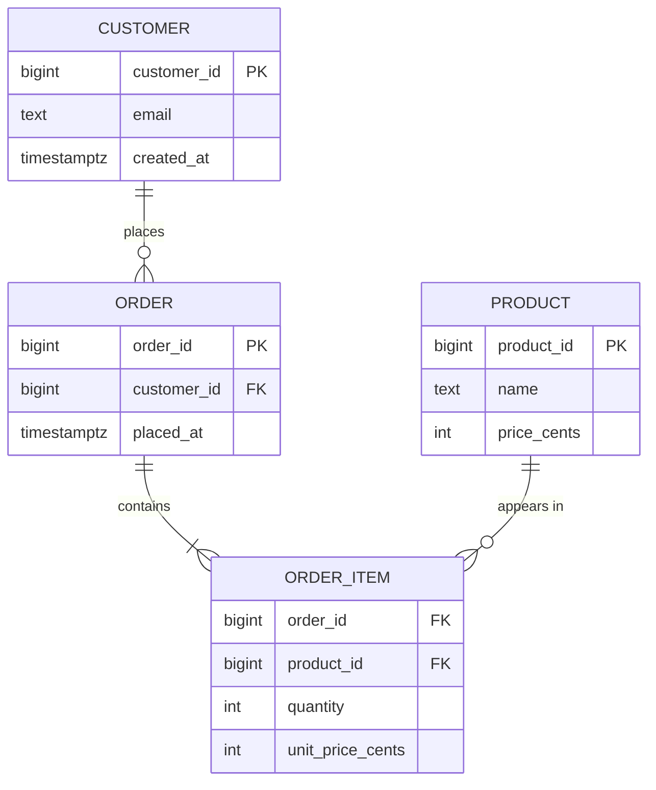

# Day 2 — Data Modeling & Keys

> Series: Database Engineering
> **Goal:** Turn messy business requirements into a precise, queryable schema. Learn ER modeling, cardinality, and every kind of key — including when a surrogate key beats a natural one and when it doesn't.

## Table of Contents
1. [What is data modeling?](#1-what-is-data-modeling)
2. [Entities, attributes, relationships](#2-entities-attributes-relationships)
3. [Cardinality (1:1, 1:N, M:N)](#3-cardinality-11-1n-mn)
4. [Keys: primary, foreign, composite](#4-keys-primary-foreign-composite)
5. [Surrogate vs natural keys](#5-surrogate-vs-natural-keys)
6. [Referential integrity & cascade rules](#6-referential-integrity--cascade-rules)
7. [Lab (hands-on)](#7-lab-hands-on)
8. [Self-Check](#8-self-check)
9. [Tomorrow](#9-tomorrow)

---

## 1. What is data modeling?

**In plain words:** Data modeling is drawing the blueprint of a house before pouring concrete. You decide what rooms (tables) exist, what's in them (columns), and which doors connect them (relationships) — *before* you build, because moving a load-bearing wall later is expensive.

- **Why:** The schema is the hardest thing to change once real data and code depend on it. A good model prevents whole categories of bugs; a bad one leaks into every query for years.
- **What:** A structured description of entities, their attributes, and how they relate — expressed as an ER (Entity-Relationship) model, then realized as tables.
- **When:** At the start of any feature that stores durable data, and again whenever the domain shifts meaningfully.
- **How:** Three levels — **conceptual** (boxes and lines, no types), **logical** (tables, columns, keys, no engine specifics), **physical** (actual Postgres DDL with types, indexes, storage).
- **Where:** Every product: the domain model of orders/users/payments is the company's spine.


*Model top-down: agree on meaning first, commit to types last.*

> 🤔 **"Modeling feels like ceremony — can't I just add columns as I go?"**
> You can, and for a spike, do. But 'add columns as you go' with no model is how you end up with a `users` table holding order data, three columns all named some variant of `status`, and nobody sure which is authoritative. Twenty minutes of ER modeling saves months of migration pain. The model is the cheap artifact; the data is the expensive one.

---

## 2. Entities, attributes, relationships

**In plain words:** Entities are the nouns of your domain (Customer, Order, Product). Attributes are the adjectives (email, total, name). Relationships are the verbs (a Customer *places* an Order).

- **Why:** Naming the nouns precisely is 80% of a good schema. Confused entities (is a "cart" an order?) create confused tables.
- **What:** Entity → becomes a table. Attribute → becomes a column. Relationship → becomes a foreign key or a join table.
- **When:** First pass of any model — list the nouns, then the verbs between them.
- **How:** In Postgres, `erDiagram` in Mermaid is a great living document.
- **Where:** The e-commerce domain below is the running example all course.


*An e-commerce model: customers place orders, orders contain items, items reference products.*

Note the crow's-foot notation: `||` = exactly one, `o{` = zero-or-many, `|{` = one-or-many. Reading relationships correctly is the whole game.

---

## 3. Cardinality (1:1, 1:N, M:N)

**In plain words:** Cardinality answers "how many of *these* connect to how many of *those*?" One person has one passport (1:1). One person places many orders (1:N). Many students take many courses (M:N).

- **Why:** Cardinality dictates *where the foreign key lives* and whether you need a junction table.
- **What / How:**

| Cardinality | Meaning | Physical realization |
|---|---|---|
| 1:1 | One row here ↔ one row there | FK + UNIQUE on the FK, or merge into one table |
| 1:N | One parent, many children | FK on the *child* pointing to parent |
| M:N | Many ↔ many | A **junction table** with FKs to both sides |

- **When:** Decide cardinality for every relationship before writing DDL.
- **Where:** M:N is everywhere — orders↔products, users↔roles, tags↔posts.

```sql
-- 1:N — the FK lives on the "many" side (orders)
CREATE TABLE orders (
  order_id    BIGINT GENERATED ALWAYS AS IDENTITY PRIMARY KEY,
  customer_id BIGINT NOT NULL REFERENCES customers(customer_id)
);

-- M:N — a junction table resolves many-to-many into two 1:N relationships
CREATE TABLE order_items (
  order_id   BIGINT NOT NULL REFERENCES orders(order_id),
  product_id BIGINT NOT NULL REFERENCES products(product_id),
  quantity   INTEGER NOT NULL CHECK (quantity > 0),
  PRIMARY KEY (order_id, product_id)   -- composite PK: a product appears once per order
);
```

> 🤔 **"Do I really need a junction table? Can't I just store a list of product IDs in a column?"**
> Postgres *lets* you (`bigint[]` or JSONB), and it feels convenient. But then you can't cheaply enforce that each product exists (no FK into an array element), can't index/join naturally for "which orders contain product X," and can't attach per-line data like quantity and price. The junction table is the relational answer; arrays are a tempting trap for M:N with attributes.

✅ **Good scenario:** `order_items` as a junction table lets you answer "top-selling products this week" with a clean `JOIN ... GROUP BY`, and a FK guarantees you never sell a deleted product.

❌ **Bad scenario:** Product IDs jammed into an array on `orders`. A product gets deleted; the array still references it; a report crashes on a missing join; nobody can write "revenue per product" without unnesting gymnastics.

**When NOT to (avoid junction table):** A genuine 1:N (an order's shipping address) does not need a junction table — just an FK. Only true M:N warrants one.

---

## 4. Keys: primary, foreign, composite

**In plain words:** A key is a promise about uniqueness. The **primary key** says "this column(s) uniquely names a row." A **foreign key** says "this column points at a valid primary key elsewhere." A **composite key** uses more than one column together.

- **Why:** Keys are how the relational model stays honest. No keys = duplicate rows, orphaned references, silent corruption.
- **What:**
  - **Primary key (PK):** unique + not null; one per table; usually backs an index automatically.
  - **Foreign key (FK):** enforces that a referenced row exists (referential integrity).
  - **Composite key:** a PK or unique constraint spanning multiple columns.
  - **Candidate key:** any column set that *could* be the PK (e.g., email). One becomes PK; others get `UNIQUE`.
- **When:** Every table gets a PK — no exceptions. FKs wherever a real relationship exists.
- **How / Where:** below.

```sql
CREATE TABLE users (
  user_id  BIGINT GENERATED ALWAYS AS IDENTITY PRIMARY KEY,  -- surrogate PK
  email    TEXT NOT NULL UNIQUE,        -- candidate (natural) key kept as UNIQUE
  username TEXT NOT NULL UNIQUE
);

-- Composite PK: valid only if the pair is unique AND you never need to reference one row by a single value
CREATE TABLE enrollments (
  student_id BIGINT NOT NULL REFERENCES students(student_id),
  course_id  BIGINT NOT NULL REFERENCES courses(course_id),
  enrolled_at TIMESTAMPTZ NOT NULL DEFAULT now(),
  PRIMARY KEY (student_id, course_id)   -- one enrollment per student per course
);
```

| Key type | Uniqueness scope | Nullable? | Typical use |
|---|---|---|---|
| Primary | Whole table, single/multi col | No | Row identity |
| Unique | Whole table | Yes (one NULL in PG per col group nuance) | Alternate identity (email) |
| Foreign | References another PK | Yes (optional relationship) | Integrity between tables |
| Composite | Multiple columns together | Depends | Junction tables, natural composite identity |

> **MySQL note:** In InnoDB the PK doubles as the *clustered index* — rows are physically stored in PK order, and secondary indexes store the PK as the row pointer. So a wide/random PK (like a UUID) is genuinely costly in MySQL. Postgres heap tables are **not** clustered by PK (Day 6), so the PK choice has a different physical footprint. This is a real cross-engine gotcha.

---

## 5. Surrogate vs natural keys

**In plain words:** A **natural key** is data that already identifies the thing (email, ISBN, SSN). A **surrogate key** is a meaningless ID you invent (`user_id BIGINT`) purely to name the row. The question: name rows by their real-world identity, or by an arbitrary counter?

- **Why:** This is one of the most consequential and most-argued modeling decisions.
- **What / trade-offs:**

| | Natural key | Surrogate key |
|---|---|---|
| Meaning | Carries business meaning | Meaningless integer/UUID |
| Stability | Can change (email edits, company merges) | Never changes |
| Size | Often wide (long strings) | Compact (8-byte int) |
| FK width | Wide, repeated everywhere | Narrow, cheap joins |
| Exposes data | May leak PII in URLs/FKs | Safe to expose (bigint) or opaque (UUID) |
| Uniqueness guaranteed by | The real world (sometimes wrongly) | The DB, always |
| Join/index cost | Higher (bigger keys) | Lower |

- **When surrogate wins:** Almost always for internal PKs in OLTP — narrow, stable, no PII leak. Keep the natural key as a `UNIQUE` constraint so you still enforce real-world uniqueness.
- **When natural wins:** Small, truly-immutable reference data (currency codes `USD`/`EUR`, ISO country codes) where the code *is* the identity and never changes.
- **How:** `BIGINT GENERATED ALWAYS AS IDENTITY` (auto-increment) or `UUID` for distributed/unguessable IDs.
- **Where:** Every table's PK decision.

```sql
-- Recommended default: surrogate PK + natural UNIQUE constraint (best of both)
CREATE TABLE customers (
  customer_id BIGINT GENERATED ALWAYS AS IDENTITY PRIMARY KEY,  -- surrogate
  email       TEXT NOT NULL UNIQUE                              -- natural, still enforced
);

-- UUID surrogate: good when IDs are generated across services or must be unguessable
CREATE TABLE api_tokens (
  token_id UUID PRIMARY KEY DEFAULT gen_random_uuid(),  -- needs pgcrypto/pg 13+
  user_id  BIGINT NOT NULL REFERENCES customers(customer_id)
);
```

> 🤔 **"Should I use UUID or BIGINT for primary keys? The internet fights about this."**
> Rule of thumb: **BIGINT identity** for single-DB OLTP — smaller, faster joins, index-friendly, sequential inserts keep B-tree pages hot. **UUID (v7 preferably)** when IDs are minted by many services, must not be guessable, or need to be merged across shards. The classic UUID pitfall is *random* UUIDv4 as a clustered/heavy-insert key: it scatters inserts across index pages, causing page splits and bloat. UUIDv7 is time-ordered and largely fixes that. Verify UUIDv7 support in your Postgres/extension version.

✅ **Good scenario (surrogate saves you):** Marketing wants to let users change their email. Because `customer_id` is the PK and email is only a `UNIQUE` column, the change is a one-column update — no cascading FK rewrites across ten tables.

❌ **Bad scenario (natural key backfires):** A team used `email` as the PK of `users` and as the FK everywhere. Legal mandates email changes on request. Now every change rewrites millions of FK rows across the schema, holding locks, and any cached URL with the old email 404s.

**When NOT to (don't over-surrogate):** A pure junction table (`order_items`) usually needs *no* separate surrogate — the composite `(order_id, product_id)` is the natural, correct PK. Adding a meaningless `order_item_id` there is often noise.

---

## 6. Referential integrity & cascade rules

**In plain words:** A foreign key is a rule the database enforces so you never point at something that isn't there. Cascade rules decide what happens to the children when a parent is deleted.

- **Why:** Orphaned rows (an order for a deleted customer) are silent corruption. FKs make them impossible.
- **What:** `ON DELETE` / `ON UPDATE` actions:

| Action | On parent delete… | Use when |
|---|---|---|
| `RESTRICT` / `NO ACTION` | Block the delete | Default safety; don't lose referenced data |
| `CASCADE` | Delete children too | Children are meaningless without parent (order_items ↔ order) |
| `SET NULL` | Null the FK | Relationship optional (order.coupon_id) |
| `SET DEFAULT` | Set FK to a default | Rare; needs a valid default row |

```sql
CREATE TABLE order_items (
  order_id   BIGINT NOT NULL REFERENCES orders(order_id) ON DELETE CASCADE,  -- die with the order
  product_id BIGINT NOT NULL REFERENCES products(product_id) ON DELETE RESTRICT, -- never lose sales history
  PRIMARY KEY (order_id, product_id)
);
```

> **Dark Side:** `ON DELETE CASCADE` is convenient and dangerous. A single `DELETE FROM customers WHERE ...` can silently vaporize millions of orders and items in one transaction — no warning. Many production shops deliberately use `RESTRICT` + explicit soft-deletes (`deleted_at` timestamp) so nothing is ever truly destroyed by accident. Know which one your table uses before you run a delete.

**When NOT to (skip FKs):** In extreme write-throughput ingestion pipelines or sharded setups where the referenced table lives on another node, FKs may be intentionally dropped and integrity enforced in the app. This is a deliberate trade-off, not a default.

---

## 7. Lab (hands-on)

**Goal:** Model a small e-commerce domain end to end, then stress the keys.

```sql
-- 1. Build the model
CREATE TABLE customers (
  customer_id BIGINT GENERATED ALWAYS AS IDENTITY PRIMARY KEY,
  email       TEXT NOT NULL UNIQUE,
  created_at  TIMESTAMPTZ NOT NULL DEFAULT now()
);

CREATE TABLE products (
  product_id BIGINT GENERATED ALWAYS AS IDENTITY PRIMARY KEY,
  sku        TEXT NOT NULL UNIQUE,          -- natural key kept as UNIQUE
  name       TEXT NOT NULL,
  price_cents INTEGER NOT NULL CHECK (price_cents >= 0)
);

CREATE TABLE orders (
  order_id    BIGINT GENERATED ALWAYS AS IDENTITY PRIMARY KEY,
  customer_id BIGINT NOT NULL REFERENCES customers(customer_id) ON DELETE RESTRICT,
  placed_at   TIMESTAMPTZ NOT NULL DEFAULT now()
);

CREATE TABLE order_items (
  order_id         BIGINT NOT NULL REFERENCES orders(order_id) ON DELETE CASCADE,
  product_id       BIGINT NOT NULL REFERENCES products(product_id) ON DELETE RESTRICT,
  quantity         INTEGER NOT NULL CHECK (quantity > 0),
  unit_price_cents INTEGER NOT NULL,          -- snapshot price at order time (deliberate!)
  PRIMARY KEY (order_id, product_id)
);
```

**Tasks:**
1. Insert a customer, two products, one order, two order_items. Confirm the composite PK rejects a duplicate `(order_id, product_id)`.
2. Try to insert an order_item for a `product_id` that doesn't exist — watch the FK reject it.
3. Try `DELETE FROM products WHERE product_id = 1;` while it's referenced — see `RESTRICT` block it. Then delete the order and watch `CASCADE` remove its items.
4. **Design question to write down:** Why does `order_items.unit_price_cents` duplicate the product's price instead of joining to `products.price_cents`? (Hint: prices change; an order must remember what the customer actually paid. This is a *deliberate denormalization* — Day 3.)
5. Draw your final model as a Mermaid `erDiagram` and mark cardinalities.

---

## 8. Self-Check
1. Name the three levels of a data model and what each commits to.
2. Where does the foreign key live in a 1:N relationship — parent or child? Why?
3. How do you physically implement an M:N relationship, and why not an array column?
4. Distinguish candidate key, primary key, and unique constraint.
5. Give two concrete reasons a surrogate key usually beats a natural key for OLTP PKs.
6. When is a natural key actually the right PK?
7. What's the classic performance pitfall of random UUIDv4 as a heavy-insert key, and what fixes it?
8. Contrast `ON DELETE CASCADE` vs `RESTRICT` and give a real risk of cascade.
9. Why might a high-throughput sharded system deliberately drop foreign keys?
10. Why does an order line item store a price snapshot instead of joining to the product's current price?

---

## 9. Tomorrow
**Day 3 — Normalization & Denormalization:** we take a messy, redundant table and march it through 1NF → 2NF → 3NF → BCNF, watching a specific *anomaly* die at each step — then deliberately denormalize one thing and justify exactly why (the price-snapshot you just met is a preview).
