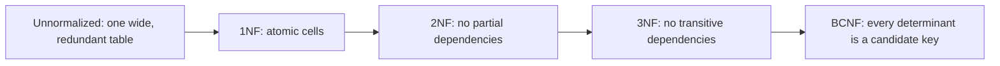

# Day 3 — Normalization & Denormalization

> Series: Database Engineering
> **Goal:** Learn *why* each normal form exists by watching a specific anomaly die at each step (1NF→2NF→3NF→BCNF), then learn to denormalize *on purpose* — a trade, not a mistake.

## Table of Contents
1. [What normalization actually is](#1-what-normalization-actually-is)
2. [The three anomalies](#2-the-three-anomalies)
3. [1NF — atomic values](#3-1nf--atomic-values)
4. [2NF — kill partial dependencies](#4-2nf--kill-partial-dependencies)
5. [3NF — kill transitive dependencies](#5-3nf--kill-transitive-dependencies)
6. [BCNF — the stricter 3NF](#6-bcnf--the-stricter-3nf)
7. [Deliberate denormalization](#7-deliberate-denormalization)
8. [Lab (hands-on)](#8-lab-hands-on)
9. [Self-Check](#9-self-check)
10. [Tomorrow](#10-tomorrow)

---

## 1. What normalization actually is

**In plain words:** Normalization means "store every fact in exactly one place." If a customer's city is written in 40 order rows, you have 40 chances to disagree with yourself. Normalization pulls that fact into one row so there's a single source of truth.

- **Why:** Redundancy causes **anomalies** — update, insert, and delete bugs where the same fact drifts out of sync. Normalization is the disciplined removal of redundancy.
- **What:** A series of increasingly strict rules (normal forms) about which columns may depend on which.
- **When:** Design-time for OLTP schemas. It's the *default*; you denormalize only with a reason.
- **How:** Identify **functional dependencies** (X determines Y) and split tables so every non-key column depends on "the key, the whole key, and nothing but the key."
- **Where:** The transactional core of every product (Day 1's OLTP world). Warehouses (OLAP) often go the other way (star schemas).

> **Cross-reference:** System Design treats "normalize vs denormalize" as a scaling lever. Here you'll learn the *rules* behind that lever, so your denormalization is a calculated trade, not superstition.


*Each step removes one more class of redundancy — and one more anomaly.*

---

## 2. The three anomalies

**In plain words:** These are the three ways redundancy bites you.

| Anomaly | What happens | Example |
|---|---|---|
| **Update** | Change a fact in one row, forget the other 39 → contradiction | Customer moves city; 39 old order rows still say the old city |
| **Insert** | Can't record a fact because unrelated data is missing | Can't add a new product because the table demands an order too |
| **Delete** | Delete a row and accidentally lose an unrelated fact | Delete the last order for a customer and lose the customer's address entirely |

Every normal form below exists to kill one or more of these.

---

## 3. 1NF — atomic values

**In plain words:** No repeating groups, no lists jammed into one cell. Each cell holds one value; each row is uniquely identifiable.

- **Why:** A cell like `"widget, gadget, gizmo"` can't be queried, joined, or constrained. It's a mini-CSV hiding in your table.
- **What:** 1NF = atomic column values + a primary key + no repeating column groups (`product1, product2, product3`).

**Violating table (not 1NF):**

| order_id | customer | products |
|---|---|---|
| 1 | Alice | "widget, gadget" |
| 2 | Bob | "gizmo" |

```sql
-- 1NF fix: one row per (order, product) — atomic, queryable, constrainable
CREATE TABLE order_items (
  order_id   BIGINT NOT NULL,
  product    TEXT   NOT NULL,
  PRIMARY KEY (order_id, product)
);
INSERT INTO order_items VALUES (1,'widget'), (1,'gadget'), (2,'gizmo');
```

> 🤔 **"Postgres has arrays and JSONB — doesn't that make 1NF obsolete?"**
> No. Arrays/JSONB are legitimate for genuinely schemaless or bag-of-attributes data (event payloads, flexible metadata). But using them to dodge modeling a real relationship (order↔product) loses foreign keys, per-item columns, clean joins, and cheap aggregation. 1NF isn't a religious rule — it's "don't hide a relationship inside a cell you'll later regret."

**When NOT to (arrays are fine):** Truly atomic-as-a-unit data — an RGB color `[255,0,0]`, tags where you never join on individual tags, or a JSONB blob of third-party API response you store verbatim.

---

## 4. 2NF — kill partial dependencies

**In plain words:** If your key is made of two columns, every other column must depend on *both*, not just one half.

- **Why:** A **partial dependency** (a column depends on only part of a composite key) forces you to repeat that column across many rows → update anomaly.
- **What:** 2NF = in 1NF **and** no non-key column depends on only part of a composite primary key.

**Violating table (1NF but not 2NF):** PK is `(order_id, product_id)`, but `product_name` depends only on `product_id`.

| order_id | product_id | product_name | quantity |
|---|---|---|---|
| 1 | 10 | "Widget" | 2 |
| 2 | 10 | "Widget" | 1 |  ← "Widget" repeated; rename it once and rows disagree |

```sql
-- 2NF fix: product facts live with the product, not the line item
CREATE TABLE products (
  product_id   BIGINT PRIMARY KEY,
  product_name TEXT NOT NULL          -- depends on product_id alone
);
CREATE TABLE order_items (
  order_id   BIGINT NOT NULL,
  product_id BIGINT NOT NULL REFERENCES products(product_id),
  quantity   INTEGER NOT NULL,        -- depends on the WHOLE key (order + product)
  PRIMARY KEY (order_id, product_id)
);
```

Now `product_name` exists once. Rename "Widget" → "Widget Pro" in one row.

**When NOT to (already single-column PK):** 2NF violations only arise with *composite* keys. A table with a single-column surrogate PK is automatically in 2NF.

---

## 5. 3NF — kill transitive dependencies

**In plain words:** No non-key column may depend on *another non-key column*. Non-key columns should depend only on the key, not on each other.

- **Why:** A **transitive dependency** (key → A → B) means B is really a fact about A, duplicated in every row that shares A.
- **What:** 3NF = in 2NF **and** no non-key column transitively depends on the key via another non-key column.

**Violating table (2NF but not 3NF):** `customer_id` → `zip` → `city`. City depends on zip, not directly on the order.

| order_id | customer_id | zip | city |
|---|---|---|---|
| 1 | 5 | 94016 | "San Francisco" |
| 2 | 5 | 94016 | "San Francisco" | ← city repeated per order; zip's city changes → many rows to fix |

```sql
-- 3NF fix: the zip→city fact lives once, in its own table
CREATE TABLE zip_codes (
  zip  TEXT PRIMARY KEY,
  city TEXT NOT NULL          -- city depends on zip
);
CREATE TABLE customers (
  customer_id BIGINT PRIMARY KEY,
  zip         TEXT REFERENCES zip_codes(zip)
);
CREATE TABLE orders (
  order_id    BIGINT PRIMARY KEY,
  customer_id BIGINT NOT NULL REFERENCES customers(customer_id)
);
-- city is now derived by JOIN, stored exactly once
```

✅ **Good scenario (3NF saves you):** A postal reorg reassigns a zip to a new city name. You update one row in `zip_codes`; every order and customer reflects it instantly. No drift.

❌ **Bad scenario (redundancy without 3NF):** City stored on every order. The reorg means an `UPDATE` across 12M order rows, holding locks for minutes, and any row your script misses now lies about the city forever.

**When NOT to:** OLAP star schemas *intentionally* violate 3NF (dimension tables denormalize hierarchies) because read speed and simplicity beat update-anomaly risk on batch-loaded, mostly-immutable data.

---

## 6. BCNF — the stricter 3NF

**In plain words:** BCNF (Boyce-Codd Normal Form) says: *every* determinant (anything on the left of a functional dependency) must be a candidate key. It closes an edge case 3NF leaves open when a table has overlapping candidate keys.

- **Why:** 3NF can still allow an anomaly when a non-prime attribute determines part of a key.
- **What:** For every dependency X → Y, X must be a superkey. Stricter than 3NF.
- **When:** Rare in practice but a favorite interview topic; matters with multiple overlapping candidate keys.

**Classic example:** A table `(student, course, instructor)` where:
- Each course has exactly one instructor: `instructor → course`
- A student+course determines the instructor: `(student, course) → instructor`

The candidate key is `(student, course)`. But `instructor → course` has a determinant (`instructor`) that is *not* a candidate key → violates BCNF (though it can satisfy 3NF).

```sql
-- BCNF decomposition: split so every determinant is a key
CREATE TABLE course_instructor (
  instructor TEXT PRIMARY KEY,   -- instructor determines course
  course     TEXT NOT NULL
);
CREATE TABLE student_instructor (
  student    TEXT NOT NULL,
  instructor TEXT NOT NULL REFERENCES course_instructor(instructor),
  PRIMARY KEY (student, instructor)
);
```

> 🤔 **"Do product companies really go to BCNF, or is it academic?"**
> In day-to-day OLTP, teams reliably reach 3NF and stop — 3NF removes almost all practical anomalies. BCNF matters when you hit a schema with overlapping candidate keys (scheduling, assignments, some reference data), and it matters in interviews. Know the definition and the one canonical example; apply it when the FDs demand it, not reflexively.

**When NOT to:** If reaching BCNF forces you to split tables such that you can no longer enforce a needed dependency without a join, teams sometimes stay at 3NF deliberately. It's a known trade-off.

---

## 7. Deliberate denormalization

**In plain words:** Denormalization is copying a fact on purpose because reading it together is worth the cost of keeping copies in sync. It's a *speed-for-consistency* trade, made consciously — not laziness.

- **Why:** Fully normalized schemas can require many joins for hot read paths. At scale, a join across five tables on every product-page load may be too slow.
- **What:** Storing redundant/derived data (a cached count, a price snapshot, a flattened field) to avoid joins or recomputation.
- **When:** Read-heavy hot paths, expensive aggregates, immutable historical facts, reporting tables.
- **How:** Triggers, materialized views, application writes, or scheduled jobs keep the copy fresh.
- **Where:** Order price snapshots, `posts.comment_count`, denormalized search/reporting tables, OLAP star schemas.

| | Normalized | Denormalized |
|---|---|---|
| Redundancy | Minimal | Intentional copies |
| Reads | More joins | Fewer joins, faster |
| Writes | Simple, one place | Must update copies (risk of drift) |
| Consistency | Enforced by structure | Enforced by you (triggers/jobs) |
| Best for | OLTP correctness | Hot reads, reporting, OLAP |

```sql
-- Legit denormalization 1: price snapshot (an immutable historical fact)
-- An order must remember what the customer PAID, even after the product's price changes.
ALTER TABLE order_items ADD COLUMN unit_price_cents INTEGER NOT NULL;

-- Legit denormalization 2: a maintained counter to avoid COUNT(*) on every page load
ALTER TABLE posts ADD COLUMN comment_count INTEGER NOT NULL DEFAULT 0;

CREATE OR REPLACE FUNCTION bump_comment_count() RETURNS trigger AS $$
BEGIN
  UPDATE posts SET comment_count = comment_count + 1 WHERE id = NEW.post_id;
  RETURN NEW;
END; $$ LANGUAGE plpgsql;

CREATE TRIGGER trg_bump
AFTER INSERT ON comments
FOR EACH ROW EXECUTE FUNCTION bump_comment_count();  -- keeps the copy in sync
```

✅ **Good scenario (denorm saves you):** A product page did five joins and ran 90ms under load. A maintained `comment_count` and a denormalized reporting table cut it to 6ms. Users notice; the counter is kept honest by a trigger.

❌ **Bad scenario (denorm misused):** A team copied `customer_email` into every order for "convenience," with no sync mechanism. Emails changed; orders now show stale emails; support emails bounce. Denormalization without a sync strategy is just an update anomaly you signed up for.

> **Dark Side:** Every denormalized copy is a promise to keep it in sync forever. Triggers add write cost and can deadlock; materialized views go stale until refreshed; app-side writes get forgotten in the one code path nobody tested. Denormalize the fewest things possible, and always document *how* each copy stays fresh.

**When NOT to (don't denormalize):** Small tables, low read volume, or any fact that changes often and must be correct everywhere. Normalize first; denormalize only when a *measured* read path demands it.

---

## 8. Lab (hands-on)

**Goal:** Normalize a deliberately messy table, then justify one denormalization.

```sql
-- 1. The mess: everything in one wide table (violates 1NF, 2NF, 3NF)
CREATE TABLE bad_orders (
  order_id     INT,
  customer     TEXT,
  cust_zip     TEXT,
  cust_city    TEXT,          -- transitive: zip -> city
  products     TEXT,          -- non-atomic list: "widget:2, gadget:1"
  order_total  INT
);
INSERT INTO bad_orders VALUES
  (1,'Alice','94016','San Francisco','widget:2, gadget:1', 300),
  (2,'Alice','94016','San Francisco','gizmo:1',            100);
```

**Tasks:**
1. **1NF:** Split `products` into a real `order_items(order_id, product, qty)` table.
2. **2NF/3NF:** Pull `customer` and address into `customers`, pull `zip→city` into `zip_codes`. Draw the final ER diagram.
3. Demonstrate the update anomaly on `bad_orders`: change Alice's city in row 1 only, then show the table now contradicts itself. Show your normalized version has one city row to update.
4. **Justify one denormalization:** Add `order_total` back as a stored column and explain why (it's a snapshot of computed total at order time — recomputing from items is fine, but a snapshot protects against later price/qty edits and speeds reporting). Write 3 sentences defending it, and state *how* you'd keep it fresh.
5. Bonus: build a `mv_order_totals` materialized view and note that it's stale until `REFRESH MATERIALIZED VIEW`.

---

## 9. Self-Check
1. Name the three anomalies and give a one-line example of each.
2. What exactly does 1NF forbid, and when is a JSONB/array column still acceptable?
3. Partial dependencies (2NF) can only occur with what kind of primary key?
4. Define a transitive dependency and give the zip→city example.
5. How is BCNF stricter than 3NF? Give the student/course/instructor case.
6. Why do OLAP star schemas deliberately violate 3NF?
7. Give two legitimate denormalizations and the sync mechanism each needs.
8. What is the hidden lifelong cost of every denormalized copy?
9. Why store a price *snapshot* on an order line instead of joining to current price?
10. Default posture: normalize first or denormalize first? Why?

---

## 10. Tomorrow
**Day 4 — SQL Core:** with a clean model in hand, we drill the language that queries it — DDL vs DML, every join type (with a diagram), filtering, aggregates, and `GROUP BY`/`HAVING`. Twenty-query lab to build muscle memory.
