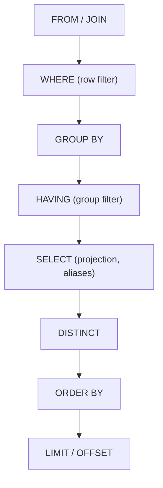
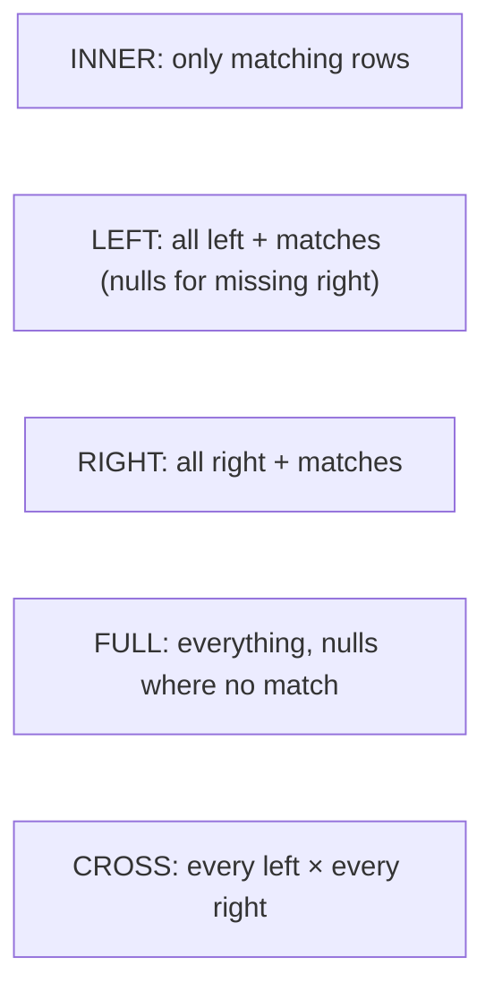

# Day 4 — SQL Core

> Series: Database Engineering
> **Goal:** Build fluent, correct SQL muscle memory — DDL vs DML, every join type, filtering, aggregation, and `GROUP BY`/`HAVING` — so the language never gets in the way of the engineering.

## Table of Contents
1. [DDL vs DML vs the rest](#1-ddl-vs-dml-vs-the-rest)
2. [SELECT and the logical order of operations](#2-select-and-the-logical-order-of-operations)
3. [Filtering: WHERE, NULLs, and the traps](#3-filtering-where-nulls-and-the-traps)
4. [Joins — all of them](#4-joins--all-of-them)
5. [Aggregates, GROUP BY, HAVING](#5-aggregates-group-by-having)
6. [DML: INSERT, UPDATE, DELETE, UPSERT](#6-dml-insert-update-delete-upsert)
7. [Lab (20-query drill)](#7-lab-20-query-drill)
8. [Self-Check](#8-self-check)
9. [Tomorrow](#9-tomorrow)

---

## 1. DDL vs DML vs the rest

**In plain words:** DDL is the language for *shaping* the database (build the tables); DML is for *moving data* in and out (rows in the tables). Different jobs, different risk profiles.

- **Why:** DDL changes structure and often takes heavy locks; DML changes data and participates in transactions. Confusing them is how migrations lock production.
- **What:**

| Category | Full name | Commands | Note |
|---|---|---|---|
| DDL | Data Definition | `CREATE`, `ALTER`, `DROP`, `TRUNCATE` | Postgres DDL is transactional (!) |
| DML | Data Manipulation | `INSERT`, `UPDATE`, `DELETE`, `SELECT`* | Wrap in transactions |
| DCL | Data Control | `GRANT`, `REVOKE` | Permissions |
| TCL | Transaction Control | `BEGIN`, `COMMIT`, `ROLLBACK`, `SAVEPOINT` | ACID boundaries |

- **When / How / Where:** DDL at migration time (ideally in a transaction on Postgres); DML constantly at runtime.

> **MySQL note:** A huge cross-engine gotcha — **Postgres DDL is transactional**: you can `BEGIN; ALTER TABLE ...; ROLLBACK;` and it truly undoes. MySQL (even InnoDB) historically performs an *implicit commit* around most DDL, so a failed migration can leave you half-applied. This alone changes how you write migrations per engine.

> 🤔 **"Isn't `TRUNCATE` just a faster `DELETE`?"**
> Mostly, but not exactly. `TRUNCATE` is DDL-ish: it drops all rows without scanning them, resets the table's storage, is far faster on big tables, and (in Postgres) can be transactional and can cascade. But it takes an `ACCESS EXCLUSIVE` lock, doesn't fire per-row triggers, and doesn't return a row count of what it removed. For "empty this table fast" it's great; for "delete rows matching a condition" you still need `DELETE`.

---

## 2. SELECT and the logical order of operations

**In plain words:** You *write* SELECT in one order, but the engine *evaluates* it in another. Knowing the real order explains a dozen "why can't I use my alias in WHERE?" confusions.

- **Why:** It explains why `WHERE` can't see aggregates, why `HAVING` can, and why a `SELECT` alias isn't visible to `WHERE`.
- **What — logical evaluation order:**


*The engine builds rows (FROM/WHERE), groups them, filters groups (HAVING), then projects and sorts.*

Because `SELECT` runs *after* `WHERE`, a column alias defined in `SELECT` is invisible to `WHERE`. Because `WHERE` runs *before* `GROUP BY`, you can't filter on `SUM(...)` in `WHERE` — that's `HAVING`'s job.

```sql
-- This FAILS: alias 'big' not visible in WHERE (WHERE runs before SELECT)
-- SELECT total_cents AS big FROM orders WHERE big > 1000;

-- Correct: repeat the expression, or use a subquery/CTE (Day 5)
SELECT total_cents AS big FROM orders WHERE total_cents > 1000;
```

---

## 3. Filtering: WHERE, NULLs, and the traps

**In plain words:** `WHERE` keeps rows that make a condition *true*. The catch: `NULL` means "unknown," and comparisons with unknown are neither true nor false — they're unknown, which `WHERE` treats as "drop it."

- **Why:** Three-valued logic (TRUE/FALSE/UNKNOWN) is the #1 source of silent SQL bugs.
- **What / How:**

```sql
SELECT * FROM orders WHERE total_cents > 5000;         -- basic
SELECT * FROM orders WHERE placed_at >= '2026-01-01';  -- range
SELECT * FROM customers WHERE email LIKE '%@x.com';    -- pattern
SELECT * FROM orders WHERE customer_id IN (1,2,3);      -- set membership
SELECT * FROM orders WHERE total_cents BETWEEN 100 AND 500;  -- inclusive both ends

-- NULL traps:
SELECT * FROM customers WHERE phone = NULL;    -- WRONG: never matches anything
SELECT * FROM customers WHERE phone IS NULL;   -- RIGHT
SELECT * FROM orders WHERE coupon_id NOT IN (SELECT id FROM coupons); -- BUG if any id is NULL
```

> 🤔 **"Why did `NOT IN` with a subquery return zero rows when I know rows match?"**
> Because if the subquery yields even one `NULL`, `NOT IN` evaluates to `UNKNOWN` for every row and filters them all out. This is a brutal, silent production bug. Use `NOT EXISTS` instead — it's NULL-safe and usually plans better. Reach for `NOT EXISTS` over `NOT IN` as a default habit.

| Comparison | With a real value | With NULL |
|---|---|---|
| `x = 5` | TRUE/FALSE | UNKNOWN (row dropped) |
| `x IS NULL` | n/a | TRUE when null |
| `x <> 5` | TRUE/FALSE | UNKNOWN (row dropped!) |
| `x IN (...)` incl NULL | may match | UNKNOWN pollution |

✅ **Good scenario:** Using `IS DISTINCT FROM` when comparing nullable columns in a dedup job — it treats NULL as a comparable value, so `NULL IS DISTINCT FROM 5` is TRUE, exactly what you meant.

❌ **Bad scenario:** A billing report used `WHERE status <> 'cancelled'`. Rows with `status IS NULL` (never set) silently vanished from the report, understating revenue for a quarter. Nobody noticed until audit.

**When NOT to (over-defend):** On a `NOT NULL` column, NULL logic can't bite — don't clutter every predicate with `COALESCE`. Defend where nullability is real.

---

## 4. Joins — all of them

**In plain words:** A join stitches rows from two tables where a condition matches. The *type* decides what happens to rows that have no match.


*The difference between join types is purely: what do you do with the rows that don't match?*

- **Why:** Choosing the wrong join is how you either drop real rows (INNER when you needed LEFT) or explode row counts (accidental CROSS).
- **What / How / Where:**

```sql
-- INNER: customers who have at least one order
SELECT c.email, o.order_id
FROM customers c
JOIN orders o ON o.customer_id = c.customer_id;

-- LEFT: ALL customers, with orders if any (null order_id = no orders)
SELECT c.email, o.order_id
FROM customers c
LEFT JOIN orders o ON o.customer_id = c.customer_id;

-- Find customers with NO orders (the classic anti-join)
SELECT c.email
FROM customers c
LEFT JOIN orders o ON o.customer_id = c.customer_id
WHERE o.order_id IS NULL;         -- "no matching right row"

-- SELF JOIN: employees and their managers (same table twice)
SELECT e.name AS emp, m.name AS manager
FROM employees e
LEFT JOIN employees m ON m.emp_id = e.manager_id;

-- CROSS JOIN: every size × every color (deliberate combinatorics)
SELECT s.size, c.color FROM sizes s CROSS JOIN colors c;
```

| Join | Keeps unmatched left? | Keeps unmatched right? | Typical use |
|---|---|---|---|
| INNER | No | No | Only related rows |
| LEFT (OUTER) | Yes | No | "All A, plus B if exists" |
| RIGHT (OUTER) | No | Yes | Same, mirrored (rare; rewrite as LEFT) |
| FULL (OUTER) | Yes | Yes | Reconciling two sets |
| CROSS | — (Cartesian) | — | Generate combinations |

> 🤔 **"My LEFT JOIN turned into an INNER JOIN and I don't know why."**
> Almost always a filter on the right table in `WHERE`. `WHERE o.status = 'paid'` after a `LEFT JOIN orders o` discards the NULL rows from unmatched customers — because `NULL = 'paid'` is UNKNOWN — silently converting your outer join to an inner one. Put right-table conditions in the `ON` clause instead: `LEFT JOIN orders o ON o.customer_id = c.customer_id AND o.status='paid'`.

✅ **Good scenario:** A "customers who never ordered" re-engagement campaign uses the LEFT JOIN + `IS NULL` anti-join and correctly finds the silent 30% of signups with zero orders.

❌ **Bad scenario:** A join forgot its `ON` condition (or joined on a non-unique column). Two 100k-row tables produced a 10-billion-row Cartesian product that filled disk and took the DB down. Always confirm join keys are the intended cardinality.

**When NOT to (avoid the join):** If you only need existence ("does this customer have any order?"), `EXISTS` is clearer and often faster than a join + `DISTINCT`.

---

## 5. Aggregates, GROUP BY, HAVING

**In plain words:** Aggregates collapse many rows into one number (count, sum, avg). `GROUP BY` says "give me one number *per group*." `HAVING` filters those groups after they're computed.

- **Why:** Almost every business question is an aggregate: revenue per region, orders per customer, error rate per endpoint.
- **What / How:**

```sql
-- One number for the whole table
SELECT count(*), sum(total_cents), avg(total_cents), max(total_cents) FROM orders;

-- One row per customer (grouping)
SELECT customer_id, count(*) AS orders, sum(total_cents) AS spend
FROM orders
GROUP BY customer_id;

-- Filter GROUPS (not rows) with HAVING — runs after aggregation
SELECT customer_id, sum(total_cents) AS spend
FROM orders
GROUP BY customer_id
HAVING sum(total_cents) > 100000        -- only big spenders; WHERE cannot do this
ORDER BY spend DESC;

-- WHERE (rows) + HAVING (groups) together
SELECT customer_id, count(*) AS paid_orders
FROM orders
WHERE status = 'paid'                    -- filter ROWS first
GROUP BY customer_id
HAVING count(*) >= 3;                     -- then filter GROUPS
```

**Key rule:** every column in `SELECT` must be either in `GROUP BY` or wrapped in an aggregate. Postgres enforces this strictly (MySQL historically did not — see below).

| Clause | Filters | Runs | Can see aggregates? |
|---|---|---|---|
| `WHERE` | Individual rows | Before grouping | No |
| `HAVING` | Groups | After grouping | Yes |

> **MySQL note:** Older MySQL (`ONLY_FULL_GROUP_BY` off) let you `SELECT` non-aggregated columns not in `GROUP BY`, returning an arbitrary value from the group — a silent-wrong-answer trap. Postgres rejects it. Modern MySQL enables `ONLY_FULL_GROUP_BY` by default; verify the mode.

> 🤔 **"Why is `count(*)` different from `count(column)`?"**
> `count(*)` counts rows. `count(col)` counts rows where `col IS NOT NULL`. So `count(coupon_id)` on 1000 orders where 300 have no coupon returns 700, not 1000. `count(DISTINCT col)` counts distinct non-null values. Pick deliberately — the difference is a common reporting bug.

✅ **Good scenario:** A cohort report groups signups by month and filters (`HAVING count(*) > 50`) to show only meaningful cohorts — clean, correct, one query.

❌ **Bad scenario:** An analyst put an aggregate condition in `WHERE` (`WHERE sum(total) > 100`), got a "aggregate not allowed in WHERE" error, then "fixed" it by summing in the app across all rows — pulling 20M rows over the wire. `HAVING` was the answer.

**When NOT to (don't aggregate):** If you need per-row detail *alongside* a group total (running totals, rank within group), `GROUP BY` collapses too much — that's what **window functions** do (Day 5).

---

## 6. DML: INSERT, UPDATE, DELETE, UPSERT

**In plain words:** The verbs that change data. Always know how many rows a statement will touch *before* you run it in production.

```sql
INSERT INTO customers (email) VALUES ('new@x.com');           -- one row
INSERT INTO customers (email) VALUES ('a2@x.com'), ('b2@x.com'); -- multi-row

UPDATE orders SET status = 'shipped' WHERE order_id = 42;      -- always have a WHERE
DELETE FROM orders WHERE placed_at < '2020-01-01';            -- know the row count first

-- UPSERT: insert, or update if the unique key already exists (Postgres)
INSERT INTO inventory (sku, qty) VALUES ('W-1', 10)
ON CONFLICT (sku) DO UPDATE SET qty = inventory.qty + EXCLUDED.qty;

-- RETURNING: get back what changed (Postgres superpower, no MySQL equivalent historically)
UPDATE orders SET status = 'paid' WHERE order_id = 42 RETURNING order_id, status;
```

> **Dark Side:** `UPDATE`/`DELETE` without a `WHERE` hits *every row*. A single missing `WHERE` has wiped whole production tables. Habits that save careers: run the `SELECT` version of your `WHERE` first, wrap risky DML in `BEGIN; ... ` and inspect the row count before `COMMIT`, and never paste a bare `DELETE FROM t;` into a prod console.

> **MySQL note:** `RETURNING` is a Postgres feature (MySQL added limited support only recently — verify your version). Postgres also supports `ON CONFLICT` for upserts; MySQL uses `INSERT ... ON DUPLICATE KEY UPDATE`.

**When NOT to (skip a transaction):** A single autocommitted insert of one row doesn't need an explicit `BEGIN`. Multi-statement changes that must be atomic always do.

---

## 7. Lab (20-query drill)

**Goal:** Build fluency. Use the `shop` schema from Days 1-2 (customers, products, orders, order_items). Seed a few hundred rows first with `generate_series`.

Write and run each; check the plan on a few with `EXPLAIN`.

```sql
-- Warm up (DDL/DML)
-- 1. Add a `status TEXT NOT NULL DEFAULT 'pending'` column to orders.
-- 2. Insert 3 customers in one statement.
-- 3. Bulk-insert 500 orders with random customers and totals via generate_series.
-- 4. Update all 'pending' orders older than 30 days to 'expired' (SELECT the WHERE first!).
-- 5. Delete order_items with quantity = 0; use RETURNING to see what went.

-- Filtering
-- 6. Orders with total between 1000 and 5000 cents.
-- 7. Customers whose email ends in '@x.com'.
-- 8. Orders placed in the last 7 days (use now() - interval '7 days').
-- 9. Customers with a NULL phone (add the column first) — prove IS NULL vs = NULL.
-- 10. Orders whose customer_id is NOT in the set of customers who have a coupon — use NOT EXISTS.

-- Joins
-- 11. INNER: each order with its customer email.
-- 12. LEFT: every customer and their order count (0 if none).
-- 13. Anti-join: customers with zero orders.
-- 14. order_items joined to products to show product name + line total.
-- 15. Self-join employees→manager (create a tiny employees table).

-- Aggregates
-- 16. Total revenue and average order value overall.
-- 17. Revenue per customer, top 5 spenders (ORDER BY ... LIMIT 5).
-- 18. Customers with >= 3 paid orders (WHERE status='paid' + HAVING count>=3).
-- 19. count(*) vs count(coupon_id) vs count(DISTINCT customer_id) on orders — explain the differences.
-- 20. Orders per day for the last 14 days (GROUP BY date_trunc('day', placed_at)).
```

**Deliverable:** For queries 12, 18, and 20, run `EXPLAIN` and note whether a sequential or index scan was used (you'll interpret these deeply on Day 9).

---

## 8. Self-Check
1. Give the logical evaluation order of a SELECT and explain why a SELECT alias isn't visible in WHERE.
2. Why is Postgres DDL being transactional a big deal versus MySQL?
3. Why does `WHERE x = NULL` never match, and what should you write instead?
4. Why prefer `NOT EXISTS` over `NOT IN` with subqueries?
5. What single mistake silently turns a LEFT JOIN into an INNER JOIN?
6. Distinguish INNER, LEFT, FULL, and CROSS joins in one line each.
7. When must you use `HAVING` instead of `WHERE`?
8. Explain `count(*)` vs `count(col)` vs `count(DISTINCT col)`.
9. Name two habits that prevent an accidental full-table `UPDATE`/`DELETE`.
10. What does `RETURNING` give you, and which engine is it native to?

---

## 9. Tomorrow
**Day 5 — SQL Advanced:** subqueries, CTEs (including recursive), and window functions (`ROW_NUMBER`, `RANK`, `LAG`/`LEAD`, running totals) — the tools that do per-row *and* per-group analysis at once, which today's `GROUP BY` cannot. We'll rewrite ugly subqueries as clean windows.
