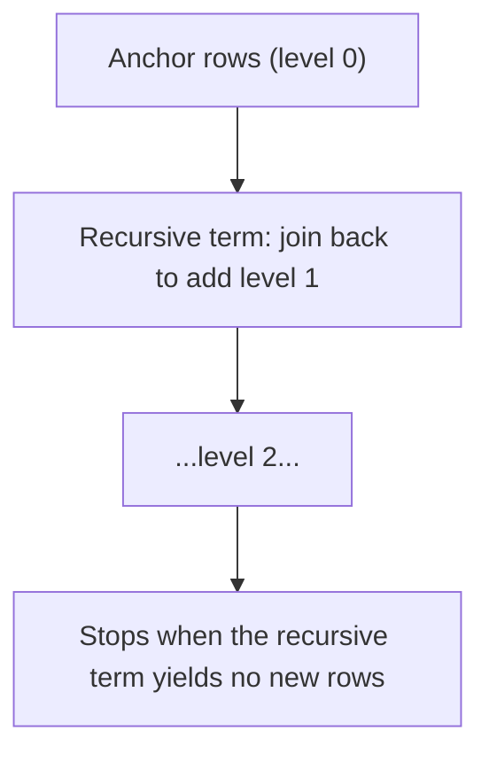
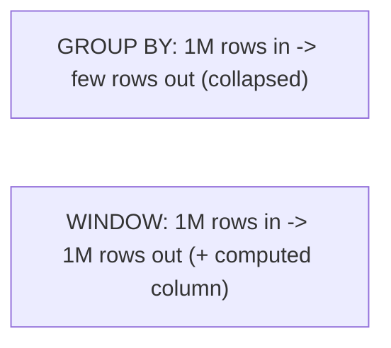

# Day 5 — SQL Advanced (CTEs, Window Functions)

> Series: Database Engineering
> **Goal:** Master the tools that do per-row *and* per-group analysis at once — subqueries, CTEs (incl. recursive), window functions, and set operations — the difference between a junior and a senior SQL author.

## Table of Contents
1. [Subqueries: scalar, IN, EXISTS, correlated](#1-subqueries-scalar-in-exists-correlated)
2. [CTEs: naming your steps](#2-ctes-naming-your-steps)
3. [Recursive CTEs: hierarchies & graphs](#3-recursive-ctes-hierarchies--graphs)
4. [Window functions: the big idea](#4-window-functions-the-big-idea)
5. [Ranking, LAG/LEAD, running totals](#5-ranking-laglead-running-totals)
6. [Set operations](#6-set-operations)
7. [Lab (hands-on)](#7-lab-hands-on)
8. [Self-Check](#8-self-check)
9. [Tomorrow](#9-tomorrow)

---

## 1. Subqueries: scalar, IN, EXISTS, correlated

**In plain words:** A subquery is a query inside a query — a temporary answer you use to compute the real answer. Like asking "what's the average?" first, then "who's above it?"

- **Why:** Many questions are two-step ("customers who spent above average"). Subqueries express step one inline.
- **What — four flavors:**

| Type | Shape | Returns | Example use |
|---|---|---|---|
| Scalar | `(SELECT avg(x) FROM t)` | Single value | Compare each row to an average |
| `IN` | `WHERE id IN (SELECT ...)` | A set | Membership test |
| `EXISTS` | `WHERE EXISTS (SELECT 1 ...)` | Boolean | "Has at least one related row" |
| Correlated | Inner query references outer row | Per-row | "This customer's latest order" |

```sql
-- Scalar subquery: orders larger than the overall average
SELECT order_id, total_cents
FROM orders
WHERE total_cents > (SELECT avg(total_cents) FROM orders);

-- EXISTS (correlated): customers who have at least one paid order
SELECT c.email
FROM customers c
WHERE EXISTS (
  SELECT 1 FROM orders o
  WHERE o.customer_id = c.customer_id AND o.status = 'paid'
);

-- Correlated scalar: each customer with their most recent order date
SELECT c.email,
       (SELECT max(o.placed_at) FROM orders o WHERE o.customer_id = c.customer_id) AS last_order
FROM customers c;
```

> 🤔 **"Is `IN (subquery)` slower than a JOIN? Which should I reach for?"**
> The planner often rewrites both into the same thing, so it's usually a wash — but there are real edges: `IN` with a subquery containing NULLs can silently misbehave (`NOT IN` especially — Day 4), while `EXISTS` short-circuits on the first match and is NULL-safe. As a rule: `EXISTS` for existence checks, `JOIN` when you need columns from the other table, and let the planner decide the rest. Correlated subqueries *can* be slow if the planner can't decorrelate them — check the plan (Day 9).

**When NOT to (a subquery):** If you're using a correlated scalar subquery to fetch "the latest per group," a window function (below) is usually clearer and faster.

---

## 2. CTEs: naming your steps

**In plain words:** A CTE (Common Table Expression, the `WITH` clause) lets you name a subquery and reference it like a temporary table. It turns one unreadable nested monster into a readable pipeline of named steps.

- **Why:** Readability, reuse of a computed set, and building multi-stage transformations top-to-bottom.
- **What:** `WITH name AS (SELECT ...) SELECT ... FROM name`.
- **When:** Any query with 2+ logical stages, or when you'd otherwise repeat a subquery.
- **How / Where:**

```sql
WITH customer_spend AS (
  SELECT customer_id, sum(total_cents) AS spend
  FROM orders
  GROUP BY customer_id
),
big_spenders AS (
  SELECT customer_id FROM customer_spend WHERE spend > 100000
)
SELECT c.email, cs.spend
FROM big_spenders bs
JOIN customer_spend cs USING (customer_id)
JOIN customers c        USING (customer_id)
ORDER BY cs.spend DESC;   -- reads like a pipeline of named steps
```

> **Dark Side / version note:** Before Postgres 12, CTEs were an *optimization fence* — the planner always materialized them, which sometimes killed performance versus an inline subquery. Since Postgres 12, non-recursive CTEs can be inlined by default (unless referenced multiple times or marked `MATERIALIZED`). You can force either behavior with `WITH x AS MATERIALIZED (...)` or `AS NOT MATERIALIZED (...)`. Know your version — this is a real historical foot-gun.

> **MySQL note:** CTEs (`WITH`) and window functions arrived in MySQL 8.0. On 5.7 or older, none of today's material works — verify the version.

**When NOT to (a CTE):** In a hot OLTP path where you need the planner to freely reorder, a plain subquery/join sometimes optimizes better than a materialized CTE. Profile if it's hot.

---

## 3. Recursive CTEs: hierarchies & graphs

**In plain words:** A recursive CTE walks a tree or graph one level at a time — an org chart, a category tree, a "friends of friends" traversal — by repeatedly joining the results back onto themselves until nothing new appears.

- **Why:** SQL is set-based and can't loop; recursive CTEs are how you do iteration/traversal declaratively.
- **What:** Two parts joined by `UNION [ALL]` — an **anchor** (starting rows) and a **recursive** term (rows reachable from the previous step).
- **When / Where:** Org charts, bill-of-materials, category trees, threaded comments, shortest-path-ish traversals.

```sql
-- Employees table: each row points to its manager
-- Walk the whole chain of command under the CEO (emp_id = 1)
WITH RECURSIVE chain AS (
  -- anchor: start at the CEO
  SELECT emp_id, name, manager_id, 1 AS depth
  FROM employees
  WHERE manager_id IS NULL
  UNION ALL
  -- recursive term: everyone who reports to someone already in `chain`
  SELECT e.emp_id, e.name, e.manager_id, c.depth + 1
  FROM employees e
  JOIN chain c ON e.manager_id = c.emp_id
)
SELECT repeat('  ', depth - 1) || name AS org_tree, depth
FROM chain
ORDER BY depth;
```


*A recursive CTE = anchor + repeated self-join, terminating when nothing new is produced.*

> **Dark Side:** A recursive CTE over a graph with **cycles** (A manages B manages A, or circular category links) will loop forever / blow up memory. Guard it: track visited nodes in an array (`path`) and add `WHERE NOT e.emp_id = ANY(c.path)`, or set a depth cap. Never run an unbounded recursive CTE on untrusted graph data.

✅ **Good scenario:** A permissions system resolves "all sub-teams under this org node" in one recursive CTE instead of N application round-trips.

❌ **Bad scenario:** A category tree had an accidental cycle from a bad import. An unguarded recursive CTE consumed all memory and OOM-killed the connection during a catalog page render.

**When NOT to:** Extremely deep or huge graphs may be better served by a dedicated graph store or a precomputed closure table. Recursive CTEs are for moderate hierarchies.

---

## 4. Window functions: the big idea

**In plain words:** A window function computes across a set of rows *related to the current row* — but unlike `GROUP BY`, it does **not** collapse them. Every input row survives, now carrying a computed value (its rank, a running total, the previous row's value).

- **Why:** Ranking, running totals, period-over-period comparisons, "top N per group" — all need per-row detail *and* group context simultaneously, which `GROUP BY` destroys.
- **What:** `func() OVER (PARTITION BY ... ORDER BY ... [frame])`.
  - `PARTITION BY` = the groups (like GROUP BY, but rows stay).
  - `ORDER BY` (inside OVER) = ordering within each partition.
  - **frame** = which rows in the partition are visible (e.g., rows so far, for running totals).


*The core distinction: GROUP BY collapses; window functions annotate.*

| | GROUP BY | Window function |
|---|---|---|
| Rows out | Collapsed to groups | Same as rows in |
| See individual rows? | No | Yes |
| Running totals / rank | Hard/impossible | Native |
| Multiple different groupings in one query | No | Yes (different OVER per column) |

> 🤔 **"When do I need a window function instead of GROUP BY?"**
> The moment you want a per-row answer that *depends on other rows*: "rank each order within its customer," "each row's % of its group total," "difference from the previous day," "3rd most recent order per user." GROUP BY can give you the group's number but throws away the rows; a window keeps the rows and attaches the number. If your result should have the same number of rows as the input, you want a window.

---

## 5. Ranking, LAG/LEAD, running totals

**In plain words:** The greatest-hits of window functions, each solving a real reporting need.

```sql
-- ROW_NUMBER / RANK / DENSE_RANK: position within each partition
SELECT customer_id, order_id, total_cents,
  ROW_NUMBER() OVER (PARTITION BY customer_id ORDER BY placed_at DESC) AS recency_rank,
  RANK()       OVER (PARTITION BY customer_id ORDER BY total_cents DESC) AS spend_rank
FROM orders;
-- ROW_NUMBER: always unique 1,2,3. RANK: ties share, gaps after (1,1,3). DENSE_RANK: ties share, no gaps (1,1,2).

-- Top-N-per-group: the #1 use of ROW_NUMBER (impossible cleanly with GROUP BY)
SELECT * FROM (
  SELECT customer_id, order_id, total_cents,
    ROW_NUMBER() OVER (PARTITION BY customer_id ORDER BY total_cents DESC) AS rn
  FROM orders
) t
WHERE rn <= 3;   -- each customer's 3 biggest orders, rows preserved

-- LAG / LEAD: look at the previous/next row (period-over-period)
SELECT placed_date, daily_revenue,
  LAG(daily_revenue) OVER (ORDER BY placed_date) AS prev_day,
  daily_revenue - LAG(daily_revenue) OVER (ORDER BY placed_date) AS day_delta
FROM daily_totals;

-- Running total: a frame of "everything up to and including this row"
SELECT placed_date, daily_revenue,
  SUM(daily_revenue) OVER (
    ORDER BY placed_date
    ROWS BETWEEN UNBOUNDED PRECEDING AND CURRENT ROW   -- explicit frame
  ) AS running_total
FROM daily_totals;

-- % of group total (partition-wide aggregate, no ORDER BY -> whole partition)
SELECT customer_id, order_id, total_cents,
  total_cents::numeric / SUM(total_cents) OVER (PARTITION BY customer_id) AS pct_of_customer_spend
FROM orders;
```

| Function | Gives you | Ties behavior |
|---|---|---|
| `ROW_NUMBER()` | Unique sequential number | Arbitrary among ties |
| `RANK()` | Rank with gaps | 1,1,3 |
| `DENSE_RANK()` | Rank without gaps | 1,1,2 |
| `LAG(col, n)` | Value n rows back | NULL at start |
| `LEAD(col, n)` | Value n rows ahead | NULL at end |
| `NTILE(k)` | Bucket into k groups | For quartiles etc. |
| `SUM/AVG() OVER` | Aggregate over the frame | Running or partition-wide |

> **Frame gotcha:** When you add `ORDER BY` inside `OVER` but omit an explicit frame, the default frame is `RANGE BETWEEN UNBOUNDED PRECEDING AND CURRENT ROW`. With duplicate ORDER BY values, `RANGE` lumps all peers together (can inflate a "running total" at ties). Use `ROWS` for a true row-by-row running total. This surprises people constantly.

✅ **Good scenario:** A finance dashboard shows daily revenue, previous day, delta, and running total in one query with `LAG` + a `SUM() OVER` frame — no self-joins, no app-side loops.

❌ **Bad scenario:** A team computed "top 3 products per category" with a correlated subquery counting how many products rank above each — an O(n²) query that timed out at scale. `ROW_NUMBER() OVER (PARTITION BY category ...)` filtered to `<= 3` did it in one pass.

**When NOT to (a window):** If you genuinely want fewer rows (one summary per group, no detail), plain `GROUP BY` is simpler and lighter. Windows keep all rows — don't pay for detail you'll discard.

---

## 6. Set operations

**In plain words:** Combine the *results* of two queries vertically (stack rows) rather than horizontally (join columns).

```sql
SELECT email FROM customers_2025
UNION            -- combine + de-duplicate
SELECT email FROM customers_2026;

SELECT email FROM customers_2025
UNION ALL        -- combine, keep duplicates (faster, no dedup sort)
SELECT email FROM customers_2026;

SELECT email FROM all_signups
INTERSECT        -- rows in BOTH
SELECT email FROM paying_customers;

SELECT email FROM all_signups
EXCEPT           -- rows in first but NOT second (signups who never paid)
SELECT email FROM paying_customers;
```

| Operator | Result | Dedups? |
|---|---|---|
| `UNION` | A ∪ B | Yes (costs a sort/hash) |
| `UNION ALL` | A + B (keep dups) | No (faster) |
| `INTERSECT` | A ∩ B | Yes |
| `EXCEPT` | A − B | Yes |

> **Performance note:** `UNION` silently sorts/hashes to remove duplicates. If you know the sets are disjoint (or don't care about dups), `UNION ALL` skips that work — a common, cheap speedup people miss. Requires matching column count and compatible types.

**When NOT to:** When you actually want columns side-by-side, that's a JOIN, not a set op. Set ops stack rows with identical column shapes.

---

## 7. Lab (hands-on)

**Goal:** Rewrite subqueries as window functions and build a small analytics pipeline.

**Setup:** reuse `orders`; also build a `daily_totals` view.

```sql
CREATE VIEW daily_totals AS
SELECT date_trunc('day', placed_at)::date AS placed_date,
       sum(total_cents) AS daily_revenue
FROM orders GROUP BY 1;
```

**Tasks:**
1. **Correlated → window:** Write "each customer's most recent order" first as a correlated subquery, then rewrite with `ROW_NUMBER() OVER (PARTITION BY customer_id ORDER BY placed_at DESC)` and filter `rn = 1`. Compare `EXPLAIN ANALYZE` timings.
2. **Top-N-per-group:** Each customer's top 3 orders by total (ROW_NUMBER, `rn <= 3`).
3. **RANK vs DENSE_RANK vs ROW_NUMBER:** Produce all three on the same partition and explain how ties differ using a hand-crafted tie.
4. **LAG delta:** From `daily_totals`, show day-over-day revenue change with `LAG`.
5. **Running total:** Add a running revenue total using an explicit `ROWS BETWEEN UNBOUNDED PRECEDING AND CURRENT ROW` frame. Then rerun with a `RANGE` frame on a day with duplicate values and observe the difference.
6. **% of total:** Each order as a percent of its customer's total spend (`SUM() OVER (PARTITION BY customer_id)`).
7. **Recursive CTE:** Build a 6-row `employees` table with a manager hierarchy; print an indented org tree. Then add a cycle and add a `path` guard to prevent infinite recursion.
8. **Set ops:** Find signups who never paid using `EXCEPT`, then rewrite with a `LEFT JOIN ... IS NULL` anti-join and confirm identical results.
9. **CTE materialization:** Take a query where a CTE is referenced twice; compare `AS MATERIALIZED` vs `AS NOT MATERIALIZED` plans (Postgres 12+).

**Deliverable:** For task 1, paste both plans and state which was faster and why.

---

## 8. Self-Check
1. Name the four subquery flavors and when each fits.
2. Why prefer `EXISTS` over `IN` for existence checks?
3. What changed about CTE materialization in Postgres 12, and how do you override it?
4. What are the two parts of a recursive CTE, and what stops the recursion?
5. How do you protect a recursive CTE from infinite loops on a cyclic graph?
6. State the one-line core difference between `GROUP BY` and a window function.
7. Distinguish `ROW_NUMBER`, `RANK`, and `DENSE_RANK` on tied values.
8. Why does a "running total" sometimes look wrong, and how does `ROWS` vs `RANGE` fix it?
9. When is `UNION ALL` meaningfully faster than `UNION`?
10. Give a problem that is O(n²) as a correlated subquery but one-pass as a window function.

---

## 9. Tomorrow
**Day 6 — Storage Layout:** we cross from *language* into *internals* — the part that makes you an engineer. How Postgres actually lays rows on 8KB pages, what a tuple header carries, heap vs index-organized tables, TOAST for big values, and fill factor. We'll crack a page open with `pageinspect`.
