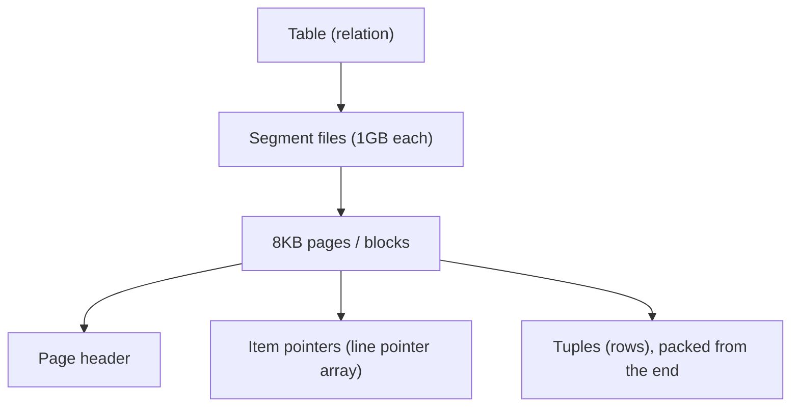
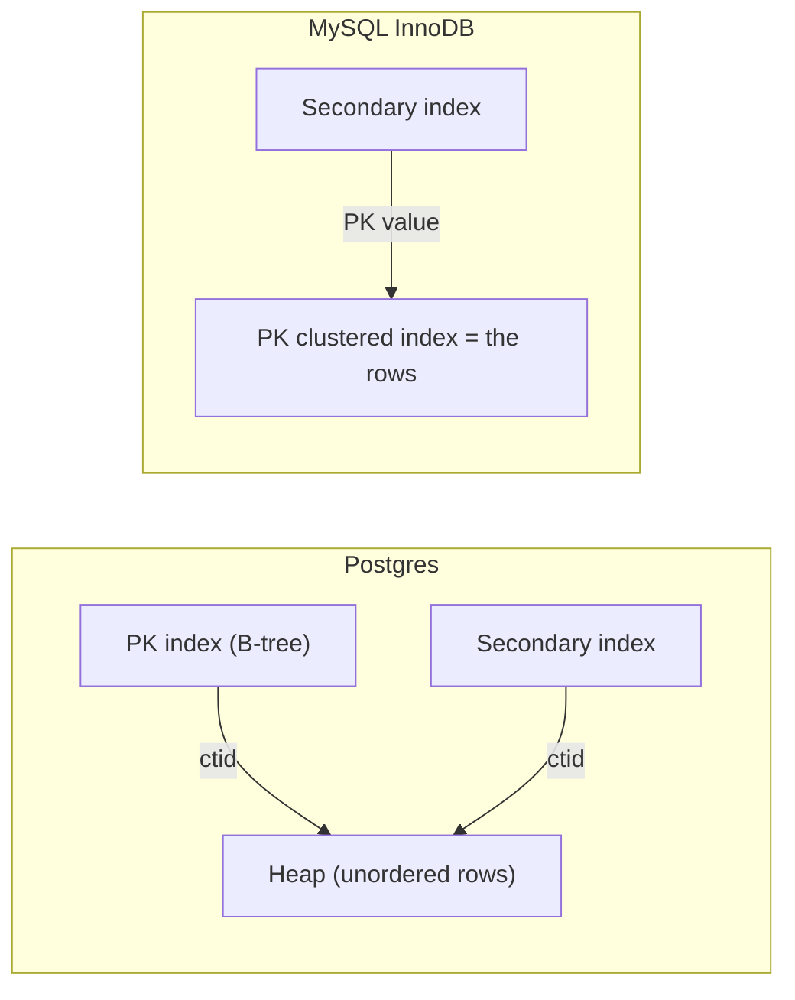

# Day 6 — Storage Layout (Pages, Heap, TOAST)

> Series: Database Engineering
> **Goal:** Cross from *using* SQL to *engineering* storage. Understand exactly how Postgres puts rows on disk — 8KB pages, tuple headers, the heap, TOAST for big values, and fill factor — because every index, plan, and MVCC decision (Days 7-10) sits on top of this.

## Table of Contents
1. [Why storage layout matters](#1-why-storage-layout-matters)
2. [Pages: the 8KB unit of everything](#2-pages-the-8kb-unit-of-everything)
3. [Tuples & the row header](#3-tuples--the-row-header)
4. [Heap tables vs index-organized tables](#4-heap-tables-vs-index-organized-tables)
5. [TOAST: storing big values](#5-toast-storing-big-values)
6. [Fill factor & column order](#6-fill-factor--column-order)
7. [Lab (inspect with pageinspect)](#7-lab-inspect-with-pageinspect)
8. [Self-Check](#8-self-check)
9. [Tomorrow](#9-tomorrow)

---

## 1. Why storage layout matters

**In plain words:** A database doesn't read "rows" from disk — it reads fixed-size *blocks*. Everything about performance flows from how many blocks a query must fetch and how efficiently rows are packed into them. If you don't know how rows land on disk, index and plan tuning is guesswork.

- **Why:** I/O is the dominant cost. The planner's whole job (Day 9) is minimizing pages read. Bloat (Day 8) is wasted pages. MVCC (Day 10) works by writing *new* row versions into pages. It all traces back to here.
- **What:** The physical arrangement of tuples in fixed-size pages within files on disk, plus how oversized values are offloaded (TOAST).
- **When:** Whenever you care about performance, storage cost, or write amplification — i.e., always, as an engineer.
- **How:** Postgres stores each table as one or more 1GB segment files of 8KB pages; you inspect them with `pageinspect`.
- **Where:** The foundation under every table, index, and query in this course.

> **Cross-reference:** System Design talks about storage engines at a black-box level (LSM-tree vs B-tree stores). Here we open the actual on-disk format of Postgres's heap.


*A table is files, files are 8KB pages, pages hold tuples referenced by an item-pointer array.*

---

## 2. Pages: the 8KB unit of everything

**In plain words:** A page (a.k.a. block) is Postgres's atomic chunk of storage — 8 kilobytes by default. Postgres always reads and writes whole pages, never single rows. Think of a page as a shipping pallet: you move the pallet, not individual boxes.

- **Why:** Aligning I/O to fixed blocks makes caching (the buffer pool, Day 10) and the WAL (Day 10) tractable. The buffer pool caches *pages*; the planner estimates cost in *pages*.
- **What — anatomy of an 8KB heap page:**

| Region | Purpose |
|---|---|
| **Page header** (24 bytes) | Checksum, free-space pointers, WAL position (LSN) |
| **Item pointers** (line pointer array) | 4-byte pointers, one per tuple, growing downward from the top |
| **Free space** | The gap in the middle |
| **Tuples** | Actual row data, packed upward from the bottom |
| **Special space** | Used by indexes (e.g., B-tree links); empty for heap |

- **When / Where:** Every read of every table touches pages. A "sequential scan" reads pages in file order; an "index scan" jumps to specific pages.

The split-from-both-ends design (pointers grow down, tuples grow up, free space in the middle) lets a row be *moved* within a page without changing its address — the item pointer is the stable handle. This matters for MVCC updates.

> 🤔 **"Can I make pages bigger than 8KB to fit more per read?"**
> Only by recompiling Postgres with a different `BLCKSZ` — it's a compile-time constant, not a runtime setting, so in practice it's fixed at 8KB on every managed/standard install. The lever you *do* have is packing efficiency: column order, fill factor, and avoiding bloat. Don't chase page size; chase rows-per-page.

---

## 3. Tuples & the row header

**In plain words:** A tuple is one physical row version. Every tuple carries a 23-byte header of bookkeeping *before* your actual column data — and that header is where MVCC lives.

- **Why:** The header explains why an "empty" row still costs ~28 bytes, why updates create *new* tuples (bloat, Day 8), and how MVCC decides which version you see (Day 10).
- **What — key `HeapTupleHeader` fields:**

| Field | Meaning |
|---|---|
| `t_xmin` | Transaction ID that **inserted** this tuple version |
| `t_xmax` | Transaction ID that **deleted/updated** it (0 if live) |
| `t_ctid` | Pointer to this or a newer version of the row (used for update chains) |
| `t_infomask` | Flags: is it committed, is it TOASTed, has nulls, etc. |
| null bitmap | 1 bit per column marking NULLs (only present if any column is null) |

Then the actual column values, aligned to their type's boundary.


*Every row version is header + optional null bitmap + your columns. xmin/xmax are the MVCC machinery.*

**Alignment tax:** Postgres aligns columns to their natural boundary (an `int8`/`timestamptz` on an 8-byte boundary). Padding bytes get inserted between mismatched neighbors, silently wasting space.

> 🤔 **"Does column order in `CREATE TABLE` affect storage size?"**
> Yes, measurably. Because of alignment padding, ordering columns from largest fixed-width type to smallest (e.g., `bigint`/`timestamptz` first, then `int`, then `smallint`/`bool`) minimizes padding and can shrink a row by several bytes — meaningful across billions of rows and for rows-per-page. Variable-length columns (`text`) go last conceptually. It won't change correctness, only density and I/O. Worth doing on your hottest, widest tables.

✅ **Good scenario:** Reordering a wide 40-column analytics table from haphazard to alignment-optimized dropped on-disk size ~12% and improved scan throughput because more rows fit per page.

❌ **Bad scenario:** A table alternated `bool, bigint, bool, bigint, ...`. Each bool forced 7 bytes of padding before the next bigint. The table was ~30% padding — pure waste multiplied over 500M rows.

**When NOT to (micro-optimize):** For small tables or a schema still in flux, don't obsess over column order — readability wins. Optimize alignment on proven-hot, large, stable tables.

---

## 4. Heap tables vs index-organized tables

**In plain words:** In Postgres, table rows live in an unordered *heap* — a pile — and every index (including the primary key) is a *separate* structure pointing into that pile. In MySQL/InnoDB, the table **is** the primary-key index (rows live inside the PK B-tree). Two fundamentally different worlds.

- **Why:** This single difference explains why "clustered index" is a MySQL/SQL-Server concept, why Postgres index-only scans need the visibility map, and why UUID PKs hurt MySQL far more than Postgres.
- **What:**

| | Postgres (heap) | MySQL InnoDB (index-organized / clustered) |
|---|---|---|
| Where rows live | Unordered heap file | Inside the PK B-tree leaves |
| Row identity | `ctid` = (page, item) physical location | Primary key value |
| Secondary index points to | `ctid` (physical) | The **primary key** (logical) |
| PK lookup | Index → heap fetch (2 structures) | Index leaf *is* the row (1 structure) |
| Secondary index lookup | Index → heap | Index → PK → PK-index → row (double lookup) |
| Physical order | None (unless you `CLUSTER`) | Always PK order |
| Cost of wide/random PK | Modest | High (bloats every secondary index) |

- **When / Where:** Every table. The mental model differs by engine.


*Postgres: indexes point at heap locations. InnoDB: the PK index holds the rows; secondaries route through the PK.*

> **MySQL note (major):** Because InnoDB secondary indexes store the PK as the row pointer, a fat PK (say a 36-char UUID string) is copied into *every* secondary index, bloating all of them. In Postgres the ctid is always 6 bytes regardless of PK. This is why "narrow surrogate PK" advice (Day 2) is even more urgent in MySQL.

> **`CLUSTER` in Postgres:** You *can* physically reorder a heap by an index with `CLUSTER table USING idx`, but it's a one-time, blocking operation — Postgres does **not** keep it clustered as you write. It's a maintenance action, not a permanent property. Don't expect InnoDB-style always-clustered behavior.

**When NOT to (CLUSTER):** On write-heavy tables, `CLUSTER` decays immediately and locks the table — usually not worth it. It helps only for read-mostly tables with strong range-scan locality.

---

## 5. TOAST: storing big values

**In plain words:** TOAST (The Oversized-Attribute Storage Technique) is how Postgres handles values too big to fit in a page. If a row would exceed ~2KB, Postgres compresses and/or slices oversized columns into an out-of-line side table, leaving a small pointer in the main row.

- **Why:** A page is 8KB and a row must fit in one page (rows can't span pages). Without TOAST, a single 1MB JSON blob would be impossible to store. TOAST also keeps the main tuple small so scans stay fast.
- **What:** For variable-length types (`text`, `bytea`, `jsonb`, arrays) above the threshold (~2KB, i.e. TOAST_TUPLE_THRESHOLD), Postgres:
  1. **Compresses** the value (default `pglz`, or `lz4` if configured — verify support in your version).
  2. If still too big, **splits** it into ~2KB chunks stored in a hidden `pg_toast_<oid>` table.
  3. Leaves an 18-byte pointer in the main tuple.
- **When / How — per-column strategies:**

| Storage strategy | Behavior | Set via |
|---|---|---|
| `PLAIN` | No TOAST (fixed-width types only) | `ALTER ... SET STORAGE PLAIN` |
| `EXTENDED` | Compress **and** move out-of-line (default for text/jsonb) | default |
| `EXTERNAL` | Move out-of-line, **no** compression (faster substring on text) | `SET STORAGE EXTERNAL` |
| `MAIN` | Compress, keep inline if possible | `SET STORAGE MAIN` |

- **Where:** Any table with large text/JSON/binary columns — product descriptions, event payloads, documents.

> 🤔 **"I added a big `jsonb` column and my table's disk file barely grew — where's the data?"**
> It's in the TOAST table (`pg_toast_*`), a separate relation not shown by default. `\d+ yourtable` reveals TOAST usage; `pg_total_relation_size()` includes it while `pg_relation_size()` does not. Also key: TOASTed columns are **not read** unless your query actually selects them — so `SELECT id FROM t` skips the JSON entirely. This is a real, free performance win: don't `SELECT *` if you don't need the big columns.

✅ **Good scenario:** An events table has a 50KB `jsonb` payload column. Because it's TOASTed out-of-line and rarely selected, the hot `SELECT event_id, occurred_at WHERE ...` scans stay tiny and fast — the payload never enters the buffer pool for those queries.

❌ **Bad scenario:** A dashboard ran `SELECT * FROM events` including the 50KB payload for 100k rows, dragging 5GB through the buffer pool and network for a page that only displayed timestamps. Selecting only needed columns cut it 99%.

**When NOT to (fight TOAST):** Don't set `STORAGE EXTERNAL` reflexively to "avoid compression cost" — for large compressible JSON, compression usually saves far more I/O than it costs CPU. Change strategy only after measuring.

---

## 6. Fill factor & column order

**In plain words:** Fill factor tells Postgres to leave some empty space on each page at insert time, so later *updates* can put the new row version on the *same* page (a cheaper HOT update) instead of a different one.

- **Why:** MVCC updates write a new tuple version (Day 10). If it fits on the same page and no indexed column changed, Postgres does a **HOT (Heap-Only Tuple)** update — no index update needed, far less bloat and write amplification (Day 8).
- **What:** `fillfactor` (10-100, default 100 for tables) = max % of a page to fill with rows on insert.
- **When:** Update-heavy tables benefit from a lower fill factor (e.g., 80-90) so HOT updates land locally. Insert-only/append tables should stay at 100 (no wasted space).
- **How / Where:**

```sql
-- Leave 20% free per page for in-place update versions (HOT updates)
CREATE TABLE sessions (
  session_id BIGINT PRIMARY KEY,
  last_seen  TIMESTAMPTZ,        -- updated constantly
  payload    JSONB
) WITH (fillfactor = 85);

-- Change it later + rewrite existing pages
ALTER TABLE sessions SET (fillfactor = 85);
VACUUM FULL sessions;  -- (or pg_repack) to apply to existing data; note the heavy lock
```

| Table pattern | Fill factor | Why |
|---|---|---|
| Insert-only log | 100 | Never updated; don't waste space |
| Update-heavy (sessions, counters) | 80-90 | Room for HOT updates → less bloat |
| Read-mostly reference | 100 | Density for scans |

> **Dark Side:** A low fill factor wastes space on every page *up front* and hurts scan density — it's only worth it if you genuinely get HOT updates in return, which also requires that the updated column is **not indexed**. Set it based on the actual update pattern, not vibes.

**When NOT to:** Append-only or read-only tables — a fill factor below 100 is pure waste there.

---

## 7. Lab (inspect with pageinspect)

**Goal:** Crack a real page open and see tuples, headers, and TOAST.

```sql
-- Enable the low-level inspection extension (superuser)
CREATE EXTENSION IF NOT EXISTS pageinspect;

-- A small table to dissect
CREATE TABLE demo (id INT, name TEXT, big TEXT);
INSERT INTO demo SELECT g, 'row ' || g, repeat('x', 5000)  -- 5KB -> will TOAST
FROM generate_series(1, 20) g;

-- 1. How big is the page header, how many item pointers, how much free space?
SELECT * FROM page_header(get_raw_page('demo', 0));

-- 2. See the line-pointer array + tuple offsets/lengths on page 0
SELECT lp, lp_off, lp_len, t_xmin, t_xmax, t_ctid
FROM heap_page_items(get_raw_page('demo', 0));

-- 3. Prove TOAST happened: main table small, total (incl TOAST) large
SELECT pg_size_pretty(pg_relation_size('demo'))       AS heap_only,
       pg_size_pretty(pg_total_relation_size('demo')) AS incl_toast_and_indexes;

-- 4. Find the TOAST table backing `demo`
SELECT reltoastrelid::regclass FROM pg_class WHERE relname = 'demo';

-- 5. Watch MVCC create a new tuple version: update one row, re-check ctid/xmax
UPDATE demo SET name = 'changed' WHERE id = 1;
SELECT lp, t_xmin, t_xmax, t_ctid FROM heap_page_items(get_raw_page('demo', 0));
-- The old tuple now has a t_xmax (deleted-by txid) and t_ctid pointing to the new version.

-- 6. Alignment experiment: create two tables, one alignment-optimized, one not,
--    fill each with 1M rows, compare pg_relation_size().
CREATE TABLE bad_align  (a bool, b bigint, c bool, d bigint, e bool);
CREATE TABLE good_align (b bigint, d bigint, a bool, c bool, e bool);
INSERT INTO bad_align  SELECT true, g, false, g, true  FROM generate_series(1,1000000) g;
INSERT INTO good_align SELECT g, g, true, false, true  FROM generate_series(1,1000000) g;
SELECT pg_size_pretty(pg_relation_size('bad_align'))  AS bad,
       pg_size_pretty(pg_relation_size('good_align')) AS good;
```

**Tasks:**
1. Report free space and item count on page 0 of `demo`.
2. Confirm from step 3 that the heap alone is small but total size is large (TOAST). Explain in one sentence.
3. From step 5, identify the old vs new tuple version and explain what `t_xmax` and `t_ctid` now mean (preview of Day 10 MVCC).
4. From step 6, report the size difference and explain it via alignment padding.

---

## 8. Self-Check
1. What is the default Postgres page size, and why can't you just change it at runtime?
2. Describe the four regions of a heap page and which end tuples vs item pointers grow from.
3. Name three fields in a tuple header and what each does.
4. Why does column order affect on-disk row size? Give the ordering heuristic.
5. Contrast Postgres heap tables with InnoDB clustered (index-organized) tables.
6. Why does a fat/UUID primary key hurt MySQL secondary indexes more than Postgres?
7. What does `CLUSTER` do in Postgres, and why isn't it permanent?
8. What is TOAST, and what three things can happen to an oversized value?
9. Why can `SELECT id FROM t` be dramatically cheaper than `SELECT *` on a TOASTed table?
10. What is a HOT update, and how does fill factor enable it?

---

## 9. Tomorrow
**Day 7 — Indexes Deep:** now that you know rows live in a heap referenced by ctid, we build the structures that find them fast — B-tree, hash, GIN, GiST, BRIN — plus composite (leftmost-prefix), covering, partial, and index-only scans. When each wins, measured.
