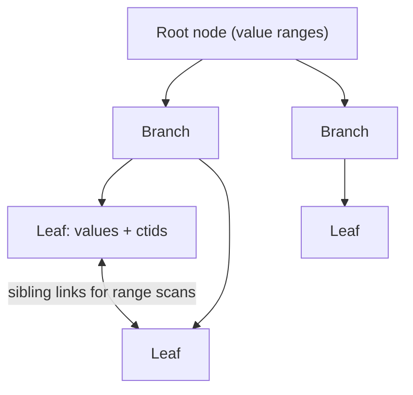
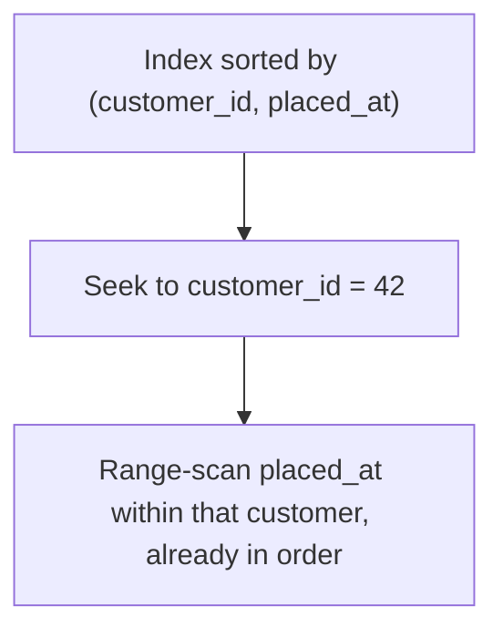

# Day 7 — Indexes Deep

> Series: Database Engineering
> **Goal:** Go from "add an index and hope" to *choosing the right index type for the right access pattern* — B-tree, hash, GIN, GiST, BRIN — plus composite (leftmost-prefix), covering, partial, and index-only scans, each with a measurement.

## Table of Contents
1. [What an index really is](#1-what-an-index-really-is)
2. [B-tree: the default workhorse](#2-b-tree-the-default-workhorse)
3. [Hash, GIN, GiST, BRIN](#3-hash-gin-gist-brin)
4. [Composite indexes & the leftmost-prefix rule](#4-composite-indexes--the-leftmost-prefix-rule)
5. [Covering & index-only scans](#5-covering--index-only-scans)
6. [Partial indexes](#6-partial-indexes)
7. [Lab (build each, measure)](#7-lab-build-each-measure)
8. [Self-Check](#8-self-check)
9. [Tomorrow](#9-tomorrow)

---

## 1. What an index really is

**In plain words:** An index is a book's index — a sorted, separate structure that tells the engine *where* to find rows without reading every page. Yesterday you learned rows live in an unordered heap; an index is the map into that heap.

- **Why:** Finding one row among 100M by scanning is O(n) and touches every page. An index makes it O(log n) and touches a handful of pages.
- **What:** A secondary data structure that maps column value(s) → row location (`ctid` in Postgres). It's a *copy* of the indexed columns kept sorted/organized, plus a pointer.
- **When:** On columns you filter, join, or sort by frequently — *and* that are selective enough to matter.
- **How:** `CREATE INDEX`. The planner (Day 9) then *chooses* whether to use it.
- **Where:** Every read-hot query path. But every index is a cost on writes (Day 8) — indexes are a trade, not free speed.

> **Cross-reference:** System Design Day 10 says "add an index to speed up reads." Here we go deeper: *which* index type, *why* the planner may ignore it, and *when* it silently hurts writes (Day 8).


*An index converts a full scan into a targeted lookup, then a heap fetch by ctid.*

**Golden rule:** an index only helps if it's *selective* — if a predicate matches a small fraction of rows. An index on a boolean `is_active` where 95% are active is nearly useless (Day 8).

---

## 2. B-tree: the default workhorse

**In plain words:** A B-tree is a balanced, sorted tree. Start at the root, follow pointers down, and in a few hops you're at the leaf holding your value. It stays balanced as you insert, so lookups are always fast.

- **Why:** It handles the most common needs — equality, ranges, sorting, and prefix matches — all in one structure. It's the default and covers ~90% of real indexes.
- **What:** A multi-level sorted tree; leaves hold indexed values + ctids, linked left-to-right for range scans.
- **When (B-tree wins):**

| Query shape | B-tree helps? |
|---|---|
| `WHERE x = 5` (equality) | Yes |
| `WHERE x > 5`, `BETWEEN` (range) | Yes |
| `WHERE x LIKE 'abc%'` (prefix) | Yes (with proper collation / `text_pattern_ops`) |
| `ORDER BY x` | Yes (returns sorted, may skip a sort) |
| `WHERE x LIKE '%abc'` (suffix/contains) | No (use GIN/trigram) |
| `WHERE lower(email)=...` (function on column) | Only with an **expression index** |

- **How / Where:**

```sql
CREATE INDEX idx_orders_placed_at ON orders (placed_at);           -- range + sort
CREATE UNIQUE INDEX idx_customers_email ON customers (email);      -- uniqueness + lookup
CREATE INDEX idx_customers_lower_email ON customers (lower(email)); -- expression index
-- now this uses the index:
SELECT * FROM customers WHERE lower(email) = 'a@x.com';
```


*A B-tree: log-depth descent to a leaf, plus sibling links that make range scans cheap.*

> 🤔 **"I have an index on `email` but `WHERE lower(email) = ...` ignores it — bug?"**
> Not a bug. An index on `email` stores the raw values; `lower(email)` is a *different* value the index knows nothing about, so the planner can't use it and falls back to a seq scan. You need an **expression index** on `lower(email)` (above), or normalize the data. This "function on the indexed column disables the index" trap catches everyone once. Same applies to implicit type casts (`WHERE int_col = '5'::text` style mismatches).

---

## 3. Hash, GIN, GiST, BRIN

**In plain words:** B-tree is the generalist. The others are specialists — each shaped for a data type or query pattern B-tree handles poorly.

| Index | Best for | Query examples | Notes |
|---|---|---|---|
| **B-tree** | Ordered scalars | `=`, `<`, `>`, `BETWEEN`, `ORDER BY`, prefix | Default; use unless you have a reason |
| **Hash** | Equality only | `WHERE x = v` | No ranges/sorting; WAL-logged & crash-safe since PG 10 |
| **GIN** | Multi-valued / contains | `jsonb @>`, arrays, full-text `@@`, trigram `%` | "Which rows *contain* this element" |
| **GiST** | Geometric / ranges / nearest | `&&` overlap, `<->` KNN, ranges, geometry (PostGIS) | Extensible; supports nearest-neighbor |
| **BRIN** | Huge, naturally-ordered tables | range scans on time-series | Tiny index, only works if physical order ~ column order |

- **Why:** Using the wrong type means the index is unused or huge. E.g., B-tree can't index "does this array contain 5?" — that's GIN.

```sql
-- GIN: containment queries on jsonb and arrays
CREATE INDEX idx_events_payload ON events USING gin (payload);        -- jsonb @>
SELECT * FROM events WHERE payload @> '{"type":"click"}';            -- uses GIN

-- GIN + trigram: substring / fuzzy search (needs pg_trgm)
CREATE EXTENSION IF NOT EXISTS pg_trgm;
CREATE INDEX idx_products_name_trgm ON products USING gin (name gin_trgm_ops);
SELECT * FROM products WHERE name ILIKE '%widget%';                  -- substring, now indexable

-- GiST: range overlap (e.g., booking conflict detection)
CREATE INDEX idx_bookings_during ON bookings USING gist (during);   -- tstzrange column
SELECT * FROM bookings WHERE during && tstzrange(now(), now()+interval '1h');

-- BRIN: a 500M-row append-only events table, physically ordered by time
CREATE INDEX idx_events_time_brin ON events USING brin (occurred_at);
-- BRIN stores min/max per block range: tiny on disk, great for time-range scans
```

> 🤔 **"BRIN indexes are tiny and cheap — why not use them everywhere?"**
> Because BRIN only works when the table's *physical* order roughly matches the indexed column — it stores min/max summaries per block range and prunes blocks. On an append-only time-series (rows inserted in time order), that's perfect: a 500M-row table gets a few-hundred-KB index. But on a randomly-ordered column, every block's min/max spans the whole range, so BRIN prunes nothing and the planner ignores it. BRIN is a scalpel for correlated-with-storage columns, not a general index.

✅ **Good scenario (right specialist):** A `jsonb` events table with GIN on `payload` answers `payload @> '{"country":"IN"}'` in milliseconds; a B-tree literally could not index that predicate.

❌ **Bad scenario (wrong type):** A team put a B-tree on a `text[]` tags column and wondered why `WHERE 'sale' = ANY(tags)` still seq-scanned. B-tree indexes the whole array as one opaque value; GIN indexes the elements. Wrong tool, no help.

**When NOT to (hash):** Historically hash indexes were not crash-safe and were discouraged; since PG 10 they're WAL-logged. Even so, a B-tree does equality *plus* ranges/sorting, so hash is rarely worth it — use it only for pure-equality on large values where its slightly smaller size matters. Verify current guidance for your version.

---

## 4. Composite indexes & the leftmost-prefix rule

**In plain words:** A composite (multi-column) index is sorted by the first column, then the second within that, etc. — like a phone book sorted by last name, then first name. You can look up by last name, or last+first, but *not by first name alone*.

- **Why:** One well-ordered composite index can serve many queries; the wrong column order serves almost none.
- **What — the leftmost-prefix rule:** an index on `(a, b, c)` can be used for queries that filter on a *leading prefix*: `a`, `a,b`, or `a,b,c` — but **not** `b` alone, or `c` alone, or `b,c`.

| Index `(customer_id, placed_at, status)` supports | Uses index? |
|---|---|
| `WHERE customer_id = 5` | Yes |
| `WHERE customer_id = 5 AND placed_at > '...'` | Yes (both cols) |
| `WHERE customer_id = 5 ORDER BY placed_at` | Yes (sorted output, no extra sort) |
| `WHERE placed_at > '...'` (skips leading col) | No (or inefficient) |
| `WHERE status = 'paid'` (only trailing col) | No |

- **How — column-order rules of thumb:**
  1. **Equality columns first**, then range columns, then the sort column.
  2. Put the most **selective** equality column early.
  3. A range predicate "stops" further columns from being used for seeking.

```sql
-- Good order for: WHERE customer_id = ? AND placed_at >= ? ORDER BY placed_at
CREATE INDEX idx_orders_cust_time ON orders (customer_id, placed_at);
-- equality (customer_id) first, range/sort (placed_at) second

-- This query is fully served (seek + already-sorted):
SELECT * FROM orders
WHERE customer_id = 42 AND placed_at >= now() - interval '30 days'
ORDER BY placed_at;
```


*A composite index seeks on the leading equality, then range-scans the next column in sorted order.*

> 🤔 **"I have single-column indexes on both `a` and `b` — does the planner combine them for `WHERE a=1 AND b=2`?"**
> It *can*, via a **bitmap index scan** that combines two indexes with a bitmap AND — but that's usually slower than one composite `(a, b)` index that seeks directly. Two singles also can't give you sorted output on `(a, b)`. If a two-column filter is hot, build the composite. Keep singles only if each column is also queried alone. (Note: you can't drop the single on `a` if you have `(a,b)` — that's covered by leftmost-prefix; but you *can* often drop a redundant single on `a` when `(a, ...)` exists.)

✅ **Good scenario:** One `(customer_id, placed_at)` index serves "this customer's orders," "this customer's recent orders," and "this customer's orders sorted by date" — three queries, one index.

❌ **Bad scenario:** A team indexed `(placed_at, customer_id)` (wrong order) for a "per-customer" workload. Every per-customer query skipped the leading column and seq-scanned. Reordering to `(customer_id, placed_at)` fixed it instantly.

**When NOT to:** Don't build a 5-column composite "just in case." Each extra column widens the index, slows writes, and only helps queries that use the prefix. Index for real query shapes you can name.

---

## 5. Covering & index-only scans

**In plain words:** Normally an index finds the ctid, then Postgres must fetch the actual row from the heap (a second I/O). A **covering index** includes every column the query needs, so Postgres answers *entirely from the index* — no heap trip. That's an **index-only scan**.

- **Why:** Skipping the heap fetch can be a huge win for hot, narrow queries.
- **What:** An index whose keys + `INCLUDE`d columns contain all columns the query selects and filters.
- **When:** Read-hot queries that select a few small columns repeatedly.
- **How:** `INCLUDE (...)` (Postgres 11+) adds payload columns to the leaf without making them part of the sort key.

```sql
-- Covering index: filter on customer_id, but also return total_cents without a heap fetch
CREATE INDEX idx_orders_cust_incl ON orders (customer_id) INCLUDE (total_cents);

-- This can be an INDEX-ONLY scan (no heap visit) — check EXPLAIN for "Index Only Scan"
SELECT customer_id, total_cents FROM orders WHERE customer_id = 42;
```

> **The visibility-map catch (Postgres-specific):** An index-only scan still has to confirm a row is *visible* to your transaction (MVCC, Day 10). Postgres uses the **visibility map** — a bitmap marking pages where all tuples are visible to everyone. If a page isn't marked all-visible (recently updated, not yet `VACUUM`ed), Postgres must visit the heap anyway, and your "index-only" scan quietly does heap fetches. Keeping the table well-vacuumed is what *keeps* index-only scans truly index-only. This surprises people who see "Index Only Scan" but still high I/O.

✅ **Good scenario:** A high-QPS "get this user's plan tier" endpoint uses a covering index and never touches the heap — p99 dropped from 4ms to 0.4ms after `INCLUDE (plan_tier)`.

❌ **Bad scenario:** A team added a covering index but the table was write-heavy and rarely vacuumed; the visibility map was mostly stale, so the "index-only" scan did heap fetches anyway. The win didn't materialize until autovacuum was tuned.

**When NOT to:** Don't stuff many wide columns into `INCLUDE` — it bloats the index and its write cost. Cover only small, hot, frequently-returned columns.

---

## 6. Partial indexes

**In plain words:** A partial index indexes only the rows matching a `WHERE` clause — so it's smaller, cheaper to maintain, and laser-focused on the rows you actually query.

- **Why:** If 98% of orders are `completed` and you always query the 2% that are `pending`, why index all 100%? Index only the pending ones.
- **What:** `CREATE INDEX ... WHERE <predicate>`. The index contains only matching rows.
- **When:** Skewed data where queries target a minority subset; enforcing conditional uniqueness.
- **How / Where:**

```sql
-- Only index the small, hot set of unprocessed rows
CREATE INDEX idx_orders_pending ON orders (placed_at) WHERE status = 'pending';
-- Tiny index; the planner uses it only when the query's WHERE implies status='pending'
SELECT * FROM orders WHERE status = 'pending' ORDER BY placed_at;

-- Conditional uniqueness: only one ACTIVE subscription per user (nulls/others exempt)
CREATE UNIQUE INDEX uniq_active_sub ON subscriptions (user_id) WHERE status = 'active';
```

| Full index | Partial index |
|---|---|
| Indexes all rows | Indexes only matching rows |
| Bigger, slower writes for all rows | Smaller, writes to it only when predicate matches |
| Used for any value of the column | Used only when query implies the predicate |

> **Gotcha:** The planner only uses a partial index when it can *prove* your query's predicate is implied by the index's predicate. `WHERE status = 'pending'` matches; `WHERE status = $1` (parameterized, value unknown at plan time) may not, depending on the plan. Make the predicate concrete where you can.

✅ **Good scenario:** A job queue table of 200M rows where 5k are `pending`. A partial index on the pending rows is a few hundred KB and makes the worker's "grab next job" query instant, while inserts of completed rows don't touch it at all.

❌ **Bad scenario:** A full index on `status` across 200M mostly-completed rows was large, wrote on every insert, and the planner still seq-scanned because the value was so common. The partial index was 1000x smaller and actually used.

**When NOT to:** If queries hit the *whole* value range (all statuses), a partial index only covers part and you'd need a full one anyway. Partial pays off with strong skew + targeted queries.

---

## 7. Lab (build each, measure)

**Goal:** Build every index type and prove the plan changes. Seed a big table first.

```sql
-- Big table so index vs seq scan actually differs
CREATE TABLE big_orders (
  order_id   BIGINT GENERATED ALWAYS AS IDENTITY PRIMARY KEY,
  customer_id BIGINT NOT NULL,
  status     TEXT NOT NULL,
  placed_at  TIMESTAMPTZ NOT NULL,
  tags       TEXT[],
  payload    JSONB
);
INSERT INTO big_orders (customer_id, status, placed_at, tags, payload)
SELECT (random()*10000)::bigint,
       (ARRAY['completed','completed','completed','pending'])[1+floor(random()*4)],
       now() - (random()*365) * interval '1 day',
       ARRAY['sale','new'],
       jsonb_build_object('country', (ARRAY['IN','US','UK'])[1+floor(random()*3)])
FROM generate_series(1, 2000000);
ANALYZE big_orders;   -- update stats so the planner estimates well (Day 9)
```

**Tasks (run `EXPLAIN (ANALYZE, BUFFERS)` before and after each index):**
1. **B-tree:** `SELECT * FROM big_orders WHERE customer_id = 42;` — seq scan → index scan after `CREATE INDEX ON big_orders(customer_id);`.
2. **Composite + leftmost-prefix:** Build `(customer_id, placed_at)`. Show it serves `WHERE customer_id=42 AND placed_at > now()-interval '30 days' ORDER BY placed_at` with no separate sort. Then show `WHERE placed_at > ...` alone does *not* use it well.
3. **Partial:** `CREATE INDEX ... (placed_at) WHERE status='pending'`. Compare its size (`\di+`) to a full index on status, and confirm the pending query uses it.
4. **GIN (jsonb):** `CREATE INDEX ... USING gin (payload)`; show `payload @> '{"country":"IN"}'` switches from seq scan to bitmap index scan.
5. **GIN (array):** show `WHERE tags @> ARRAY['sale']` uses a GIN index on `tags`.
6. **BRIN:** `CREATE INDEX ... USING brin (placed_at)`; compare its on-disk size to the B-tree on `placed_at` (\di+) and note both can serve a time-range query — BRIN is tiny.
7. **Covering / index-only:** `CREATE INDEX ... (customer_id) INCLUDE (total_cents)` (add the column first); confirm `EXPLAIN` shows "Index Only Scan". Then `UPDATE` many rows without `VACUUM` and watch heap fetches reappear.
8. **Expression index:** show `WHERE lower(status) = 'pending'` ignores the plain index until you add `CREATE INDEX ON big_orders (lower(status))`.

**Deliverable:** A table of {query, index type, scan type before, scan type after, ms before, ms after} for tasks 1-6.

---

## 8. Self-Check
1. In one sentence, why does an index turn O(n) into O(log n)?
2. What is "selectivity," and why is an index on a 95%-true boolean nearly useless?
3. List three query shapes a B-tree serves and one it cannot.
4. Why does `WHERE lower(email)=...` ignore an index on `email`, and how do you fix it?
5. Match GIN, GiST, BRIN each to the workload it's designed for.
6. Why is BRIN tiny on an append-only time table but useless on a randomly-ordered column?
7. State the leftmost-prefix rule and give the correct column order heuristic (equality/range/sort).
8. What is an index-only scan, and why can the visibility map secretly sabotage it?
9. When does a partial index beat a full index, and what must be true of the query predicate?
10. Why is a covering index with many wide `INCLUDE` columns a bad idea?

---

## 9. Tomorrow
**Day 8 — When Indexes Hurt:** the other half of the story. Every index you built today taxes writes, bloats, and can be the *wrong* choice. We'll construct a workload where adding an index makes the system slower — and learn write amplification, bloat, and maintenance cost.
