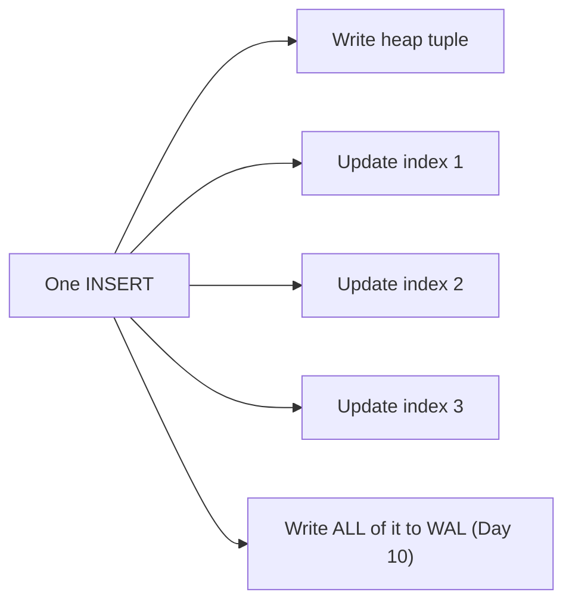
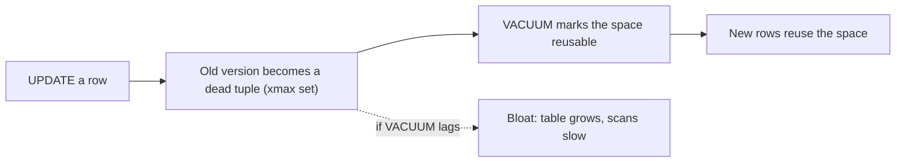

# Day 8 — When Indexes Hurt

> Series: Database Engineering
> **Goal:** Learn the *cost* side of indexing — write amplification, bloat, wrong-index-chosen, too-many-indexes — and build a real workload where adding an index makes the system *slower*. This is the maturity that separates engineers from index-spammers.

## Table of Contents
1. [Indexes are not free](#1-indexes-are-not-free)
2. [Write amplification](#2-write-amplification)
3. [Bloat: dead tuples & why VACUUM exists](#3-bloat-dead-tuples--why-vacuum-exists)
4. [When the planner picks the wrong index](#4-when-the-planner-picks-the-wrong-index)
5. [Too many indexes](#5-too-many-indexes)
6. [Maintenance cost & unused indexes](#6-maintenance-cost--unused-indexes)
7. [Lab (make an index slow things down)](#7-lab-make-an-index-slow-things-down)
8. [Self-Check](#8-self-check)
9. [Tomorrow](#9-tomorrow)

---

## 1. Indexes are not free

**In plain words:** Yesterday indexes were pure magic — reads got faster. Today the bill arrives. Every index is a second copy of data that must be kept in sync on *every* insert, update, and delete. Indexes trade write speed and disk for read speed. A shop with 15 indexes on a hot table has a write problem it doesn't know about yet.

- **Why:** Junior engineers add indexes to fix slow reads and never remove them. Over months, the write path chokes, disk balloons, and nobody connects it to the index sprawl.
- **What:** The costs — write amplification (N indexes = N extra writes per row change), bloat (dead versions pile up), planner mistakes (wrong index chosen), and maintenance (VACUUM, REINDEX, memory).
- **When:** The moment you have write-heavy tables, skewed data, or more than a couple indexes.
- **How / Where:** Measure write throughput and index usage; prune ruthlessly.


*Every index multiplies the write work — and all of it must also be WAL-logged for durability.*

> **Cross-reference:** System Design frames indexing as "reads vs writes" trade-off at a high level. Here you see the actual mechanism — heap tuple + one index entry *per index* + WAL — that makes the trade concrete.

---

## 2. Write amplification

**In plain words:** Write amplification means one logical change causes many physical writes. Insert one order into a table with 6 indexes, and Postgres writes the heap tuple *plus* 6 index entries *plus* WAL records for all of it. One row in, seven-plus writes out.

- **Why:** Index maintenance is synchronous with the write. More indexes → more work per write → lower write throughput and higher latency.
- **What:** Extra I/O and CPU per DML op, proportional to the number of (relevant) indexes.
- **When:** Insert/update/delete-heavy tables — queues, event logs, counters, session tables.
- **How much:** Roughly, a table with N indexes does ~N+1 index-related writes per row change (fewer for HOT updates — see below).

```sql
-- Demonstration: measure insert throughput as you add indexes
CREATE TABLE amp (id BIGINT, a INT, b INT, c INT, d TEXT);

-- Baseline (no indexes): time this
\timing on
INSERT INTO amp SELECT g, g%100, g%1000, g%50, md5(g::text)
FROM generate_series(1, 1000000) g;
-- e.g. ~1.2s

TRUNCATE amp;
CREATE INDEX ON amp(a); CREATE INDEX ON amp(b);
CREATE INDEX ON amp(c); CREATE INDEX ON amp(d);
-- Same insert now: much slower because 4 indexes must be maintained per row
INSERT INTO amp SELECT g, g%100, g%1000, g%50, md5(g::text)
FROM generate_series(1, 1000000) g;
-- e.g. ~4-6s -- that gap is write amplification
```

**HOT updates reduce it:** Recall Day 6 — if an `UPDATE` changes *only non-indexed* columns and the new tuple fits on the same page (fill factor!), Postgres does a Heap-Only Tuple update and **skips all index updates**. The instant you update an *indexed* column, every index must be touched.

> 🤔 **"We're read-heavy, so index write cost doesn't matter to us, right?"**
> Careful. "Read-heavy" usually means read-heavy *in query count*, but your writes may still be latency-sensitive (checkout, sign-up). A pile of indexes can push a 2ms insert to 20ms, and that insert sits on the user's critical path. Also, write amplification competes with reads for the same buffer pool and WAL bandwidth. Measure the write path even when reads dominate.

✅ **Good scenario (fewer indexes wins):** An ingestion pipeline dropped 4 rarely-used indexes on its events table; insert throughput went up 3x and the backlog cleared. The dropped indexes served one weekly report that ran fine on a replica.

❌ **Bad scenario:** A session table updated `last_seen` on every request. Someone indexed `last_seen`. Now every request's update touched that index (no HOT update possible), tripling write latency on the hottest path in the app.

**When NOT to (index a hot-updated column):** Avoid indexing columns that change on nearly every write unless a read query truly needs it — you forfeit HOT updates and pay on every write.

---

## 3. Bloat: dead tuples & why VACUUM exists

**In plain words:** Because of MVCC (Day 10), Postgres never overwrites a row in place. An `UPDATE` or `DELETE` leaves the old version as a *dead tuple* sitting in the page, invisible but still taking space. Accumulated dead tuples are **bloat** — pages full of corpses that scans still have to skip over.

- **Why:** Bloat wastes disk, slows scans (more pages to read for the same live rows), and degrades index efficiency. It's the #1 silent Postgres performance killer.
- **What:** Dead tuples in heap and index pages left by updates/deletes, reclaimed by `VACUUM`.
- **When:** Update/delete-heavy tables; tables where autovacuum can't keep up; long-running transactions that "pin" old versions.
- **How — the lifecycle:**


*Updates create dead tuples; VACUUM reclaims them; when VACUUM lags, bloat grows.*

```sql
-- See dead tuples and last (auto)vacuum
SELECT relname, n_live_tup, n_dead_tup, last_autovacuum
FROM pg_stat_user_tables
ORDER BY n_dead_tup DESC;

-- Reclaim space for reuse (non-blocking, normal)
VACUUM orders;
-- Reclaim AND return disk to OS (heavy, ACCESS EXCLUSIVE lock — avoid on live tables)
VACUUM FULL orders;   -- rewrites the whole table; use pg_repack online instead in prod
```

> **Dark Side — the long-transaction bloat trap:** `VACUUM` can only remove a dead tuple if *no* transaction might still need to see it. A single forgotten transaction left open (an idle analytics session, a stuck app connection `idle in transaction`) holds back the "oldest visible" horizon and **prevents vacuum from cleaning anything newer** across the whole database. One leaked transaction can bloat a busy table by gigabytes. Monitor `pg_stat_activity` for long `idle in transaction` sessions — this is a classic 3am incident.

> **MySQL note:** InnoDB also keeps old row versions (in the undo log / rollback segments) for MVCC, and long transactions bloat the undo log similarly — the "history list length" is the equivalent metric to watch. Different mechanism, same failure mode.

✅ **Good scenario:** Autovacuum is tuned aggressively for a hot queue table (lower `autovacuum_vacuum_scale_factor`); dead tuples are reclaimed promptly, the table stays compact, and scans stay fast.

❌ **Bad scenario:** A batch job ran a 4-hour transaction nightly. During it, vacuum couldn't clean the orders table; it bloated to 3x size by morning; every query slowed; disk alerts fired. Fix: shorten the transaction; the table was fine within a day of vacuuming.

**When NOT to (VACUUM FULL):** Never run `VACUUM FULL` casually on a live table — it takes an exclusive lock and blocks all access for the duration. Use plain `VACUUM` (or `pg_repack` for online compaction) instead.

---

## 4. When the planner picks the wrong index

**In plain words:** Having an index doesn't mean the planner uses it — and sometimes it uses the *wrong* one, or uses one when a seq scan would've been faster. The planner decides based on *statistics*, and stale or misleading stats lead to bad choices.

- **Why:** The planner (Day 9) estimates row counts from `pg_statistic`, gathered by `ANALYZE`. If those estimates are wrong (stale stats, skewed data, correlated columns), it costs the wrong plan.
- **What:** Common failure modes:

| Symptom | Cause | Fix |
|---|---|---|
| Seq scan when an index exists | Planner estimates the predicate matches most rows | `ANALYZE`; check selectivity; maybe the data really is unselective |
| Wrong index chosen among several | Bad row estimates, correlated columns | `ANALYZE`; extended statistics; drop misleading index |
| Index ignored after data load | Stats not yet gathered | `ANALYZE table;` |
| Index scan slower than seq scan | Low selectivity + random I/O | Trust the planner; maybe drop the index |

- **How:**

```sql
ANALYZE orders;                    -- refresh planner statistics (do after big loads)

-- Correlated columns fool the planner (e.g., city and zip): extended stats help
CREATE STATISTICS orders_corr (dependencies)
  ON customer_id, status FROM orders;
ANALYZE orders;

-- Inspect what the planner thinks (Day 9 goes deep)
EXPLAIN (ANALYZE, BUFFERS) SELECT * FROM orders WHERE status='pending' AND customer_id=42;
-- Compare "estimated rows" vs "actual rows" — a big gap means bad stats
```

> 🤔 **"The planner keeps doing a seq scan even though I built the perfect index — how do I force it to use my index?"**
> First, don't reach for `enable_seqscan=off` — that's a diagnostic hammer, not a fix. Usually the real cause is (a) stale stats — run `ANALYZE`; (b) the predicate genuinely isn't selective, so a seq scan *is* cheaper and the planner is right; (c) a type mismatch/function preventing index use (Day 7); or (d) a row-estimate error from correlated columns — fix with extended statistics. The planner is usually smarter than the instinct to override it. Diagnose the estimate gap first.

✅ **Good scenario:** After a bulk load, a report was slow because stats were empty and the planner mis-estimated. A single `ANALYZE` gave it correct row counts; it switched to the right index; the report went from 40s to 200ms.

❌ **Bad scenario:** A team globally set `enable_seqscan = off` to "force index usage." It worked for one query and quietly made dozens of small-table queries slower (index scan on a 50-row table is worse than reading it once). Never a global fix.

**When NOT to (force a plan):** Avoid session/global planner overrides in production code. Fix statistics and indexing so the planner makes the right choice on its own.

---

## 5. Too many indexes

**In plain words:** Beyond write cost, too many indexes confuse the planner (more options to cost, sometimes worse choices), consume buffer-pool memory (indexes compete with data for cache), and inflate backups and restore time. There's such a thing as an over-indexed table.

- **Why:** Each index is a permanent tax on every write, a chunk of RAM, and a maintenance burden — for a read benefit that may be redundant with another index.
- **What — redundancy patterns to hunt:**
  - A single-column index on `a` when a composite `(a, b)` exists (leftmost-prefix already covers `a`).
  - Two indexes with the same leading columns.
  - Indexes on columns never used in any `WHERE`/`JOIN`/`ORDER BY`.

```sql
-- Find likely-redundant / unused indexes
SELECT
  schemaname, relname AS table, indexrelname AS index,
  idx_scan AS times_used,
  pg_size_pretty(pg_relation_size(indexrelid)) AS size
FROM pg_stat_user_indexes
ORDER BY idx_scan ASC, pg_relation_size(indexrelid) DESC;   -- idx_scan=0 => never used
```

| Too few indexes | Too many indexes |
|---|---|
| Slow reads, seq scans | Slow writes, WAL pressure |
| Under-uses RAM for lookups | Wastes RAM caching unused indexes |
| — | Bigger backups, longer restore |
| — | Planner has more (sometimes worse) options |

> **Dark Side:** `idx_scan = 0` doesn't *always* mean "safe to drop" — it might back a `UNIQUE`/PK constraint, serve a rare-but-critical monthly job, or exist on a replica that resets stats. Confirm it's not enforcing a constraint and check the stats window before dropping. But an index with zero scans over a representative period and no constraint role is a prime deletion candidate.

**When NOT to (add another index):** Before adding an index, check whether an existing composite already covers the query via leftmost-prefix. Don't add `(a)` if `(a, b)` exists.

---

## 6. Maintenance cost & unused indexes

**In plain words:** Indexes need care: they bloat too (index bloat), occasionally need `REINDEX`, consume `maintenance_work_mem` when built, and every `CREATE INDEX` on a big table can lock writes unless you use the concurrent variant.

- **Why:** The lifetime cost of an index includes rebuilds, memory, and lock risk at creation — not just the write tax.
- **What / How:**

```sql
-- Build an index WITHOUT locking writes (takes longer, but safe on live tables)
CREATE INDEX CONCURRENTLY idx_orders_status ON orders(status);
-- (Cannot run inside a transaction block; can leave an INVALID index if it fails — drop & retry.)

-- Index bloat also happens; rebuild without long locks:
REINDEX INDEX CONCURRENTLY idx_orders_status;   -- PG 12+
```

> **Dark Side:** A plain `CREATE INDEX` on a large production table takes a lock that blocks writes for the whole build — minutes on a big table. Always use `CREATE INDEX CONCURRENTLY` in production. But `CONCURRENTLY` can't run in a transaction and, if interrupted, leaves an `INVALID` index you must drop and rebuild. Know both facts before your first prod index migration.

> **MySQL note:** MySQL/InnoDB has online DDL (`ALGORITHM=INPLACE, LOCK=NONE`) for many index operations; behavior and lock levels differ by version and operation — verify what's truly non-blocking for your version.

✅ **Good scenario:** A migration added an index with `CONCURRENTLY` during peak hours; writes kept flowing; users never noticed.

❌ **Bad scenario:** An engineer ran a plain `CREATE INDEX` on a 400M-row table at noon. It took an `ACCESS EXCLUSIVE`-adjacent lock, blocked writes for 8 minutes, and checkout stalled. The postmortem action item: `CONCURRENTLY` always in prod.

**When NOT to (CONCURRENTLY):** In a maintenance window with no traffic, a plain (faster) `CREATE INDEX` is fine and quicker. Reserve `CONCURRENTLY` for live tables.

---

## 7. Lab (make an index slow things down)

**Goal:** Prove with numbers that an index can *hurt*. Two demonstrations.

**Demo A — write amplification on a hot-update column:**
```sql
CREATE TABLE sessions (
  session_id BIGINT PRIMARY KEY,
  user_id    BIGINT,
  last_seen  TIMESTAMPTZ
) WITH (fillfactor = 90);
INSERT INTO sessions SELECT g, g%10000, now() FROM generate_series(1,500000) g;

-- Simulate the app: 200k "heartbeat" updates to last_seen
\timing on
DO $$ BEGIN
  FOR i IN 1..200000 LOOP
    UPDATE sessions SET last_seen = now() WHERE session_id = (random()*500000)::bigint;
  END LOOP;
END $$;
-- Note the time WITHOUT an index on last_seen (HOT updates possible).

-- Now index the hot-updated column, defeating HOT updates:
CREATE INDEX idx_sessions_last_seen ON sessions(last_seen);
-- Re-run the same 200k updates. It is SLOWER: every update now maintains the index
-- AND cannot be a HOT update. Record both times -> the index made writes worse.
```

**Demo B — a useless low-selectivity index the planner rejects:**
```sql
CREATE TABLE flags (id BIGINT PRIMARY KEY, is_active BOOL);
INSERT INTO flags SELECT g, (g % 100 <> 0) FROM generate_series(1,2000000) g; -- 99% true
CREATE INDEX idx_flags_active ON flags(is_active);
ANALYZE flags;

-- The planner IGNORES the index for the common value (seq scan is cheaper):
EXPLAIN (ANALYZE, BUFFERS) SELECT count(*) FROM flags WHERE is_active = true;   -- seq scan
-- It only helps for the rare value:
EXPLAIN (ANALYZE, BUFFERS) SELECT * FROM flags WHERE is_active = false;         -- index/bitmap
-- Lesson: the index cost writes for 2M rows but is used only for the 1% case.
-- A PARTIAL index WHERE is_active=false would have been the right call (Day 7).
```

**Tasks:**
1. Report Demo A's update times before/after indexing `last_seen`; explain via HOT updates + amplification.
2. In Demo B, show the seq scan for `true` and index use for `false`; explain via selectivity.
3. Bloat: run `UPDATE sessions SET last_seen=now();` (all rows) a few times, then `SELECT n_dead_tup FROM pg_stat_user_tables WHERE relname='sessions';`. Run `VACUUM` and watch dead tuples drop.
4. Long-transaction trap: in session 1 `BEGIN; SELECT 1;` (leave open). In session 2, update+vacuum `sessions` and show dead tuples *cannot* be reclaimed until session 1 commits. Then commit and vacuum again.
5. Find unused indexes with the `pg_stat_user_indexes` query; identify one candidate to drop and justify.

**Deliverable:** Two before/after timing numbers (Demo A) and one screenshot of `n_dead_tup` before/after vacuum with a long transaction blocking it.

---

## 8. Self-Check
1. Roughly how many index-related writes does an INSERT cause on a table with N indexes?
2. What is a HOT update, and which single action disables it?
3. Why does "we're read-heavy" not excuse ignoring index write cost?
4. What is a dead tuple, why does MVCC create them, and what reclaims them?
5. Explain how one long-open transaction can bloat the entire database.
6. Give three reasons the planner might ignore an index you built.
7. Why is globally setting `enable_seqscan = off` a bad fix?
8. What makes a single-column index redundant with an existing composite index?
9. Why must you use `CREATE INDEX CONCURRENTLY` on a live production table, and what's its catch?
10. Does `idx_scan = 0` always mean an index is safe to drop? Why or why not?

---

## 9. Tomorrow
**Day 9 — Query Execution & the Planner:** we finally read the machine's mind. Parser → planner/optimizer → executor; scan types (seq/index/bitmap); join algorithms (nested loop/hash/merge); and how to read `EXPLAIN` and `EXPLAIN ANALYZE` line by line to diagnose why a query is slow.
