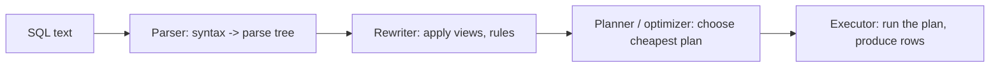
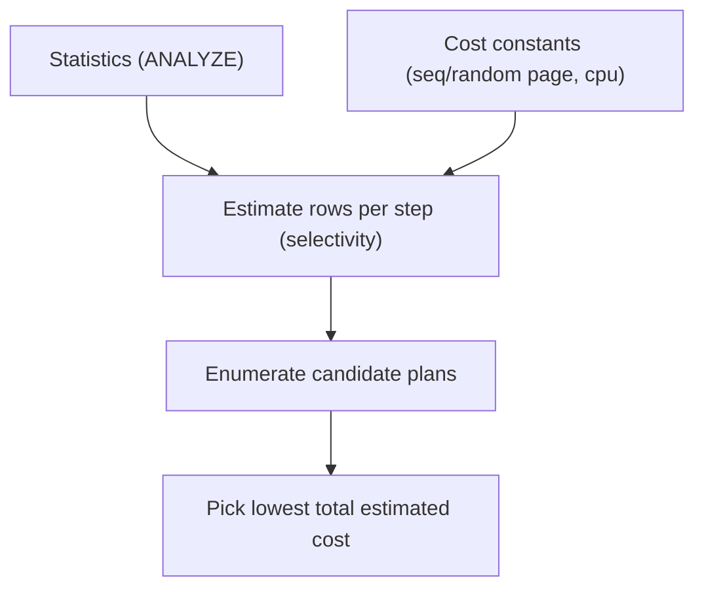
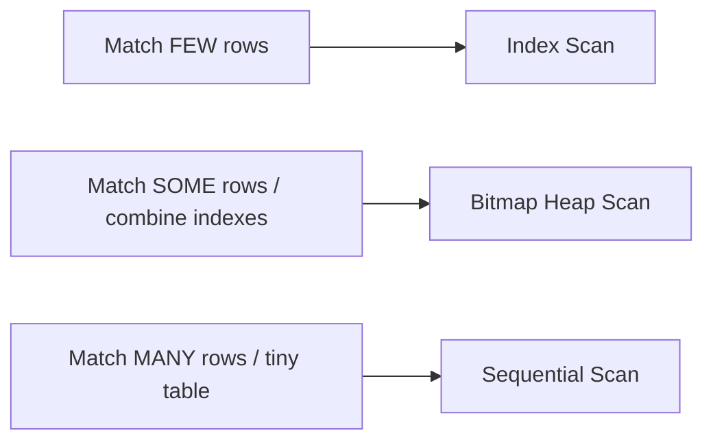
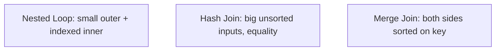

# Day 9 — Query Execution & the Planner

> Series: Database Engineering
> **Goal:** Read the engine's mind. Follow a query from text to result — parser → planner/optimizer → executor — understand scan and join algorithms, and learn to read `EXPLAIN`/`EXPLAIN ANALYZE` line by line to diagnose *why* a query is slow.

## Table of Contents
1. [The query lifecycle](#1-the-query-lifecycle)
2. [The planner: cost-based decisions](#2-the-planner-cost-based-decisions)
3. [Scan types: seq, index, bitmap](#3-scan-types-seq-index-bitmap)
4. [Join algorithms: nested loop, hash, merge](#4-join-algorithms-nested-loop-hash-merge)
5. [Reading EXPLAIN & EXPLAIN ANALYZE](#5-reading-explain--explain-analyze)
6. [Annotated real plan](#6-annotated-real-plan)
7. [Lab (diagnose 3 plans)](#7-lab-diagnose-3-plans)
8. [Self-Check](#8-self-check)
9. [Tomorrow](#9-tomorrow)

---

## 1. The query lifecycle

**In plain words:** Your SQL text takes a journey through four stations before you get rows back. Each station has a distinct job, and slowness can live in any of them. Knowing the stations tells you *where* to look when a query misbehaves.

- **Why:** "The query is slow" is meaningless until you know whether it's a bad *plan*, bad *stats*, an unavoidable amount of *work*, or lock/contention. The lifecycle localizes the problem.
- **What — four stages:**


*Four stages. The planner is where the intelligence — and most tunable slowness — lives.*

| Stage | Job | Where slowness comes from |
|---|---|---|
| Parser | Validate syntax, build parse tree | Rarely; only pathological SQL |
| Rewriter | Expand views, apply rules | View explosion, huge rewritten trees |
| Planner/optimizer | Enumerate plans, pick cheapest by cost | Bad row estimates → bad plan |
| Executor | Execute nodes, stream rows | Genuine work: scans, sorts, spills to disk |

- **When / How / Where:** Every query. You observe stages 3-4 with `EXPLAIN` (the plan) and `EXPLAIN ANALYZE` (the plan *plus* what actually happened).

---

## 2. The planner: cost-based decisions

**In plain words:** Postgres's planner is a cost estimator. For a query it can often execute many ways (which index? which join order? which join algorithm?), it estimates a *cost* for each candidate plan and picks the cheapest. Cost is an abstract number blending estimated page reads and CPU.

- **Why:** SQL is declarative (Day 1) — you say *what*, the planner decides *how*. Understanding its cost model explains its choices.
- **What — the inputs:**
  - **Statistics** (`pg_statistic`, via `ANALYZE`): row counts, most-common-values, histograms, null fraction, distinct counts.
  - **Cost constants:** `seq_page_cost` (1.0), `random_page_cost` (default 4.0 — random I/O assumed 4x sequential), `cpu_tuple_cost`, etc.
  - **Available indexes and their properties.**
- **How it decides:** estimate rows at each step (selectivity), multiply by per-operation costs, sum up the plan tree, compare candidates.


*The planner multiplies estimated rows by cost constants and picks the cheapest plan tree.*

> 🤔 **"Why does the planner sometimes make a terrible choice even with the right index?"**
> Almost always because its **row estimate is wrong**. The cost model is fine; it's being fed bad numbers. Stale statistics (no `ANALYZE` after a load), correlated columns it assumes are independent (city + zip), or skewed data can make it estimate "10 rows" when it's really 10 million — so it picks a nested loop that's catastrophic at the real size. The fix is almost never "tune the cost model"; it's "fix the estimate" (ANALYZE, extended statistics). On SSDs, one legitimate cost-model tweak is lowering `random_page_cost` (e.g., to 1.1) so the planner stops over-penalizing index/random I/O — verify for your storage.

> **Key diagnostic:** In `EXPLAIN ANALYZE`, compare **estimated rows** vs **actual rows** at each node. A large gap = the planner was misled = your root cause. This single habit solves most plan problems.

---

## 3. Scan types: seq, index, bitmap

**In plain words:** A scan is how the executor reads rows from a table. Three main flavors, each optimal for a different fraction of the table.

- **Why:** Choosing the scan is the planner's first big decision, and the right one depends entirely on *how many rows* the predicate returns.

| Scan type | Reads | Best when | Cost profile |
|---|---|---|---|
| **Sequential scan** | Every page in file order | Returning a large fraction of rows, or small table | Cheap per page (sequential I/O), but reads everything |
| **Index scan** | Index → heap fetch per match | Returning few rows (high selectivity) | Random I/O per row; great for few rows, terrible for many |
| **Bitmap heap scan** | Build a bitmap of matching pages from index(es), then read those pages in order | Medium selectivity; combining multiple indexes | Between the two; converts random into semi-sequential |
| **Index-only scan** | Index only (no heap), if covered + visible (Day 7) | Covered query, all-visible pages | Cheapest; skips heap |


*Selectivity drives the choice: few→index, medium→bitmap, many→seq.*

> 🤔 **"A sequential scan appeared in my plan — that's bad, right? Should I panic?"**
> No. A seq scan is often the *correct, fastest* choice. If a query returns 60% of a table, jumping around via an index (random I/O, one heap fetch per row) is far slower than reading the whole thing sequentially. Seq scans are only a problem when the query is actually *selective* (returns few rows) but the planner chose seq anyway — usually a stats or type-mismatch issue (Day 8). Judge a seq scan by selectivity, not by reflex.

✅ **Good scenario:** A "find one user by email" query uses an index scan and touches 3 pages. A "monthly revenue over all orders" query uses a seq scan and streams the table once — both optimal for their selectivity.

❌ **Bad scenario:** A highly selective `WHERE order_id = 42` did a seq scan over 50M rows because `order_id` was compared against a text literal (type mismatch disabled the index). One-row query, full-table read.

**When NOT to (fear seq scans):** On small tables (a few hundred rows), a seq scan is always cheaper than index overhead — don't index tiny lookup tables expecting a scan improvement.

---

## 4. Join algorithms: nested loop, hash, merge

**In plain words:** When two tables join, the executor picks *how* to match rows. Three algorithms, each a winner in different size/index situations.

- **Why:** The join algorithm often dominates a multi-table query's cost. A nested loop that's perfect for tiny inputs is catastrophic for large ones — and a wrong row estimate is exactly what causes that mismatch.

| Algorithm | How it works | Best when | Danger |
|---|---|---|---|
| **Nested loop** | For each row of outer, look up matches in inner (ideally via index) | Outer is small **and** inner has an index on the join key | Explodes if outer is large (O(n·m)) |
| **Hash join** | Build a hash table on the smaller side, probe with the larger | Large, unsorted inputs; equality joins | Needs memory; spills to disk if `work_mem` too small |
| **Merge join** | Sort both sides on join key, then merge in one pass | Both inputs already sorted (or cheaply sortable), large | Sorting cost if not pre-sorted |


*Three join strategies; the planner picks based on input sizes, indexes, and sort order.*

```sql
-- Force-observe each (for learning only — never in prod):
SET enable_hashjoin = off; SET enable_mergejoin = off;   -- forces nested loop
EXPLAIN ANALYZE SELECT * FROM orders o JOIN customers c USING (customer_id);
RESET ALL;   -- always reset
```

> 🤔 **"My join was instant on staging and times out in prod — same query, same indexes. Why?"**
> The classic cause: the planner chose a **nested loop** because it estimated the outer side had *few* rows (true on small staging data), but in prod the outer side is huge, turning the nested loop into billions of index lookups. The plan that's optimal at 100 rows is a disaster at 10M. Check `EXPLAIN ANALYZE` on prod-scale data: if you see a nested loop with a big "actual rows" on the outer and a large loop count on the inner, that's it. Fresh stats or a query rewrite pushes it to a hash join.

✅ **Good scenario:** "This customer's orders" — outer is one customer, inner `orders` has an index on `customer_id`. Nested loop with an index lookup: a handful of page reads.

❌ **Bad scenario:** A report joined two 20M-row tables. Stale stats made the planner pick a nested loop expecting small inputs; it ran for an hour. After `ANALYZE`, it switched to a hash join and finished in 12 seconds.

**When NOT to (force a join type):** Never ship `enable_hashjoin=off` etc. to production. They're learning/diagnostic tools. Fix estimates instead.

---

## 5. Reading EXPLAIN & EXPLAIN ANALYZE

**In plain words:** `EXPLAIN` shows the plan the planner *chose* (estimates only, doesn't run it). `EXPLAIN ANALYZE` actually *runs* it and shows what really happened — real times, real row counts. The gap between estimate and reality is your diagnostic gold.

- **Why:** This is the single most important skill for query tuning. Everything above shows up here.
- **What — how to read a plan:**
  - Plans are **trees**, read **inside-out / bottom-up**: the most indented nodes run first, feeding their parents.
  - Each node shows `(cost=startup..total rows=estimated width=bytes)`.
  - With `ANALYZE`: also `(actual time=start..end rows=real loops=N)`.
- **How — useful options:**

```sql
EXPLAIN SELECT ...;                              -- plan + estimates only (safe, no run)
EXPLAIN ANALYZE SELECT ...;                      -- actually runs it; real timings
EXPLAIN (ANALYZE, BUFFERS) SELECT ...;           -- + shared/read buffer hits (cache behavior)
EXPLAIN (ANALYZE, BUFFERS, FORMAT JSON) SELECT ...;  -- machine-readable
EXPLAIN (ANALYZE, BUFFERS, SETTINGS, WAL) SELECT ...; -- extra context (PG 13+)
```

> **Warning:** `EXPLAIN ANALYZE` **executes** the statement. On an `UPDATE`/`DELETE`/`INSERT` it *really changes data* — wrap it in `BEGIN; ... ROLLBACK;` to test safely.

**What to look for (the checklist):**
1. **Estimated vs actual rows** — big gap = bad stats (the root cause of most bad plans).
2. **Node with the biggest actual time** — that's your bottleneck; optimize there.
3. **Seq Scan on a large table with a selective filter** — missing/unused index.
4. **`Rows Removed by Filter: N`** (large) — reading rows only to throw them away; index the filter.
5. **Sort or Hash spilling to disk** (`Sort Method: external merge Disk: ...`) — `work_mem` too low.
6. **Nested Loop with high loop count** — possible join-algorithm mistake at scale.
7. **BUFFERS: `shared hit` vs `read`** — `read` means it went to disk (cold cache); `hit` means it came from the buffer pool (Day 10).

| Term in plan | Meaning |
|---|---|
| `Seq Scan` | Full table scan |
| `Index Scan` / `Index Only Scan` | Used an index (latter skips heap) |
| `Bitmap Heap Scan` + `Bitmap Index Scan` | Bitmap approach (medium selectivity / multi-index) |
| `Rows Removed by Filter` | Rows read then discarded (waste signal) |
| `Sort Method: external merge Disk` | Sort spilled to disk (raise `work_mem`) |
| `loops=N` | Inner side of a nested loop ran N times |
| `actual time=0.5..1200` | startup..total ms for this node |

---

## 6. Annotated real plan

**In plain words:** Let's read one plan end to end.

```sql
EXPLAIN (ANALYZE, BUFFERS)
SELECT c.email, count(*) AS orders
FROM customers c
JOIN orders o ON o.customer_id = c.customer_id
WHERE o.placed_at >= now() - interval '30 days'
GROUP BY c.email;
```

Sample output (annotated):
```
HashAggregate  (cost=... rows=980 width=40) (actual time=210..214 rows=1012 loops=1)   -- (5) GROUP BY via hash; est 980 vs actual 1012: good estimate
  Group Key: c.email
  ->  Hash Join  (cost=... rows=48000 width=32) (actual time=35..190 rows=47210 loops=1)  -- (4) join, est~actual: healthy
        Hash Cond: (o.customer_id = c.customer_id)
        ->  Bitmap Heap Scan on orders o  (rows=48000) (actual rows=47210 loops=1)     -- (2) medium-selectivity date filter
              Recheck Cond: (placed_at >= ...)
              Rows Removed by Filter: 0
              Buffers: shared hit=1200 read=340                                        -- 340 pages from disk, 1200 cached
              ->  Bitmap Index Scan on idx_orders_placed_at  (actual rows=47210)       -- (1) index gives matching page bitmap
        ->  Hash  (actual rows=10000 loops=1)                                          -- (3) build hash on customers (small side)
              ->  Seq Scan on customers c  (actual rows=10000)                         -- full scan of small table: correct
Planning Time: 0.6 ms
Execution Time: 216 ms                                                                  -- total
```

Reading it bottom-up: (1) the bitmap index scan on `placed_at` finds candidate pages → (2) bitmap heap scan reads them → (3) `customers` is small so it's seq-scanned and hashed → (4) hash join matches orders to customers → (5) hash aggregate does the `GROUP BY`. Estimates ≈ actuals everywhere, so the plan is trustworthy. The biggest time is the hash join's heap reads — if it were slow, more `work_mem` or a covering index would be the levers.

> 🤔 **"There are so many numbers — what do I actually look at first?"**
> Two things, in order: (1) find the node with the largest `actual time` — that's where the time goes, ignore the rest. (2) At that node, compare estimated vs actual `rows`. If they're close, the plan is honest and you're looking at genuine work (need a better index, more memory, or less data). If they diverge wildly, you have a stats problem — fix the estimate and the whole plan may change. Everything else is detail.

✅ **Good scenario:** An engineer sees `Rows Removed by Filter: 4,900,000` on a seq scan, adds an index on the filtered column, and the node becomes an index scan reading 100 rows — 50x faster.

❌ **Bad scenario:** Someone optimized the *cheapest* node in a plan for a day while the actual bottleneck — a disk-spilling sort at the top — went untouched. Always find the biggest `actual time` first.

**When NOT to (use EXPLAIN ANALYZE):** On a statement whose execution has side effects you can't afford (a destructive `DELETE` in prod). Use plain `EXPLAIN` for the estimate, or wrap in a rolled-back transaction.

---

## 7. Lab (diagnose 3 plans)

**Goal:** Diagnose and fix three deliberately-broken plans. Reuse the 2M-row `big_orders` from Day 7 (`ANALYZE` it first).

**Plan 1 — the missing index / wasteful filter:**
```sql
EXPLAIN (ANALYZE, BUFFERS)
SELECT * FROM big_orders WHERE customer_id = 4242;
-- Diagnose: Seq Scan? Look at "Rows Removed by Filter". Add an index on customer_id,
-- re-run, and record the scan-type change and time drop.
```

**Plan 2 — the stale-stats join mistake:**
```sql
-- Force stale stats: load a burst of new rows and DON'T analyze
INSERT INTO big_orders (customer_id, status, placed_at)
SELECT 9999, 'pending', now() FROM generate_series(1, 300000);

EXPLAIN (ANALYZE, BUFFERS)
SELECT * FROM big_orders o JOIN big_orders p ON p.customer_id = o.customer_id
WHERE o.customer_id = 9999;
-- Diagnose: compare estimated vs actual rows for customer_id=9999 (planner thinks few).
-- Watch for a nested loop with a huge loop count. Then run ANALYZE big_orders; and re-run.
-- Record how the join algorithm changes.
```

**Plan 3 — the disk-spilling sort:**
```sql
SET work_mem = '64kB';   -- artificially tiny to force a spill
EXPLAIN (ANALYZE, BUFFERS)
SELECT customer_id, count(*) FROM big_orders GROUP BY customer_id ORDER BY count(*) DESC;
-- Diagnose: find "Sort Method: external merge  Disk: ...kB" (spilled to disk).
-- Raise work_mem: SET work_mem = '64MB'; re-run; confirm "Sort Method: quicksort  Memory".
RESET work_mem;
```

**Tasks / Deliverable:** For each plan, write: (a) the scan/join node at fault, (b) estimated vs actual rows, (c) the one change you made, (d) before/after execution time. One paragraph each.

---

## 8. Self-Check
1. Name the four query lifecycle stages and the job of each.
2. What two kinds of inputs does the cost-based planner use to compare plans?
3. What single comparison in `EXPLAIN ANALYZE` most often reveals the root cause of a bad plan?
4. When is a sequential scan the *correct* choice, and when is it a red flag?
5. Contrast index scan, bitmap heap scan, and index-only scan by selectivity.
6. Match nested loop / hash join / merge join to the situation each wins.
7. Explain why a query can be fast on staging and time out in prod with the same plan shape.
8. What does `Rows Removed by Filter: <large>` tell you to do?
9. What does `Sort Method: external merge Disk` mean, and what knob addresses it?
10. Why must you be careful running `EXPLAIN ANALYZE` on an `UPDATE` or `DELETE`?

---

## 9. Tomorrow
**Day 10 — Buffer Pool, WAL & MVCC Intro:** the final internals layer. Where do pages live in RAM (shared buffers)? How does the write-ahead log guarantee durability and enable crash recovery? What are checkpoints? And a first real look at MVCC — the tuple versions and snapshots you glimpsed on Days 6 and 8 — previewing the deep isolation dive of Day 14.
