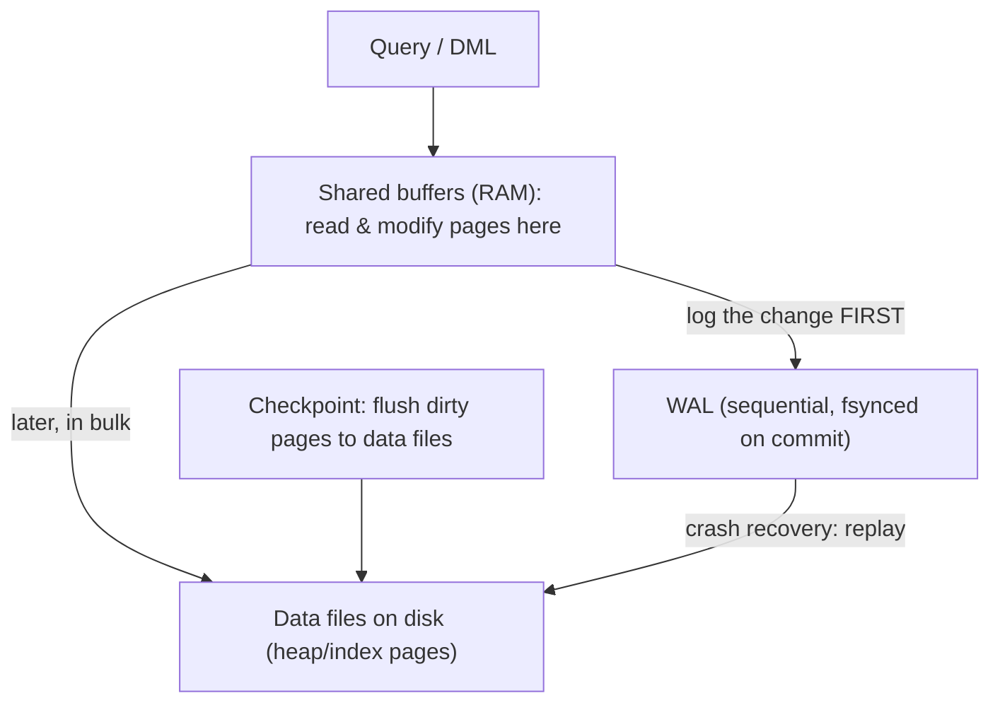
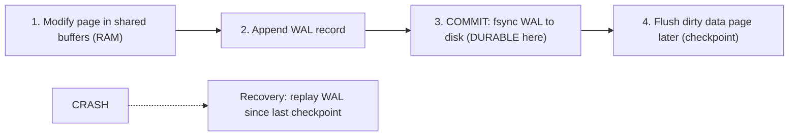
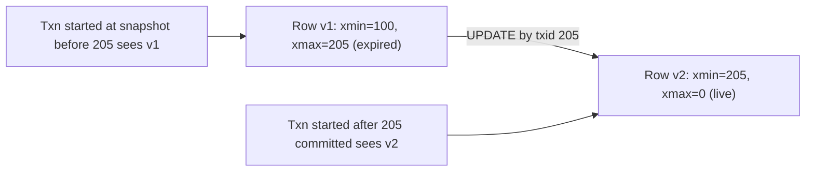
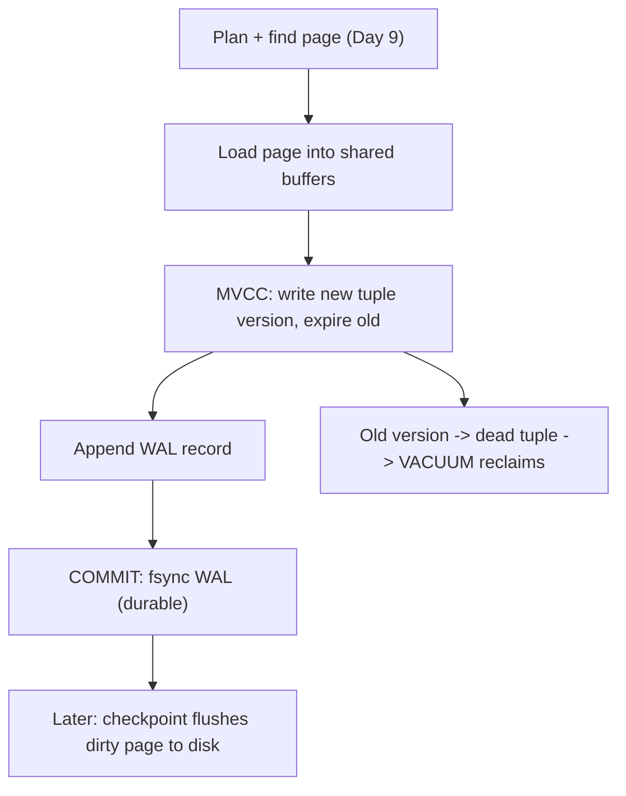

# Day 10 — Buffer Pool, WAL & MVCC Intro

> Series: Database Engineering
> **Goal:** Close the internals stage. Understand where pages live in RAM (shared buffers), how the write-ahead log guarantees durability and crash recovery, what checkpoints do, and get your first real look at MVCC — the tuple versions and snapshots behind every concurrent read.

## Table of Contents
1. [The big picture: RAM, log, disk](#1-the-big-picture-ram-log-disk)
2. [Shared buffers: the page cache](#2-shared-buffers-the-page-cache)
3. [WAL: why durability needs a log](#3-wal-why-durability-needs-a-log)
4. [Checkpoints](#4-checkpoints)
5. [MVCC intro: versions & snapshots](#5-mvcc-intro-versions--snapshots)
6. [Putting it together: the write path](#6-putting-it-together-the-write-path)
7. [Lab (observe WAL & checkpoints under load)](#7-lab-observe-wal--checkpoints-under-load)
8. [Self-Check](#8-self-check)
9. [Tomorrow](#9-tomorrow)

---

## 1. The big picture: RAM, log, disk

**In plain words:** A database juggles three places at once: fast volatile RAM (where it works), a sequential log (where it writes down what it's about to do, for safety), and slow durable disk (where data ultimately lives). Every design decision in this file is about making RAM fast, disk durable, and never losing a committed change even if the power dies mid-write.

- **Why:** These three subsystems are what make a database both *fast* and *durable* — a genuinely hard combination. Files (Day 1) give you one or the other, not both.
- **What:** The buffer pool (RAM cache of pages), the WAL (sequential durability log), and the data files (Day 6's heap/index pages on disk).
- **When / Where:** Every read and write touches this machinery. This is the physical realization of ACID's **D**urability and **I**solation (Day 1).


*Modify pages in RAM, log to WAL before commit, flush to data files later; on crash, replay WAL.*

> **Cross-reference:** System Design discusses caching layers and durability guarantees abstractly. Here you see the actual buffer pool and write-ahead log that implement them inside Postgres.

---

## 2. Shared buffers: the page cache

**In plain words:** Shared buffers is Postgres's own in-RAM cache of 8KB pages (Day 6). When you query a row, Postgres first checks if that page is already in shared buffers; if yes ("buffer hit"), no disk I/O. If not ("buffer read"), it fetches the page from disk into a buffer, then serves it. Modified pages are marked "dirty" and written back later.

- **Why:** Disk is orders of magnitude slower than RAM. Keeping hot pages cached is *the* single biggest performance lever. Yesterday's `EXPLAIN (BUFFERS)` `shared hit` vs `read` numbers come straight from here.
- **What:** A fixed-size shared-memory region of page-sized buffers, managed with a clock-sweep eviction policy (approximate LRU).
- **When / How — the key setting:** `shared_buffers` (config). Common guidance: ~25% of system RAM for a dedicated DB server (the OS page cache covers more on top). Verify current sizing guidance for your version and workload.
- **Where:** Every read consults it first.

```sql
SHOW shared_buffers;   -- current size

-- See what's actually cached right now (needs pg_buffercache extension)
CREATE EXTENSION IF NOT EXISTS pg_buffercache;
SELECT c.relname, count(*) AS buffers,
       pg_size_pretty(count(*) * 8192) AS cached
FROM pg_buffercache b JOIN pg_class c ON b.relfilenode = pg_relnode(c.oid)
GROUP BY c.relname ORDER BY buffers DESC LIMIT 10;

-- Cache hit ratio for your database (want this high, e.g. >99% for OLTP)
SELECT sum(heap_blks_hit) / nullif(sum(heap_blks_hit + heap_blks_read),0) AS hit_ratio
FROM pg_statio_user_tables;
```

| Term | Meaning |
|---|---|
| Buffer **hit** | Page found in shared buffers — no disk I/O (fast) |
| Buffer **read** | Page not cached — read from disk (slow) |
| **Dirty** page | Modified in RAM, not yet written to data file |
| **Clock sweep** | Eviction: least-recently-useful page gets reused |

> 🤔 **"More `shared_buffers` = faster, so should I give Postgres 90% of RAM?"**
> No — and this is a classic mistake. Postgres relies on the **OS page cache too** (a double-caching design), so giving it 90% starves the OS cache and other processes, and huge buffer pools can increase checkpoint I/O storms and eviction overhead. ~25% of RAM is the common starting point; measure your cache hit ratio and adjust. Contrast MySQL/InnoDB, whose `innodb_buffer_pool_size` is meant to be *large* (often 70-80% of RAM) because InnoDB largely bypasses the OS cache with `O_DIRECT`. Same idea, opposite tuning — don't copy MySQL advice into Postgres.

✅ **Good scenario:** An OLTP workload's hot tables + indexes fit in shared buffers; hit ratio is 99.8%; p99 latency is flat because almost nothing touches disk on the read path.

❌ **Bad scenario (the OLAP-on-OLTP sin, revisited from Day 1):** A giant analytical `GROUP BY` scans a 200GB table, evicting all the hot OLTP pages from shared buffers. Checkout queries suddenly go to disk for pages that were cached a second ago; latency spikes. This is *why* Day 1 said keep OLAP off the OLTP box.

**When NOT to (crank shared_buffers):** On a shared/containerized host, or when the working set already fits, adding buffers past the working-set size wastes RAM other processes need. Size to the working set + headroom, not to "all the RAM."

---

## 3. WAL: why durability needs a log

**In plain words:** The Write-Ahead Log is a promise kept in a notebook. Before Postgres changes a page, it first writes a description of the change to a sequential log and flushes *that* to disk. Rule: **log the intent before touching the data** ("write-ahead"). So even if the machine loses power a microsecond after commit, the change is safely in the log and can be replayed. The actual data pages can be written lazily, in bulk, later.

- **Why:** Writing scattered data pages to random disk locations on every commit would be brutally slow. The WAL turns durability into a *sequential append* (fast) and defers the slow random data-file writes. It's how you get both durability and speed.
- **What:** An append-only stream of change records in `pg_wal/`, each tagged with an LSN (Log Sequence Number). On `COMMIT`, the WAL up to that point is `fsync`ed to disk. Only then does the client get "committed."
- **When:** Every committing transaction. Also the basis of replication and point-in-time recovery (PITR).
- **How — the WAL protocol:**
  1. Modify the page in shared buffers (in RAM).
  2. Write a WAL record describing the change.
  3. On `COMMIT`, `fsync` the WAL (durability point).
  4. The dirty data page is flushed to its data file *later* (at a checkpoint or by the background writer).
  5. On crash, replay WAL from the last checkpoint to reconstruct any changes not yet in data files.


*Durability is achieved at the WAL fsync, not at the data-file write. Recovery replays the log.*

> 🤔 **"If the data file wasn't written yet, how is my committed transaction safe?"**
> Because the *WAL record was fsynced before we told you 'committed'*. The data page in RAM may still be dirty and unwritten — that's fine. If the server crashes, recovery reads the WAL from the last checkpoint forward and re-applies every logged change, reconstructing exactly the state you committed. Durability rides on the *log's* fsync, not the data file's. This decoupling is the central trick that lets databases be fast *and* durable.

> **Dark Side — the durability knobs:** `synchronous_commit = off` lets `COMMIT` return *before* the WAL is fsynced — much faster, but a crash can lose the last fraction of a second of "committed" transactions (they were acknowledged but not yet durable). `fsync = off` is even more dangerous (can corrupt the database on crash) and is for throwaway/test systems only. These trade the **D** in ACID for speed. Know exactly what you're giving up before turning them off — a lost confirmed payment is a very expensive optimization.

> **MySQL note:** InnoDB has the equivalent: the redo log (`ib_logfile*`) plus the doublewrite buffer, controlled by `innodb_flush_log_at_trx_commit` (1 = fully durable per commit; 2/0 = faster, weaker). Same durability-vs-speed trade under different names. Verify the setting on any MySQL you inherit.

✅ **Good scenario:** A power loss hits mid-workload. On restart, Postgres replays the WAL from the last checkpoint, recovers every committed transaction, discards partial uncommitted ones, and comes up consistent — automatically, no data loss.

❌ **Bad scenario:** A team set `synchronous_commit = off` globally to hit a latency target. A crash lost 800ms of "committed" orders — including captured payments. Customers were charged; the DB had no record. The latency win wasn't worth the reconciliation nightmare.

**When NOT to (relax WAL durability):** Never for money, inventory, or anything a user is told succeeded. It *can* be acceptable for a rebuildable analytics cache or bulk-load staging you can replay.

---

## 4. Checkpoints

**In plain words:** A checkpoint is Postgres flushing all currently-dirty pages from shared buffers out to the data files, and recording "everything up to this WAL point is now safely in the data files." It bounds how much WAL recovery would ever have to replay — the shorter the checkpoint interval, the faster recovery, but the more I/O during normal running.

- **Why:** Without checkpoints, crash recovery would have to replay the *entire* WAL history. Checkpoints create recovery starting points and let old WAL be recycled/archived.
- **What:** A periodic (or triggered) flush of dirty buffers + a checkpoint record in the WAL.
- **When triggered:** by time (`checkpoint_timeout`, e.g., 5 min) or by WAL volume (`max_wal_size`) — whichever comes first.
- **How — the tuning tension:**

| Frequent checkpoints | Infrequent checkpoints |
|---|---|
| Fast crash recovery (little WAL to replay) | Slow crash recovery (lots of WAL) |
| More steady I/O (frequent flushing) | I/O comes in bigger bursts |
| Smaller `pg_wal` | Larger `pg_wal` (needs disk space) |

`checkpoint_completion_target` (default ~0.9) spreads a checkpoint's writes over most of the interval to avoid a sudden I/O spike ("checkpoint storm").

```sql
SHOW checkpoint_timeout;   -- e.g. 5min
SHOW max_wal_size;         -- checkpoint also triggers when WAL grows this much

-- Watch checkpoint activity (PG 15+: pg_stat_checkpointer; earlier: pg_stat_bgwriter)
SELECT * FROM pg_stat_bgwriter;   -- checkpoints_timed, checkpoints_req, buffers_checkpoint
```

> **Dark Side — checkpoint storms:** If checkpoints are too infrequent (huge `max_wal_size`) and then one fires, Postgres may have to flush gigabytes of dirty pages at once, saturating disk I/O and stalling everything for seconds. If `checkpoints_req` (requested, i.e., WAL-volume-triggered) greatly exceeds `checkpoints_timed`, your `max_wal_size` is too small and checkpoints fire too often. Tune both, and lean on `checkpoint_completion_target` to smooth the writes.

**When NOT to:** Don't set `checkpoint_timeout` very low "to be safe" — you'll pay constant flush I/O for recovery speed you rarely need. Balance recovery-time objective against steady-state I/O.

---

## 5. MVCC intro: versions & snapshots

**In plain words:** MVCC (Multi-Version Concurrency Control) is how Postgres lets many transactions read and write the same data at once without blocking each other's reads. The trick: never overwrite a row in place. Every `UPDATE` writes a *new* version of the row and marks the old one as expired. Each transaction sees a consistent *snapshot* — the set of row versions that were committed as of when it started (or its statement started). Readers never block writers; writers never block readers.

- **Why:** In a lock-based system, a reader would block a writer and vice versa, killing concurrency. MVCC gives every reader a stable, consistent view without locking — the foundation of Postgres's isolation (ACID's **I**).
- **What — the machinery (you met it on Days 6 & 8):**
  - Each tuple carries `xmin` (creating txid) and `xmax` (expiring txid) in its header (Day 6).
  - A transaction gets a **snapshot**: which txids are committed/in-progress. A tuple is *visible* if its `xmin` committed before the snapshot and its `xmax` did not.
  - `UPDATE` = insert new version (new `xmin`) + set old version's `xmax`. `DELETE` = set `xmax`. The old versions become **dead tuples** → **bloat** → cleaned by **VACUUM** (Day 8).


*One logical row, two physical versions. Which you see depends on your snapshot.*

- **When / Where:** Every concurrent read/write. Isolation *levels* (how "frozen" your snapshot is) are Day 14's deep dive.

> 🤔 **"If nothing is overwritten, doesn't the table grow forever with old versions?"**
> It would — that's exactly why `VACUUM` exists (Day 8). MVCC's cost is dead tuples (bloat); autovacuum reclaims them once no snapshot can still see them. This is also why a single long-open transaction is so damaging (Day 8): it holds an old snapshot, so vacuum can't remove versions newer than it, and bloat piles up database-wide. MVCC's elegance (no read locks) is paid for with vacuum discipline. There's no free lunch — you trade lock contention for space management.

> **MySQL note:** InnoDB also does MVCC, but stores old versions in the **undo log** (rollback segments) rather than inline in the table like Postgres. Consequences: InnoDB tables bloat less from updates (old versions live elsewhere) but long transactions bloat the *undo log* instead, and InnoDB must reconstruct old versions from undo (extra work). Postgres keeps versions inline (simpler reads, more table bloat). Same concept, meaningfully different mechanics — a favorite senior interview contrast.

✅ **Good scenario:** A long analytics read runs for 30 seconds while thousands of OLTP writes commit. Thanks to MVCC, the reader sees a stable snapshot from its start — a consistent report — while writers proceed unblocked. No locks, no waiting.

❌ **Bad scenario:** The same long read is left as an *open transaction* for hours (a stuck connection). Now vacuum can't clean any tuple newer than its snapshot; the hot tables bloat by gigabytes; queries slow across the DB. MVCC's gift becomes a liability when transactions overstay.

**When NOT to (rely on default snapshots):** The default READ COMMITTED level takes a *new* snapshot per statement, so two statements in one transaction can see different data. When you need a frozen view across statements (a multi-query report, a consistent backup read), use REPEATABLE READ — the Day 14 topic.

---

## 6. Putting it together: the write path

**In plain words:** Let's trace one `UPDATE orders SET status='paid' WHERE order_id=42` end to end, using everything from Days 6-10.

1. **Planner** (Day 9) picks an index scan on the PK to find `order_id=42`.
2. The target **page** (Day 6) is loaded into **shared buffers** (§2) if not already cached.
3. MVCC (§5): Postgres writes a **new tuple version** with the new status (new `xmin`) and sets the old version's `xmax`. If it fits on the same page and `status` weren't indexed, this could be a HOT update (Day 6/8); since `status` may be indexed, index entries update too (write amplification, Day 8).
4. A **WAL record** (§3) describing the change is appended.
5. On `COMMIT`, the **WAL is fsynced** — the change is now durable (§3).
6. The **dirty page** stays in RAM; it's flushed to the data file later, at a **checkpoint** (§4) or by the background writer.
7. The old tuple version is now dead; **VACUUM** (Day 8) will reclaim it once no snapshot needs it.
8. On any **crash** before step 6 completes, recovery **replays the WAL** (§3) from the last checkpoint and reconstructs the committed state.


*One UPDATE, touching every subsystem from Days 6-10.*

---

## 7. Lab (observe WAL & checkpoints under load)

**Goal:** Watch the buffer pool, WAL, and checkpoints react to real writes.

```sql
-- Setup
CREATE EXTENSION IF NOT EXISTS pg_buffercache;
CREATE TABLE load_test (id BIGINT PRIMARY KEY, v INT, note TEXT);

-- 1. WAL generation: measure how much WAL a workload produces
SELECT pg_current_wal_lsn() AS before \gset
INSERT INTO load_test SELECT g, g, md5(g::text) FROM generate_series(1, 500000) g;
SELECT pg_size_pretty(pg_wal_lsn_diff(pg_current_wal_lsn(), :'before')) AS wal_generated;
-- Report bytes of WAL for 500k inserts.

-- 2. See the table's pages populate shared buffers
SELECT count(*) AS buffers, pg_size_pretty(count(*)*8192) AS cached
FROM pg_buffercache b JOIN pg_class c ON b.relfilenode = pg_relnode(c.oid)
WHERE c.relname = 'load_test';

-- 3. Cache hit ratio: cold vs warm
--    (a) Restart or evict, run a scan, check pg_statio_user_tables -> many heap_blks_read.
--    (b) Run the same scan again -> now heap_blks_hit dominates (served from RAM).
SELECT heap_blks_read, heap_blks_hit FROM pg_statio_user_tables WHERE relname='load_test';
SELECT count(*) FROM load_test;   -- run twice; compare read vs hit before/after
SELECT heap_blks_read, heap_blks_hit FROM pg_statio_user_tables WHERE relname='load_test';

-- 4. Force and observe a checkpoint
SELECT checkpoints_timed, checkpoints_req, buffers_checkpoint FROM pg_stat_bgwriter;
CHECKPOINT;   -- manual checkpoint (superuser); flushes dirty buffers now
SELECT checkpoints_timed, checkpoints_req, buffers_checkpoint FROM pg_stat_bgwriter; -- counters moved

-- 5. WAL amplification vs indexes (ties back to Day 8):
--    Add 3 indexes, repeat the 500k insert with the WAL measurement from step 1.
--    Report how much MORE WAL is generated (indexes are WAL-logged too).
CREATE INDEX ON load_test(v); CREATE INDEX ON load_test(note); CREATE INDEX ON load_test((id%7));
TRUNCATE load_test;
SELECT pg_current_wal_lsn() AS before2 \gset
INSERT INTO load_test SELECT g, g, md5(g::text) FROM generate_series(1, 500000) g;
SELECT pg_size_pretty(pg_wal_lsn_diff(pg_current_wal_lsn(), :'before2')) AS wal_with_indexes;

-- 6. MVCC visibility across snapshots (two psql sessions):
--    Session A: BEGIN ISOLATION LEVEL REPEATABLE READ; SELECT v FROM load_test WHERE id=1;
--    Session B: UPDATE load_test SET v = 999 WHERE id=1; COMMIT;
--    Session A: SELECT v FROM load_test WHERE id=1;  -- still sees OLD value (frozen snapshot!)
--    Session A: COMMIT; SELECT ...;                  -- now sees 999
```

**Tasks / Deliverable:**
1. Report WAL bytes for 500k inserts *without* vs *with* 3 indexes (step 1 vs step 5). Explain the gap (Day 8 write amplification is also WAL amplification).
2. Show the cache hit ratio jump between the first and second scan (step 3).
3. Confirm the checkpoint counters moved (step 4).
4. Demonstrate the frozen snapshot in step 6 and explain, in MVCC terms, why session A didn't see the committed update until it committed. (This is the doorway to Day 14.)

---

## 8. Self-Check
1. Name the three storage locations a write touches and the role of each.
2. What's the difference between a buffer "hit" and a buffer "read," and where did you see these on Day 9?
3. Why is 25% of RAM a common `shared_buffers` target for Postgres but 70-80% for InnoDB's buffer pool?
4. State the write-ahead rule in one sentence.
5. If a committed transaction's data page wasn't written to disk yet, how is it durable?
6. What exactly does `synchronous_commit = off` trade away, and when is that unacceptable?
7. What is a checkpoint, and what two things trigger one?
8. What is a "checkpoint storm," and which counters hint your `max_wal_size` is too small?
9. In MVCC, what do `xmin` and `xmax` mean, and what happens to a row on `UPDATE`?
10. Why does one long-open transaction bloat the whole database, connecting MVCC to VACUUM?

---

## 9. Tomorrow
**Day 11 — Transactions & Concurrency (preview):** we build on today's MVCC foundation to go deep on transaction boundaries, the four isolation levels (READ COMMITTED → SERIALIZABLE), the anomalies each prevents (dirty/non-repeatable/phantom reads), locking, and deadlocks — the Day 14 isolation dive begins here. You've now finished Stage 2 (Internals): you understand storage, indexes, planning, and durability. You're no longer *using* a database — you're starting to *engineer* one.
