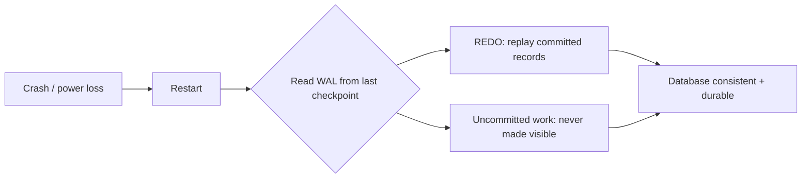
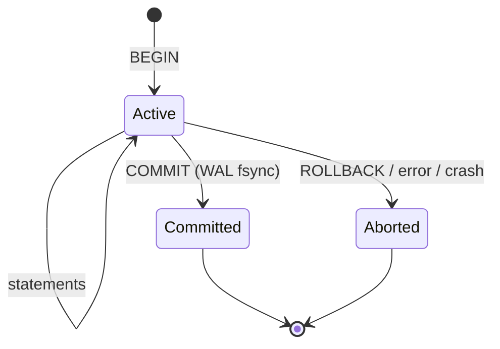
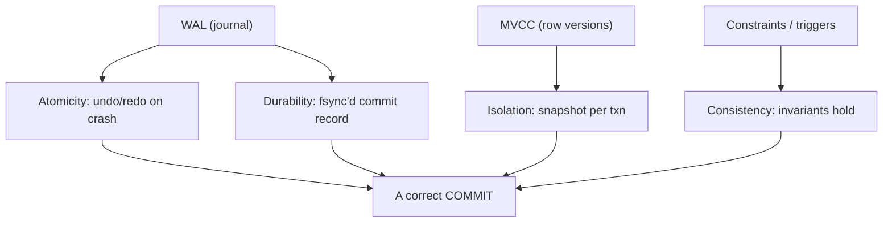

# Day 11 — ACID In Depth

> Series: Database Engineering
> **Goal:** Understand what each ACID guarantee actually promises, how PostgreSQL implements them (WAL, transactions, MVCC), and where each guarantee saves you — or bites you when misunderstood.

## Table of Contents
1. [In plain words](#in-plain-words)
2. [Why ACID exists](#why-acid-exists)
3. [Atomicity](#atomicity--all-or-nothing)
4. [Consistency](#consistency--the-rules-hold)
5. [Isolation](#isolation--as-if-alone)
6. [Durability](#durability--it-sticks)
7. [How WAL powers durability + atomicity](#how-wal-powers-durability--atomicity)
8. [ACID vs BASE](#acid-vs-base)
9. [Lab](#lab-force-a-rollback-mid-transaction)
10. [Self-Check](#self-check)
11. [Tomorrow](#tomorrow)

---

## In plain words

**In plain words:** A transaction is like transferring money between two friends by physically handing over cash. Either *both* things happen — the cash leaves your hand AND lands in theirs — or *neither* does. There is no universe where the cash vanishes mid-air. ACID is the database's written promise that this "all-or-nothing, and it stays done" behavior holds even if the power dies mid-transfer.

ACID = **A**tomicity, **C**onsistency, **I**solation, **D**urability. Four promises a database makes about how a *transaction* (a group of statements you want treated as one unit) behaves.

**Verify versions when building:** examples below tested against **PostgreSQL 17** (also valid on 16/18). PG 18 (released Sept 2025) is current stable as of 2026; nothing here changed across those versions.

```sql
-- A transaction is bracketed by BEGIN ... COMMIT (or ROLLBACK)
BEGIN;                                   -- start the unit of work
  UPDATE accounts SET balance = balance - 100 WHERE id = 1;  -- debit
  UPDATE accounts SET balance = balance + 100 WHERE id = 2;  -- credit
COMMIT;                                   -- make it all real, atomically
```

---

## Why ACID exists

**Why:** Real systems crash mid-operation, two users click "buy the last ticket" at the same millisecond, and disks lie about whether data is written. Without formal guarantees, every application would have to hand-roll crash recovery and concurrency control. ACID pushes that burden into the database, which does it once, correctly, for everyone.

**What:** A contract. Not a feature you enable — it's the default behavior of transactions in a relational DB like PostgreSQL.

**When:** Any time correctness matters more than raw throughput: payments, inventory, bookings, ledgers, user auth. Basically any write where "sort of saved" is unacceptable.

**Where:** Applied at the *transaction* boundary. A single statement is itself an implicit transaction; multiple statements need explicit `BEGIN`/`COMMIT`.

> 🤔 **"Isn't ACID just a fancy word for 'the database saves my data'?"**
> No. Saving is only the D. The hard, valuable parts are A (partial writes never leak out), I (concurrent transactions don't corrupt each other's view), and C (your invariants survive). A key-value store can "save data" and still let two writers clobber each other and leave half-finished state visible.

---

## Atomicity — all or nothing

**In plain words:** A light switch, not a dimmer. The transaction is either fully ON (committed) or fully OFF (rolled back). Never stuck halfway.

**Why:** So a crash or error in the middle of a multi-step change can't leave the database in a half-updated, self-contradictory state.

**What:** All statements in a transaction succeed together or none take effect.

**How (Postgres):** Every change is written to the **Write-Ahead Log (WAL)** *before* the data files change. On `COMMIT`, a commit record is flushed. On `ROLLBACK` or crash, uncommitted changes are simply never applied / are undone via MVCC visibility (the old row versions remain visible).

### Concrete failure example
Bank transfer: debit account 1, then the app throws an exception before crediting account 2.

```sql
BEGIN;
  UPDATE accounts SET balance = balance - 100 WHERE id = 1;  -- $100 leaves acct 1
  -- 💥 app crashes here, connection dies, no COMMIT ever arrives
COMMIT;   -- never reached
```
Result with atomicity: Postgres rolls back automatically on disconnect. Account 1 keeps its $100. **Without atomicity**, $100 would have evaporated — debited but never credited.

> ✅ **Good scenario (where it saves you):** At a fintech, a payout job debits the merchant wallet then calls an external ledger insert. The ledger insert fails on a constraint. Because both live in one transaction, the debit auto-reverses. No reconciliation ticket, no angry merchant.

> ❌ **Bad scenario (the pain without it):** An e-commerce team splits "decrement stock" and "create order" into two separate auto-committed statements with app logic between them. A deploy restarts the pod between them → stock decremented, no order created → "phantom out-of-stock" bugs that take a week to trace.

**When NOT to (rely on it):** Atomicity only covers work *inside one database transaction*. Calls to external services (Stripe, email, S3) are NOT rolled back. Don't assume `ROLLBACK` un-sends an email — use the outbox pattern (see Day 18 & System Design).

---

## Consistency — the rules hold

**In plain words:** Bumper rails on a bowling lane. Whatever you do, the ball (your data) can't end up in a state that breaks the defined rules.

**Why:** So business invariants (balances non-negative, foreign keys valid, unique emails) are never violated by a committed transaction.

**What:** A transaction moves the DB from one *valid* state to another *valid* state, honoring all constraints, triggers, and cascades.

**How (Postgres):** `CHECK`, `NOT NULL`, `UNIQUE`, `FOREIGN KEY`, exclusion constraints, and triggers are evaluated; if any fails, the whole transaction aborts.

### Concrete failure example
```sql
ALTER TABLE accounts ADD CONSTRAINT bal_nonneg CHECK (balance >= 0);

BEGIN;
  UPDATE accounts SET balance = balance - 500 WHERE id = 1;  -- would go to -300
COMMIT;
-- ERROR: new row for relation "accounts" violates check constraint "bal_nonneg"
-- Whole transaction aborts → consistency preserved.
```

> 🤔 **"Is the C in ACID the same 'consistency' as in the CAP theorem?"**
> No — this trips up almost everyone. ACID's C = *your data obeys DB constraints*. CAP's C = *every read sees the latest write across nodes* (a distributed-systems replication property). They are unrelated concepts that share a word. See System Design (CAP) for the other one.

> ✅ **Good scenario:** A ticketing platform uses a `UNIQUE(seat_id, event_id)` constraint. Two buyers race for seat 14A; the DB lets exactly one commit and rejects the other with a unique violation. No double-booked seat ever exists.

> ❌ **Bad scenario (when misused):** A team encodes all invariants in app code and none in the DB "for flexibility." A buggy migration script writes negative balances directly. The DB happily stores them because nothing forbids it. Months of corrupt rows.

**When NOT to (over-rely):** Consistency enforces *declared* rules only. If you never declared the constraint, the DB won't invent it. Consistency is only as strong as your schema.

---

## Isolation — as if alone

**In plain words:** Soundproof booths. Many people record podcasts at once, but each acts as if they're alone in the studio — no bleed-through of half-said sentences.

**Why:** Concurrent transactions must not see each other's uncommitted or intermediate state, or you get corruption and anomalies.

**What:** The degree to which concurrent transactions are shielded from one another. Controlled by *isolation levels* (Day 12).

**How (Postgres):** MVCC (Day 14) — each transaction sees a *snapshot* of the DB. Readers don't block writers and vice versa. Postgres default level is **Read Committed**.

> 🤔 **"If Postgres has isolation, are all my concurrency bugs impossible?"**
> No. The *default* (Read Committed) still permits non-repeatable reads, phantoms, and write skew. Isolation is a dial, not a magic shield. You must pick the right level (or use explicit locks) for your invariant. Day 12 & 13 cover this.

> ✅ **Good scenario:** An analytics query runs for 40 seconds on the orders table while thousands of orders are inserted. Thanks to MVCC snapshots, the report sees a consistent point-in-time view and never blocks the writers.

> ❌ **Bad scenario:** Two "reserve last item" transactions both `SELECT quantity` (sees 1), both decrement, both commit under Read Committed with a naive read-modify-write → oversold. Fixed with `SELECT ... FOR UPDATE` (Day 13) or higher isolation.

**When NOT to (crank it up):** Serializable isolation is safest but adds overhead and serialization failures you must retry. Don't default everything to Serializable; target it where write skew actually threatens an invariant.

---

## Durability — it sticks

**In plain words:** Signing a contract in permanent ink, then photographing it. Once done, even if the office burns down, the record survives.

**Why:** A user who sees "payment confirmed" must never lose that payment to a crash one second later.

**What:** Once `COMMIT` returns success, the change survives crashes, power loss, and restarts.

**How (Postgres):** The WAL commit record is `fsync`'d to durable storage before COMMIT reports success. On restart, Postgres replays WAL to recover any committed-but-not-yet-flushed data pages.

### Concrete failure example
```sql
BEGIN;
  INSERT INTO payments(id, amount) VALUES (42, 999);
COMMIT;   -- returns OK → WAL fsync'd
-- 💥 power dies 10ms later, before the heap page hit disk
-- On restart: Postgres replays WAL → payment 42 is there. Durable.
```

> 🤔 **"I set `synchronous_commit = off` for speed — still fully durable, right?"**
> No. That trades durability for latency: COMMIT returns before the WAL is fsync'd, so a crash can lose the last fraction of a second of *committed* transactions (the DB stays *consistent*, just missing recent commits). Fine for logs/metrics, dangerous for payments.

> ✅ **Good scenario:** A payments service keeps `synchronous_commit = on` (default). A datacenter power blip kills the node; on reboot, every confirmed charge is intact. Zero reconciliation.

> ❌ **Bad scenario (when misused):** A team sets `fsync = off` in production "because staging was slow." A crash corrupts data files with no recoverable WAL. `fsync = off` is a benchmarking-only footgun — never in prod.

**When NOT to (full durability):** For ephemeral/regenerable data (session caches, derived aggregates, ETL scratch tables) relaxing durability (`synchronous_commit=off`, `UNLOGGED` tables) is a legitimate speed win.

```sql
-- UNLOGGED skips WAL entirely: fast writes, but table is TRUNCATED after a crash.
CREATE UNLOGGED TABLE scratch_metrics (k text, v bigint);
```

---

## How WAL powers durability + atomicity

**In plain words:** WAL is a journal. Before the DB touches the actual ledger pages, it scribbles "I'm about to do X" in an append-only diary and flushes *that* to disk. The diary is cheap to write (sequential). The real pages can be updated lazily. If we crash, we re-read the diary and finish/undo the work.

```mermaid
sequenceDiagram
    participant App
    participant PG as "Postgres backend"
    participant WAL as "WAL (fsync'd)"
    participant Heap as "Data pages (lazy)"
    App->>PG: BEGIN; UPDATE ...
    PG->>WAL: append change record
    App->>PG: COMMIT
    PG->>WAL: append COMMIT record + fsync
    WAL-->>PG: durable
    PG-->>App: COMMIT OK
    PG--)Heap: flush dirty pages later (checkpoint)
```
*WAL is flushed at commit; heap pages catch up lazily at checkpoint.*


*Recovery = replay committed WAL, discard uncommitted — atomicity + durability together.*


*A transaction's lifecycle: only Committed is durable and visible.*

Key WAL settings to know:

| Setting | Meaning | Prod guidance |
|---|---|---|
| `fsync` | Force writes to disk | **on** always in prod |
| `synchronous_commit` | Wait for WAL flush before COMMIT returns | `on` for money; `off`/`local` for logs |
| `wal_level` | Detail in WAL (`replica`/`logical`) | `replica` min for replication (Day 20) |
| `full_page_writes` | Guard against torn pages | **on** |
| `checkpoint_timeout` | How often heap catches up to WAL | tune for IO smoothness |

> **Dark Side:** WAL grows until a checkpoint + archiving lets it recycle. If archiving stalls (`archive_command` failing) or a replication slot is abandoned, `pg_wal` fills the disk and the primary halts. Monitor `pg_wal` size and slot lag (Day 20).

---

## ACID vs BASE

**In plain words:** ACID says "be correct, even if slower." BASE (Basically Available, Soft state, Eventually consistent) says "stay available and fast; correctness catches up later." Many big systems mix both.

| Dimension | ACID (Postgres, RDBMS) | BASE (Dynamo/Cassandra-style) |
|---|---|---|
| Consistency | Strong, immediate | Eventual |
| Availability under partition | May reject writes | Stays writable |
| Transactions | Multi-row, multi-table | Often single-key only |
| Best for | Money, inventory, bookings | Feeds, carts, telemetry, sessions |
| Failure mode | Abort + retry | Conflicting versions to reconcile |

> Cross-ref (System Design): the CAP theorem and eventual consistency debate is the "BASE" side of this table. Read it alongside this for the distributed view.

**When NOT to use full ACID:** Global, write-heavy, partition-tolerant workloads (activity feeds, IoT ingestion at millions/sec) often accept BASE. Forcing strict ACID there can cripple availability.

### The interplay: ACID letters aren't independent

**In plain words:** The four letters lean on each other. Durability without atomicity would durably save half a transfer. Isolation without atomicity would let others see work that later vanishes. WAL is the shared machinery that delivers both A and D; MVCC (Day 14) delivers I; constraints deliver C.


*One `COMMIT` is correct only because all four mechanisms cooperate.*

> 🤔 **"Can I get atomicity without durability, or pick just the letters I want?"**
> Partly — you *tune* durability (`synchronous_commit`, `UNLOGGED`) independently, and isolation is a per-transaction dial (Day 12). But you can't opt out of atomicity or consistency in Postgres; they're structural. The practical lever is: keep A + C always, dial I to the cheapest safe level, and relax D only for regenerable data. That's the real-world "which letters matter here" decision every DB engineer makes per table.

> **Dark Side:** Developers often assume a `COMMIT` that returns success means "everything downstream is done too." It only means *this database's* state is durable. Distributed correctness across services needs saga/outbox patterns, not a single COMMIT — a lesson that bites teams migrating a monolith to microservices.

---

## Lab: force a rollback mid-transaction

**Goal:** Prove atomicity and durability with your own eyes.

```bash
# Start psql (PostgreSQL 17). Adjust connection as needed.
psql -U postgres -d labdb
```

```sql
-- 1) Setup
CREATE TABLE accounts (id int PRIMARY KEY, balance numeric NOT NULL);
INSERT INTO accounts VALUES (1, 500), (2, 500);
ALTER TABLE accounts ADD CONSTRAINT bal_nonneg CHECK (balance >= 0);

-- 2) A transaction that will fail on the constraint
BEGIN;
  UPDATE accounts SET balance = balance - 100 WHERE id = 1;  -- 500 -> 400 (ok so far)
  SELECT id, balance FROM accounts;   -- you can SEE 400 inside the txn
  UPDATE accounts SET balance = balance - 999 WHERE id = 1;  -- 400 -> -599 💥
-- ERROR: violates check constraint "bal_nonneg"
-- The transaction is now in "aborted" state.
  SELECT 1;   -- ERROR: current transaction is aborted, commands ignored until end
ROLLBACK;    -- clean up

-- 3) Verify atomicity: NOTHING changed. balance still 500.
SELECT id, balance FROM accounts;   -- both rows = 500
```

```sql
-- 4) Manual rollback mid-transaction (no error, you decide to abort)
BEGIN;
  UPDATE accounts SET balance = balance - 100 WHERE id = 1;  -- looks good inside
  -- change your mind:
ROLLBACK;
SELECT id, balance FROM accounts WHERE id = 1;   -- still 500

-- 5) SAVEPOINT: partial rollback (nested atomicity)
BEGIN;
  UPDATE accounts SET balance = balance - 50 WHERE id = 1;   -- 500 -> 450
  SAVEPOINT s1;
  UPDATE accounts SET balance = balance - 999 WHERE id = 1;  -- would break check
-- ERROR ...
  ROLLBACK TO SAVEPOINT s1;   -- undo only the bad step, keep the -50
  UPDATE accounts SET balance = balance + 10 WHERE id = 2;
COMMIT;
SELECT * FROM accounts;   -- id1=450, id2=510  (the good work survived)
```

```sql
-- 6) Durability quick-look: confirm WAL settings
SHOW fsync;                  -- on
SHOW synchronous_commit;     -- on
SHOW wal_level;              -- replica
```

**Stretch:** In one terminal `BEGIN; UPDATE ...;` (no commit), then `kill -9` the psql/backend or `SELECT pg_terminate_backend(pid)`. Reconnect — the uncommitted change is gone. Atomicity on disconnect.

> **MySQL callout:** Same ACID guarantees only with the **InnoDB** engine (default since 5.5). The old **MyISAM** engine is NOT transactional — no atomicity, no rollback, table-level locks. If a legacy MySQL table uses MyISAM, none of this lab applies. Also, MySQL implicitly commits on DDL (`CREATE`/`ALTER`), so you can't roll back schema changes — Postgres CAN (DDL is transactional).

---

## Self-Check
1. In your own words, what does the "A" guarantee, and how does WAL make it possible on a crash?
2. Why is ACID's "C" *not* the same as CAP's "C"? Give one example of each.
3. What anomalies can still happen at Postgres's default isolation level?
4. What exactly does `COMMIT` returning success promise about disk state?
5. What does `synchronous_commit = off` trade away, and when is that acceptable?
6. Why is `fsync = off` a prod footgun even though it's faster?
7. What is a `SAVEPOINT` and how does `ROLLBACK TO SAVEPOINT` differ from `ROLLBACK`?
8. Why does atomicity NOT cover an email you sent via an external API mid-transaction? What pattern fixes this?
9. Name one workload where relaxing durability (UNLOGGED table) is a good idea, and one where it's dangerous.
10. In MySQL, why does engine choice (InnoDB vs MyISAM) decide whether you get ACID at all?

## Tomorrow
**Day 12 — Isolation Levels & Anomalies:** we crack open the "I" — reproduce dirty reads, non-repeatable reads, phantoms, and write skew with two live psql sessions, and see exactly why Postgres defaults to Read Committed while MySQL defaults to Repeatable Read.
