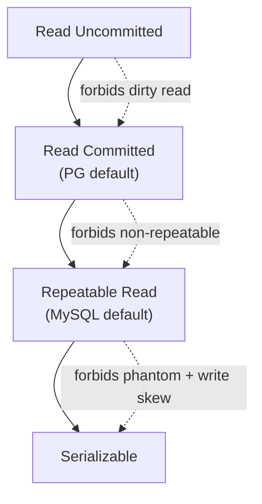

# Day 12 — Isolation Levels & Anomalies

> Series: Database Engineering
> **Goal:** Master the "I" in ACID — the four SQL isolation levels, the anomalies each permits, and how to *reproduce every anomaly live with two psql sessions*. Know what PostgreSQL actually defaults to vs MySQL.

## Table of Contents
1. [In plain words](#in-plain-words)
2. [The dial: four isolation levels](#the-dial-four-isolation-levels)
3. [The anomalies](#the-anomalies)
4. [What Postgres actually does](#what-postgres-actually-does)
5. [Dirty read (and why PG can't show it)](#anomaly-1-dirty-read)
6. [Non-repeatable read](#anomaly-2-non-repeatable-read)
7. [Phantom read](#anomaly-3-phantom-read)
8. [Write skew (the serializable-only bug)](#anomaly-4-write-skew)
9. [Postgres vs MySQL defaults](#postgres-vs-mysql-defaults)
10. [Lab](#lab-reproduce-each-anomaly-with-2-psql-sessions)
11. [Self-Check](#self-check)
12. [Tomorrow](#tomorrow)

---

## In plain words

**In plain words:** Isolation levels are like privacy settings for concurrent transactions. At the loosest setting everyone can peek at everyone else's unfinished drafts (chaos). At the strictest, each transaction runs as if it's the *only* one in the world, one after another. Between those extremes you trade a little correctness for a lot of speed. Your job is to pick the loosest setting that still protects your specific invariant.

**Verify versions when building:** tested on **PostgreSQL 17** (behavior identical 16–18). MySQL notes assume **8.x / InnoDB**.

The SQL standard defines the levels by *which anomalies they forbid* — not by implementation. That's the key mental model.

---

## The dial: four isolation levels

**Why:** More isolation = more correctness but more blocking / more aborts to retry. You want the cheapest level that still forbids the anomaly that would break *your* data.

**What / How:** Set per-transaction:

```sql
BEGIN ISOLATION LEVEL READ COMMITTED;   -- or REPEATABLE READ / SERIALIZABLE
-- ...
COMMIT;

-- Or set the session/transaction default:
SET default_transaction_isolation = 'repeatable read';
```

| Level | Dirty read | Non-repeatable read | Phantom | Write skew | Cost |
|---|---|---|---|---|---|
| Read Uncommitted | allowed* | allowed | allowed | allowed | cheapest |
| Read Committed | ✗ | allowed | allowed | allowed | cheap (PG default) |
| Repeatable Read | ✗ | ✗ | ✗ (in PG) | allowed | medium |
| Serializable | ✗ | ✗ | ✗ | ✗ | most |

\* In PostgreSQL, Read Uncommitted behaves *exactly* like Read Committed — dirty reads are impossible thanks to MVCC (Day 14). The level exists only for SQL-standard compatibility.


*Each step up the ladder forbids one more class of anomaly, at rising cost.*

> 🤔 **"So Serializable everywhere = never think about concurrency again?"**
> Tempting, but no. Serializable makes Postgres *detect* dangerous interleavings and abort one transaction with a `40001 serialization_failure`. Your app MUST catch that error and retry — if it doesn't, you just moved the bug from "silent corruption" to "unhandled exception." It also costs throughput. Use it deliberately.

---

## The anomalies

**In plain words:** Anomalies are the specific ways concurrent transactions can lie to each other. Learn them by their story, not their name.

- **Dirty read:** You read a value another txn wrote but *hasn't committed* — it may vanish (rollback).
- **Non-repeatable read:** You read row X twice in one txn and get *different values* because someone updated & committed in between.
- **Phantom read:** You run the same `WHERE` query twice and get *different sets of rows* because someone inserted/deleted matching rows.
- **Write skew:** Two txns each read an overlapping set, each makes a decision that's fine *individually*, but together they break an invariant. The nastiest — only Serializable stops it.

```mermaid
sequenceDiagram
    participant T1 as "Txn A"
    participant DB
    participant T2 as "Txn B"
    Note over T1,T2: Non-repeatable read
    T1->>DB: SELECT balance WHERE id=1  (=500)
    T2->>DB: UPDATE balance=800 WHERE id=1; COMMIT
    T1->>DB: SELECT balance WHERE id=1  (=800 ❗ changed)
```
*Same row, same txn, two different answers — the non-repeatable read.*

---

## What Postgres actually does

**In plain words:** Postgres does NOT implement isolation with dirty-locking like textbooks imply. It uses **MVCC snapshots** (Day 14). Under the hood:

- **Read Committed** (default): each *statement* gets a fresh snapshot at statement start. So a later statement in the same txn can see newer committed data → non-repeatable reads happen.
- **Repeatable Read**: the *whole transaction* uses one snapshot taken at the first query. Also blocks phantoms (stronger than the SQL standard requires). This is "snapshot isolation."
- **Serializable (SSI)**: snapshot isolation PLUS a monitor that detects read/write dependency cycles and aborts one transaction to guarantee the result equals *some* serial order. This is what stops write skew.

> 🤔 **"Postgres defaults to Read Committed — isn't Repeatable Read strictly better, so why not default to it?"**
> Read Committed is chosen because it rarely aborts and behaves intuitively for typical CRUD (each statement sees the latest committed data). Repeatable Read can throw `40001` on concurrent updates you must retry, and holds one snapshot for the whole txn (long txns see stale data). Default = fewest surprises for the common app. You opt up when an invariant needs it.

---

## Anomaly 1: Dirty read

**Why care:** Reading uncommitted data means acting on a value that might be rolled back → phantom money, ghost inventory.

**In Postgres: you literally cannot reproduce it** — even at `READ UNCOMMITTED`, MVCC only ever shows committed row versions. Demo that it's blocked:

```sql
-- Session A
BEGIN ISOLATION LEVEL READ UNCOMMITTED;   -- PG treats as READ COMMITTED
  UPDATE accounts SET balance = 9999 WHERE id = 1;  -- uncommitted!
-- (do NOT commit yet)

-- Session B
BEGIN ISOLATION LEVEL READ UNCOMMITTED;
  SELECT balance FROM accounts WHERE id = 1;   -- sees OLD value, NOT 9999
COMMIT;
```

> ✅ **Good scenario:** A reporting tool at a bank runs at Read Committed and *never* sees a half-applied transfer, even if an operator's big update is mid-flight. Postgres' no-dirty-reads guarantee means auditors trust the numbers.

> ❌ **Bad scenario (elsewhere):** Older SQL Server / Sybase code sprinkled `WITH (NOLOCK)` (= Read Uncommitted) "for speed," then a rolled-back batch made a dashboard show revenue that never existed → wrong exec decision. Postgres users avoid this entire class of bug.

**When NOT to worry:** In Postgres, never — dirty reads don't exist. This anomaly is mostly a lesson about *other* engines' hint flags.

---

## Anomaly 2: Non-repeatable read

Happens at **Read Committed**. Fix by moving to **Repeatable Read**.

```sql
-- ===== Session A (Read Committed, the default) =====
BEGIN;   -- default READ COMMITTED
SELECT balance FROM accounts WHERE id = 1;   -- 500

-- ===== Session B =====
BEGIN;
UPDATE accounts SET balance = 800 WHERE id = 1;
COMMIT;

-- ===== back in Session A (same txn!) =====
SELECT balance FROM accounts WHERE id = 1;   -- 800  ❗ NON-REPEATABLE
COMMIT;
```

Now block it:

```sql
-- ===== Session A =====
BEGIN ISOLATION LEVEL REPEATABLE READ;
SELECT balance FROM accounts WHERE id = 1;   -- 500  (snapshot pinned)

-- ===== Session B ===== UPDATE ...=800; COMMIT; (as above)

-- ===== Session A again =====
SELECT balance FROM accounts WHERE id = 1;   -- still 500 ✅ repeatable
COMMIT;
```

> ✅ **Good scenario:** A monthly invoice job reads a customer's line items, computes a subtotal, then reads again to render a summary. Under Repeatable Read both reads agree even if the customer edits an item mid-run → invoice never self-contradicts.

> ❌ **Bad scenario:** A "check-then-act" balance transfer at Read Committed reads 500, decides "enough for -300," but between read and update another txn drained it. The update goes negative if there's no CHECK constraint. Fix: Repeatable Read + retry, or `SELECT FOR UPDATE` (Day 13).

**When NOT to (upgrade):** If you never read the same datum twice in a transaction, non-repeatable reads can't bite you — Read Committed is fine and cheaper.

---

## Anomaly 3: Phantom read

Same query, different *row set*, because rows were inserted/deleted. Read Committed allows it; Postgres **Repeatable Read blocks it** (stronger than standard).

```sql
-- ===== Session A (Read Committed) =====
BEGIN;
SELECT count(*) FROM orders WHERE status = 'pending';   -- 3

-- ===== Session B =====
BEGIN; INSERT INTO orders(status) VALUES ('pending'); COMMIT;

-- ===== Session A =====
SELECT count(*) FROM orders WHERE status = 'pending';   -- 4 ❗ PHANTOM
COMMIT;
```

At `REPEATABLE READ` Session A keeps seeing 3 (its snapshot). ✅

> ✅ **Good scenario:** A capacity report counts active sessions and shows a chart. At Repeatable Read every aggregate in the report is computed against one frozen snapshot, so the pie slices actually sum to the total.

> ❌ **Bad scenario:** A "enforce max 5 bookings per room" check counts existing bookings (=4), then inserts a 5th — but two concurrent txns both counted 4 and both inserted → 6 bookings. This is really *write skew via phantom* — only Serializable (next) or an explicit constraint/lock stops it.

**When NOT to (worry):** Point lookups by primary key can't phantom. Phantoms only matter for range/predicate queries.

---

## Anomaly 4: Write skew

**In plain words:** Two doctors are on call. Rule: at least one must stay on call. Each independently checks "is the *other* still on?" — sees yes — and each takes themselves off. Both reads were valid; the combination breaks the invariant. Nobody is on call. No single row conflict, so lower levels never notice.

Write skew slips through **Repeatable Read (snapshot isolation)**. Only **Serializable** catches it.

```sql
-- doctors(name text, on_call boolean); two rows both on_call = true

-- ===== Session A (Alice going off) =====
BEGIN ISOLATION LEVEL REPEATABLE READ;
SELECT count(*) FROM doctors WHERE on_call;   -- 2  (>=1, safe to leave)
UPDATE doctors SET on_call = false WHERE name = 'alice';

-- ===== Session B (Bob going off, concurrently) =====
BEGIN ISOLATION LEVEL REPEATABLE READ;
SELECT count(*) FROM doctors WHERE on_call;   -- 2 (its snapshot, safe)
UPDATE doctors SET on_call = false WHERE name = 'bob';
COMMIT;

-- ===== Session A =====
COMMIT;   -- ❗ succeeds under REPEATABLE READ → 0 on call. INVARIANT BROKEN.
```

Now with Serializable:

```sql
-- Both sessions: BEGIN ISOLATION LEVEL SERIALIZABLE; ... same steps ...
-- Second COMMIT fails:
-- ERROR: could not serialize access due to read/write dependencies among transactions
-- Detail: Reason code: ... Cancelled on identification as a pivot.
-- HINT: The transaction might succeed if retried.
```

Your app must **catch `40001` and retry**.

```mermaid
sequenceDiagram
    participant A as "Txn A (Alice off)"
    participant DB
    participant B as "Txn B (Bob off)"
    A->>DB: SELECT count(on_call)=2  (safe)
    B->>DB: SELECT count(on_call)=2  (safe)
    A->>DB: UPDATE alice off
    B->>DB: UPDATE bob off; COMMIT
    A->>DB: COMMIT
    Note over A,DB: RepeatableRead: both commit → 0 on call ❌<br/>Serializable: A aborts 40001 ✅
```
*Write skew: two individually-valid decisions combine to break an invariant.*

> 🤔 **"Why can't Repeatable Read catch write skew? It blocks phantoms and non-repeatable reads!"**
> Because snapshot isolation only detects conflicts when two txns write the *same row* (a write-write conflict → "could not serialize"). Write skew involves *disjoint* writes based on *overlapping reads*. No two txns touch the same row, so snapshot isolation sees nothing wrong. Serializable adds read-dependency tracking (SSI) to catch exactly this.

> ✅ **Good scenario:** A trading system enforces "portfolio must stay net-positive" across many rows. Under Serializable, concurrent trades that would jointly violate it get one aborted+retried. Correct without hand-written locks.

> ❌ **Bad scenario:** The on-call example above in production paged nobody during an outage because two engineers went off-call "safely" at once, at Repeatable Read.

**When NOT to (use Serializable):** If your invariants are all single-row (enforceable by UNIQUE/CHECK/`FOR UPDATE`), you don't need Serializable's overhead. Reach for it when invariants span multiple rows you only *read*.

---

## Postgres vs MySQL defaults

| | PostgreSQL | MySQL (InnoDB) |
|---|---|---|
| Default level | **Read Committed** | **Repeatable Read** |
| Read Uncommitted | acts as Read Committed | actually allows dirty reads |
| Repeatable Read blocks phantoms? | **Yes** (snapshot) | Partly — via next-key locks on locking reads; plain SELECT uses consistent snapshot |
| Serializable impl | SSI (optimistic, aborts) | Locking (S-locks on reads) — more blocking, fewer aborts |
| Write skew at RR | possible | possible (plain reads) |

> **MySQL callout:** MySQL's Repeatable Read is famous for the "phantom on locking read" subtlety and for **next-key locking** (locks gaps between index rows) to prevent phantoms on `SELECT ... FOR UPDATE`. Its Serializable turns every plain `SELECT` into `SELECT ... LOCK IN SHARE MODE`, so it prevents anomalies by *blocking* rather than *aborting* like Postgres. Don't assume identical behavior when porting.

> **Dark Side:** Setting a session default of Serializable app-wide (via connection pool init) can silently 40001-storm under load if the app doesn't retry. Always pair Serializable with a retry wrapper (exponential backoff, cap ~3–5 tries).

---

## Lab: reproduce each anomaly with 2 psql sessions

Open **two** terminals. Left = Session A, Right = Session B.

```sql
-- SETUP (run once, either session)
DROP TABLE IF EXISTS accounts, orders, doctors;
CREATE TABLE accounts (id int PRIMARY KEY, balance numeric NOT NULL);
INSERT INTO accounts VALUES (1, 500);
CREATE TABLE orders (id serial PRIMARY KEY, status text);
INSERT INTO orders(status) VALUES ('pending'),('pending'),('pending');
CREATE TABLE doctors (name text PRIMARY KEY, on_call boolean);
INSERT INTO doctors VALUES ('alice', true), ('bob', true);
```

**Exercise 1 — Non-repeatable read (Read Committed):** run the [non-repeatable section](#anomaly-2-non-repeatable-read). Confirm A sees 500 then 800.

**Exercise 2 — Block it:** repeat at `REPEATABLE READ`. Confirm A sees 500 both times.

**Exercise 3 — Phantom:** run the [phantom section](#anomaly-3-phantom-read) at Read Committed (count 3 → 4), then at Repeatable Read (stays 3).

**Exercise 4 — Write skew + Serializable abort:** run the [doctors section](#anomaly-4-write-skew). First at Repeatable Read (both commit, 0 on-call = bug). Reset data, then at Serializable (second commit → `40001`).

```sql
-- Inspect current settings any time:
SHOW default_transaction_isolation;   -- read committed
SELECT current_setting('transaction_isolation');  -- inside a txn
-- Reset the doctors table between runs:
UPDATE doctors SET on_call = true;
```

**Retry wrapper (pseudocode) you'd wrap Serializable txns in:**
```text
for attempt in 1..5:
    begin serializable
    try: do work; commit; break
    catch SQLSTATE '40001' or '40P01':   # serialization_failure / deadlock
        rollback; sleep(backoff * 2^attempt); continue
```

---

## Self-Check
1. Which anomalies does Read Committed permit? Which does Postgres Repeatable Read additionally forbid?
2. Why can't you reproduce a dirty read in PostgreSQL even at Read Uncommitted?
3. Explain the difference between a non-repeatable read and a phantom read with a one-line example each.
4. What is write skew, and why does snapshot isolation (Repeatable Read) miss it?
5. What SQLSTATE does Serializable throw on conflict, and what MUST your app do about it?
6. Postgres defaults to Read Committed; MySQL to Repeatable Read. Why might each choice make sense?
7. How does Postgres implement Serializable differently from MySQL (abort vs block)?
8. Give an invariant best protected by a UNIQUE constraint, and one best protected by Serializable — why the difference?
9. In Read Committed, does each statement or each transaction get a fresh snapshot? Why does that cause non-repeatable reads?
10. Why is "Serializable everywhere, no retry logic" a dangerous default?

## Tomorrow
**Day 13 — Locking & Deadlocks:** the other tool for concurrency — explicit locks. Shared vs exclusive, row vs table, `SELECT FOR UPDATE`, how Postgres *detects* deadlocks, lock ordering to prevent them, and advisory locks. Lab: create a deadlock on purpose, then engineer it away.
