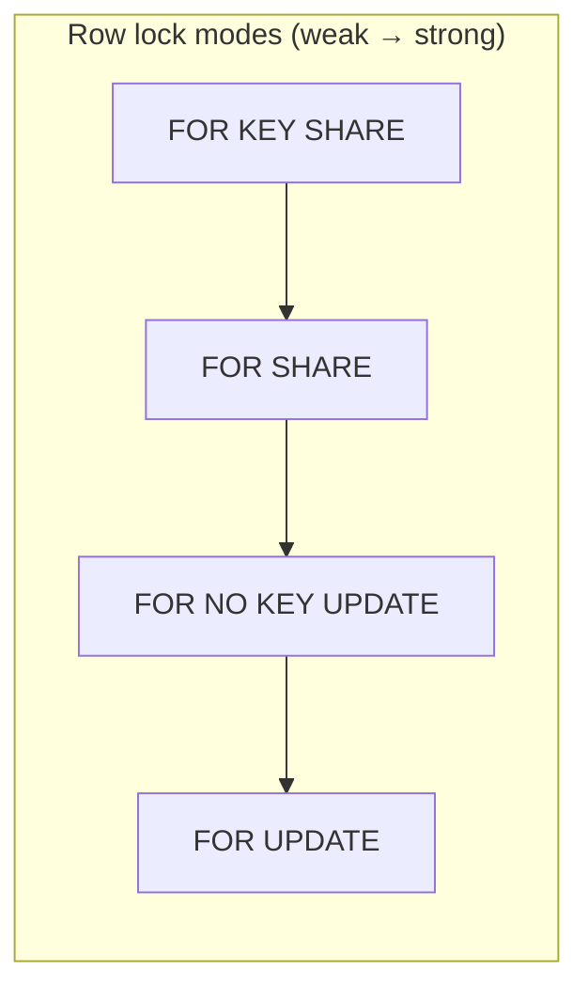
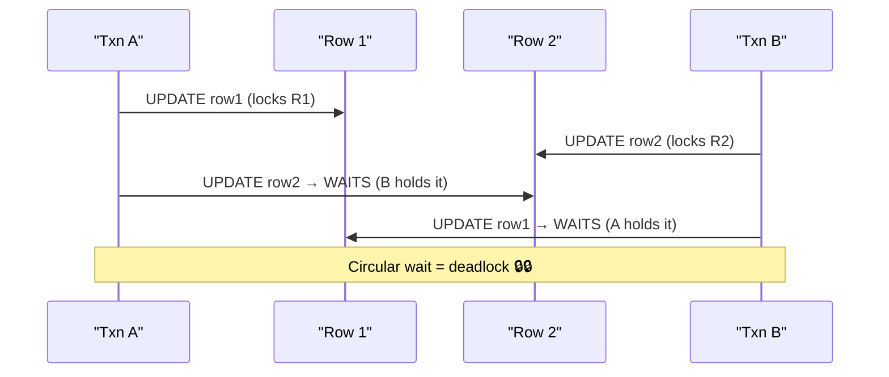
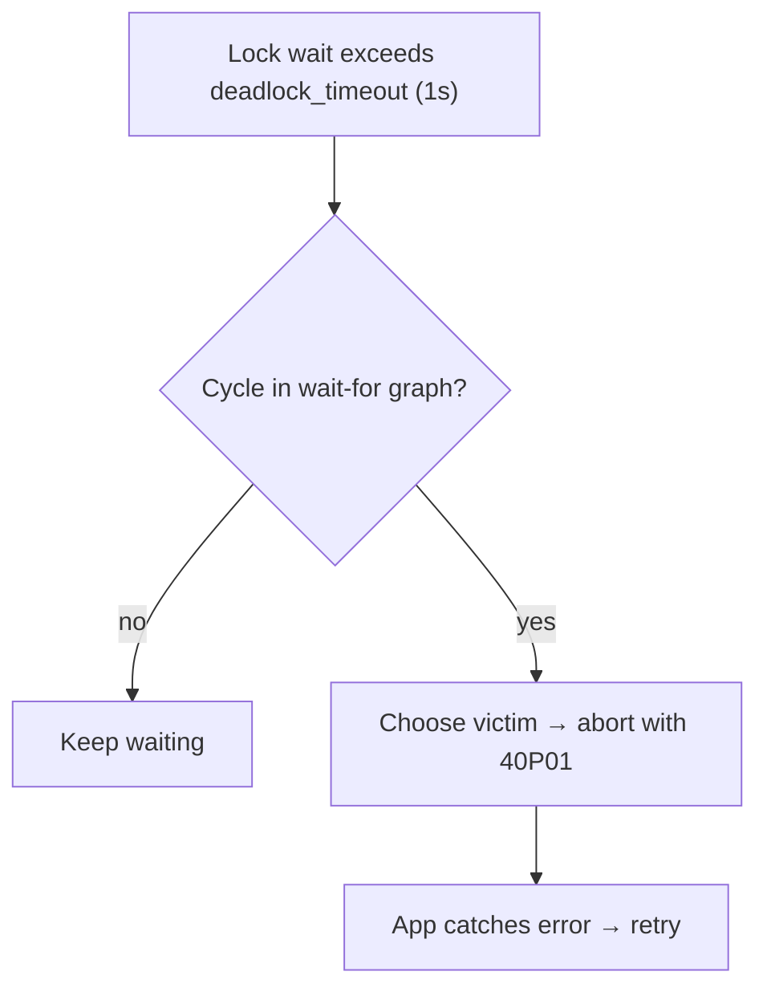

# Day 13 — Locking & Deadlocks

> Series: Database Engineering
> **Goal:** Learn PostgreSQL's locking model — shared vs exclusive, row vs table, `SELECT ... FOR UPDATE`, how deadlocks form and are detected, lock ordering to prevent them, and advisory locks. Then create and resolve a real deadlock.

## Table of Contents
1. [In plain words](#in-plain-words)
2. [Shared vs exclusive](#shared-vs-exclusive-locks)
3. [Row-level vs table-level](#row-level-vs-table-level-locks)
4. [SELECT FOR UPDATE and friends](#select-for-update-and-friends)
5. [How deadlocks form](#how-deadlocks-form)
6. [Deadlock detection](#deadlock-detection)
7. [Lock ordering to prevent deadlocks](#lock-ordering-to-prevent-deadlocks)
8. [Advisory locks](#advisory-locks)
9. [Observability](#observability-who-holds-what)
10. [Lab](#lab-create-then-resolve-a-deadlock)
11. [Self-Check](#self-check)
12. [Tomorrow](#tomorrow)

---

## In plain words

**In plain words:** Locks are like a bathroom door. A **shared lock** is a reading-room policy — many people can read the same book at once (all fine). An **exclusive lock** is a single-occupancy bathroom — one person in, door bolted, everyone else waits. A **deadlock** is two people each holding the key the other needs, both refusing to leave until they get it. Someone has to be forced out.

While Day 12's MVCC lets readers avoid locks entirely, *writers* still need locks to not stomp each other. Locking is how the DB serializes conflicting *writes*.

**Verify versions when building:** examples on **PostgreSQL 17** (identical semantics 16–18). `deadlock_timeout` default = **1s**.

**Why:** MVCC solves reader/writer contention, but two writers touching the same row must be ordered. Locks provide that ordering and let you build "reserve exactly one" logic.

**What:** Automatic locks (taken by `UPDATE`/`DELETE`/DDL) plus explicit locks (`SELECT FOR UPDATE`, `LOCK TABLE`, advisory).

**When:** Whenever you do read-modify-write on a hot row, enforce single-winner semantics, or run DDL.

**Where:** Held for the *duration of the transaction* and released on COMMIT/ROLLBACK. There is no manual "unlock" (except advisory).

> 🤔 **"Postgres has MVCC so readers never block — doesn't that mean I never deal with locks?"**
> No. MVCC means *reads* don't block *writes* and vice versa. But **write-write** conflicts still block: two `UPDATE`s on the same row, the second waits for the first to commit. And you *opt into* read locks with `FOR UPDATE` when you need "check-then-act" safety. Locks are alive and well; MVCC just hid the common case.

---

## Shared vs exclusive locks

**In plain words:** Shared = "I'm reading, others may read too." Exclusive = "I'm changing it, nobody else touches it."

| Property | Shared (S) | Exclusive (X) |
|---|---|---|
| Concurrent same-mode holders | many | one |
| Blocks readers? | no (other S ok) | conflicting modes wait |
| Blocks writers? | yes | yes |
| Taken by | `FOR SHARE`, FK checks | `UPDATE`, `DELETE`, `FOR UPDATE` |

Postgres has a rich lattice of *table-level* lock modes (8 of them) and *row-level* modes. You mostly care about a few.


*Row-lock strength ladder — stronger modes conflict with more others.*

---

## Row-level vs table-level locks

**In plain words:** A row lock bolts one seat; a table lock closes the whole theater. Prefer the smallest lock that does the job — table locks kill concurrency.

- **Row-level:** Acquired automatically by `UPDATE`/`DELETE` on the affected rows, or explicitly by `SELECT ... FOR UPDATE`. Other txns can still work on *other* rows.
- **Table-level:** `ALTER TABLE`, `CREATE INDEX` (non-concurrent), `VACUUM FULL`, `TRUNCATE`, or explicit `LOCK TABLE`. Can block everything.

```sql
-- Row lock: only rows matching WHERE are locked
BEGIN;
UPDATE inventory SET qty = qty - 1 WHERE sku = 'ABC';  -- locks that one row
-- other txns can UPDATE sku='XYZ' freely
COMMIT;

-- Table lock: brutal, blocks concurrent readers depending on mode
LOCK TABLE inventory IN ACCESS EXCLUSIVE MODE;  -- almost never do this by hand
```

> **Dark Side:** `ALTER TABLE ... ADD COLUMN` with a volatile default, or `CREATE INDEX` (without `CONCURRENTLY`), takes an `ACCESS EXCLUSIVE` lock and blocks ALL queries on the table — a classic cause of "the deploy took the site down for 4 minutes." Use `CREATE INDEX CONCURRENTLY` and add nullable columns first. (More in Day 17.)

---

## SELECT FOR UPDATE and friends

**In plain words:** `FOR UPDATE` says "I'm about to change these rows — reserve them for me so nobody else can change them until I'm done." It turns a read into a claim.

```sql
-- Safe "reserve the last item" (fixes the oversell from Day 12)
BEGIN;
SELECT qty FROM inventory WHERE sku = 'ABC' FOR UPDATE;  -- locks the row
-- if qty > 0:
UPDATE inventory SET qty = qty - 1 WHERE sku = 'ABC';
COMMIT;   -- lock released; the next waiter now sees the decremented value
```

| Clause | Meaning | Use for |
|---|---|---|
| `FOR UPDATE` | Exclusive row lock | read-modify-write, reservations |
| `FOR NO KEY UPDATE` | Weaker; allows FK ref | updating non-key columns |
| `FOR SHARE` | Shared row lock | "don't let this change while I read it" |
| `FOR KEY SHARE` | Weakest; taken by FKs | rarely explicit |

**Handling contention politely:**
```sql
-- Don't wait at all — fail fast if locked:
SELECT ... FOR UPDATE NOWAIT;      -- ERROR 55P03 if row is locked

-- Skip locked rows — great for job queues (each worker grabs a free row):
SELECT id FROM jobs WHERE state='ready'
ORDER BY id LIMIT 1
FOR UPDATE SKIP LOCKED;            -- workers never contend on the same job
```

> ✅ **Good scenario:** A ride-hailing backend uses `FOR UPDATE SKIP LOCKED` to hand each free driver-matching task to exactly one worker across 20 pods. Zero double-dispatch, no external queue needed.

> ❌ **Bad scenario:** A payments team does `SELECT balance` (no lock), checks in app code, then `UPDATE`. Under load, two refunds both read the old balance → double refund. They needed `FOR UPDATE`.

**When NOT to:** Don't `FOR UPDATE` rows you're only reporting on — you'll serialize readers needlessly. And don't hold the lock across a slow external call (see below).

> 🤔 **"Can I hold a row lock while I call Stripe, then commit?"**
> Please don't. Locks live until COMMIT. If you `SELECT FOR UPDATE`, call a 3-second payment API, then commit, you've blocked every other writer of that row for 3 seconds — a self-inflicted throughput cliff and a deadlock magnet. Do external calls *outside* the transaction; use idempotency keys / the outbox pattern.

---

## How deadlocks form

**In plain words:** Two transactions grab locks in *opposite order*. A holds row 1 and wants row 2; B holds row 2 and wants row 1. Neither yields. Circular wait.


*Opposite lock-acquisition order → circular wait → deadlock.*

```sql
-- Session A                          -- Session B
BEGIN;                                BEGIN;
UPDATE t SET v=1 WHERE id=1;          UPDATE t SET v=1 WHERE id=2;
-- (A holds row 1)                    -- (B holds row 2)
UPDATE t SET v=1 WHERE id=2;          UPDATE t SET v=1 WHERE id=1;
-- A waits for B                      -- B waits for A  → DEADLOCK
```

---

## Deadlock detection

**In plain words:** Postgres doesn't prevent deadlocks; it *detects* them. After a lock has waited `deadlock_timeout` (default 1s), Postgres runs a cycle-detection algorithm on the wait-for graph. If it finds a cycle, it picks one transaction as the *victim*, aborts it with SQLSTATE `40P01`, and lets the other proceed.

```
ERROR:  deadlock detected
DETAIL: Process 123 waits for ShareLock on transaction 456; blocked by process 789.
        Process 789 waits for ShareLock on transaction 455; blocked by process 123.
HINT:   See server log for query details.
```

Your app should catch `40P01` and **retry** (same wrapper as Serializable's `40001` from Day 12).


*Detection, not prevention: wait, check for a cycle, sacrifice a victim.*

> 🤔 **"A deadlock means my database is corrupted / broken, right?"**
> No. A deadlock is a *handled, expected* concurrency event. Postgres cleanly rolls back one transaction — no corruption, no lost data. The only "bug" is an app that doesn't retry, or a *frequent* deadlock rate signaling bad lock ordering. Rare deadlocks under high contention are normal.

---

## Lock ordering to prevent deadlocks

**In plain words:** If everyone always grabs locks in the *same order* (e.g., always the lower id first), a cycle is impossible — there's no "opposite order" to create one.

```sql
-- Transfer money without deadlocks: always lock the lower id first
BEGIN;
-- deterministic order regardless of from/to direction
SELECT * FROM accounts
WHERE id IN (:from, :to)
ORDER BY id            -- <-- consistent ordering
FOR UPDATE;
UPDATE accounts SET balance = balance - :amt WHERE id = :from;
UPDATE accounts SET balance = balance + :amt WHERE id = :to;
COMMIT;
```

Prevention techniques, best first:

| Technique | How | Trade-off |
|---|---|---|
| Consistent lock order | Always lock by sorted key | Requires discipline everywhere |
| Single-statement update | Do it in one `UPDATE ... FROM` | Not always expressible |
| `FOR UPDATE SKIP LOCKED` | Don't contend at all | Only for queue-like work |
| Shorter transactions | Less overlap window | Refactor app flow |
| Retry on `40P01` | Accept + recover | Must be idempotent |

> ✅ **Good scenario:** A bank's transfer service sorts the two account ids and locks in that order. Even at 10k transfers/sec across accounts, deadlock rate is ~zero because a cycle is structurally impossible.

> ❌ **Bad scenario:** An inventory service updates `warehouse` then `product` in one code path and `product` then `warehouse` in another. Under load they deadlock hundreds of times/minute; users see random 500s until someone unifies the order.

> Cross-ref (System Design): the same "consistent ordering avoids cycles" idea shows up in distributed lock design and in Sharding (Day 13 of System Design) — deterministic key routing prevents cross-shard lock cycles.

**When NOT to (obsess):** If your writes rarely touch the same rows (well-partitioned keys), deadlocks are near-zero and micro-optimizing lock order is wasted effort. Measure first (`log_lock_waits = on`).

---

## Advisory locks

**In plain words:** Application-defined locks that Postgres tracks but doesn't tie to any row. You invent the meaning of the lock key. Great for "only one worker runs this cron at a time" without a rows table.

```sql
-- Session-level: held until you unlock or disconnect
SELECT pg_advisory_lock(42);        -- blocks until acquired
-- ... do the singleton work ...
SELECT pg_advisory_unlock(42);

-- Try without waiting (returns true/false):
SELECT pg_try_advisory_lock(42);    -- false if someone else holds it → skip run

-- Transaction-level: auto-released at COMMIT/ROLLBACK (safer, can't leak)
SELECT pg_advisory_xact_lock(hashtext('nightly-report'));
-- ... work ...  COMMIT;  -- lock auto-released
```

| Kind | Released when | Use |
|---|---|---|
| `pg_advisory_lock` (session) | explicit unlock / disconnect | long-lived singleton |
| `pg_advisory_xact_lock` | txn end | prefer this — leak-proof |
| `pg_try_advisory_lock` | (non-blocking variant) | "run only if free" |

> ✅ **Good scenario:** A fleet of 12 app pods each tries `pg_try_advisory_xact_lock(hashtext('rebuild-search-index'))`. Exactly one wins and rebuilds; the rest skip. No Redis, no ZooKeeper — just the DB you already have.

> ❌ **Bad scenario:** A team uses *session* advisory locks in a connection pool. A pooled connection is reused without unlocking → the lock leaks and the next borrower is mysteriously blocked. Fix: use `xact` advisory locks (auto-released).

**When NOT to:** For cross-datacenter or multi-DB coordination — advisory locks are per-cluster. Use a real distributed lock (etcd/Redlock) there.

---

## Observability: who holds what

```sql
-- Active locks + the queries involved, showing blockers
SELECT bl.pid AS blocked_pid,
       bl.query AS blocked_query,
       kl.pid AS blocking_pid,
       kl.query AS blocking_query
FROM pg_stat_activity bl
JOIN pg_locks blocked_locks ON blocked_locks.pid = bl.pid AND NOT blocked_locks.granted
JOIN pg_locks blocking_locks
     ON blocking_locks.locktype = blocked_locks.locktype
    AND blocking_locks.database IS NOT DISTINCT FROM blocked_locks.database
    AND blocking_locks.relation IS NOT DISTINCT FROM blocked_locks.relation
    AND blocking_locks.pid <> blocked_locks.pid
    AND blocking_locks.granted
JOIN pg_stat_activity kl ON kl.pid = blocking_locks.pid;

-- Postgres 9.6+ shortcut: which pids block a given pid
SELECT pg_blocking_pids(pid), pid, wait_event_type, wait_event, query
FROM pg_stat_activity WHERE state = 'active';

-- Emergency: cancel a query / kill a connection holding a lock
SELECT pg_cancel_backend(<pid>);      -- polite: cancel current query
SELECT pg_terminate_backend(<pid>);   -- forceful: kill the session
```

Log settings worth enabling:
```
log_lock_waits = on          -- log any wait > deadlock_timeout
deadlock_timeout = 1s        -- also the detection interval
```

---

## Lab: create then resolve a deadlock

Open **two** psql terminals.

```sql
-- SETUP
DROP TABLE IF EXISTS t;
CREATE TABLE t (id int PRIMARY KEY, v int);
INSERT INTO t VALUES (1, 0), (2, 0);
```

**Step 1 — Cause the deadlock (opposite order):**
```sql
-- Session A                              -- Session B
BEGIN;                                    BEGIN;
UPDATE t SET v = v+1 WHERE id = 1;        UPDATE t SET v = v+1 WHERE id = 2;
-- (A locked row 1)                       -- (B locked row 2)
UPDATE t SET v = v+1 WHERE id = 2;        UPDATE t SET v = v+1 WHERE id = 1;
--   A now WAITS on B ...                 --   B now waits on A → within ~1s:
--                                        ERROR:  deadlock detected  (B is victim)
-- A's second UPDATE now completes.       -- B's txn is aborted; ROLLBACK it.
COMMIT;                                   ROLLBACK;
```
Watch which session gets `40P01`. In another terminal, while they're stuck, run the `pg_blocking_pids` query to *see* the cycle.

**Step 2 — Resolve by consistent ordering (no deadlock possible):**
```sql
-- Both sessions lock the lower id FIRST, always:
-- Session A                              -- Session B
BEGIN;                                    BEGIN;
SELECT * FROM t WHERE id IN (1,2)         SELECT * FROM t WHERE id IN (1,2)
  ORDER BY id FOR UPDATE;                   ORDER BY id FOR UPDATE;
-- one session acquires both in order;    -- the other simply WAITS (no cycle)
UPDATE t SET v=v+1 WHERE id=1;            -- ... proceeds after A commits ...
UPDATE t SET v=v+1 WHERE id=2;
COMMIT;                                   -- now B runs cleanly, COMMIT;
```

**Step 3 — Job queue with SKIP LOCKED (contention-free):**
```sql
DROP TABLE IF EXISTS jobs;
CREATE TABLE jobs (id serial PRIMARY KEY, state text DEFAULT 'ready');
INSERT INTO jobs(state) SELECT 'ready' FROM generate_series(1,5);
-- Each worker (each session) grabs a DIFFERENT row, never blocking:
BEGIN;
SELECT id FROM jobs WHERE state='ready' ORDER BY id LIMIT 1 FOR UPDATE SKIP LOCKED;
-- mark it done, COMMIT;
```
Run in both sessions simultaneously — each gets a distinct job id.

**Step 4 — Advisory singleton:**
```sql
-- Both sessions try; only one prints true:
SELECT pg_try_advisory_lock(999);   -- A: true, B: false
SELECT pg_advisory_unlock(999);     -- A releases; now B can win
```

---

## Self-Check
1. In Postgres, do readers block writers? Do writers block writers? Why the difference?
2. When is a lock released? Is there a manual UNLOCK for row locks?
3. What does `SELECT ... FOR UPDATE` protect against that plain `SELECT` doesn't?
4. What does `FOR UPDATE SKIP LOCKED` enable, and give a real use case.
5. Draw the wait-for cycle for a classic two-row deadlock.
6. Does Postgres *prevent* or *detect* deadlocks? What's `deadlock_timeout` for?
7. Which SQLSTATE signals a deadlock, and what should the app do?
8. Explain how consistent lock ordering makes deadlocks structurally impossible.
9. Why prefer `pg_advisory_xact_lock` over `pg_advisory_lock` in a connection-pooled app?
10. Why is holding a row lock across an external API call a bad idea?

## Tomorrow
**Day 14 — MVCC Deep & VACUUM:** the machinery behind "readers don't block writers." Tuple versions (`xmin`/`xmax`), snapshots, why dead tuples cause bloat, how VACUUM and autovacuum reclaim space, and the scary transaction-ID wraparound. Lab: create bloat, VACUUM it away, watch it in `pg_stat`.
