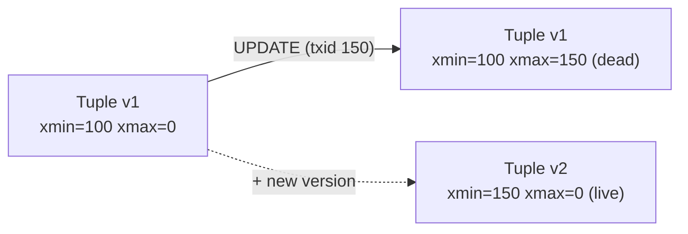
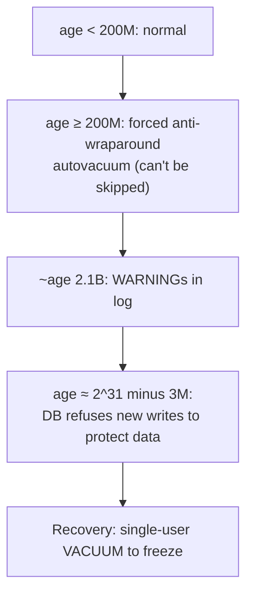

# Day 14 — MVCC Deep & VACUUM

> Series: Database Engineering
> **Goal:** Understand PostgreSQL's Multi-Version Concurrency Control from the inside — tuple versions (`xmin`/`xmax`), snapshots, why readers never block writers, how dead tuples cause bloat, how VACUUM/autovacuum reclaim space, and the transaction-ID wraparound danger. Then create bloat and vacuum it away.

## Table of Contents
1. [In plain words](#in-plain-words)
2. [Tuple versions: xmin & xmax](#tuple-versions-xmin--xmax)
3. [Snapshots & visibility](#snapshots--visibility)
4. [Why readers don't block writers](#why-readers-dont-block-writers)
5. [Dead tuples & bloat](#dead-tuples--bloat)
6. [VACUUM](#vacuum)
7. [Autovacuum](#autovacuum)
8. [Transaction ID wraparound](#transaction-id-wraparound-the-scary-one)
9. [HOT updates & fillfactor](#hot-updates--fillfactor)
10. [Lab](#lab-cause-bloat-vacuum-it-away-watch-with-pg_stat)
11. [Self-Check](#self-check)
12. [Tomorrow](#tomorrow)

---

## In plain words

**In plain words:** MVCC is like a document with tracked changes that never deletes old text — it just marks each version with "valid from revision N" and "invalid after revision M." When you open the doc, you're handed a bookmark to a specific revision, and you only ever see the text that was valid *then*. Two people can edit and read simultaneously because everyone's reading their own consistent revision. VACUUM is the janitor who later shreds the struck-through text nobody can see anymore.

This is *why* Postgres readers never block writers (Day 12) and how it implements isolation without locking reads.

**Verify versions when building:** **PostgreSQL 17**. PG 17 improved VACUUM memory management (new dead-tuple TID store) — vacuum is faster/less memory-hungry than 16. Wraparound mechanics unchanged.

**Why:** Concurrency without read locks — high throughput mixed read/write workloads.
**What:** Every row *update* creates a new *version* (tuple); old versions linger until no one can see them.
**When:** Always on; you can't turn it off. You only tune its cleanup (VACUUM).
**Where:** In the heap (table files); indexes point at tuple locations (TIDs).

---

## Tuple versions: xmin & xmax

**In plain words:** Every row version secretly carries two stamps: `xmin` = "the transaction that created me," `xmax` = "the transaction that killed/superseded me" (0 if still alive). Visibility is just comparing these stamps to your snapshot.

```sql
-- System columns are hidden but selectable:
CREATE TABLE t (id int PRIMARY KEY, v int);
INSERT INTO t VALUES (1, 100);
SELECT xmin, xmax, id, v FROM t;   -- xmin = the INSERT's txid, xmax = 0

UPDATE t SET v = 200 WHERE id = 1; -- creates a NEW tuple; old one gets xmax set
SELECT xmin, xmax, id, v FROM t;   -- new tuple: fresh xmin, xmax=0
-- (the old v=100 tuple still exists on disk with xmax = this UPDATE's txid,
--  invisible to new snapshots, waiting for VACUUM)
```

Key insight: **an `UPDATE` is really a DELETE + INSERT under the hood.** The old version is a *dead tuple* the moment no active snapshot needs it.


*An UPDATE marks the old tuple dead (xmax set) and writes a brand-new live tuple.*

---

## Snapshots & visibility

**In plain words:** A snapshot is a list: "these transaction ids had already committed when I started; ignore anything newer or still-running." A tuple is visible to you if its `xmin` committed before your snapshot AND its `xmax` is unset or belongs to a transaction not visible to you.

```sql
-- See your own transaction id and the current snapshot
SELECT txid_current();                 -- your txid (bigint form: pg_current_xact_id)
SELECT pg_current_snapshot();          -- xmin:xmax:xip_list of in-progress txids
```

- **Read Committed** (Day 12): a *new* snapshot per statement → later statements see newer commits (non-repeatable reads).
- **Repeatable Read / Serializable**: *one* snapshot for the whole transaction → stable view.

```mermaid
sequenceDiagram
    participant R as "Reader (snapshot @ t0)"
    participant DB
    participant W as "Writer"
    R->>DB: snapshot taken (sees v=100)
    W->>DB: UPDATE v=200; COMMIT (creates v2, kills v1)
    R->>DB: SELECT → still sees v=100 (v1, per its snapshot)
    Note over R,DB: No lock. Reader sees its own consistent version.
```
*The reader keeps seeing its snapshot's version even after a committed update — no blocking.*

---

## Why readers don't block writers

**In plain words:** Because a writer never overwrites in place — it writes a *new* version and leaves the old one for current readers. There's nothing to fight over. The reader has its own copy (logically); the writer has the new one.

Contrast with lock-based engines (older SQL Server default, or Postgres if it used 2-phase locking for reads): a reader would hold a shared lock and block writers. MVCC sidesteps this entirely.

The cost: **old versions accumulate.** That's the trade — read concurrency in exchange for cleanup work (VACUUM). "There's no free lunch: MVCC pays for lock-free reads with disk bloat."

> 🤔 **"If updates never overwrite, does my table grow forever?"**
> It would — that's exactly the bloat problem. Dead tuples pile up until VACUUM marks their space reusable. Without VACUUM, a table that's updated heavily balloons far past its live data size. Autovacuum normally handles it, but a stuck autovacuum (long transactions, misconfig) is a top production incident cause.

---

## Dead tuples & bloat

**In plain words:** A dead tuple is a row version no snapshot can see anymore — struck-through text. Bloat is the accumulated dead space: your table/index occupies far more disk (and cache!) than the live data needs, slowing every scan.

```sql
-- See live vs dead tuple estimates
SELECT relname, n_live_tup, n_dead_tup,
       last_vacuum, last_autovacuum
FROM pg_stat_user_tables
WHERE relname = 't';

-- Physical size of table + indexes
SELECT pg_size_pretty(pg_total_relation_size('t')) AS total,
       pg_size_pretty(pg_relation_size('t'))        AS heap_only;
```

What creates dead tuples:
- Every `UPDATE` (old version dies)
- Every `DELETE` (the deleted version becomes dead once invisible)
- Rolled-back `INSERT`s (the aborted tuple is dead)

> **Dark Side:** A single **long-running transaction** (an idle-in-transaction connection, a giant analytics query, an abandoned `BEGIN`) holds back the "oldest snapshot," so VACUUM *cannot* remove any dead tuple newer than it. One forgotten `BEGIN;` in a psql window can bloat a hot table by gigabytes overnight. Monitor `pg_stat_activity` for `state = 'idle in transaction'`.

> ❌ **Bad scenario:** A SaaS ran a nightly ETL that opened a 6-hour Repeatable Read transaction against the primary. Autovacuum on the orders table could reclaim nothing for 6 hours; the table tripled in size, index scans slowed 4x, p99 latency spiked every night. Fix: run ETL on a replica, or keep the txn short.

---

## VACUUM

**In plain words:** VACUUM is the janitor. Plain `VACUUM` marks dead-tuple space as reusable *within the file* (doesn't shrink the file). `VACUUM FULL` rewrites the whole table compactly (shrinks the file) but takes an `ACCESS EXCLUSIVE` lock — offline.

| Command | What it does | Lock | Returns space to OS? |
|---|---|---|---|
| `VACUUM t` | Mark dead space reusable; update stats/visibility map | very light (no blocking of reads/writes) | No |
| `VACUUM (ANALYZE) t` | Above + refresh planner statistics | light | No |
| `VACUUM FULL t` | Rewrite table compactly | `ACCESS EXCLUSIVE` (blocks everything) | **Yes** |
| `pg_repack` (extension) | Compact online, no long lock | brief | Yes |

```sql
VACUUM (VERBOSE, ANALYZE) t;   -- clean + restats + report what it did

-- Reclaim disk to OS but LOCKS the table (maintenance window only):
VACUUM FULL t;                 -- avoid in prod hot path

-- Better online alternative (needs the pg_repack extension):
-- $ pg_repack -d labdb -t t
```

**Why plain VACUUM usually suffices:** the reclaimed space is reused by future inserts/updates, so the table reaches a steady state. You only need `VACUUM FULL`/`pg_repack` when a table bloated massively once (e.g., a huge one-time DELETE) and you want the disk back.

> 🤔 **"Should I just run VACUUM FULL on a schedule to keep things tidy?"**
> No. `VACUUM FULL` takes an exclusive lock and rewrites the entire table — on a big table that's minutes of total downtime. Autovacuum + plain VACUUM keeps steady-state bloat in check without locks. Reserve `VACUUM FULL`/`pg_repack` for one-off recovery after a massive delete.

---

## Autovacuum

**In plain words:** A background daemon that runs VACUUM (and ANALYZE) automatically when a table has accumulated "enough" dead tuples. You rarely run VACUUM by hand in prod — you *tune autovacuum*.

Trigger formula (per table):
```
autovacuum runs when:
  n_dead_tup > autovacuum_vacuum_threshold
             + autovacuum_vacuum_scale_factor * n_live_tup
-- defaults: threshold=50, scale_factor=0.2  → fires at ~20% dead
```

```sql
-- Global defaults
SHOW autovacuum_vacuum_scale_factor;   -- 0.2
SHOW autovacuum_vacuum_threshold;      -- 50
SHOW autovacuum_max_workers;           -- 3

-- Per-table override for a HOT table (vacuum more aggressively):
ALTER TABLE orders SET (
  autovacuum_vacuum_scale_factor = 0.02,   -- fire at ~2% dead, not 20%
  autovacuum_vacuum_threshold    = 1000,
  autovacuum_vacuum_cost_delay   = 2       -- ms; lower = faster/more IO
);
```

> ✅ **Good scenario:** A high-churn `sessions` table (millions of UPDATEs/hour) is tuned to `scale_factor = 0.01`. Autovacuum keeps dead tuples low, index scans stay fast, and disk usage is flat. Default 0.2 would have let it bloat 5x between vacuums.

> ❌ **Bad scenario:** Defaults left on a 500M-row table: scale_factor 0.2 means autovacuum only fires after 100M dead tuples — a massive, IO-heavy vacuum that thrashes disk and lags. Big tables need *smaller* scale factors.

**When NOT to tune:** Low-write tables (config/lookup) are fine on defaults. Don't globally crank autovacuum aggressiveness — target hot tables per-table.

---

## Transaction ID wraparound (the scary one)

**In plain words:** Transaction ids are a 32-bit counter (~4.2 billion values). Postgres compares them *modulo 2^31* to decide "is this txn in my past or future." If the counter laps all the way around and an old tuple's `xmin` suddenly looks like it's in the *future*, that row would become invisible — silent data loss. To prevent this, VACUUM "freezes" old tuples (marks them permanently visible). If autovacuum falls too far behind, Postgres protects itself by refusing new writes.

```sql
-- How close is each table to wraparound danger? (age = txns since last freeze)
SELECT relname, age(relfrozenxid) AS xid_age
FROM pg_class WHERE relkind = 'r'
ORDER BY xid_age DESC LIMIT 10;

-- Database-wide
SELECT datname, age(datfrozenxid) FROM pg_database ORDER BY 2 DESC;

SHOW autovacuum_freeze_max_age;   -- default 200,000,000 → forced anti-wraparound vacuum
```

The escalation as `age` climbs toward 2^31 (~2.1B):

*Wraparound escalation — ignore it long enough and the database stops accepting writes.*

> 🤔 **"Wraparound sounds catastrophic — is it a real risk with autovacuum on?"**
> Under normal load, autovacuum's anti-wraparound runs keep `age` bounded and you never see it. It bites systems where autovacuum was *disabled*, *starved* (aggressive cost limits), or *blocked for weeks* by a stuck long transaction or a table that autovacuum keeps skipping. The famous outages (Sentry, Mailchimp writeups) came from exactly that. Watch `age(relfrozenxid)`; alert at ~1B. Note: PG's move toward 64-bit transaction ids is in progress but as of PG 17/18 the 32-bit xid + freezing model still applies.

> **Dark Side:** Recovering a wrapped-around database means stopping it and running `VACUUM` in single-user mode — real downtime. Prevention (monitoring `age`, healthy autovacuum) is vastly cheaper than the cure.

---

## HOT updates & fillfactor

**In plain words:** A **HOT** (Heap-Only Tuple) update is an optimization: if an UPDATE doesn't change any *indexed* column and the new version fits on the *same page*, Postgres links the new version to the old one *without* touching indexes. Cheaper updates, less index bloat. Leaving free space on each page (`fillfactor`) makes HOT more likely.

```sql
-- Reserve 15% free space per page so updates stay on-page (HOT)
ALTER TABLE t SET (fillfactor = 85);
-- Then future UPDATEs to non-indexed columns can be HOT.

-- Check HOT effectiveness
SELECT relname, n_tup_upd, n_tup_hot_upd,
       round(100.0 * n_tup_hot_upd / NULLIF(n_tup_upd,0), 1) AS hot_pct
FROM pg_stat_user_tables WHERE relname = 't';
```

> ✅ **Good scenario:** A `counters` table updated constantly on a non-indexed `hits` column with `fillfactor=80` gets >95% HOT updates → indexes barely bloat, VACUUM has little to do.

**When NOT to:** Insert-heavy / rarely-updated tables don't benefit from a low fillfactor; you'd just waste space. Default 100 is right there.

## Index bloat & the visibility map

**In plain words:** Bloat isn't only a heap (table) problem — indexes bloat too, and they have their own cleanup. Also, VACUUM maintains a **visibility map** that marks pages where *all* tuples are visible to everyone; that map is what lets Index Only Scans (Day 15) skip the heap entirely.

- **Index bloat:** dead index entries and half-empty pages from splits accumulate. Plain VACUUM removes dead index entries but doesn't repack pages. Use `REINDEX CONCURRENTLY` (Day 17) to rebuild a dense index.
- **Visibility map:** if it's stale (VACUUM behind), Index Only Scans degrade to fetching the heap anyway — one more reason healthy autovacuum keeps queries fast.

```sql
-- Compare an index's size to what it "should" be; big gap = bloat
SELECT indexrelname, pg_size_pretty(pg_relation_size(indexrelid)) AS idx_size,
       idx_scan
FROM pg_stat_user_indexes WHERE relname = 'bloaty';

-- After heavy churn, rebuild the index densely (online):
REINDEX INDEX CONCURRENTLY bloaty_pkey;
```

> 🤔 **"I VACUUMed the table — why is my index still huge?"**
> Because plain VACUUM only marks index entries reusable; it doesn't reclaim/repack index pages back to a compact shape. A B-tree that saw millions of updates keeps its bloated page count until you `REINDEX`. VACUUM keeps the *heap* in steady state; `REINDEX` is the tool for *index* bloat. They're separate maintenance jobs.

> **Dark Side:** People run VACUUM, see the table's dead tuples drop to zero, and assume all bloat is gone — while a primary-key index quietly stays 3x oversized, slowing every lookup and eating cache. Track index size trends, not just `n_dead_tup`.

---

## Lab: cause bloat, VACUUM it away, watch with pg_stat

```sql
-- 1) Build a table and fill it
DROP TABLE IF EXISTS bloaty;
CREATE TABLE bloaty (id int PRIMARY KEY, v int);
INSERT INTO bloaty SELECT g, g FROM generate_series(1, 500000) g;
VACUUM (ANALYZE) bloaty;

SELECT pg_size_pretty(pg_relation_size('bloaty')) AS size_before;  -- ~17 MB
SELECT n_live_tup, n_dead_tup FROM pg_stat_user_tables WHERE relname='bloaty';

-- 2) TEMPORARILY disable autovacuum on this table so we can see bloat build up
ALTER TABLE bloaty SET (autovacuum_enabled = false);

-- 3) Churn it: update every row 10 times → 5M dead tuples
DO $$ BEGIN
  FOR i IN 1..10 LOOP
    UPDATE bloaty SET v = v + 1;   -- each pass makes 500k dead tuples
  END LOOP;
END $$;

SELECT n_live_tup, n_dead_tup FROM pg_stat_user_tables WHERE relname='bloaty';
-- n_dead_tup is now huge (millions)
SELECT pg_size_pretty(pg_relation_size('bloaty')) AS size_bloated;  -- much larger

-- 4) Prove a long transaction BLOCKS cleanup:
--    In Session B:  BEGIN; SELECT 1;   (leave it open)
--    In Session A:  VACUUM (VERBOSE) bloaty;
--    VERBOSE output shows dead tuples "cannot be removed yet" (held by B's snapshot).
--    Commit/rollback Session B, then VACUUM again → they get removed.

-- 5) Reclaim reusable space (file stays big, space marked reusable):
VACUUM (VERBOSE, ANALYZE) bloaty;
SELECT n_dead_tup FROM pg_stat_user_tables WHERE relname='bloaty';  -- ~0

-- 6) Shrink the file back to the OS:
VACUUM FULL bloaty;   -- takes ACCESS EXCLUSIVE lock
SELECT pg_size_pretty(pg_relation_size('bloaty')) AS size_after;    -- back near ~17 MB

-- 7) Re-enable autovacuum
ALTER TABLE bloaty SET (autovacuum_enabled = true);
```

Watch autovacuum activity live:
```sql
-- Autovacuum workers currently running
SELECT pid, datname, query, state, xact_start
FROM pg_stat_activity WHERE query LIKE 'autovacuum:%';

-- Per-table vacuum history + counts
SELECT relname, last_autovacuum, autovacuum_count, vacuum_count
FROM pg_stat_user_tables WHERE relname='bloaty';
```

Estimate bloat cluster-wide (rough):
```sql
-- Install the standard extension for real bloat estimates:
CREATE EXTENSION IF NOT EXISTS pgstattuple;
SELECT * FROM pgstattuple('bloaty');   -- dead_tuple_percent, free_percent, etc.
```

> **MySQL callout:** InnoDB also uses MVCC, but stores old versions in the **undo log / rollback segment**, not inline in the table. There's no user-facing VACUUM; purge threads clean up. The analogous danger is undo-log/history-list growth from long transactions (watch `History list length`). InnoDB has no transaction-ID-wraparound-halts-writes behavior like Postgres, but long transactions still bloat undo and slow reads.

---

## Self-Check
1. What are `xmin` and `xmax`, and how do they decide a tuple's visibility to your snapshot?
2. Why is an `UPDATE` in Postgres effectively a DELETE + INSERT? What does that create?
3. Explain precisely why readers don't block writers under MVCC.
4. What is a dead tuple, and name three operations that create them.
5. How can one long-running transaction cause a hot table to bloat massively?
6. Difference between plain `VACUUM`, `VACUUM FULL`, and `pg_repack` — locks and disk reclaim?
7. Write the autovacuum trigger formula and explain why big tables need a smaller scale factor.
8. What is transaction ID wraparound, and what does Postgres do to protect itself as `age` grows?
9. What is a HOT update and what two conditions must hold for one to happen?
10. How does InnoDB's MVCC cleanup differ from Postgres's?

## Tomorrow
**Day 15 — Query Optimization:** now that you understand what's on disk, we make queries fast. `EXPLAIN ANALYZE` line by line, sargability, the classic anti-patterns (function on an indexed column, leading wildcard, implicit casts), and statistics. Lab: take a 10-second query under 100ms.
