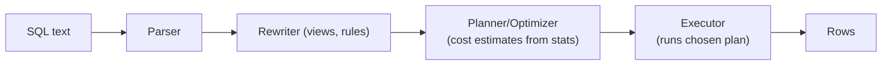
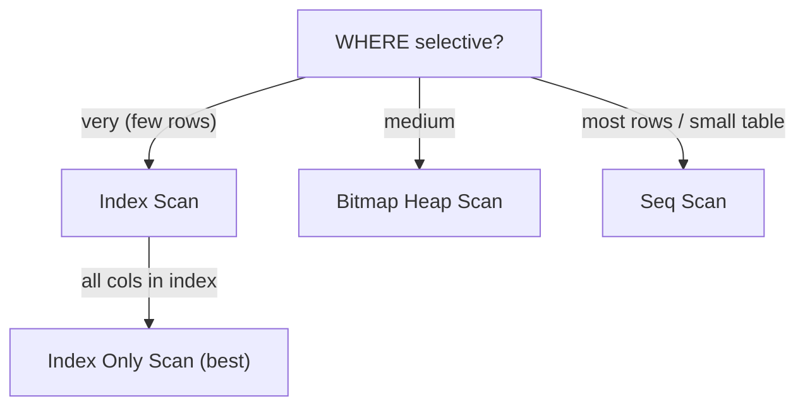

# Day 15 — Query Optimization

> Series: Database Engineering
> **Goal:** Read `EXPLAIN ANALYZE` fluently, understand sargability, recognize and fix the classic anti-patterns (function on an indexed column, leading wildcard, implicit cast), and keep planner statistics healthy. Then take a 10-second query under 100ms.

## Table of Contents
1. [In plain words](#in-plain-words)
2. [The planner's job](#the-planners-job)
3. [Reading EXPLAIN ANALYZE](#reading-explain-analyze)
4. [Scan & join node types](#scan--join-node-types)
5. [Sargability](#sargability)
6. [Anti-pattern: function on an indexed column](#anti-pattern-function-on-an-indexed-column)
7. [Anti-pattern: leading wildcard](#anti-pattern-leading-wildcard)
8. [Anti-pattern: implicit cast](#anti-pattern-implicit-cast)
9. [Statistics](#statistics-how-the-planner-guesses)
10. [Lab](#lab-take-a-10s-query-under-100ms)
11. [Self-Check](#self-check)
12. [Tomorrow](#tomorrow)

---

## In plain words

**In plain words:** The query planner is a GPS. You say *where* you want to go (declarative SQL — "give me orders for customer 42 last month"); it figures out the *route* (the execution plan — which indexes, which join order). Like a GPS, it uses traffic estimates (statistics) that can be wrong, and it will happily route you through a traffic jam (a sequential scan of 50M rows) if its map is stale. `EXPLAIN ANALYZE` is the dashcam that shows the route it *actually* drove and how long each leg took.

**Verify versions when building:** **PostgreSQL 17**. `EXPLAIN` gained `SERIALIZE` and improved `BUFFERS` in recent versions; PG 17 shows `BUFFERS` by default when you pass `ANALYZE` in some tools — always request it explicitly to be safe.

**Why:** A missing index or a non-sargable predicate turns a 1ms lookup into a full-table scan. Optimization is where you win orders of magnitude.
**What:** Rewriting queries and adding indexes/stats so the planner picks a cheap plan.
**When:** When a query is slow (p95 latency, `pg_stat_statements` top offenders) — measure, don't guess.
**Where:** In the SQL text, the indexes, and the statistics — not usually in server config.

> 🤔 **"If I add enough indexes, won't every query be fast automatically?"**
> No. Indexes help *reads* but slow *writes* (every INSERT/UPDATE maintains them) and consume cache. Worse, a badly-written predicate (a function wrapped around the column) makes the planner *unable to use* even a perfect index. Optimization is 50% writing sargable SQL and 50% having the right indexes — plus accurate statistics so the planner trusts them.

---

## The planner's job

The planner is **cost-based**: it estimates a cost (in arbitrary units, tuned by `seq_page_cost`, `random_page_cost`, `cpu_tuple_cost`) for each candidate plan and picks the cheapest. It relies on **row-count estimates** from statistics. Wrong estimates → wrong plan.


*Declarative SQL becomes a concrete execution plan the executor runs.*

---

## Reading EXPLAIN ANALYZE

**In plain words:** `EXPLAIN` shows the *planned* route with *estimates*. `EXPLAIN ANALYZE` actually *runs* the query and shows *real* timings and row counts. Add `BUFFERS` to see cache vs disk.

```sql
EXPLAIN (ANALYZE, BUFFERS, VERBOSE, FORMAT TEXT)
SELECT * FROM orders WHERE customer_id = 42 AND created_at > now() - interval '30 days';
```

Sample output, annotated:
```
Index Scan using idx_orders_cust_created on orders  (cost=0.43..12.9 rows=8 width=64)
                                                    (actual time=0.021..0.084 rows=7 loops=1)
  Index Cond: (customer_id = 42 AND created_at > (now() - '30 days'::interval))
  Buffers: shared hit=5
Planning Time: 0.11 ms
Execution Time: 0.10 ms
```

How to read it:
- **`cost=0.43..12.9`** = estimated startup cost .. total cost (arbitrary units). Compare *between* plans, not to milliseconds.
- **`rows=8` (estimate) vs `actual ... rows=7`** = the crucial check. If estimate is 8 and actual is 800,000, your **statistics are wrong** and the plan is likely bad.
- **`actual time=0.021..0.084`** = startup .. total ms *per loop*.
- **`loops=1`** = how many times this node ran. Multiply `actual time * loops` for real total (huge for nested loops!).
- **`Buffers: shared hit=5`** = 5 pages from cache, no disk reads (`read=` would mean disk).
- **`Execution Time`** = the number you're trying to shrink.

> 🤔 **"The `cost` says 12.9 — is that 12.9 milliseconds?"**
> No! Cost is a unitless estimate for *comparing plans*, calibrated to page/CPU cost parameters. The real time is `actual time` / `Execution Time`. A plan with lower cost isn't guaranteed faster if the estimates are wrong — that's why you ALWAYS run `ANALYZE`, not just `EXPLAIN`.

**Red flags to hunt in a plan:**
| Symptom | Likely meaning |
|---|---|
| `Seq Scan` on a big table with a selective filter | missing/unusable index |
| estimate `rows=1` but `actual rows=500000` | stale/insufficient statistics |
| `Nested Loop` with high `loops=` | N+1-style blowup (Day 16) |
| `Rows Removed by Filter: 4M` | reading way more than you keep — non-sargable |
| `Buffers: ... read=` large | cold cache / too much IO |
| `Sort ... external merge Disk: 250MB` | `work_mem` too low, spilling to disk |

---

## Scan & join node types

| Node | When it's good | When it's bad |
|---|---|---|
| **Seq Scan** | small table, or you need most rows | large table + selective predicate → add index |
| **Index Scan** | selective lookup, few rows | returning most of the table (random IO worse than seq) |
| **Index Only Scan** | all needed cols in the index (covering) | requires visibility map fresh (VACUUM) |
| **Bitmap Heap Scan** | medium selectivity, combines indexes | very high selectivity → plain index scan better |
| **Nested Loop** | small outer, indexed inner | big outer × big inner = disaster |
| **Hash Join** | large unsorted joins | needs `work_mem`; spills if too small |
| **Merge Join** | both inputs sorted (or indexed) | needs sort if not already ordered |


*Selectivity drives which scan the planner picks.*

---

## Sargability

**In plain words:** SARGable = "Search-ARGument-able" = the predicate is written so the DB can jump straight to matching rows via an index, instead of testing every row. The rule: **keep the indexed column bare on one side of the comparison.** The moment you wrap it in a function or math, the index can't be used.

Sargable (index usable):
```sql
WHERE created_at >= '2026-07-01'          -- bare column, index range scan ✅
WHERE customer_id = 42                    -- ✅
WHERE email = lower('X@Y.com')            -- function on the CONSTANT is fine ✅
```

Non-sargable (index unusable → seq scan):
```sql
WHERE date_trunc('day', created_at) = '2026-07-01'   -- function on COLUMN ❌
WHERE customer_id + 0 = 42                            -- math on column ❌
WHERE lower(email) = 'x@y.com'                        -- function on column ❌
WHERE created_at::date = '2026-07-01'                 -- cast on column ❌
```

---

## Anti-pattern: function on an indexed column

**Why it hurts:** The index stores `created_at` values, not `date_trunc('day', created_at)` values. Postgres can't translate your predicate into an index range, so it computes the function for *every row* → Seq Scan.

```sql
-- SLOW (Seq Scan, function on column)
EXPLAIN ANALYZE
SELECT * FROM orders WHERE date_trunc('day', created_at) = DATE '2026-07-20';
-- Seq Scan ... Rows Removed by Filter: 9,999,900

-- FIX 1: rewrite as a sargable range (keeps column bare)
EXPLAIN ANALYZE
SELECT * FROM orders
WHERE created_at >= DATE '2026-07-20'
  AND created_at <  DATE '2026-07-21';   -- Index Scan ✅

-- FIX 2: if you MUST use the expression, build an expression index
CREATE INDEX idx_orders_day ON orders ((date_trunc('day', created_at)));
-- now the original query CAN use an index (planner matches the expression)
```

> ✅ **Good scenario:** An analytics team frequently filters `lower(email)`. They add `CREATE INDEX ON users (lower(email))` (an expression index). Case-insensitive lookups go from 400ms Seq Scan to 0.3ms Index Scan.

> ❌ **Bad scenario:** A dashboard wraps `created_at::date = today` on a 200M-row events table. Every page load Seq-scans the whole table (8s). Rewriting to a bare range dropped it to 40ms.

**When NOT to (make an expression index):** If the expression query is rare, an expression index just adds write overhead for no benefit. Prefer rewriting to a sargable range when possible.

---

## Anti-pattern: leading wildcard

**Why it hurts:** B-tree indexes are sorted alphabetically. `LIKE 'smith%'` can seek to "smith" and scan forward (sargable). `LIKE '%smith'` has no known prefix → must check every row.

```sql
-- Sargable prefix match (uses a text_pattern_ops index)
CREATE INDEX idx_users_name ON users (name text_pattern_ops);
SELECT * FROM users WHERE name LIKE 'smith%';   -- Index range scan ✅

-- NON-sargable leading wildcard
SELECT * FROM users WHERE name LIKE '%smith';   -- Seq Scan ❌

-- FIX for substring/contains search: trigram GIN index
CREATE EXTENSION IF NOT EXISTS pg_trgm;
CREATE INDEX idx_users_name_trgm ON users USING gin (name gin_trgm_ops);
SELECT * FROM users WHERE name LIKE '%smith%';  -- now uses GIN ✅
-- Or full-text search (tsvector) for word-level search.
```

| Pattern | B-tree | Fix |
|---|---|---|
| `LIKE 'abc%'` | usable (with `text_pattern_ops`) | — |
| `LIKE '%abc'` | not usable | reverse+index, or trigram GIN |
| `LIKE '%abc%'` | not usable | trigram GIN / full-text |
| `ILIKE` | not usable directly | trigram GIN (`gin_trgm_ops` is case-insensitive-friendly) |

> Cross-ref (System Design): for true search (typo tolerance, ranking, huge scale) you'd offload to a dedicated engine (Elasticsearch/OpenSearch) rather than push Postgres LIKE. Know where the DB's search stops being the right tool.

---

## Anti-pattern: implicit cast

**Why it hurts:** If column and literal types differ, Postgres may cast the *column* (per row) to match the literal, defeating the index. Classic: a `varchar` id column compared to a numeric literal, or `bigint` column vs a value the driver sends as text.

```sql
-- users.phone is VARCHAR
SELECT * FROM users WHERE phone = 5551234;   -- implicit cast column→? or literal→text?
-- Can produce a Seq Scan or wrong results. Postgres may error or cast oddly.

-- FIX: match the types exactly (quote the literal for a text column)
SELECT * FROM users WHERE phone = '5551234';  -- Index Scan ✅

-- Timestamp vs date mismatch also forces casts — align types:
SELECT * FROM orders WHERE created_at >= TIMESTAMP '2026-07-01';  -- not DATE if col is timestamptz
```

> **Dark Side:** Implicit casts are the sneakiest — the query *works* and returns correct rows, just 1000x slower via Seq Scan. It hides until traffic grows. Always confirm the plan uses the index (`EXPLAIN`) after adding a filter, and keep parameter types matching column types in your ORM/driver.

> 🤔 **"My ORM generates the SQL — am I safe from these anti-patterns?"**
> Not automatically. ORMs happily emit `lower(col) = ?`, `col::date = ?`, or send mismatched parameter types. They also love `%term%` for search boxes. `EXPLAIN ANALYZE` the actual SQL your ORM produces (log it) — the abstraction hides the plan, not the cost.

---

## Statistics: how the planner guesses

**In plain words:** The planner doesn't scan your table to plan; it consults a *sample-based summary* (`pg_statistic`, viewable via `pg_stats`): how many distinct values, most-common values, histograms. `ANALYZE` refreshes this sample. Stale stats = bad estimates = bad plans.

```sql
-- Refresh stats for a table (autovacuum also does this, but on-demand helps)
ANALYZE orders;

-- Inspect what the planner knows about a column
SELECT attname, n_distinct, most_common_vals, most_common_freqs
FROM pg_stats WHERE tablename = 'orders' AND attname = 'status';

-- Increase sample resolution for a skewed column (default 100 buckets)
ALTER TABLE orders ALTER COLUMN status SET STATISTICS 1000;
ANALYZE orders;

-- Correlated columns fool the planner (it assumes independence). Fix with
-- extended statistics:
CREATE STATISTICS orders_city_state (dependencies)
  ON city, state FROM orders;   -- teaches planner city→state correlation
ANALYZE orders;
```

Signs of a statistics problem: estimated `rows` off from actual by 10x+ in `EXPLAIN ANALYZE`. That single ratio is your best diagnostic.

> ✅ **Good scenario:** A query joined `orders` and `line_items`; the planner estimated 5 rows, got 2M, chose a Nested Loop → 30s. `ANALYZE` after a bulk load fixed the estimate; planner switched to Hash Join → 200ms. No SQL change, just fresh stats.

**When NOT to (tune stats):** For uniformly-distributed, well-analyzed columns the defaults are fine. Reach for `SET STATISTICS` / extended stats only when `EXPLAIN` shows a large estimate/actual gap.

---

## Lab: take a 10s query under 100ms

```sql
-- 1) Build a realistic-ish dataset
DROP TABLE IF EXISTS orders;
CREATE TABLE orders (
  id          bigserial PRIMARY KEY,
  customer_id int NOT NULL,
  status      text NOT NULL,
  created_at  timestamptz NOT NULL
);
INSERT INTO orders (customer_id, status, created_at)
SELECT (random()*100000)::int,
       (ARRAY['pending','paid','shipped','cancelled'])[1+(random()*3)::int],
       now() - (random()*365) * interval '1 day'
FROM generate_series(1, 10000000);        -- 10M rows
ANALYZE orders;

-- 2) The SLOW query (non-sargable function on column, no useful index)
EXPLAIN (ANALYZE, BUFFERS)
SELECT count(*) FROM orders
WHERE customer_id = 4242
  AND date_trunc('day', created_at) = DATE '2026-03-15';
-- Expect: Seq Scan, ~seconds, "Rows Removed by Filter" ~10M.
```

```sql
-- 3) FIX A: make the predicate sargable (bare column range)
EXPLAIN (ANALYZE, BUFFERS)
SELECT count(*) FROM orders
WHERE customer_id = 4242
  AND created_at >= DATE '2026-03-15'
  AND created_at <  DATE '2026-03-16';
-- Still Seq Scan until we index...

-- 4) FIX B: add a composite index matching the predicate
CREATE INDEX CONCURRENTLY idx_orders_cust_created
  ON orders (customer_id, created_at);
ANALYZE orders;

EXPLAIN (ANALYZE, BUFFERS)
SELECT count(*) FROM orders
WHERE customer_id = 4242
  AND created_at >= DATE '2026-03-15'
  AND created_at <  DATE '2026-03-16';
-- Now: Index Scan / Index Only Scan, single-digit ms. 🎉
```

```sql
-- 5) BONUS: covering index for an aggregate-free lookup (Index Only Scan)
CREATE INDEX CONCURRENTLY idx_orders_cust_created_status
  ON orders (customer_id, created_at) INCLUDE (status);
-- SELECT status ... can be served from the index alone (after VACUUM sets visibility map)
VACUUM (ANALYZE) orders;

-- 6) Confirm the win: compare Execution Time before/after in the plans above.
--    Goal: >10s (or seconds) → <100ms.
```

**Diagnostic habit — find the slow queries first:**
```sql
CREATE EXTENSION IF NOT EXISTS pg_stat_statements;   -- (needs shared_preload_libraries)
SELECT round(mean_exec_time::numeric,2) AS avg_ms, calls,
       round(total_exec_time::numeric,0) AS total_ms, query
FROM pg_stat_statements
ORDER BY total_exec_time DESC LIMIT 10;   -- your optimization worklist
```

> **MySQL callout:** Use `EXPLAIN ANALYZE` (8.0.18+) or `EXPLAIN FORMAT=JSON`. MySQL's `type` column (`ALL`=seq scan, `ref`/`range`=index, `const`=PK) is the quick tell. It has no `EXPLAIN (BUFFERS)`; use `SHOW STATUS` / performance_schema. Sargability rules are the same. Its optimizer historically had a weaker cost model and relied more on index hints.

---

## Self-Check
1. What's the difference between `EXPLAIN` and `EXPLAIN ANALYZE`, and why must you use the latter to trust a plan?
2. In a plan node, what does a large gap between estimated `rows` and `actual rows` tell you?
3. Why is `cost=...12.9` not milliseconds? What number *is* the real time?
4. Why does `loops=` matter for Nested Loop nodes?
5. Define sargability. Rewrite `WHERE created_at::date = '2026-07-01'` to be sargable.
6. Why can't a B-tree index serve `LIKE '%term%'`? What index type can?
7. How can an implicit type cast silently cause a Seq Scan while returning correct rows?
8. What does `ANALYZE` update, and how do stale statistics cause bad plans?
9. When would you create an expression index vs just rewriting the query?
10. What's an Index Only Scan and what must be true for the planner to use one?

## Tomorrow
**Day 16 — Index Tuning & the N+1 Problem:** index strategy (composite order, partial, covering), then the infamous N+1 query problem from ORMs — how to spot it and fix it with joins/batching — plus connection pooling with PgBouncer and its pool modes. Lab: find and kill an N+1.
