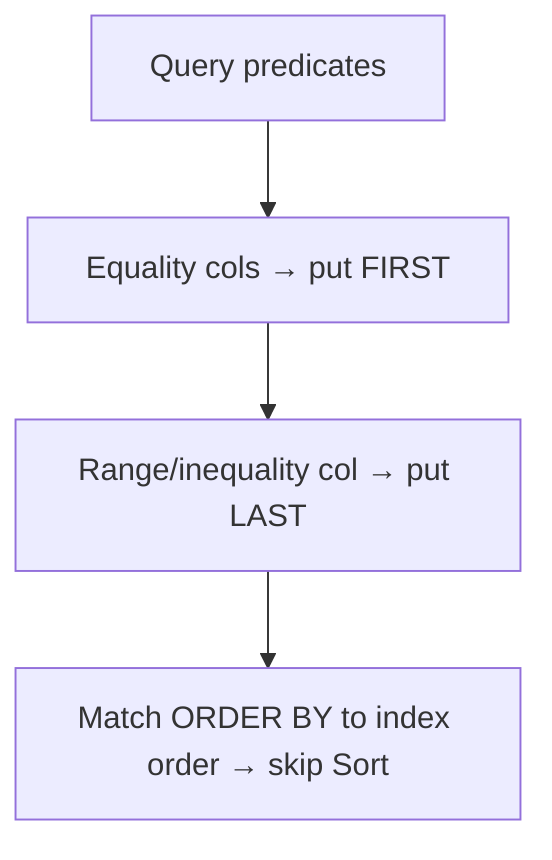
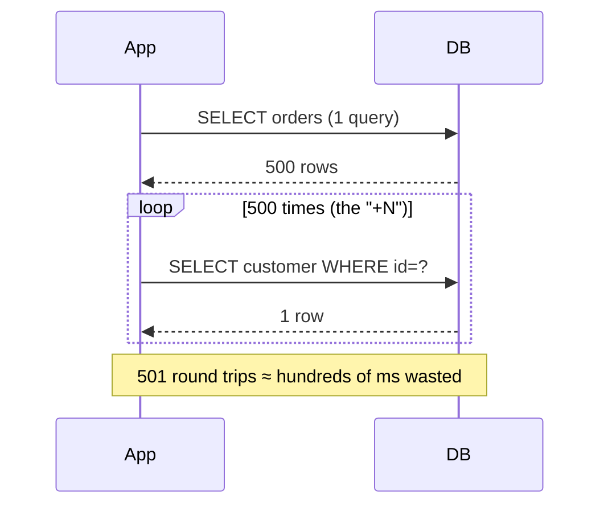
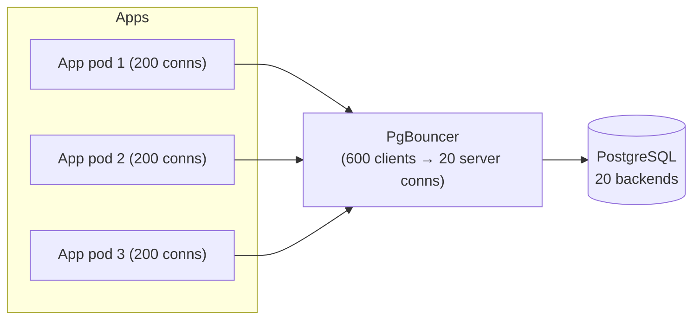

# Day 16 — Index Tuning & the N+1 Problem

> Series: Database Engineering
> **Goal:** Build an index strategy (types, composite column order, partial, covering), then recognize and kill the ORM **N+1 query problem** with joins/batching, and understand connection pooling with **PgBouncer** and its pool modes. Lab: find and kill an N+1.

## Table of Contents
1. [In plain words](#in-plain-words)
2. [Index types in Postgres](#index-types-in-postgres)
3. [Composite index column order](#composite-index-column-order)
4. [Partial & covering indexes](#partial--covering-indexes)
5. [When indexes hurt](#when-indexes-hurt)
6. [The N+1 problem](#the-n1-problem)
7. [Fixing N+1: joins, batching, eager loading](#fixing-n1-joins-batching-eager-loading)
8. [Connection pooling & PgBouncer](#connection-pooling--pgbouncer)
9. [Lab](#lab-find--kill-an-n1)
10. [Self-Check](#self-check)
11. [Tomorrow](#tomorrow)

---

## In plain words

**In plain words:** An index is the back-of-the-book index. Without it, finding "MVCC" means reading all 400 pages (a Seq Scan). With it, you flip to the index, find "MVCC → p.214," and jump straight there. But every index you keep must be *updated* every time the book changes (every write), and it takes shelf space (disk + cache). So you index the terms people actually look up — not every word.

The **N+1 problem** is a different beast: it's not about a single slow query, it's about firing *hundreds of fast queries* when one would do. Death by a thousand paper cuts.

**Verify versions when building:** **PostgreSQL 17**; **PgBouncer 1.23+**. B-tree, GIN, GiST, BRIN, Hash, SP-GiST all available. `INCLUDE` (covering) indexes since PG 11.

---

## Index types in Postgres

| Type | Best for | Example |
|---|---|---|
| **B-tree** (default) | equality + range on scalars, sorting | `WHERE id = ?`, `ORDER BY created_at` |
| **Hash** | equality only (rarely worth it now) | `WHERE token = ?` |
| **GIN** | multi-value: arrays, jsonb, full-text, trigram | `tags @> '{sale}'`, `LIKE '%x%'` |
| **GiST** | geometric, ranges, nearest-neighbor | geo `<->`, `tstzrange &&` |
| **SP-GiST** | non-balanced: quadtrees, IP prefixes | `inet` routing |
| **BRIN** | huge, naturally-ordered tables (time-series) | append-only `created_at` on 1B rows |

```sql
-- B-tree (default): equality/range/sort
CREATE INDEX idx_orders_created ON orders (created_at);

-- GIN for jsonb containment
CREATE INDEX idx_events_data ON events USING gin (data jsonb_path_ops);
SELECT * FROM events WHERE data @> '{"type":"click"}';   -- uses GIN

-- BRIN: tiny index for massive, time-ordered tables
CREATE INDEX idx_logs_ts_brin ON logs USING brin (created_at);
-- ~thousandths the size of a B-tree; great when rows are physically ordered by time
```

> 🤔 **"BRIN sounds free — should I use it instead of B-tree everywhere?"**
> No. BRIN only works when the table is *physically* ordered by the indexed column (append-only time-series is ideal). It stores min/max per block range, so on unordered data it degenerates to nearly a Seq Scan. It's a specialist: tiny and fast on ordered big tables, useless on random data.

---

## Composite index column order

**In plain words:** A composite index `(a, b, c)` is like sorting a phone book by (last name, first name, middle). You can search by last name alone, or last+first, but NOT by first name alone — the ordering doesn't help. **Left-prefix rule:** an index on `(a,b,c)` serves queries filtering `a`, `a,b`, or `a,b,c` — never `b` alone or `c` alone.

```sql
CREATE INDEX idx_o ON orders (customer_id, status, created_at);

-- USES the index (left prefix):
WHERE customer_id = 42                                   -- ✅ (a)
WHERE customer_id = 42 AND status = 'paid'               -- ✅ (a,b)
WHERE customer_id = 42 AND status = 'paid' AND created_at > now() - interval '7 d'  -- ✅

-- Does NOT use it efficiently (skips the leading column):
WHERE status = 'paid'                                    -- ❌ no customer_id
WHERE created_at > '2026-01-01'                          -- ❌ leading col missing
```

**Ordering rules of thumb:**
1. **Equality columns first, range/sort column last.** `(customer_id =, created_at range)` — put the `=` first so the range can scan contiguously.
2. **Most selective equality first** (usually) so the index narrows fast.
3. Match your `ORDER BY` to avoid a separate Sort node.


*Composite index design: equality first, range last, align with ORDER BY.*

> ❌ **Bad scenario:** A team had 6 single-column indexes on `orders` and a query filtering `customer_id AND status AND created_at`. The planner used a bitmap-AND of three indexes (slow, lots of heap fetches). One well-ordered composite `(customer_id, status, created_at)` replaced all three and cut latency 20x — and reduced write overhead.

---

## Partial & covering indexes

**In plain words:** A **partial index** indexes only the rows you actually query (e.g., only `status='active'`), so it's smaller and faster. A **covering index** includes extra columns so the query is answered *from the index alone* — no trip to the heap (Index Only Scan).

```sql
-- PARTIAL: only index the hot subset (99% of queries want active users)
CREATE INDEX idx_users_active_email ON users (email) WHERE status = 'active';
-- Query MUST include the same predicate to use it:
SELECT id FROM users WHERE email = 'a@b.com' AND status = 'active';  -- ✅

-- Great for soft-delete: don't waste index space on deleted rows
CREATE INDEX idx_orders_open ON orders (customer_id)
  WHERE deleted_at IS NULL;

-- COVERING: include columns needed by SELECT so we never touch the heap
CREATE INDEX idx_orders_cover ON orders (customer_id, created_at) INCLUDE (status, total);
SELECT status, total FROM orders WHERE customer_id = 42;  -- Index Only Scan ✅
```

| Kind | Wins | Cost/caveat |
|---|---|---|
| Partial | smaller index, cheaper writes | query predicate must match the WHERE |
| Covering (`INCLUDE`) | Index Only Scan, no heap fetch | bigger index; needs fresh visibility map (VACUUM) |

> ✅ **Good scenario:** A queue table has 50M `done` rows and 2k `ready` rows. `CREATE INDEX ... WHERE state='ready'` is a few KB and makes the worker's poll query instant, instead of a B-tree over 50M mostly-irrelevant rows.

**When NOT to:** Don't make a partial index whose predicate rarely matches your queries — the planner just won't use it. Don't `INCLUDE` wide columns you don't select; you bloat the index and slow writes.

---

## When indexes hurt

**In plain words:** Every index is a tax on writes and a claim on cache. Unused indexes are pure cost.

- Each `INSERT`/`UPDATE`/`DELETE` must maintain every applicable index.
- Indexes compete for `shared_buffers` (cache). A rarely-used index evicts hot data.
- Redundant indexes (`(a)` when `(a,b)` exists) are usually dead weight.

```sql
-- Find NEVER-used indexes (candidates to drop)
SELECT relname AS table, indexrelname AS index,
       idx_scan AS times_used,
       pg_size_pretty(pg_relation_size(indexrelid)) AS size
FROM pg_stat_user_indexes
WHERE idx_scan = 0
ORDER BY pg_relation_size(indexrelid) DESC;

-- Find duplicate/overlapping indexes → keep the widest, drop the prefix ones
DROP INDEX CONCURRENTLY idx_orders_customer;   -- if (customer_id, ...) exists
```

> **Dark Side:** "Just add an index" is the reflex fix, and indexes silently accumulate. A write-heavy table with 15 indexes can spend more time maintaining indexes than storing data — INSERT throughput craters. Audit `idx_scan=0` quarterly and drop the freeloaders.

---

## The N+1 problem

**In plain words:** You fetch a list of N things (1 query), then loop over them and fetch each thing's details one-at-a-time (N more queries). 1 + N = N+1 round trips. Each query is fast, but 500 network round trips at 1ms each = 500ms of pure latency the user waits on. The DB isn't slow; you're *chatting* with it instead of *asking once*.

This is an application-layer problem, usually hidden by an ORM's lazy loading.

```java
// Java/JPA pseudocode — the classic N+1
List<Order> orders = orderRepo.findByCustomerId(42);   // 1 query: SELECT * FROM orders ...
for (Order o : orders) {                                // suppose 500 orders
    // lazy relationship triggers a query PER order:
    Customer c = o.getCustomer();                        // SELECT * FROM customers WHERE id=?  (×500!)
    print(o.getId() + " " + c.getName());
}
// Total: 1 + 500 = 501 queries. 😱
```

The SQL flood in the log:
```sql
SELECT * FROM orders WHERE customer_id = 42;            -- the "1"
SELECT * FROM customers WHERE id = 42;                  -- the "N" ...
SELECT * FROM customers WHERE id = 42;                  -- ... repeated
SELECT * FROM customers WHERE id = 42;                  -- ... 500 times
```


*N+1: one list query spawns N per-row queries — latency death by round trips.*

> 🤔 **"Each of those queries is 0.2ms — how is that a problem?"**
> Because latency is dominated by *round trips*, not per-query work. 500 queries × (network + parse + plan) even at ~0.8ms each = 400ms serially. Add TLS, pooler hops, and cross-AZ latency and it's seconds. The DB's CPU is bored while the user stares at a spinner. Cross-ref: this is the same "chatty vs chunky" lesson as microservice call fan-out in System Design.

> Cross-ref (System Design): N+1 is the DB-layer twin of the "chatty microservices / fan-out" anti-pattern — the fix (batch/aggregate the calls) is identical in spirit.

---

## Fixing N+1: joins, batching, eager loading

**Fix 1 — Single JOIN (best when you need related data every time):**
```sql
-- Replace 501 queries with ONE
SELECT o.id, o.total, c.name
FROM orders o
JOIN customers c ON c.id = o.customer_id
WHERE o.customer_id = 42;
```

**Fix 2 — Batch the IN-list (when a join fans out too wide or you already have the ids):**
```sql
-- 1 query for orders, then ONE query for all needed customers
SELECT * FROM customers WHERE id = ANY(ARRAY[42, 7, 99, ...]);   -- 2 queries total
```

**Fix 3 — ORM eager loading (tell the ORM to prefetch):**
```java
// JPA: JOIN FETCH
@Query("SELECT o FROM Order o JOIN FETCH o.customer WHERE o.customerId = :cid")
List<Order> findWithCustomer(@Param("cid") int cid);      // 1 query

// Or @EntityGraph / Hibernate batch fetching:
// hibernate.default_batch_fetch_size = 100  → turns N lazy loads into N/100 IN-queries
```

| ORM | Eager-load mechanism |
|---|---|
| Hibernate/JPA | `JOIN FETCH`, `@EntityGraph`, `@BatchSize` |
| Rails ActiveRecord | `.includes(:customer)` (avoids N+1) |
| Django ORM | `.select_related()` (join), `.prefetch_related()` (batch) |
| Sequelize (Node) | `include: [Customer]` |
| SQLAlchemy | `joinedload()`, `selectinload()` |

| Fix | Queries | Use when |
|---|---|---|
| JOIN | 1 | related data always needed; low fan-out |
| Batch IN(...) | 2 | high fan-out (join would duplicate parent rows) or paginating |
| Eager/prefetch | 1–2 | you use an ORM; configure it to do the above for you |

> ✅ **Good scenario:** A marketplace order page showed 200 items each lazy-loading its seller (201 queries, 700ms). Switching to `.select_related('seller')` (Django) made it 1 query, 25ms. Same data, 28x faster, zero DB tuning.

> ❌ **Bad scenario (JOIN misused):** A team "fixed" N+1 by JOINing a parent to a 1-to-many child with 10k children each — the parent row was duplicated 10k times, inflating result size to GBs. Here **batching** (`selectinload`) was the right fix, not a join. Match the tool to the cardinality.

**When NOT to (eliminate every N+1):** If N is tiny (a detail page with 2 related rows) the extra queries are negligible; don't contort code. Fix the N+1s that show up in `pg_stat_statements` with high `calls`.

---

## Connection pooling & PgBouncer

**In plain words:** Each Postgres connection is a real OS process (~5–10MB, plus backend setup). Opening a connection per web request is like hiring a new employee for every phone call and firing them after. A **pooler** keeps a warm set of connections and lends them out. **PgBouncer** is the lightweight standard pooler.

**Why:** Postgres handles a few hundred connections well; thousands crush it (memory, context switching, lock contention). App servers × threads can want thousands. The pooler multiplexes many client connections onto few server connections.


*PgBouncer multiplexes hundreds of client connections onto a small server pool.*

**Pool modes (the crucial choice):**

| Mode | Server conn returned to pool when… | Multiplexing | Caveats |
|---|---|---|---|
| **Session** | client disconnects | lowest | safest; `SET`, prepared stmts, advisory session locks OK |
| **Transaction** | transaction ends (COMMIT/ROLLBACK) | high (recommended) | NO session state across txns: no session `SET`, session advisory locks, or `LISTEN` |
| **Statement** | each statement ends | highest | no multi-statement transactions at all; rare |

```ini
; pgbouncer.ini
[databases]
labdb = host=127.0.0.1 port=5432 dbname=labdb

[pgbouncer]
pool_mode = transaction        ; the usual choice for web apps
max_client_conn = 2000         ; how many app connections we accept
default_pool_size = 20         ; server connections per (db,user)
```

```bash
# Connect through PgBouncer (port 6432) instead of Postgres (5432)
psql -h 127.0.0.1 -p 6432 -U app -d labdb
# Admin console for live pool stats:
psql -h 127.0.0.1 -p 6432 -U pgbouncer pgbouncer -c "SHOW POOLS;"
```

> 🤔 **"I'll use transaction pooling for max throughput — anything I'll break?"**
> Yes, watch these: (1) **Prepared statements** — a plain protocol prepared statement is per-server-connection; with transaction pooling the next txn may land on a different backend. Use PgBouncer 1.21+'s prepared-statement support or disable server-side prepares in your driver. (2) **Session state** — `SET search_path`, session advisory locks, `LISTEN/NOTIFY`, temp tables don't persist across transactions. (3) **`SET LOCAL`** is fine (txn-scoped). Know these before flipping the switch.

> **Dark Side:** A pooler hides connection exhaustion until it doesn't. If `default_pool_size` is too small and every server conn is busy in a long transaction (or a leaked one), new requests queue at PgBouncer and time out — looks like the DB is down when it's actually idle. Monitor `SHOW POOLS` `cl_waiting`.

> ✅ **Good scenario:** A serverless app spiking to 5000 concurrent Lambdas would open 5000 Postgres connections and OOM the server. PgBouncer (transaction mode, pool size 40) absorbs the spike; Postgres never sees more than 40 backends. Stable under bursts.

**When NOT to:** Very low-concurrency apps or long-lived worker connections may not need a pooler. And features that require session state (session advisory locks from Day 13, `LISTEN/NOTIFY`) push you toward *session* mode or a direct connection.

---

## Lab: find & kill an N+1

```sql
-- 1) Setup
DROP TABLE IF EXISTS customers, orders;
CREATE TABLE customers (id int PRIMARY KEY, name text);
CREATE TABLE orders (id serial PRIMARY KEY, customer_id int REFERENCES customers(id), total numeric);
INSERT INTO customers SELECT g, 'cust_'||g FROM generate_series(1,1000) g;
INSERT INTO orders (customer_id, total)
  SELECT (random()*999+1)::int, (random()*100)::numeric FROM generate_series(1,50000);
CREATE INDEX ON orders (customer_id);
```

**2) Surface the N+1 by logging every statement:**
```sql
-- In psql (session-level), log all queries with timing
SET log_statement = 'all';           -- or 'none' to stop
SET client_min_messages = 'log';
-- Now run your app / the loop below and WATCH the flood in the server log.
```

**3) Simulate the app's N+1 in SQL (the bad way):**
```sql
-- Pretend the app does: get 200 orders, then a query PER order for the customer
-- Order list (the "1"):
SELECT id, customer_id FROM orders LIMIT 200;
-- Then the app fires 200 of these (the "+N") — each a separate round trip:
SELECT name FROM customers WHERE id = 42;   -- ...repeated 200x with different ids
```

**4) Kill it — one JOIN:**
```sql
EXPLAIN (ANALYZE, BUFFERS)
SELECT o.id, o.total, c.name
FROM orders o JOIN customers c ON c.id = o.customer_id
LIMIT 200;                           -- 1 query, one plan, one round trip ✅
```

**5) Kill it — batching (when join fan-out is undesirable):**
```sql
-- App collected the 200 distinct customer ids; fetch them all at once:
SELECT id, name FROM customers WHERE id = ANY('{42,7,99,...}'::int[]);   -- 1 query
```

**6) Prove it with pg_stat_statements (before vs after):**
```sql
SELECT calls, query FROM pg_stat_statements
WHERE query LIKE 'SELECT name FROM customers WHERE id =%';
-- Before fix: calls in the thousands. After: gone / near-zero.
SELECT pg_stat_statements_reset();   -- reset counters between runs
```

**7) Pooler smoke test (if PgBouncer installed):**
```bash
# Open 100 short transactions through PgBouncer; SHOW POOLS should show few sv_active
for i in $(seq 1 100); do psql -h 127.0.0.1 -p 6432 -U app labdb -c "SELECT 1;" & done; wait
psql -h 127.0.0.1 -p 6432 -U pgbouncer pgbouncer -c "SHOW POOLS;"
```

> **MySQL callout:** Same N+1 problem with any ORM (Rails/Hibernate on MySQL identical). Pooling: MySQL connections are threads (lighter than Postgres processes), so connection pressure is milder, but poolers (ProxySQL, or app-side HikariCP) are still standard. MySQL also has a server-side thread pool plugin (Enterprise).

---

## Self-Check
1. When is BRIN a great index and when is it nearly useless?
2. State the left-prefix rule. Does `(a,b,c)` help a query filtering only on `b`?
3. For `WHERE a = ? AND b > ?`, what column order should the composite index use and why?
4. What's the difference between a partial and a covering index? Give a use case for each.
5. Why can too many indexes hurt a write-heavy table? How do you find dead indexes?
6. Explain the N+1 problem and why "each query is fast" doesn't save you.
7. Give two different fixes for N+1 and when you'd pick a JOIN vs batching.
8. Why does Postgres struggle with thousands of direct connections, and how does PgBouncer help?
9. Compare session vs transaction pool mode. What breaks under transaction mode?
10. How would you detect an N+1 in production using `pg_stat_statements`?

## Tomorrow
**Day 17 — Partitioning & Maintenance:** declarative partitioning (range/list/hash), partition pruning, when it helps and when it hurts, and routine maintenance (REINDEX, ANALYZE, autovacuum tuning per partition). Lab: partition a large time-series table.
