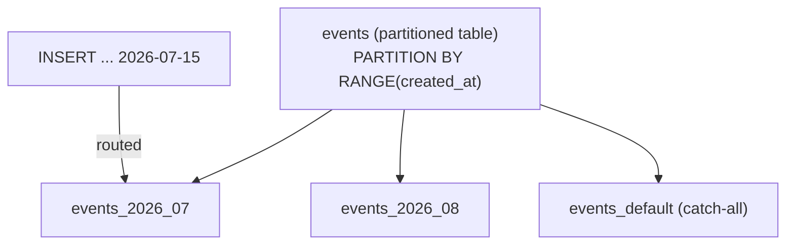
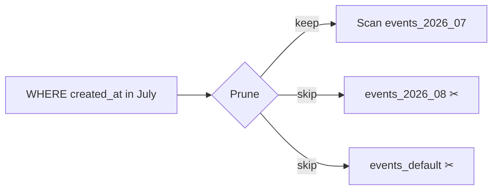

# Day 17 — Partitioning & Maintenance

> Series: Database Engineering
> **Goal:** Use PostgreSQL declarative partitioning (range/list/hash), understand partition pruning, know when partitioning helps vs hurts, and run routine maintenance (REINDEX, ANALYZE, autovacuum tuning per partition). Lab: partition a large time-series table.

## Table of Contents
1. [In plain words](#in-plain-words)
2. [Declarative partitioning](#declarative-partitioning)
3. [Range, list, hash](#range-list-hash)
4. [Partition pruning](#partition-pruning)
5. [When it helps / when it hurts](#when-it-helps--when-it-hurts)
6. [Rolling windows & detaching old data](#rolling-windows--detaching-old-data)
7. [Maintenance: REINDEX, ANALYZE, autovacuum](#maintenance-reindex-analyze-autovacuum)
8. [Lab](#lab-partition-a-large-time-series-table)
9. [Self-Check](#self-check)
10. [Tomorrow](#tomorrow)

---

## In plain words

**In plain words:** Partitioning is turning one giant filing cabinet into a row of labeled cabinets — "2026-Jan," "2026-Feb," etc. The table still *looks* like one table to your queries, but physically the rows live in separate child tables. When you ask for February's data, the DB opens *only* the February cabinet (partition pruning) and ignores the rest. And when 2025 data is old, you don't shred it row by row — you just wheel the whole 2025 cabinet out the door (`DETACH` / `DROP`) instantly.

**Verify versions when building:** **PostgreSQL 17**. Declarative partitioning has matured a lot: PG 11+ added default partitions, PK/FK support, pruning at execution; PG 12–14 improved planning with many partitions; PG 17 improved partition-wise operations and pruning. Avoid the old inheritance+trigger approach — declarative is the modern way.

**Why:** A single 2-billion-row table has huge indexes, painful VACUUMs, and slow bulk deletes. Splitting it makes each piece manageable and lets the planner skip irrelevant data.
**What:** One logical *partitioned table* + many physical *partitions*, split by a *partition key*.
**When:** Very large tables with a natural split key (time, tenant, region) AND queries/maintenance that align with that key.
**Where:** DDL-level structure; transparent to most SQL.

---

## Declarative partitioning

```sql
-- Parent: declares the partitioning scheme (has NO data itself)
CREATE TABLE events (
  id         bigserial,
  tenant_id  int NOT NULL,
  created_at timestamptz NOT NULL,
  payload    jsonb,
  PRIMARY KEY (id, created_at)         -- partition key MUST be in the PK/unique key
) PARTITION BY RANGE (created_at);

-- Children: each owns a slice of the key space
CREATE TABLE events_2026_07 PARTITION OF events
  FOR VALUES FROM ('2026-07-01') TO ('2026-08-01');
CREATE TABLE events_2026_08 PARTITION OF events
  FOR VALUES FROM ('2026-08-01') TO ('2026-09-01');

-- Catch-all so inserts outside defined ranges don't error
CREATE TABLE events_default PARTITION OF events DEFAULT;
```

Key constraints to internalize:
- The **partition key must be part of every unique/primary key** (that's why the PK is `(id, created_at)`).
- Inserts are **routed automatically** to the right partition; no triggers needed.
- Ranges are **`[FROM, TO)`** — lower inclusive, upper exclusive (no gaps, no overlaps).


*One logical table, many physical partitions; inserts auto-route by the key.*

---

## Range, list, hash

**In plain words:** Choose the split that matches how your data grows and how you query it.

| Strategy | Split by | Ideal for | Example key |
|---|---|---|---|
| **RANGE** | contiguous ranges | time-series, sequences | `created_at`, `id` |
| **LIST** | discrete values | region/status/tenant buckets | `country`, `status` |
| **HASH** | hash modulo N | even spread, no natural range | `user_id` (balance load) |

```sql
-- LIST: bucket by region
CREATE TABLE users (id bigint, region text, ...) PARTITION BY LIST (region);
CREATE TABLE users_us PARTITION OF users FOR VALUES IN ('US','CA');
CREATE TABLE users_eu PARTITION OF users FOR VALUES IN ('DE','FR','ES');

-- HASH: spread 50M rows across 8 evenly-sized partitions
CREATE TABLE metrics (id bigint, device_id bigint, ...) PARTITION BY HASH (device_id);
CREATE TABLE metrics_p0 PARTITION OF metrics FOR VALUES WITH (MODULUS 8, REMAINDER 0);
CREATE TABLE metrics_p1 PARTITION OF metrics FOR VALUES WITH (MODULUS 8, REMAINDER 1);
-- ... p2..p7
```

> 🤔 **"Hash partitioning spreads load evenly — is it the same as sharding?"**
> No. Hash *partitioning* keeps all partitions in **one** Postgres instance — it helps VACUUM/index size and enables partition-wise joins, but it does NOT distribute data across machines. **Sharding** (System Design Day 13) splits data across *separate servers* for horizontal scale. Partitioning is a single-node organizing tool; sharding is a multi-node scaling tool. You can combine them (shard, then partition within each shard).

> Cross-ref (System Design): partitioning vs sharding is the local-vs-distributed version of the same "divide the data" idea. Hash partition key selection mirrors shard-key selection — pick one that spreads load and matches query access patterns.

---

## Partition pruning

**In plain words:** Pruning = the planner (or executor) looks at your `WHERE` clause and skips partitions that can't possibly match. This is the whole payoff — a query for July only scans the July partition.

```sql
SET enable_partition_pruning = on;   -- default on

EXPLAIN (ANALYZE)
SELECT count(*) FROM events
WHERE created_at >= '2026-07-10' AND created_at < '2026-07-20';
-- Plan shows only events_2026_07 scanned; other partitions pruned.
-- Look for: "Subplans Removed: N" or only one partition appearing.
```

Two kinds:
- **Plan-time pruning:** the constant is known when planning → other partitions never appear in the plan.
- **Execution-time pruning:** the value comes from a parameter/`ANY`/join at runtime → partitions skipped during execution (`Subplans Removed`).

**Pruning only works if the query filters on the partition key.** A query with no `created_at` predicate scans *every* partition (worse than a plain table!).


*Pruning: only the partitions the predicate can match are scanned.*

> ❌ **Bad scenario:** A team partitioned `events` by `created_at` but their hottest query filtered only by `tenant_id` (no time bound). Every query fanned out to all 60 partitions — planning got *slower* and each query touched 60 index scans. Partitioning by the wrong key is worse than not partitioning.

---

## When it helps / when it hurts

**In plain words:** Partitioning is a big commitment with real downsides. It pays off at scale with the right key; it's overhead at small scale or the wrong key.

| Helps when… | Hurts when… |
|---|---|
| Table is very large (100M+ rows / 100GB+) | Table is small — pure overhead |
| Queries filter on the partition key (pruning) | Queries don't use the key (fan-out to all) |
| You drop/archive old data by time | Random-access by non-key column (fanned index scans) |
| Per-partition VACUUM/REINDEX is easier | You need a global unique constraint NOT including the key |
| Bulk loads/deletes align with partitions | Too many partitions (thousands) → planner overhead |

**The "too many partitions" trap:** planning time grows with partition count. Keep it to hundreds, not tens of thousands. Daily partitions for 10 years = 3650 partitions = pain; prefer monthly, or use `pg_partman` to manage.

> 🤔 **"Partitioning makes queries faster, so I should partition all my big tables, right?"**
> Only if queries filter on the partition key. Partitioning's speed win comes almost entirely from *pruning* and *smaller per-partition indexes*. If your access pattern doesn't align with the key, you get all the maintenance complexity and none of the pruning — often a net loss. Also, unique constraints must include the key, which can force schema changes. Decide based on data size AND query patterns.

> ✅ **Good scenario:** An IoT platform ingesting 500M rows/month partitions `readings` by month. Queries are always "last 24h / last 7d," so they prune to 1–2 partitions. Archiving is `DETACH` + move to cold storage — instant, no giant DELETE, no bloat.

**When NOT to:** Under ~50–100M rows, or when no single column drives both queries and lifecycle, skip it. A well-indexed plain table is simpler and often faster.

---

## Rolling windows & detaching old data

**In plain words:** The killer feature: dropping a whole month of data is instant (drop a partition file) instead of a `DELETE` that creates millions of dead tuples and hammers VACUUM.

```sql
-- Add next month ahead of time (automate this in a cron / pg_partman)
CREATE TABLE events_2026_09 PARTITION OF events
  FOR VALUES FROM ('2026-09-01') TO ('2026-10-01');

-- Retire old data — detach first (keeps it as a standalone table), then archive/drop
ALTER TABLE events DETACH PARTITION events_2026_01;   -- now a normal table
-- ...COPY to cold storage / S3...
DROP TABLE events_2026_01;                            -- instant space reclaim

-- Compare to the painful non-partitioned way:
-- DELETE FROM events WHERE created_at < '2026-02-01';  -- millions of dead tuples, huge VACUUM
```

`DETACH ... CONCURRENTLY` (PG 14+) avoids a long lock:
```sql
ALTER TABLE events DETACH PARTITION events_2026_01 CONCURRENTLY;
```

> **Dark Side:** Forget to pre-create next month's partition and all inserts silently land in `events_default` (or error if no default). The default partition then bloats and, worse, adding a new partition requires scanning the default to prove no rows belong there — a long lock. Automate partition creation (a scheduled job or `pg_partman`), and monitor the default partition's row count.

---

## Maintenance: REINDEX, ANALYZE, autovacuum

**In plain words:** Partitions don't maintain themselves. Each partition has its own indexes, its own bloat, its own stats. The upside: you can maintain them *individually* and in parallel, and skip cold ones.

### REINDEX (rebuild bloated indexes)
```sql
-- Rebuild a single partition's indexes WITHOUT blocking writes (PG 12+)
REINDEX INDEX CONCURRENTLY events_2026_07_created_idx;
REINDEX TABLE CONCURRENTLY events_2026_07;    -- all indexes on that partition

-- Whole partitioned set (schedules children; still per-index work)
REINDEX TABLE CONCURRENTLY events;
```
Why REINDEX: B-tree indexes bloat over time (page splits, dead entries). A rebuilt index is denser and faster. Prefer `CONCURRENTLY` in prod to avoid the exclusive lock.

### ANALYZE (stats per partition)
```sql
-- Stats live per partition AND on the parent. Analyze after big loads.
ANALYZE events_2026_07;        -- the hot, recently-loaded partition
ANALYZE events;                -- refresh parent-level stats too
```
Note: autovacuum analyzes each partition based on *that partition's* churn — a freshly loaded partition may need a manual `ANALYZE` right after bulk insert so the planner prunes/plans well immediately.

### Autovacuum per partition
```sql
-- Tune the HOT (current) partition aggressively; leave cold ones on defaults
ALTER TABLE events_2026_07 SET (
  autovacuum_vacuum_scale_factor = 0.02,
  autovacuum_analyze_scale_factor = 0.02
);
-- Cold, read-only historical partitions barely need autovacuum → less background IO.
```

| Task | Command | Prod flag |
|---|---|---|
| Rebuild bloated index | `REINDEX ... CONCURRENTLY` | avoids ACCESS EXCLUSIVE |
| Refresh stats after load | `ANALYZE partition` | do it immediately post-load |
| Reclaim dead tuples | autovacuum (tuned per partition) | tune hot partition tighter |
| Add index to all partitions | `CREATE INDEX ON parent` | uses `ONLY` + attach for online |

Adding an index across a partitioned table without a long lock (PG 11+):
```sql
-- Create ON ONLY the parent (marked invalid), build per-partition concurrently, then attach
CREATE INDEX idx_events_tenant ON ONLY events (tenant_id);        -- invalid marker
CREATE INDEX CONCURRENTLY idx_events_2026_07_tenant ON events_2026_07 (tenant_id);
ALTER INDEX idx_events_tenant ATTACH PARTITION idx_events_2026_07_tenant;
-- repeat per partition; parent index becomes valid once all attached
```

> ✅ **Good scenario:** A logging DB REINDEXes only the current writable partition weekly (seconds, concurrent) and never touches the 24 frozen historical partitions. Maintenance cost stays flat as data grows — the opposite of a monolithic table whose REINDEX time grows forever.

---

## Lab: partition a large time-series table

```sql
-- 1) Create a range-partitioned time-series table
DROP TABLE IF EXISTS readings CASCADE;
CREATE TABLE readings (
  id         bigserial,
  device_id  int NOT NULL,
  ts         timestamptz NOT NULL,
  value      double precision,
  PRIMARY KEY (id, ts)
) PARTITION BY RANGE (ts);

-- 2) Create monthly partitions + a default
CREATE TABLE readings_2026_05 PARTITION OF readings FOR VALUES FROM ('2026-05-01') TO ('2026-06-01');
CREATE TABLE readings_2026_06 PARTITION OF readings FOR VALUES FROM ('2026-06-01') TO ('2026-07-01');
CREATE TABLE readings_2026_07 PARTITION OF readings FOR VALUES FROM ('2026-07-01') TO ('2026-08-01');
CREATE TABLE readings_default PARTITION OF readings DEFAULT;

-- 3) Load 3M rows spread across the three months
INSERT INTO readings (device_id, ts, value)
SELECT (random()*1000)::int,
       TIMESTAMPTZ '2026-05-01' + (random() * (interval '92 days')),
       random()*100
FROM generate_series(1, 3000000);

-- 4) Index the partition key + a common filter (indexes propagate to partitions)
CREATE INDEX ON readings (device_id, ts);
ANALYZE readings;

-- 5) See pruning in action
EXPLAIN (ANALYZE, BUFFERS)
SELECT avg(value) FROM readings
WHERE ts >= '2026-07-05' AND ts < '2026-07-12';
-- Expect: only readings_2026_07 scanned; "Subplans Removed" for the others.

-- 6) Contrast: a query WITHOUT the partition key fans out to ALL partitions
EXPLAIN (ANALYZE)
SELECT count(*) FROM readings WHERE device_id = 42;   -- scans every partition ⚠

-- 7) Row counts per partition (prove routing worked)
SELECT tableoid::regclass AS partition, count(*)
FROM readings GROUP BY 1 ORDER BY 1;

-- 8) Roll the window: retire May instantly
ALTER TABLE readings DETACH PARTITION readings_2026_05 CONCURRENTLY;
DROP TABLE readings_2026_05;    -- instant vs a multi-million-row DELETE

-- 9) Pre-create August (never let inserts fall into default)
CREATE TABLE readings_2026_08 PARTITION OF readings FOR VALUES FROM ('2026-08-01') TO ('2026-09-01');

-- 10) Maintenance drills
REINDEX TABLE CONCURRENTLY readings_2026_07;
ANALYZE readings_2026_07;
ALTER TABLE readings_2026_07 SET (autovacuum_vacuum_scale_factor = 0.02);
```

Automation note: in production, use the **`pg_partman`** extension to auto-create future partitions and retire old ones on a schedule, instead of hand-writing DDL.

## Migrating an existing big table to partitioned

**In plain words:** You rarely get to design partitioning up front — usually you must convert a monolithic 500M-row table that's *already in production and taking writes*. You can't just `ALTER TABLE ... PARTITION BY`; the standard play is create-new + backfill + swap.

```sql
-- 1) Create the new partitioned table (same columns) alongside the old one
CREATE TABLE events_new (LIKE events INCLUDING ALL) PARTITION BY RANGE (created_at);
-- create partitions covering all existing + future data ...

-- 2) Backfill in batches (avoid one giant transaction that bloats + locks)
INSERT INTO events_new SELECT * FROM events
WHERE created_at >= '2026-01-01' AND created_at < '2026-02-01';   -- repeat per range

-- 3) Dual-write or brief lock, then swap names in one transaction
BEGIN;
  ALTER TABLE events RENAME TO events_old;
  ALTER TABLE events_new RENAME TO events;
COMMIT;
-- 4) Verify, then DROP events_old.
```

Tools that automate this safely: **`pg_partman`** (has a migration helper) and cloud managed options. Batching is the key discipline — a single `INSERT ... SELECT` of 500M rows is one giant transaction that holds an old snapshot (Day 14 bloat), fills WAL, and can't be resumed if it fails.

> 🤔 **"Can I convert a table to partitioned in place with a simple ALTER?"**
> No — Postgres has no in-place "make this existing table partitioned" command. The partitioned table must be created as such from the start. Converting a live table means create-new-plus-migrate (above), ideally with dual writes or a maintenance window for the final swap. Plan the cutover; it's a project, not a one-liner.

> **Dark Side:** Teams underestimate the backfill. Copying 500M rows generates enormous WAL (replicas lag, Day 20), can trigger aggressive autovacuum on the new table, and if done in one transaction blocks VACUUM cluster-wide for hours. Always batch, throttle, and watch replication lag during the migration.

> **MySQL callout:** MySQL supports `PARTITION BY RANGE/LIST/HASH/KEY` too, but with big caveats: every UNIQUE/PRIMARY key must include the partition column (same rule), foreign keys are **not allowed** on partitioned InnoDB tables, and pruning support is narrower. Dropping a partition (`ALTER TABLE ... DROP PARTITION`) is the same instant-archive win. Postgres's declarative partitioning is generally more flexible (defaults, partition-wise joins, concurrent detach).

---

## Self-Check
1. Why must the partition key be part of every unique/primary key?
2. What is partition pruning, and what must a query include for it to happen?
3. Contrast plan-time and execution-time pruning.
4. Give one scenario where partitioning helps and one where it actively hurts.
5. Why is hash partitioning NOT the same as sharding?
6. Why is dropping a partition vastly cheaper than a `DELETE` of the same rows?
7. What goes wrong if you forget to pre-create the next time partition?
8. Why REINDEX partitions individually with `CONCURRENTLY`, and when do you need it?
9. Why might a freshly bulk-loaded partition need a manual `ANALYZE` immediately?
10. How would you tune autovacuum differently for the current hot partition vs cold historical ones?

## Tomorrow
**Day 18 — Caching Layers & Materialized Views:** where to put a cache (app memory vs Redis vs the DB itself), materialized views and concurrent refresh, and the hard part — invalidation strategies (reusing System Design's caching lesson). Lab: add a materialized view with a refresh strategy.
