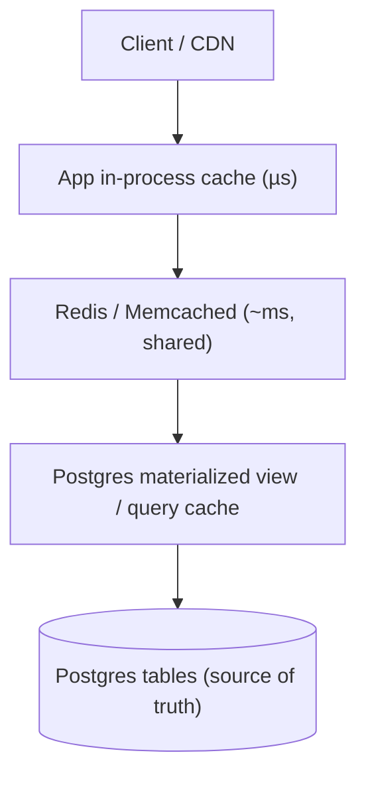
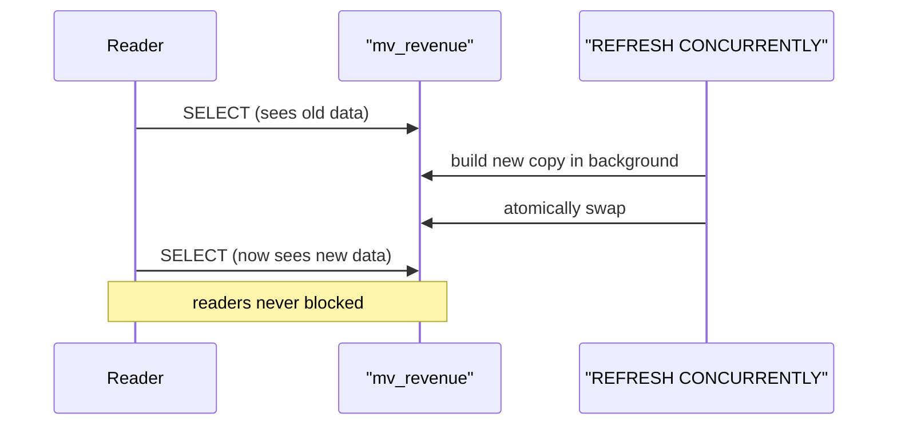
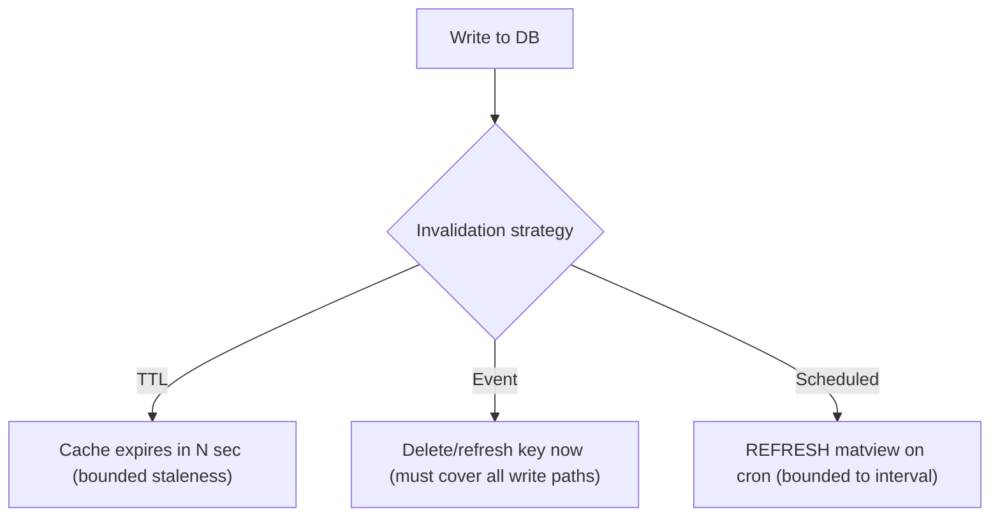

# Day 18 — Caching Layers & Materialized Views

> Series: Database Engineering
> **Goal:** Decide *where* to cache (app memory vs Redis vs the database itself), use PostgreSQL materialized views with concurrent refresh, and master the genuinely hard part — invalidation strategies (reusing System Design's caching lesson). Lab: add a materialized view with a refresh strategy.

## Table of Contents
1. [In plain words](#in-plain-words)
2. [The caching hierarchy](#the-caching-hierarchy)
3. [App cache vs Redis vs matview](#app-cache-vs-redis-vs-materialized-view)
4. [Materialized views](#materialized-views)
5. [Refreshing: plain vs concurrent](#refreshing-plain-vs-concurrent)
6. [Cache patterns](#cache-patterns-cache-aside-write-through)
7. [Invalidation strategies](#invalidation-the-hard-part)
8. [Lab](#lab-add-a-matview--refresh-strategy)
9. [Self-Check](#self-check)
10. [Tomorrow](#tomorrow)

---

## In plain words

**In plain words:** A cache is the sticky note on your monitor with the WiFi password. The real source of truth is buried in an email somewhere (the database), but reading that every time is slow, so you keep a fast copy where you can see it. The whole game is: (1) is the sticky note *faster* to read than the email? (yes), and (2) is it *still correct*? — because the day someone changes the WiFi password and forgets the sticky note, everyone's locked out. That second question — invalidation — is the hard one. "There are only two hard things in computer science: cache invalidation and naming things."

A **materialized view** is a special cache that lives *inside* Postgres: the stored, precomputed result of an expensive query.

**Verify versions when building:** **PostgreSQL 17**; **Redis 7.x**. `REFRESH MATERIALIZED VIEW CONCURRENTLY` since PG 9.4 (needs a unique index).

> Cross-ref (System Design, Day 11 — Caching): this file is the database-side companion. The cache-aside/write-through patterns, TTL vs event invalidation, and the thundering-herd problem are the same concepts applied one layer down. Read them together.

---

## The caching hierarchy

**In plain words:** Caches stack from closest/fastest/smallest to farthest/slowest/biggest. Each layer shields the one below it.


*Each layer absorbs load so fewer requests reach the source of truth.*

| Layer | Latency | Scope | Survives restart? | Best for |
|---|---|---|---|---|
| App in-process (map/Caffeine) | ~µs | one process | no | tiny, hot, per-node reference data |
| Redis/Memcached | ~0.2–1ms | shared across pods | yes (Redis persistence optional) | session, computed fragments, rate limits |
| Materialized view | ~ms (indexed) | all DB clients | yes | expensive aggregates/reports |
| Postgres `shared_buffers` | ~µs (RAM page cache) | the DB itself | no (rebuilt from disk) | automatic — the DB caches hot pages |

Note: Postgres has **no query result cache** like MySQL used to. It caches *pages* in `shared_buffers`, not query results. That's why matviews/Redis exist — to cache *results*.

---

## App cache vs Redis vs materialized view

**In plain words:** Pick by *who needs the data* and *how fresh it must be*.

| | App in-process | Redis | Materialized view |
|---|---|---|---|
| Shared across app nodes? | No (each node its own) | Yes | Yes (it's in the DB) |
| Consistency across nodes | hard (each stale differently) | one shared copy | one shared copy |
| Where invalidation happens | app code | app code / pub-sub | `REFRESH` |
| Good for | per-node config, tiny lookups | sessions, fragments, counters | heavy JOIN/aggregate reports |
| Failure blast radius | node only | shared dependency | DB load on refresh |
| Extra infra | none | yes (Redis cluster) | none (already have PG) |

> 🤔 **"Redis is faster than Postgres — should I cache everything in Redis?"**
> Not reflexively. Redis adds a network hop, an extra system to operate/monitor, and a *second source of truth* you must keep consistent (the hard part). If a query is already fast (indexed PK lookup hitting `shared_buffers`), caching it in Redis can be *slower* (extra hop) and riskier (staleness). Cache the *expensive* stuff — aggregates, fan-out results, rate limits — not everything. And a matview may beat Redis when the data is DB-derived and all clients share it.

> ✅ **Good scenario:** A dashboard's "revenue by region this quarter" is a 4-second 8-table aggregate hit 10k times/hour. A materialized view refreshed every 5 minutes turns each hit into a 3ms indexed read on precomputed rows. DB load drops 99%; the 5-min staleness is acceptable for a KPI dashboard.

> ❌ **Bad scenario:** A team cached individual user rows in Redis with a 1-hour TTL. Profile edits didn't invalidate the cache → users saw stale names for an hour, support tickets piled up. The lookup was a 0.3ms PK read that never needed caching. They added complexity and a correctness bug for negative benefit.

---

## Materialized views

**In plain words:** A regular `VIEW` is a saved query — it re-runs every time you select from it (a macro). A **materialized view** runs the query *once*, stores the rows physically like a table, and serves them instantly until you `REFRESH`. Trade freshness for speed.

```sql
-- Regular view: recomputed on every access (always fresh, can be slow)
CREATE VIEW v_revenue AS
SELECT region, date_trunc('day', created_at) d, sum(total) rev
FROM orders GROUP BY 1, 2;

-- Materialized view: computed & stored now, served fast, stale until REFRESH
CREATE MATERIALIZED VIEW mv_revenue AS
SELECT region, date_trunc('day', created_at) d, sum(total) rev
FROM orders GROUP BY 1, 2
WITH DATA;                      -- WITH NO DATA to create empty, refresh later

-- Index it like a table (crucial for fast reads AND for concurrent refresh)
CREATE UNIQUE INDEX ux_mv_revenue ON mv_revenue (region, d);
CREATE INDEX ix_mv_revenue_d ON mv_revenue (d);

SELECT * FROM mv_revenue WHERE d = current_date;   -- instant indexed read
```

| | View | Materialized view | Table |
|---|---|---|---|
| Storage | none (query only) | yes (stored rows) | yes |
| Freshness | always current | as of last REFRESH | whatever you write |
| Read speed | = underlying query | fast (precomputed + indexed) | fast |
| Write cost | none | REFRESH recomputes | per-row |
| Indexable | no (indexes underlying) | yes | yes |

---

## Refreshing: plain vs concurrent

**In plain words:** `REFRESH` recomputes the matview. Plain refresh **locks readers out** while it rebuilds. `REFRESH ... CONCURRENTLY` rebuilds in the background and swaps, so readers keep querying the old data meanwhile — but it needs a UNIQUE index and is slower/heavier.

```sql
-- Plain: fast to compute, but takes ACCESS EXCLUSIVE lock (readers BLOCKED during refresh)
REFRESH MATERIALIZED VIEW mv_revenue;

-- Concurrent: readers keep working; requires a UNIQUE index on the matview
REFRESH MATERIALIZED VIEW CONCURRENTLY mv_revenue;
```

| | Plain REFRESH | CONCURRENTLY |
|---|---|---|
| Reader blocking | Yes (ACCESS EXCLUSIVE) | No |
| Speed | faster | slower (diffs rows) |
| Requires unique index | No | **Yes** |
| Can run on empty matview | Yes | No (must have data) |
| Use when | maintenance window / small matview | 24/7 read traffic |


*CONCURRENTLY swaps atomically so reads never block — at the cost of a heavier refresh.*

> **Dark Side:** `REFRESH` (even concurrent) *recomputes the entire query* every time — Postgres has no built-in *incremental* matview refresh. On a huge base table, a 5-minute-scheduled full refresh can itself become a heavy recurring load. For true incremental maintenance you need extensions (e.g., `pg_ivm`) or a hand-rolled trigger/rollup table. Know the cost before scheduling frequent refreshes.

> 🤔 **"Can I make Postgres auto-refresh the matview when the base table changes?"**
> Not natively — there's no automatic refresh trigger. You schedule it (cron / `pg_cron` / app job) or refresh on an event (after a batch load). If you need near-real-time, either use triggers to maintain a summary table incrementally, use `pg_ivm`, or accept a short refresh interval. Choosing the refresh cadence *is* choosing your staleness SLA.

---

## Cache patterns (cache-aside, write-through)

**In plain words:** These are the rules for *how* the app talks to the cache and DB. Reusing System Design Day 11 vocabulary.

**Cache-aside (lazy loading)** — the default:
```text
read(key):
    v = cache.get(key)
    if v is None:                 # miss
        v = db.query(key)         # go to source of truth
        cache.set(key, v, ttl)    # populate for next time
    return v

write(key, val):
    db.write(key, val)
    cache.delete(key)             # INVALIDATE (don't update — avoids races)
```

**Write-through** — write goes through the cache to the DB:
```text
write(key, val):
    db.write(key, val)
    cache.set(key, val)           # cache always warm & consistent on write
```

| Pattern | Reads | Writes | Risk |
|---|---|---|---|
| Cache-aside | populate on miss | invalidate key | brief miss after write (thundering herd) |
| Write-through | always warm | write both | write latency + stale if write path bypassed |
| Write-behind | warm | async flush to DB | data loss if cache dies before flush |
| Read-through | cache library fetches on miss | (paired with write-through) | needs cache-managed loader |

> 🤔 **"On a write, should I *update* the cache or *delete* it?"**
> Prefer **delete (invalidate)**, not update. If two concurrent writes both update the cache, they can interleave and leave a stale value permanently. Deleting forces the next reader to re-fetch the true value from the DB. Update-in-place is a subtle source of permanently stale caches. (Same lesson as System Design Day 11.)

---

## Invalidation: the hard part

**In plain words:** Invalidation = making sure the cache stops serving a value that's no longer true. Every strategy trades freshness against cost/complexity. There is no free option.

| Strategy | How | Freshness | Cost |
|---|---|---|---|
| **TTL (time-based)** | expire after N seconds | stale up to N s | trivial; tune N |
| **Event-based** | invalidate on write / message | near-immediate | app must fire on every write path |
| **Write-through** | update on every write | immediate | write latency; must cover all writers |
| **Versioned keys** | embed version in the key | immediate (old key abandoned) | old entries linger until evicted |
| **Manual/scheduled** | refresh matview on cron | up to interval | simple; bounded staleness |

**TTL** is the pragmatic default: bounded staleness, zero coordination. Pick the largest TTL your product tolerates.

**Event-based** is precise but fragile — you must invalidate on *every* code path that mutates the data, including migrations, admin tools, and batch jobs. Miss one and you get silent staleness (the WiFi sticky-note bug).

**The thundering herd / cache stampede:** when a hot key expires, thousands of requests miss simultaneously and all hammer the DB to recompute the same thing.
```text
Mitigations:
  - per-key lock: first miss recomputes, others wait for it (single-flight)
  - stale-while-revalidate: serve slightly-stale value while ONE request refreshes
  - jittered TTLs: randomize expiry so keys don't all expire at once
  - pre-warm: refresh popular keys before they expire (matview on a schedule does this)
```


*Three invalidation families; matview refresh is the DB-native scheduled variant.*

> ✅ **Good scenario:** A pricing page cached prices in Redis with a 60s TTL *and* an event-based delete fired by the price-update service. TTL is the safety net if an event is missed; events give near-instant updates in the common case. Belt and suspenders — the standard production pattern.

> ❌ **Bad scenario:** A team relied purely on event-based invalidation. A back-office bulk price import wrote directly to the DB (bypassing the service that fired events) → the cache served last week's prices for days until someone noticed. A TTL would have capped the damage at 60 seconds.

**When NOT to cache:** highly volatile data read once, data with strict correctness needs and no tolerance for staleness (e.g., live account balance at point of transfer — use the DB with a lock, Day 13), or data that's already a fast PK lookup. Caching adds a consistency problem; only take it on when the read cost justifies it.

---

## Lab: add a matview + refresh strategy

```sql
-- 1) Base data
DROP TABLE IF EXISTS orders;
CREATE TABLE orders (
  id bigserial PRIMARY KEY, region text, total numeric, created_at timestamptz
);
INSERT INTO orders (region, total, created_at)
SELECT (ARRAY['us','eu','apac'])[1+(random()*2)::int],
       (random()*500)::numeric,
       now() - (random()*90) * interval '1 day'
FROM generate_series(1, 2000000);
CREATE INDEX ON orders (created_at);

-- 2) The expensive report query — time it first
EXPLAIN (ANALYZE)
SELECT region, date_trunc('day', created_at) d, sum(total) rev, count(*) n
FROM orders GROUP BY 1,2;   -- note the Execution Time (hundreds of ms+)

-- 3) Materialize it
CREATE MATERIALIZED VIEW mv_daily_rev AS
SELECT region, date_trunc('day', created_at) d, sum(total) rev, count(*) n
FROM orders GROUP BY 1,2
WITH DATA;

-- 4) UNIQUE index → required for CONCURRENT refresh + fast reads
CREATE UNIQUE INDEX ux_mv_daily_rev ON mv_daily_rev (region, d);

-- 5) Read it — should be single-digit ms now
EXPLAIN (ANALYZE)
SELECT * FROM mv_daily_rev WHERE d >= current_date - 7;

-- 6) Add new data, observe staleness, then refresh
INSERT INTO orders (region, total, created_at) VALUES ('us', 9999, now());
SELECT rev FROM mv_daily_rev WHERE region='us' AND d = date_trunc('day', now());  -- OLD value

REFRESH MATERIALIZED VIEW CONCURRENTLY mv_daily_rev;   -- readers not blocked
SELECT rev FROM mv_daily_rev WHERE region='us' AND d = date_trunc('day', now());  -- updated ✅

-- 7) Prove CONCURRENTLY doesn't block: in Session B keep SELECTing during a refresh in A.
```

Scheduling the refresh (choose your staleness SLA):
```sql
-- Option A: pg_cron extension (in-database scheduler)
CREATE EXTENSION IF NOT EXISTS pg_cron;
SELECT cron.schedule('refresh_daily_rev', '*/5 * * * *',
  $$REFRESH MATERIALIZED VIEW CONCURRENTLY mv_daily_rev$$);   -- every 5 min

-- Option B: external cron / app job calling:
--   psql -c "REFRESH MATERIALIZED VIEW CONCURRENTLY mv_daily_rev"
```

Rollup table (incremental alternative to a full matview refresh) via trigger:
```sql
-- When you can't afford a full REFRESH, maintain a summary table incrementally
CREATE TABLE daily_rev_rollup (region text, d date, rev numeric, n int,
  PRIMARY KEY (region, d));

CREATE OR REPLACE FUNCTION bump_rollup() RETURNS trigger AS $$
BEGIN
  INSERT INTO daily_rev_rollup (region, d, rev, n)
  VALUES (NEW.region, date_trunc('day', NEW.created_at)::date, NEW.total, 1)
  ON CONFLICT (region, d)                       -- upsert: add to the running total
  DO UPDATE SET rev = daily_rev_rollup.rev + EXCLUDED.rev,
                n   = daily_rev_rollup.n   + 1;
  RETURN NEW;
END $$ LANGUAGE plpgsql;

CREATE TRIGGER trg_rollup AFTER INSERT ON orders
FOR EACH ROW EXECUTE FUNCTION bump_rollup();
-- Now reads hit daily_rev_rollup (always current), no periodic full recompute.
-- Trade-off: every INSERT pays a small write; handle UPDATE/DELETE too if needed.
```

| Approach | Freshness | Write cost | Read cost | Complexity |
|---|---|---|---|---|
| Materialized view + scheduled refresh | interval-stale | none (until refresh) | fast | low |
| Trigger-maintained rollup | real-time | per-write overhead | fast | medium (handle upd/del) |
| Redis cache-aside | TTL-stale | invalidation logic | fastest | medium (extra infra) |

> 🤔 **"Rollup triggers give real-time aggregates for free — why ever use a matview?"**
> Not free: every write now does extra work and can contend on the rollup row (a single hot `(region, d)` row becomes a write bottleneck — the counter-contention problem). Triggers also must handle UPDATE and DELETE, not just INSERT, or the totals drift. Matviews concentrate the cost into one scheduled recompute instead of taxing every write. Choose by write volume and freshness needs.

Redis cache-aside sketch (app side, pseudocode) for a hot per-region total:
```text
GET report:us  → miss → SELECT ... FROM mv_daily_rev WHERE region='us'
              → SET report:us <json> EX 60 (60s TTL, jittered ±10s)
on price/order batch import → DEL report:us   (event invalidation as a bonus)
```

> **MySQL callout:** MySQL has **no materialized views** natively — you emulate them with a summary table maintained by triggers or a scheduled `INSERT ... SELECT` (or use ClickHouse/other tools). MySQL's old **query cache** was removed in 8.0 (it hurt concurrency). So on MySQL, result caching means Redis or a hand-rolled rollup table. Postgres's matviews are a real advantage here.

---

## Self-Check
1. Why does Postgres have no query-result cache, and what does `shared_buffers` actually cache?
2. When is a materialized view a better choice than Redis, and vice versa?
3. Difference between a regular view and a materialized view in storage and freshness?
4. What does `REFRESH ... CONCURRENTLY` require, and what does it buy you?
5. Why is there no automatic/incremental matview refresh in core Postgres, and what are the workarounds?
6. On a write, why prefer invalidating (deleting) the cache key over updating it?
7. Compare TTL vs event-based invalidation — one strength and one weakness each.
8. What is a cache stampede / thundering herd, and name two mitigations.
9. Why is "event-based invalidation only" risky, and what's the standard belt-and-suspenders fix?
10. Name two situations where you should NOT add a cache at all.

## Tomorrow
**Day 19 — Benchmarking & Finding Bottlenecks:** how to measure honestly with `pgbench`, methodology (warm cache, realistic data, steady state), and how to tell whether your bottleneck is CPU, IO, or locks using `pg_stat_activity` and wait events. Lab: benchmark before and after a tuning change.
