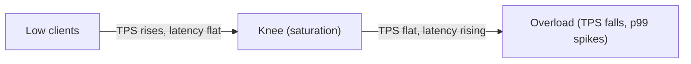
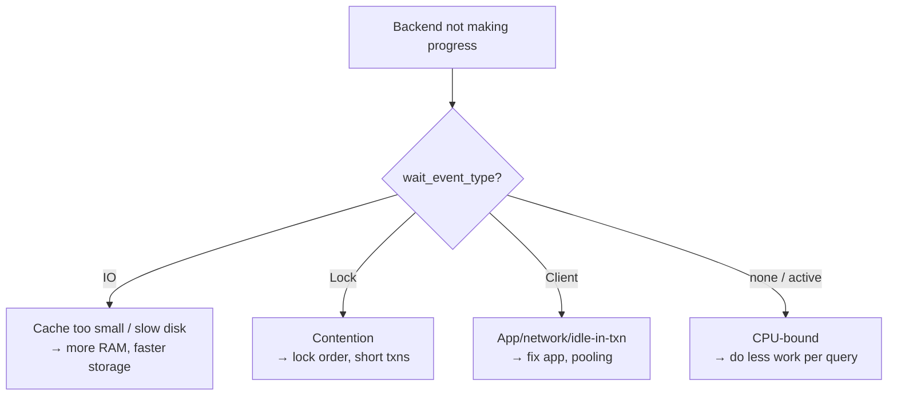

# Day 19 — Benchmarking & Finding Bottlenecks

> Series: Database Engineering
> **Goal:** Measure PostgreSQL performance honestly with `pgbench`, follow sound methodology (warm cache, realistic data, steady state), and diagnose whether a bottleneck is CPU, IO, or locks using `pg_stat_activity` and wait events. Lab: benchmark before and after a tuning change.

## Table of Contents
1. [In plain words](#in-plain-words)
2. [Benchmarking methodology](#benchmarking-methodology)
3. [pgbench basics](#pgbench-basics)
4. [Custom workloads](#custom-workloads-realistic-benchmarks)
5. [Reading the numbers](#reading-the-numbers-tps-latency-percentiles)
6. [Is it CPU, IO, or locks?](#is-it-cpu-io-or-locks)
7. [Wait events](#wait-events-the-diagnostic-key)
8. [Lab](#lab-benchmark-before--after-a-tuning-change)
9. [Self-Check](#self-check)
10. [Tomorrow](#tomorrow)

---

## In plain words

**In plain words:** Benchmarking is a dyno test for your database. You don't tune an engine by *listening* to it and guessing — you put it on a dyno, apply a repeatable load, and read the gauges. The two cardinal sins are (1) testing on a cold engine (empty cache) and pretending it reflects reality, and (2) changing five things then bragging about the improvement without knowing which one did it. Change **one variable**, measure, repeat.

Finding the bottleneck is like a car losing power: is it fuel-starved (IO), redlining the RPM (CPU), or stuck in gear (locks)? Different problem, different fix. The wait-event view is your diagnostic scanner.

**Verify versions when building:** **PostgreSQL 17**; `pgbench` ships with Postgres. PG 17 added richer wait-event coverage and `pg_stat_io` (introduced PG 16) for IO diagnosis — use it.

**Why:** Without measurement you'll "optimize" the wrong thing. Intuition about DB performance is famously wrong.
**What:** A repeatable load + gauges (TPS, latency, wait events) + a controlled change.
**When:** Before/after any tuning, capacity planning, or a "the DB is slow" investigation.
**Where:** On hardware/data that resembles production — a laptop benchmark rarely transfers.

> 🤔 **"My query ran in 3ms the second time — I fixed it, right?"**
> Almost certainly not. The first run read from disk (cold cache); the second hit `shared_buffers`/OS cache (warm). You measured caching, not your change. Always warm the cache first, run enough iterations to reach *steady state*, and compare like-for-like. A single fast run proves nothing.

---

## Benchmarking methodology

**In plain words:** Good benchmarks are boring and repeatable. Follow the checklist or your numbers lie.

1. **Realistic data volume & distribution.** 1000 rows behaves nothing like 100M. Skew matters (a few hot keys vs uniform).
2. **Warm the cache** (or explicitly test cold-cache behavior on purpose) — run a warm-up pass and discard it.
3. **Steady state.** Run long enough (minutes, not seconds) that checkpoints, autovacuum, and cache fill settle. Watch for a warm-up ramp.
4. **One variable at a time.** Change the index, OR `work_mem`, OR the query — never several.
5. **Repeat & look at variance.** Run 3–5 times; if results swing wildly, something uncontrolled is interfering (other load, thermal throttling).
6. **Measure the right metric.** Throughput (TPS) *and* tail latency (p95/p99) — averages hide the pain users feel.
7. **Isolate the system.** No other heavy processes, no shared VM neighbors if you can help it.
8. **Record everything.** Config, data size, command, results — so it's reproducible.


*The benchmarking loop: control everything, change one variable, remeasure.*

> **Dark Side:** The most common self-deception is the **micro-benchmark that doesn't match production access patterns**. You benchmark a single-row PK lookup at 200k TPS, ship it, and prod dies because the real workload is range scans with concurrent writes contending for locks. Benchmark the *shape* of your real traffic, not a convenient synthetic one.

---

## pgbench basics

**In plain words:** `pgbench` is the built-in load generator. It ships a default TPC-B-like banking workload (accounts, tellers, branches) and can run your own SQL scripts.

```bash
# 1) Initialize test schema at "scale factor" 100 (~10M rows in pgbench_accounts)
#    scale 1 ≈ 100k accounts; pick scale so data > RAM if you want to test IO
pgbench -i -s 100 labdb

# 2) Run the default workload: 10 clients, 4 threads, 60 seconds
pgbench -c 10 -j 4 -T 60 labdb

# Key flags:
#   -c  clients (concurrent connections)
#   -j  threads (driver-side; ~= CPU cores on the client)
#   -T  duration in seconds  (prefer over -t transaction count for steady state)
#   -P 5  progress report every 5s (watch for warm-up ramp)
#   -r  per-statement latency breakdown
#   -M prepared  use prepared statements (less parse overhead, more realistic for apps)
#   -S  read-only (SELECT-only) variant
#   -N  skip updates to branches/tellers (reduce contention)
```

Typical output:
```
transaction type: <builtin: TPC-B (sort of)>
scaling factor: 100
number of clients: 10
number of threads: 4
duration: 60 s
number of transactions actually processed: 154203
latency average = 3.891 ms
latency stddev = 2.104 ms
tps = 2569.9 (without initial connection time)
```

> 🤔 **"pgbench says 2500 TPS — is that my database's real capacity?"**
> Only for *pgbench's* workload at *that* scale on *this* hardware with *this* config. TPS is meaningless without all four. The default TPC-B is write-heavy with contention on small tables (branches/tellers) — your app may be 95% reads. Build a custom script matching your real query mix before quoting a number to anyone.

---

## Custom workloads (realistic benchmarks)

**In plain words:** The default banking workload rarely matches your app. Write a script with *your* queries and *your* read/write ratio.

```sql
-- myworkload.sql  (a pgbench script)
\set cid random(1, 100000)
\set region random(1, 3)
BEGIN;
  SELECT * FROM orders WHERE customer_id = :cid ORDER BY created_at DESC LIMIT 20;
  SELECT sum(total) FROM orders WHERE customer_id = :cid;
COMMIT;
```

```bash
# Run YOUR workload, 50 clients, 2 min, with per-statement latencies
pgbench -c 50 -j 8 -T 120 -P 10 -r -f myworkload.sql labdb

# Mix scripts with weights: 90% reads, 10% writes
pgbench -c 50 -j 8 -T 120 \
  -f reads.sql@9 \
  -f writes.sql@1 \
  labdb
```

> ✅ **Good scenario:** Before a Black Friday, a retail team built a pgbench script mirroring real traffic (browse-heavy with checkout spikes) at production data scale on prod-like hardware. They found the checkout path lock-bottlenecked at 3x normal load, fixed it (`FOR UPDATE SKIP LOCKED`, Day 13), and re-benchmarked to confirm 6x headroom. No surprises on the day.

> ❌ **Bad scenario:** A team benchmarked the default `pgbench -S` (read-only, tiny hot set entirely in cache) on a laptop, saw 80k TPS, and promised leadership that capacity. Production (writes, cold pages, cross-AZ latency, connection churn) did 4k TPS. The benchmark measured a fantasy.

---

## Reading the numbers: TPS, latency, percentiles

**In plain words:** Throughput (TPS) is how many you serve; latency is how long each waits. They trade off — pushing TPS up usually pushes tail latency up. Users feel the *tail* (p99), not the average.

| Metric | Meaning | Watch for |
|---|---|---|
| TPS | transactions/sec (throughput) | plateaus then drops as clients ↑ (saturation) |
| latency avg | mean per-txn time | hides outliers |
| latency stddev | spread | high = inconsistent (contention/GC/IO spikes) |
| p95 / p99 | tail latency | the number your SLA cares about |

Find the **saturation point**: increase `-c` (clients) in steps; TPS rises, then flattens, then *falls* while latency climbs. Past the knee you're just queuing.


*Push clients up to find the knee; running past it only grows latency.*

```bash
# Sweep concurrency to find the knee
for c in 1 5 10 20 50 100 200; do
  echo "clients=$c"; pgbench -c $c -j 8 -T 30 -S labdb | grep -E 'tps|latency'
done
```

For real percentiles across runs, use `--latency-limit` or post-process the `--log` per-transaction timings (`pgbench --log` writes a file of individual latencies you can feed to a percentile script).

---

## Is it CPU, IO, or locks?

**In plain words:** Three suspects. Read the gauges to convict one.

| Bottleneck | Symptoms | Where to look | Typical fix |
|---|---|---|---|
| **CPU** | high CPU %, TPS scales with cores then flattens, low IO wait | `top`/`htop`, `pg_stat_activity` many `active` | better indexes/queries (do less work), more cores |
| **IO** | high disk read/write, `iowait`, buffers `read=` high | `pg_stat_io`, `iostat`, wait event `IO/*` | more RAM (cache), faster disk, reduce data scanned |
| **Locks** | TPS low but CPU & IO low (!), sessions waiting | wait events `Lock/*`, `pg_blocking_pids` | fix lock ordering, shorter txns, `SKIP LOCKED` (Day 13) |

The tell for **locks**: low CPU *and* low IO but also low throughput — the system is *waiting*, not working. That paradox ("nothing is busy but it's slow") almost always means lock contention or client-side latency.

```sql
-- Snapshot: what is every backend doing RIGHT NOW?
SELECT state, wait_event_type, wait_event, count(*)
FROM pg_stat_activity
WHERE backend_type = 'client backend'
GROUP BY 1,2,3 ORDER BY count DESC;

-- Are we IO-bound? (PG 16+)
SELECT backend_type, object, context,
       reads, writes, extends,
       round(read_time) AS read_ms, round(write_time) AS write_ms
FROM pg_stat_io
WHERE reads > 0 OR writes > 0
ORDER BY read_time DESC NULLS LAST;

-- Cache hit ratio (low ratio → IO-bound / cache too small)
SELECT round(100.0 * sum(blks_hit) / NULLIF(sum(blks_hit + blks_read),0), 2) AS cache_hit_pct
FROM pg_stat_database;
```

> 🤔 **"CPU is at 30%, disk is quiet, but the app times out — is the database broken?"**
> No — that's the classic **lock-bound** signature. The DB has spare CPU and IO but transactions are blocked waiting on each other (or on a leaked long transaction, Day 14). Check `wait_event_type = 'Lock'` and `pg_blocking_pids`. Also check *client-side*: connection-pool exhaustion (Day 16) looks identical from the app — requests wait for a free connection while the DB sits idle.

---

## Wait events: the diagnostic key

**In plain words:** When a backend isn't running on CPU, it's *waiting* for something, and Postgres records *what*. Aggregating wait events over time tells you where time actually goes — this is the single most useful DB diagnostic.

Common wait-event types:
| `wait_event_type` | Meaning | Points to |
|---|---|---|
| `CPU` (null wait_event, state active) | running on CPU | CPU-bound |
| `IO` | reading/writing data/WAL | IO-bound; e.g., `DataFileRead`, `WALWrite` |
| `Lock` | waiting on a heavyweight lock | row/table lock contention |
| `LWLock` | internal lightweight lock | buffer/WAL internals (e.g., `WALWrite`, `BufferContent`) |
| `Client` | waiting on the client | app slow / network / idle in txn |
| `IPC` | waiting on another backend | parallel query, sync replication |

```sql
-- Poll wait events repeatedly to build a profile (poor-man's sampler).
-- Run this every 100ms during a benchmark and tally the results:
SELECT wait_event_type, wait_event
FROM pg_stat_activity
WHERE state = 'active' AND backend_type = 'client backend';
```

For continuous, low-overhead sampling in production, use the **`pg_wait_sampling`** extension (samples wait events into a histogram) or a monitoring tool (pganalyze, PMM). That turns "the DB felt slow at 2pm" into "68% of time was `Lock/transactionid` on the orders table."


*Wait events map a "slow database" straight to its root cause.*

---

## Lab: benchmark before & after a tuning change

We'll prove that adding an index improves a real workload — with honest methodology.

```bash
# 0) Fresh DB, realistic scale (make data larger than shared_buffers if testing IO)
psql -c "DROP DATABASE IF EXISTS benchdb;"
psql -c "CREATE DATABASE benchdb;"
```
```sql
-- 1) Build a workload table (5M rows), NO helpful index yet
\c benchdb
CREATE TABLE orders (id bigserial PRIMARY KEY, customer_id int, total numeric, created_at timestamptz);
INSERT INTO orders (customer_id, total, created_at)
SELECT (random()*100000)::int, (random()*500)::numeric, now() - (random()*365)*interval '1 day'
FROM generate_series(1, 5000000);
ANALYZE orders;
```
```sql
-- 2) The workload script  → save as bench_orders.sql
\set cid random(1, 100000)
SELECT * FROM orders WHERE customer_id = :cid ORDER BY created_at DESC LIMIT 20;
```
```bash
# 3) WARM UP (discard this run) — fill the cache first
pgbench -c 20 -j 4 -T 30 -f bench_orders.sql benchdb >/dev/null

# 4) BEFORE: baseline measurement (3 runs, note TPS + latency each)
for i in 1 2 3; do pgbench -c 20 -j 4 -T 60 -r -f bench_orders.sql benchdb | grep -E 'tps|latency'; done
```
```sql
-- 5) While the BEFORE run is going, in another session diagnose the bottleneck:
SELECT wait_event_type, wait_event, count(*) FROM pg_stat_activity
WHERE state='active' AND backend_type='client backend' GROUP BY 1,2 ORDER BY 3 DESC;
-- Expect lots of IO/DataFileRead (Seq Scans hitting disk) → IO-bound.

-- 6) THE ONE CHANGE: add the index the query needs
CREATE INDEX CONCURRENTLY idx_orders_cust_created ON orders (customer_id, created_at DESC);
ANALYZE orders;
```
```bash
# 7) WARM UP again (indexes need to warm too), then AFTER measurement
pgbench -c 20 -j 4 -T 30 -f bench_orders.sql benchdb >/dev/null
for i in 1 2 3; do pgbench -c 20 -j 4 -T 60 -r -f bench_orders.sql benchdb | grep -E 'tps|latency'; done
# Expect: TPS up many-fold, p95 latency down, wait events shift from IO to CPU/Client.
```

**Second experiment — tune `work_mem` for a sort-heavy query (one variable):**
```sql
-- A query that sorts a lot; watch for "external merge Disk:" in EXPLAIN ANALYZE
EXPLAIN (ANALYZE, BUFFERS)
SELECT customer_id, sum(total) FROM orders GROUP BY customer_id ORDER BY 2 DESC;
-- If it spills to disk:
SET work_mem = '256MB';   -- session-level, one change
-- re-run EXPLAIN ANALYZE → sort should stay in memory ("quicksort Memory:"), faster.
RESET work_mem;
```

**Common config knobs you'll benchmark (change ONE at a time):**

| Setting | What it affects | Rough guidance |
|---|---|---|
| `shared_buffers` | DB page cache in RAM | ~25% of RAM (rest to OS cache) |
| `work_mem` | per-sort/hash memory before spilling to disk | raise for sort/hash-heavy analytics; beware × many connections |
| `effective_cache_size` | planner's hint about total cache | ~50–75% of RAM (planning only, not an allocation) |
| `max_wal_size` / `checkpoint_timeout` | checkpoint frequency (IO smoothing) | larger = fewer, bigger checkpoint spikes |
| `random_page_cost` | index-vs-seqscan cost balance | ~1.1 on SSD/NVMe (default 4 assumes spinning disk) |
| `max_parallel_workers_per_gather` | parallel query workers | more for big analytical scans |

> 🤔 **"Bigger `work_mem` made my sort faster — should I set it to 4GB globally?"**
> Careful: `work_mem` is *per operation, per connection*. A single complex query can use several `work_mem` chunks (multiple sorts/hashes), and 200 connections each doing that can multiply into an OOM. Set a modest global default and raise it *per session* for the specific heavy analytical queries. This is exactly why you benchmark one knob at a time with realistic concurrency, not a single query in isolation.

> **Dark Side:** `random_page_cost = 4` (the historical default tuned for spinning disks) makes the planner over-avoid index scans on modern SSD/NVMe, silently preferring seq scans. Many "why won't it use my index?" mysteries are just this default fighting your hardware. Benchmark with a realistic value (~1.1) and you'll often see the planner make better choices for free.

**Report template (record for reproducibility):**
```text
Change: added index (customer_id, created_at DESC)
Hardware: <cores/RAM/disk>   Data: 5M rows   shared_buffers: <X>
Command: pgbench -c 20 -j 4 -T 60 -f bench_orders.sql
BEFORE: tps=~180  avg=110ms  p95=~300ms  wait=IO/DataFileRead
AFTER:  tps=~9500 avg=2.1ms  p95=~5ms    wait=Client/CPU
Verdict: ~50x throughput; bottleneck moved from disk IO to client round-trips.
```

> **MySQL callout:** MySQL's equivalents: `sysbench` (the de-facto load tool) or `mysqlslap`. Diagnose with `SHOW ENGINE INNODB STATUS`, `performance_schema` (`events_waits_summary_*`), and `SHOW PROCESSLIST`. Concepts identical: warm cache (InnoDB buffer pool), steady state, find CPU/IO/lock. The `sys` schema (`sys.innodb_lock_waits`) is MySQL's `pg_blocking_pids` analog.

---

## Self-Check
1. Why is a single fast query run poor evidence that you fixed something?
2. List four methodology rules for an honest benchmark.
3. Why change only one variable per benchmark iteration?
4. What does the default `pgbench` workload measure, and why might it not match your app?
5. Why report p95/p99 latency and not just the average?
6. Describe the TPS-vs-clients "knee" and what running past it costs you.
7. Give the distinguishing symptom of a *lock*-bound system versus a CPU- or IO-bound one.
8. Which `pg_stat_activity` columns tell you what a waiting backend is waiting on?
9. What does a low cache-hit ratio in `pg_stat_database` suggest?
10. How would you confirm that adding an index actually helped, controlling for cache warmth?

## Tomorrow
**Day 20 — Replication:** the finale — physical (streaming) vs logical replication, synchronous vs asynchronous, primary-replica topologies, replication lag and the read-your-writes problem (reusing System Design), and failover basics. Lab: set up a read replica and measure lag.
