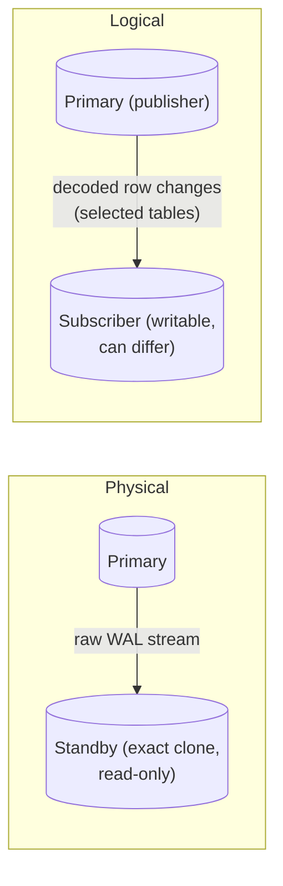
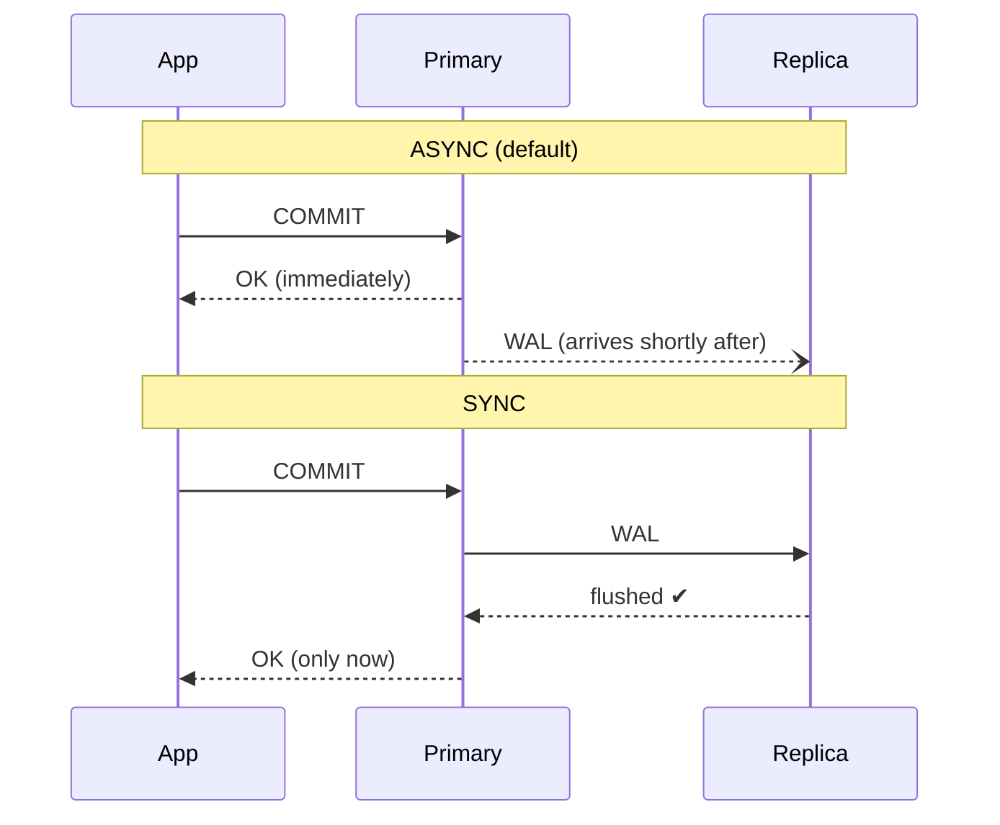
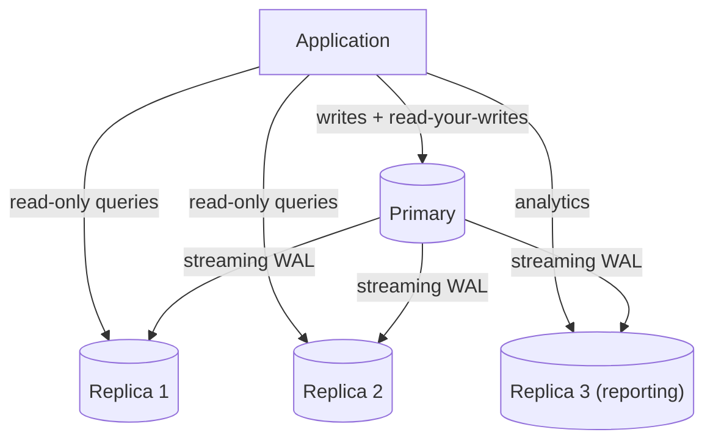
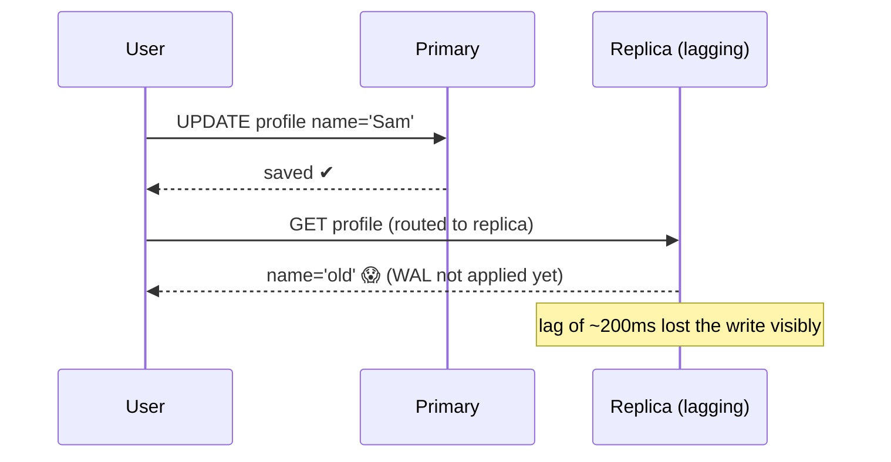
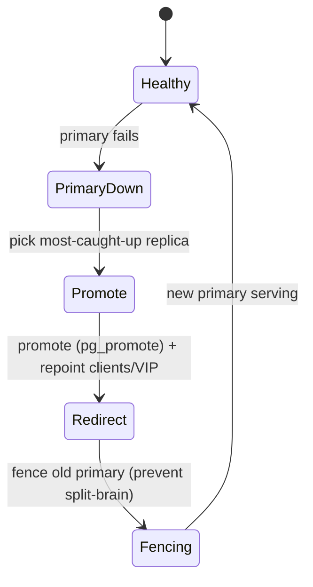

# Day 20 — Replication

> Series: Database Engineering
> **Goal:** Understand PostgreSQL replication end to end — physical (streaming) vs logical, synchronous vs asynchronous, primary-replica topologies, replication lag and the read-your-writes problem (reusing System Design), and failover basics. Lab: set up a read replica and measure lag.

## Table of Contents
1. [In plain words](#in-plain-words)
2. [Why replicate](#why-replicate)
3. [Physical (streaming) vs logical](#physical-streaming-vs-logical)
4. [Synchronous vs asynchronous](#synchronous-vs-asynchronous)
5. [Primary-replica topology](#primary-replica-topology)
6. [Replication lag & read-your-writes](#replication-lag--the-read-your-writes-problem)
7. [Failover basics](#failover-basics)
8. [Lab](#lab-set-up-a-read-replica-measure-lag)
9. [Self-Check](#self-check)
10. [Series wrap-up](#series-wrap-up)

---

## In plain words

**In plain words:** Replication is keeping photocopies of a ledger in several offices. One office is the *original* where all edits happen (the primary); the others get a live feed of every change and keep identical copies (replicas). Now reports can be read from any office (spreading load), and if the head office burns down, a branch office has the ledger and can be promoted to the new original (failover). The catch: the copies are always a *little* behind the original — the courier takes a moment. That delay (replication lag) is the source of nearly every replication headache.

**Verify versions when building:** **PostgreSQL 17**. Streaming replication since 9.0; logical replication since 10; PG 16 added logical replication *from a standby* and parallel apply; PG 17 improved logical replication (failover slots, `pg_createsubscriber` to convert a physical standby to logical). Tools referenced: `pg_basebackup`, `pg_createsubscriber`, and HA managers like Patroni/repmgr.

> Cross-ref (System Design, replication & sharding, plus the read-your-writes lesson): this is the DB-native implementation of concepts you met there. The CAP trade-offs, sync-vs-async durability/latency, and read-after-write consistency are the same ideas in Postgres's concrete terms.

---

## Why replicate

**In plain words:** Three distinct goals, often conflated:

| Goal | What replication gives you | Note |
|---|---|---|
| **High availability** | a standby to promote if the primary dies | needs failover automation |
| **Read scaling** | serve `SELECT`s from replicas | writes still go to one primary |
| **Disaster recovery** | a copy in another region/DC | async, geo-distant |
| **Zero-downtime upgrades / migrations** | logical replication between versions | logical only |
| **Analytics offload** | run heavy reports on a replica | protects primary (recall Day 14 bloat!) |

> 🤔 **"Replication is my backup, right? If I have replicas I don't need backups."**
> Dangerously wrong. Replication copies *everything instantly* — including your mistakes. `DELETE FROM orders;` (no WHERE) replicates to every replica in milliseconds. A `DROP TABLE` is now gone everywhere. Replication protects against *hardware/node failure*; **backups** (with point-in-time recovery via WAL archiving) protect against *human/logical error*. You need both. Replicas are not backups.

---

## Physical (streaming) vs logical

**In plain words:** **Physical** replication ships the raw WAL (Day 11) — byte-for-byte block changes — so the replica is an *exact clone*, down to the physical layout. **Logical** replication ships *decoded changes* ("INSERT this row into orders") so you can replicate *selected* tables, across versions, and even transform on the way.


*Physical clones the whole cluster block-for-block; logical replays chosen row changes.*

| Dimension | Physical (streaming) | Logical (pub/sub) |
|---|---|---|
| Unit shipped | raw WAL blocks | decoded row changes |
| Granularity | whole cluster (all DBs) | per-table / per-database |
| Replica writable? | No (read-only standby) | Yes (subscriber is a normal DB) |
| Cross major version? | No (must match) | **Yes** (great for upgrades) |
| Different schema/subset? | No | Yes (columns/rows can differ) |
| DDL replicated? | Yes (it's physical) | **No** (DDL not replicated — apply manually) |
| Sequences | Yes | Not automatically (must sync) |
| Overhead | low | higher (decode + apply) |
| Typical use | HA, read replicas, DR | upgrades, selective sync, integrations |

```sql
-- LOGICAL replication setup (publisher side)
-- postgresql.conf: wal_level = logical
CREATE PUBLICATION pub_orders FOR TABLE orders, customers;   -- or FOR ALL TABLES

-- Subscriber side (a separate PG instance)
CREATE SUBSCRIPTION sub_orders
  CONNECTION 'host=primary dbname=app user=repl password=...'
  PUBLICATION pub_orders;
-- Initial data copied, then streamed changes applied. Subscriber stays writable.
```

> ✅ **Good scenario (logical):** A team upgrading Postgres 14 → 17 with near-zero downtime: set up 17 as a logical subscriber of the 14 primary, let it catch up, verify, then flip the app's connection string. Minutes of downtime instead of hours of `pg_upgrade` + testing. Physical replication can't cross major versions — logical is the tool.

> ❌ **Bad scenario (logical gotcha):** A team used logical replication and ran `ALTER TABLE orders ADD COLUMN status text` on the primary. It did **not** replicate (logical doesn't ship DDL). Inserts with the new column then failed on the subscriber. Fix: apply DDL to *both* sides in a coordinated order (subscriber first for additive changes).

---

## Synchronous vs asynchronous

**In plain words:** After you `COMMIT`, does the primary wait for a replica to confirm it got the change (**synchronous**) or reply "done" immediately and tell replicas later (**asynchronous**)? Sync = no data loss on failover but slower writes. Async = fast writes but a failover can lose the last few transactions.


*Async acks before the replica has it; sync waits for the replica — safety vs latency.*

| | Asynchronous (default) | Synchronous |
|---|---|---|
| COMMIT latency | low | higher (+ network round trip) |
| Data loss on primary crash | possible (last few txns) | none (for `remote_apply`/`on`) |
| Throughput | higher | lower |
| Availability | replica down ≠ primary blocked | replica down can **block writes**! |
| Use for | read replicas, DR, most apps | financial data needing zero loss |

```sql
-- Configure synchronous replication (postgresql.conf on the primary)
-- synchronous_standby_names = 'FIRST 1 (replica_a, replica_b)'
SHOW synchronous_commit;   -- levels: off < local < remote_write < on < remote_apply

-- Per-transaction override: keep most writes async, make critical ones sync
SET synchronous_commit = 'remote_apply';   -- this txn waits for replica to APPLY
INSERT INTO payments ...; COMMIT;
```

`synchronous_commit` levels (weakest→strongest durability):
- `off` — don't even wait for local WAL fsync (Day 11 footgun for money)
- `local` — local WAL fsync only, ignore replicas
- `remote_write` — replica received it (in its OS, not yet fsync'd)
- `on` — replica fsync'd it to disk
- `remote_apply` — replica *applied* it (visible to reads there) → strongest, enables read-your-writes on that replica

> **Dark Side:** With a single synchronous standby and `synchronous_standby_names` requiring it, if that standby goes down the primary **blocks all commits** waiting for an ack that never comes — an availability outage caused by your durability setting. Use `ANY`/quorum with multiple standbys (`ANY 1 (a, b, c)`), or accept async. Sync replication without redundancy is a self-inflicted single point of failure.

> 🤔 **"Synchronous replication means my replicas are always perfectly up to date, so I can read from any of them safely?"**
> Not quite. `synchronous_commit=on` guarantees the WAL is *durably received/fsync'd* on the standby, but reads there may still lag until the WAL is *applied* — only `remote_apply` guarantees the committed row is visible on that standby. And "synchronous" typically involves *one* quorum member, not *all* replicas. Other async replicas still lag. Sync is about durability on failover, not universal read freshness.

---

## Primary-replica topology

**In plain words:** One writer (primary), many readers (replicas). The app must route: writes → primary, reads → a replica (with care about lag). This is the standard scale-reads architecture.


*One primary for writes; replicas absorb read and analytics load.*

Routing is usually done by:
- **App-level**: separate read/write connection strings (explicit control).
- **Proxy/pooler**: PgBouncer/PgPool/HAProxy or cloud endpoints (e.g., a "reader endpoint") that load-balance reads.

Cascading replication (a replica feeds other replicas) offloads the primary's network:
```
Primary → Replica A → Replica B, Replica C   (A relays WAL downstream)
```

> ✅ **Good scenario:** A content site is 95% reads. Three read replicas behind a reader endpoint absorb the traffic; the primary handles only the 5% writes. They scaled reads 4x by adding replicas — no sharding needed. (Writes still bottleneck on the single primary; that's when sharding — System Design — enters.)

**When NOT to (add read replicas):** If your bottleneck is *writes*, replicas don't help — every replica replays every write, so write capacity is still one primary's worth (in fact replicas add WAL-shipping overhead). Read replicas scale reads only. Write scaling needs sharding or a different architecture.

---

## Replication lag & the read-your-writes problem

**In plain words:** Async replicas are always slightly behind. If a user updates their profile (write → primary), then immediately reloads (read → replica that hasn't caught up), they see their *old* profile and think the save failed. That's the **read-your-writes** violation — the most common replication bug in apps.


*Read-your-writes violation: a read hits a replica before the write has replicated.*

Measure lag:
```sql
-- On the PRIMARY: how far behind is each replica (bytes)?
SELECT client_addr, state,
       pg_wal_lsn_diff(pg_current_wal_lsn(), replay_lsn) AS replay_lag_bytes,
       write_lag, flush_lag, replay_lag       -- time intervals (PG 10+)
FROM pg_stat_replication;

-- On a REPLICA: how stale is my data, in seconds?
SELECT now() - pg_last_xact_replay_timestamp() AS replica_lag;
-- Or check if paused / current replayed LSN:
SELECT pg_last_wal_replay_lsn(), pg_is_in_recovery();
```

**Fixes for read-your-writes (reuse System Design's toolkit):**

| Strategy | How | Trade-off |
|---|---|---|
| **Read from primary after a write** | route that user's reads to primary for N seconds ("sticky") | primary takes more load |
| **Wait for LSN** | after write, capture LSN; replica read waits until `replay_lsn >= LSN` | added latency; needs plumbing |
| **Synchronous `remote_apply`** | write visible on the sync replica before COMMIT returns | write latency cost |
| **Monotonic session routing** | pin a session to one replica so it never goes "backwards" | doesn't fix cross-replica jumps |
| **Tolerate staleness** | show "saving..." UI / eventual consistency | product decision |

```sql
-- LSN-wait technique: app captures the commit LSN, then makes the replica wait
-- 1) after COMMIT on primary:
SELECT pg_current_wal_lsn();          -- e.g. '3/AB12F0' → store in session
-- 2) before reading on replica, block until it has caught up to that LSN:
--    (app loops or uses a helper checking pg_last_wal_replay_lsn() >= stored LSN)
```

> ❌ **Bad scenario:** A social app naively load-balanced *all* reads across replicas with ~500ms lag. After posting, users' own feed didn't show their post → they double-posted, then triple-posted. Fix: route a user's reads to the primary for a few seconds after they write (sticky read-your-writes).

> **Dark Side:** A **long-running query on a replica** can *pause* WAL replay (to avoid its snapshot's rows being vacuumed away — `max_standby_streaming_delay`), causing lag to balloon. Or, if the replica falls behind and the primary recycled the needed WAL, the replica breaks entirely (needs `wal_keep_size` or a replication slot to prevent). Slots prevent WAL loss but can fill the primary's disk if a replica is down (Day 11 Dark Side). Monitor both lag and slot retention.

---

## Failover basics

**In plain words:** Failover = promoting a replica to be the new primary when the old one dies. The hard parts: *detecting* the failure reliably (not a network blip), avoiding **split-brain** (two primaries accepting writes), and *redirecting* clients to the new primary.


*Failover: detect, pick the freshest replica, promote, redirect, fence the old primary.*

```bash
# Manual promotion of a standby to primary (PG 12+)
pg_ctl promote -D /var/lib/postgresql/data
# or SQL:  SELECT pg_promote();
```

Key concerns:
- **Which replica?** The one with the highest `replay_lsn` (least data loss). Under async, some committed-on-old-primary txns may be lost — the RPO.
- **Split-brain:** if the old primary comes back thinking it's still primary, and clients split, you corrupt data. **Fencing** (STONITH — "shoot the other node in the head") or a consensus/quorum prevents it.
- **Client redirection:** a virtual IP, DNS update, or a proxy (HAProxy/Patroni's endpoints) points apps at the new primary.
- **Rejoining the old primary:** it must be re-cloned or `pg_rewind`'d to become a replica of the new primary (its timeline diverged).

**Production HA managers do this automatically:**
| Tool | Role |
|---|---|
| **Patroni** | consensus-based (etcd/Consul) automatic failover, no split-brain |
| **repmgr** | replication management + failover |
| **pg_auto_failover** | simpler managed failover (monitor + keeper) |
| Cloud (RDS/Aurora/Cloud SQL) | managed failover behind an endpoint |

| Metric | Meaning | Set by |
|---|---|---|
| **RPO** (Recovery Point Objective) | max data you can afford to lose | sync vs async |
| **RTO** (Recovery Time Objective) | max downtime during failover | automation quality |

> 🤔 **"Can't I just promote a replica manually when the primary dies — why do I need Patroni?"**
> You can, once, slowly, at 3am, hoping you pick the right replica and the old primary stays down. At scale you need *automatic* detection (with quorum so a network partition doesn't falsely promote), *automatic* fencing (so no split-brain), and *automatic* client redirect. Manual failover means minutes-to-hours of downtime and a real risk of two primaries corrupting data. HA managers encode the hard-won correctness. Match the tool to your RTO.

---

## Lab: set up a read replica, measure lag

Using two local PostgreSQL 17 instances (ports 5432 primary, 5433 replica). Adjust paths to your install.

```bash
# ===== PRIMARY (port 5432) =====
# 1) Allow replication connections. In postgresql.conf:
#    wal_level = replica
#    max_wal_senders = 10
#    wal_keep_size = 512MB          # keep WAL so a briefly-down replica can catch up
# In pg_hba.conf add:
#    host  replication  repl  127.0.0.1/32  scram-sha-256
psql -p 5432 -c "CREATE ROLE repl WITH REPLICATION LOGIN PASSWORD 'replpass';"
# restart primary to apply config
pg_ctl -D /data/primary restart
```

```bash
# ===== REPLICA (port 5433) =====
# 2) Base backup: clone the primary into the replica's data dir + set up streaming
pg_basebackup -h 127.0.0.1 -p 5432 -U repl \
  -D /data/replica -Fp -Xs -P -R \
  # -R writes standby.signal + primary_conninfo automatically (PG 12+)

# 3) Set the replica port and start it
echo "port = 5433" >> /data/replica/postgresql.auto.conf
pg_ctl -D /data/replica start
# It comes up in recovery (read-only), streaming from the primary.
```

```sql
-- 4) Verify the stream is live (on PRIMARY)
SELECT client_addr, state, sync_state, replay_lsn
FROM pg_stat_replication;    -- expect one row, state = 'streaming'

-- 5) Confirm replica is read-only and in recovery (on REPLICA :5433)
SELECT pg_is_in_recovery();  -- t
-- Try a write → it fails:
-- ERROR: cannot execute INSERT in a read-only transaction

-- 6) MEASURE LAG: write on primary, read on replica
--    PRIMARY:
CREATE TABLE lag_test (id int, t timestamptz);
INSERT INTO lag_test VALUES (1, clock_timestamp());
SELECT pg_current_wal_lsn();          -- note the LSN

--    REPLICA (immediately): does the row exist yet?
SELECT * FROM lag_test;               -- may be empty for a moment, then appears
SELECT now() - pg_last_xact_replay_timestamp() AS lag_seconds;  -- tiny (ms) locally
```

```bash
# 7) Induce lag to SEE it: hammer writes on primary, watch replica fall behind
pgbench -i -s 50 -p 5432 labdb
pgbench -c 20 -j 4 -T 60 -p 5432 labdb &     # heavy write load
watch -n1 "psql -p 5432 -tAc \
  \"SELECT client_addr, pg_wal_lsn_diff(pg_current_wal_lsn(), replay_lsn) AS lag_bytes,
            replay_lag FROM pg_stat_replication;\""
# Watch lag_bytes / replay_lag rise under load, then drain when the load stops.
```

```sql
-- 8) Read-your-writes demo:
--    PRIMARY: UPDATE a row; note LSN.
--    REPLICA under load: SELECT that row → may show OLD value until caught up.
--    Fix option: read from primary for that user, OR wait for replay_lsn >= noted LSN.

-- 9) Failover drill (CAREFUL — this promotes the replica):
--    Stop the primary, then on the replica:
SELECT pg_promote();          -- replica becomes a writable primary
SELECT pg_is_in_recovery();   -- now f
-- (Old primary must be pg_rewind'd to rejoin as a replica of the new primary.)
```

> **MySQL callout:** MySQL replication ships the **binary log (binlog)** — row-based (like logical) or statement-based — to replicas' relay logs. It's async by default; **semi-synchronous** replication (plugin) waits for one replica to ack (≈ Postgres `remote_write`). MySQL 8 **Group Replication / InnoDB Cluster** provides multi-primary and automatic failover (≈ Patroni). Read-your-writes and lag concerns are identical. Terminology differs: "source/replica" (formerly master/slave), GTIDs for tracking position (≈ LSN).

---

## Self-Check
1. Why is a replica NOT a substitute for backups? Give a concrete failure it can't protect against.
2. Contrast physical and logical replication on: granularity, cross-version, writable replica, DDL.
3. When must you use logical replication rather than physical?
4. Explain the durability-vs-latency trade in synchronous vs asynchronous replication.
5. What are the `synchronous_commit` levels, and which one enables read-your-writes on the sync standby?
6. Why can a single synchronous standby become an availability risk, and how do you avoid it?
7. Do read replicas help a write-bottlenecked system? Why or why not?
8. Describe the read-your-writes problem and two ways to fix it.
9. How do you measure replication lag in bytes (on primary) and in seconds (on replica)?
10. In failover, what is split-brain and how do fencing/quorum prevent it? Define RPO and RTO.

## Series wrap-up
You now have the full internals-to-operations arc: **ACID & WAL (11)** → **isolation & anomalies (12)** → **locking & deadlocks (13)** → **MVCC & VACUUM (14)** → **query optimization (15)** → **index tuning & N+1 (16)** → **partitioning & maintenance (17)** → **caching & matviews (18)** → **benchmarking (19)** → **replication (20)**. Each layer builds on the last: MVCC explains isolation; isolation and locking explain concurrency bugs; optimization and indexing explain speed; partitioning, caching, and replication explain scale and availability. Take a real slow endpoint from your work, run it through Days 15–16, then design its scale story with Days 17–20. That end-to-end exercise is exactly the job-ready DB-engineering skill this series was built to give you.
