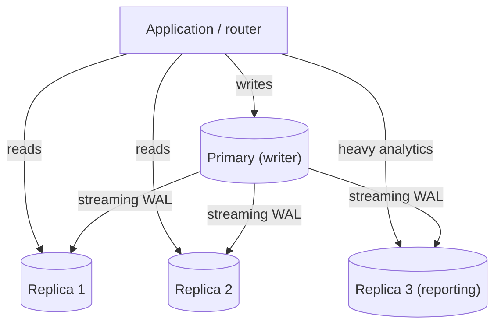
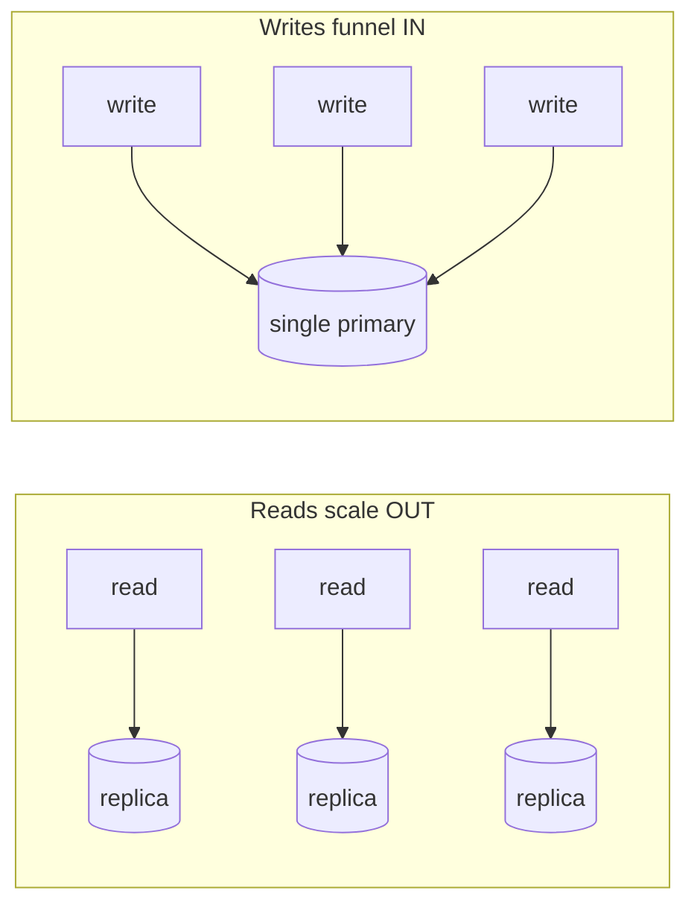
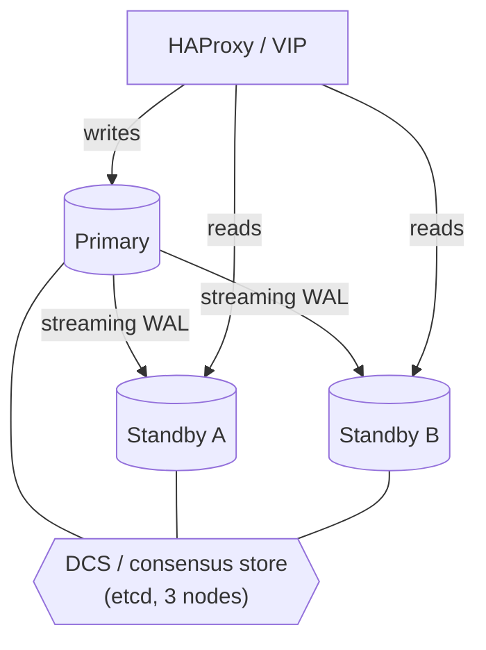
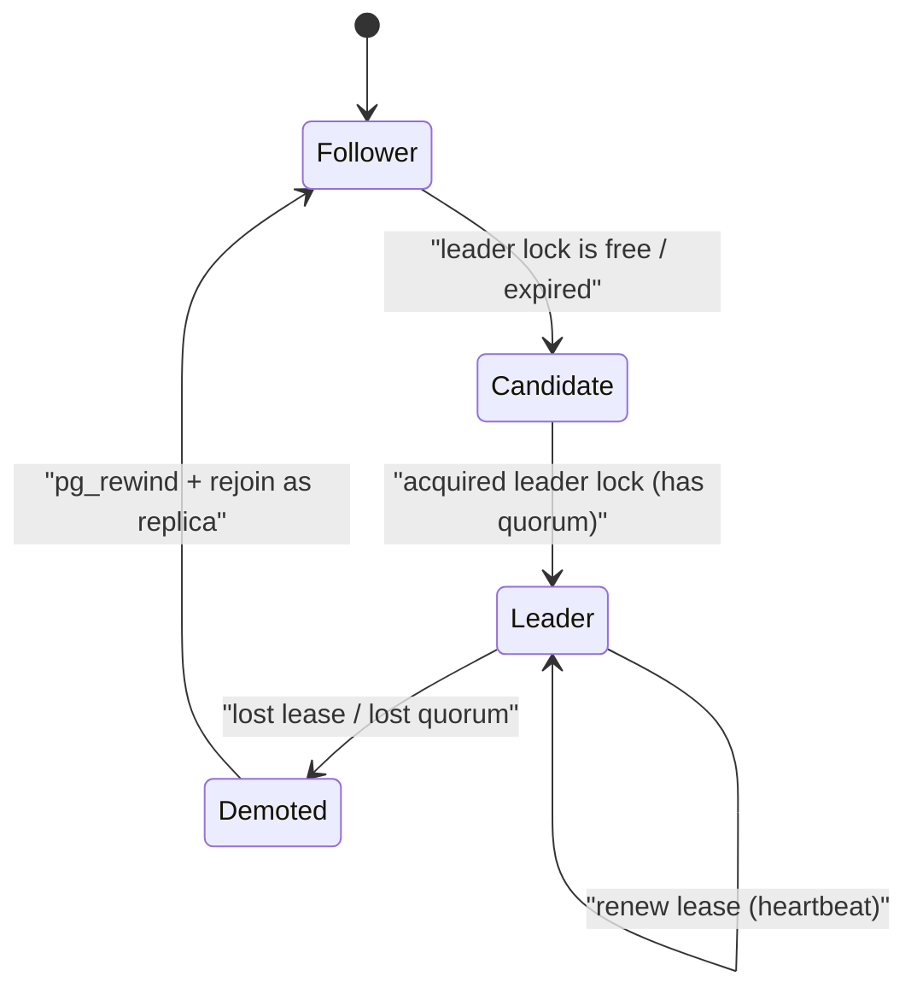
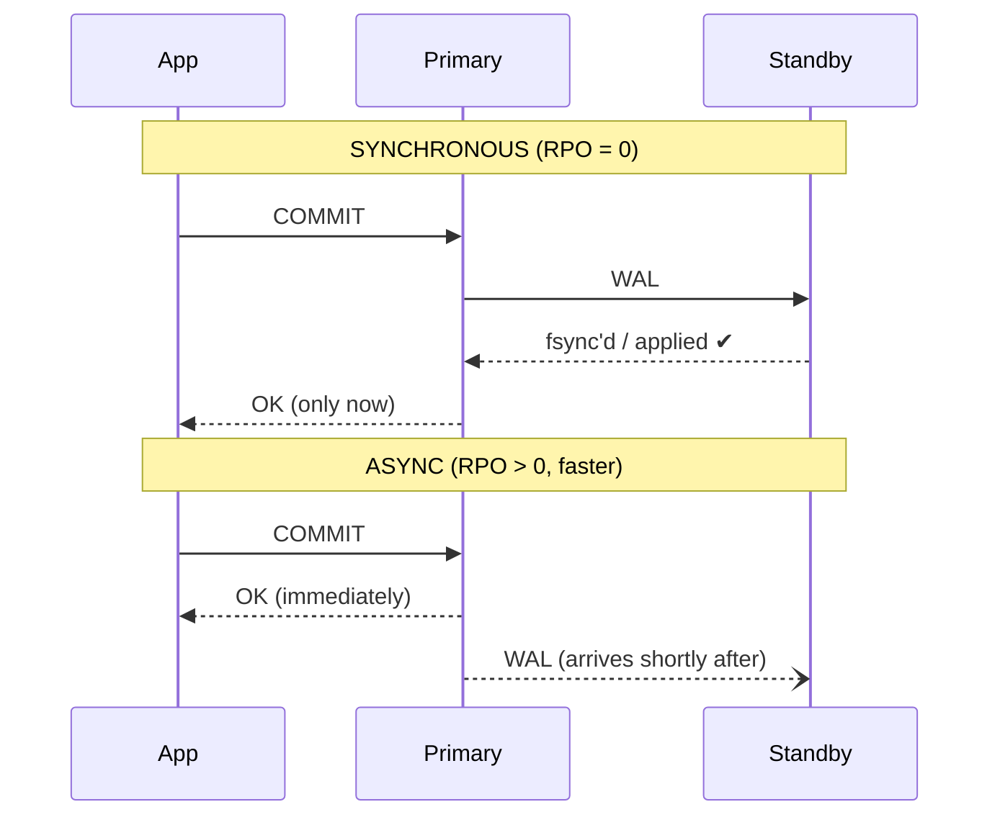

# Day 21 — Read/Write Scaling & High Availability

> Series: Database Engineering
> **Goal:** Understand how to scale *reads* with replicas, why *writes* are the hard ceiling, and how to build a highly-available Postgres cluster (HA topologies, automated failover with Patroni, and the synchronous-replication trade-off). Lab: simulate a failover and watch a replica get promoted.

## Table of Contents
1. [In plain words](#in-plain-words)
2. [Scaling reads with replicas](#scaling-reads-with-replicas)
3. [Why writes are the ceiling](#why-writes-are-the-ceiling)
4. [HA topologies](#ha-topologies)
5. [Automated failover with Patroni](#automated-failover-with-patroni)
6. [The synchronous replication trade-off](#the-synchronous-replication-trade-off)
7. [Connection pooling under HA](#connection-pooling-under-ha)
8. [Lab: simulate a failover](#lab-simulate-a-failover)
9. [Self-Check](#self-check)
10. [Tomorrow](#tomorrow)

---

## In plain words

**In plain words:** Imagine a busy bank branch. All *deposits and withdrawals* (writes) must go through the one head teller who owns the master ledger — otherwise two tellers could both hand out the last $100. But *balance enquiries* (reads) can be answered by any assistant holding a photocopy of the ledger. So you scale enquiries by hiring more assistants (read replicas), but you can only ever have **one** head teller for the ledger (one primary for writes). High availability is the plan for what happens when the head teller collapses: someone with the freshest photocopy is instantly sworn in as the new head teller, and everyone is told to queue at *their* window now.

Day 20 gave you replication mechanics. Today is the *operational* layer built on top: how you actually scale and stay up.

**Verify versions when building:** **PostgreSQL 17** (primary). `pg_promote()` since PG 12; quorum/`ANY` synchronous replication since PG 10; `pg_rewind` to rejoin a demoted primary. HA tooling: **Patroni** (with etcd/Consul/Kubernetes as the DCS), **repmgr**, **pg_auto_failover**. Poolers: **PgBouncer**, **HAProxy**. (PostgreSQL 18 is available in 2026; the concepts here are unchanged — verify defaults against your minor version.)

> Cross-ref (System Design — replication & sharding, and the CAP lesson): this is the concrete Postgres implementation. Read scaling here = the "read replica" pattern; write scaling limits here are *why* System Design reaches for sharding.

---

## Scaling reads with replicas

**Why:** Most OLTP apps are read-heavy (often 90–99% reads). If reads and writes compete for the same primary's CPU, buffers, and I/O, heavy reads starve writes. Offloading reads to replicas frees the primary.

**What:** Streaming physical replicas (Day 20) that serve `SELECT` traffic. Add N replicas → roughly N× read throughput (until some shared bottleneck like the network or the primary's WAL-sending capacity appears).

**When:** Read latency/throughput is your bottleneck, the write volume is comfortably handled by one node, and you can tolerate a little replica lag on those reads.

**How:** Route writes to the primary, reads to replicas — via the app (two connection strings), a proxy (HAProxy/PgBouncer), or a cloud "reader endpoint."

**Where:** Content sites, dashboards, search/list pages, analytics offload, "read-mostly" microservices.


*One writer; replicas fan out read and analytics load.*

```sql
-- A replica is read-only and in recovery:
SELECT pg_is_in_recovery();          -- t on a replica, f on the primary
-- Attempting a write on a replica:
INSERT INTO orders VALUES (...);     -- ERROR: cannot execute INSERT in a read-only transaction
```

> 🤔 **"Reads are slow, so I'll just keep adding read replicas until it's fast — replicas scale everything, right?"**
> They scale **reads only**, and even then not infinitely. Every replica must *replay every write* the primary does, so a write-heavy workload gives each replica the same write cost as the primary — you've multiplied WAL-shipping and apply work, not reduced it. Replicas also add lag risk to reads. If your bottleneck is writes, replicas make things *worse*, not better. Adding replicas is the answer to "reads are slow," never to "writes are slow."

> ✅ **Good scenario (where it saves you):** A news site sees a traffic spike from a viral story — 98% reads. Three replicas behind an HAProxy reader endpoint absorb the surge; the primary quietly handles the trickle of comments and edits. No sharding, no rearchitecture, just replicas.

> ❌ **Bad scenario (when misused):** A payments service that is 60% writes added five read replicas to "scale." Write latency got *worse* (WAL senders competing for the primary's I/O), read-your-writes bugs appeared, and cost 5×'d — all without touching the actual bottleneck.

**When NOT to:** Don't add read replicas when writes are the bottleneck, when your reads demand strict freshness (lag breaks them), or when the app can't be taught to route reads separately.

---

## Why writes are the ceiling

**In plain words:** There is exactly **one** primary that can accept writes, because a single authority is what makes ACID and MVCC (Days 11, 14) work — one place decides transaction order, holds locks, and assigns the WAL sequence. You cannot "add a second writer" to a plain Postgres cluster the way you add a reader. So the write ceiling is *one machine's* CPU, memory, disk IOPS, and WAL-flush rate. That ceiling is the whole reason sharding exists.

**Why writes can't fan out like reads:**
- **Serialization point:** all writes must agree on an order (WAL LSN) and respect locks. Two independent primaries would produce conflicting histories (split-brain).
- **Every replica replays every write:** replication doesn't *divide* write work, it *duplicates* it. N replicas = N+1 copies of the write cost.
- **Single WAL stream:** the primary's WAL flush (fsync) and WAL-sender bandwidth are a hard serial pipe.


*Reads spread across many nodes; every write funnels through one primary.*

**Squeezing more writes out of one primary (before sharding):**

| Lever | What it buys | Cost / caveat |
|---|---|---|
| Faster disk (NVMe), more IOPS | higher WAL fsync + checkpoint throughput | hardware $ |
| `synchronous_commit=off` / group commit | fewer/cheaper fsyncs | small durability window |
| Batch inserts, `COPY` | fewer round trips + WAL records | app change |
| Bigger `shared_buffers`, tuned checkpoints | less write stall | RAM $ |
| Partitioning (Day 17) | smaller indexes, less write amplification | complexity |
| Offload reads to replicas | frees primary for writes | doesn't add write capacity |
| **Sharding** | true horizontal write scale | large complexity (Day 22) |

> 🤔 **"If one primary isn't enough for writes, I'll just run multi-master so every node accepts writes."**
> Multi-master trades one hard problem (scale) for a *harder* one (conflict resolution). If two nodes both write to the same row, someone must decide who wins — last-write-wins loses data, CRDTs are limited, and app-level merges are painful. Vanilla Postgres does **not** do multi-master; BDR/Bucardo and distributed-SQL engines (CockroachDB, Yugabyte — Day 25) do, but at real cost. For most teams the ordered escalation is: tune → read replicas → **shard** (Day 22). Multi-master is a specialist tool, not a default.

> ✅ **Good scenario:** A SaaS hit 8k writes/sec on one primary. Instead of sharding immediately, they moved to NVMe, switched hot-path inserts to batched `COPY`, and tuned checkpoints — got to 20k writes/sec and bought two years before sharding was justified.

> ❌ **Bad scenario:** A startup sharded at 500 writes/sec "to be safe." They inherited cross-shard join pain and resharding fear for a load a single tuned primary handles trivially. Premature sharding is a classic self-inflicted wound.

**When NOT to (scale writes early):** Don't reach for sharding/multi-master until you've proven one tuned primary can't keep up. Measure first (Day 19 benchmarking).

---

## HA topologies

**In plain words:** High availability = "the database survives losing a node without a human scrambling at 3am." You keep standbys ready and automate the promotion. The topology is *how many* standbys, *where* they live, and *who decides* when to fail over.

**What (common shapes):**

| Topology | Shape | Survives | Trade-off |
|---|---|---|---|
| **Primary + 1 async standby** | 2 nodes, one region | node failure (with data-loss window) | cheap; manual/simple failover; small RPO risk |
| **Primary + 2 standbys + DCS** | 3 nodes + etcd quorum | node failure, split-brain safe | the standard production HA (Patroni) |
| **Quorum synchronous (ANY 1 of 2)** | primary + 2 sync-eligible | node failure, **zero data loss** | write latency + availability care |
| **Cross-region standby (DR)** | +1 async standby in region B | whole-region loss | large lag; higher RPO; failover = DR event |


*Three DB nodes plus a 3-node consensus store: a quorum can always agree who is primary.*

**Why odd numbers / quorum:** the consensus store (etcd/Consul) needs a **majority** to make a decision. With 3 DCS nodes, losing 1 still leaves 2 = majority, so failover can proceed. With 2, a network split gives you 1 vs 1 — no majority — and you're stuck (correct, but unavailable) or, worse, both sides act (split-brain). Odd counts avoid ties.

> 🤔 **"Two nodes is high availability — I have a backup server ready."**
> Two nodes can't safely *decide* who is in charge during a network partition — each side sees "the other is gone" and both may try to be primary (split-brain → data corruption). True automated HA needs a **quorum** (an odd-sized consensus group) so exactly one side can win. Two nodes give you a standby you can promote *manually*; they do not give you safe *automatic* failover.

> ✅ **Good scenario:** A fintech runs primary + 2 standbys with a 3-node etcd. A disk fails on the primary; Patroni detects it, promotes the freshest standby, updates the VIP, and fences the dead node — 8 seconds, no human, no split-brain.

> ❌ **Bad scenario:** A team ran primary + 1 standby with a naive "if I can't ping primary, promote myself" script on the standby. A brief network blip triggered promotion while the primary was still alive and serving writes → two primaries, divergent data, a painful manual merge.

**When NOT to:** Don't build full quorum HA for a dev/internal tool where minutes of downtime are fine — the operational complexity isn't free. Match HA investment to your RTO/RPO targets.

---

## Automated failover with Patroni

**In plain words:** Patroni is the "auto-pilot" that watches the cluster and does the promotion dance for you. Each node runs a Patroni agent; they all store their state in a **DCS** (Distributed Configuration Store — etcd/Consul/Kubernetes). The node that holds the **leader lock** in the DCS is the primary. It must keep renewing that lock (a lease/TTL); if it fails to renew (crashed, partitioned), the lock expires and a healthy standby grabs it and promotes itself. Because the DCS needs a quorum, only one node can ever hold the lock — no split-brain.


*Patroni node lifecycle: the leader must keep renewing a quorum-backed lease or it is replaced.*

**Key mechanisms:**
- **Leader lease/TTL:** primary renews the lock every few seconds; if it can't, the lock expires (`ttl`, default ~30s) and failover begins.
- **Health checks & the freshest standby:** Patroni promotes the standby with the highest received LSN to minimise data loss.
- **Fencing / demotion:** the old primary, on rejoining, sees it no longer holds the lock, and is `pg_rewind`'d to become a follower (no split-brain).
- **Client routing:** apps connect through HAProxy using Patroni's REST health endpoint (`/primary`, `/replica`) so traffic always reaches the current roles.

```bash
# Inspect a Patroni cluster
patronictl -c /etc/patroni.yml list
# +--------+-------------+---------+---------+----+-----------+
# | Member | Host        | Role    | State   | TL | Lag in MB |
# +--------+-------------+---------+---------+----+-----------+
# | pg-a   | 10.0.0.1    | Leader  | running |  7 |           |
# | pg-b   | 10.0.0.2    | Replica | running |  7 |         0 |
# | pg-c   | 10.0.0.3    | Replica | running |  7 |         0 |
# +--------+-------------+---------+---------+----+-----------+

patronictl -c /etc/patroni.yml switchover   # planned, graceful role swap (for maintenance)
patronictl -c /etc/patroni.yml failover      # unplanned promotion (primary already gone)
```

```yaml
# Patroni essentials (patroni.yml) — the durability/HA knobs
bootstrap:
  dcs:
    ttl: 30                     # leader lease seconds — lower = faster failover, more false positives
    loop_wait: 10               # how often agents check in
    retry_timeout: 10
    maximum_lag_on_failover: 1048576   # bytes — refuse to promote a too-stale standby (RPO guard)
    synchronous_mode: true      # require a sync standby (zero-data-loss failover)
```

> 🤔 **"Patroni makes failover instant and lossless — I'm fully covered."**
> Failover is *fast*, not instant: detection waits out the lease TTL (seconds), plus promotion and client redirect. And it's lossless **only** in `synchronous_mode`; the default async setup can lose the last few unacked transactions (your RPO). Patroni removes the *human* and the *split-brain risk* — it does not repeal physics. Tune `ttl`/`maximum_lag_on_failover` to your RTO/RPO.

> **Dark Side:** Set `ttl` too low chasing fast failover and a momentary GC pause or network jitter triggers a *false* failover — an unnecessary outage and a `pg_rewind` shuffle. The DCS itself is now a dependency: if etcd loses quorum, Patroni will **demote the primary to read-only** (it can't prove it's still leader), so your HA layer can cause a write outage. Monitor the DCS as carefully as the database.

**When NOT to:** Don't run Patroni for a single-node dev DB, and don't hand-roll failover scripts in production — the correctness (quorum, fencing, freshest-standby selection) is exactly what's hard to get right.

---

## The synchronous replication trade-off

**In plain words:** Do you want *never to lose a committed transaction* even if the primary explodes one millisecond later? Then the primary must wait for a standby to confirm each commit (synchronous). The price: every write pays a network round-trip, and if the required standby is unreachable, writes can **stall**. It's a dial between *durability* (RPO=0) and *availability + latency*.


*Sync waits for a standby ack (no data loss, more latency); async replies first (fast, small loss window).*

| | Asynchronous | Synchronous (`ANY 1 (...)`) |
|---|---|---|
| RPO on failover | > 0 (last unacked txns lost) | **0** |
| Write latency | low | + one network round trip |
| Throughput | higher | lower |
| Standby down → | primary unaffected | writes **stall** unless quorum has spares |
| Best for | most apps, DR, read replicas | money, ledgers, "must not lose" data |

**Make it safe with quorum:** never require *one specific* standby (single point of failure). Require **any 1 of several** so a down standby doesn't block writes.

```sql
-- postgresql.conf on the primary:
-- synchronous_standby_names = 'ANY 1 (stby_a, stby_b, stby_c)'
--   => commit waits for any ONE of the three to ack; tolerates two being down.
SHOW synchronous_commit;   -- off < local < remote_write < on < remote_apply

-- Selective durability: keep most writes async, make the money path sync
SET synchronous_commit = 'remote_apply';   -- this txn only
INSERT INTO ledger_entries (...) VALUES (...);
COMMIT;                                     -- returns only after a standby APPLIED it
```

> ✅ **Good scenario:** A ledger uses `ANY 1 (a,b)` synchronous with three standbys. A node dies mid-day; commits keep flowing (the other sync-eligible standby acks), and when the primary later fails, the promoted standby has *every* committed transaction — RPO 0, no availability gap.

> ❌ **Bad scenario:** A team set `synchronous_standby_names = 'stby_a'` (exactly one, named). `stby_a` went down for a routine reboot and **all writes across the product froze** until it came back — an outage caused by the durability setting, with no redundancy behind it.

> 🤔 **"Synchronous replication means every replica is always current, so I can read the latest data from any of them."**
> No. `synchronous_commit=on` guarantees the WAL is *durably received/fsync'd* on the quorum standby — reads there may still lag until it's *applied* (only `remote_apply` guarantees visibility). And sync usually involves *one* quorum member, not all replicas; other async replicas still lag. Sync is about **durability on failover**, not universal read freshness.

**When NOT to:** Don't use synchronous replication for data where losing a few seconds of the newest rows on a rare crash is acceptable (most analytics, logs, caches). The latency/availability tax isn't worth it there.

---

## Connection pooling under HA

**In plain words:** During a failover the *primary moves*. Every app connection to the old primary breaks. You need something that (a) points clients at whoever is primary *now*, and (b) doesn't melt the new primary with a thundering herd of reconnects.

- **HAProxy + Patroni REST checks:** route port 5000 → current primary (`/primary` health check), port 5001 → replicas (`/replica`). Clients reconnect to the same stable VIP/port; the backend changes underneath.
- **PgBouncer** (Day covered again in Day 29/Advanced A6): a lightweight pooler that multiplexes thousands of client connections onto a few DB connections. On failover, restart/repoint PgBouncer's target and clients barely notice.

```
# haproxy.cfg (essence)
listen postgres_write
    bind *:5000
    option httpchk GET /primary        # Patroni: 200 only on the leader
    server pg-a 10.0.0.1:5432 check port 8008
    server pg-b 10.0.0.2:5432 check port 8008
    server pg-c 10.0.0.3:5432 check port 8008
```

> **When NOT to:** Don't route writes through a plain round-robin load balancer with no primary awareness — you'll send writes to read-only replicas and get errors. The health check that distinguishes primary from replica is the whole point.

---

## Lab: simulate a failover

Goal: run a 3-node-style setup (or 2 nodes + manual promotion) and *watch* a standby become primary, then rejoin the old primary. Uses two local PG 17 instances (5432 primary, 5433 standby); the same steps mirror what Patroni automates.

```bash
# ---- 0) Assume Day 20's primary(:5432) + streaming standby(:5433) are running ----
psql -p 5432 -c "SELECT client_addr, state, sync_state FROM pg_stat_replication;"
#   expect state='streaming'

# ---- 1) Put some data + light load so lag is observable ----
psql -p 5432 -c "CREATE TABLE IF NOT EXISTS acct(id serial primary key, bal int);"
psql -p 5432 -c "INSERT INTO acct(bal) SELECT 100 FROM generate_series(1,10000);"
```

```sql
-- 2) BEFORE failover: confirm roles
--    PRIMARY :5432
SELECT pg_is_in_recovery();      -- f  (this is the writer)
--    STANDBY :5433
SELECT pg_is_in_recovery();      -- t  (read-only)
INSERT INTO acct(bal) VALUES (1);  -- ERROR: read-only transaction
```

```bash
# 3) KILL the primary (simulate crash)
pg_ctl -D /data/primary stop -m immediate    # abrupt stop, like a crash

# 4) PROMOTE the standby to become the new primary
psql -p 5433 -c "SELECT pg_promote();"        # (Patroni would do this automatically)
sleep 3
```

```sql
-- 5) AFTER failover: the old standby is now the writer
--    :5433
SELECT pg_is_in_recovery();      -- f  (promoted!)
INSERT INTO acct(bal) VALUES (999);   -- now SUCCEEDS
SELECT count(*) FROM acct;            -- verify data survived
```

```bash
# 6) REJOIN the old primary as a NEW standby of the promoted node.
#    Its timeline diverged, so we can't just restart it — use pg_rewind.
pg_rewind --target-pgdata=/data/primary \
          --source-server="host=127.0.0.1 port=5433 user=repl password=replpass" \
          --progress
# Point it at the new primary and start it as a standby:
cat >> /data/primary/postgresql.auto.conf <<'EOF'
primary_conninfo = 'host=127.0.0.1 port=5433 user=repl password=replpass'
EOF
touch /data/primary/standby.signal
echo "port = 5434" >> /data/primary/postgresql.auto.conf   # avoid port clash
pg_ctl -D /data/primary start
```

```sql
-- 7) Confirm the OLD primary is now a healthy standby of the NEW primary
--    On new primary :5433
SELECT client_addr, state FROM pg_stat_replication;   -- see the rejoined node streaming
--    On old primary (now standby) :5434
SELECT pg_is_in_recovery();   -- t  (it's a replica now)
```

```
# 8) Measure your RTO: how long from "kill" (step 3) to "writes succeed" (step 5)?
#    That gap is your Recovery Time Objective in this manual run.
#    With Patroni, steps 3-5 happen automatically in seconds (bounded by ttl).
#    RPO check: if you were ASYNC, did the standby have EVERY row the primary
#    committed just before the crash? Under async, the last unacked txns can be lost.
```

> **MySQL callout:** The equivalent stack is **InnoDB Cluster / Group Replication** (multi-node consensus, automatic failover) fronted by **MySQL Router** (the HAProxy analogue). "Source/replica" replaces "primary/standby"; GTIDs track position (≈ LSN). Semi-synchronous replication ≈ Postgres `remote_write`. The write-ceiling and read-scaling reasoning is identical.

---

## Self-Check
1. Why do read replicas scale reads but *not* writes? What actually happens to write cost as you add replicas?
2. Name three ways to squeeze more write throughput out of a single primary before sharding.
3. Why can't vanilla Postgres simply add a second writer? What breaks?
4. Why do HA clusters use an *odd* number of consensus nodes? What goes wrong with two?
5. In Patroni, what is the leader lock/lease, and how does it prevent split-brain?
6. What does `maximum_lag_on_failover` protect, and which objective (RPO or RTO) does it defend?
7. Give the durability-vs-availability trade in `synchronous_standby_names = 'stby_a'` vs `'ANY 1 (a,b,c)'`.
8. Does `synchronous_commit=on` guarantee you can read the latest committed row from that standby? Why or why not?
9. Why must a crashed old primary be `pg_rewind`'d before rejoining as a standby?
10. During failover, how does HAProxy know which node to send writes to?

## Tomorrow
**Day 22 — Sharding.** We've hit the wall today: writes bottleneck on one primary and no amount of replicas fixes it. Tomorrow we break through it by splitting the data itself across many primaries — choosing a shard key, surviving cross-shard queries, and dreading the day you must reshard.
