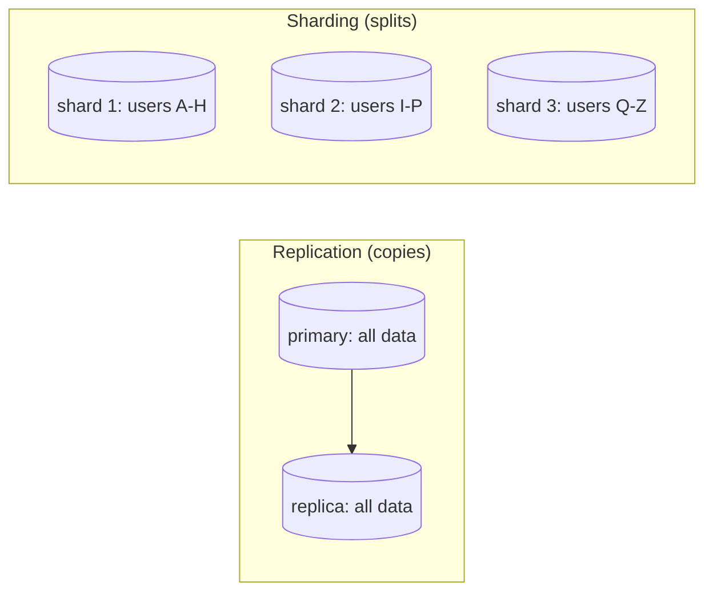
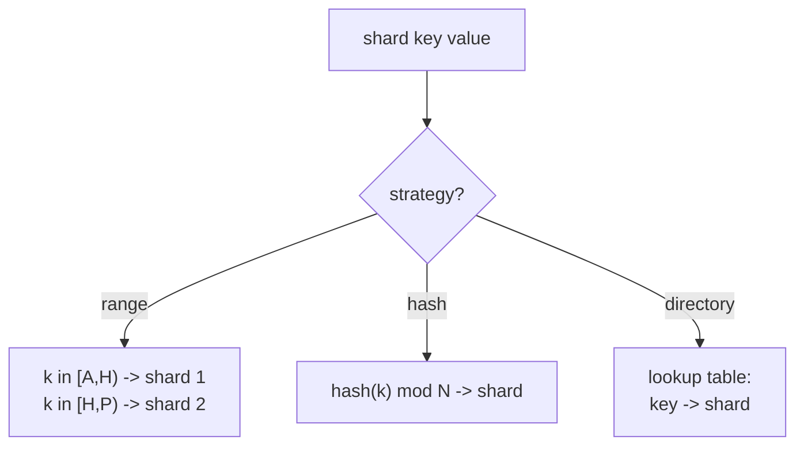
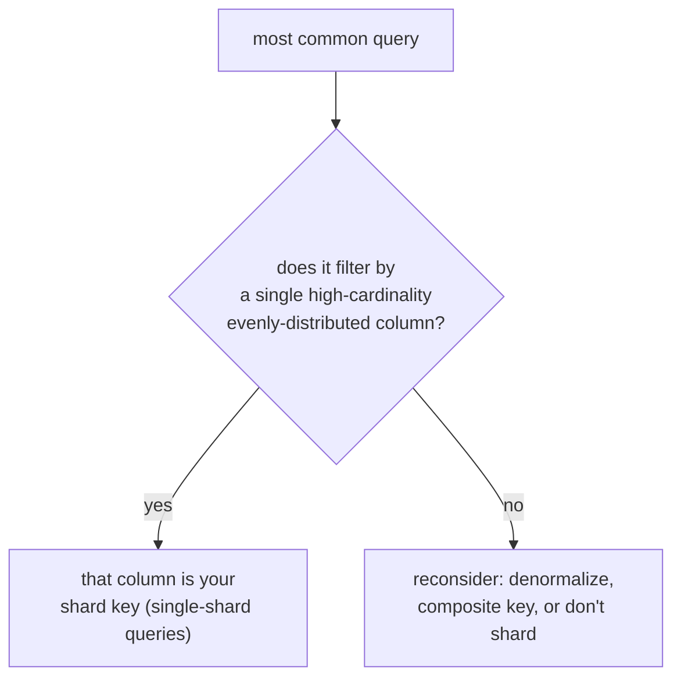
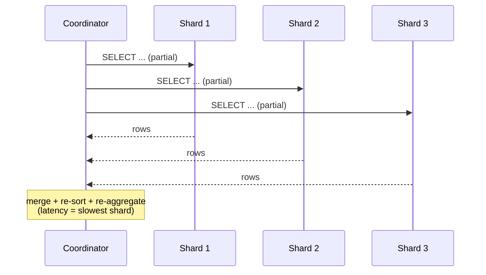
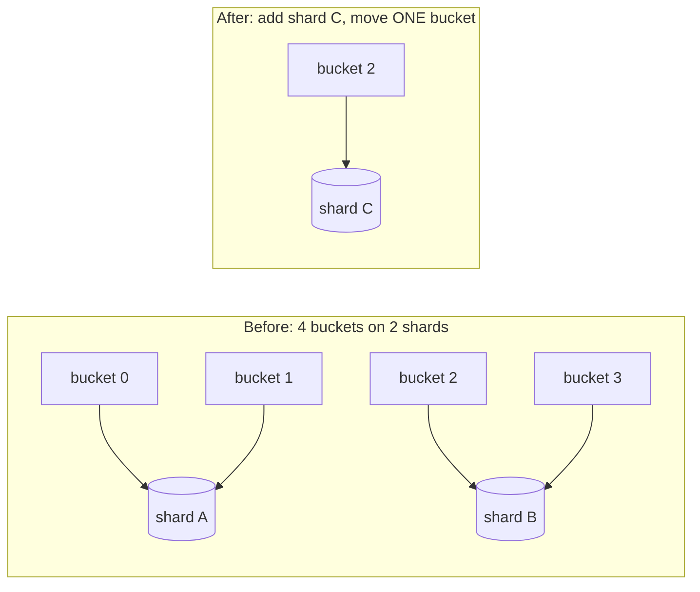

# Day 22 — Sharding

> Series: Database Engineering
> **Goal:** Learn how to break the single-primary write ceiling by splitting data across many nodes — the strategies (range / hash / directory), how to *choose a shard key* well (cardinality, distribution, query-isolation), the real pain (scatter-gather, no cross-shard joins/transactions), and the nightmare of resharding. Lab: shard a table by key and run a cross-shard query.

## Table of Contents
1. [In plain words](#in-plain-words)
2. [Partitioning vs replication vs sharding](#partitioning-vs-replication-vs-sharding)
3. [Sharding strategies](#sharding-strategies)
4. [Choosing a shard key (worked example)](#choosing-a-shard-key-worked-example)
5. [Cross-shard queries and the pain](#cross-shard-queries-and-the-pain)
6. [Resharding](#resharding)
7. [Tooling for Postgres sharding](#tooling-for-postgres-sharding)
8. [Lab: shard a table and run a cross-shard query](#lab-shard-a-table-and-run-a-cross-shard-query)
9. [Self-Check](#self-check)
10. [Tomorrow](#tomorrow)

---

## In plain words

**In plain words:** A single library branch ran out of shelves. Instead of one giant building, you open several branches and split the books by a rule — say, by the first letter of the author's surname (A–H at branch 1, I–P at branch 2, Q–Z at branch 3). Now each branch holds a *share* of the collection (a **shard**), each has its own shelves and staff (its own primary), and total capacity scales by adding branches. The pain: "give me every book, sorted by title" now means phoning all three branches and merging their answers (scatter-gather), and "which authors appear in both branch 1 and branch 3?" is genuinely awkward (no cross-branch join). And the day you must re-split by a new rule, you're moving trucks of books between buildings (resharding).

Sharding is the answer to Day 21's write ceiling — and it is the single biggest complexity jump in database engineering. Reach for it last.

**Verify versions when building:** **PostgreSQL 17**. Postgres has no built-in transparent sharding; you use extensions/proxies: **Citus** (distributed Postgres, now open source), **Vitess** (MySQL, the classic), or app-level sharding with a routing layer. Native `postgres_fdw` + partitioning gives a *manual* distributed setup. Consistent-hashing and directory services are language-agnostic patterns.

> Cross-ref: **System Design Day 13 (Sharding)** covered the distributed-systems view — consistent hashing, hot spots, rebalancing. This lesson is the *database engineer's* view: what it does to your **schema, queries, transactions, and joins**. Read them together; today assumes you know the Day 13 vocabulary (shard, shard key, rebalancing, hot shard).

---

## Partitioning vs replication vs sharding

**In plain words:** These three are constantly confused. Replication = *copies* of the same data (Day 20). Partitioning = one database splitting one big table into pieces *on the same node* (Day 17). Sharding = splitting data across *different nodes/primaries*, each holding a distinct slice — this is what adds write capacity.

| | Replication (Day 20) | Partitioning (Day 17) | **Sharding (today)** |
|---|---|---|---|
| Data on each node | full copy | one node, many partitions | **distinct slice per node** |
| Scales | reads, availability | maintenance, pruning | **writes + storage** |
| Number of primaries | 1 | 1 | **many** |
| Cross-node join | n/a | local (same node) | **hard / unsupported** |
| Complexity | low | low-med | **high** |


*Replication duplicates the whole dataset; sharding divides it into disjoint slices on separate primaries.*

> 🤔 **"Partitioning and sharding are the same thing, right?"**
> They share a mental model (split by a key) but partitioning keeps everything on *one* server — it helps maintenance and query pruning, not write throughput. Sharding puts slices on *different* servers, each an independent primary, which is what actually raises the write ceiling. You often shard *and* partition each shard locally.

---

## Sharding strategies

**In plain words:** The strategy is the *rule* that maps a row's shard key to a shard. Three classic rules, each with a different failure mode.


*Three ways to map a key to a shard: ranges, a hash function, or an explicit lookup.*

### Range sharding
Split by contiguous ranges of the key (dates, IDs, alphabetical). Great for range scans; **prone to hot spots** — the newest range (today's date, latest IDs) takes all the write traffic.

### Hash sharding
`hash(key) mod N` (or consistent hashing). Spreads writes evenly → no hot spot from monotonic keys. **But** range queries scatter across all shards, and `mod N` makes adding a shard mean re-mapping almost everything (consistent hashing mitigates this).

### Directory (lookup) sharding
A metadata service maps each key (or key range/tenant) to a shard explicitly. Most flexible — you can move a tenant to a bigger shard, rebalance selectively. **But** the directory is a new dependency and a potential single point of failure/lookup latency.

| Strategy | Even write spread | Range scans | Adding a shard | Best for |
|---|---|---|---|---|
| **Range** | ✗ (hot latest range) | ✓ great | ✓ split the range | time-series, ordered scans |
| **Hash** | ✓ excellent | ✗ scatter | ✗ costly (use consistent hashing) | uniform OLTP by id |
| **Directory** | depends on placement | depends | ✓ flexible/selective | multi-tenant SaaS |

> ✅ **Good scenario (hash):** A messaging app shards by `hash(user_id)`. Writes spread perfectly across 16 shards; each user's inbox lives entirely on one shard, so "load my messages" is a single-shard query. Write ceiling gone.

> ❌ **Bad scenario (range on a monotonic key):** An events pipeline range-sharded by `event_time`. All of *today's* inserts landed on the newest shard — one shard was pinned at 100% CPU while the others idled. A hot shard is a sharded system that scales storage but not write load. Fix: hash, or a composite key that spreads the current range.

> 🤔 **"Hash sharding is strictly better because it spreads load — I'll always hash."**
> Hashing spreads writes but *destroys locality*: every `ORDER BY created_at LIMIT 20` or `BETWEEN` scan must hit **every** shard and merge (scatter-gather). If your access pattern is dominated by range scans or "recent N," hashing turns cheap queries into fan-outs. The strategy must match your **dominant query**, not just your write distribution.

**When NOT to (shard at all):** if one tuned primary + read replicas (Day 21) handles your load, don't shard. Sharding's complexity tax is permanent.

---

## Choosing a shard key (worked example)

**In plain words:** The shard key is the most consequential decision you'll make — it's baked into the data layout and *extremely* expensive to change. A good key has three properties:

1. **High cardinality** — many distinct values, so data can spread across many shards (not 3 "regions").
2. **Even distribution** — no single value dominates (no "shard everything by `country` when 80% are US").
3. **Query isolation** — your most common queries should be answerable from **one** shard (the key appears in their `WHERE`).

**Worked example — a multi-tenant SaaS with orders:**

Schema: `tenants`, `users(tenant_id)`, `orders(tenant_id, user_id, ...)`. Candidate keys:

| Candidate | Cardinality | Distribution | Query isolation | Verdict |
|---|---|---|---|---|
| `order_id` | very high | even (hash) | ✗ "all orders for tenant X" scatters | poor for this app |
| `country` | low (~50) | very skewed (US-heavy) | ✗ giant hot shards | bad |
| `created_at` (range) | high | hot latest range | ✗ recent writes on one shard | bad for writes |
| **`tenant_id`** | high (many tenants) | mostly even (watch whales) | ✓ almost all queries filter by tenant | **best** |

Why `tenant_id` wins: in a B2B SaaS, virtually every query is "within one tenant" (`WHERE tenant_id = ?`). Sharding by tenant means each of those is a **single-shard** query — no scatter-gather, and you get natural data isolation between customers. Co-locate `users` and `orders` on the same key so `JOIN users USING (tenant_id)` stays **local** to a shard.

```sql
-- With Citus (distributed Postgres): distribute by tenant_id so related tables co-locate
SELECT create_distributed_table('users',  'tenant_id');
SELECT create_distributed_table('orders', 'tenant_id');   -- colocated with users
-- Now this JOIN executes entirely on ONE shard (no cross-node traffic):
SELECT u.name, count(*) FROM users u JOIN orders o USING (tenant_id, user_id)
WHERE u.tenant_id = 42 GROUP BY u.name;
```

**The whale problem:** one tenant is 100× bigger than the rest (a giant customer). `tenant_id` distribution is now skewed → a hot shard. Fixes: a **composite key** (`tenant_id, user_id`) to split a whale across shards, or **directory sharding** to place whales on dedicated shards. Plan for whales *before* they arrive.


*Pick the shard key that makes your dominant query single-shard.*

> ✅ **Good scenario:** Sharding by `tenant_id` gave a SaaS single-shard reads/writes for 99% of traffic and free per-customer isolation (a compliance win — one tenant's data physically separate).

> ❌ **Bad scenario:** A team sharded an e-commerce DB by `order_id` (hash). "Show me this customer's order history" now scatters across all 32 shards and merges — a 3ms query became a 90ms fan-out, run millions of times a day. The key ignored the dominant access pattern.

> 🤔 **"I'll just pick a shard key later once I see the traffic."**
> The shard key determines the physical layout of every row. Changing it means rewriting/moving *all* the data (a full reshard, below) — one of the riskiest operations you can run. You choose the shard key roughly once. Spend real design time on it *before* you shard, using your actual query log.

**When NOT to:** don't shard on a key you can't include in most queries — you'll scatter-gather everything and gain nothing but complexity.

---

## Cross-shard queries and the pain

**In plain words:** The moment data lives on multiple nodes, three things you took for granted get hard or impossible: (1) queries that span shards must **scatter-gather**, (2) **joins across shards** aren't free (often unsupported), and (3) a **transaction across shards** needs distributed commit (2PC) or a saga — losing simple ACID.


*Scatter-gather: fan a query to all shards, then merge — as slow as the slowest shard.*

**The pains, concretely:**

| Operation | On one DB | Sharded |
|---|---|---|
| `WHERE shard_key = ?` | index lookup | single shard (fine) |
| `ORDER BY x LIMIT 20` (no shard key) | one sort | scatter to all, merge N sorted streams |
| `JOIN` across two shard keys | local join | move data between nodes or **unsupported** |
| `SUM`/`COUNT` across shards | one aggregate | partial aggregates + re-aggregate |
| Transaction touching 2 shards | ACID | 2PC (slow, can block) or **saga** (eventual) |
| Unique constraint across shards | trivial | needs global sequence / coordination |

**Coping tactics (all trade-offs):**
- **Co-locate** related tables on the same shard key so their joins stay local (the `tenant_id` trick above).
- **Denormalize** to avoid cross-shard joins (duplicate the fields you'd have joined for — Day 30 revisits denormalization).
- **Reference tables:** replicate small, rarely-changing lookup tables to *every* shard so joins to them are always local (Citus `create_reference_table`).
- **Global IDs:** use UUIDs or a snowflake/central sequence so IDs don't collide across shards.
- **Push aggregation down:** compute partial `SUM`/`COUNT` per shard, combine at the coordinator.

```sql
-- Citus reference table: a small table copied to every shard so joins stay local
SELECT create_reference_table('countries');   -- lookup data, replicated everywhere

-- A cross-shard aggregate: the coordinator fans out partial COUNTs then sums them
SELECT count(*) FROM orders;   -- Citus rewrites to per-shard COUNT + final SUM automatically
```

> 🤔 **"I'll shard but still just write normal SQL joins across everything."**
> Once tables live on different nodes, a join between two differently-sharded tables means shipping one side across the network (expensive) or is simply **not supported** by your sharding layer. You must design co-location and denormalization *up front*. Sharding changes how you model data, not just where it lives.

> ❌ **Bad scenario (cross-shard transaction):** A bank sharded accounts by `account_id`, then tried "transfer from A to B" where A and B are on different shards. A plain `BEGIN; UPDATE a; UPDATE b; COMMIT;` no longer works atomically. They needed 2-phase commit (blocking, slow) or a saga with compensations — a large redesign they hadn't planned for.

> ✅ **Good scenario:** A SaaS sharded by `tenant_id` and co-located every tenant-scoped table. 99% of queries and *all* their transactions live within a single tenant → single-shard, fully ACID, no scatter-gather. The rare cross-tenant report runs on an analytics replica instead.

> **Dark Side:** Scatter-gather latency is governed by the **slowest** shard (tail latency), and one hot/GC-paused shard drags every fan-out query with it. Cross-shard `LIMIT` can force each shard to return more rows than needed for correct global ordering. Distributed transactions (2PC) can leave **in-doubt** transactions holding locks if the coordinator crashes mid-commit. Every "just query across shards" hides one of these.

**When NOT to:** don't run analytical/cross-shard queries on your OLTP shards — offload them to a warehouse or a replica (Day 30). Sharded OLTP is for single-shard, key-scoped access.

---

## Resharding

**In plain words:** Resharding = changing how data is split — adding shards, or changing the key/strategy. It means *moving live data between nodes while the app keeps running*. It is the operation everyone fears, because a mistake can corrupt or lose data, and it usually can't be a quick maintenance window at scale.

**Why it's hard:**
- `hash % N` → changing N remaps almost every key (that's why **consistent hashing / virtual buckets** exist — they move only ~1/N of keys when you add a shard).
- Data must move *while writes continue*, so you need dual-writes or change capture during the move, then a cutover.
- The routing layer must switch each key's home atomically without dropping writes.


*Virtual buckets: rebalancing moves whole buckets, so adding a shard relocates a small, predictable fraction of data.*

**Safer resharding recipe (the pattern to know):**
1. **Over-provision buckets up front:** hash into many virtual buckets (e.g., 1024), map buckets → shards. Rebalancing moves *buckets*, not by re-hashing keys.
2. **Copy + catch up:** snapshot the buckets to move to the new shard; stream ongoing changes (logical replication / CDC — Day 30) until caught up.
3. **Cutover:** briefly freeze writes to those buckets, apply the final delta, flip the routing entry, unfreeze. Only the moving buckets pause, and only for a moment.
4. **Verify + clean up:** checksum row counts, then drop the moved data from the old shard.

> 🤔 **"Adding a shard is easy — I'll just increase N and rehash."**
> With plain `hash % N`, going from 4→5 shards remaps ~80% of all keys — a near-total data movement, catastrophic online. This is *the* reason to use consistent hashing or a fixed large number of virtual buckets from day one, so adding a shard moves only ~1/N of the data. If you didn't plan buckets, resharding is a giant migration.

> ✅ **Good scenario:** A team designed 4096 virtual buckets over 8 shards from the start. Scaling to 16 shards moved half the buckets, one bucket at a time, online, over a weekend with zero downtime and a clean checksum verify.

> ❌ **Bad scenario:** A startup used `user_id % 4`. At 4 shards they hit the wall and needed 8; there was no online path — they took a multi-hour maintenance window, dual-wrote by hand, and still had a data-integrity scare. The absence of buckets made resharding a project, not an operation.

**When NOT to:** don't reshard reactively under fire — plan capacity (over-provision buckets) so you rebalance *ahead* of the wall, calmly. If you find yourself resharding often, revisit whether the shard key was right.

---

## Tooling for Postgres sharding

| Tool | What it is | Use when |
|---|---|---|
| **Citus** | Postgres extension: distributed tables, colocation, reference tables, distributed SQL | you want sharded Postgres with real SQL and cross-shard queries handled for you |
| **Vitess** | sharding middleware (born at YouTube, MySQL) | large-scale MySQL sharding |
| **App-level sharding** | your code + a routing/directory service | full control, willing to build the plumbing |
| **postgres_fdw + partitioning** | foreign tables across nodes | small/manual distributed setups |
| **CockroachDB / Yugabyte / Spanner** | distributed SQL (auto-sharded) | you want sharding to be *transparent* (Day 25) |

```sql
-- Citus quickstart flavor
CREATE EXTENSION citus;
SELECT create_distributed_table('orders', 'tenant_id');   -- shard on tenant_id
SELECT create_reference_table('plans');                    -- small table, on every shard
-- Citus routes single-tenant queries to one shard, fans out aggregates automatically.
```

> **When NOT to:** don't hand-roll app-level sharding if Citus/CockroachDB fit — the query routing, colocation, and rebalancing are exactly the hard parts you'd be reinventing.

---

## Lab: shard a table and run a cross-shard query

We'll simulate sharding with plain Postgres using `postgres_fdw` (two logical "shards"), then feel scatter-gather. (Conceptually identical to Citus/app-level sharding — you're just doing the routing by hand.)

```bash
# Two local PG instances act as shards: :5432 (shard1) and :5433 (shard2)
# plus a coordinator DB on :5432 that federates them via foreign tables.
createdb -p 5432 coord
createdb -p 5432 shard1_local
createdb -p 5433 shard2_local
```

```sql
-- ===== On each shard: create the same table, hold DIFFERENT rows =====
-- shard1 (:5432/shard1_local): users whose id hashes to bucket 0
-- shard2 (:5433/shard2_local): users whose id hashes to bucket 1
CREATE TABLE users (id bigint primary key, tenant_id int, name text, spend numeric);

-- We route by:  bucket = abs(hashint8(id)) % 2
-- Insert rows deliberately onto each shard (app-level routing):
--   shard1:
INSERT INTO users VALUES (2,10,'Ana',50),(4,10,'Bo',80),(6,20,'Cy',30);
--   shard2:
INSERT INTO users VALUES (1,10,'Di',90),(3,20,'Ed',10),(5,20,'Fi',60);
```

```sql
-- ===== On the coordinator (:5432/coord): federate both shards =====
CREATE EXTENSION IF NOT EXISTS postgres_fdw;

CREATE SERVER shard1 FOREIGN DATA WRAPPER postgres_fdw
  OPTIONS (host '127.0.0.1', port '5432', dbname 'shard1_local');
CREATE SERVER shard2 FOREIGN DATA WRAPPER postgres_fdw
  OPTIONS (host '127.0.0.1', port '5433', dbname 'shard2_local');

CREATE USER MAPPING FOR CURRENT_USER SERVER shard1 OPTIONS (user 'postgres', password '...');
CREATE USER MAPPING FOR CURRENT_USER SERVER shard2 OPTIONS (user 'postgres', password '...');

-- Foreign tables pointing at each shard's users table:
CREATE FOREIGN TABLE users_s1 (id bigint, tenant_id int, name text, spend numeric)
  SERVER shard1 OPTIONS (table_name 'users');
CREATE FOREIGN TABLE users_s2 (id bigint, tenant_id int, name text, spend numeric)
  SERVER shard2 OPTIONS (table_name 'users');

-- A UNION view = the "distributed table":
CREATE VIEW users_all AS
  SELECT * FROM users_s1 UNION ALL SELECT * FROM users_s2;
```

```sql
-- ===== 1) SINGLE-SHARD query (cheap): we know id=4 lives on shard1 =====
--   In real sharding the router computes bucket(4)=0 -> shard1 and hits ONE node.
SELECT * FROM users_s1 WHERE id = 4;          -- one shard, fast

-- ===== 2) CROSS-SHARD (scatter-gather): total spend per tenant across ALL shards =====
EXPLAIN (VERBOSE) 
SELECT tenant_id, sum(spend) AS total
FROM users_all
GROUP BY tenant_id
ORDER BY total DESC;
--   Note the plan touches BOTH foreign tables (both shards) then aggregates.
--   This is scatter-gather: latency = slowest shard, and it grows with shard count.

-- ===== 3) The join pain: "top spender per tenant" needs data from both shards =====
--   There is no cheap cross-shard JOIN; you fan out, pull rows back, and merge.
SELECT tenant_id, name, spend
FROM users_all u
WHERE spend = (SELECT max(spend) FROM users_all x WHERE x.tenant_id = u.tenant_id);
--   Feel it: correlated subquery re-scatters. On real shards this is expensive.
```

```sql
-- ===== 4) Show WHY tenant_id would be a better shard key here =====
--   If we had sharded by tenant_id instead of hash(id), then
--   "all users + spend for tenant 10" would be a SINGLE-shard query.
--   As-is (hashed by id), tenant 10's rows are split across shard1 AND shard2:
SELECT 's1' src, * FROM users_s1 WHERE tenant_id = 10
UNION ALL
SELECT 's2' src, * FROM users_s2 WHERE tenant_id = 10;
--   Two shards touched for one tenant -> the shard key didn't match the query. Lesson learned.
```

> **Reflection:** You just built a tiny distributed table and felt the three pains: routing single-shard queries is great, but aggregates scatter, joins are awkward, and the *wrong* shard key (id instead of tenant_id) turned a should-be-single-shard query into a fan-out. That is the entire trade of sharding in miniature.

---

## Self-Check
1. Distinguish replication, partitioning, and sharding — which one raises the write ceiling and why?
2. Give the failure mode of range sharding on a monotonically increasing key.
3. When does hash sharding hurt you despite spreading writes evenly?
4. State the three properties of a good shard key and apply them to a multi-tenant SaaS.
5. What is the "whale" problem and two ways to handle it?
6. Explain scatter-gather and why its latency tracks the slowest shard.
7. Why are cross-shard joins hard, and what are three tactics to avoid needing them?
8. Why is a cross-shard transaction not simply `BEGIN; UPDATE; UPDATE; COMMIT;`? What are the options?
9. Why does `hash % N` make adding a shard catastrophic, and how do virtual buckets / consistent hashing fix it?
10. Outline the safe online resharding recipe (copy → catch up → cutover → verify).

## Tomorrow
**Day 23 — CAP & Consistency Models.** Once data lives on many nodes, network partitions become inevitable and you must choose what to sacrifice when they happen. Tomorrow: what CAP *actually* says (and the myths), CP vs AP with real databases, PACELC, the consistency ladder, and the quorum N/R/W arithmetic that powers Dynamo-style stores.
