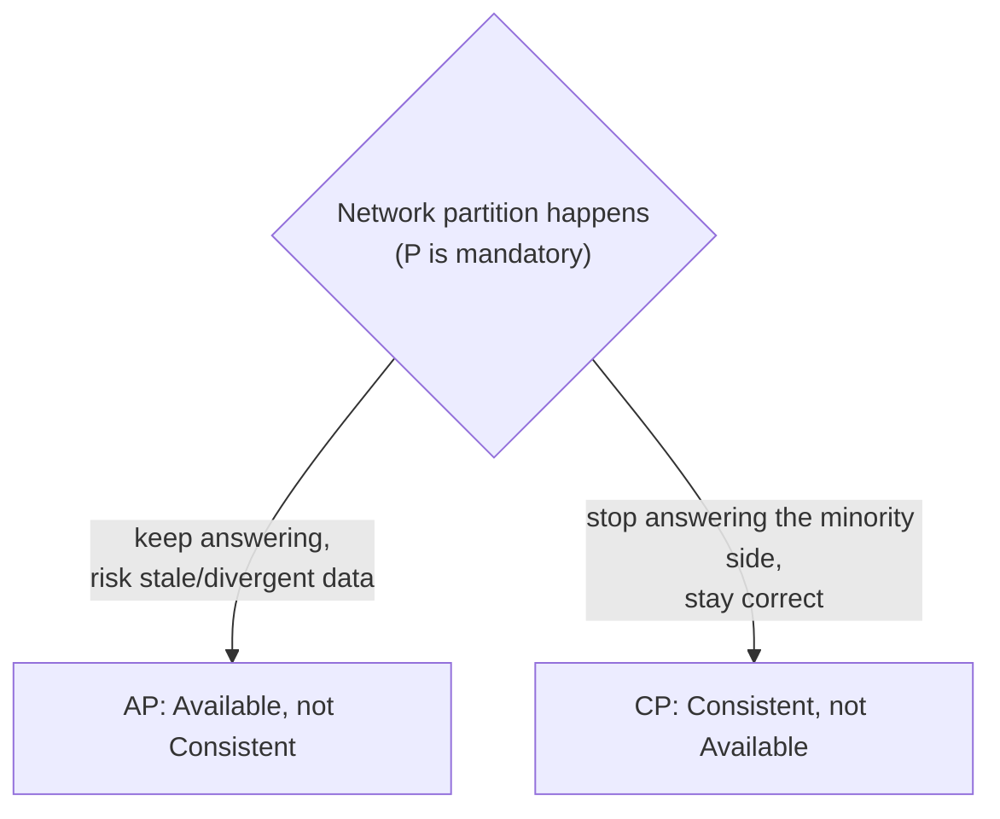
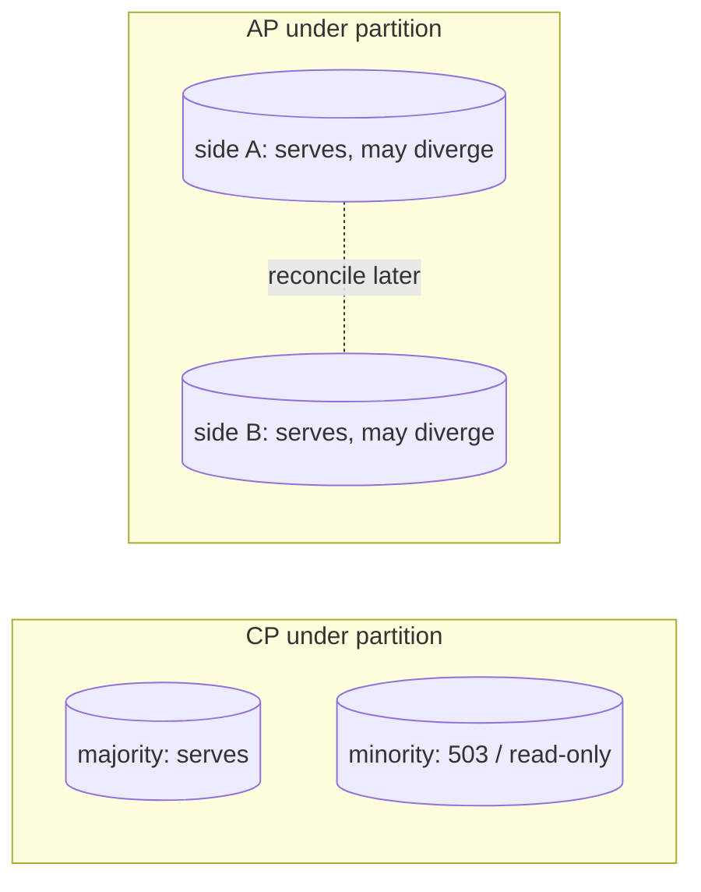
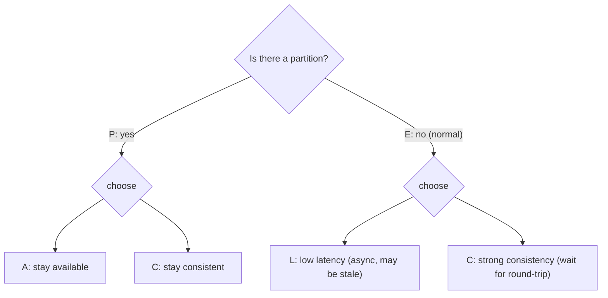
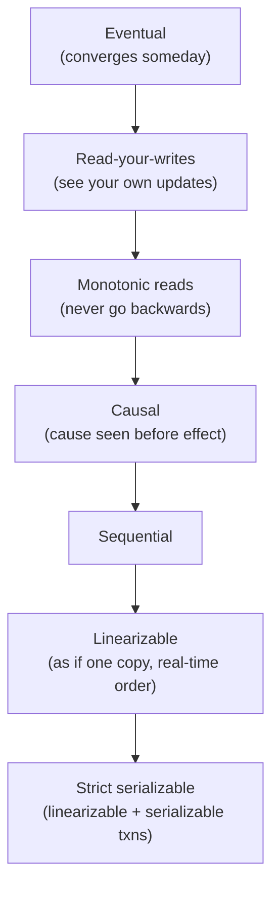
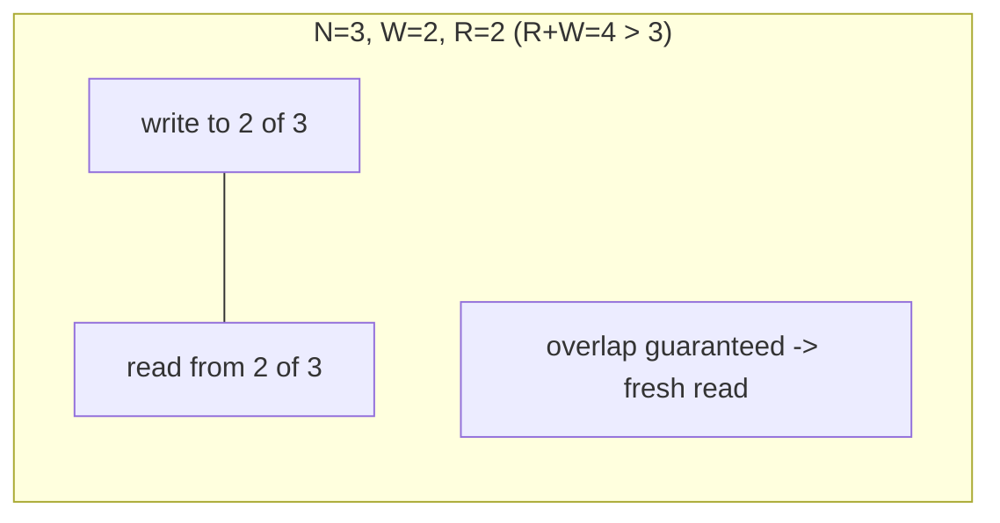

# Day 23 — CAP & Consistency Models

> Series: Database Engineering
> **Goal:** Cut through the CAP myths — what the theorem *actually* says (and doesn't), CP vs AP with real databases, PACELC (the latency half everyone forgets), the consistency-models ladder, and the quorum N/R/W arithmetic that lets you tune consistency. Lab: reason through a partition scenario and set quorums to hit a target.

## Table of Contents
1. [In plain words](#in-plain-words)
2. [What CAP really says (and doesn't)](#what-cap-really-says-and-doesnt)
3. [CP vs AP with database examples](#cp-vs-ap-with-database-examples)
4. [PACELC: the part everyone forgets](#pacelc-the-part-everyone-forgets)
5. [The consistency models ladder](#the-consistency-models-ladder)
6. [Quorum arithmetic: N, R, W](#quorum-arithmetic-n-r-w)
7. [Lab: reason through a partition scenario](#lab-reason-through-a-partition-scenario)
8. [Self-Check](#self-check)
9. [Tomorrow](#tomorrow)

---

## In plain words

**In plain words:** Two clerks each hold a copy of the same account ledger, connected by a phone line so they stay in sync. One day the phone line drops (a **network partition**). A customer walks up to each clerk at the same time and both ask to withdraw the last $100. Now each clerk faces a forced choice:

- **Refuse to serve** until the phone works again — nobody gets wrong data, but the service is *down* for that account. (This is choosing **Consistency** over Availability — **CP**.)
- **Serve anyway** and reconcile later — both stay *up*, but they might both hand out the $100 and disagree until the line returns. (This is choosing **Availability** over Consistency — **AP**.)

CAP is *only* about this moment — the partition. It says: when the phone line is down, you can't have both perfect consistency and full availability; pick one. That's it. Everyone over-reads it.

**Verify versions when building:** concepts are engine-agnostic. Reference points: **PostgreSQL** (single-primary → CP-leaning), **Cassandra/DynamoDB** (tunable, AP-leaning), **etcd/ZooKeeper/Spanner/CockroachDB** (CP via consensus). Cassandra/Dynamo tunable-consistency (N/R/W) is the concrete arithmetic here.

> Cross-ref: **System Design Day 14 (CAP)** framed the distributed-systems theory. Today is the *database engineer's* view — mapping CAP/PACELC onto real DB configs and the consistency knobs you actually turn (`synchronous_commit`, Cassandra consistency levels, quorum reads/writes).

---

## What CAP really says (and doesn't)

**In plain words:** CAP (Brewer's theorem, proven by Gilbert & Lynch) has three properties:
- **Consistency (C):** every read sees the most recent write (this is *linearizability*, a strong form — **not** the "C" in ACID!).
- **Availability (A):** every request to a non-failed node gets a (non-error) response.
- **Partition tolerance (P):** the system keeps working despite messages being dropped/delayed between nodes.

The theorem: **during a network partition, you can guarantee at most two of the three.** Since partitions *will* happen in any distributed system (P is not optional — networks are unreliable), the real choice is **C vs A when partitioned**.


*CAP is a decision made only during a partition: keep serving (AP) or stay correct (CP).*

**What CAP does NOT say (the myths):**

| Myth | Reality |
|---|---|
| "You must pick 2 of 3 permanently" | The choice only bites *during a partition*. When healthy, you can have both C and A. |
| "CAP's C is ACID's C" | No. CAP-C = linearizability (recency of reads). ACID-C = constraints/invariants hold. Different words. |
| "P is optional; I'll choose CA" | You can't opt out of partitions on a real network. "CA" only means "single node / no distribution." |
| "AP means no consistency ever" | AP means not *linearizable during partitions*; it can still be eventually consistent, read-your-writes, etc. |
| "CAP tells me which DB to use" | It's a *lens*, not a verdict. PACELC and consistency models refine the picture. |

> 🤔 **"My database is CA — consistent and available, and I just avoid partitions."**
> There is no meaningful CA distributed system. Partitions are a fact of networks; you don't get to "avoid" them. A single-node database is trivially "CA" only because there's nothing to partition — and it has no partition tolerance because it has no partitions to tolerate. The instant you distribute, P is forced, and your real choice is CP or AP.

> ❌ **Bad scenario:** An architect declared their multi-region cluster "CA — we have a fast network." A cross-region link flapped for 40 seconds; both regions kept accepting conflicting writes (accidentally AP) with no conflict resolution designed → divergent data and a manual reconciliation. They'd chosen AP by *not choosing*, and hadn't built for it.

**When NOT to (over-apply CAP):** don't use CAP to make everyday consistency decisions on a single-primary Postgres — CAP is about *partition behavior across nodes*. For a lone primary, isolation levels (Day 12) and replication lag (Day 20) are the relevant tools.

---

## CP vs AP with database examples

**In plain words:** CP systems, when partitioned, sacrifice availability on the minority side to stay correct — the minority stops serving so it can never return stale/conflicting data. AP systems keep every node serving and reconcile divergence later.

| | **CP (consistency-first)** | **AP (availability-first)** |
|---|---|---|
| During a partition | minority side refuses/errors | all sides keep serving |
| Guarantees | linearizable reads, no divergence | staleness / conflicts possible |
| Reconciliation | none needed (never diverged) | needed (last-write-wins, CRDTs, app merge) |
| Example DBs | Postgres (single primary), etcd, ZooKeeper, Spanner, CockroachDB, MongoDB (majority) | Cassandra, DynamoDB, Riak, (Cassandra/Dynamo tunable toward CP too) |
| Fits | money, config, coordination, correctness-critical | carts, feeds, sensor data, "must stay up" |


*CP silences the minority to stay correct; AP keeps everyone up and reconciles afterward.*

**Where Postgres sits:** a single-primary Postgres cluster is effectively **CP** — writes go to the one primary, and if a replica is partitioned from it, the replica serves *stale reads* (or you fence it). Postgres doesn't accept conflicting writes on two nodes, so it never diverges; it "loses availability" for writes if the primary is unreachable. (This is why failover/HA — Day 21 — matters: it restores availability without giving up consistency.)

> ✅ **Good scenario (CP):** A distributed lock / leader-election uses etcd (CP). During a partition, the minority partition *cannot* grant the lock — so you never get two leaders. Correctness under partition is exactly the point; a brief unavailability on the minority side is the acceptable price.

> ✅ **Good scenario (AP):** A shopping cart on Cassandra stays writable in every region during a network split. Two adds to the cart on different sides merge on reconciliation (a set union — a CRDT-ish merge). Staying "add to cart"-able beats momentary perfect consistency for revenue.

> ❌ **Bad scenario (wrong pick):** A team put *account balances* on an AP store with last-write-wins. During a partition, two concurrent debits both succeeded and one silently overwrote the other on merge → money vanished. Balances need CP (or careful conflict-free design), not LWW.

> 🤔 **"AP databases are eventually consistent, so they're basically fine — the data catches up."**
> "Eventually" hides two questions: *how long* (could be seconds to minutes under load) and *how conflicts merge* (last-write-wins silently drops data; you must design the merge). AP is fine when stale/merged data is acceptable and you've *designed* the reconciliation. It is not "fine by default" for invariants like balances, inventory-can't-go-negative, or uniqueness.

**When NOT to:** don't force everything CP for "safety" — global linearizability across regions costs latency (PACELC, next). Feeds, likes, and telemetry are happier AP.

---

## PACELC: the part everyone forgets

**In plain words:** CAP only speaks about the *partition* case. But partitions are rare; your system spends 99.9% of its life *healthy*. PACELC extends CAP to that normal case: **if Partitioned, choose between A and C; Else (normal operation), choose between Latency and Consistency.** Even with no partition, keeping replicas strongly consistent costs a round-trip — so you trade **L**atency vs **C**onsistency every single request.


*PACELC: the partition trade (A vs C) AND the everyday trade (Latency vs Consistency).*

**Classifying real systems (PA/EL etc.):**

| System | Partition (P) | Else (E) | Reading |
|---|---|---|---|
| **DynamoDB / Cassandra (default)** | PA | EL | available under partition; fast (possibly stale) normally |
| **Cassandra tuned QUORUM** | PC | EC | consistent under partition; slower normally |
| **Spanner / CockroachDB** | PC | EC | consistent always; pays latency (TrueTime / consensus) |
| **Postgres async replica reads** | PC (writes) | EL (stale replica reads) | strong on primary; low-latency stale reads on replicas |
| **MongoDB (majority)** | PC | EC | majority acks trade latency for consistency |

The point: even when nothing is broken, you pay for consistency in latency. That's the trade you tune with `synchronous_commit` (Day 21) or Cassandra consistency levels every day.

> 🤔 **"If I'm not partitioned, consistency is free — CAP only matters during failures."**
> No — this is exactly PACELC's correction. Keeping two nodes in agreement on every write requires a round trip (or waiting for a quorum) *even on a perfect network*. Strong consistency has an always-on latency tax. That's usually a bigger day-to-day cost than the rare partition. Design for the "Else" case, not just the "P" case.

> ✅ **Good scenario:** A global product read path picks **EL** (fast, possibly slightly stale reads from the nearest replica) for the catalog, and **EC** (consistent, majority) only for the checkout/payment path. Latency where it's cheap, consistency where it's required.

**When NOT to:** don't pay EC latency for data that tolerates staleness (feeds, view counts). Reserve strong consistency for the paths whose correctness depends on it.

---

## The consistency models ladder

**In plain words:** "Consistency" isn't binary — it's a ladder from weakest (fast, surprising) to strongest (slow, intuitive). Knowing the rungs lets you ask for *exactly* the guarantee you need instead of over-paying for linearizability everywhere.


*From weakest to strongest — each rung adds a guarantee and usually some latency.*

| Model | Guarantee | Typical use |
|---|---|---|
| **Eventual** | replicas converge *eventually* | view counts, caches, telemetry |
| **Read-your-writes** | you always see your own writes | user editing their profile (Day 20 problem) |
| **Monotonic reads** | reads never move backward in time | pagination, timelines |
| **Causal** | if A caused B, everyone sees A before B | comments-under-posts, chat |
| **Linearizable** | acts like a single up-to-date copy, respects real-time order | locks, balances, config |
| **Strict serializable** | linearizable + serializable transactions | financial systems needing both |

**Session guarantees** (read-your-writes, monotonic reads) are the pragmatic middle: cheap to provide (sticky routing / LSN-wait — Day 20) and they kill the most visible bugs without global linearizability's cost.

> ✅ **Good scenario:** A social app gives **causal** consistency to comments (you never see a reply before the comment it answers) and **eventual** to like counts. Users perceive it as correct; the system stays fast and available.

> ❌ **Bad scenario:** A dashboard offered only **eventual** consistency and its reads sometimes *went backward* (a later read hit a staler replica), so a metric flickered 500 → 480 → 500. Adding **monotonic reads** (pin the session to one replica) fixed the "time travel" without going full linearizable.

> 🤔 **"Strong (linearizable) consistency is always the safe default — why would I ever pick weaker?"**
> Because linearizability across nodes/regions costs a coordination round-trip on *every* operation (PACELC's EC), and it reduces availability under partition (CP). Most data doesn't need it: a like count, a feed, a cache. Picking the *weakest model that's still correct for the use case* is how you keep systems fast and available. Use strong consistency surgically, not by default.

**When NOT to:** don't demand linearizability for data whose staleness is invisible or harmless — you'll pay latency and availability for a guarantee no user perceives.

---

## Quorum arithmetic: N, R, W

**In plain words:** Dynamo-style stores (Cassandra, DynamoDB, Riak) let you *tune* consistency per operation with three numbers:
- **N** = replication factor (how many copies of each piece of data).
- **W** = how many replicas must acknowledge a **write** before it's "done."
- **R** = how many replicas must respond to a **read** before you answer.

The magic rule: **if `R + W > N`, the read and write quorums overlap**, so a read is guaranteed to touch at least one replica that has the latest write → **strong (linearizable-ish) consistency**. If `R + W <= N`, they might not overlap → you can read stale data (eventual).


*R + W > N forces the read set and write set to share at least one up-to-date replica.*

**Common tunings (N = 3):**

| W | R | R+W > N? | Property | Trade-off |
|---|---|---|---|---|
| 3 | 1 | 4 > 3 ✔ | strong; fast reads | slow writes; write blocked if any replica down |
| 1 | 3 | 4 > 3 ✔ | strong; fast writes | slow reads; read blocked if any replica down |
| **2** | **2** | **4 > 3 ✔** | **strong + balanced (QUORUM)** | tolerates 1 node down for both |
| 1 | 1 | 2 > 3 ✗ | eventual; fastest | can read stale/lost data |
| 3 | 3 | 6 > 3 ✔ | strongest | zero fault tolerance (any node down blocks) |

**QUORUM = floor(N/2)+1.** For N=3 that's 2. `W=QUORUM, R=QUORUM` is the sweet spot: strong consistency *and* it survives one node being down. This is the same idea as Postgres `ANY 1 (a,b)` synchronous replication (Day 21) — a majority ack.

```sql
-- Cassandra: consistency is set PER STATEMENT (CQL)
CONSISTENCY QUORUM;                       -- W or R = floor(N/2)+1
INSERT INTO orders (id, total) VALUES (uuid(), 42);   -- write needs QUORUM acks
SELECT * FROM orders WHERE id = ?;                    -- read needs QUORUM responses
-- QUORUM write + QUORUM read on N=3  =>  2+2 > 3  =>  strong.

CONSISTENCY ONE;                          -- W=R=1: fastest, eventual (may be stale)
CONSISTENCY LOCAL_QUORUM;                 -- quorum within the local datacenter (multi-region latency win)
```

> 🤔 **"QUORUM reads and QUORUM writes are strongly consistent, so it's just like Postgres."**
> `R+W>N` gives you *linearizable single-object* reads, but Dynamo-style stores still lack cross-row **transactions**, foreign keys, and serializable isolation by default. Quorum makes a *single key* fresh; it does not give you multi-row ACID. Don't mistake tunable per-key consistency for full transactional correctness.

> ✅ **Good scenario:** A team ran Cassandra with N=3, `LOCAL_QUORUM` reads and writes. They got strong per-key consistency, survived any single node failure with no downtime, and kept multi-region latency low by quorum-ing within a datacenter.

> ❌ **Bad scenario:** A team used `W=1, R=1` for "speed" on a store of unique usernames. Two signups on different replicas both succeeded (no overlap to catch the conflict) → duplicate usernames. `R+W<=N` meant no freshness guarantee; uniqueness silently broke.

> **Dark Side:** Quorum doesn't make writes *atomic across keys* or prevent lost updates from concurrent read-modify-write — you still need lightweight transactions (Paxos-based `IF NOT EXISTS` in Cassandra) or app-level locking for compare-and-set. And `R+W>N` guarantees *freshness*, not *conflict resolution*: concurrent writes to the same key still need a merge policy (timestamps/LWW can drop data).

**When NOT to:** don't run `W=N` or `R=N` in production — you lose all fault tolerance (any single node down blocks the operation). QUORUM is almost always the right balance.

---

## Lab: reason through a partition scenario

No cluster needed — this lab is *reasoning* (the actual on-the-job skill), with a Postgres-flavored setup to ground it.

**Scenario:** You run N=3 replicas of a `wallet(user_id, balance)` store across two datacenters: DC-A has 2 replicas, DC-B has 1. The cross-DC link goes down (partition). Requests keep arriving to *both* DCs.

```
Work through each config. For each, answer: (a) can DC-A serve reads/writes?
(b) can DC-B? (c) is a stale/lost-update read possible? (d) is it CP or AP here?
```

```sql
-- CONFIG 1: N=3, W=QUORUM(2), R=QUORUM(2)   [strong / CP-leaning]
--   DC-A has 2 replicas -> can reach W=2 and R=2  -> DC-A KEEPS SERVING (majority)
--   DC-B has 1 replica  -> cannot reach 2         -> DC-B REFUSES (minority)
--   No divergence possible. This is CP: minority (DC-B) loses availability.
--   Answer: (a) yes (b) no (c) no (d) CP.  Money is safe; DC-B users get errors.

-- CONFIG 2: N=3, W=1, R=1   [eventual / AP-leaning]
--   Both DCs can reach 1 -> BOTH keep serving writes to 'balance'.
--   Two concurrent debits on opposite sides both succeed -> divergence.
--   On heal, LWW keeps ONE -> the other debit is LOST.
--   Answer: (a) yes (b) yes (c) YES lost update (d) AP.  Wrong for money.

-- CONFIG 3: Postgres single primary in DC-A, async replica in DC-B  [CP for writes]
--   Partition: DC-A primary keeps accepting writes.
--   DC-B replica can serve STALE reads but CANNOT write (read-only).
--   No divergence (only one writer). If the PRIMARY were in the isolated DC-B,
--   writes would stop until failover -> availability loss, correctness kept. CP.
```

```sql
-- Now MAKE the trade explicit in Postgres terms (Day 21 link):
-- Require a majority sync ack so a partitioned minority primary can't commit alone:
--   synchronous_standby_names = 'ANY 1 (stby_b, stby_c)'
-- This is quorum arithmetic in Postgres clothing: a write needs a majority ack,
-- exactly like W=QUORUM. A minority-partitioned primary simply cannot get the ack
-- and therefore cannot commit -> no split-brain divergence (CP choice, on purpose).

-- Verify the intended behavior:
SHOW synchronous_standby_names;
SELECT application_name, sync_state FROM pg_stat_replication;   -- who can form the quorum?
```

**Deliverable (write these out):**
1. For your real workload, is each data class CP or AP-appropriate? (balances → CP; feed → AP.)
2. Pick N/R/W (or `synchronous_standby_names`) that gives the right partition behavior.
3. State your PACELC choice for the *healthy* case too (EL vs EC) — where do you pay latency for consistency, and where do you buy speed with staleness?

> **Reflection:** Notice you never needed to memorize CAP as a slogan. You asked concrete questions — who forms a majority, can the minority commit, does staleness/lost-update hurt this data — and the CP/AP/PACELC labels *fell out*. That's how CAP is used on the job: a reasoning tool, not a bumper sticker.

---

## Self-Check
1. State CAP precisely. What does its "C" mean, and why is it *not* ACID's "C"?
2. Why is "CA" not a real choice for a distributed system?
3. Give a CP database and an AP database, and the behavior of each during a partition.
4. Where does single-primary Postgres sit on the CP/AP spectrum, and why?
5. What does PACELC add that CAP omits, and why does it usually matter more day-to-day?
6. Order these strongest→weakest: eventual, causal, linearizable, read-your-writes.
7. When is eventual consistency perfectly fine, and when is it dangerous? Give an example of each.
8. State the `R + W > N` rule and explain why overlap guarantees a fresh read.
9. For N=3, what is QUORUM, and why is `W=QUORUM, R=QUORUM` the usual sweet spot?
10. Does quorum consistency give you multi-row ACID transactions? What does it *not* protect against?

## Tomorrow
**Day 24 — NoSQL: Document & Key-Value.** Now that you understand the consistency trade-offs these stores are built around, we meet the stores themselves. Tomorrow: document databases (MongoDB — embedding vs referencing, access-pattern-first modeling) and key-value stores (Redis, DynamoDB single-table design), and exactly when each beats a relational database.
