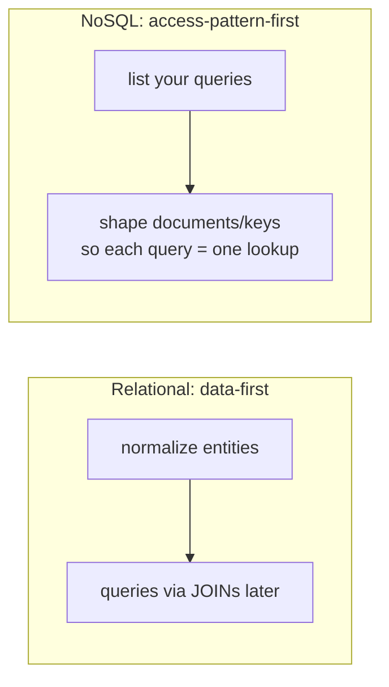
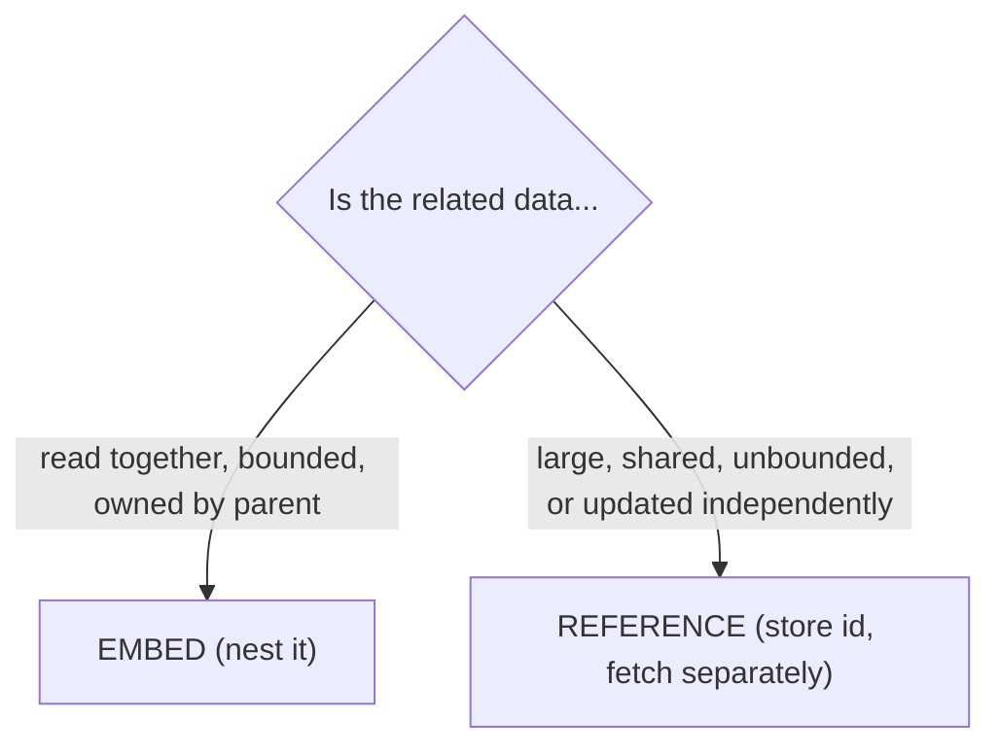
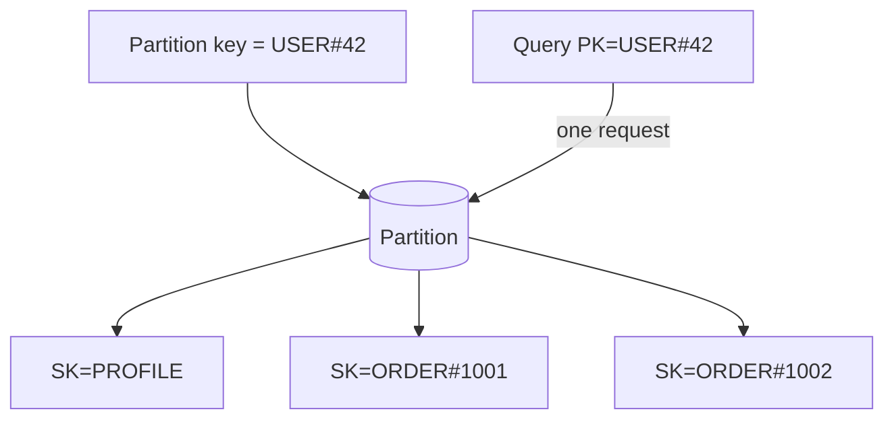

# Day 24 — NoSQL: Document & Key-Value

> Series: Database Engineering
> **Goal:** Meet the two most common NoSQL families — **document** stores (MongoDB: embedding vs referencing, access-pattern-first modeling) and **key-value** stores (Redis, DynamoDB single-table design). Learn precisely *when each beats a relational database* and, just as important, when it doesn't. Lab: model the same domain in Postgres vs MongoDB and compare.

## Table of Contents
1. [In plain words](#in-plain-words)
2. [Access-pattern-first modeling (the mindset flip)](#access-pattern-first-modeling-the-mindset-flip)
3. [Document databases: MongoDB](#document-databases-mongodb)
4. [Embedding vs referencing](#embedding-vs-referencing)
5. [Key-value stores: Redis](#key-value-stores-redis)
6. [DynamoDB and single-table design](#dynamodb-and-single-table-design)
7. [When NoSQL beats a RDBMS (and when it doesn't)](#when-nosql-beats-a-rdbms-and-when-it-doesnt)
8. [Lab: model the same domain in Postgres vs MongoDB](#lab-model-the-same-domain-in-postgres-vs-mongodb)
9. [Self-Check](#self-check)
10. [Tomorrow](#tomorrow)

---

## In plain words

**In plain words:** A relational database is a **spreadsheet library** — everything lives in flat, tidy tables, and you *reassemble* what you need at read time by joining tables together (customer + their orders + each order's items). A **document** database is a **filing cabinet of folders** — each customer is one folder that *already contains* their orders and items stapled inside, so opening the folder gives you everything in one grab, no reassembly. A **key-value** store is a **coat-check**: you hand over a ticket (the key) and instantly get back exactly one bundle (the value) — blazingly fast, but you can only ask "give me ticket 42," never "give me all red coats."

The relational model optimizes for *flexible questions you haven't thought of yet*. Document and key-value stores optimize for *questions you already know you'll ask, answered fast*.

**Verify versions when building:** **MongoDB 7/8** (document; `mongosh`), **Redis 7** (key-value + data structures), **DynamoDB** (managed key-value/document, AWS). Postgres is the relational baseline — and note that **Postgres `jsonb`** lets it act as a capable document store too (a recurring "you may not need Mongo" theme).

> Cross-ref: **Day 23** gave you the consistency lens — MongoDB majority reads are CP-leaning, DynamoDB is tunable, Redis is typically a fast single-node/eventually-consistent cache. **System Design (sharding/replication)** underpins how these scale. **Day 01** (OLTP vs OLAP) framed workloads; these are OLTP-family stores.

---

## Access-pattern-first modeling (the mindset flip)

**In plain words:** In relational design you model the *data* first (normalize into clean entities — Day 03) and figure out queries later; joins make almost any question answerable. In NoSQL you flip it: **model the queries first**, then shape the data so those exact queries are cheap. There are no (cheap) joins to save you, so the schema *is* the query plan.


*Relational normalizes then joins; NoSQL lists access patterns then shapes storage to match.*

**Why the flip matters:**
- **Why:** without joins, a query that needs data from three "tables" either does three round trips or the data must be *pre-joined* into one document. So you must know the queries to model well.
- **What:** you enumerate access patterns ("get user profile + last 20 orders", "list orders by status") and design collections/items so each is a single read.
- **When:** high-scale, known, repetitive access patterns; flexible/evolving document shapes; when horizontal scale and low latency beat ad-hoc query flexibility.
- **How:** duplicate/denormalize deliberately, embed what's read together, and accept that a *new* query pattern may require reshaping data.
- **Where:** product catalogs, user profiles, event/activity feeds, session stores, IoT, caches.

> 🤔 **"NoSQL is schema-less, so I don't have to design a schema — I just throw JSON in."**
> "Schema-less" means the *database* doesn't enforce a schema; it does **not** mean you get to skip design. In fact NoSQL demands *more* upfront modeling than relational, because you must bake your access patterns into the data layout and there are no joins to rescue a bad model. The schema moves from the database into your application and your document design — it doesn't disappear.

**When NOT to:** don't go access-pattern-first when your access patterns are unknown or highly ad-hoc (BI, analytics, "slice any dimension"). That's exactly what relational + SQL is for.

---

## Document databases: MongoDB

**In plain words:** A document DB stores JSON-like documents (BSON in Mongo) grouped into *collections* (≈ tables). Each document can have its own shape, nested objects, and arrays — a whole "folder" of related data in one record.

**Why / What / When / How / Where:**
- **Why:** read an entire aggregate (order + line items + shipping) in *one* lookup, no joins; evolve document shape without migrations.
- **What:** collections of BSON documents; rich queries, secondary indexes, aggregation pipeline, sharding built in.
- **When:** your data is naturally hierarchical, mostly accessed as whole aggregates, and shapes vary or evolve.
- **How:** `find`, `aggregate`, indexes on nested fields, `$lookup` for the occasional join.
- **Where:** catalogs, CMS, user profiles, event logs, mobile/app backends.

```javascript
// mongosh — a document is a whole aggregate, retrieved in one read
db.orders.insertOne({
  _id: "ord_1001",
  customer: { id: "cus_42", name: "Ana", email: "ana@x.com" }, // embedded copy of what we read together
  status: "shipped",
  items: [                                                       // array = one-to-many, embedded
    { sku: "A1", qty: 2, price: 9.99 },
    { sku: "B7", qty: 1, price: 19.99 }
  ],
  total: 39.97,
  createdAt: ISODate("2026-07-26T10:00:00Z")
});

// One lookup returns the ENTIRE order + items + customer snapshot — no joins:
db.orders.find({ _id: "ord_1001" });

// Index on a nested field to keep a common query fast:
db.orders.createIndex({ "customer.id": 1, createdAt: -1 });      // "this customer's recent orders"
db.orders.find({ "customer.id": "cus_42" }).sort({ createdAt: -1 }).limit(20);
```

> ✅ **Good scenario:** A product catalog where each product has wildly different attributes (a book has ISBN/author; a shirt has size/color). Documents let each product carry only its relevant fields, and "load product page" is one read of one document — no 6-way join across attribute tables.

> ❌ **Bad scenario:** A finance team modeled double-entry accounting in Mongo, needing multi-document transactions and cross-entity consistency everywhere. They fought the tool constantly (and paid for multi-doc transactions). This is relational's home turf — they should have used Postgres.

**When NOT to:** highly relational data with many-to-many joins, strong cross-entity invariants, or ad-hoc analytical queries. Also: if Postgres `jsonb` covers your document needs *and* you have relational data, one Postgres often beats running Mongo alongside it.

---

## Embedding vs referencing

**In plain words:** The central document-modeling decision: do you **embed** related data *inside* the parent document (staple it in the folder), or **reference** it by id and fetch separately (a note saying "see file X")? Embed what you read together and that stays bounded; reference what's large, shared, or unbounded.


*Embed for read-together bounded data; reference for large, shared, or unbounded data.*

| Aspect | Embed | Reference |
|---|---|---|
| Read | one lookup (fast) | multiple lookups / `$lookup` |
| Data duplication | yes (denormalized) | no (single source of truth) |
| Update of shared data | must update every copy | update once |
| Document size | grows with children | stays small |
| Best for | order → items, post → comments (few) | user → their millions of events, shared product → many carts |

```javascript
// EMBED: comments live inside the post (read together, usually few)
db.posts.insertOne({ _id:"p1", title:"Hi", comments:[{u:"a",t:"nice"},{u:"b",t:"cool"}] });

// REFERENCE: a user's events are unbounded -> store separately, link by userId
db.events.insertMany([{ userId:"u1", type:"click" }, { userId:"u1", type:"view" }]);
db.events.createIndex({ userId: 1, ts: -1 });
// Join only when truly needed (server-side aggregation):
db.users.aggregate([
  { $match: { _id: "u1" } },
  { $lookup: { from:"events", localField:"_id", foreignField:"userId", as:"events" } }
]);
```

> 🤔 **"Embedding everything is best — one read is always fastest, so I'll never reference."**
> Embedding is fast *until the embedded array is unbounded*. A user document that embeds every event they've ever generated eventually blows past MongoDB's 16MB document limit and makes *every* read of that user drag megabytes of events. Unbounded one-to-many (a user's events, a post's viral comment thread) must be **referenced**. Embed the bounded, reference the unbounded.

> ❌ **Bad scenario (the unbounded-array trap):** A team embedded chat messages inside a `conversation` document. Popular conversations hit the 16MB cap, writes rewrote the whole growing document (slow), and reads pulled the entire history to show the last 20 messages. Fix: messages in their own collection, referenced by `conversationId`.

**When NOT to (embed):** don't embed data that's shared across many parents (a product embedded in every cart → update nightmare), unbounded (events, messages), or updated on a different cadence than its parent.

---

## Key-value stores: Redis

**In plain words:** The simplest data model: a giant dictionary. You `SET key value` and `GET key`. Redis lives in RAM (with optional persistence), so it's microsecond-fast, and it adds *data-structure* values — strings, hashes, lists, sets, sorted sets — that make it far more than a dumb cache.

- **Why:** extreme speed (in-memory), simple model, atomic operations on rich structures.
- **What:** key → value, where value can be a string, hash, list, set, sorted set, stream, etc.; TTLs; pub/sub.
- **When:** caching, sessions, rate limiting, leaderboards, queues, counters, ephemeral data.
- **How:** commands per data type; `EXPIRE` for TTL; `INCR` for atomic counters.
- **Where:** in front of a database (cache-aside — Day 18), session stores, real-time features.

```bash
# redis-cli — the value type is chosen per key
SET session:abc "{\"userId\":42}" EX 3600     # string value, TTL 1 hour (auto-expire)
GET session:abc

INCR page:home:views                          # atomic counter (no race)
HSET user:42 name "Ana" tier "gold"           # hash: field-value map under one key
ZADD leaderboard 4200 "ana" 3900 "bo"         # sorted set: score-ranked
ZREVRANGE leaderboard 0 9 WITHSCORES          # top-10 leaderboard in O(log N + 10)

LPUSH jobs "email:1001"                        # list as a simple queue
BRPOP jobs 5                                   # blocking pop (worker consumes)
```

| Redis structure | Great for |
|---|---|
| String + TTL | cache, session |
| Hash | object fields under one key |
| Sorted set | leaderboards, rate limiting, priority queues |
| Set | tags, unique visitors, membership |
| List / Stream | queues, event logs |

> ✅ **Good scenario:** A gaming leaderboard for 10M players. A Redis sorted set answers "top 10" and "my rank" in microseconds — a query that would hammer a relational DB with sorts/window functions on every request (Day 18's caching lesson made concrete).

> ❌ **Bad scenario:** A team used Redis as their *primary* database for orders, with no durable store behind it. A node restart lost recent orders (Redis persistence was misconfigured / async). Redis is fantastic *alongside* a durable DB; making it the system of record for critical data is risky.

> 🤔 **"Redis is just a cache."**
> Redis is a *data-structure server*. Yes it caches, but its sorted sets power leaderboards and rate limiters, its streams back message queues, its atomic `INCR`/`SETNX` implement counters and distributed locks. Reducing it to "a cache" misses most of its value. (Also: it's not a durable system of record by default — pair it with one.)

**When NOT to:** don't use Redis for data that must survive independently, needs rich ad-hoc queries, or is larger than affordable RAM. It's for hot, small, fast-access data.

---

## DynamoDB and single-table design

**In plain words:** DynamoDB is a managed key-value/document store with a hard rule: you access items by their **primary key** (a partition key, optionally + a sort key). No joins, no free ad-hoc filters. The famous consequence is **single-table design** — you put *multiple entity types* in one table and use cleverly-formatted keys so that one query fetches a whole related set (e.g., a user *and* their orders) in a single request.

- **Partition key (PK):** decides which physical partition holds the item (like a shard key — Day 22). Must be high-cardinality/even (hot-partition risk!).
- **Sort key (SK):** orders items within a partition; enables range queries and "get item + its children."
- **GSI (Global Secondary Index):** a second access pattern with a different key.

```
// Single-table example: one table holds Users AND their Orders.
// Keys are STRINGS crafted to group related items in the same partition.
PK              SK                  attributes
USER#42         PROFILE             { name:"Ana", tier:"gold" }
USER#42         ORDER#1001          { total: 39.97, status:"shipped" }
USER#42         ORDER#1002          { total: 12.00, status:"pending" }
USER#99         PROFILE             { name:"Bo" }

// ONE query returns user 42's profile AND all their orders (same PK, SK range):
Query: PK = "USER#42"                      // -> 3 items in one request, no join

// Just the orders:
Query: PK = "USER#42" AND begins_with(SK, "ORDER#")
```


*Single-table design: related items share a partition key so one query returns the whole set.*

> 🤔 **"Single-table design is a weird hack — surely one table per entity is cleaner, like SQL."**
> In a joinless store, one-table-per-entity means every "user + orders" needs multiple round trips. Single-table design co-locates related items under one partition key so the common access pattern is a *single* query — it's the DynamoDB-native way to get join-like results without joins. It looks alien coming from SQL, but it's the correct pattern for the tool. (It also demands you know your access patterns cold — access-pattern-first modeling, above.)

> ✅ **Good scenario:** A serverless app with a well-known access pattern ("get a user's dashboard = profile + recent orders + notifications") uses single-table design: one query, single-digit-millisecond latency, scales to any size with no capacity planning.

> ❌ **Bad scenario:** A team needed flexible analytics ("orders by region by month, filtered by 5 attributes") on DynamoDB. Without a matching key/GSI, they resorted to full-table `Scan`s — slow and expensive. DynamoDB punishes queries you didn't design a key for. That workload belonged in a relational DB or warehouse (Day 30).

> **Dark Side:** A poorly chosen partition key creates **hot partitions** (one key gets all traffic → throttling), exactly the Day 22 hot-shard problem. And every *new* access pattern you didn't anticipate may need a new GSI or a data reshape — DynamoDB is unforgiving of unplanned queries. Model access patterns first, or suffer scans.

**When NOT to:** don't choose DynamoDB when access patterns are unknown/ad-hoc, when you need joins/transactions across many entities, or when strong relational integrity is core. It rewards known patterns and punishes exploration.

---

## When NoSQL beats a RDBMS (and when it doesn't)

| Signal | Prefer NoSQL | Prefer RDBMS (Postgres) |
|---|---|---|
| Access patterns | few, known, repetitive | many, ad-hoc, evolving |
| Data shape | hierarchical / variable | relational, many-to-many |
| Joins | avoidable (denormalize) | central to the queries |
| Consistency needs | tunable / eventual OK | strong ACID, constraints |
| Scale of writes | must scale horizontally now | one tuned primary suffices |
| Query language | key/pattern lookups | rich SQL, analytics |

> **The honest default:** for most apps, **start with Postgres**. It does relational *and* documents (`jsonb`) *and* key-value (`hstore`/unlogged tables) *and* it has real transactions, constraints, and SQL. Reach for a dedicated NoSQL store when a *specific* workload (a leaderboard, a huge known-pattern key-value load, a variable-shape catalog at scale) clearly outgrows what one Postgres gives you. "Polyglot persistence" (Day 26) is choosing the right store *per workload*, not replacing everything.

> ❌ **Bad scenario:** A startup chose MongoDB "because it scales" for a small, deeply relational app (users, teams, permissions, billing). They reimplemented joins and transactions in application code, badly. At their scale one Postgres would have been simpler, safer, and faster. **Resume-driven database selection** is a real anti-pattern.

**When NOT to (pick NoSQL):** don't pick it for scale you don't have yet, for relational data, or because it's trendy. Pick it when a concrete access pattern is a poor fit for relational and a great fit for the NoSQL model.

---

## Lab: model the same domain in Postgres vs MongoDB

Domain: a **blog** — authors, posts, and comments. Model it both ways and compare the "load a post page" query (post + author + comments).

```sql
-- ===== POSTGRES (relational, normalized) =====
CREATE TABLE authors  (id serial PRIMARY KEY, name text, bio text);
CREATE TABLE posts    (id serial PRIMARY KEY, author_id int REFERENCES authors(id),
                       title text, body text, created_at timestamptz DEFAULT now());
CREATE TABLE comments (id serial PRIMARY KEY, post_id int REFERENCES posts(id),
                       author_name text, body text, created_at timestamptz DEFAULT now());
CREATE INDEX ON comments (post_id, created_at);

-- "Load post page" = a 3-table JOIN (reassemble at read time):
SELECT p.title, p.body, a.name AS author,
       c.author_name, c.body AS comment
FROM posts p
JOIN authors a  ON a.id = p.author_id
LEFT JOIN comments c ON c.post_id = p.id
WHERE p.id = 1
ORDER BY c.created_at;
-- One SQL statement, the planner joins. Adding a NEW query (e.g., "posts by tag")
-- is trivial - just write SQL. Strong integrity: FK stops orphan comments.
```

```javascript
// ===== MONGODB (document, access-pattern-first) =====
// We KNOW the dominant read is "load a post page" -> embed comments + author snapshot.
db.posts.insertOne({
  _id: 1,
  title: "Hello",
  body: "...",
  author: { id: "a1", name: "Ana" },          // embedded snapshot (read-together)
  comments: [                                   // embedded (bounded: we'll cap/paginate)
    { authorName: "Bo", body: "nice", createdAt: ISODate() }
  ],
  createdAt: ISODate()
});

// "Load post page" = ONE lookup, no join:
db.posts.find({ _id: 1 });                       // post + author + comments in one read
db.posts.createIndex({ "author.id": 1 });        // support "posts by this author"
```

```
// ===== COMPARE — write your findings =====
// 1) Read "post page":  Postgres = 3-table join;  Mongo = 1 document read (faster, denormalized).
// 2) New query "all posts by author X":
//       Postgres: SELECT ... WHERE author_id = X   (trivial, no remodel)
//       Mongo:    fine IF you indexed author.id; a totally new pattern may need remodeling.
// 3) Author renames themselves:
//       Postgres: UPDATE authors SET name=... (one row; join always shows fresh name)
//       Mongo:    every post embeds an author SNAPSHOT -> must update many docs (or accept staleness)
// 4) Integrity (no orphan comments):
//       Postgres: FK enforces it;  Mongo: your app must enforce it.
// 5) Comments grow unbounded on a viral post:
//       Mongo embedding hits the 16MB limit -> switch comments to a referenced collection.
```

```sql
-- ===== BONUS: Postgres AS a document store (jsonb) — often "you didn't need Mongo" =====
CREATE TABLE post_docs (id int PRIMARY KEY, doc jsonb);
INSERT INTO post_docs VALUES (1, '{"title":"Hello","author":{"name":"Ana"},
                                    "comments":[{"authorName":"Bo","body":"nice"}]}');
-- Query inside the JSON, index it, AND still have transactions/joins available:
CREATE INDEX ON post_docs USING gin (doc);
SELECT doc->>'title', doc->'author'->>'name' FROM post_docs WHERE id = 1;
SELECT * FROM post_docs WHERE doc @> '{"author":{"name":"Ana"}}';   -- containment query
```

> **Reflection:** Same domain, two philosophies. Postgres pays a small join cost per read but stays flexible and enforces integrity. Mongo makes the *known* read a single fast lookup but pays on new query shapes and on updates to duplicated data. And Postgres `jsonb` can straddle both — a big reason "just use Postgres" is the sane default until a workload clearly demands otherwise.

---

## Self-Check
1. Contrast data-first (relational) vs access-pattern-first (NoSQL) modeling. Why does the absence of joins force the flip?
2. What does "schema-less" actually mean, and why does it require *more* upfront design, not less?
3. Give the rule for embed vs reference, and one example of each.
4. Why is embedding an unbounded array (e.g., all of a user's events) a trap in MongoDB?
5. Name three Redis data structures beyond plain strings and a use for each.
6. Why is Redis usually a poor choice as the *system of record*?
7. Explain DynamoDB single-table design and why it exists in a joinless store.
8. What is a hot partition, and which earlier day's problem is it the same as?
9. List three signals that favor NoSQL and three that favor a RDBMS.
10. How can Postgres `jsonb` blur the line, and why does that make "just use Postgres" a common default?

## Tomorrow
**Day 25 — NoSQL: Wide-Column, Graph & NewSQL.** We continue the tour with the heavy-scale and specialty stores: Cassandra (query-first modeling, partition keys, LSM-tree storage), Neo4j (when relationships *are* the data), and NewSQL/distributed-SQL (CockroachDB, Spanner, Vitess) that promise SQL *and* horizontal scale. Lab: design a Cassandra table for a specific query.
