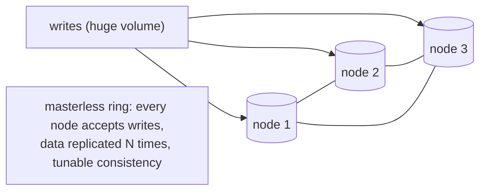
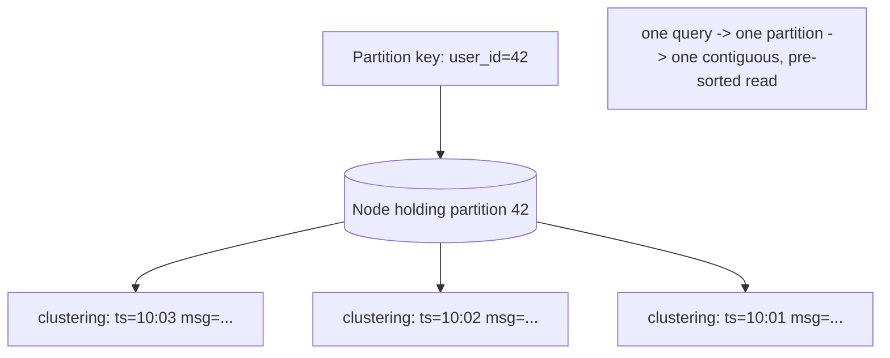
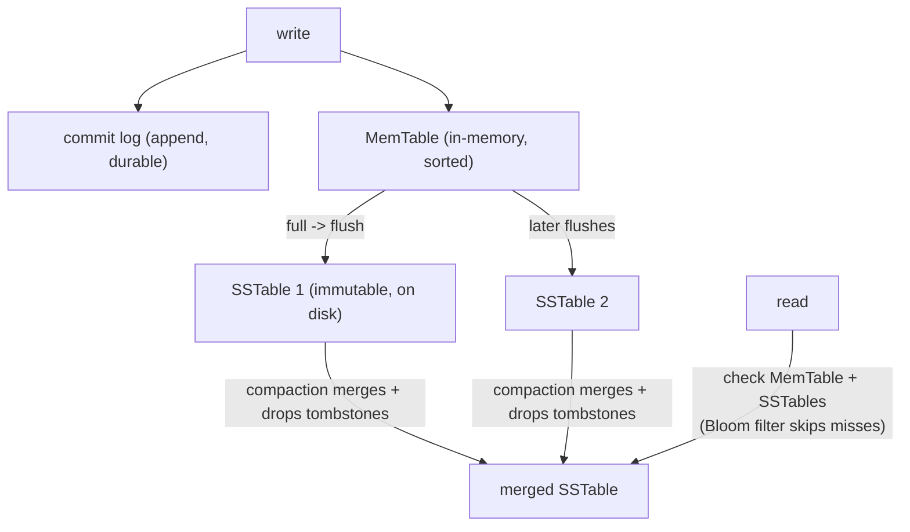
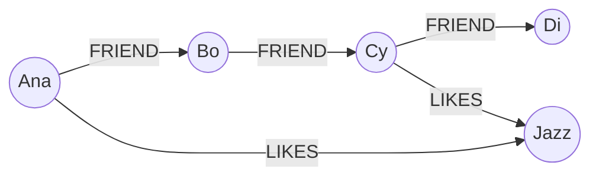
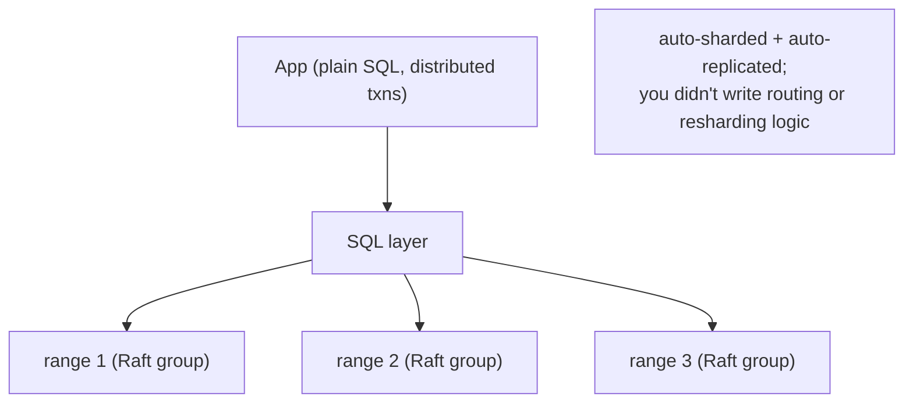

# Day 25 — NoSQL: Wide-Column, Graph & NewSQL

> Series: Database Engineering
> **Goal:** Finish the NoSQL tour with the heavy-hitters: **wide-column** (Cassandra — query-first modeling, partition keys, an LSM-tree storage preview), **graph** (Neo4j — when relationships *are* the data), and **NewSQL / distributed SQL** (CockroachDB, Spanner, Vitess — SQL *and* horizontal scale). Lab: design a Cassandra table for a specific query.

## Table of Contents
1. [In plain words](#in-plain-words)
2. [Wide-column: Cassandra](#wide-column-cassandra)
3. [Query-first modeling & partition keys](#query-first-modeling--partition-keys)
4. [LSM-tree storage preview](#lsm-tree-storage-preview)
5. [Graph databases: Neo4j](#graph-databases-neo4j)
6. [NewSQL / distributed SQL](#newsql--distributed-sql)
7. [Choosing among these](#choosing-among-these)
8. [Lab: design a Cassandra table for a query](#lab-design-a-cassandra-table-for-a-query)
9. [Self-Check](#self-check)
10. [Tomorrow](#tomorrow)

---

## In plain words

**In plain words:**
- A **wide-column** store (Cassandra) is a **spreadsheet where every row can have different columns and you shard millions of rows across a whole datacenter by design**. You don't ask it questions it wasn't built for; you build one "table" per question, pre-arranged so the answer is a single contiguous read from one node.
- A **graph** database (Neo4j) is a **whiteboard of dots and arrows**: when the *connections* between things are the point — "friends of friends who like jazz," "what depends on this service" — it stores and traverses relationships as first-class citizens instead of forcing you to join tables over and over.
- **NewSQL** is **"can I have the SQL and ACID I love *and* the horizontal scale of NoSQL?"** — engines that shard automatically under the hood while still speaking SQL and offering real transactions.

**Verify versions when building:** **Cassandra 5** (CQL; ScyllaDB is a C++ drop-in), **Neo4j 5** (Cypher), **CockroachDB** / **Google Spanner** / **YugabyteDB** / **Vitess** (distributed SQL). Postgres remains the relational baseline for comparison.

> Cross-ref: **Day 22 (Sharding)** — Cassandra's partition key *is* a shard key, and NewSQL automates the sharding you'd otherwise hand-build. **Day 23 (CAP)** — Cassandra is tunable AP; Spanner/CockroachDB are CP. **Advanced Track A3** goes deep on LSM-tree internals previewed here.

---

## Wide-column: Cassandra

**In plain words:** Cassandra is built for **massive write throughput and no single point of failure** across many nodes and datacenters. It has no primary — every node is equal (masterless), data is replicated by a factor N, and consistency is tunable per query (the N/R/W arithmetic from Day 23). The price of that scale: you must model *one table per query*, and you give up joins, ad-hoc queries, and (by default) strong cross-row transactions.

- **Why:** linear write scalability, multi-datacenter, always-writable (AP), no SPOF.
- **What:** keyspaces → tables; rows grouped into partitions; CQL (SQL-like but restricted).
- **When:** huge write volume, time-series/event data, known access patterns, geo-distribution, uptime above all.
- **How:** design tables around queries; partition key routes; clustering columns sort within a partition.
- **Where:** IoT/telemetry, activity feeds, messaging, logging, metrics at scale.


*Cassandra: a masterless ring — writes land anywhere, replicate N times, no primary to bottleneck.*

> ✅ **Good scenario:** A fleet of 5M IoT sensors each emitting a reading every second. Cassandra ingests the firehose across a ring, replicated across two datacenters, always writable even if a node dies. A relational primary would choke on the write volume (Day 21's ceiling).

> ❌ **Bad scenario:** A team used Cassandra for an app needing frequent ad-hoc queries and joins ("show orders where X and Y and Z, grouped by W"). Every new question needed a *new table* and a data backfill, or an illegal `ALLOW FILTERING` full-ring scan. They'd chosen a write-optimized, query-rigid store for an ad-hoc, relational workload.

> 🤔 **"Cassandra is just a faster SQL database — I can query it however I like with CQL."**
> CQL *looks* like SQL but is deliberately crippled: you can generally only filter on the partition key (and clustering columns in order). No joins, no arbitrary `WHERE`, no `GROUP BY` across partitions. A query you didn't design a table for either fails or requires `ALLOW FILTERING` (a full-ring scan — a performance disaster). Cassandra trades query flexibility for write scale. Model per query or don't use it.

**When NOT to:** small data, ad-hoc/analytical queries, heavy joins, or strong multi-row transactions. If one Postgres handles your writes, you don't need Cassandra's complexity.

---

## Query-first modeling & partition keys

**In plain words:** This is access-pattern-first (Day 24) taken to the extreme: in Cassandra you **design a table per query**, and it's normal to *duplicate the same data into several tables* so each query is a single-partition read. The **primary key** has two parts:
- **Partition key** — decides which node stores the row (the shard key). All rows with the same partition key live together on one node, read as one contiguous chunk.
- **Clustering columns** — sort rows *within* a partition, enabling efficient range scans and "latest N."

```
PRIMARY KEY ((partition_key), clustering_col1, clustering_col2)
              ^^^ routes to a node   ^^^ sort order within the partition
```


*Partition key picks the node; clustering columns keep rows pre-sorted for cheap range reads.*

**Choosing a partition key (same three tests as a shard key — Day 22):**
- **High cardinality** so data spreads across the ring (not `country`).
- **Even distribution** so no partition is a hot spot.
- **Bounded partition size** — a partition must not grow forever (unbounded partitions = the wide-row problem; cap by bucketing on time).

```sql
-- Cassandra CQL: a table PER QUERY. Query = "messages for a user, newest first".
CREATE TABLE messages_by_user (
  user_id  uuid,
  bucket   text,          -- e.g. '2026-07' to bound partition size (time bucketing)
  ts       timeuuid,
  sender   text,
  body     text,
  PRIMARY KEY ((user_id, bucket), ts)     -- partition = (user, month); sort by ts
) WITH CLUSTERING ORDER BY (ts DESC);

-- This is the ONLY shape of query this table serves well (single partition):
SELECT * FROM messages_by_user
WHERE user_id = ? AND bucket = '2026-07'          -- must supply the full partition key
LIMIT 20;                                          -- newest 20, one contiguous read

-- Need "messages by sender" too? That's a DIFFERENT query -> a DIFFERENT table:
CREATE TABLE messages_by_sender (
  sender text, ts timeuuid, user_id uuid, body text,
  PRIMARY KEY ((sender), ts)
) WITH CLUSTERING ORDER BY (ts DESC);
-- You write each message to BOTH tables (denormalization / dual-write is normal here).
```

> 🤔 **"Duplicating the same data into three tables is a bug — I should normalize."**
> In Cassandra, denormalization is the *design*, not a smell. Storage is cheap; joins and cross-partition scans are impossible/expensive. You write each fact to every table that serves a query about it, so every read is a single-partition hit. Normalization (Day 03) is a relational virtue; in wide-column, query-first duplication is correct.

> ❌ **Bad scenario (unbounded partition):** A team keyed a time-series table by just `sensor_id`. A busy sensor's partition grew to millions of rows on one node — reads timed out, compaction struggled, one node got hot. Fix: composite partition key `(sensor_id, day)` to bound each partition (time bucketing).

**When NOT to:** don't model Cassandra like a relational schema (one normalized table, join later) — you'll hit `ALLOW FILTERING` and hot partitions. And don't use it at all if your queries aren't known in advance.

---

## LSM-tree storage preview

**In plain words:** *Why* is Cassandra so write-fast? Because it never does slow random-write-in-place. It uses an **LSM tree** (Log-Structured Merge tree): writes go to an in-memory sorted table (**MemTable**) plus an append-only commit log (instant, sequential). When the MemTable fills, it's flushed to disk as an immutable sorted file (**SSTable**). Reads may check several SSTables, so a background **compaction** merges them. This is the opposite of Postgres's B-tree "update the page in place" (Day 06/07).


*LSM write path: append to log + MemTable, flush to immutable SSTables, compact in the background.*

Key ideas (full treatment in **Advanced Track A3**):
- **Fast writes:** everything is a sequential append — no random in-place update.
- **Bloom filters:** a probabilistic index per SSTable answers "definitely not here" fast, so reads skip SSTables that can't contain the key.
- **Read amplification:** a read may touch several SSTables + MemTable → reads are relatively costlier than writes.
- **Write amplification:** compaction rewrites data multiple times over its life.
- **Tombstones:** deletes are *markers*, purged only at compaction — too many tombstones slow reads (a real Cassandra footgun).

| | LSM tree (Cassandra, RocksDB, ScyllaDB) | B+ tree (Postgres, MySQL InnoDB) |
|---|---|---|
| Writes | very fast (sequential append) | slower (random in-place, WAL) |
| Reads | may check many SSTables | one tree traversal |
| Write amplification | high (compaction) | lower |
| Best for | write-heavy, ingest | read-heavy, point + range |

> 🤔 **"LSM trees are just strictly better than B-trees — they're newer and faster."**
> They're *write*-optimized, not universally better. LSM trades read cost and write-amplification (compaction rewrites data repeatedly, competing for I/O) for blazing sequential writes. B-trees give cheaper, more predictable reads. The right choice depends on read/write ratio. Postgres uses B-trees precisely because most OLTP is read-heavy with point/range lookups.

**When NOT to (rely on LSM assumptions):** watch tombstone buildup on delete-heavy Cassandra tables, and budget I/O for compaction — an under-provisioned cluster can fall behind on compaction and degrade reads.

---

## Graph databases: Neo4j

**In plain words:** When your data is *mostly about the connections* — social networks, recommendations, fraud rings, dependency graphs, knowledge graphs — a relational database makes you write increasingly painful self-joins to walk relationships ("friends of friends of friends" = a 3-way join that explodes). A graph DB stores **nodes** and **relationships** as first-class objects with direct pointers, so traversing a relationship is O(1) per hop regardless of total data size. You query with **Cypher**, an ASCII-art pattern language.

- **Why:** relationship traversal is cheap and expressive; deep/variable-length paths that murder SQL joins are natural.
- **What:** nodes (with labels + properties), relationships (typed, directed, with properties).
- **When:** the *connections* carry the meaning and you traverse them a lot.
- **Where:** social graphs, recommendations, fraud detection, network/IT topology, knowledge graphs.

```cypher
// Neo4j Cypher — nodes in (), relationships in -[]->, patterns read like a drawing
CREATE (ana:Person {name:'Ana'})-[:FRIEND]->(bo:Person {name:'Bo'})
CREATE (bo)-[:FRIEND]->(cy:Person {name:'Cy'})

// "Friends of friends of Ana" — trivial in Cypher, painful in SQL:
MATCH (ana:Person {name:'Ana'})-[:FRIEND]->()-[:FRIEND]->(fof)
RETURN DISTINCT fof.name;

// Variable-length path — "anyone reachable from Ana in 1..4 hops":
MATCH (ana:Person {name:'Ana'})-[:FRIEND*1..4]->(reached)
RETURN DISTINCT reached.name;      // the killer feature: recursive traversal, one line
```


*Nodes and typed relationships; traversing edges is a pointer hop, not a join.*

**Graph vs relational for connected data:**

| | Graph (Neo4j) | Relational |
|---|---|---|
| "friends of friends" | one Cypher pattern | nested self-joins (explodes with depth) |
| Variable-depth path | `[:REL*1..n]` native | recursive CTE, expensive |
| Traversal cost | O(1) per hop (pointer) | grows with joined table sizes |
| Ad-hoc tabular reports | weaker | strong (SQL) |

> ✅ **Good scenario:** A fraud team detects rings — "accounts sharing a device, phone, or address within 3 hops of a known-bad account." In Neo4j that's a single traversal; in SQL it was an unmaintainable pile of self-joins that timed out. Relationships *are* the query.

> ❌ **Bad scenario:** A team stored ordinary tabular order data in Neo4j "for flexibility." Aggregations and reporting ("revenue by month") were awkward and slow versus one SQL `GROUP BY`. Graph shines on connectedness, not tabular aggregation.

> 🤔 **"I can do graphs in SQL with recursive CTEs, so I never need a graph database."**
> You *can* for shallow, occasional traversals — Postgres `WITH RECURSIVE` handles a few hops. But for deep, variable-length, high-fan-out traversals run constantly, join-based recursion blows up combinatorially while a graph DB's index-free adjacency stays cheap. It's a question of *how central and deep* traversal is. Occasional/shallow → SQL is fine. Traversal-dominated → graph earns its keep.

**When NOT to:** don't use a graph DB for tabular/aggregate-heavy workloads or when relationships are shallow and rare. And you rarely need it as your *only* store — it's usually a specialist alongside a primary DB.

---

## NewSQL / distributed SQL

**In plain words:** NewSQL asks: *why must I give up SQL and ACID to get horizontal scale?* These engines shard and replicate automatically under the hood (via consensus — Raft/Paxos, Advanced A2) while presenting a familiar SQL interface with real distributed transactions. You write SQL; the engine handles sharding, rebalancing, and cross-node consistency for you — the Day 22 pain, automated.

- **CockroachDB / YugabyteDB:** Postgres-wire-compatible distributed SQL; auto-sharded ("ranges"), Raft-replicated, serializable transactions, survives node/region loss. CP (Day 23).
- **Google Spanner:** globally-distributed SQL with external consistency via **TrueTime** (atomic-clock/GPS bounded clock uncertainty — Advanced A8).
- **Vitess:** sharding middleware over MySQL (born at YouTube) — scales existing MySQL horizontally.


*Distributed SQL hides sharding/replication behind a SQL layer — the Day 22 work, automated.*

| | Sharded Postgres/Citus (Day 22) | Distributed SQL (CockroachDB/Spanner) |
|---|---|---|
| Sharding | you design shard key/colocation | automatic (ranges) |
| Resharding | you plan buckets/rebalance | automatic |
| Distributed txns | limited / 2PC pain | native serializable |
| Failover | Patroni etc. | built-in (Raft) |
| Cost | operational complexity | latency (consensus per write) + $ |

> ✅ **Good scenario:** A global fintech needs SQL, serializable transactions, and survival of a whole-region outage. CockroachDB gives them auto-sharded, Raft-replicated tables that stay consistent and available across regions — no hand-built sharding layer.

> ❌ **Bad scenario:** A single-region app with modest load adopted CockroachDB "to be web-scale." Every write now pays a Raft consensus round trip (higher latency than a single Postgres), and they inherited distributed-systems operational complexity they didn't need. NewSQL's consistency-across-nodes has an always-on latency cost (PACELC's EC — Day 23).

> 🤔 **"NewSQL is a free lunch — SQL, ACID, *and* infinite scale with no trade-offs."**
> The trade-off is **latency and cost**: keeping distributed transactions serializable requires consensus round-trips on writes (and clock coordination in Spanner's case), so per-operation latency is higher than a single-node Postgres, and you're running a more complex, pricier system. NewSQL is brilliant when you genuinely need horizontal scale *with* strong SQL semantics — and overkill (slower + costlier) when one Postgres would do.

**When NOT to:** don't adopt distributed SQL until a single Postgres + replicas truly can't meet your scale/geo needs — you pay consensus latency and operational complexity from day one.

---

## Choosing among these

| Workload signal | Reach for |
|---|---|
| Massive writes, known patterns, geo, uptime > flexibility | **Wide-column (Cassandra)** |
| Relationships/traversal are the core query | **Graph (Neo4j)** |
| Need SQL + ACID *and* horizontal/global scale | **NewSQL (CockroachDB/Spanner)** |
| Relational, one primary suffices, want flexibility | **Postgres** (still the default) |

Day 26 turns this into a full decision framework (with a flowchart) and adds vector databases.

---

## Lab: design a Cassandra table for a query

Goal: practice query-first modeling. Given three access patterns for a **ride-sharing** app, design the tables. (Run against a local Cassandra 5 / Docker if you have one, or design on paper — the *thinking* is the skill.)

**Access patterns:**
1. "Show a rider's trips, newest first" (`rider_id`).
2. "Show a driver's trips for a given day, newest first" (`driver_id`, day).
3. "Look up a single trip by its id."

```sql
-- Step 1: ONE TABLE PER QUERY. Do NOT try to serve all three from one table.

-- Query 1: rider's trips, newest first  -> partition by rider, sort by time.
CREATE TABLE trips_by_rider (
  rider_id  uuid,
  ts        timeuuid,
  trip_id   uuid,
  driver_id uuid,
  fare      decimal,
  PRIMARY KEY ((rider_id), ts)               -- partition = rider; clustered by ts
) WITH CLUSTERING ORDER BY (ts DESC);

SELECT * FROM trips_by_rider WHERE rider_id = ? LIMIT 20;   -- single partition, pre-sorted

-- Query 2: driver's trips for a DAY -> bound the partition with a day bucket (avoid wide rows).
CREATE TABLE trips_by_driver_day (
  driver_id uuid,
  day       date,                            -- bucket to bound partition size
  ts        timeuuid,
  trip_id   uuid,
  rider_id  uuid,
  fare      decimal,
  PRIMARY KEY ((driver_id, day), ts)         -- partition = (driver, day)
) WITH CLUSTERING ORDER BY (ts DESC);

SELECT * FROM trips_by_driver_day
WHERE driver_id = ? AND day = '2026-07-26';  -- MUST supply full partition key

-- Query 3: single trip by id -> partition by trip_id itself.
CREATE TABLE trips_by_id (
  trip_id   uuid PRIMARY KEY,
  rider_id  uuid, driver_id uuid, ts timeuuid, fare decimal
);
SELECT * FROM trips_by_id WHERE trip_id = ?;
```

```sql
-- Step 2: On each new trip, WRITE TO ALL THREE tables (denormalization is the design).
--   Use a BATCH only for atomicity of the same partition; across partitions it's a
--   "logged batch" (has overhead) or app-level dual-write.
BEGIN BATCH
  INSERT INTO trips_by_rider      (rider_id, ts, trip_id, driver_id, fare) VALUES (...);
  INSERT INTO trips_by_driver_day (driver_id, day, ts, trip_id, rider_id, fare) VALUES (...);
  INSERT INTO trips_by_id         (trip_id, rider_id, driver_id, ts, fare) VALUES (...);
APPLY BATCH;
```

```sql
-- Step 3: Feel the constraints — try to break the rules and see why they exist.
-- (a) A query you DIDN'T design a table for:
SELECT * FROM trips_by_rider WHERE fare > 50;      -- ERROR (or needs ALLOW FILTERING = full scan)
-- (b) Set consistency for a strong read (Day 23 quorum arithmetic):
CONSISTENCY LOCAL_QUORUM;                           -- N/R/W: R+W>N -> fresh, DC-local latency
SELECT * FROM trips_by_id WHERE trip_id = ?;
```

**Deliverable:** for a fourth access pattern of your choosing ("trips in a city, newest first"), design the table — pick a partition key that is high-cardinality, evenly distributed, and *bounded* (hint: `(city, day)` beats `city` alone). Explain why.

> **Reflection:** You wrote the *same trip* into three tables and couldn't run an un-designed query — and that's *correct* Cassandra. The mental shift from "normalize then query" to "enumerate queries then build a table for each" is the entire wide-column skill.

---

## Self-Check
1. Why is Cassandra masterless, and how does that give it write scalability and no SPOF?
2. What are the two parts of a Cassandra primary key, and what does each do?
3. Why is `ALLOW FILTERING` a warning sign, and what does it imply about your model?
4. Why is data duplication across tables the *correct* design in Cassandra, not a smell?
5. Sketch the LSM write path (commit log, MemTable, SSTable, compaction). Why are writes fast?
6. Define read amplification, write amplification, and tombstones — and a problem each can cause.
7. When do relationships justify a graph database over recursive SQL CTEs?
8. Write the Cypher idea for "friends of friends" and say why the SQL equivalent gets ugly.
9. What problem does NewSQL/distributed SQL solve, and what is its unavoidable cost?
10. Give the one-line rule for choosing wide-column vs graph vs NewSQL vs Postgres.

## Tomorrow
**Day 26 — Choosing the Right Store + Vector DBs.** You now know the major store families. Tomorrow we build a decision framework (a flowchart) to pick the right one, discuss polyglot persistence, and add the store the AI era made essential: **vector databases** (pgvector, Pinecone, Qdrant — embeddings and ANN search), tied back to the AI course. Lab: justify DB choices for five real workloads.
