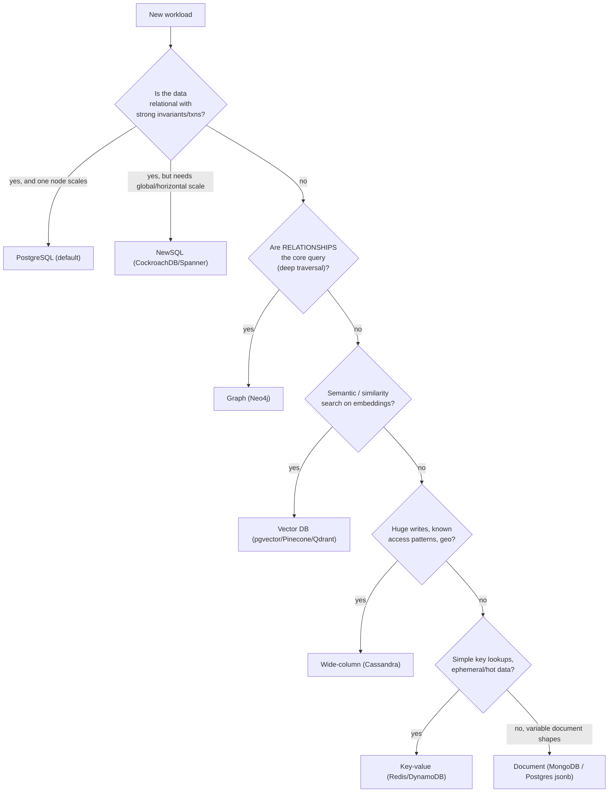
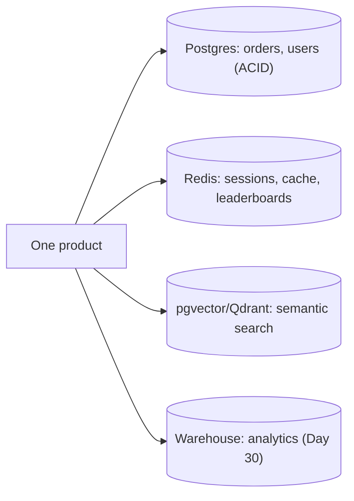
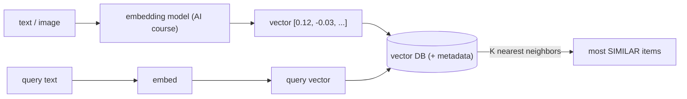
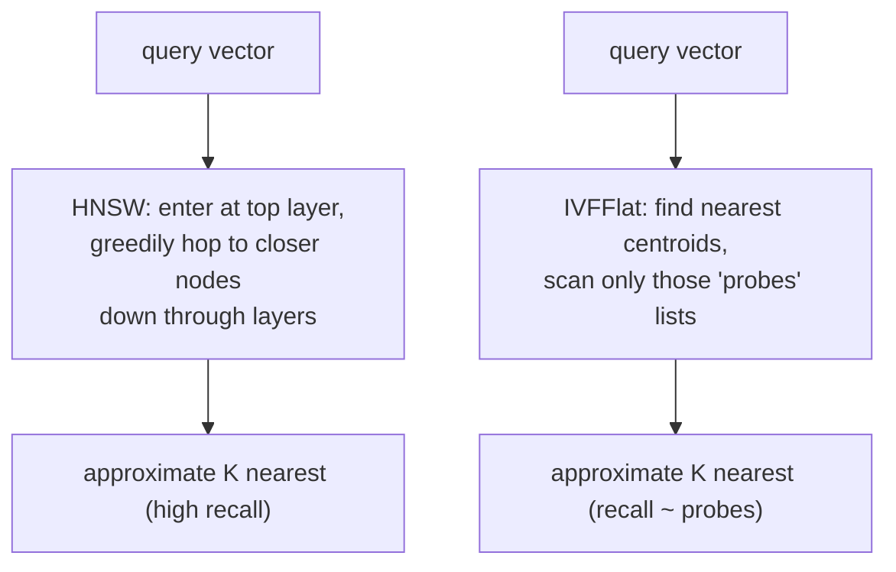
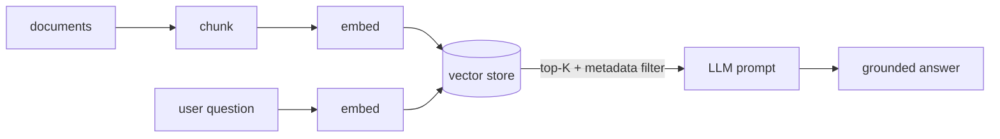

# Day 26 — Choosing the Right Store + Vector DBs

> Series: Database Engineering
> **Goal:** Turn the whole NoSQL tour into a *decision*: a practical framework (with a flowchart) for choosing the right store, the discipline of **polyglot persistence**, and the store the AI era made essential — **vector databases** (pgvector, Pinecone, Qdrant: embeddings, ANN search) from a database engineer's point of view. Lab: justify DB choices for five real workloads.

## Table of Contents
1. [In plain words](#in-plain-words)
2. [A decision framework (flowchart)](#a-decision-framework-flowchart)
3. [Polyglot persistence](#polyglot-persistence)
4. [Vector databases: what and why](#vector-databases-what-and-why)
5. [ANN: how vector search actually works](#ann-how-vector-search-actually-works)
6. [pgvector vs Pinecone vs Qdrant](#pgvector-vs-pinecone-vs-qdrant)
7. [A DB engineer's view of the RAG stack](#a-db-engineers-view-of-the-rag-stack)
8. [Lab: justify DB choices for five workloads](#lab-justify-db-choices-for-five-workloads)
9. [Self-Check](#self-check)
10. [Tomorrow](#tomorrow)

---

## In plain words

**In plain words:** You now own a toolbox: relational (Postgres), document (Mongo), key-value (Redis/DynamoDB), wide-column (Cassandra), graph (Neo4j), NewSQL (CockroachDB), and now vector DBs. Choosing a store is like a chef choosing a knife — there's no "best knife," only the right one for *this* cut. The mistake beginners make is owning one knife and forcing every cut with it, or buying a drawer of exotic knives they don't need. The skill is matching the tool to the workload — and knowing that a good chef's knife (Postgres) handles 80% of cuts, so you only reach for the specialist blade when the cut genuinely demands it.

**Verify versions when building:** **PostgreSQL 17 + pgvector 0.8** (vector search inside Postgres), **Pinecone** (managed vector DB), **Qdrant** (open-source vector DB), plus embedding models from the AI course. The decision framework is engine-agnostic.

> Cross-ref: **The AI Engineering course** covered embeddings, semantic search, and RAG (retrieval-augmented generation) from the *model* side. Today is the **database engineer's** side of the same coin — how the vectors are *stored, indexed, and queried* at scale. Also builds on **Days 22–25** (scale/consistency of each store) and **Day 01** (OLTP vs OLAP).

---

## A decision framework (flowchart)

**In plain words:** Don't start from "which database is cool." Start from the *workload*: its shape, access patterns, consistency needs, and scale. Answer a short series of questions and the right family falls out.


*Start from the workload's needs; the store family is the answer, not the starting point.*

**The questions that actually decide it:**

| Question | If yes → lean toward |
|---|---|
| Strong multi-row ACID / constraints? | Relational / NewSQL |
| Access patterns few and known? | any NoSQL fits; else relational |
| Deep relationship traversal central? | Graph |
| Writes exceed one tuned primary? | Cassandra / NewSQL / shard |
| Sub-ms hot lookups, ephemeral? | Redis |
| Similarity/semantic search? | Vector DB |
| Ad-hoc analytics / BI? | Warehouse (Day 30), not OLTP NoSQL |

> 🤔 **"There must be one best modern database I should standardize on for everything."**
> There isn't — every store makes trade-offs that make it great at some workloads and bad at others (that's Days 22–25 in one sentence). Standardizing on *one* store means forcing square pegs into round holes. That said, the pragmatic near-truth is: **Postgres is the best default** and handles a remarkable range (relational + jsonb + key-value + full-text + pgvector). Standardize on Postgres, then add a specialist store *per proven need* — not per fashion.

> ❌ **Bad scenario (resume-driven design):** A team ran Postgres + Mongo + Cassandra + Neo4j + Elasticsearch + Redis for an app with ~50k users. Six datastores meant six backup strategies, six failure modes, six on-call runbooks, and constant sync bugs — for load a single Postgres handled. Complexity they chose, not complexity they needed.

**When NOT to:** don't add a new datastore for a feature Postgres can already do (jsonb for documents, `pg_trgm`/full-text for search, pgvector for embeddings). Each new store is a permanent operational tax.

---

## Polyglot persistence

**In plain words:** Polyglot persistence = deliberately using *different* stores for *different* workloads within one system, each chosen for what it's best at. The key word is **deliberately** — it's a considered decision per workload, not "let's collect databases."


*Polyglot done right: each store owns the workload it's genuinely best at.*

**The cost side (why "deliberately" matters):**
- Each store = its own ops (backups, HA, monitoring, upgrades, on-call knowledge).
- **Data sync / dual-write** between stores is a notorious source of bugs and inconsistency (CDC — Day 30 — is how you do it *right*).
- No cross-store transactions or joins — consistency across stores is *your* problem.

| Do | Don't |
|---|---|
| Add a store for a clearly-better-fit workload | Add a store because it's trendy |
| Start with Postgres, extend it (jsonb/pgvector) | Split into 6 stores for a small app |
| Own the data-sync strategy (CDC) explicitly | Hand-roll dual-writes and hope |
| Count the operational cost per store | Ignore the on-call/backup multiplier |

> ✅ **Good scenario:** An e-commerce app: Postgres for orders/inventory (ACID), Redis for cart/session and rate limits, pgvector for "similar products," and a warehouse for BI. Each store earns its place; sync flows one way via CDC. This is polyglot done right.

> **Dark Side:** The moment data lives in two stores, you have a *consistency problem across stores* with no transaction to protect you. Dual-writes can partially fail (write A succeeds, write B fails) leaving stores out of sync. The disciplined pattern is one **source of truth** + **CDC** (Day 30) to propagate changes, never independent dual-writes to two systems of record.

**When NOT to:** don't go polyglot to look sophisticated. The best architecture is the *fewest* stores that meet the requirements. Add the second store when the first genuinely can't serve a workload well.

---

## Vector databases: what and why

**In plain words:** An **embedding** is a list of numbers (a vector, e.g., 1536 dimensions) that captures the *meaning* of text/image/audio — produced by an AI model (the AI course). Similar meanings → nearby vectors. A **vector database** stores millions of these and answers "find the K vectors most *similar* to this query vector" fast. That's **semantic search**: matching by meaning, not keywords ("car" matches "automobile"). It's the retrieval half of RAG and recommendation systems.

- **Why:** keyword/`LIKE` search can't match *meaning*; vector similarity can. And computing similarity against millions of vectors by brute force is too slow — vector DBs use approximate indexes.
- **What:** storage + a similarity index (ANN) over high-dimensional vectors, with a distance metric (cosine / dot / L2).
- **When:** semantic search, RAG (feed relevant docs to an LLM), recommendations, dedup, clustering, image search.
- **How:** embed content → store vectors (+ metadata) → query with an embedded query vector → get nearest neighbors.
- **Where:** RAG chatbots, "similar items," search that understands intent.


*Embed content into vectors, store them, and query by nearest-neighbor similarity — search by meaning.*

```sql
-- pgvector: vector search INSIDE Postgres (no new datastore needed)
CREATE EXTENSION vector;
CREATE TABLE docs (
  id bigserial PRIMARY KEY,
  content text,
  category text,                       -- ordinary column: enables metadata filtering
  embedding vector(1536)               -- an OpenAI-style embedding
);

-- Nearest-neighbor search: <=> is cosine distance (smaller = more similar)
SELECT id, content, embedding <=> $1 AS distance
FROM docs
WHERE category = 'faq'                 -- combine SQL filters WITH vector search (a pgvector strength)
ORDER BY embedding <=> $1              -- $1 = the query's embedding
LIMIT 5;                               -- top-5 most semantically similar FAQ docs
```

> 🤔 **"A vector database is a fundamentally new kind of database I must run separately."**
> Not necessarily. A vector DB is really "a store + an approximate-nearest-neighbor index over vectors." **pgvector** adds exactly that to Postgres — so your vectors live *next to* your relational data, and you can filter by SQL and join in one query, with your existing backups/HA. You need a *dedicated* vector DB (Pinecone/Qdrant) only at large scale or when you want a purpose-built, separately-scaled service. For most apps, pgvector means "no new datastore."

> ✅ **Good scenario:** A support bot's RAG pipeline stores 500k help-article chunks as vectors in pgvector, right beside the articles' metadata. A query embeds the user's question, filters by product line in SQL, and returns the 5 most relevant chunks to the LLM — all in one Postgres, one backup, one HA setup.

**When NOT to:** don't use a vector DB for exact-match or keyword search (a B-tree or full-text index is faster and exact), or for structured filtering alone. Vectors are for *similarity*, not lookups you can express precisely.

---

## ANN: how vector search actually works

**In plain words:** Comparing a query vector to *every* stored vector (exact k-NN) is O(N) per query — fine for thousands, hopeless for millions. So vector DBs use **ANN** (Approximate Nearest Neighbor) indexes that trade a tiny bit of accuracy (**recall**) for massive speed. The database engineer's job is understanding these indexes: their build cost, memory, and the recall/speed dial.

**Two dominant index families:**

| Index | Idea | Pros | Cons |
|---|---|---|---|
| **HNSW** (graph) | a navigable small-world graph; hop toward nearer neighbors | high recall + fast queries | more memory, slower builds |
| **IVFFlat** (clustering) | partition vectors into lists (centroids); search only nearby lists | smaller, faster to build | recall depends on `probes`; needs training data |


*HNSW navigates a proximity graph; IVFFlat scans only the closest clusters — both approximate to stay fast.*

```sql
-- pgvector: build an ANN index and tune the recall/speed dial
-- HNSW (usually the best default): m = graph degree, ef_construction = build quality
CREATE INDEX ON docs USING hnsw (embedding vector_cosine_ops)
  WITH (m = 16, ef_construction = 64);
SET hnsw.ef_search = 100;      -- query-time: higher = better recall, slower. THE dial.

-- IVFFlat: fewer lists = faster/less accurate; probes = how many lists to scan
CREATE INDEX ON docs USING ivfflat (embedding vector_cosine_ops) WITH (lists = 200);
SET ivfflat.probes = 10;       -- higher = better recall, slower
```

- **Recall** = fraction of the true nearest neighbors the ANN index actually returned. 100% = exact; ANN aims for ~95–99% at a fraction of the cost.
- **Distance metrics:** cosine (angle — most common for text embeddings), inner/dot product, L2 (Euclidean). Match the metric your embedding model was trained for.

> 🤔 **"ANN gives me the exact nearest neighbors, just faster."**
> No — the "A" is *Approximate*. ANN may miss a true neighbor occasionally; that's the recall trade you tune (`ef_search`/`probes`). For semantic search that's fine (a slightly-less-perfect match is invisible to users). If you truly need *exact* nearest neighbors (rare — some scientific/dedup cases), you need exact k-NN and must accept its cost. Know which one your use case requires.

> ❌ **Bad scenario:** A team built an HNSW index with tiny `ef_search`, got poor recall, and their RAG bot retrieved irrelevant chunks → the LLM hallucinated. The fix wasn't a bigger model; it was tuning the ANN recall dial. Retrieval quality is a *database* problem here.

> **Dark Side:** ANN indexes are large and often want to live in **RAM** for speed — a million 1536-dim float32 vectors is ~6GB *before* the index. HNSW builds are slow and memory-hungry; rebuilding after bulk loads is a real operation. And updates/deletes to graph indexes are trickier than B-trees. Capacity-plan vector memory like you plan `shared_buffers`.

**When NOT to:** don't crank recall to 100% (huge `ef_search`) by default — you throw away ANN's whole speed advantage. Tune to the lowest recall that keeps results good enough.

---

## pgvector vs Pinecone vs Qdrant

| | **pgvector** (in Postgres) | **Pinecone** (managed) | **Qdrant** (OSS, self-host or cloud) |
|---|---|---|---|
| Deploy | extension in your Postgres | fully managed SaaS | self-host or managed |
| Best when | vectors alongside relational data; small–medium scale | want zero ops, huge scale, don't want to run infra | want control, rich filtering, open source |
| Metadata filtering | full SQL (joins, WHERE) | payload filters | rich payload filters |
| Scale ceiling | one Postgres (+ replicas) | very high (managed) | high (clustered) |
| Ops burden | none extra (reuse Postgres) | none (SaaS) | you run it (or pay) |
| Cost model | your existing DB | usage-based SaaS $ | infra / managed $ |

**The DB-engineer's heuristic:** start with **pgvector** (no new datastore, SQL filtering, your existing HA/backups). Move to a **dedicated** vector DB (Pinecone/Qdrant) when: vector count/QPS outgrows one Postgres, you need independent scaling of the vector workload, or you want purpose-built features (hybrid search, sharding of vectors) without loading your OLTP database.

> ✅ **Good scenario:** A startup ships RAG on pgvector in week one (zero new infra). At 50M vectors and heavy QPS a year later, they migrate the vector workload to Qdrant so it scales independently of their transactional Postgres. Right tool at each stage.

**When NOT to:** don't jump straight to a dedicated vector DB for a prototype or modest corpus — pgvector likely covers it, and one fewer datastore is a real win (the polyglot cost above).

---

## A DB engineer's view of the RAG stack

**In plain words:** RAG (from the AI course) = retrieve relevant documents, then feed them to an LLM to ground its answer. As a *database engineer*, your responsibilities in that pipeline are concrete and familiar:


*RAG retrieval is a database problem: chunk, embed, index, filter, and return the right K fast.*

| Pipeline step | DB-engineer concern |
|---|---|
| Chunking | chunk size vs retrieval quality; store chunk→doc lineage |
| Embedding storage | dimensions, metric, schema, keeping vectors in sync with source rows (CDC) |
| Indexing | HNSW/IVFFlat choice, recall tuning, index memory/build cost |
| Filtering | combine metadata filters (SQL/payload) with similarity (pgvector shines) |
| Freshness | re-embed on content change (a data-sync problem — Day 30 CDC) |
| Latency/scale | QPS, p99, replicas, when to move off pgvector |

> **The core insight:** the *quality* of a RAG system depends heavily on retrieval — which is a **database** concern (indexing, recall, filtering, freshness), not just a model concern. That's why "vector DBs" belong in a database-engineering curriculum. When retrieval returns the wrong chunks, the smartest LLM still answers wrong.

**When NOT to:** don't treat retrieval as "just an API call" — poor recall, stale embeddings, or missing metadata filters are database bugs that show up as bad AI answers.

---

## Lab: justify DB choices for five workloads

For each workload, pick a store (or stores), and write a one-paragraph justification citing the concepts from Days 22–26. There isn't a single "right" answer — the *reasoning* is graded. Sample answers follow; try yours first.

```
Workload A: Banking core — accounts, transfers, balances. Strong ACID, must not lose
            money, one region, moderate volume.
Workload B: IoT telemetry — 3M devices, 1 reading/sec, "latest N per device", geo,
            uptime critical, few query shapes.
Workload C: "Customers who bought X also bought Y" recommendations over 20M products.
Workload D: A support chatbot answering from 800k help-article chunks (RAG).
Workload E: Session store + rate limiting + a live leaderboard for a mobile game.
```

```
---- Sample justifications ----
A (Banking): PostgreSQL. Relational with hard invariants (balance >= 0), multi-row
   transactions (transfer = two updates atomically), constraints/FKs. One region +
   moderate volume => one tuned primary + a sync standby (Day 21) for RPO 0. CP is
   required (Day 23) — never AP for money. No NoSQL benefit here.

B (IoT): Cassandra (wide-column). Massive writes beyond one primary's ceiling (Day 21/22),
   known access pattern ("latest N per device"), geo + always-writable (AP tunable,
   Day 23). Model query-first: PRIMARY KEY ((device_id, day), ts) DESC (Day 25),
   bucketed to bound partitions. A relational primary would choke on the write firehose.

C (Recommendations): Two valid paths. (1) Graph (Neo4j) if you traverse co-purchase
   relationships deeply ("also bought" chains). (2) Vector DB / pgvector if you frame it
   as similarity over product embeddings. Often pgvector for "similar items" + a warehouse
   job for co-purchase counts. Justify by whether RELATIONSHIPS or SIMILARITY dominate.

D (RAG chatbot): pgvector (start) — 800k chunks fits comfortably in one Postgres, and you
   get SQL metadata filtering (by product/version) alongside HNSW similarity search
   (Day 26). Tune ef_search for recall so retrieval quality is good. Move to Qdrant only
   if it outgrows one Postgres. Retrieval quality is a DB concern.

E (Game infra): Redis. Sessions (string + TTL), rate limiting (sorted set / INCR),
   leaderboard (sorted set: top-N and my-rank in microseconds — Day 24). Ephemeral, hot,
   sub-ms. Pair with a durable Postgres as the system of record for player accounts;
   Redis is not the source of truth.
```

**Deliverable:** For each, also state what you would *not* use and why (e.g., "not Cassandra for A — no cross-row ACID; not Neo4j for B — tabular ingest, no traversal need"). Naming the wrong tool sharpens the right one.

> **Reflection:** Notice the recurring shape of every justification: *workload shape → access patterns → consistency needs → scale → store*. And notice how often the answer is "Postgres, possibly extended (pgvector), plus one specialist for one workload." That's the whole framework: right tool per workload, fewest stores that meet the need.

---

## Self-Check
1. Walk the decision flowchart for a workload with deep relationship traversal. Where does it land and why?
2. Why is "standardize on one database for everything" both wrong *and* nearly-right (with Postgres)?
3. Define polyglot persistence and its biggest hidden cost.
4. Why are independent dual-writes to two systems of record dangerous, and what's the disciplined alternative?
5. What is an embedding, and what question does a vector database answer?
6. Why does vector search need ANN instead of exact k-NN at scale?
7. Contrast HNSW and IVFFlat, and name the query-time dial that trades recall for speed.
8. What does "recall" mean for ANN, and why is approximate usually fine for RAG?
9. When would you use pgvector vs a dedicated vector DB like Pinecone/Qdrant?
10. Why is RAG retrieval quality a *database* problem, and name three DB concerns in the pipeline.

## Tomorrow
**Day 27 — Backups & Recovery.** We've spent six days on scaling and store selection; now we protect the data. Tomorrow: logical vs physical backups (`pg_dump` vs `pg_basebackup`), point-in-time recovery with WAL archiving, RPO/RTO, and the discipline that separates pros from amateurs — *testing your restores*. Lab: back up, corrupt, and restore to a precise point in time.
