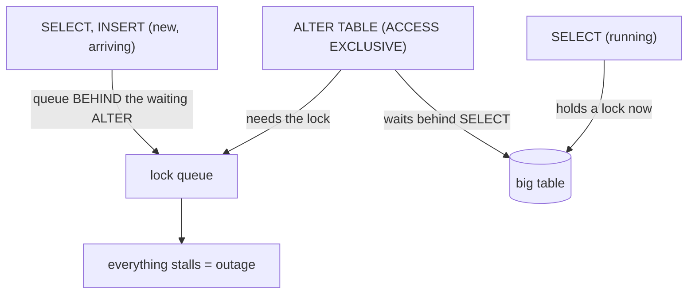
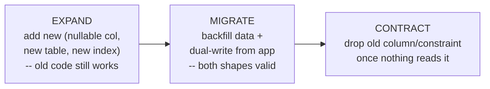
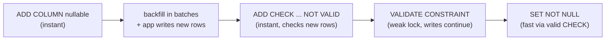
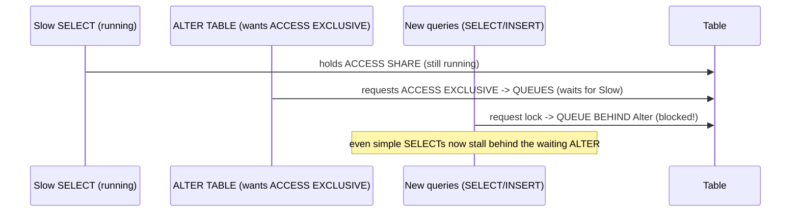

# Day 28 — Zero-Downtime Migrations

> Series: Database Engineering
> **Goal:** Master the scariest routine skill in the job — changing the schema of a **live, large, busy** database without downtime or locking out users. The **expand/contract** pattern, adding columns/indexes without locking (`CREATE INDEX CONCURRENTLY`, adding `NOT NULL` safely in steps), **batched backfills**, online schema-change tools (gh-ost, pt-online-schema-change, Flyway/Liquibase versioning), and the **lock-timeout danger** that turns a "quick migration" into an outage. Lab: add a `NOT NULL` column to a 500M-row table with zero downtime.

## Table of Contents
1. [In plain words](#in-plain-words)
2. [Why naive migrations cause outages: locks](#why-naive-migrations-cause-outages-locks)
3. [The expand/contract pattern](#the-expandcontract-pattern)
4. [Adding indexes without locking](#adding-indexes-without-locking)
5. [Adding a NOT NULL column safely](#adding-a-not-null-column-safely)
6. [Batched backfills](#batched-backfills)
7. [The lock-timeout danger (and lock queue)](#the-lock-timeout-danger-and-lock-queue)
8. [Online schema-change tools & versioning](#online-schema-change-tools--versioning)
9. [A catalog of safe vs unsafe operations](#a-catalog-of-safe-vs-unsafe-operations)
10. [Lab: add a NOT NULL column to a big table with no downtime](#lab-add-a-not-null-column-to-a-big-table-with-no-downtime)
11. [Self-Check](#self-check)
12. [Tomorrow](#tomorrow)

---

## In plain words

**In plain words:** Imagine renovating a restaurant kitchen *during the dinner rush* without closing. You can't just shut off the gas and rebuild the stove — customers are mid-meal. So you work in careful stages: install the *new* stove beside the old one while the old one keeps cooking (**expand**), gradually route dishes to the new stove and copy over the pots (**backfill**), verify everything works on the new stove, then quietly remove the old one when nothing depends on it anymore (**contract**). At no point is the kitchen closed. That staged, additive, reversible approach — never a single big-bang change that locks the doors — *is* zero-downtime migration.

The core danger is a single word: **lock**. A careless `ALTER TABLE` grabs an exclusive lock on a huge table, and every query behind it *waits* — your "one-second schema change" becomes a full outage. The entire discipline is: make schema changes that acquire only *brief* or *non-blocking* locks, and split risky changes into safe steps.

**Verify versions when building:** **PostgreSQL 17**. Postgres has done many `ALTER TABLE` operations *without a table rewrite* since 11 (e.g., `ADD COLUMN ... DEFAULT` is metadata-only since PG 11). `CREATE INDEX CONCURRENTLY` and `lock_timeout` are your core tools. Tools: **gh-ost** / **pt-online-schema-change** (MySQL online DDL), **Flyway** / **Liquibase** (migration versioning), and libraries like **Django/Rails migrations** with safety linters (e.g., `strong_migrations`).

> Cross-ref: **Day 13 (Locking & deadlocks)** — the lock modes and the lock *queue* behavior are the foundation of everything here. **Day 07/08 (Indexes)** — `CREATE INDEX CONCURRENTLY`. **Day 14 (MVCC)** — why Postgres can add a column cheaply. This day *applies* those internals operationally.

---

## Why naive migrations cause outages: locks

**In plain words:** Most `ALTER TABLE` operations take an **ACCESS EXCLUSIVE** lock — the strongest lock, which conflicts with *everything*, even simple `SELECT`s. If the table is huge and the operation rewrites it, that lock is held for minutes. Worse (below), a blocked `ALTER` sitting in the lock *queue* blocks every query behind it too. On a busy table, that's an outage.

**Two separate costs of a schema change:**
1. **Lock strength** — what other queries it blocks (ACCESS EXCLUSIVE blocks all; SHARE UPDATE EXCLUSIVE blocks only other DDL/VACUUM).
2. **Lock duration** — how long it holds. A metadata-only change is instant; a *table rewrite* holds the lock for the whole rewrite (minutes on a big table).


*A blocked ALTER doesn't just wait — new queries queue behind it, stalling the whole table.*

| Change | Lock | Rewrites table? | Safe on big/busy table? |
|---|---|---|---|
| `ADD COLUMN` (no volatile default, PG 11+) | ACCESS EXCLUSIVE (brief, metadata-only) | no | ✔ yes (fast) |
| `ADD COLUMN ... DEFAULT <constant>` (PG 11+) | brief | no (stored as metadata) | ✔ yes |
| `ADD COLUMN ... DEFAULT now()` (volatile) | ACCESS EXCLUSIVE | **yes** (rewrite) | ✗ dangerous |
| `ALTER COLUMN TYPE` (most) | ACCESS EXCLUSIVE | **yes** (rewrite) | ✗ dangerous |
| `ADD CONSTRAINT ... NOT NULL` (direct) | ACCESS EXCLUSIVE | scans whole table | ✗ dangerous |
| `CREATE INDEX` (plain) | SHARE (blocks writes) | no | ✗ blocks writes |
| `CREATE INDEX CONCURRENTLY` | SHARE UPDATE EXCLUSIVE | no | ✔ yes (non-blocking) |
| `DROP COLUMN` | ACCESS EXCLUSIVE (brief) | no (lazy) | ✔ mostly (see contract) |

> 🤔 **"`ALTER TABLE ADD COLUMN` is instant — it's just metadata, so all schema changes are cheap."**
> Some are, some are catastrophic — and they *look* identical in SQL. `ADD COLUMN foo int` (or with a *constant* default, PG 11+) is metadata-only and instant. But `ADD COLUMN foo int DEFAULT now()` (a *volatile* default) or `ALTER COLUMN ... TYPE` **rewrites the entire table** under an ACCESS EXCLUSIVE lock — minutes of total outage on a big table. You must know which category each change falls into *before* you run it. Reading the SQL isn't enough; you must know whether it rewrites and what lock it takes.

> ❌ **Bad scenario:** An engineer ran `ALTER TABLE users ADD COLUMN created_at timestamptz DEFAULT now()` on a 200M-row table at peak. The volatile default forced a full rewrite; the ACCESS EXCLUSIVE lock froze *all* reads and writes to `users` for 8 minutes. The whole product was down. The fix was one keyword away (add nullable, backfill, then set default).

**When NOT to:** never run a rewriting/whole-table-scanning `ALTER` directly on a large busy table. Every such change has a staged, non-blocking equivalent (this whole day).

---

## The expand/contract pattern

**In plain words:** Also called **parallel change** or **expand-migrate-contract**. Never change a schema *and* the code that uses it in one atomic step — the old and new code run *simultaneously* during a deploy, so the schema must be compatible with *both*. Instead, split every risky change into additive, reversible phases where old and new coexist.


*Expand (add new, non-breaking), Migrate (backfill + dual-write), Contract (remove old) — each phase reversible.*

**The three phases, concretely (renaming a column `email` → `email_address`):**

| Phase | Action | Why it's safe |
|---|---|---|
| **Expand** | add new `email_address` column (nullable) | old code ignores it; no lock of consequence |
| **Migrate** | app dual-writes both columns; backfill old rows in batches | both old and new code paths work |
| **(deploy)** | ship code reading `email_address` | rollback still safe — old column still there |
| **Contract** | stop writing `email`; later `DROP COLUMN email` | only after *nothing* reads it |

Why not just `ALTER TABLE users RENAME COLUMN email TO email_address`? Because the instant you rename, all currently-running old code (and the previous deploy still finishing) breaks — there's no moment where one name satisfies both. Expand/contract removes that cliff.

> ✅ **Good scenario:** A team renamed a column across a 12-service fleet with zero downtime: added the new column, dual-wrote for a week while services migrated one by one, backfilled in batches, verified, then dropped the old column. No coordinated big-bang deploy, and any step was safely revertible.

> 🤔 **"Expand/contract is overkill — I'll put the app in maintenance mode for 5 minutes and just do it."**
> Maintenance windows are a real outage (lost revenue, broken SLAs, waking people up) and they don't scale — you can't take a global product down for every schema tweak, and the "5 minutes" becomes 40 when the rewrite runs long or something fails mid-change with no rollback. Expand/contract is *more* steps but *zero* downtime and reversible at each step. For anything user-facing, staged beats big-bang.

**When NOT to:** for a tiny, low-traffic table where a brief lock is genuinely invisible, a direct change may be fine. Reserve full expand/contract for large/busy tables and multi-service coordination — but when in doubt, stage it.

---

## Adding indexes without locking

**In plain words:** A plain `CREATE INDEX` takes a lock that blocks **writes** to the table for the entire build — minutes on a big table = a write outage. `CREATE INDEX CONCURRENTLY` builds the index without blocking reads *or* writes (it scans the table twice and takes only a weak lock), at the cost of being slower and non-transactional.

```sql
-- ✗ DON'T on a busy table: blocks all writes for the whole build
CREATE INDEX idx_orders_customer ON orders (customer_id);

-- ✔ DO: build without blocking reads/writes (cannot run inside a transaction block)
CREATE INDEX CONCURRENTLY idx_orders_customer ON orders (customer_id);
```

**The gotchas of CONCURRENTLY (know these cold):**
- It **cannot run inside a transaction** (so migration tools must run it outside their transactional wrapper — a common failure).
- If it **fails partway**, it leaves an *invalid* index behind that you must drop and retry:
```sql
-- Detect and clean up a failed concurrent build:
SELECT indexrelid::regclass FROM pg_index WHERE NOT indisvalid;   -- invalid indexes
DROP INDEX CONCURRENTLY idx_orders_customer;                       -- remove the failed one, retry
```
- It's **slower** and does more I/O than a plain build — but it doesn't take the site down.
- Dropping too: use `DROP INDEX CONCURRENTLY` to avoid a blocking lock on drop.

| | `CREATE INDEX` | `CREATE INDEX CONCURRENTLY` |
|---|---|---|
| Blocks writes | yes (whole build) | no |
| Speed | faster | slower (2 scans) |
| In a transaction | yes | **no** |
| On failure | clean | leaves invalid index |
| Use on busy table | ✗ | ✔ |

> ❌ **Bad scenario:** A migration framework wrapped every step in a transaction, including `CREATE INDEX CONCURRENTLY` — which errors inside a transaction. The migration failed in prod after already half-applying. Fix: mark index migrations as non-transactional (Rails `disable_ddl_transaction!`, Django `AddIndexConcurrently`).

> 🤔 **"CONCURRENTLY is strictly better, so I should always use it for indexes."**
> On a *busy production* table, yes. But it can't run in a transaction, it's slower, and on failure it leaves an invalid index needing cleanup. For an *empty* table, a table you're building in a maintenance step, or a tiny table, a plain `CREATE INDEX` is simpler and transactional. Use CONCURRENTLY when live writes must not be blocked — which is most production index adds, but not all.

**When NOT to:** don't use CONCURRENTLY inside a transactional migration block (it'll error), and don't bother for empty/tiny tables where the blocking window is negligible.

---

## Adding a NOT NULL column safely

**In plain words:** This is the canonical "looks trivial, causes outages" migration. Naively `ADD COLUMN status text NOT NULL DEFAULT 'active'` *seems* fine — and on PG 11+ a *constant* default is actually metadata-only and safe. But the moment the default is *volatile* (`now()`, `uuid_generate_v4()`), or you must set `NOT NULL` on a column you're *backfilling* from existing data, a naive approach rewrites/scans the whole table under an ACCESS EXCLUSIVE lock. The safe path is always: **add nullable → backfill in batches → validate the constraint without a long lock.**

```sql
-- ✗ DANGEROUS on a 500M-row table (volatile default -> full rewrite, long ACCESS EXCLUSIVE):
ALTER TABLE events ADD COLUMN token uuid NOT NULL DEFAULT gen_random_uuid();

-- ✔ SAFE, staged version:
-- Step 1 (EXPAND): add the column NULLABLE, no default (metadata-only, instant)
ALTER TABLE events ADD COLUMN token uuid;

-- Step 2 (MIGRATE): backfill existing rows in BATCHES (next section) so no long lock
--   ... UPDATE events SET token = gen_random_uuid() WHERE token IS NULL  (in chunks) ...
--   and have the APP set token on all new inserts from now on (dual-write / default in code)

-- Step 3: add a NOT VALID check constraint (does NOT scan the table -> instant, brief lock)
ALTER TABLE events ADD CONSTRAINT token_not_null CHECK (token IS NOT NULL) NOT VALID;

-- Step 4: VALIDATE it separately (scans, but takes only SHARE UPDATE EXCLUSIVE -> writes continue)
ALTER TABLE events VALIDATE CONSTRAINT token_not_null;

-- Step 5 (optional): promote to a real NOT NULL. On PG 12+, an existing valid CHECK
-- lets Postgres set NOT NULL WITHOUT a full scan:
ALTER TABLE events ALTER COLUMN token SET NOT NULL;   -- fast, uses the validated CHECK
ALTER TABLE events DROP CONSTRAINT token_not_null;    -- redundant now
```

Why this works:
- `NOT VALID` adds the constraint *without scanning* existing rows → instant, only a brief lock. New rows are checked immediately.
- `VALIDATE CONSTRAINT` scans to confirm old rows, but under a **weak** lock (SHARE UPDATE EXCLUSIVE) that lets reads *and writes* continue.
- PG 12+ can use the validated CHECK to set `NOT NULL` without re-scanning.


*Adding NOT NULL to a big table: nullable, backfill, NOT VALID check, validate, then promote — no long lock.*

> ✅ **Good scenario:** A team added a required `tenant_id` to a 500M-row table with zero downtime using exactly this recipe — nullable add, batched backfill overnight, `NOT VALID` + `VALIDATE`, then `SET NOT NULL`. Peak traffic never noticed.

> 🤔 **"On PG 11+ constant defaults are safe, so `ADD COLUMN x int NOT NULL DEFAULT 0` is always fine."**
> The *constant* default part is safe (metadata-only). But two traps remain: (1) a **volatile** default (`now()`, `gen_random_uuid()`) still forces a full rewrite; (2) if you must derive the value from *existing data* (not a constant), you can't express it as a default at all — you must backfill. Know whether your default is constant, volatile, or data-derived; only the constant case is the easy one.

**When NOT to:** don't set `NOT NULL` directly (the scanning form) on a large table, and don't use a volatile default in the `ADD COLUMN`. Stage it every time on big tables.

---

## Batched backfills

**In plain words:** You need to populate a new column (or fix data) across millions of rows. A single `UPDATE big_table SET ...` updates *every* row in *one transaction* — holding locks, bloating the table with dead tuples (MVCC — Day 14), generating a giant WAL burst, and possibly running for hours while blocking VACUUM and replicating a huge lag spike. Instead, update in **small batches** with commits between them, so each transaction is short and the system breathes.

```sql
-- ✗ DON'T: one giant transaction — long locks, huge WAL, massive bloat, replica lag spike
UPDATE events SET token = gen_random_uuid() WHERE token IS NULL;

-- ✔ DO: batched backfill — loop over small chunks, commit each, pause to let replicas keep up
DO $$
DECLARE
  batch int := 10000;
  rows  int;
BEGIN
  LOOP
    UPDATE events
    SET token = gen_random_uuid()
    WHERE id IN (
      SELECT id FROM events WHERE token IS NULL
      ORDER BY id LIMIT batch      -- keyset/ordered chunk
      FOR UPDATE SKIP LOCKED       -- don't fight concurrent writers
    );
    GET DIAGNOSTICS rows = ROW_COUNT;
    EXIT WHEN rows = 0;            -- done when no NULLs remain
    COMMIT;                        -- short transaction; release locks; let VACUUM + replicas catch up
    PERFORM pg_sleep(0.1);         -- throttle: ease WAL/replica-lag pressure (tune to your system)
  END LOOP;
END $$;
```

Batched backfill principles:
- **Small chunks** (1k–50k rows) so each transaction is short and locks are brief.
- **Commit between batches** to release locks and let VACUUM reclaim dead tuples (avoid bloat).
- **Throttle** (a short sleep, or watch replica lag) so you don't saturate I/O or blow out replication lag (Day 20).
- **Keyset pagination** (`WHERE id > last_id ORDER BY id LIMIT n`) not `OFFSET` (Day 16) so each batch stays fast.
- **Idempotent & resumable** (filter `WHERE token IS NULL`) so a failure mid-run just continues.

> ❌ **Bad scenario:** A backfill ran as one `UPDATE` over 300M rows. It held locks for 40 minutes, generated so much WAL that the async replica fell *2 hours* behind (breaking read-your-writes app-wide), and bloated the table so badly that a later autovacuum storm hurt performance for a day. Batching + throttling would have made it a non-event.

> 🤔 **"A backfill is just an `UPDATE` — why complicate it with batches and sleeps?"**
> Because a single mega-`UPDATE` violates half of what you learned earlier: it holds locks (Day 13), creates millions of dead tuples that bloat the table (Day 14 MVCC/VACUUM), floods the WAL and spikes replica lag (Day 20), and runs in one long transaction that blocks VACUUM from cleaning up. Batching with commits and throttling keeps each of those bounded. On a big table, *how* you backfill matters as much as *what* you backfill.

**When NOT to:** for a small table, a single `UPDATE` is fine. Batch when the row count is large enough that one transaction would hold locks noticeably, bloat the table, or spike replica lag.

---

## The lock-timeout danger (and lock queue)

**In plain words:** The subtlest outage cause. When your `ALTER` needs an ACCESS EXCLUSIVE lock but a *long-running query* (a slow report, an idle-in-transaction connection) currently holds a conflicting lock, your `ALTER` **waits in the lock queue** — and here's the killer: **every new query that wants the table now queues *behind* your waiting `ALTER`**. So a schema change that would have taken 1ms ends up blocking the entire table for as long as that one slow query runs. A quick migration causes a total stall.


*A blocked ALTER poisons the queue: new queries pile up behind it until the original slow query finishes.*

**The defense: `lock_timeout` + retries.** Tell the `ALTER` to give up quickly if it can't get the lock *immediately*, rather than waiting (and blocking everyone). If it times out, retry later — better a failed migration than a stalled database.

```sql
-- Set a short lock timeout so the ALTER either grabs the lock fast or bails (no queue poisoning)
SET lock_timeout = '2s';        -- give up if the lock isn't acquired within 2s
ALTER TABLE orders ADD COLUMN note text;   -- fails fast instead of blocking everyone
RESET lock_timeout;

-- Also cap how long the operation itself runs (separate from waiting):
SET statement_timeout = '30s';

-- Find the blocker BEFORE migrating (kill idle-in-transaction offenders):
SELECT pid, state, wait_event_type, now()-xact_start AS txn_age, query
FROM pg_stat_activity
WHERE state <> 'idle' AND now()-xact_start > interval '1 min'
ORDER BY txn_age DESC;          -- long transactions that will block your ALTER
-- SELECT pg_cancel_backend(<pid>);   -- politely cancel a blocker if needed
```

Best practice recipe for any lock-taking DDL on a busy table:
1. `SET lock_timeout = '1-3s'` so you never poison the queue.
2. Run the DDL; if it times out, **retry** (often in a loop with backoff — many migration tools do this).
3. Watch for **idle-in-transaction** connections (an app that `BEGIN`s and forgets to commit holds locks forever — set `idle_in_transaction_session_timeout`).

> ❌ **Bad scenario:** An engineer ran a trivial `ALTER TABLE ADD COLUMN` (metadata-only, should be 1ms) at peak. But a nightly analytics `SELECT` had a 20-minute lock on the table; the `ALTER` queued behind it, and *every* app query queued behind the `ALTER`. The site was down for 20 minutes over a "1ms" change. `lock_timeout = '2s'` would have made the `ALTER` bail instantly and leave traffic flowing.

> 🤔 **"My schema change is instant, so it can't cause an outage."**
> An *instant* change can still cause a *long* outage if it has to *wait* for a lock while a slow query holds the table — because everything else queues behind your waiting change. The danger isn't the change's own duration; it's the **lock queue** it can poison while waiting. Always run production DDL with a short `lock_timeout` so a waiting change fails fast instead of stalling the table.

> **Dark Side:** `idle-in-transaction` connections are the silent killer here — an app opens a transaction, holds a lock, and sits idle (a bug or a hung request). Your DDL waits forever behind it. Set `idle_in_transaction_session_timeout` and monitor `pg_stat_activity` for long/idle transactions *before* every migration.

**When NOT to:** never run production DDL without a `lock_timeout`. The only time you'd omit it is a maintenance window where the table is guaranteed idle — which, if you're doing zero-downtime, you're avoiding anyway.

---

## Online schema-change tools & versioning

**In plain words:** Two different categories often confused: **online DDL tools** (do the change safely) and **migration versioning tools** (track *which* changes have been applied, in order, across environments).

**Online schema-change tools (mainly MySQL, which historically lacked non-blocking DDL):**

| Tool | How it works |
|---|---|
| **gh-ost** (GitHub) | creates a *ghost* copy of the table, applies the change to it, tails the binlog to keep it in sync with live writes, then atomically swaps — no triggers, low load |
| **pt-online-schema-change** (Percona) | copies the table with triggers keeping it in sync, then swaps |
| Postgres native | `CONCURRENTLY`, `NOT VALID`+`VALIDATE`, staged patterns (this whole day) — Postgres does most of this natively, so it rarely needs a gh-ost equivalent |

**Migration versioning tools (all databases):**

| Tool | Role |
|---|---|
| **Flyway** | versioned SQL migrations (`V1__init.sql`, `V2__add_col.sql`), applied in order, tracked in a schema-history table |
| **Liquibase** | changelog (XML/YAML/SQL) with rollback support, contexts, preconditions |
| **Framework migrations** | Rails/Django/Alembic — code-defined migrations; pair with a safety linter (`strong_migrations`) to catch unsafe ops |

```
# Flyway: migrations are ordered, versioned, immutable-once-applied files
sql/
  V1__create_orders.sql
  V2__add_index_concurrently.sql   # (mark as non-transactional!)
  V3__add_status_column.sql
# flyway migrate  -> applies pending versions in order, records them in flyway_schema_history
```

> ✅ **Good scenario:** A MySQL shop used gh-ost to change the type of a column on a 1B-row table with zero downtime — the ghost table + binlog sync + atomic swap kept the live table serving throughout. In Postgres the same team would have used a staged native approach.

> 🤔 **"Postgres needs gh-ost like MySQL does."**
> Mostly no. gh-ost/pt-osc exist because older MySQL `ALTER` was blocking; Postgres has `CREATE INDEX CONCURRENTLY`, `ADD CONSTRAINT ... NOT VALID` + `VALIDATE`, cheap `ADD COLUMN`, and non-rewriting changes natively. Some rewrites (e.g., certain `ALTER TYPE`) still need the expand/contract dance manually, but Postgres rarely needs a ghost-table tool. Match the technique to the engine.

**When NOT to:** don't adopt a ghost-table tool for Postgres by default — its native staged patterns cover most cases with less machinery. Do always use a *versioning* tool (Flyway/Liquibase/framework migrations) so schema changes are ordered, tracked, and reproducible across environments.

---

## A catalog of safe vs unsafe operations

Keep this table handy — it's the cheat sheet you'll actually reference on the job (PostgreSQL 17).

| Operation | Naive form | Safe form |
|---|---|---|
| Add column | `ADD COLUMN x int DEFAULT now()` (rewrite!) | `ADD COLUMN x int` (nullable) → backfill → default |
| Add NOT NULL | `SET NOT NULL` (full scan) | `ADD CHECK ... NOT VALID` → `VALIDATE` → `SET NOT NULL` |
| Add index | `CREATE INDEX` (blocks writes) | `CREATE INDEX CONCURRENTLY` |
| Drop index | `DROP INDEX` (blocking lock) | `DROP INDEX CONCURRENTLY` |
| Change column type | `ALTER COLUMN TYPE` (rewrite) | new column → backfill → swap (expand/contract) |
| Rename column | `RENAME COLUMN` (breaks old code) | add new col → dual-write → migrate readers → drop old |
| Add FK | `ADD FOREIGN KEY` (scans + locks) | `ADD ... NOT VALID` → `VALIDATE CONSTRAINT` |
| Backfill data | one big `UPDATE` | batched loop with commits + throttle |
| Any DDL on busy table | run bare | `SET lock_timeout` + retry |

---

## Lab: add a NOT NULL column to a big table with no downtime

Simulate a 500M-row situation at lab scale (use 5–50M locally, or fewer — the *technique* is identical). We'll add a required `region` column with zero downtime and no long lock, *while* a simulated write workload runs.

```bash
# Terminal A — keep a live write workload running the WHOLE time (proves "no downtime")
pgbench -i -s 100 labdb                     # ~10M rows in pgbench_accounts
pgbench -c 8 -j 4 -T 600 labdb &            # sustained load for 10 min; watch it never stall
```

```sql
-- Terminal B — the zero-downtime migration, run WHILE load is live.

-- STEP 0: never poison the lock queue.
SET lock_timeout = '2s';

-- STEP 1 (EXPAND): add the column NULLABLE, no default. Metadata-only => instant, brief lock.
ALTER TABLE pgbench_accounts ADD COLUMN region text;
--   pgbench load in Terminal A should NOT stall. If ALTER can't get the lock in 2s it bails
--   (then just retry) rather than blocking every query behind it.
RESET lock_timeout;

-- STEP 2 (MIGRATE - new rows): ensure NEW inserts get a value.
--   In a real app: set it in application code / a trigger. For the lab, a simple default-in-app
--   or a temporary trigger works; here we just backfill existing rows in step 3.
```

```sql
-- STEP 3 (MIGRATE - existing rows): BATCHED backfill so no long lock / bloat / lag spike.
DO $$
DECLARE rows int; batch int := 20000;
BEGIN
  LOOP
    UPDATE pgbench_accounts
    SET region = CASE (aid % 3) WHEN 0 THEN 'us' WHEN 1 THEN 'eu' ELSE 'apac' END
    WHERE aid IN (SELECT aid FROM pgbench_accounts WHERE region IS NULL
                  ORDER BY aid LIMIT batch FOR UPDATE SKIP LOCKED);
    GET DIAGNOSTICS rows = ROW_COUNT;
    EXIT WHEN rows = 0;
    COMMIT;                     -- short txn; release locks; let VACUUM + replicas catch up
    PERFORM pg_sleep(0.05);     -- throttle
  END LOOP;
END $$;
--   Meanwhile Terminal A keeps running — no outage, just background progress.
```

```sql
-- STEP 4: add NOT NULL WITHOUT a full-table exclusive scan.
--   4a) instant, brief lock, checks NEW rows immediately:
ALTER TABLE pgbench_accounts ADD CONSTRAINT region_nn CHECK (region IS NOT NULL) NOT VALID;
--   4b) validate old rows under a WEAK lock (reads AND writes continue):
ALTER TABLE pgbench_accounts VALIDATE CONSTRAINT region_nn;
--   4c) promote to a real NOT NULL (PG 12+ uses the validated CHECK -> no re-scan):
SET lock_timeout = '2s';
ALTER TABLE pgbench_accounts ALTER COLUMN region SET NOT NULL;
ALTER TABLE pgbench_accounts DROP CONSTRAINT region_nn;    -- now redundant
RESET lock_timeout;
```

```sql
-- STEP 5: VERIFY — column exists, is NOT NULL, all rows populated, and load never stalled.
SELECT count(*) FROM pgbench_accounts WHERE region IS NULL;    -- 0
\d pgbench_accounts                                            -- region | text | not null
--   Check Terminal A's pgbench output: TPS stayed healthy throughout = ZERO downtime achieved.

-- BONUS: prove the danger you avoided. On a scratch copy, try the NAIVE version and watch it lock:
--   ALTER TABLE big_copy ADD COLUMN r text NOT NULL DEFAULT gen_random_uuid();  -- rewrites! observe the stall.
```

> **Reflection:** You changed a live, loaded table's schema — adding a *required* column — and the workload in Terminal A never stopped. The recipe (nullable → batched backfill → `NOT VALID` check → `VALIDATE` → `SET NOT NULL`, all under `lock_timeout`) is the exact answer to the interview question "migrate a 500M-row table with zero downtime." You now own the scariest routine skill in database engineering.

---

## Self-Check
1. What are the *two* separate costs of a schema change, and why do both matter?
2. Why can `ADD COLUMN ... DEFAULT now()` cause an outage while `ADD COLUMN ... DEFAULT 0` (PG 11+) does not?
3. Describe the expand/contract pattern and why a plain `RENAME COLUMN` breaks zero-downtime deploys.
4. Give three gotchas of `CREATE INDEX CONCURRENTLY`.
5. Write the safe multi-step recipe to add a `NOT NULL` column to a huge table.
6. Why does `ADD CONSTRAINT ... NOT VALID` followed by `VALIDATE CONSTRAINT` avoid a long lock?
7. List four things a single giant backfill `UPDATE` does wrong that batching fixes.
8. Explain lock-queue poisoning: how can an *instant* DDL cause a *long* outage?
9. What does `lock_timeout` do, and why is it mandatory for production DDL?
10. Why does Postgres rarely need gh-ost/pt-online-schema-change, and what do Flyway/Liquibase do that those don't?

## Tomorrow
**Day 29 — Security & Observability.** A database that's fast, scalable, and migratable still has to be *safe* and *visible*. Tomorrow: roles and least privilege, row-level security, encryption at rest/in transit, SQL-injection defense (parameterized queries), and the monitoring that lets you see trouble coming (`pg_stat_statements`, `pg_stat_activity`, slow-query logs, key metrics and alerts). Lab: lock a role to least privilege and wire up a slow-query alert.
