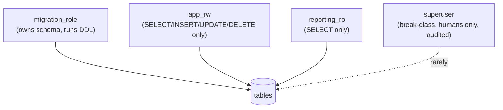
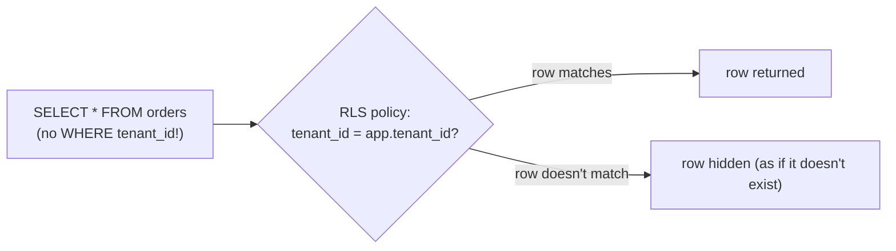
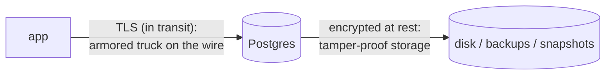
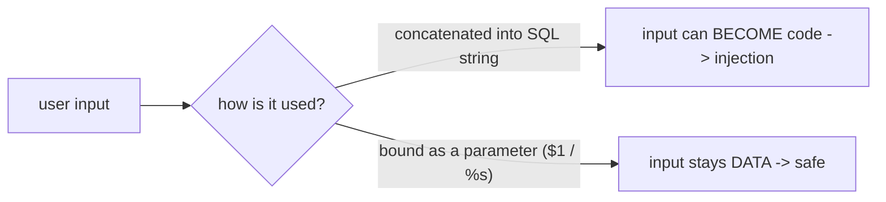
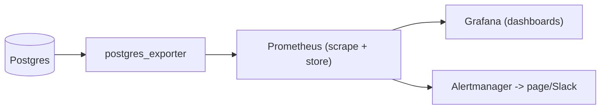

# Day 29 — Security & Observability

> Series: Database Engineering
> **Goal:** Make the database **safe** and **visible**: roles & least privilege, row-level security (RLS), encryption at rest and in transit, SQL-injection defense (parameterized queries), and the observability that lets you see trouble coming — `pg_stat_statements`, `pg_stat_activity`, slow-query logging, and the key metrics & alerts every DB engineer watches. Lab: lock a role to least privilege and wire up a slow-query alert.

## Table of Contents
1. [In plain words](#in-plain-words)
2. [Roles & least privilege](#roles--least-privilege)
3. [Row-level security (RLS)](#row-level-security-rls)
4. [Encryption at rest & in transit](#encryption-at-rest--in-transit)
5. [SQL injection defense](#sql-injection-defense)
6. [Observability: seeing inside the database](#observability-seeing-inside-the-database)
7. [Key metrics & alerts](#key-metrics--alerts)
8. [Lab: least-privilege role + slow-query alert](#lab-least-privilege-role--slow-query-alert)
9. [Self-Check](#self-check)
10. [Tomorrow](#tomorrow)

---

## In plain words

**In plain words:** Think of the database as a bank vault. **Security** is the access control: not everyone gets the master key — the teller can move money but can't rewire the vault (least privilege), some drawers are only openable by the customer who owns them (row-level security), the cash is stored in tamper-proof bags (encryption at rest) and moved in armored trucks (encryption in transit), and the intake desk never lets a customer's handwritten note *become an instruction to the vault* (SQL-injection defense). **Observability** is the CCTV and dashboards: cameras on every drawer, a log of who did what, and alarms that trip *before* a robbery completes — so you see the slow leak or the break-in attempt while there's still time to act, not in the post-mortem.

A database that's fast, scalable, and migratable (Days 15–28) but insecure or invisible is a liability. This day makes it trustworthy and operable.

**Verify versions when building:** **PostgreSQL 17**. `GRANT`/`REVOKE` + roles, `CREATE POLICY` / `ENABLE ROW LEVEL SECURITY` (RLS, since 9.5), TLS via `ssl = on`, `pgcrypto` / TDE-style disk encryption (filesystem/cloud), `pg_stat_statements` (extension), `pg_stat_activity`, `log_min_duration_statement`. Ecosystem: Prometheus + `postgres_exporter` + Grafana, `pgAudit`, `auto_explain`.

> Cross-ref: **Day 11/14 (WAL/MVCC)** — some metrics (bloat, replication lag) come straight from those internals. **Day 15/16 (optimization/index tuning)** — `pg_stat_statements` is how you *find* the slow queries to tune. **Day 20/21 (replication/HA)** — lag and connection metrics are here. **System Design** — defense-in-depth and the CIA triad framing.

---

## Roles & least privilege

**In plain words:** **Least privilege** = every account gets *exactly* the permissions it needs and nothing more. If the app only reads and writes rows in three tables, its DB user should not be able to `DROP TABLE`, read other schemas, or be a superuser. Postgres uses **roles** (which are both users and groups) and `GRANT`/`REVOKE` to control this. The goal: when (not if) a credential leaks or an app is compromised, the blast radius is tiny.


*Separate roles by job: DDL owner, app read-write, read-only reporting — never one god-account for all.*

```sql
-- Create purpose-specific roles (least privilege by design)
CREATE ROLE app_rw      LOGIN PASSWORD '...';   -- the application connects as this
CREATE ROLE reporting_ro LOGIN PASSWORD '...';  -- BI / analysts / dashboards
CREATE ROLE migration    LOGIN PASSWORD '...';  -- runs schema migrations (owns objects)

-- Start from DENY: revoke the permissive PUBLIC defaults, then grant back only what's needed
REVOKE ALL ON SCHEMA public FROM PUBLIC;
REVOKE ALL ON ALL TABLES IN SCHEMA public FROM PUBLIC;

-- App role: DML on the app tables only — NO DDL, NO superuser
GRANT USAGE ON SCHEMA public TO app_rw;
GRANT SELECT, INSERT, UPDATE, DELETE ON ALL TABLES IN SCHEMA public TO app_rw;
-- Make it apply to FUTURE tables too (a common gap):
ALTER DEFAULT PRIVILEGES IN SCHEMA public
  GRANT SELECT, INSERT, UPDATE, DELETE ON TABLES TO app_rw;

-- Reporting role: SELECT only (can never mutate data)
GRANT USAGE ON SCHEMA public TO reporting_ro;
GRANT SELECT ON ALL TABLES IN SCHEMA public TO reporting_ro;
ALTER DEFAULT PRIVILEGES IN SCHEMA public GRANT SELECT ON TABLES TO reporting_ro;
```

| Role | Should have | Must NOT have |
|---|---|---|
| `app_rw` | DML on app tables | DDL, superuser, other schemas |
| `reporting_ro` | SELECT only | any write |
| `migration` | DDL on owned objects | superuser (usually) |
| superuser | break-glass only | day-to-day app use |

> 🤔 **"The app connects as the postgres superuser — it's simpler and it just works."**
> It works right up until it's catastrophic. If the app has a SQL-injection hole or its credentials leak, a superuser connection lets the attacker read *every* table, drop the database, disable logging, install extensions, and read files off disk. Least privilege means that same breach can, at worst, touch the handful of tables `app_rw` can reach — no DDL, no data destruction, no lateral movement. The "simplicity" of a superuser app is a loaded gun; the setup cost of scoped roles is trivial by comparison.

> ❌ **Bad scenario:** A leaked `.env` file exposed the app's DB URL — which connected as superuser. The attacker `DROP`ped tables and exfiltrated everything in minutes. With an `app_rw` role limited to DML on 12 tables, the same leak would have been a contained incident (rotate credentials, review logs), not a company-ending event.

> ✅ **Good scenario:** A team gives each service its *own* least-privilege role and rotates credentials via a secrets manager. A compromised microservice could touch only its own tables; the breach was scoped, detected via audit logs, and remediated without touching other data.

**When NOT to:** there's essentially no production case for the app running as superuser. Use superuser only for break-glass human operations, ideally audited and time-boxed.

---

## Row-level security (RLS)

**In plain words:** Normal grants control access to whole *tables*. **Row-level security** controls access to individual *rows* — the database itself enforces "user X can only see/modify rows that belong to X." This is huge for multi-tenant apps: instead of trusting every query to remember `WHERE tenant_id = ?`, the *database* guarantees a tenant can never see another tenant's rows, even if a query forgets the filter or is exploited.

```sql
-- Enable RLS on a multi-tenant table and write a policy
ALTER TABLE orders ENABLE ROW LEVEL SECURITY;

-- Policy: a session can only see/act on rows matching the current tenant setting
CREATE POLICY tenant_isolation ON orders
  USING (tenant_id = current_setting('app.tenant_id')::int)          -- rows visible for SELECT/UPDATE/DELETE
  WITH CHECK (tenant_id = current_setting('app.tenant_id')::int);    -- rows allowed for INSERT/UPDATE

-- The app sets the tenant per connection/transaction (from the authenticated user):
SET app.tenant_id = '42';
SELECT * FROM orders;                 -- returns ONLY tenant 42's rows — enforced by the DB
INSERT INTO orders (tenant_id, ...) VALUES (99, ...);   -- BLOCKED by WITH CHECK (not tenant 42)
```


*RLS filters rows in the engine — a forgotten or exploited WHERE clause can't leak other tenants' data.*

- **Table owners / superusers bypass RLS by default** — use `FORCE ROW LEVEL SECURITY` to apply it even to the owner if needed.
- Policies can differ per command (`FOR SELECT`, `FOR INSERT`, ...) and per role.

> ✅ **Good scenario:** A B2B SaaS enforces tenant isolation with RLS. A bug shipped a report query missing its `WHERE tenant_id = ?`. Instead of leaking every customer's data (a breach + headlines), RLS silently returned only the current tenant's rows. The database was the backstop the application code forgot to be.

> 🤔 **"I filter by tenant_id in every query, so I don't need RLS — it's redundant."**
> Application-level filtering is one forgotten `WHERE`, one clever injection, or one misused ORM method away from a cross-tenant data leak — the most damaging bug a multi-tenant app can ship. RLS makes isolation a property the *database* enforces on every access, so a single application mistake can't expose another tenant. It's defense-in-depth: keep the app filters *and* add RLS as the guarantee beneath them.

> **Dark Side:** RLS policies are evaluated on every row access and can interact with the planner in surprising ways (a policy subquery can hurt performance; indexes must cover the policy predicate). And it's easy to forget that the *table owner* bypasses RLS — a migration/ETL job running as owner sees everything. Test RLS with the *actual* app role, and `FORCE` it where the owner must also be restricted.

**When NOT to:** RLS adds per-row evaluation cost and complexity. For single-tenant apps or tables with no per-row ownership, plain table grants suffice. Use RLS where row ownership is a real security boundary (multi-tenant, per-user private data).

---

## Encryption at rest & in transit

**In plain words:** Two different threats, two different encryptions.
- **In transit** (TLS/SSL): protects data moving between the app and the database over the network — stops eavesdropping/man-in-the-middle on the wire.
- **At rest**: protects data *stored on disk* — if someone steals the disk, a backup file, or a cloud snapshot, they get ciphertext, not your data.


*In-transit TLS protects the network hop; at-rest encryption protects stolen disks, backups, and snapshots.*

**In transit (TLS):**
```bash
# postgresql.conf
ssl = on
ssl_cert_file = 'server.crt'
ssl_key_file  = 'server.key'
# pg_hba.conf — REQUIRE encrypted connections (reject plaintext):
# hostssl  app  app_rw  0.0.0.0/0  scram-sha-256      # 'hostssl' = TLS mandatory
```
```bash
# Client must verify the server certificate (prevents MITM) — not just 'require':
psql "host=db.example.com dbname=app user=app_rw sslmode=verify-full sslrootcert=ca.crt"
#   sslmode=verify-full  = encrypt AND verify hostname+CA (the safe setting)
#   sslmode=require      = encrypt but DON'T verify identity (still MITM-able!)
```

**At rest:** Postgres has no built-in full-cluster TDE in core; you get at-rest encryption via:
- **Filesystem / block-device encryption** (LUKS/dm-crypt, cloud-managed disk encryption) — most common.
- **Cloud-managed** (RDS/Cloud SQL "encryption at rest" checkbox, KMS-backed keys).
- **Column-level** with `pgcrypto` for specific sensitive fields (e.g., encrypt a secret token).

```sql
-- Column-level encryption for a single sensitive field (pgcrypto)
CREATE EXTENSION pgcrypto;
INSERT INTO secrets (id, token)
VALUES (1, pgp_sym_encrypt('super-secret', :'key'));         -- store ciphertext
SELECT pgp_sym_decrypt(token::bytea, :'key') FROM secrets;    -- decrypt with the key
-- (Key management is the hard part — keep keys OUT of the database, in a KMS/secrets manager.)
```

| | In transit (TLS) | At rest (disk/backup) |
|---|---|---|
| Threat | network eavesdrop / MITM | stolen disk, leaked backup, snapshot |
| Postgres knob | `ssl = on`, `hostssl` | filesystem/cloud/pgcrypto |
| Client concern | `sslmode=verify-full` | key management (KMS) |
| Common gap | `sslmode=require` (no identity check) | unencrypted backups / snapshots |

> 🤔 **"We use SSL with `sslmode=require`, so our connections are secure."**
> `require` encrypts the traffic but does **not verify the server's identity** — an attacker who can intercept the connection (DNS spoofing, compromised network) can present their own cert and man-in-the-middle you while still "using SSL." Only `verify-full` (verify the CA *and* the hostname) actually stops MITM. "Encrypted" and "talking to the *right* server" are different guarantees; you need both.

> ❌ **Bad scenario:** A company encrypted the live database at rest but shipped nightly `pg_dump` backups to an S3 bucket **unencrypted** with loose permissions. The bucket was misconfigured public; attackers downloaded the plaintext backup — a full breach that at-rest encryption on the live disk did nothing to prevent. Encrypt the *backups* too (Day 27's 3-2-1 copies included).

**When NOT to:** don't rely on column-level `pgcrypto` for bulk data (it defeats indexing and is CPU-heavy) — use it for targeted secrets. Don't skip identity verification (`verify-full`) to "make TLS work"; fix the certs instead.

---

## SQL injection defense

**In plain words:** SQL injection is when user input is *concatenated* into a query string, so the input can *become SQL* instead of staying *data*. A username field containing `'; DROP TABLE users; --` can turn one query into two. The fix is one rule, applied everywhere: **never build SQL by string-concatenating user input — use parameterized queries (bind variables)**, which send the query and the data *separately* so the data can never be interpreted as code.

```python
# ✗ VULNERABLE: user input concatenated into SQL — input can become code
name = request.args["name"]           # e.g.  ' OR '1'='1
cur.execute("SELECT * FROM users WHERE name = '" + name + "'")   # returns ALL users!
#   attacker input: '; DROP TABLE users; --   -> can execute a second statement

# ✔ SAFE: parameterized query — the driver sends SQL and DATA separately
cur.execute("SELECT * FROM users WHERE name = %s", (name,))      # name is ALWAYS just a value
#   The database treats %s as a bound value; no input can ever change the query's structure.
```

```sql
-- Server-side: prepared statements make the separation explicit
PREPARE find_user (text) AS SELECT * FROM users WHERE name = $1;
EXECUTE find_user('any input, even '';DROP--');   -- input is data, never parsed as SQL
```


*The whole defense: bound parameters keep input as data; string concatenation lets input become code.*

**Layers of defense (parameterization is the main one):**
- **Parameterized queries / ORMs** — the primary, non-negotiable defense. Nearly all injection is "someone concatenated a string."
- **Least privilege** (above) — even a successful injection via `app_rw` can't `DROP` or read other schemas.
- **Input validation** — helpful but *not* a substitute (allowlists reduce surface; they don't replace binding).
- **Careful with dynamic identifiers** — table/column *names* can't be bound as parameters; if they must be dynamic, use an allowlist or `quote_ident`, never raw concatenation.

> ❌ **Bad scenario:** A search feature concatenated the query string into SQL. An attacker used a `UNION SELECT` to dump the `users` table (including password hashes). Every field was a valid credential lookup — because input was code. A single parameterized query would have made the exploit impossible.

> 🤔 **"I sanitize input by escaping quotes, so I'm protected from SQL injection."**
> Manual escaping is a leaky, error-prone patchwork — attackers have decades of bypasses (unicode, comment tricks, second-order injection, numeric contexts with no quotes at all). The *correct* and complete defense is **parameterized queries**, where the driver guarantees input is treated as data regardless of its contents. Don't escape; *bind*. Escaping is trying to out-clever attackers; parameterization removes the vulnerability by construction.

**When NOT to:** there is no "when not to parameterize." The only exception is dynamic *identifiers* (table/column names) which can't be bound — and those need allowlists/`quote_ident`, never raw concatenation.

---

## Observability: seeing inside the database

**In plain words:** You can't operate what you can't see. Observability answers "what is the database doing *right now*?" and "which queries are hurting us?" Postgres ships the exact tools: `pg_stat_activity` (live sessions), `pg_stat_statements` (aggregated query stats — your #1 tuning tool), and slow-query logging.

**`pg_stat_activity` — what's happening this second:**
```sql
-- Live sessions: who's connected, running what, waiting on what, for how long
SELECT pid, usename, state, wait_event_type, wait_event,
       now() - query_start AS runtime, left(query, 60) AS query
FROM pg_stat_activity
WHERE state <> 'idle'
ORDER BY runtime DESC;

-- Find blockers (Day 13/28): who is blocking whom right now
SELECT blocked.pid AS blocked_pid, blocking.pid AS blocking_pid,
       left(blocked.query,40) AS blocked_query, left(blocking.query,40) AS blocking_query
FROM pg_stat_activity blocked
JOIN pg_stat_activity blocking ON blocking.pid = ANY(pg_blocking_pids(blocked.pid));

-- The classic 3am firefighting move: cancel/kill a runaway query
SELECT pg_cancel_backend(<pid>);      -- polite cancel (rolls back current statement)
SELECT pg_terminate_backend(<pid>);   -- forceful (kills the whole connection)
```

**`pg_stat_statements` — which queries cost the most (aggregated over time):**
```sql
CREATE EXTENSION pg_stat_statements;   -- + shared_preload_libraries = 'pg_stat_statements'

-- The single most useful query in DB ops: your worst queries by TOTAL time
SELECT calls,
       round(total_exec_time::numeric, 1)  AS total_ms,
       round(mean_exec_time::numeric, 2)   AS mean_ms,
       rows,
       left(query, 70) AS query
FROM pg_stat_statements
ORDER BY total_exec_time DESC             -- total time = calls x mean: what to optimize FIRST
LIMIT 10;
--   A query called 1M times at 5ms each (5000s total) matters MORE than one 30s report.
--   This is how you find what to tune (feeds Day 15/16 optimization).
```

**Slow-query logging — capture individual slow statements:**
```bash
# postgresql.conf
log_min_duration_statement = 500      # log every statement taking > 500ms (with its params)
log_line_prefix = '%t [%p] %u@%d '    # timestamp, pid, user@db for context
# auto_explain: log the PLAN of slow queries automatically (why it was slow — Day 09/15)
# shared_preload_libraries = 'auto_explain'
# auto_explain.log_min_duration = '1s'
# auto_explain.log_analyze = on
```

| Tool | Answers | Time frame |
|---|---|---|
| `pg_stat_activity` | what's running/blocking *now* | live snapshot |
| `pg_stat_statements` | which queries cost the most overall | cumulative |
| slow-query log + `auto_explain` | which individual statements were slow (+ why) | as they happen |

> 🤔 **"The database feels slow — I'll just add more CPU/RAM until it's fast."**
> Throwing hardware at a slow database usually just raises the ceiling on a *fixable* problem. `pg_stat_statements` almost always reveals the real cause: one un-indexed query called millions of times, an N+1 pattern (Day 16), or a missing index. Fixing that one query can beat doubling the hardware — and it's free. Measure with the stats views first; scale hardware only once you know it's genuinely a capacity issue.

> ✅ **Good scenario:** A team's DB was "randomly slow." `pg_stat_statements` showed one query at 60% of total execution time — a missing index on a hot foreign key (Day 16). One `CREATE INDEX CONCURRENTLY` (Day 28) cut total DB load in half. The observability tool turned a vague "it's slow" into a precise, one-line fix.

**When NOT to:** `pg_stat_statements` has minimal overhead — leave it on in production. Be judicious with `log_min_duration_statement = 0` (logs *everything* — huge log volume); set a sensible threshold (e.g., 500ms–1s).

---

## Key metrics & alerts

**In plain words:** Observability tools show you data on demand; **alerts** page you *before* users feel pain. A database engineer watches a small set of high-signal metrics and sets thresholds that catch trouble early. Standard stack: Prometheus + `postgres_exporter` + Grafana dashboards + Alertmanager.

| Metric | What it warns of | Alert when |
|---|---|---|
| **Connections** (`numbackends` / max) | connection exhaustion (need pooling) | > 80% of `max_connections` |
| **Replication lag** (Day 20) | stale replicas / broken read-your-writes | > N seconds/bytes |
| **Cache hit ratio** (`pg_stat_database`) | working set spilling to disk | < ~99% sustained |
| **Slow queries** (`pg_stat_statements` mean/total) | a query regressing | mean_ms jumps / new heavy query |
| **Deadlocks** (`pg_stat_database.deadlocks`) | lock-ordering problems (Day 13) | rate rising |
| **Transaction wraparound age** (`age(datfrozenxid)`) | the scariest silent outage (Day 14 VACUUM) | age > ~1.5B (well before 2B) |
| **Disk usage** (data + WAL) | running out of space → DB halts | > 80% |
| **Replication slots** | a slot retaining WAL, filling disk (Day 11) | slot inactive + growing |
| **Long/idle-in-transaction** | blockers, migration hazards (Day 28) | txn age > N minutes |

```sql
-- A few metric queries you'd scrape/alert on:
-- Connection saturation:
SELECT count(*) AS conns, current_setting('max_connections')::int AS max FROM pg_stat_activity;

-- Cache hit ratio (want ~0.99+):
SELECT sum(blks_hit)::float / nullif(sum(blks_hit)+sum(blks_read),0) AS cache_hit_ratio
FROM pg_stat_database;

-- Transaction ID wraparound danger (the silent killer — alert LONG before 2^31):
SELECT datname, age(datfrozenxid) AS xid_age FROM pg_database ORDER BY xid_age DESC;

-- Replication lag in seconds (on a replica):
SELECT now() - pg_last_xact_replay_timestamp() AS replica_lag;
```


*Standard pipeline: exporter → Prometheus → Grafana dashboards + Alertmanager pages.*

> ❌ **Bad scenario:** A team never monitored transaction-ID wraparound age (Day 14). Autovacuum fell behind on a huge table; the XID age crept toward 2 billion, and Postgres eventually went into emergency read-only shutdown to protect data — a full outage that a simple `age(datfrozenxid)` alert would have flagged weeks earlier. The scariest outages are the metrics nobody watches.

> 🤔 **"If something breaks, our users will tell us — we don't need proactive alerts."**
> By the time users complain, you're already in an outage and playing catch-up under pressure. Good alerts fire on *leading* indicators (rising lag, connections at 85%, XID age climbing, disk at 80%) so you fix the problem *before* it becomes user-visible. Reactive-only operations means every incident is a customer-facing incident. Alert on the trend, not just the failure.

**When NOT to:** don't alert on everything (alert fatigue makes people ignore the pager). Alert on a small set of high-signal, actionable metrics with thresholds that mean "act now," and dashboard the rest.

---

## Lab: least-privilege role + slow-query alert

Two exercises: (1) lock an app role down to least privilege and *prove* it, and (2) surface slow queries and wire a basic alert.

```sql
-- ===== PART 1: least-privilege role =====
-- 1) Create a scoped app role and strip permissive defaults
CREATE ROLE app_rw LOGIN PASSWORD 'labpass';
REVOKE ALL ON SCHEMA public FROM PUBLIC;
REVOKE ALL ON ALL TABLES IN SCHEMA public FROM PUBLIC;

-- 2) Grant ONLY what the app needs
GRANT USAGE ON SCHEMA public TO app_rw;
GRANT SELECT, INSERT, UPDATE, DELETE ON ALL TABLES IN SCHEMA public TO app_rw;
ALTER DEFAULT PRIVILEGES IN SCHEMA public
  GRANT SELECT, INSERT, UPDATE, DELETE ON TABLES TO app_rw;

-- 3) PROVE the limits (connect as app_rw): these must FAIL
--    psql -U app_rw -d labdb
CREATE TABLE hack (id int);              -- ERROR: permission denied for schema public (no DDL)
DROP TABLE orders;                       -- ERROR: must be owner (no DDL)
SELECT * FROM pg_authid;                 -- ERROR/empty: can't read superuser catalogs
-- but the legitimate app work SUCCEEDS:
SELECT count(*) FROM orders;             -- OK
INSERT INTO orders (amt) VALUES (10);    -- OK
```

```sql
-- 4) BONUS: add RLS so app_rw can't cross tenants even with a forgotten WHERE
ALTER TABLE orders ENABLE ROW LEVEL SECURITY;
CREATE POLICY tenant_iso ON orders
  USING (tenant_id = current_setting('app.tenant_id')::int)
  WITH CHECK (tenant_id = current_setting('app.tenant_id')::int);
-- As app_rw:
SET app.tenant_id = '42';
SELECT DISTINCT tenant_id FROM orders;   -- only 42, even though we SELECTed all rows
```

```bash
# ===== PART 2: slow-query visibility + alert =====
# 1) Enable the tooling (postgresql.conf), then restart
echo "shared_preload_libraries = 'pg_stat_statements'" >> "$PGDATA/postgresql.conf"
echo "log_min_duration_statement = 500"                 >> "$PGDATA/postgresql.conf"   # log > 500ms
pg_ctl -D "$PGDATA" restart
```

```sql
-- 2) Create the extension and generate a deliberately slow query
CREATE EXTENSION pg_stat_statements;
-- an un-indexed hot query (force it slow):
SELECT * FROM orders WHERE amt = 99.99;        -- run a few times (seq scan if no index)
SELECT pg_sleep(0.7);                           -- guaranteed to exceed 500ms -> logged

-- 3) Find the worst offenders (this IS the alert's data source)
SELECT calls, round(mean_exec_time::numeric,1) AS mean_ms,
       round(total_exec_time::numeric,1) AS total_ms, left(query,60) AS q
FROM pg_stat_statements
ORDER BY total_exec_time DESC LIMIT 5;
```

```bash
# 4) A minimal alert without a full Prometheus stack: a cron check that pages if any
#    query's mean time exceeds a threshold. (In prod, use postgres_exporter + Alertmanager.)
cat > /usr/local/bin/slow_query_alert.sh <<'EOF'
#!/usr/bin/env bash
THRESHOLD_MS=1000
HITS=$(psql -tA -d labdb -c \
 "SELECT count(*) FROM pg_stat_statements WHERE mean_exec_time > ${THRESHOLD_MS};")
if [ "$HITS" -gt 0 ]; then
  MSG="ALERT: $HITS query patterns exceed ${THRESHOLD_MS}ms mean on $(hostname)"
  echo "$MSG"                     # -> pipe to Slack webhook / PagerDuty in real life
fi
EOF
chmod +x /usr/local/bin/slow_query_alert.sh
# schedule it: */1 * * * * /usr/local/bin/slow_query_alert.sh   (cron)
/usr/local/bin/slow_query_alert.sh          # run once to test
```

```sql
-- 5) Also verify the slow-query LOG captured the statement (with duration):
--    tail the log file (log_directory) and look for "duration: 700.xxx ms  statement: SELECT pg_sleep..."
-- 6) Fix the root cause (ties Days 15/16/28): add the missing index CONCURRENTLY, re-measure.
CREATE INDEX CONCURRENTLY idx_orders_amt ON orders (amt);
SELECT pg_stat_statements_reset();          -- reset stats, re-run the query, confirm it's fast now
```

> **Reflection:** You made the database *safe* (a role that literally cannot drop tables or cross tenants, proven by failed attempts) and *visible* (the exact query hurting you, surfaced and alerted on). These two — least privilege and observability — are what a team trusts a database engineer to own. Security limits the blast radius of the inevitable mistake; observability shrinks the time-to-detect so the mistake never becomes a headline.

---

## Self-Check
1. Define least privilege. What can go wrong if the app connects as superuser, and what does a scoped `app_rw` role contain the damage to?
2. Why does `ALTER DEFAULT PRIVILEGES` matter after granting on existing tables?
3. What problem does row-level security solve that table grants can't, and why is it defense-in-depth rather than a replacement for app filters?
4. Who bypasses RLS by default, and how do you force it to apply?
5. Distinguish encryption in transit from at rest — the threat each addresses.
6. Why is `sslmode=require` insufficient, and what does `verify-full` add?
7. State the one rule that defeats SQL injection, and why manual escaping is inferior.
8. What can't be passed as a bound parameter, and how do you handle it safely?
9. Contrast `pg_stat_activity`, `pg_stat_statements`, and slow-query logging — which answers "what's slow overall"?
10. Name four metrics you'd alert on, including the "silent killer" from Day 14, and why leading indicators beat waiting for user complaints.

## Tomorrow
**Day 30 — Warehousing, CDC & Capstone.** The finale. We separate OLTP from OLAP for real: columnar storage, cloud data warehouses (Snowflake/BigQuery/Redshift), change-data-capture and streaming (Debezium → Kafka), and time-series (TimescaleDB). Then a full **capstone** — design and tune a schema end-to-end — plus **interview prep** for the questions you'll actually be asked, and a graduation note.
