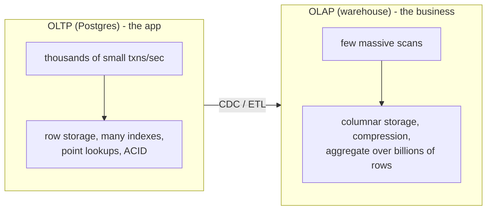
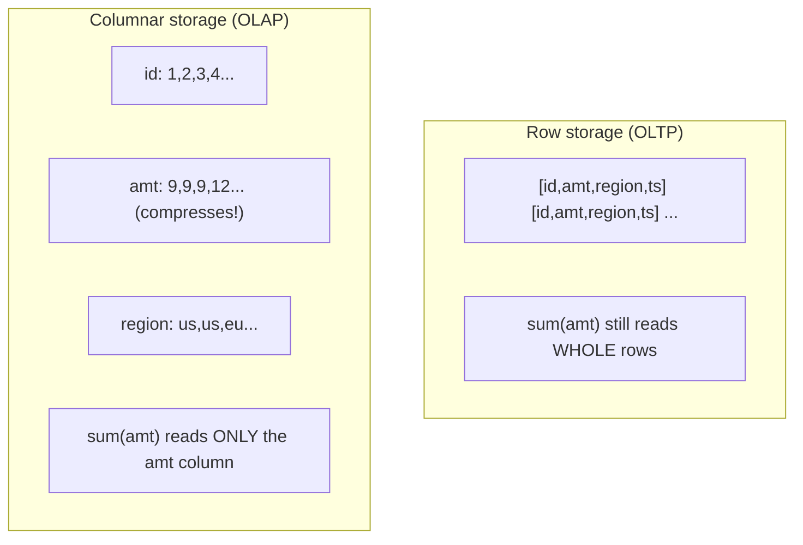
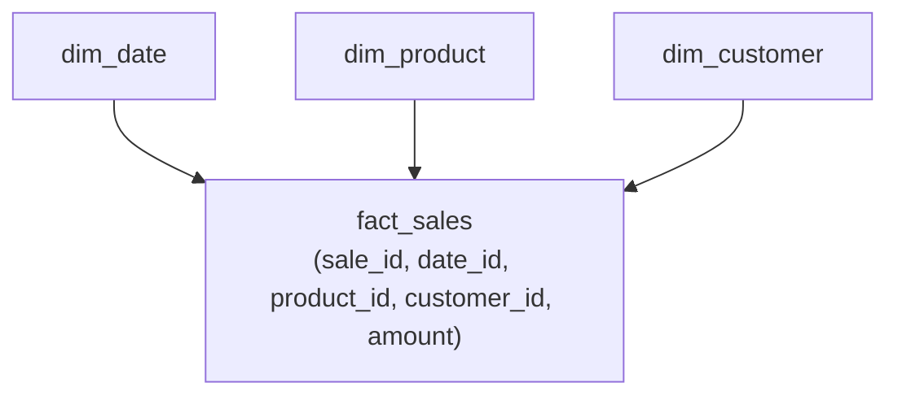
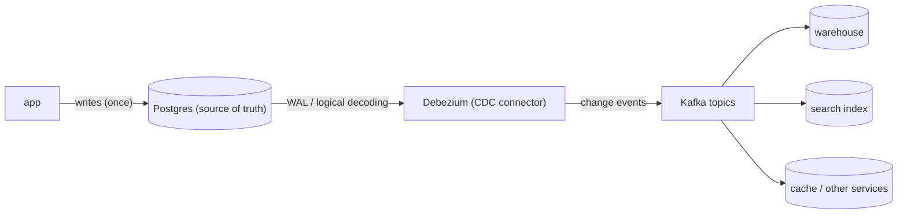

# Day 30 — Warehousing, CDC & Capstone

> Series: Database Engineering
> **Goal:** The finale — separate **OLTP from OLAP** for real (columnar storage, cloud data warehouses: Snowflake/BigQuery/Redshift), move data between them safely with **CDC & streaming** (Debezium → Kafka), handle **time-series** at scale (TimescaleDB), then a full **capstone** (design + tune a schema end-to-end) and **interview prep** for the questions you'll actually face. Graduation note at the end.

## Table of Contents
1. [In plain words](#in-plain-words)
2. [OLTP vs OLAP (finally, in full)](#oltp-vs-olap-finally-in-full)
3. [Columnar storage](#columnar-storage)
4. [Cloud data warehouses](#cloud-data-warehouses)
5. [CDC & streaming (Debezium → Kafka)](#cdc--streaming-debezium--kafka)
6. [Time-series databases (TimescaleDB)](#time-series-databases-timescaledb)
7. [Capstone: design + tune a schema end-to-end](#capstone-design--tune-a-schema-end-to-end)
8. [Interview prep](#interview-prep)
9. [Self-Check](#self-check)
10. [Graduation](#graduation)

---

## In plain words

**In plain words:** Your transactional database (Postgres, OLTP) is a **busy shop counter** — thousands of tiny, fast transactions: ring up a sale, update stock, look up one customer. Ask it "what were our total sales by region by month for the last three years, sliced by product category?" and it grinds — that's a warehouse question. A **data warehouse** (OLAP) is the **back-office analytics room**: it stores history in a shape optimized for scanning billions of rows and aggregating, using **columnar** storage (read only the columns a query needs). You don't run analytics on the shop counter (it hurts customers — recall Day 20's "analytics on a replica"); you *copy* data from the counter to the analytics room. **CDC** is the conveyor belt that streams every change from the counter to the room in near-real-time, reliably, without dual-write bugs.

This is the last piece of the job-ready picture: OLTP serves the app, OLAP serves the business, and CDC connects them.

**Verify versions when building:** **PostgreSQL 17** (OLTP baseline; and `COPY`, logical replication for CDC source). Warehouses: **Snowflake**, **Google BigQuery**, **Amazon Redshift**, plus open engines (DuckDB, ClickHouse). CDC: **Debezium** (reads Postgres WAL via logical decoding) → **Apache Kafka**. Time-series: **TimescaleDB** (Postgres extension). Columnar formats: **Parquet**.

> Cross-ref: **Day 01 (OLTP vs OLAP)** introduced the split — today completes it. **Day 06/07 (storage & indexes)** — columnar is the counterpoint to Postgres's row storage. **Day 11 (WAL)** — CDC reads the WAL. **Day 20 (logical replication)** — CDC is logical decoding productized. **Day 26 (polyglot)** — CDC is *how* you keep polyglot stores in sync correctly.

---

## OLTP vs OLAP (finally, in full)

**In plain words:** Two workloads with opposite shapes. **OLTP** (Online Transaction Processing) = many small, fast, concurrent reads/writes touching *few rows* (the app). **OLAP** (Online Analytical Processing) = few huge, complex, scan-heavy queries touching *many rows, few columns* (the business/BI). They want opposite storage, opposite indexing, opposite hardware.


*OLTP: many tiny transactions on rows. OLAP: few giant scans on columns. CDC bridges them.*

| Dimension | OLTP (Postgres) | OLAP (warehouse) |
|---|---|---|
| Query shape | point/small-range, `WHERE id = ?` | big aggregates, `GROUP BY`, full scans |
| Rows per query | few | millions–billions |
| Columns per query | most/all of a row | a few of many |
| Storage | row-oriented | **column-oriented** |
| Writes | constant, small | bulk loads / streamed |
| Indexes | many (B-tree) | few / zone maps |
| Optimized for | latency + concurrency | throughput on scans |
| Examples | orders, users, sessions | revenue trends, cohort analysis |

> 🤔 **"Why not just run analytics on my production Postgres — it's SQL, it can do `GROUP BY`?"**
> It *can*, and for small data it's fine. But a report scanning 500M rows on your OLTP primary competes with live traffic for buffers, CPU, and I/O — slowing the app for real users (and creating bloat/long transactions, Days 14/28). Row storage also makes it read whole rows to sum one column. Analytics belongs on a **replica** (Day 20) for light needs, or a **columnar warehouse** for serious ones. Keep the shop counter for customers; do the heavy accounting in the back office.

> ❌ **Bad scenario:** A finance team ran quarter-end reports directly on the production OLTP primary. The multi-hour scans held snapshots that blocked VACUUM (Day 14), bloated tables, and slowed checkout for customers during the busiest week. Moving those reports to a warehouse fed by CDC fixed both problems at once.

**When NOT to:** don't stand up a warehouse for small data — a read replica or even the primary handles modest analytics. Add a warehouse when analytical scans are large enough to hurt OLTP or too slow on row storage.

---

## Columnar storage

**In plain words:** Row storage (Postgres, Day 06) keeps each row's fields together on disk — perfect for "give me this whole order." **Columnar** storage keeps each *column* together — all the `amount`s contiguous, all the `region`s contiguous. So a query that sums `amount` reads *only* the `amount` column (not the other 40 columns), and because a column holds similar values, it **compresses** dramatically (run-length, dictionary). That's why warehouses scan billions of rows fast.


*Columnar keeps each column contiguous — scans touch only needed columns and compress heavily.*

| | Row storage | Columnar storage |
|---|---|---|
| Reads a full row | fast (one place) | slow (gather columns) |
| Aggregates one column over many rows | slow (reads all columns) | **fast** (reads one column) |
| Compression | modest | **excellent** (similar values together) |
| Writes/updates single row | fast | slower (batch-oriented) |
| Best for | OLTP | OLAP |

Concretely: **Parquet** is the ubiquitous columnar *file* format (data lakes); **DuckDB**/**ClickHouse** are columnar engines; Postgres itself is row-oriented (with extensions like `citus columnar` for append-only analytics). You can even query Parquet directly with DuckDB.

> ✅ **Good scenario:** A dashboard sums revenue across 2B rows. On columnar storage it reads only the `revenue` + `date` columns, heavily compressed — seconds. The same query on row storage would drag every column of 2B rows off disk.

> 🤔 **"Columnar storage is just faster, so warehouses beat Postgres at everything."**
> Only for *analytical* access. Columnar is *terrible* at OLTP: fetching or updating a single full row means gathering values from many separate column files, and row-at-a-time inserts fight its batch/compression model. That's why warehouses load in bulk and aren't your app's database. Row storage wins OLTP; columnar wins OLAP. Different tools for opposite shapes — not "better," just *fitted*.

**When NOT to:** don't use a columnar store for transactional, single-row, high-concurrency writes — it's built for bulk loads and scans, not OLTP.

---

## Cloud data warehouses

**In plain words:** Managed, massively-parallel columnar databases that scale to petabytes and separate *storage* from *compute* so you pay for scans, not idle servers. You load data (via CDC/ETL), then run SQL analytics that fan across many nodes.

| Warehouse | Flavor | Notable trait |
|---|---|---|
| **Snowflake** | multi-cloud SaaS | separate storage/compute; "virtual warehouses" you size per workload; zero-copy clones |
| **BigQuery** | Google, serverless | no clusters to manage; pay per bytes scanned; huge scale |
| **Redshift** | AWS | cluster-based (+ serverless); tight AWS integration |
| **ClickHouse / DuckDB** | open-source columnar | ClickHouse for real-time analytics at scale; DuckDB for local/embedded analytics |

**Modeling for warehouses (star schema):** analytics data is usually modeled as a central **fact** table (events/measurements — sales) surrounded by **dimension** tables (who/what/when — customer, product, date). This denormalized-ish shape (contrast Day 03 normalization) suits scans and aggregation.


*Star schema: one big fact table of measurements, joined to descriptive dimension tables.*

```sql
-- A typical warehouse query: aggregate a fact over dimensions (columnar scans this fast)
SELECT d.year, p.category, sum(f.amount) AS revenue
FROM fact_sales f
JOIN dim_date d    ON d.date_id = f.date_id
JOIN dim_product p ON p.product_id = f.product_id
GROUP BY d.year, p.category
ORDER BY revenue DESC;
```

> ✅ **Good scenario:** A company streams orders from Postgres to Snowflake via CDC. Analysts run cohort and revenue queries on Snowflake's columnar engine without ever touching production, sizing compute up for month-end and down afterward — paying only for what they scan.

> 🤔 **"A warehouse replaces my transactional database — I'll just use Snowflake for everything."**
> Warehouses are built for *analytical* workloads: bulk loads, big scans, seconds-to-minutes queries. They are the wrong tool for OLTP — high-concurrency single-row reads/writes with millisecond latency and strong per-row transactions. You run *both*: Postgres for the app (OLTP), a warehouse for analytics (OLAP), connected by CDC. One does not replace the other.

**When NOT to:** don't warehouse tiny data (a replica suffices), and never point your application's transactional traffic at a warehouse — latency and cost model are wrong for OLTP.

---

## CDC & streaming (Debezium → Kafka)

**In plain words:** You need the warehouse (and search index, cache, other services — Day 26 polyglot) to reflect changes from Postgres *continuously and reliably*. The naive way — have the app write to both — is the **dual-write problem**: if the second write fails or races, the stores silently diverge. **Change Data Capture (CDC)** solves it properly: instead of the app dual-writing, a CDC tool *reads the database's own change log* (the WAL, via logical decoding — Day 20) and streams every insert/update/delete as an event. The database's committed truth *is* the source of the stream, so nothing is missed or invented.


*CDC reads Postgres's WAL and streams every change to Kafka; downstream consumers stay in sync — no dual-writes.*

**How it works:**
- Postgres emits changes to the WAL (Day 11). Set `wal_level = logical` and create a publication/replication slot.
- **Debezium** connects as a logical replication client, decodes each committed change into a structured event (before/after row images), and publishes to **Kafka** topics (one per table).
- **Consumers** (warehouse loaders, search indexers, other microservices) read the topics and apply changes. Kafka's durability + ordering means events aren't lost and are applied in order.

```sql
-- Postgres source setup for CDC (Debezium reads this)
-- postgresql.conf:  wal_level = logical
CREATE PUBLICATION dbz_pub FOR TABLE orders, customers;   -- what to stream
SELECT pg_create_logical_replication_slot('dbz_slot', 'pgoutput');  -- the slot Debezium consumes
-- Debezium (Kafka Connect) config points at this slot/publication and produces topics
-- like "dbserver.public.orders" carrying {op: c/u/d, before:{...}, after:{...}} events.
```

**Why CDC beats dual-writes:**

| | Dual-write (app writes to both) | CDC (stream from the log) |
|---|---|---|
| Consistency | can diverge (partial failure/race) | eventual, but **complete** (log is truth) |
| Missed changes | possible | no (every committed change is in WAL) |
| App complexity | app knows every downstream | app writes once, unaware of consumers |
| Ordering | app's problem | preserved (log order / Kafka partitions) |
| Backfill/replay | manual | replay the topic from an offset |

> ✅ **Good scenario:** A team feeds Postgres → Debezium → Kafka → {Snowflake, Elasticsearch, a fraud service}. The app just writes to Postgres, oblivious to the four downstream consumers. Adding a fifth consumer later needed *zero* app changes — subscribe a new consumer to the topic. That's the decoupling CDC buys.

> 🤔 **"CDC is just a fancy way to dual-write — same thing, more moving parts."**
> The crucial difference: dual-writes ask the *application* to atomically update two systems with no transaction spanning them — impossible to make reliable, so they drift. CDC makes the *database's committed WAL* the single source of the change stream, so downstream stores are always derived from truth and never miss or invent a change. It trades a subtle, unfixable consistency bug for a well-understood eventual-consistency pipeline. Fewer bugs, not more.

> **Dark Side:** CDC introduces a **replication slot** on Postgres — if a consumer/Debezium stalls or dies, the slot retains WAL to avoid data loss, and `pg_wal` can fill the disk and **halt the primary** (Day 11/29). Monitor slot lag and `pg_wal` size. Also: schema changes (Day 28) must be coordinated with consumers (an added column changes the event shape). CDC is powerful but is now part of your database's availability surface.

**When NOT to:** for a single store with no downstream consumers, you don't need CDC. Add it when data must reliably reach *other* systems (warehouse, search, services) — that's when dual-writes would otherwise bite you.

---

## Time-series databases (TimescaleDB)

**In plain words:** Time-series data (metrics, IoT readings, events, prices) has a distinct shape: huge append-only volume, always stamped with time, queried by time ranges and downsampled ("average per hour"). **TimescaleDB** is a Postgres extension that makes Postgres excellent at this — it auto-partitions by time (**hypertables** → chunks), compresses old chunks columnar-style, and adds time-bucketing and continuous aggregates — all while staying full Postgres (SQL, joins, your existing tooling).

```sql
-- TimescaleDB: turn a normal table into a time-partitioned hypertable
CREATE EXTENSION IF NOT EXISTS timescaledb;
CREATE TABLE metrics (ts timestamptz NOT NULL, device_id int, temp double precision);
SELECT create_hypertable('metrics', 'ts');          -- auto-partitions by time into chunks

-- Time-bucketed downsampling (hourly average per device) — the bread-and-butter query
SELECT time_bucket('1 hour', ts) AS hour, device_id, avg(temp)
FROM metrics
WHERE ts > now() - interval '7 days'
GROUP BY hour, device_id
ORDER BY hour;

-- Continuous aggregate: a materialized, auto-refreshing rollup (fast dashboards)
CREATE MATERIALIZED VIEW metrics_hourly
WITH (timescaledb.continuous) AS
  SELECT time_bucket('1 hour', ts) AS hour, device_id, avg(temp) AS avg_temp
  FROM metrics GROUP BY hour, device_id;

-- Compress old chunks (columnar-style) to save space + speed range scans
ALTER TABLE metrics SET (timescaledb.compress);
SELECT add_compression_policy('metrics', INTERVAL '7 days');   -- compress chunks older than 7d
```

| | Plain Postgres table | TimescaleDB hypertable |
|---|---|---|
| Partitioning by time | manual (Day 17) | automatic (chunks) |
| Old-data compression | none built-in | columnar compression policy |
| Downsampling helpers | manual `date_trunc` | `time_bucket`, continuous aggregates |
| Retention (drop old) | manual | retention policies |

> ✅ **Good scenario:** An IoT platform stores 50k sensor readings/sec. TimescaleDB auto-chunks by day, compresses chunks older than a week (10x space savings), and answers "average per hour last 30 days" from a continuous aggregate in milliseconds — all in Postgres, so the team reused their existing skills, backups (Day 27), and monitoring (Day 29).

> 🤔 **"For time-series I need a special database like InfluxDB — Postgres can't handle it."**
> For many workloads, TimescaleDB (Postgres) matches or beats dedicated time-series DBs *and* keeps full SQL, joins to your relational data, transactions, and your existing ops toolchain — one fewer specialist store (Day 26's polyglot cost). Dedicated TSDBs (InfluxDB, etc.) earn their place at extreme ingest scales or specific feature needs, but "I have time-series data" does not automatically mean "leave Postgres." Reach for the specialist only when Timescale demonstrably can't keep up.

**When NOT to:** don't add TimescaleDB for a table with modest time-series volume that ordinary partitioning (Day 17) handles. Use it when time-partitioning, compression, and downsampling at scale are real needs.

---

## Capstone: design + tune a schema end-to-end

**In plain words:** Put the whole series together. You're the DB engineer for a **food-delivery marketplace**. Design the schema, index it, plan its scale, protect it, and connect analytics — citing the day where each decision comes from. Do this yourself first; a reference walkthrough follows.

**Requirements:** customers, restaurants, menu items, orders + order items, drivers, real-time order tracking (location pings), and analytics (revenue by region/time, top restaurants). Millions of orders/month; read-heavy browsing; write spikes at meal times; strict correctness on payments; near-real-time analytics.

```sql
-- ===== 1) SCHEMA (Days 02/03: model + normalize the transactional core) =====
CREATE TABLE customers   (id bigserial PRIMARY KEY, name text, email citext UNIQUE, region text);
CREATE TABLE restaurants (id bigserial PRIMARY KEY, name text, region text, active boolean);
CREATE TABLE menu_items  (id bigserial PRIMARY KEY, restaurant_id bigint REFERENCES restaurants(id),
                          name text, price numeric(10,2), available boolean);
CREATE TABLE orders (
  id bigserial PRIMARY KEY,
  customer_id  bigint REFERENCES customers(id),
  restaurant_id bigint REFERENCES restaurants(id),
  driver_id    bigint,
  status text NOT NULL,                          -- placed/accepted/delivering/delivered/cancelled
  total  numeric(10,2) NOT NULL CHECK (total >= 0),  -- Day 29: constraint = invariant
  created_at timestamptz NOT NULL DEFAULT now()
);
CREATE TABLE order_items (
  order_id bigint REFERENCES orders(id),
  menu_item_id bigint REFERENCES menu_items(id),
  qty int NOT NULL CHECK (qty > 0),
  price numeric(10,2) NOT NULL,                  -- price AT TIME of order (denormalized on purpose)
  PRIMARY KEY (order_id, menu_item_id)
);
-- location pings = high-volume time-series -> TimescaleDB hypertable (Day 30)
CREATE TABLE order_pings (order_id bigint, ts timestamptz NOT NULL, lat float, lng float);
-- SELECT create_hypertable('order_pings','ts');
```

```sql
-- ===== 2) INDEXING (Days 07/08/16: index the access patterns, not everything) =====
CREATE INDEX ON orders (customer_id, created_at DESC);   -- "my recent orders"
CREATE INDEX ON orders (restaurant_id, status);          -- "restaurant's active orders"
CREATE INDEX ON menu_items (restaurant_id) WHERE available;  -- partial index: only available items
CREATE INDEX ON order_items (menu_item_id);              -- reverse lookups / joins
-- (Day 08 caution: don't over-index write-hot 'orders' — each index taxes every insert.)
```

```sql
-- ===== 3) TRANSACTION correctness (Days 11/12: place an order atomically) =====
BEGIN;
  INSERT INTO orders (customer_id, restaurant_id, status, total)
    VALUES (:cust, :rest, 'placed', :total) RETURNING id;   -- -> :oid
  INSERT INTO order_items (order_id, menu_item_id, qty, price) VALUES (:oid, ...);
  -- payment reservation etc. — all-or-nothing
COMMIT;
-- Payments path uses synchronous replication (Day 21) for RPO 0.
```

**Scale + operate plan (name the day):**

| Concern | Decision | Day |
|---|---|---|
| Read-heavy browsing | read replicas + reader endpoint | 21 |
| Write spikes at meal times | tune primary; batch where possible; shard by `region`/`restaurant_id` *only if* one primary can't keep up | 21/22 |
| Payment correctness | ACID + synchronous replication (RPO 0) | 11/21 |
| Location pings volume | TimescaleDB hypertable + compression + retention | 17/30 |
| Hot query "restaurant's active orders" | covering/partial index; cache menus in Redis | 16/18/24 |
| Analytics (revenue by region) | CDC → warehouse (star schema), never on OLTP | 30 |
| Adding a column to huge `orders` | expand/contract + batched backfill, `lock_timeout` | 28 |
| Safety | least-privilege roles, RLS by region if multi-brand, TLS | 29 |
| Backups | physical + WAL archiving (PITR), tested restores | 27 |
| Visibility | pg_stat_statements, lag + XID-age + disk alerts | 29 |

```sql
-- ===== 4) TUNE a slow query (Days 09/15/16 — the daily job) =====
-- "Top 10 restaurants by revenue last 30 days" is slow. Diagnose with EXPLAIN ANALYZE:
EXPLAIN (ANALYZE, BUFFERS)
SELECT r.name, sum(o.total) AS revenue
FROM orders o JOIN restaurants r ON r.id = o.restaurant_id
WHERE o.created_at > now() - interval '30 days' AND o.status = 'delivered'
GROUP BY r.name ORDER BY revenue DESC LIMIT 10;
-- Likely fixes: index on (created_at, status) or (status, created_at); or — better — run this
-- analytical query in the WAREHOUSE via CDC, not on the OLTP primary at all (Day 30).
```

> **Reflection:** Notice the capstone is just the whole series in one page: model + normalize (2/3), index the access patterns (7/8/16), transactions for correctness (11/12), replicas for reads and sync for payments (20/21), shard *only if forced* (22), CDC to a columnar warehouse for analytics (30), zero-downtime migrations to evolve it (28), security + observability + backups to operate it (27/29). That integrated judgment — not any single technique — is database engineering.

---

## Interview prep

The questions you'll actually be asked, with the *approach* (not just an answer). Practice saying these out loud.

**1. "Design a schema for X" (e.g., a URL shortener / Twitter / an e-commerce cart).**
Approach: clarify requirements & scale → identify entities and relationships (Day 02/03) → decide keys → list the *access patterns* → index for them (Day 16) → state consistency needs → then scale story (replicas/sharding — 21/22) and analytics (CDC/warehouse — 30). Say your normalization *and* where you'd denormalize and why.

**2. "This query is slow — fix it."**
Approach: `EXPLAIN (ANALYZE, BUFFERS)` first (Day 09/15) — never guess. Look for seq scans on big tables, bad row estimates (stale stats → `ANALYZE`), N+1 patterns (Day 16), missing/unused indexes (Day 07/08), sorts spilling to disk. Check `pg_stat_statements` (Day 29) to confirm it's actually a top cost. Fix the *cause*, re-measure, add the index `CONCURRENTLY` (Day 28).

**3. "Migrate a 500M-row table with zero downtime."**
Approach: expand/contract (Day 28). Add nullable column → batched backfill with throttling → `ADD CONSTRAINT NOT VALID` → `VALIDATE` → `SET NOT NULL`; indexes via `CREATE INDEX CONCURRENTLY`; everything under a short `lock_timeout` to avoid queue poisoning; version with Flyway/Liquibase. Explicitly mention lock-queue danger and idle-in-transaction blockers.

**4. "When would you denormalize?"**
Approach: normalize by default (Day 03) for write integrity; denormalize *deliberately* when a read is hot and the join/aggregate cost is proven a bottleneck — e.g., store `order_items.price` at order time (history that mustn't change), precompute counters, materialized views (Day 18), or a star-schema fact table for analytics (Day 30). Name the cost: duplicated data must be kept consistent (triggers/CDC).

**5. "SQL vs NoSQL for this workload?"**
Approach: run the Day 26 framework aloud — workload shape, access patterns, consistency (Day 23), scale (Day 21/22). Default to Postgres; justify a specialist store *per proven need*. Avoid resume-driven selection.

**6. "How do you ensure you don't lose data?"**
Approach: separate the threats — node failure (HA/replication, Day 20/21) vs human/logical error (backups + PITR, Day 27) vs consistency (RPO via sync replication). State RPO/RTO, and stress *tested restores*.

**7. "Explain isolation levels / a concurrency bug you'd expect."**
Approach: Day 12 — read committed vs repeatable read vs serializable, and the anomalies each prevents (lost update, write skew). Mention MVCC (Day 14) and how you'd reproduce/fix (e.g., `SELECT ... FOR UPDATE`, serializable + retry).

| Question type | Lead with | Days |
|---|---|---|
| Design a schema | access patterns + keys | 02/03/16 |
| Fix a slow query | `EXPLAIN ANALYZE` | 09/15/16/29 |
| Zero-downtime migration | expand/contract + `lock_timeout` | 28 |
| Denormalize? | normalize first, denormalize on proven hot reads | 03/18/30 |
| SQL vs NoSQL | workload → framework | 23/24/25/26 |
| No data loss | HA ≠ backups; RPO/RTO; test restores | 20/21/27 |

> **Interview meta-tip:** interviewers grade *reasoning*, not memorized answers. Always state assumptions, name the trade-off, and say what you'd measure. "It depends — here's what it depends on, and here's how I'd decide" beats a confident wrong absolute every time.

---

## Self-Check
1. Contrast OLTP and OLAP across query shape, storage orientation, and hardware. Why not run analytics on the OLTP primary?
2. Why does columnar storage make analytical scans fast and compress well — and why is it bad at OLTP?
3. What is a star schema, and how does it differ from normalized OLTP modeling?
4. Explain the dual-write problem and how CDC (Debezium reading the WAL) avoids it.
5. What downstream consumers can a single CDC stream feed, and why is adding one "free" to the app?
6. What is the CDC replication-slot danger, and which metric guards against it?
7. What does TimescaleDB add to Postgres for time-series, and when might you *not* need a dedicated TSDB?
8. In the capstone, why store `order_items.price` at order time instead of joining to `menu_items.price`?
9. Give the approach (not the answer) to "migrate a 500M-row table with zero downtime."
10. When would you denormalize, and what new obligation does it create?

---

## Graduation

You started at "why databases exist" and OLTP vs OLAP (Day 1) and you finish able to **design, index, tune, scale, secure, operate, migrate, and analyze** a production database — and to *choose* the right store for a workload and defend it.

**The arc you completed:**
- **Foundations (1–10):** why databases, modeling, normalization, SQL, storage, indexes, the planner, buffers/WAL/MVCC.
- **Correctness & performance (11–19):** ACID, isolation, locking, MVCC/VACUUM, query optimization, index tuning & N+1, partitioning, caching/matviews, benchmarking.
- **Scale & availability (20–23):** replication, read/write scaling & HA, sharding, CAP & consistency.
- **The store landscape (24–26):** document, key-value, wide-column, graph, NewSQL, vector DBs, and how to choose.
- **Operations (27–30):** backups & PITR, zero-downtime migrations, security & observability, warehousing & CDC.
- **Advanced (optional):** the kernel-engineer track for those who want to *build* databases.

**What makes you job-ready** is not that you memorized these — it's that you can reason from first principles: *what is the workload, what are the access patterns, what consistency does it need, where will it not scale, how do I evolve it safely, and how do I prove it's correct and recoverable?* That integrated judgment is exactly what teams hire a database engineer to bring.

Take a real system from your work. Model it (2/3), find its slowest endpoint and fix it with `EXPLAIN ANALYZE` (9/15/16), design its scale and backup story (20/21/27), and plan one zero-downtime migration end-to-end (28). Do that once, for real, and you'll have done the whole job.

Congratulations — and if you want to go deeper into how databases work *inside*, the **Advanced Track — Database Systems Engineering** is waiting.
