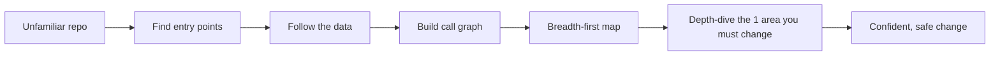
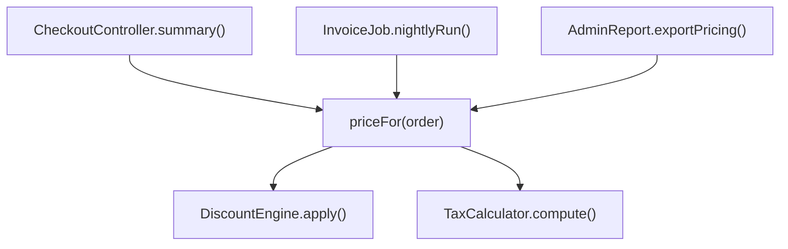
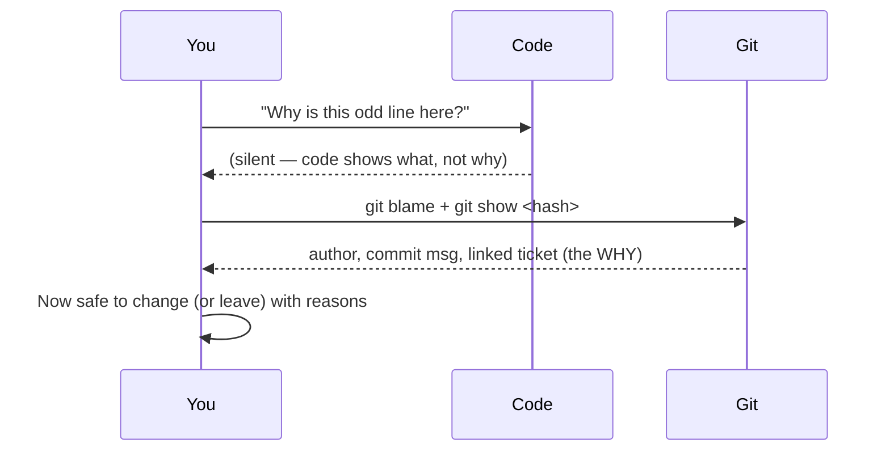

# Engineering Craft 01 — Reading & Navigating Code

> **Series:** Engineering Craft
> **Goal:** Learn to get productive in an unfamiliar codebase *fast* — because you will spend far more of your career reading code than writing it.

---

## Table of Contents

1. [Why Reading Beats Writing](#1-why-reading-beats-writing)
2. [The Mental Model: What "Understanding Code" Means](#2-the-mental-model-what-understanding-code-means)
3. [Technique 1 — Find the Entry Points](#3-technique-1--find-the-entry-points)
4. [Technique 2 — Follow the Data](#4-technique-2--follow-the-data)
5. [Technique 3 — Build the Call Graph in Your Head](#5-technique-3--build-the-call-graph-in-your-head)
6. [Technique 4 — Breadth-First, Then Depth](#6-technique-4--breadth-first-then-depth)
7. [Tools of the Trade](#7-tools-of-the-trade)
8. [Git as Archaeology](#8-git-as-archaeology)
9. [Reading Strategies Compared](#9-reading-strategies-compared)
10. [Practice: Orient in an Unfamiliar Repo in 30 Minutes](#10-practice-orient-in-an-unfamiliar-repo-in-30-minutes)
11. [Self-Check](#11-self-check)
12. [Next](#12-next)

---

## 1. Why Reading Beats Writing

**In plain words:** A surgeon doesn't start cutting the moment they walk into the operating room — they read the chart, the scans, the history first. Most of the job is understanding the patient. Software is the same: the keyboard is the last 10% of the work. The other 90% is reading enough to know *where* and *what* to change without breaking the three things you can't see.

### Why

Studies of professional developers put the read-to-write ratio at roughly **10:1** — you read ten lines for every one you write. Every bug you fix, every feature you extend, every review you do starts with reading someone else's (or past-you's) code. Yet almost no course teaches reading. It's the single most underrated craft skill, and it's the first thing that separates a junior who is "blocked, waiting for someone to explain the codebase" from a senior who drops into any repo and is useful by lunch.

### What

Reading code well means building an accurate **mental model** of a system fast: what it does, how data flows through it, where the boundaries are, and — critically — *where the change you need to make lives*. It is an active skill (forming and testing hypotheses), not passive scrolling.

### When

Every single time you touch code you didn't write this week. New job, new team, new service, an old module of your own, an open-source library you're debugging, a PR you're reviewing. In practice: **always.**

### How

Four repeatable techniques, covered below: find entry points, follow the data, build the call graph, breadth-then-depth. Plus the toolset (ripgrep, IDE navigation, git) that makes them fast.

### Where

Onboarding at a new company (the first two weeks decide your reputation), incident response (you must read unfamiliar code under pressure), open-source contribution, and inheriting a legacy service nobody remembers writing.

> **🤔 Wait — shouldn't a good codebase be so clean I don't need special techniques to read it?**
> Comforting, but no. Even a beautifully written system is *large* — hundreds of files, years of decisions, domain rules that live in someone's head. Clean code makes each *file* readable; it does nothing to tell you *which of 800 files* to open, or why a seemingly innocent config value exists. Reading technique is about navigating scale and history, not compensating for messy code. The best engineers on the cleanest codebases still use every technique below — they're just faster at it.

**✅ Good scenario (where it saves you):** You join a fintech team and get paged in week two for a payment stuck in `PENDING`. Instead of freezing, you grep the status string, find the state machine, follow the data from the webhook handler to the DB write, and spot that a retry never fires. You ship the fix in an afternoon on a codebase you'd never seen. Your manager quietly upgrades their opinion of you.

**❌ Bad scenario (the pain without it):** A developer who never learned to read starts "understanding" a service by opening `main()` and reading top-to-bottom like a novel. Three days later they've read 4,000 lines, retained nothing structural, and still can't answer "where does an order get validated?" They ask a senior, who answers in 30 seconds — because the senior read *strategically*, not linearly.

**When NOT to over-invest:** For a 5-line hotfix in code you already know cold, skip the ceremony — just make the change. Deep orientation is for *unfamiliar* territory or *risky* changes, not every keystroke.


*The reading pipeline: orient broadly first, then drill down only where you must touch.*

---

## 2. The Mental Model: What "Understanding Code" Means

**In plain words:** Understanding a city isn't memorizing every street — it's knowing the map: downtown is there, the airport is that way, this road connects those two. You navigate by landmarks and directions, filling in detail only for the block you're actually visiting.

You do **not** need to understand every line. You need three things:

1. **The shape** — top-level modules/packages and what each is responsible for.
2. **The flow** — how a request or event travels through the system.
3. **The change site** — the specific place your task lives, understood deeply.

Everything else you understand *lazily*, on demand. Trying to hold the whole system in your head is the beginner mistake; experts hold the *map* and re-derive detail as needed.

> **🤔 Wait — isn't skimming lazy? Shouldn't I read everything to be responsible?**
> Reading everything is the *irresponsible* choice — it burns days, you forget 90% of it, and you still miss the one config flag that actually matters. Responsibility is building an *accurate* model efficiently and knowing the limits of what you know. A senior says "I understand the order flow deeply and the pricing module only at the interface level" — precise about their own map. That's rigor, not laziness.

---

## 3. Technique 1 — Find the Entry Points

**In plain words:** To understand how a machine works, start where the power comes in. Code has "power sockets" too — the places execution begins.

### Why & What

Every program has a small number of doors execution comes through. Find them and you have the roots of every call tree. In a typical Java backend the entry points are:

- **`public static void main`** — the boot sequence (`SpringApplication.run(...)`).
- **HTTP controllers** — `@RestController` / `@GetMapping` methods; each is an entry for a user request.
- **Message consumers** — `@KafkaListener`, `@RabbitListener`, SQS pollers; entries for async events.
- **Scheduled jobs** — `@Scheduled` methods; entries triggered by the clock.
- **Test files** — an underrated door: a test *shows you how the code is meant to be called*.

### How

```java
// Grep for the annotations that mark entry points, then read those methods first.
// ripgrep (rg) is the fastest way — see §7.
//   rg -n "@RestController|@KafkaListener|@Scheduled|static void main"
//
// An entry point tells you the CONTRACT the outside world relies on:
@RestController
@RequestMapping("/orders")
public class OrderController {

    private final OrderService orderService;   // <- follow THIS dependency next

    @PostMapping                                // <- entry point for "create order"
    public OrderResponse create(@RequestBody CreateOrderRequest req) {
        // Reading stops here for now. You know: input shape, output shape, the one
        // collaborator (orderService) that does the real work. Go there next.
        return orderService.place(req.toCommand());
    }
}
```

**✅ Good scenario:** New service, 600 files. You `rg "@RestController"`, find 12 controllers, read just their method signatures, and in 15 minutes you have the entire *public surface* of the service — every action a user can trigger. That's the map's main roads.

**❌ Bad scenario:** You open the biggest file (`Utils.java`, 2,000 lines) because it "looked important," and spend an hour on helper methods that could be called from anywhere or nowhere. You learned mechanics with no context. Entry points give context first.

**When NOT to:** For a pure library (no `main`, no controllers), the "entry points" are the public API classes and — best of all — the test suite and README examples. Adapt the idea: start where *callers* begin.

---

## 4. Technique 2 — Follow the Data

**In plain words:** To understand a river system, drop a leaf in and follow it to the sea. Pick one concrete piece of data and trace its journey through the code.

### Why & What

Static structure (classes, packages) tells you what *exists*; following the data tells you what *happens*. Pick one representative operation — "a user places an order" — and trace the data object from the moment it enters to the moment it's persisted or returned.

### How

```java
// Trace: CreateOrderRequest -> Order -> saved row -> OrderResponse
// You're following ONE object's transformation across layers.

// 1) Controller: raw HTTP body becomes a request DTO
CreateOrderRequest req  // { items, addressId, couponCode }

// 2) Mapper/command: normalized into a domain command
PlaceOrderCommand cmd = req.toCommand();   // validation happens here?

// 3) Service: business rules applied, domain object built
Order order = orderService.place(cmd);
//   inside: pricing, inventory check, coupon apply  <- the real logic lives here

// 4) Repository: domain object -> persistence
orderRepository.save(order);   // maps Order -> orders table

// 5) Response: domain object -> API shape
return OrderResponse.from(order);
```

At each hop ask: *what changed, what validation happened, what could fail?* By the end you understand the feature better than someone who read every class in isolation — because you saw them *collaborate*.

> **🤔 Wait — with async queues and events, the data disappears into a broker. How do I follow it then?**
> You follow it in *two segments*. Trace the producer up to the `send()`/`publish()` call and note the **topic/queue name and the message schema**. Then grep that topic name (`rg "orders.created"`) to find the consumer, and pick up the trail there. The broker is a gap in the call stack but not in the data flow — the message schema is the bridge. This is exactly the event-driven flow you studied in **System Design (Event-Driven Architecture, Message Queues)**; reading it in code is the same idea from the other side.

**✅ Good scenario:** A discount is applied twice. Following the data, you see the coupon is applied in `PlaceOrderCommand.toCommand()` *and* again in `PricingService` — two hops both "helpfully" applying it. The bug is obvious once you traced one order end-to-end; it was invisible reading files separately.

**❌ Bad scenario:** You read `PricingService` alone, see correct-looking code, and declare it fine — missing that its *caller* already applied the coupon. Files in isolation lie; data flow tells the truth.

---

## 5. Technique 3 — Build the Call Graph in Your Head

**In plain words:** A call graph is a "who-calls-whom" family tree. Knowing it means you can predict the blast radius of a change before you make it.

### Why & What

Two directions matter, and your IDE does both instantly:

- **Go-to-definition (callee direction):** "What does this actually do?" — jump *into* a method.
- **Find-usages / find-references (caller direction):** "Who depends on this?" — see everyone who calls it. This is how you scope a change: *if I change this method, who breaks?*

### How

```java
// Suppose you must change this method's behavior:
public BigDecimal priceFor(Order order) { ... }

// Before changing it, Find Usages (Alt+F7 in IntelliJ / Shift+F12 in VS Code).
// Say it returns 3 callers:
//   - CheckoutController.summary()      (user-facing, high traffic)
//   - InvoiceJob.nightlyRun()           (batch, tolerant of latency)
//   - AdminReport.exportPricing()       (internal, rare)
// Now you KNOW the blast radius: a change here touches checkout + billing + reports.
// You just turned "hope nothing breaks" into a checklist.
```

The call graph is what lets a senior say, in review, "this change also affects the nightly invoice job" — they didn't memorize it, they *asked the IDE*.

**When NOT to:** Don't try to draw the *entire* call graph of a large system — it's a hairball. Build it locally, around the node you're about to touch, two hops out.


*Find-usages upward (who calls me) reveals blast radius; go-to-definition downward reveals behavior.*

---

## 6. Technique 4 — Breadth-First, Then Depth

**In plain words:** Explore a new house room by room to learn the layout before you start rearranging furniture in the study. Wide and shallow first; narrow and deep only where you must.

### Why & What

The failure mode of curious engineers is **depth-first rabbit-holing**: you go-to-definition, then go-to-definition again, and twenty minutes later you're four libraries deep reading a connection-pool internal, having lost the plot. Discipline: **first pass is breadth** (build the map), **second pass is depth** (only the change site).

### How — a concrete order of operations

1. **README + `docs/`** — 5 minutes. What is this, how do I run it?
2. **Build file** (`pom.xml` / `build.gradle`) — dependencies reveal the tech stack and integrations (a `spring-kafka` dep tells you there's async messaging *before* you read any code).
3. **Package/module structure** — `tree -L 2` or the IDE project pane. Names like `controller`, `domain`, `repository`, `adapter` reveal the architecture.
4. **Entry points** (§3) — the public surface.
5. **One data flow** (§4) — one feature end to end.
6. **Now** — depth-dive only the module your task touches.

> **🤔 Wait — if I only breadth-scan, won't I miss the tricky detail that actually bites me?**
> You'll miss it *on the first pass — by design.* The point is you don't yet know which detail matters, so deep-reading everything is a lottery you lose. Breadth first tells you *where* the tricky detail probably lives (the module you must change), and *then* you go deep there with full attention. You get the detail — just at the right time, not by reading 600 files hoping to stumble on it.

**✅ Good scenario:** Onboarding, day one. You spend 90 minutes doing steps 1–5 across the whole service and produce a one-page map. For the next month, every task starts with "which box on my map is this?" You're never lost.

**❌ Bad scenario:** You skip the map and dive straight into your first ticket's file. It calls a `NotificationGateway` you don't recognize; you dive into *that*; it uses a `TemplateResolver`; you dive into *that*. An hour gone, ticket untouched, map still blank.

---

## 7. Tools of the Trade

**In plain words:** A good mechanic isn't stronger than you — they have the right wrench. These tools turn hours of scrolling into seconds of jumping.

### ripgrep (`rg`) — search at the speed of thought

`ripgrep` is the modern, fast `grep`: recursive by default, respects `.gitignore`, colorized. It is the single highest-leverage reading tool.

```bash
# Find where a status string lives (great for "where does PENDING get set?")
rg -n "\"PENDING\""

# Find all entry points at once
rg -n "@RestController|@KafkaListener|@Scheduled"

# Find every implementer of an interface
rg -n "implements PaymentGateway"

# Find a config key's usages (across yaml AND java)
rg -n "order.timeout.seconds"

# -t java restricts to Java files; -l lists only file names; -A/-B show context lines
rg -t java -A 3 "throw new InsufficientFundsException"
```

### IDE navigation — the muscle memory that matters

| Action | IntelliJ IDEA | VS Code | What it answers |
|---|---|---|---|
| Go to definition | Ctrl/Cmd+B | F12 | "What does this do?" |
| Find usages / references | Alt+F7 | Shift+F12 | "Who calls this?" (blast radius) |
| Go to class/file | Ctrl/Cmd+N | Ctrl/Cmd+P | "Open X fast" |
| Search everywhere / symbol | Double-Shift | Ctrl/Cmd+T | "Where is anything named X?" |
| Type hierarchy | Ctrl+H | — | "What implements/extends this?" |
| Call hierarchy | Ctrl+Alt+H | — | "Full caller tree of this method" |
| Recent files | Ctrl/Cmd+E | Ctrl+Tab | "Back to that file I just saw" |

Learn these six shortcuts cold. They convert "reading" from scrolling into *navigating a graph*.

**When NOT to reach for grep:** When you want *semantic* navigation (all implementers of an interface, or callers through polymorphism), the IDE's index beats a text grep — grep can't tell `save()` on `OrderRepo` from `save()` on `UserRepo`. Use grep for strings/config/logs; use the IDE for symbols/types.

---

## 8. Git as Archaeology

**In plain words:** Code tells you *what*; git history tells you *why*. When a line makes no sense, ask the person who wrote it — and `git blame` tells you who that was and links to the reasoning.

### Why & What

The hardest reading questions are "why is this weird line here?" Deleting it might reintroduce a bug someone fixed at 3am two years ago. Git turns the codebase into a time machine with a paper trail.

### How

```bash
# Who last touched each line, and in which commit? (the "why is this here" starter)
git blame OrderService.java

# Read the full story behind a commit hash from blame:
git show <hash>          # message + full diff + linked ticket in the message

# How did this ONE file evolve? (great for a file that grew mysterious)
git log --oneline --follow OrderService.java

# Search history for when a string appeared/disappeared (the "pickaxe")
git log -S "retryOnce" --oneline    # commits that added/removed this text

# Find the commit that INTRODUCED a bug, automatically (feature bisecting):
git bisect start
git bisect bad                 # current commit is broken
git bisect good v2.3.0         # this old tag worked
# git checks out the midpoint; you test; tell it good/bad; it halves each time.
# log2(N) steps to pinpoint the exact breaking commit across thousands.
git bisect good   # or: git bisect bad
git bisect reset  # when done
```

> **🤔 Wait — why dig through git when I can just ask the author on Slack?**
> Often you should — but the author may have left the company, be on holiday, or not remember a decision from 2022. `git blame` + the commit message + the linked ticket is *durable, self-service context* available at 2am during an incident when nobody's online. And frequently the commit message answers the question faster than a human would. Ask people for *judgment and intent going forward*; ask git for *what happened and why, in the past.*

**✅ Good scenario:** You find `Thread.sleep(200)` in a retry loop — smells like a hack. `git blame` → commit message: "Add 200ms backoff: vendor API rate-limits bursts, see INCIDENT-4412." You now know deleting it re-triggers a rate-limit outage. Reading the code alone would have tempted you to "clean it up" straight into a repeat incident.

**❌ Bad scenario:** A developer deletes a "pointless" `if (region == null)` guard because it looked redundant. It was guarding a legacy data-migration path. Production breaks for a specific customer segment. Thirty seconds of `git blame` would have shown the guard was added to fix exactly that.


*Code answers "what"; git answers "why". Ask each the question it can answer.*

---

## 9. Reading Strategies Compared

| Strategy | Best for | Speed | Risk |
|---|---|---|---|
| **Linear (top-to-bottom)** | A single short file; a focused function | Slow on large systems | Retain little structure; get lost |
| **Entry-point first** | Understanding a service's public surface | Fast orientation | Miss internal-only logic (fine on pass 1) |
| **Follow-the-data** | Understanding a *feature* / finding data bugs | Medium | Tunnel vision on one path |
| **Call-graph (IDE)** | Scoping a change's blast radius | Instant | Hairball if you go too wide |
| **Git archaeology** | "Why is this here?" / regressions | Fast for one question | Rabbit-hole through history |
| **Test-first reading** | Learning intended usage of an API | Fast | Tests may be incomplete |

**Rule of thumb:** breadth (entry points + structure) → one data flow → then call-graph and git for the *specific* thing you must change. Mix them; don't marry one.

---

## 10. Practice: Orient in an Unfamiliar Repo in 30 Minutes

Pick any real Java repo you've never seen (a Spring Boot sample, an open-source service). Time-box **30 minutes** and produce a **one-page map** answering:

1. **(5 min)** From README + build file: What does it do? What's the stack (framework, DB, messaging)? How do you run it and its tests?
2. **(5 min)** From `tree -L 2` / project pane: List the top-level packages and one line on each's responsibility.
3. **(5 min)** `rg "@RestController|@KafkaListener|@Scheduled"`: List every entry point (the public surface).
4. **(10 min)** Pick ONE entry point. Follow the data end-to-end (controller → service → repository → response). Note where validation and persistence happen, and what could fail.
5. **(3 min)** Pick one method in that flow. Use Find-Usages to list its callers (blast radius).
6. **(2 min)** Pick one line that surprised you. `git blame` it and read the commit message.

**Deliverable:** A markdown page with the architecture map, one traced data flow, and one "why is this here" answered from git. If you can hand this to a teammate and they'd get oriented from it, you've built the skill. Do this on your *own team's* codebase next — you'll learn something even about code you thought you knew.

---

## 11. Self-Check

1. What is the approximate read-to-write ratio for professional developers, and why does it matter for how you spend your day?
2. Name the four entry-point types in a typical Java backend and the annotation/keyword you'd grep for each.
3. What's the difference between "go-to-definition" and "find-usages," and which one tells you a change's blast radius?
4. Why is "follow the data" better than reading classes in isolation for finding a logic bug?
5. How do you follow data flow across an async message queue where the call stack breaks?
6. What does breadth-first-then-depth protect you from, and what's the failure mode it replaces?
7. Give two questions `git blame` + the commit message can answer that the code itself cannot.
8. When should you prefer the IDE's symbol navigation over `ripgrep`, and vice versa?
9. What is `git bisect` for, and roughly how many steps does it take to find a bad commit among 1,000?
10. Why is reading a project's *tests* an efficient way to learn how its code is meant to be used?

---

## 12. Next

**Debugging** — once you can read code, you can hunt bugs in it *scientifically*: reproduce → hypothesize → test → fix → verify, with debuggers, breakpoints, `git bisect`, and production-only tools (logs, traces, metrics) when you can't just add a print. Reading is how you form the hypothesis; debugging is how you prove it.
