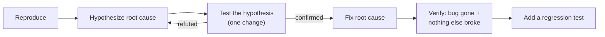
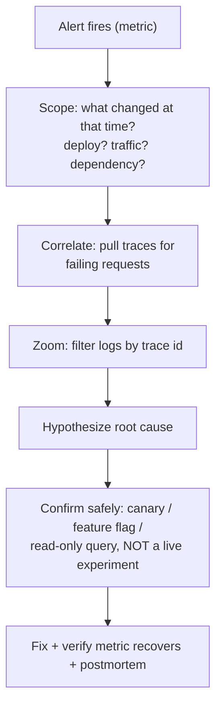

# Engineering Craft 02 — Debugging

> **Series:** Engineering Craft
> **Goal:** Turn debugging from panicked guessing into a repeatable science — reproduce, hypothesize, test, fix, verify — with the right tool for dev *and* production.

---

## Table of Contents

1. [Why Debugging Is a Craft, Not Luck](#1-why-debugging-is-a-craft-not-luck)
2. [The Scientific Method for Bugs](#2-the-scientific-method-for-bugs)
3. [Step 1 — Reproduce (the whole game)](#3-step-1--reproduce-the-whole-game)
4. [Reading a Stack Trace](#4-reading-a-stack-trace)
5. [The Debugger: Breakpoints, Watches, Stepping](#5-the-debugger-breakpoints-watches-stepping)
6. [Logging Levels & Debugging by Log](#6-logging-levels--debugging-by-log)
7. [git bisect for Regressions](#7-git-bisect-for-regressions)
8. [Rubber-Duck & Bias Traps](#8-rubber-duck--bias-traps)
9. [Production Debugging — When You Can't Add a Print](#9-production-debugging--when-you-cant-add-a-print)
10. [Debugger vs Logging — When to Reach for Which](#10-debugger-vs-logging--when-to-reach-for-which)
11. [Practice: Debug a Planted Bug](#11-practice-debug-a-planted-bug)
12. [Self-Check](#12-self-check)
13. [Next](#13-next)

---

## 1. Why Debugging Is a Craft, Not Luck

**In plain words:** A bad doctor guesses and prescribes until something works; a good doctor runs one test at a time, ruling causes in and out until the diagnosis is certain. Debugging is diagnosis for software. The skill isn't knowing the answer — it's a *process* that finds the answer even for a bug you've never seen.

### Why

Bugs are where the money and reputation are lost — outages, corrupted data, angry customers. The gap between engineers here is enormous: one flails for a day changing random lines; another isolates the cause in an hour with a method. The difference is almost never intelligence — it's **discipline**. The good news: the discipline is learnable and identical whether the bug is a null pointer or a distributed race condition.

### What

Debugging is the systematic search for the *root cause* of a discrepancy between expected and actual behavior — then a fix that addresses the cause (not the symptom) and a check that it's really gone and didn't break anything else.

### When

Anytime behavior diverges from expectation: a failing test, a bug report, a production alert, a "works on my machine" mystery, a metric that dipped after a deploy.

### How & Where

The five-step loop in §2, applied in a local debugger for dev bugs and via logs/traces/metrics for production bugs. Everywhere: your laptop, CI, staging, and the 2am incident bridge.

> **🤔 Wait — the best debuggers I know just "see" the bug instantly. Isn't it intuition, not process?**
> What looks like intuition is a *compressed* process. A senior has run the loop thousands of times, so pattern-matching skips steps out loud — but ask them and they'll tell you "I saw `NullPointerException` on line 40, hypothesized the config wasn't loaded, checked the logs, confirmed." That's reproduce→hypothesize→test in under a minute. When their intuition fails (and on a gnarly bug it will), they *fall back to the explicit method*. Beginners who chase "intuition" without the method have nothing to fall back on. Learn the process; speed comes with reps.

**✅ Good scenario (where it saves you):** A payment reconciliation job double-counts refunds intermittently. Instead of guessing, you reproduce it deterministically with one crafted input, hypothesize a shared-mutable-state race, confirm with a targeted log, and fix it with an idempotency key. One day, root cause, no recurrence.

**❌ Bad scenario (the pain without it):** An engineer "fixes" the same intermittent bug three times by adding a `try/catch` that swallows the error, a `sleep`, and a retry — each masking the symptom. The corrupted data keeps accruing silently; finance finds a six-figure discrepancy months later. Three symptom-patches, zero root cause.

**When NOT to over-process:** A one-character typo the compiler already points at doesn't need a hypothesis log. Match the rigor to the mystery — heavy method for hard bugs, quick fix for obvious ones.


*The debugging loop. Note the loop back: a refuted hypothesis is progress, not failure.*

---

## 2. The Scientific Method for Bugs

**In plain words:** Treat the bug as a hypothesis to prove, not a mess to poke. Change *one thing at a time* and predict the result before you look — if you can't predict it, you don't yet understand the system.

Five steps, in order, no skipping:

1. **Reproduce** — make the bug happen *on demand*. Without this, you're blind (see §3).
2. **Hypothesize** — form a *specific, falsifiable* claim: "the coupon is applied twice because both the mapper and the pricing service apply it." Not "something's wrong with pricing."
3. **Test the hypothesis** — the smallest experiment that would *disprove* it: add one log, set one breakpoint, comment out one line. Predict the outcome first.
4. **Fix the root cause** — not the symptom. If a `NullPointerException` is thrown, the fix is usually *why the value was null*, not a null check.
5. **Verify** — confirm the bug is gone, and that you didn't break something adjacent. Then **write a regression test** so it can never silently return.

> **🤔 Wait — why write a test after I've already fixed it? The bug's gone.**
> Because "gone" is a claim, and claims rot. A regression test *pins the fix in place forever* — if a future refactor reintroduces the bug, the test screams in CI instead of the bug reaching a customer again. It's also the cheapest documentation of *what went wrong*: the test name literally describes the failure mode. Fixing without a test means you'll debug the same bug twice. (This links directly to **Testing I & II** later in this course.)

---

## 3. Step 1 — Reproduce (the whole game)

**In plain words:** You can't fix a leak you can't make drip. Get the bug to happen reliably and you're 80% done; everything after is mechanical.

### Why

A bug you can reproduce on demand is a bug you can *bisect, breakpoint, and verify against*. A bug you can't reproduce is a rumor. Most of the real difficulty in hard bugs is *making them deterministic*.

### How

- **Nail the exact inputs**: the specific request body, user, feature flags, time of day, data state. "It fails for user 8842's cart" beats "checkout is broken."
- **Shrink to a minimal case**: strip the reproduction to the fewest steps that still fail. Often the act of shrinking *reveals the cause*.
- **Capture the environment**: version/commit, config, DB snapshot. "Works on my machine" is almost always an *environment* difference — find it.
- **Write it as a failing test** if you can: now reproduction is one click, and it becomes your regression test for free.

```java
// The best reproduction is a failing unit/integration test built from the bug report.
// "Refund double-counts for orders with a percentage coupon" becomes:
@Test
void refundIsNotDoubleCounted_whenOrderHasPercentageCoupon() {
    Order order = anOrder().withCoupon(percentage(10)).withTotal("100.00").build();
    refundService.refund(order, Money.of("50.00"));

    // This assertion FAILS today — that failure IS the reproduction.
    assertThat(order.refundedTotal()).isEqualTo(Money.of("50.00"));  // not 55.00
}
```

**✅ Good scenario:** A flaky checkout bug becomes reproducible once you notice it only fails when the cart has *exactly one* item — an off-by-one in a loop. Shrinking the input exposed the cause before you even opened the debugger.

**❌ Bad scenario:** An engineer "can't reproduce it" so closes the ticket. It recurs weekly for customers. The bug was real; the reproduction just needed the customer's specific data state, which nobody bothered to capture from the report.

**When NOT to insist on local repro:** Some bugs only exist in production's scale/timing (a race under 10k QPS). You may never repro locally — then reproduce *observably* in prod (§9) via logs/traces, and use a canary to confirm the fix.

---

## 4. Reading a Stack Trace

**In plain words:** A stack trace is the bug's confession, written top-to-bottom. It tells you *what* went wrong and the exact path the code took to get there — most people just don't read it carefully.

### How to read it

```
java.lang.NullPointerException: Cannot invoke "Coupon.percentage()" because "coupon" is null
    at com.shop.pricing.PricingService.applyDiscount(PricingService.java:42)   <- (1) where it blew up
    at com.shop.pricing.PricingService.priceFor(PricingService.java:28)
    at com.shop.order.OrderService.place(OrderService.java:73)
    at com.shop.order.OrderController.create(OrderController.java:31)          <- (2) how it got here
    ...
Caused by: com.shop.data.CouponNotLoadedException: coupon 'SAVE10' not in cache  <- (3) the REAL cause
    at com.shop.data.CouponCache.get(CouponCache.java:55)
```

1. **Top frame** = where the exception was thrown. Line 42, `applyDiscount`. Start reading here.
2. **Frames below** = the call chain that led there (read down = older calls). This is the runtime call graph — pair it with the reading skills from **Craft 01**.
3. **`Caused by:`** = the *chained* root cause. Modern Java exceptions wrap the original. **The bottom-most `Caused by` is usually the real culprit** — here, the coupon was never loaded into cache. Fixing the NPE at line 42 with a null check would hide, not fix, the caching bug.
4. **Your code vs framework code**: skim past framework frames (`org.springframework.*`); the *first frame in your package* is where you have leverage.

> **🤔 Wait — the exception message says NullPointerException at line 42. Isn't line 42 the bug?**
> Line 42 is the *scene of the crash*, not necessarily the *cause of it*. The value is null at line 42, but the interesting question is *why* — and the `Caused by` tells you: the coupon cache didn't load it. A null check at line 42 stops the crash but ships a wrong price (no discount) silently — arguably worse. Always chase the `Caused by` chain to the bottom before deciding where the real fix goes.

**When NOT to over-read:** For a trivial trace (typo, obvious NPE on your own new code), the top frame is enough. Deep-read traces when the top frame is framework code or when there's a `Caused by` chain.

---

## 5. The Debugger: Breakpoints, Watches, Stepping

**In plain words:** A debugger is a pause button for a running program. You freeze time at the exact line, look at every variable, and step forward one instruction at a time. It beats scattering print statements because you see *everything* at once, live.

### The core moves (IntelliJ / VS Code)

- **Line breakpoint** — pause when execution reaches this line.
- **Conditional breakpoint** — pause *only when* `order.id == 8842` or `i == 999`. Essential for "fails only for one input" bugs — you skip the 998 boring iterations.
- **Step over (F8)** — run the current line, don't dive into calls.
- **Step into (F7)** — dive into the method call on this line.
- **Step out (Shift+F8)** — finish current method, return to caller.
- **Watch / evaluate expression** — inspect or even *run* an expression live: type `order.total().subtract(discount)` and see the value now.
- **Frames pane** — the live call stack; click a frame to inspect that caller's variables.

```java
public BigDecimal applyDiscount(Order order, Coupon coupon) {
    BigDecimal base = order.total();          // <- conditional breakpoint: coupon == null
    BigDecimal pct = coupon.percentage();     // NPE here — but WHY is coupon null?
    // At the breakpoint: inspect `order` (which coupon code?), climb the Frames pane
    // to priceFor(), evaluate `couponCache.get("SAVE10")` live to confirm the cache miss.
    return base.multiply(BigDecimal.ONE.subtract(pct));
}
```

**✅ Good scenario:** A value is wrong only on the 1,000th loop iteration. A conditional breakpoint (`i == 999`) drops you there instantly; you see the accumulator overflowed a positive `int`. Print debugging would have flooded you with 999 useless lines.

**❌ Bad scenario:** An engineer refuses to learn the debugger and adds 15 `System.out.println` calls, recompiling between each guess. Forty minutes later they've learned what one conditional breakpoint would have shown in two — and now they have 15 prints to remember to delete (one ships to prod).

**When NOT to:** You can't attach a debugger to production (you'd freeze real user requests), and stepping is slow for bugs spread across many async hops. Then use logging/tracing (§6, §9).

---

## 6. Logging Levels & Debugging by Log

**In plain words:** Logs are the flight recorder — the running diary a program keeps of what it's doing. When you can't pause the program (production, async, intermittent), the logs are how you reconstruct what happened after the fact.

### The levels (and what each means)

| Level | Use for | Ships to prod? |
|---|---|---|
| `ERROR` | A failure needing attention (exception, failed payment) | Yes — alertable |
| `WARN` | Something recoverable but suspicious (retry, fallback used) | Yes |
| `INFO` | Business milestones (order placed, user logged in) | Yes |
| `DEBUG` | Developer detail (branch taken, computed value) | Usually off in prod |
| `TRACE` | Very fine-grained (per-loop, wire dumps) | Off in prod |

### Doing it right

```java
private static final Logger log = LoggerFactory.getLogger(OrderService.class);

public Order place(PlaceOrderCommand cmd) {
    // Structured, with context you can grep/filter on. NOT string-concatenation.
    log.info("Placing order userId={} items={} coupon={}",
             cmd.userId(), cmd.itemCount(), cmd.couponCode());
    try {
        Order order = doPlace(cmd);
        log.info("Order placed orderId={} total={}", order.id(), order.total());
        return order;
    } catch (InventoryException e) {
        // Log the exception OBJECT (keeps the stack trace), plus the context to reproduce.
        log.error("Order failed userId={} coupon={}", cmd.userId(), cmd.couponCode(), e);
        throw e;
    }
}
```

- **Include correlation context** (userId, orderId, and a request/trace id) so you can filter one request out of millions — this is the observability hook you'll reuse in §9.
- **Log objects, not concatenations** (`log.error("failed", e)` keeps the trace; `log.error("failed " + e)` loses it).
- **Don't log secrets/PII.** A logged card number is a breach.

> **🤔 Wait — isn't logging just print debugging with extra steps? Why not `System.out.println`?**
> Three big differences. (1) **Levels**: you can turn `DEBUG` on for one class in prod without redeploying, and keep it off normally so logs stay cheap. (2) **Structure & routing**: logs go to a searchable store (ELK/Loki/CloudWatch), not a console that scrolls away. (3) **Durability & correlation**: a trace id ties log lines across services together. `println` has none of that — it's fine on your laptop for ten seconds, useless at 2am across five services. Use the logger.

**When NOT to:** Don't debug-by-log a bug you can reproduce locally in five seconds — the debugger is faster and leaves no cleanup. Logging is for the un-pauseable: prod, async, intermittent.

---

## 7. git bisect for Regressions

**In plain words:** "It worked last release, it's broken now" is the easiest kind of bug — because git can binary-search the exact commit that broke it, in a handful of steps, even across thousands of commits.

### How

```bash
git bisect start
git bisect bad                    # HEAD is broken
git bisect good v4.2.0            # this release worked
# git checks out the midpoint commit. Run your reproduction (ideally a test):
./mvnw -q test -Dtest=RefundServiceTest#refundIsNotDoubleCounted
# Tell git the verdict:
git bisect good     # or 'git bisect bad'
# Repeat ~log2(N) times. For 1,000 commits that's ~10 steps to the exact culprit.
git bisect reset    # restore your branch when done

# Even better — automate the verdict with a script that exits 0=good, 1=bad:
git bisect run ./mvnw -q test -Dtest=RefundServiceTest#refundIsNotDoubleCounted
```

**✅ Good scenario:** A subtle rounding bug appeared "sometime last month" across ~400 commits. `git bisect run` with a one-line failing test finds the exact commit — a currency library bump — in 9 automated steps and two minutes. Reading 400 diffs by hand would have taken all day.

**❌ Bad scenario:** An engineer reads every commit since the last release trying to spot the regression by eye, misses it (the culprit looked innocent — a dependency bump in `pom.xml`), and concludes "must be data." Bisect would have pointed straight at the version bump.

> **🤔 Wait — bisect needs a reliable good/bad test. What if the bug is flaky?**
> Flakiness breaks bisect's core assumption (each commit is deterministically good or bad), so first *make the reproduction deterministic* (§3) — pin the seed, the clock, the input. If you truly can't, bisect manually and run the test several times per step, treating "ever fails" as bad. But usually the effort to de-flake the repro pays off everywhere, not just in bisect.

---

## 8. Rubber-Duck & Bias Traps

**In plain words:** Explaining the bug out loud — to a colleague, or literally a rubber duck on your desk — forces you to state your assumptions, and the wrong one usually reveals itself mid-sentence. It's not magic; it's that speaking uses a different, more skeptical part of your brain than staring.

### The biases that keep you stuck

- **Confirmation bias:** you're sure it's the cache, so you only look at the cache. *Cure:* try to *disprove* your hypothesis, not confirm it (§2, step 3).
- **"It can't be that" (favorite-code bias):** you trust code you wrote, so you rule it out. *Cure:* trust nothing; verify with a breakpoint/log.
- **The last-change anchor:** "it must be my new code" — often true, but not always. *Cure:* let `git bisect` decide, don't assume.
- **Fatigue tunneling:** after two hours you keep retrying the same failed idea. *Cure:* step away; the duck (or a walk) resets the tunnel.

**✅ Good scenario:** Halfway through explaining "the cache definitely has the coupon, because I load it in the constructor…" you stop — the constructor runs *before* the config that names the cache region is bound. You found it by narrating an assumption you'd never have questioned silently.

**❌ Bad scenario:** Three hours of silent staring, changing random lines, no notes. The engineer never articulated a hypothesis, so they never noticed the false assumption underneath it. A five-minute explanation to a teammate would have surfaced it.

---

## 9. Production Debugging — When You Can't Add a Print

**In plain words:** In production you can't pause the program or sprinkle new prints — real users are inside it. So you debug from the *telemetry the system already emits*: logs, traces, and metrics. This is exactly the observability stack you built in **DevOps/System Design** — now you use it as a debugger.

### The three pillars (reuse your observability knowledge)

- **Metrics** — the *symptom* and its shape. "Error rate jumped at 14:03, p99 latency doubled." Tells you *when* and *how bad*, rarely *why*. Start here to scope.
- **Traces** (distributed tracing) — the *path*. A single request's journey across services with timing per hop. "The 2s latency is 1.9s inside the payments call to the vendor." Tells you *where*.
- **Logs** — the *detail*. Filtered by the trace id from the slow trace, the log lines for that exact request tell you *what* happened (which branch, which error).

### The production debugging loop


*Production debugging is the same scientific loop — you just gather evidence from telemetry instead of a debugger.*

### Techniques when you truly need more signal

- **Dynamic log levels:** bump one logger to `DEBUG` in prod (via config/actuator) *without redeploying*, capture, then revert.
- **Thread dump / heap dump:** for a hung or memory-leaking JVM (`jstack`, `jmap`) — the production equivalent of "what is every thread doing right now?"
- **Feature flags:** the safe experiment — toggle the suspect code path for 1% of traffic and watch the metric.
- **Correlate with the deploy timeline:** "error rate rose exactly at the 14:03 deploy" is a bisect you didn't have to run.

> **🤔 Wait — if I can't reproduce it locally and can't attach a debugger, how is this even the "scientific method"? It feels like guessing.**
> It's the *same* method — reproduce/hypothesize/test/verify — with different instruments. "Reproduce" becomes "find the failing requests in traces." "Test the hypothesis" becomes "enable a flag for 1% and watch the error metric" instead of "set a breakpoint." The rigor is identical: one falsifiable hypothesis, one controlled experiment, predict-then-observe. What changes is you never freeze the program — you interrogate its telemetry. Teams that invested in observability debug prod scientifically; teams that didn't are the ones truly guessing.

**✅ Good scenario:** Checkout errors spike after a deploy. The metric scopes it to 14:03; a trace shows the failing calls all hit the new pricing path; logs filtered by trace id show a `CouponNotLoadedException`. You flag-off the new path (recovery in 3 minutes), then fix the cache warm-up. Root cause found without ever reproducing locally.

**❌ Bad scenario:** A team with no tracing and unstructured logs gets a "checkout is slow" report. They can't tell which service, which request, or what changed. They restart pods hopefully, guess at the DB, and the incident drags for six hours. The bug was a slow vendor call a trace would have shown in one minute. *The debugging tooling gap is a production reliability gap.*

**When NOT to:** Don't reach for heap dumps and thread dumps for a bug a local test reproduces — that's heavy machinery for a screwdriver job. Prod tools are for prod-only bugs.

---

## 10. Debugger vs Logging — When to Reach for Which

| | Interactive Debugger | Logging / Tracing |
|---|---|---|
| **Environment** | Local / staging you control | Production, CI, any environment |
| **Best for** | Reproducible bugs; inspecting live state deeply | Intermittent, async, distributed, prod-only bugs |
| **Granularity** | Every variable, step-by-step | Only what you logged (plan ahead) |
| **Cost to run** | Freezes the process | Near-zero overhead; async |
| **Cleanup** | None (breakpoints aren't code) | Must curate levels; don't leak PII |
| **Time travel** | No (live only) | Yes — logs persist; read them after |
| **Multi-service** | Painful | Natural (trace id correlation) |

**Rule of thumb:** reproducible + local → debugger. Intermittent, async, or in prod → logs, traces, metrics. Great engineers are fluent in both and switch without ego.

---

## 11. Practice: Debug a Planted Bug

Grab a small Java project (or write a ~200-line one) and have a friend — or a past commit of yours — introduce a regression. Then:

1. **Reproduce** it as a *failing test* (§3). Do not proceed until the test fails deterministically.
2. **Read the stack trace** (if any) to the bottom `Caused by` (§4). Write down your first hypothesis in one falsifiable sentence.
3. **`git bisect run`** with your failing test to find the exact commit that introduced it (§7). Note how many steps it took.
4. **Set a conditional breakpoint** at the suspect line and inspect state to confirm/refute the hypothesis (§5). If refuted, form a new one — that's success, not failure.
5. **Fix the root cause**, not the symptom. State in a sentence why your fix addresses the cause.
6. **Verify**: the regression test passes, the full suite still passes, and the test stays in the repo forever.

**Stretch:** Add structured logging with a correlation id to one code path, then practice reconstructing a request's journey purely from the logs — no debugger. That's the muscle you'll use in every production incident.

---

## 12. Self-Check

1. Name the five steps of the debugging loop, in order. Why is the loop-back from "test" to "hypothesize" a sign of progress?
2. Why is reproduction "the whole game"? Give two things you must capture to reproduce a reported bug.
3. In a stack trace, what does `Caused by:` mean, and why is the *bottom-most* one usually the real culprit?
4. What's a conditional breakpoint and when does it save you the most time?
5. Give three reasons a proper logger beats `System.out.println` for anything beyond your laptop.
6. Which log level would you use for "used a fallback because the primary timed out," and why not ERROR?
7. Roughly how many `git bisect` steps to find one bad commit among 1,000, and why? What breaks bisect?
8. Map each observability pillar (metrics, traces, logs) to the debugging question it answers best.
9. How do you run a controlled "test the hypothesis" experiment safely in production without a debugger?
10. Give one bug type where the debugger wins and one where logging/tracing wins, and why.

---

## 13. Next

**Software Testing I — Unit Tests & TDD.** You just wrote a regression test to pin a fix; now learn to write tests *first*. JUnit 5/6 (Jupiter), the Arrange-Act-Assert pattern, red-green-refactor TDD, and mocking with Mockito — including the subtle art of testing *behavior*, not implementation, so your tests catch bugs instead of breaking on every refactor.
