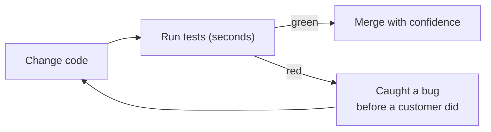
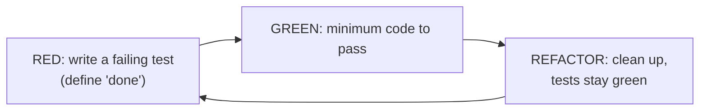

# Engineering Craft 03 — Software Testing I: Unit Tests & TDD

> **Series:** Engineering Craft
> **Goal:** Write unit tests that catch real bugs and don't break on every refactor — using JUnit (Jupiter), AAA, test doubles, and the red-green-refactor rhythm of TDD.

---

## Table of Contents

1. [Why Test at All](#1-why-test-at-all)
2. [What a Unit Test Is (and Isn't)](#2-what-a-unit-test-is-and-isnt)
3. [JUnit 5/6 (Jupiter) — the Toolkit](#3-junit-56-jupiter--the-toolkit)
4. [The AAA Pattern](#4-the-aaa-pattern)
5. [Test Names That Document](#5-test-names-that-document)
6. [Test Doubles: Mock, Stub, Fake, Spy](#6-test-doubles-mock-stub-fake-spy)
7. [Mocking & Stubbing with Mockito](#7-mocking--stubbing-with-mockito)
8. [Test Behavior, Not Implementation](#8-test-behavior-not-implementation)
9. [TDD: Red → Green → Refactor](#9-tdd-red--green--refactor)
10. [Practice: TDD a Small Class](#10-practice-tdd-a-small-class)
11. [Self-Check](#11-self-check)
12. [Next](#12-next)

---

## 1. Why Test at All

**In plain words:** Tests are a smoke detector wired into your code. You don't install one because you plan to have a fire — you install it so that *when* something starts smouldering (a refactor, a teammate's change, a dependency bump), you hear about it in seconds, in CI, instead of from a customer at 2am.

### Why

Tests exist to let you **change code with confidence**. That's the whole point. A codebase without tests calcifies — everyone's afraid to touch it, so it rots. A well-tested codebase invites change, because the tests catch what you break. Tests are also the fastest feedback loop in engineering (milliseconds vs. a deploy-and-check cycle of minutes), and they document intended behavior more honestly than any comment, because they *run*.

### What

A test is executable specification: given some setup, when I do X, then Y should hold. It fails loudly when Y stops holding.

### When

Continuously. New behavior → write tests (ideally first, §9). Bug fixed → regression test (from **Craft 02**). Refactoring → run the existing tests as your safety net (the golden rule of **Craft 07**).

### How & Where

Fast, isolated unit tests for logic (this file); integration and e2e tests for the seams (**Craft 04**). They run on your laptop in seconds and gate every merge in CI.

> **🤔 Wait — tests are just more code to maintain. Doesn't writing them slow me down?**
> They slow down the *first hour* and speed up every hour after. The cost you're comparing against isn't zero — it's the hidden cost of manual re-testing every change by hand, the fear that freezes refactoring, and the production bugs that ship because nobody could check everything. On any codebase that lives longer than a weekend, tests are net *faster*. The teams that "don't have time to test" are the ones spending their afternoons in incident bridges. Tests are how you go fast *sustainably*.

**✅ Good scenario (where it saves you):** You refactor a gnarly pricing engine to be readable. You run 40 unit tests; two go red, pointing at a rounding edge case you'd have shipped. Green again in ten minutes. You merge a big cleanup on a Friday without fear — because the tests, not your nerves, vouch for it.

**❌ Bad scenario (the pain without it):** An untested "quick tweak" to tax calculation ships. It's correct for the demo cart but wrong for multi-region orders. Nobody notices for three weeks; finance finds thousands of mis-taxed orders. A single unit test with a multi-region case would have gone red before merge.

**When NOT to:** A throwaway spike you'll delete tomorrow, or a one-off script, may not warrant tests. But be honest — "throwaway" code has a way of becoming load-bearing. If it survives the week, it needs tests.


*The value of tests is the fast red arrow — a bug caught in CI instead of production.*

---

## 2. What a Unit Test Is (and Isn't)

**In plain words:** A unit test checks one small piece of logic — usually one class or method — in isolation, without touching the database, network, or clock. It's a lab experiment with everything controlled, so when it fails you know *exactly* what broke.

**A unit test is:**
- **Fast** — milliseconds. You run hundreds in the time it takes to sip coffee.
- **Isolated** — no real DB, HTTP, filesystem, or wall-clock time. Dependencies are replaced with test doubles (§6).
- **Deterministic** — same input, same result, every run. No flakiness (a key theme of **Craft 04**).
- **Focused** — exercises one behavior; when it fails, the *name* tells you what.

**A unit test is NOT:**
- A test that spins up Postgres (that's an *integration* test — **Craft 04**).
- A test that asserts twenty unrelated things (split it).
- A test that depends on test-execution order or another test's leftover state.

> **🤔 Wait — if my unit test mocks the database and the network, am I even testing anything real? Couldn't everything pass and prod still break?**
> Yes — and that's *by design*, which is why unit tests are only half the story. A unit test proves your *logic* is correct given its inputs; it deliberately does **not** prove your DB query is valid or the vendor API behaves. Those need integration tests (**Craft 04**) — different tool, different job. The mistake is expecting one test level to catch everything. Unit tests catch logic bugs cheaply and instantly; integration tests catch seam bugs. You need both, in the right proportion (the test pyramid, next file). A unit test isn't "fake" — it's *scoped*.

---

## 3. JUnit 5/6 (Jupiter) — the Toolkit

**In plain words:** JUnit is the standard test runner for Java — it finds your test methods, runs them, and reports pass/fail. "Jupiter" is the modern API (the `org.junit.jupiter` package), shared by JUnit 5 and the current **JUnit 6** line (6.x, requires Java 17+). The annotations below are identical across both.

```java
import org.junit.jupiter.api.*;
import static org.assertj.core.api.Assertions.*;   // AssertJ 3.26+ — fluent assertions

class CartTest {                                    // no 'public' needed in Jupiter

    private Cart cart;

    @BeforeEach                                     // runs before EACH test — fresh state
    void setUp() {
        cart = new Cart();
    }

    @Test                                           // marks a test method
    @DisplayName("empty cart has a zero total")     // human-readable report label
    void emptyCartHasZeroTotal() {
        assertThat(cart.total()).isEqualTo(Money.ZERO);
    }

    @Test
    void addingTwoItemsSumsTheirPrices() {
        cart.add(item("Book", "10.00"));
        cart.add(item("Pen",  "2.50"));
        assertThat(cart.total()).isEqualTo(Money.of("12.50"));
    }

    @ParameterizedTest                              // same test, many inputs
    @CsvSource({ "2, 10.00, 20.00", "0, 10.00, 0.00", "3, 2.50, 7.50" })
    void quantityMultipliesPrice(int qty, String unit, String expected) {
        cart.add(item("X", unit), qty);
        assertThat(cart.total()).isEqualTo(Money.of(expected));
    }

    @Test
    void addingNullItemIsRejected() {
        // assertThatThrownBy documents WHICH exception AND its message
        assertThatThrownBy(() -> cart.add(null))
            .isInstanceOf(IllegalArgumentException.class)
            .hasMessageContaining("item");
    }
}
```

Key annotations: `@Test`, `@BeforeEach`/`@AfterEach` (per-test setup/teardown), `@BeforeAll`/`@AfterAll` (once per class), `@ParameterizedTest` + `@CsvSource`/`@ValueSource` (data-driven), `@DisplayName`, `@Disabled` (skip, with a reason), `@Nested` (group related tests). **AssertJ** (`assertThat(x).isEqualTo(...)`) reads left-to-right and gives far better failure messages than raw `assertEquals`.

**When NOT to:** Don't reach for `@ParameterizedTest` when two hardcoded cases are clearer — parameterization earns its keep at 3+ cases with the same logic.

---

## 4. The AAA Pattern

**In plain words:** Every good test has three acts, always in the same order: set the stage (**Arrange**), do the one thing (**Act**), check what happened (**Assert**). Keeping them visually separate makes any test readable in five seconds.

```java
@Test
void applyingPercentageCouponReducesTotal() {
    // Arrange — build the world the test needs
    Cart cart = new Cart();
    cart.add(item("Laptop", "1000.00"));
    Coupon tenPercentOff = Coupon.percentage(10);

    // Act — the ONE action under test (one line, ideally)
    cart.apply(tenPercentOff);

    // Assert — one behavior verified
    assertThat(cart.total()).isEqualTo(Money.of("900.00"));
}
```

- **Arrange:** inputs, collaborators (real or doubles), starting state.
- **Act:** the single call you're testing. If you have two "acts," you probably have two tests.
- **Assert:** the expected outcome. Prefer asserting *one behavior* — related assertions on the same outcome are fine; a grab-bag of unrelated checks is a smell.

The blank lines between sections are not decoration — they're a readability contract. A reviewer should never have to hunt for "what is actually being tested here."

> **🤔 Wait — my test needs ten lines of Arrange. Isn't that a code smell in the test?**
> Often it's a smell in the *production* code, not the test — heavy Arrange usually means the class under test has too many dependencies or does too much (a **Craft 06** smell). But when the setup is legitimately complex, extract it into a **test data builder** (`anOrder().withCoupon(...).build()`) or a `@BeforeEach`. The goal is that the *Act* and *Assert* stay one line each and obvious; the Arrange complexity gets a name. If you can't shrink the Arrange, listen to it — your design may be telling you something.

---

## 5. Test Names That Document

**In plain words:** A test's name is the one line everyone reads when it fails in CI at 2am — before they read a single line of code. It should say *what behavior broke* in plain language, so the failure report alone tells the story.

A good name states **what**, **under what condition**, **expected result**:

```java
// ❌ Bad — tells you nothing when it goes red
@Test void test1() { ... }
@Test void testTotal() { ... }
@Test void couponWorks() { ... }

// ✅ Good — the failure line reads like a spec
@Test void total_isZero_whenCartIsEmpty() { ... }
@Test void applyingCoupon_reducesTotal_byThePercentage() { ... }
@Test void apply_throws_whenCouponIsExpired() { ... }
```

Conventions vary — `methodUnderTest_expectedBehavior_whenCondition`, or `@DisplayName("adds interest monthly")`, or `@Nested` classes named for the scenario. Pick one and be consistent. The test is a **failure-time diagnosis**: red output should read like documentation of exactly which rule of the system just broke, with no code-diving required.

---

## 6. Test Doubles: Mock, Stub, Fake, Spy

**In plain words:** A test double is a stand-in actor for a real dependency — like a stunt double stands in for a movie star. You use one when the real thing is slow (a DB), non-deterministic (a clock, a random), external (a payment vendor), or hard to drive into the state you need. The four kinds differ by *what job the stand-in does*.

| Double | What it does | You use it to… | Verifies? |
|---|---|---|---|
| **Dummy** | Passed but never used (fills a parameter) | Satisfy a signature you don't care about | No |
| **Stub** | Returns canned answers to calls | Control *inputs* — "when asked, return this" | No (state-based) |
| **Spy** | A real (or partial) object that records how it was called | Assert *interactions* while keeping real behavior | Yes |
| **Mock** | Pre-programmed with expectations about calls | Assert *interactions* — "was `send()` called once?" | Yes (behavior-based) |
| **Fake** | A working but simplified implementation | Replace a heavy dependency with a light real one (e.g. in-memory repo) | No (state-based) |

The two you'll reach for most: **stub** (I want to control what a dependency *returns* so I can test my logic) and **mock** (I want to verify my code *called* a dependency correctly, e.g. "we did send exactly one email").

> **🤔 Wait — Mockito calls everything `mock()`. So is a stub and a mock actually the same thing?**
> In *tooling*, they blur — Mockito's `mock()` creates an object you can both stub (`when(...).thenReturn(...)`) and verify (`verify(...)`). But *conceptually* they answer different questions. A **stub** is about **state**: "given this input from the dependency, does my code produce the right output?" A **mock** is about **interaction**: "did my code call the dependency the right way?" The distinction matters because over-using *interaction* verification (mocks) couples tests to implementation and makes them brittle (§8). Rule of thumb: **stub queries, mock commands** — stub the calls that fetch data, verify only the calls that cause side effects (send email, charge card).

**✅ Good scenario:** You test `OrderService.place()`. You *stub* the `PriceCatalog` to return a fixed price (controls input, keeps the test deterministic) and *mock* the `EmailSender` to verify exactly one confirmation email was sent (the meaningful side effect). Clean separation of "what it computes" and "what it triggers."

**❌ Bad scenario:** An engineer mocks *everything* and verifies *every* call — `verify(repo).findById()`, `verify(mapper).toDto()`, `verify(logger).info()`. The test now asserts the exact implementation. The next refactor (which changes *how* but not *what*) turns 30 tests red for no real bug. The mocks tested the code's diary, not its behavior.

**When NOT to double:** Don't mock value objects or things that are already fast and deterministic (`LocalDate`, a `Money` class). Mocking a `Money` to return "5" is slower to write, harder to read, and tests nothing. Double the *awkward* collaborators (I/O, time, randomness, external services); use the real thing for simple, fast, pure objects.

---

## 7. Mocking & Stubbing with Mockito

**In plain words:** Mockito (5.18+ in 2026) is the library that makes doubles cheap — one line to fake a dependency, one line to program its answers, one line to verify a call. It plugs straight into JUnit.

```java
import org.junit.jupiter.api.*;
import org.junit.jupiter.api.extension.ExtendWith;
import org.mockito.*;
import org.mockito.junit.jupiter.MockitoExtension;
import static org.mockito.Mockito.*;
import static org.assertj.core.api.Assertions.*;

@ExtendWith(MockitoExtension.class)             // wires up @Mock / @InjectMocks
class OrderServiceTest {

    @Mock  PriceCatalog priceCatalog;           // a double for a slow/external dependency
    @Mock  EmailSender  emailSender;            // we'll verify interactions on this one
    @InjectMocks OrderService orderService;     // real object under test, mocks injected

    @Test
    void place_chargesCatalogPrice_andSendsOneConfirmation() {
        // Arrange — STUB the query: control what the dependency returns
        when(priceCatalog.priceOf("SKU-1")).thenReturn(Money.of("40.00"));
        PlaceOrderCommand cmd = new PlaceOrderCommand("user-9", "SKU-1", 2);

        // Act
        Order order = orderService.place(cmd);

        // Assert STATE (the outcome of the logic)
        assertThat(order.total()).isEqualTo(Money.of("80.00"));   // 40 * 2

        // Assert INTERACTION (the meaningful side effect) — MOCK the command
        verify(emailSender, times(1)).sendConfirmation(eq("user-9"), any(Order.class));
        verifyNoMoreInteractions(emailSender);   // no accidental extra emails
    }

    @Test
    void place_propagatesError_whenCatalogFails() {
        // Stub a dependency to THROW — test your error handling path
        when(priceCatalog.priceOf(anyString()))
            .thenThrow(new CatalogUnavailableException());

        assertThatThrownBy(() -> orderService.place(new PlaceOrderCommand("u", "S", 1)))
            .isInstanceOf(CatalogUnavailableException.class);

        // And we must NOT send a confirmation for a failed order
        verify(emailSender, never()).sendConfirmation(anyString(), any());
    }
}
```

Key Mockito moves: `when(x).thenReturn(y)` (stub), `when(x).thenThrow(e)` (stub error paths), `verify(mock).method()` (assert a call happened), `times(n)`/`never()` (how many), `any()`/`eq()`/`anyString()` (argument matchers), `ArgumentCaptor` (capture and assert the exact argument passed). Use `@ExtendWith(MockitoExtension.class)` to auto-create `@Mock`s and inject them into `@InjectMocks`.

**When NOT to:** If a test needs `when(...)` on eight different mocks just to run, that's the design (too many collaborators) or the test level (should be an integration test with a real DB via Testcontainers — **Craft 04**) talking. Heavy mocking is a smell to listen to, not power through.

---

## 8. Test Behavior, Not Implementation

**In plain words:** Test *what* the code promises to do (its observable behavior), not *how* it does it inside. If your test knows the private helper methods and exact call order, then every refactor — which changes the "how" but keeps the "what" — will break your tests for no reason. Good tests survive refactoring; that's how you know they test behavior.

```java
// ❌ BAD — tests implementation. Couples to private structure and call order.
@Test
void badTest() {
    orderService.place(cmd);
    verify(orderService).validate(cmd);        // private step — none of the caller's business
    verify(orderService).calculateTax(cmd);    // will break if you inline or reorder this
    verify(pricingHelper).roundHalfEven(any()); // asserts a helper's existence
}
// Rename a helper, inline a method, split a class -> all these go red. Zero real bugs found.

// ✅ GOOD — tests behavior. Asserts the promise the caller actually relies on.
@Test
void place_appliesTax_toTheOrderTotal() {
    when(priceCatalog.priceOf("SKU")).thenReturn(Money.of("100.00"));
    Order order = orderService.place(new PlaceOrderCommand("u", "SKU", 1));
    // We assert the OUTCOME (total includes tax), not the internal steps that produced it.
    assertThat(order.total()).isEqualTo(Money.of("108.00"));   // 100 + 8% tax
}
// Refactor freely: extract, inline, rename. As long as tax is still applied, this stays green.
```

The litmus test: **could this test survive a correct refactor?** If refactoring internals (no behavior change) breaks it, it's testing implementation. The only interactions worth verifying are the *observable, contractual* side effects (an email sent, a payment charged) — not internal plumbing.

> **🤔 Wait — but sometimes the *only* thing that matters is that a call happened, like sending an email. Isn't verifying that "testing implementation"?**
> No — and this is the key distinction. Sending the email *is* the observable behavior; it's a side effect the outside world can see and cares about. Verifying it is testing *what the code promises*. What's brittle is verifying *internal* interactions — that a private helper ran, that methods were called in a certain order, that a particular collaborator was consulted. The rule: **verify interactions that are part of the contract (commands with real-world effects); never verify interactions that are just internal mechanics.** "We sent one confirmation email" = contract. "We called `validate()` before `save()`" = mechanics.

---

## 9. TDD: Red → Green → Refactor

**In plain words:** Test-Driven Development inverts the usual order: you write the *failing test first*, then the smallest code to pass it, then clean up. It feels backwards for about a week, then feels like driving with headlights on — you always know exactly what "done" means because you defined it before you started.

### The rhythm

1. **Red** — write one small failing test for the next bit of behavior. Run it; watch it fail *for the right reason* (a failing assert, not a compile error you didn't intend). A test that never fails proves nothing.
2. **Green** — write the *minimum* code to make it pass. Not the elegant version — the *simplest* one. Even a hardcoded return is allowed here; the next test will force generality.
3. **Refactor** — now that it's green, clean up the code *and* the test, running tests continuously. This is the only safe time to refactor (the golden rule of **Craft 07**).

Then repeat, one tiny behavior at a time.

```java
// RED — write this first; StreakCounter doesn't exist yet, so it fails to compile, then fails.
@Test
void newCounter_hasStreakOfZero() {
    assertThat(new StreakCounter().current()).isEqualTo(0);
}

// GREEN — simplest thing that passes:
class StreakCounter {
    int current() { return 0; }     // yes, hardcoded — the next test forces real logic
}

// RED — next behavior:
@Test
void recordingOnConsecutiveDays_increasesStreak() {
    StreakCounter c = new StreakCounter();
    c.record(LocalDate.of(2026, 7, 1));
    c.record(LocalDate.of(2026, 7, 2));
    assertThat(c.current()).isEqualTo(2);
}
// GREEN — now the hardcoded 0 no longer passes; implement real counting. Then REFACTOR.
```


*TDD's tight loop. Each pass adds one behavior; the test defines success before code exists.*

> **🤔 Wait — how can I write a test for code that doesn't exist yet? And doesn't TDD just double my work?**
> You're not testing code — you're *specifying* it. Writing the test first forces you to decide the API from the *caller's* point of view ("how do I want to use `StreakCounter`?") before you're biased by an implementation. That usually produces a cleaner, more usable design. As for double work: you were going to verify the behavior *anyway* (by hand, in the app, repeatedly). TDD just captures that verification as a permanent, automated test instead of a throwaway manual check — and it stops you writing code with no purpose. It's not slower; it front-loads the thinking.

**✅ Good scenario:** TDD-ing a `RetryPolicy`, writing the "gives up after max attempts" test *first* forces you to design the max-attempts API before implementing — and immediately exposes an ambiguity ("is max attempts inclusive of the first try?") you resolve in the test, not in a production incident.

**❌ Bad scenario:** An engineer writes 200 lines of a "flexible, future-proof" scheduler, *then* tries to test it — and finds half of it is untestable (statics, hidden clock, no seams). They either rewrite it or ship it untested. TDD would have made every piece testable by construction, because a test existed before each piece did.

**When NOT to TDD strictly:** Exploratory spikes (you don't yet know the design), throwaway prototypes, or UI-tweak work where the feedback loop is visual. Even then, many engineers TDD the *core logic* and spike the edges. TDD is a tool, not a religion — but the red-green-refactor discipline pays off far more often than beginners expect.

---

## 10. Practice: TDD a Small Class

Build a `PasswordValidator` (or `BankAccount`, or `ShoppingCart`) **test-first**. Rules, added one at a time:

1. **Red/Green:** "a password shorter than 8 chars is invalid." Write the failing test, then the minimum code.
2. **Red/Green:** "a password with no digit is invalid." New test, extend the code.
3. **Red/Green:** "a password with no uppercase letter is invalid."
4. **Red/Green:** "a valid password (long enough, has digit and uppercase) is accepted."
5. **Refactor:** with all four green, clean up the validator (extract each rule into a well-named method) — tests must stay green throughout.

**Constraints that build the skill:**
- Never write production code without a red test demanding it.
- Each test uses AAA with blank-line separation and a behavior-revealing name.
- If you introduce a dependency (say, a `BreachedPasswordChecker` that calls an API), **stub** it with Mockito so the test stays fast and deterministic — and verify you *don't* call it for already-invalid passwords.
- At the end, delete one line of production logic and confirm a test — and its *name* — tells you exactly what broke.

---

## 11. Self-Check

1. In one sentence, what is the core purpose of tests? (Hint: it's about *change*.)
2. List the four properties of a good unit test. Which one does mocking the database protect?
3. What are the three parts of AAA, and why do the blank lines between them matter?
4. Give a bad and a good name for the same test, and explain what the good name buys you at 2am.
5. Explain the conceptual difference between a stub and a mock. State the "stub queries, mock commands" rule.
6. When should you NOT use a test double, and why does mocking a `Money` value object hurt?
7. What does "test behavior, not implementation" mean? Give the litmus test for whether a test is brittle.
8. Verifying "one confirmation email was sent" — is that testing implementation? Why or why not?
9. Walk through red-green-refactor. Why must you watch the test *fail* first, and why is hardcoding allowed in "green"?
10. Give one situation where strict TDD is not the right call, and what you'd do instead.

---

## 12. Next

**Software Testing II — Strategy & the Test Pyramid.** Unit tests are the base of the pyramid; now learn the whole shape. Integration tests against a *real* database with Testcontainers, contract tests between services, why 100% coverage is a myth, how flaky tests destroy trust (and how to fix them), and how to design a test strategy for a whole service instead of one class.
