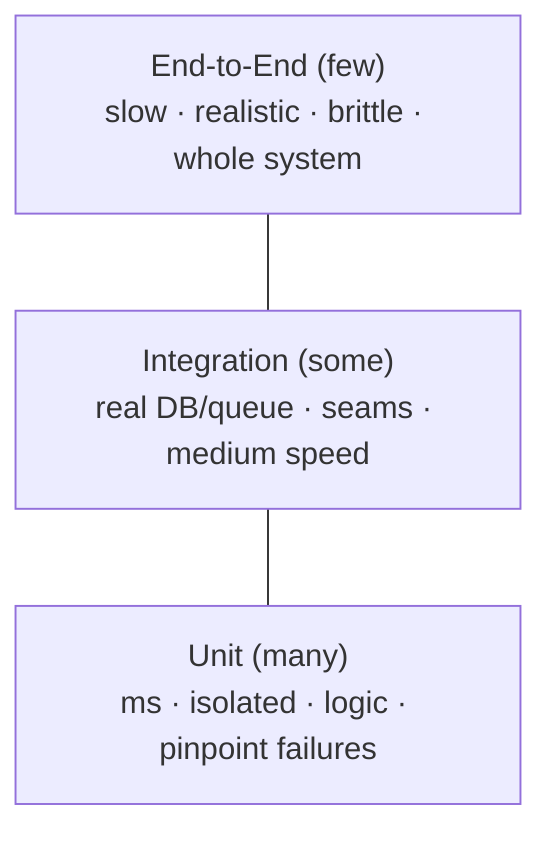
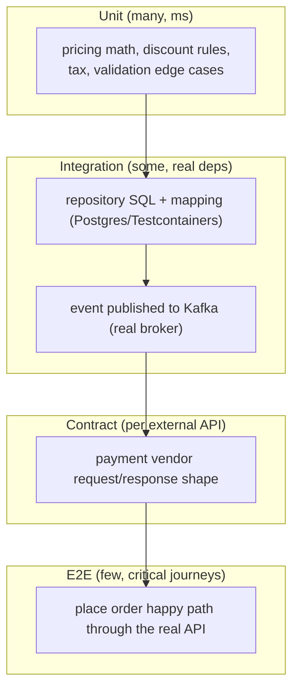

# Engineering Craft 04 — Software Testing II: Strategy & the Test Pyramid

> **Series:** Engineering Craft
> **Goal:** Decide *what* to test at *which level* — the test pyramid, real-DB integration tests with Testcontainers, contract tests, the coverage myth, killing flaky tests, and a strategy for a whole service.

---

## Table of Contents

1. [From "How to Test" to "What to Test"](#1-from-how-to-test-to-what-to-test)
2. [The Test Pyramid](#2-the-test-pyramid)
3. [Unit vs Integration vs E2E](#3-unit-vs-integration-vs-e2e)
4. [Integration Tests with Testcontainers](#4-integration-tests-with-testcontainers)
5. [Contract Tests](#5-contract-tests)
6. [The Coverage Myth](#6-the-coverage-myth)
7. [Flaky Tests: Causes & Cures](#7-flaky-tests-causes--cures)
8. [Test Data & Fixtures](#8-test-data--fixtures)
9. [A Test Strategy for a Service](#9-a-test-strategy-for-a-service)
10. [Practice: Integration Test with a Real DB](#10-practice-integration-test-with-a-real-db)
11. [Self-Check](#11-self-check)
12. [Next](#12-next)

---

## 1. From "How to Test" to "What to Test"

**In plain words:** Knowing how to write a test (Craft 03) is like knowing how to swing a hammer. Strategy is knowing *which nail* to hit and *how hard* — where to spend your limited testing budget so you get the most safety per minute of test-runtime and maintenance.

### Why

Testing has a budget: test *runtime* (slow suites nobody runs), *maintenance* (brittle tests you constantly fix), and *attention* (nobody reads a 4,000-test report). Spend it wrong — a thousand slow, flaky end-to-end tests — and the suite becomes a tax everyone routes around. Spend it right and you get maximum confidence per second of CI. Strategy is how you allocate that budget.

### What

A deliberate mix of test *levels* (unit, integration, e2e) and *types* (contract, property, load) chosen so each risk is covered by the *cheapest test that can catch it*, with minimal overlap.

### When & Where

At service design time ("how will we test this?"), at code review ("is this tested at the right level?"), and whenever the suite gets slow or flaky (rebalance the pyramid). You built the *instincts* for this in **System Design** (where do failures happen?) and **DevOps** (what does CI cost?) — this file makes them explicit.

> **🤔 Wait — why not just write end-to-end tests for everything? They test the real system, so they're the most trustworthy.**
> E2E tests are the most *realistic* and the least *practical* — and realism isn't the only axis. They're slow (a full-stack test takes seconds to minutes; a unit test takes milliseconds), flaky (every network hop is a chance to fail for reasons unrelated to your code), and terrible at *localizing* failure (a red e2e test says "checkout is broken" — it doesn't say which of 40 classes). If your whole suite is e2e, it runs in an hour, fails 5% of the time for no reason, and when it goes red nobody can tell what actually broke. You *do* want a few e2e tests — for the critical happy paths — but as the tip of the pyramid, not the base. Coverage of *logic* belongs in fast unit tests; e2e proves the *wiring*.

**✅ Good scenario (where it saves you):** A team has ~2,000 fast unit tests, ~150 integration tests (real DB), and ~15 e2e smoke tests. CI is green in 4 minutes, a red test names the exact class, and flakiness is near zero. They ship 20 times a day with confidence.

**❌ Bad scenario (the pain without it):** A team wrote mostly e2e/UI tests ("test like a user!"). The suite takes 55 minutes, fails ~1-in-8 runs for timing reasons, and everyone hits "re-run" until it's green — which means real failures get re-run away too. This is the classic **inverted pyramid** (an "ice-cream cone"), and it slowly erodes all trust in tests.

**When NOT to over-strategize:** A tiny library or CLI may just need solid unit tests and one smoke test — a full pyramid is overkill. Match the strategy to the system's real risks and lifespan.

---

## 2. The Test Pyramid

**In plain words:** Picture a pyramid: lots of cheap fast tests at the bottom, fewer slower ones in the middle, a handful of the slowest at the top. The *shape* is the advice — the further down a test lives, the more of that kind you should have.


*More tests the lower you go: many fast unit tests, some integration, a few e2e. Same shape, every healthy service.*

- **Base — Unit (many):** pure logic, milliseconds, doubles for I/O. Where 70–80% of your tests live because bugs in *logic* are most common and cheapest to catch here.
- **Middle — Integration (some):** your code + a *real* dependency (DB, message broker, cache) via Testcontainers. Catches the bugs unit tests *can't*: bad SQL, wrong mapping, transaction boundaries, serialization.
- **Tip — E2E (few):** the whole system through its real entry points. Proves the pieces are wired together. Reserve for critical user journeys (login, checkout).

The proportions are a heuristic, not a law — but if your shape is *inverted* (mostly e2e), your suite is slow, flaky, and untrusted. The pyramid is the antidote.

> **🤔 Wait — some famous engineers say the pyramid is dead and we should write "one big test" or use the 'testing trophy.' Is the pyramid outdated?**
> The critiques mostly argue about the *middle* — Kent C. Dodds' "testing trophy" (popular in frontend) fattens the integration layer because in UI-heavy code, integration tests give the best confidence-per-effort. That's a *rebalancing*, not a refutation: the core principle — *push tests down to the fastest level that can catch the bug* — is unchanged. For a Java backend with real business logic, a pyramid (fat unit base) still fits best. The lesson isn't "obey the exact triangle"; it's "know why each level exists and don't let the slow, brittle layer dominate."

---

## 3. Unit vs Integration vs E2E

| | Unit | Integration | End-to-End |
|---|---|---|---|
| **Scope** | One class/method | Your code + one real dependency | Whole system, real entry point |
| **Speed** | Milliseconds | ~100ms–seconds | Seconds–minutes |
| **Real DB/network?** | No (doubles) | Yes (Testcontainers) | Yes (full stack) |
| **Catches** | Logic bugs | SQL, mapping, tx, serialization, config | Wiring, missing routes, real integration |
| **Failure localization** | Pinpoint (one class) | Narrow (one seam) | Vague (somewhere in the flow) |
| **Flakiness risk** | Near zero | Low–moderate | Highest |
| **How many** | Hundreds–thousands | Tens–low hundreds | A handful |
| **When it fails, you know…** | Exactly which logic broke | Which integration point broke | That *something* in the journey broke |

**Reading the table:** each level exists to catch a class of bug the level below *cannot*. A unit test can't catch "your JPA mapping drops the timezone" — only a real DB can. An integration test can't catch "the API gateway routes `/checkout` to the wrong service" — only e2e can. Choose the level by *which bug you're defending against.*

---

## 4. Integration Tests with Testcontainers

**In plain words:** Testcontainers spins up a *real* Postgres (or Kafka, Redis, whatever) inside a throwaway Docker container just for your test, then throws it away after. You test against the actual database engine — not an in-memory fake that lies about behavior — and it's still automated, isolated, and repeatable.

### Why not an in-memory DB (H2)?

Because H2 is *not* Postgres. It has different SQL dialect quirks, different `JSON`/`array`/`upsert` support, different constraint and isolation behavior. A test that passes on H2 and fails on prod Postgres is worse than no test — it's false confidence. Testcontainers runs the *same* engine you deploy.

```java
import org.junit.jupiter.api.*;
import org.testcontainers.containers.PostgreSQLContainer;
import org.testcontainers.junit.jupiter.*;
import static org.assertj.core.api.Assertions.*;

@Testcontainers                                  // Testcontainers 1.21+ / 2.x, JUnit Jupiter
@SpringBootTest                                  // real Spring context + real repository
class OrderRepositoryIT {                        // 'IT' = integration test (Failsafe convention)

    @Container                                    // one real Postgres for this test class
    static PostgreSQLContainer<?> postgres =
        new PostgreSQLContainer<>("postgres:16-alpine");   // pin the version you run in prod

    @DynamicPropertySource                        // point Spring at the container's JDBC url
    static void datasource(DynamicPropertyRegistry r) {
        r.add("spring.datasource.url",      postgres::getJdbcUrl);
        r.add("spring.datasource.username", postgres::getUsername);
        r.add("spring.datasource.password", postgres::getPassword);
    }

    @Autowired OrderRepository repository;

    @Test
    void savesAndReloadsOrder_withAllFieldsIntact() {
        // This exercises the REAL SQL, the REAL mapping, the REAL constraints.
        Order saved = repository.save(anOrder().withTotal("42.00").build());

        Order loaded = repository.findById(saved.id()).orElseThrow();

        // A bug an in-memory DB would hide (e.g. numeric precision, timezone) shows up here.
        assertThat(loaded.total()).isEqualTo(Money.of("42.00"));
        assertThat(loaded.createdAt()).isEqualTo(saved.createdAt());
    }

    @Test
    void enforcesUniqueConstraint_onIdempotencyKey() {
        repository.save(anOrder().withIdempotencyKey("K1").build());
        // Only a REAL Postgres will actually throw on the duplicate key:
        assertThatThrownBy(() -> repository.save(anOrder().withIdempotencyKey("K1").build()))
            .isInstanceOf(DataIntegrityViolationException.class);
    }
}
```

Notes: keep integration tests in a separate source set / naming convention (`*IT`) run by Maven **Failsafe** (not Surefire) so unit tests stay fast and always run, while integration tests run in a later CI stage. Reuse a container across a class (`static @Container`) for speed; use `@Testcontainers` + Ryuk to guarantee cleanup even if the JVM crashes. This is where your **DevOps** Docker knowledge pays off directly.

**✅ Good scenario:** A migration adds a `NOT NULL` column with no default. A Testcontainers integration test running the real migration against real Postgres fails instantly — catching a bug that would have broken every insert in production. No unit test could have found it.

**❌ Bad scenario:** A team tests repositories against H2. Everything's green. In prod, a Postgres-specific `ON CONFLICT` upsert behaves differently and silently overwrites rows. The tests gave false confidence; the "faster" in-memory DB cost them a data-corruption incident.

**When NOT to:** Don't Testcontainers pure logic — that's a unit test, and spinning a container to test a `Money.multiply()` is 1000× slower for zero extra coverage. And on a machine with no Docker (some locked-down CI), you need a Docker-capable runner first.

---

## 5. Contract Tests

**In plain words:** When Service A calls Service B, a contract test checks they still *agree on the shape of the conversation* — the request/response format — without spinning up both services together. A (consumer) records "I expect B to answer this request with that shape"; B (provider) verifies it still honors that expectation. It catches "B renamed a field and broke A" *before* deploy.

### Why they exist

E2E tests catch integration breaks but are slow and require *every* service running together. Contract tests catch the *specific* break — an incompatible API change — cheaply, per-service, in each service's own pipeline. Tools: **Pact** (consumer-driven), or **Spring Cloud Contract**.

```java
// Consumer side (Service A) declares what it needs from B — this becomes "the contract":
//   GET /users/42  ->  200  { "id": 42, "email": "..." }   (A relies on 'email' existing)
// Provider side (Service B) runs a generated test that FAILS if B stops returning 'email'.
// B learns it's breaking A *in B's own CI*, before deploying — no full environment needed.
```

| | Contract test | End-to-End test |
|---|---|---|
| Services running | One at a time (in its own CI) | All of them together |
| Catches | Incompatible API/schema changes | Real wiring + runtime behavior |
| Speed | Fast | Slow |
| Owns the truth | The consumer's expectations | The deployed environment |

**When NOT to:** For a monolith or two services owned by one team who deploy together, a shared integration test is simpler — contract tests shine when *independent teams* deploy *independently* and you can't run everything at once. This connects to **System Design (Microservices vs Monolith)**: contract tests are a microservices-era answer to a microservices-era problem.

---

## 6. The Coverage Myth

**In plain words:** Coverage measures which lines your tests *executed*, not whether they *checked the right things*. It's a fuel gauge, not a quality gauge — 100% coverage can still mean 0% verified.

### Why 100% ≠ good

```java
// This "test" gives 100% line coverage of divide() — and asserts NOTHING.
@Test
void coversDivide() {
    calculator.divide(10, 2);     // line executed -> "covered"
    // no assertion! A bug returning 999 would still pass. Coverage: 100%. Value: 0%.
}
```

Coverage tells you what's *definitely untested* (0% coverage of the refund path is a real red flag). It does **not** tell you what's *well* tested. A line can be covered by a test that never asserts on its output, or covered for the happy path while every edge case is untested.

- **Use coverage as a floor and a spotlight, not a target.** "No critical path below X%" is reasonable; "everyone must hit 100%" produces assertion-free tests written to game the metric.
- **Goodhart's law:** when a measure becomes a target, it stops being a good measure. Mandating 100% coverage reliably produces the worst tests you've ever seen.
- **What actually matters:** are the important *behaviors* and *edge cases* tested with real assertions? Coverage can't see that; humans in review can.

> **🤔 Wait — if coverage is so misleading, why do serious teams still track it?**
> Because it's a cheap, automatic *smoke detector for gaps*. Coverage is excellent at answering "is there any test touching this code at all?" — and a *drop* in coverage on a PR ("you added 200 lines with no tests") is a useful review signal. What it can't do is answer "are these tests good?" So teams use it *diagnostically* (find the untested refund path) and *directionally* (don't let it fall), never as a *goal* (hit 100%). The failure is treating a gap-detector as a quality-certifier.

**When NOT to chase it:** Generated code, DTOs, trivial getters — don't write tests just to color them green. Spend the effort on the logic and edge cases that can actually hurt someone.

---

## 7. Flaky Tests: Causes & Cures

**In plain words:** A flaky test passes sometimes and fails other times *with no code change*. It's worse than a missing test, because it trains the whole team to ignore red — and once people reflexively hit "re-run," a *real* failure gets re-run away too. Flakiness is a trust-destroyer; hunt it like a production bug.

### The usual causes (and fixes)

| Cause | Symptom | Fix |
|---|---|---|
| **Timing / `sleep`** | Passes on fast machine, fails on slow CI | Await a condition (`Awaitility`), never `Thread.sleep`; control time with an injectable `Clock` |
| **Test order dependence** | Fails only when run with others | Isolate state; fresh setup per test (`@BeforeEach`); no shared mutable statics |
| **Shared/global state** | Random failures under parallelism | Reset DB/caches per test; use unique data per test |
| **Real network / external service** | Fails when a third party is slow/down | Stub externals in unit tests; pin versions/containers in integration |
| **Randomness / current time** | Fails "sometimes" | Seed the RNG; inject a fixed `Clock`; freeze `now()` |
| **Nondeterministic ordering** | Assert on a `HashMap`/`Set` order | Assert on content, not order; sort or use `containsExactlyInAnyOrder` |
| **Resource leaks / ports** | Fails when a port/file is in use | Random ports (Testcontainers does this); clean up in teardown |

```java
// ❌ FLAKY — depends on wall-clock timing; fails on a loaded CI box.
@Test void flaky() {
    scheduler.runIn(100, MILLISECONDS, job);
    Thread.sleep(150);                              // hope 150ms was enough...
    assertThat(job.ran()).isTrue();
}

// ✅ STABLE — poll for the condition with a timeout, no fixed sleep.
@Test void stable() {
    scheduler.runIn(100, MILLISECONDS, job);
    await().atMost(2, SECONDS).until(job::ran);     // Awaitility — deterministic outcome
}
```

**The policy that works:** a flaky test is a **bug with a ticket**, not a nuisance to re-run. Quarantine it (so it stops blocking merges) *and* fix it fast — a quarantine with no fix is just hidden rot. Never add a blanket "retry failed tests 3x"; that hides real regressions behind the same mechanism.

> **🤔 Wait — CI retries are built into every runner now. Why not just auto-retry flaky tests and move on?**
> Because auto-retry doesn't distinguish a *flaky* failure from a *real* one — it re-runs both. A genuine regression that fails 1-in-3 due to a race in your *production* code will "pass on retry" and ship the bug. Retry-on-fail is a painkiller that masks the disease and eventually numbs you to red entirely. Use retries only as a *temporary* bandage on an *already-ticketed* flake while you fix the root cause — the same discipline as fixing a bug's root cause, not its symptom (**Craft 02**).

---

## 8. Test Data & Fixtures

**In plain words:** Test data is the raw material every test needs — an order, a user, a cart. If you build it by hand in every test, tests become unreadable walls of setup and break in fifty places when a constructor changes. Give the data a factory with sensible defaults, and each test states only the *one field it cares about*.

### The test data builder pattern

```java
// A builder with sensible defaults; tests override ONLY what's relevant to them.
public class OrderBuilder {
    private Money total = Money.of("10.00");     // sensible default
    private Coupon coupon = null;                // default: no coupon
    private String idempotencyKey = UUID.randomUUID().toString();  // unique per build

    public static OrderBuilder anOrder() { return new OrderBuilder(); }
    public OrderBuilder withTotal(String t) { this.total = Money.of(t); return this; }
    public OrderBuilder withCoupon(Coupon c) { this.coupon = c; return this; }
    public OrderBuilder withIdempotencyKey(String k) { this.idempotencyKey = k; return this; }
    public Order build() { return new Order(total, coupon, idempotencyKey); }
}

// In tests, the intent is obvious — only the relevant field is set:
Order plain      = anOrder().build();                          // I don't care about specifics
Order discounted = anOrder().withCoupon(percentage(10)).build(); // I care ONLY about the coupon
```

Principles:
- **Sensible defaults, override the one thing that matters.** The test reads as "an order *with a 10% coupon*" — the coupon is the point; everything else is noise the builder hides.
- **Unique data per test** (random ids/emails) to avoid collisions under parallel/integration runs.
- **Keep fixtures small and local.** Giant shared fixtures (`testData.sql` with 500 rows everyone depends on) become the flaky, order-dependent nightmare of §7. Prefer building exactly what each test needs.
- For integration tests, reset state per test (transaction rollback, or truncate) so tests don't leak into each other.

**When NOT to:** For one dead-simple test, inlining `new Order(...)` is fine — introduce builders when the setup starts repeating or growing. Don't build a framework before you feel the pain.

---

## 9. A Test Strategy for a Service

**In plain words:** A test strategy is a one-page answer to "how do we know this service works?" — written *before* or *alongside* the code, mapping each risk to the cheapest test that guards it. It's the testing equivalent of a system design doc.

### Worked example — an `OrderService` (checkout backend)


*Map each risk to a level: logic → unit, persistence/messaging → integration, external APIs → contract, the money path → one e2e.*

A practical strategy:
- **Logic (pricing, discounts, tax, validation):** exhaustive **unit** tests, including edge cases (zero qty, expired coupon, rounding). This is the bulk.
- **Persistence:** **integration** tests with Testcontainers Postgres — real SQL, constraints, mapping, migrations.
- **Messaging:** **integration** test that a real event is published to a real broker with the right schema.
- **External payment vendor:** **contract** test on the request/response shape; **stub** it in unit tests.
- **The one critical journey (place order → paid → confirmed):** a single **e2e** smoke test.
- **Non-functional:** a **load** test for peak-sale QPS (reuse your **System Design** estimation), and a **failure-injection** test (vendor down → order goes `PENDING`, not lost) reflecting your **fault-tolerance** knowledge.

The strategy is a *conversation*, not a doc that rots — revisit it when the service grows. The point is deliberate coverage of *risks*, not a coverage percentage.

**❌ Bad scenario (no strategy):** Everyone writes whatever test is convenient. Pricing logic ends up tested via slow e2e checkout runs; the DB mapping has no test at all. The suite is slow *and* has a giant hole exactly where a data-corruption bug will land.

**When NOT to:** A 200-line internal tool doesn't need a formal strategy doc — the pyramid instinct in your head is enough. Write it down when the service is shared, long-lived, or business-critical.

---

## 10. Practice: Integration Test with a Real DB

Take a Spring Boot repository (or write a small `OrderRepository`) and:

1. **Add Testcontainers** (`org.testcontainers:junit-jupiter` + `:postgresql`, 1.21+/2.x) and Docker to your setup.
2. Write an **integration test** (`OrderRepositoryIT`) that starts a real `postgres:16-alpine`, points Spring at it via `@DynamicPropertySource`, and:
   - saves an order and reloads it, asserting *every* field survives (catch a mapping/precision bug an in-memory DB would hide);
   - asserts a real **unique constraint** throws on a duplicate idempotency key;
   - runs your real **migrations** (Flyway/Liquibase) against the container so a bad migration fails the test.
3. **Prove the value:** deliberately introduce a Postgres-specific bug (e.g. a `numeric(10,2)` truncation, or a missing `NOT NULL` default in a migration) and confirm the integration test catches what a unit test never could.
4. **Wire CI:** put unit tests in Surefire (fast, every build) and this `*IT` in Failsafe (later stage). Confirm the fast suite still runs in seconds.

**Stretch:** add one **contract test** (Pact or Spring Cloud Contract) for a downstream API this service calls, and observe how it fails in *your* CI when the (simulated) provider drops a field.

---

## 11. Self-Check

1. What three budgets does testing spend, and how does the pyramid optimize them?
2. Draw the test pyramid. For each level, name one bug class it catches that the level below cannot.
3. Why is an inverted pyramid (mostly e2e) a trap? Name two concrete symptoms.
4. Why prefer Testcontainers (real Postgres) over an in-memory H2 for repository tests? Give a bug H2 hides.
5. What does a contract test catch that a unit test can't, and when are contract tests worth the setup?
6. Explain the coverage myth. Why can 100% coverage still mean 0% verified? How should you use coverage?
7. List three common causes of flaky tests and the fix for each. Why is blanket auto-retry dangerous?
8. What problem does the test data builder pattern solve, and why is a giant shared fixture a smell?
9. Sketch a test strategy for a payment service: which risks go to unit, integration, contract, and e2e?
10. When is Testcontainers the *wrong* tool, and when is a full test strategy doc overkill?

---

## 12. Next

**Clean Code I — Naming, Functions, Errors.** You can now test code; next, make the code worth testing. Intention-revealing names, small single-purpose functions, honest error handling (exceptions vs codes, fail fast), and comments that help instead of lie — with before/after Java for each.
