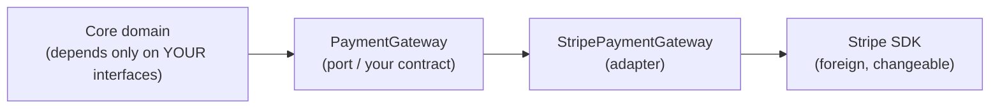

# Engineering Craft 06 — Clean Code II: Smells & SOLID in Practice

> **Series:** Engineering Craft
> **Goal:** Learn to *smell* bad code at a glance — a catalog of code smells each with its fix — and apply SOLID (from System Design Day 2) at the code level with guard clauses and clean boundaries.

---

## Table of Contents

1. [What Is a Code Smell?](#1-what-is-a-code-smell)
2. [The Code Smell Catalog](#2-the-code-smell-catalog)
3. [Smell Deep-Dives with Fixes](#3-smell-deep-dives-with-fixes)
4. [SOLID in Practice (from System Design Day 2)](#4-solid-in-practice-from-system-design-day-2)
5. [Guard Clauses](#5-guard-clauses)
6. [Boundaries & Adapters](#6-boundaries--adapters)
7. [Practice: Spot 5 Smells](#7-practice-spot-5-smells)
8. [Self-Check](#8-self-check)
9. [Next](#9-next)

---

## 1. What Is a Code Smell?

**In plain words:** A smell is that faint "something's off here" you get reading code — not a bug, not a compiler error, but a *surface sign of a deeper design problem*. Like a musty smell in a house doesn't mean the ceiling is falling, but it's worth checking the pipes. Smells are your early-warning system.

### Why

You can't refactor what you can't *see*. Naming the smells turns a vague unease ("this is gross") into a precise diagnosis ("this is Feature Envy, fix with Move Method") that you can act on and communicate in review (**Craft 08**). A shared vocabulary of smells is how a team keeps design healthy without every discussion starting from zero.

### What

A smell is a *heuristic* — a pattern that *usually* indicates a problem worth investigating, not a rule that must always be fixed. Each smell has a name, a "why it hurts," and a known refactoring (**Craft 07**) that resolves it.

### When & Where

While reading (**Craft 01**), while reviewing (**Craft 08**), and while refactoring (**Craft 07**). Smells are the *trigger* for refactoring: you refactor *because* you smelled something, under green tests.

> **🤔 Wait — if a smell isn't a bug and the code works, why spend time fixing it? Isn't that gold-plating?**
> Because smells are *compounding interest on technical debt* (**engineering:tech-debt** territory). Each one slightly raises the cost of the next change — a Long Method is a little harder to modify, a Shotgun Surgery smell means the next feature touches ten files instead of one. Individually ignorable; collectively they're why a two-year-old codebase becomes "we're afraid to touch it." You fix smells *opportunistically* — when you're already in that code for a feature (the "campsite rule": leave it cleaner than you found it) — not on a crusade. The judgment call is real, which is exactly why naming them matters: you fix the ones near your work, note the rest, and don't rewrite the world.

**When NOT to chase smells:** Code you'll delete soon, stable code nobody touches (a smell in code that never changes costs nothing), or when the "fix" adds more complexity than the smell (over-abstraction is its own smell — §4 Dark Side). Smells are heuristics; judgment overrides them.

---

## 2. The Code Smell Catalog

**In plain words:** Here's the field guide — the common smells, what each looks like, why it hurts, and the refactoring that cures it. Learn to name these on sight; it's the single fastest upgrade to your review and refactoring skills.

| Smell | What it looks like | Why it hurts | The fix (Craft 07) |
|---|---|---|---|
| **Long Method** | A function that scrolls off screen; many altitudes | Hard to read, test, reuse | Extract Method until each does one thing |
| **Large Class (God Class)** | One class with 20 fields, 40 methods, many jobs | Violates SRP; change-magnet | Extract Class; split responsibilities |
| **Long Parameter List** | 4+ positional args | Error-prone calls, hard to read | Introduce Parameter Object |
| **Duplicated Code** | The same logic copy-pasted | Fix a bug in one copy, miss the others | Extract Method/Class; pull up |
| **Feature Envy** | A method that mostly uses *another* class's data | Logic lives in the wrong place | Move Method to the class it envies |
| **Data Clumps** | The same group of fields travels together everywhere (`lat, lon`; `start, end`) | Missing concept; scattered validation | Extract a value object (`Coordinate`, `DateRange`) |
| **Primitive Obsession** | `String email`, `int cents`, `String status` everywhere | No validation, no type safety, stringly-typed | Introduce value types / enums |
| **Shotgun Surgery** | One conceptual change forces edits in many files | Change is expensive and error-prone | Move related behavior together (Move Method/Field) |
| **Divergent Change** | One class changes for many unrelated reasons | Coupled responsibilities (SRP) | Extract Class per reason-to-change |
| **Switch Statements / Type Codes** | `switch(type)` repeated across the code | New type = edit every switch (OCP) | Replace Conditional with Polymorphism |
| **Message Chains** | `a.getB().getC().getD().doIt()` | Fragile coupling to structure (Law of Demeter) | Hide delegate; ask, don't navigate |
| **Middle Man** | A class that only forwards calls | Needless indirection | Remove Middle Man; inline |
| **Speculative Generality** | Abstractions "for the future" nobody uses | Dead complexity | Collapse; YAGNI |
| **Comments (as deodorant)** | Comments explaining confusing code (Craft 05) | Hides a naming/structure problem | Rename/extract, delete the comment |
| **Temporary Field** | A field only set in some circumstances | Confusing lifecycle | Extract Class; or pass as parameter |

Keep this table nearby during review. The goal isn't to memorize definitions — it's to feel the itch and reach for the named fix.

---

## 3. Smell Deep-Dives with Fixes

Three of the most common (and most fixable) smells, in before/after Java.

### 3.1 Primitive Obsession → Value Objects

**In plain words:** Using raw `String`/`int` for domain concepts (email, money, status) means the *rules* about them are scattered everywhere and the compiler can't help you. Wrap them in a type and the rules live in one place — and you can never mix up two `String`s again.

```java
// ❌ BEFORE — everything is a String/int. Validation is scattered or missing.
public void register(String email, int balanceCents) {
    if (!email.contains("@")) throw new IllegalArgumentException();  // validated HERE
    // ...and re-validated (or forgotten) in ten other places. Nothing stops:
    //   register(balanceStr, emailCents)  // args swapped — both are just strings/ints
}

// ✅ AFTER — value objects. Rules live once; the compiler enforces the distinction.
public record Email(String value) {
    public Email {                                    // compact-constructor validation
        if (value == null || !value.contains("@"))
            throw new IllegalArgumentException("invalid email: " + value);
    }
}
public record Money(long cents) {
    public Money { if (cents < 0) throw new IllegalArgumentException("negative"); }
    public Money plus(Money o) { return new Money(cents + o.cents); }
}
public void register(Email email, Money balance) { /* both already valid; can't swap them */ }
```

### 3.2 Feature Envy → Move Method

**In plain words:** If a method spends all its time reaching into *another* object's data, it's living in the wrong house. Move it to where the data lives; then it can ask questions of its own fields instead of prying into someone else's.

```java
// ❌ BEFORE — OrderPrinter is envious of Order's internals (Law of Demeter violation too).
class OrderPrinter {
    String summary(Order o) {
        return o.getCustomer().getName() + " owes " +
               o.getItems().stream().mapToLong(i -> i.getPrice() * i.getQty()).sum();
    }  // this method knows Order's ENTIRE internal structure. Any change to Order breaks it.
}

// ✅ AFTER — the behavior moves INTO Order, which owns the data it needs.
class Order {
    Money total() {                                   // Order asks its OWN items
        return items.stream().map(Item::lineTotal).reduce(Money.ZERO, Money::plus);
    }
    String summary() { return customer.name() + " owes " + total(); }
}
// OrderPrinter now just calls o.summary() — no envy, no structural coupling.
```

### 3.3 Switch on Type Code → Polymorphism

**In plain words:** A `switch` on a "type" field, repeated across the code, means every new type is a hunt-and-edit across every switch (Open/Closed violation). Replace it with polymorphism: each type is a class that knows its own behavior, and adding a type is adding a class — no existing code changes.

```java
// ❌ BEFORE — switch on type, duplicated wherever behavior differs by type.
BigDecimal fee(Account a) {
    switch (a.type()) {                               // add a new type -> edit EVERY such switch
        case BASIC:   return BigDecimal.valueOf(5);
        case PREMIUM: return BigDecimal.ZERO;
        case ENTERPRISE: return BigDecimal.valueOf(-2);  // credit
        default: throw new IllegalStateException();
    }
}

// ✅ AFTER — polymorphism (Replace Conditional with Polymorphism). OCP: extend, don't modify.
sealed interface Account permits BasicAccount, PremiumAccount, EnterpriseAccount {
    Money monthlyFee();                               // each type owns its own rule
}
record BasicAccount(...)      implements Account { public Money monthlyFee(){ return Money.of("5"); } }
record PremiumAccount(...)    implements Account { public Money monthlyFee(){ return Money.ZERO; } }
record EnterpriseAccount(...) implements Account { public Money monthlyFee(){ return Money.of("-2"); } }
// A new account type is a NEW class. No existing method is touched. (sealed => compiler checks completeness)
```

> **🤔 Wait — a `switch` is simple and fast to read. Isn't polymorphism just more classes and indirection for the same result?**
> For *one* switch used *once*, yes — leave it; the smell is barely there. Polymorphism earns its cost when (a) the *same* switch on the *same* type appears in **multiple** places (fee here, label there, permissions elsewhere), so a new type means editing all of them and forgetting one is a bug; or (b) types are added often. Then the switch is Shotgun Surgery waiting to happen, and polymorphism localizes each type's behavior in one place. The judgment: count the switches and the rate of new types. One stable switch → keep it. Three switches that grow → make them classes. Java 21+ `switch` pattern-matching on sealed types is a nice middle ground when behavior truly is view-only.

---

## 4. SOLID in Practice (from System Design Day 2)

**In plain words:** You met SOLID as *design principles* in **System Design Day 2**. Here they show up as everyday *code-level* moves — the same five ideas, applied to the class you're editing right now. SOLID isn't abstract theory; it's the "why" behind half the smell fixes above.

- **S — Single Responsibility:** a class has *one reason to change*. The God Class and Divergent Change smells are SRP violations; **Extract Class** is the fix. Practically: if you describe a class with "and" (`OrderService handles pricing *and* emailing *and* persistence"), split it.
- **O — Open/Closed:** open to extension, closed to modification. The switch-on-type smell violates it; **polymorphism** (§3.3) fixes it — add a class, don't edit existing code.
- **L — Liskov Substitution:** a subtype must be usable *anywhere* its base type is, without surprises. If `SquareOverridesSetWidth` breaks callers expecting a `Rectangle`, that's an LSP violation — prefer composition over an inheritance that lies.
- **I — Interface Segregation:** many small, focused interfaces beat one fat one. A class forced to implement `throw new UnsupportedOperationException()` for methods it doesn't need is an ISP smell — split the interface.
- **D — Dependency Inversion:** depend on abstractions, not concretions. This is the foundation of testability (**Craft 03** — you inject a mock *because* the code depends on an interface) and of boundaries (§6).

```java
// SRP + DIP in one small move: a bloated service split, depending on an abstraction.
// ❌ BEFORE — one class, three reasons to change, hard-wired to concrete Stripe.
class OrderService {
    private final StripeClient stripe = new StripeClient();   // concrete dependency (untestable)
    Order place(Cmd c) { /* price + persist + email + charge Stripe, all here */ }
}

// ✅ AFTER — one responsibility, depends on an interface (inject a mock in tests).
class OrderService {
    private final PaymentGateway payments;      // DIP: abstraction, not Stripe
    private final OrderRepository repository;   // SRP: persistence is its own collaborator
    OrderService(PaymentGateway payments, OrderRepository repository) { ... }  // injected
    Order place(PlaceOrderCommand cmd) { /* orchestrates; each concern lives elsewhere */ }
}
```

> **🤔 Wait — my last codebase applied SOLID everywhere and it was an unreadable maze of one-method interfaces and factories. Isn't SOLID just over-engineering?**
> That codebase applied SOLID *dogmatically*, and dogmatic SOLID is its own smell — **Speculative Generality**. Every principle has a cost (indirection, more files), and the payoff only materializes when the axis of change it protects *actually varies*. An interface with one implementation that will *never* have a second is pure ceremony; DIP on a value object you'll never mock is noise. The mature use is *reactive*: you apply DIP when you feel the pain of an untestable concrete dependency, extract a class when a God Class actually resists change. As **System Design Day 2's "Dark Side"** section put it — SOLID is a response to *felt* pressure, not a checklist to satisfy up front. Judgment, not dogma.

**✅ Good scenario:** A team applies DIP only where they mock in tests and OCP only where new payment providers keep arriving. Adding a fourth provider is a new class; testing is trivial with mocks. SOLID paid off exactly where change happened.

**❌ Bad scenario:** A team wraps every class in an interface "for SOLID." Navigating the code means jumping through five single-implementation interfaces to find the one real class. They got all the cost of abstraction and none of the benefit — because nothing ever varied along those axes.

---

## 5. Guard Clauses

**In plain words:** Instead of wrapping your real logic in deep nested `if`s, handle the exceptional/edge cases *first* and return (or throw) early. The happy path then flows straight down the left margin, unindented and easy to read — you've "guarded the door" against bad states up front.

```java
// ❌ BEFORE — arrow anti-pattern: logic buried under nested conditionals; hard to follow.
public Money price(Order order) {
    if (order != null) {
        if (!order.items().isEmpty()) {
            if (order.customer().isActive()) {
                Money total = order.subtotal();
                return applyTax(total);         // the ONE real line, buried 3 levels deep
            } else { throw new InactiveCustomerException(); }
        } else { throw new EmptyOrderException(); }
    } else { throw new IllegalArgumentException("order"); }
}

// ✅ AFTER — guard clauses: reject bad states early; happy path is flat and obvious.
public Money price(Order order) {
    if (order == null)               throw new IllegalArgumentException("order");
    if (order.items().isEmpty())     throw new EmptyOrderException();
    if (!order.customer().isActive()) throw new InactiveCustomerException();

    Money total = order.subtotal();   // happy path: unindented, reads top-to-bottom
    return applyTax(total);
}
```

Guard clauses are the practical face of **fail fast** (**Craft 05**): validate and reject at the top, keep the main logic at one indentation level. They pair naturally with polymorphism (§3.3) and small functions (**Craft 05**) to keep methods flat.

**When NOT to:** If early returns become so numerous the method has ten exit points scattered through complex logic, that's a different smell (the method does too much — extract). Guards are for *preconditions at the top*, not for littering returns through the middle.

---

## 6. Boundaries & Adapters

**In plain words:** A boundary is the seam between *your* code and *someone else's* (a third-party library, a vendor API, the database). Wrap that foreign thing behind *your own* interface — an adapter — so their weirdness stays on their side of the wall and your core logic depends only on a clean contract you control. Then when they change (or you swap vendors), you edit one adapter, not your whole codebase.

```java
// ✅ Your domain defines the contract IT wants (Dependency Inversion, §4):
public interface PaymentGateway {                 // YOUR abstraction, YOUR vocabulary
    PaymentResult charge(Money amount, CardToken token);
}

// The adapter translates between your clean world and the vendor's messy SDK:
public class StripePaymentGateway implements PaymentGateway {
    private final StripeSdk stripe;               // the foreign, changeable thing
    public PaymentResult charge(Money amount, CardToken token) {
        // ALL Stripe-specific quirks (cents, string codes, their exceptions) are trapped HERE.
        var req = new StripeChargeRequest(amount.cents(), token.raw());
        try {
            var resp = stripe.charges().create(req);
            return PaymentResult.success(resp.getId());
        } catch (StripeException e) {
            return PaymentResult.failure(mapToDomainError(e));  // translate to YOUR error model
        }
    }
}
// Your OrderService depends on PaymentGateway. It never imports a single Stripe class.
// Swap to Adyen? Write AdyenPaymentGateway. Zero changes to core logic. Test? Mock PaymentGateway.
```

Benefits: **testability** (mock the interface — **Craft 03**), **swappability** (change vendors behind the wall), **isolation** (a breaking change in their SDK is contained to one adapter — no Shotgun Surgery across your code). This is the code-level form of the **ports & adapters / hexagonal** idea and the anti-corruption layer you saw in **System Design (Microservices)**.


*Adapters trap foreign weirdness at the boundary; your core depends only on contracts you own.*

**When NOT to:** Don't wrap the JDK or a stable, ubiquitous library (`List`, `Optional`, Jackson) behind adapters — that's ceremony for something that won't change and isn't "foreign." Reserve adapters for *volatile* external dependencies you might swap or that you need to mock: vendors, third-party APIs, infrastructure.

---

## 7. Practice: Spot 5 Smells

Take a real class from your codebase (or the deliberately-smelly `LegacyOrderService` you'll refactor in **Craft 07**). Read it with the catalog (§2) open and:

1. **Find and name at least 5 distinct smells.** For each, write: the smell's name, the exact lines, *why* it hurts here (not the generic definition — the concrete cost in *this* code), and the named refactoring that would fix it.
2. **Rank them by leverage:** which fix reduces the most future pain per unit of effort? (A Shotgun Surgery fix often beats a cosmetic Long Method split.)
3. **Map two smells to SOLID:** name which SOLID principle each violates and how the fix restores it.
4. **Argue one "leave it":** find one smell you'd *deliberately not fix* right now, and justify it (stable code, throwaway, fix costlier than smell). Naming when *not* to act is as senior as naming the fix.
5. **Write it up as a mini review comment** (**Craft 08** style): severity-tagged, specific, kind — "Feature Envy (design, non-blocking): `summary()` reaches into `Order`'s internals; consider moving it onto `Order`."

**Deliverable:** a smell report you could paste into a real PR review. Success = each smell is named precisely, the cost is concrete, and your "leave it" shows judgment.

---

## 8. Self-Check

1. What is a code smell, and how does it differ from a bug? Why is it "compounding interest"?
2. Name five smells from the catalog and the refactoring that fixes each.
3. What is Primitive Obsession, and how does a value object fix it? Give the compiler benefit.
4. What is Feature Envy, and how does Move Method resolve it and reduce coupling?
5. When is `switch`-on-type a real smell worth replacing with polymorphism, and when is it fine to keep?
6. Map three code smells to the SOLID principle each violates (from System Design Day 2).
7. Why can *dogmatic* SOLID become the Speculative Generality smell? What's the mature, reactive alternative?
8. Rewrite a deeply-nested method using guard clauses. How do guards relate to fail-fast (Craft 05)?
9. What is an adapter/boundary, and what three benefits does it give? When should you NOT wrap something?
10. Give one smell you'd deliberately leave unfixed and justify it. Why is naming "leave it" a senior skill?

---

## 9. Next

**Refactoring.** You can now *smell* problems and name their fixes — next, learn to *apply* those fixes safely. What refactoring is (behavior-preserving) and isn't, the golden rule (only under green tests), the catalog of moves (extract, inline, rename, replace conditional with polymorphism, introduce parameter object), small safe steps, and the strangler-fig pattern (from **System Design**) for taming a big legacy rewrite without a big-bang risk.
