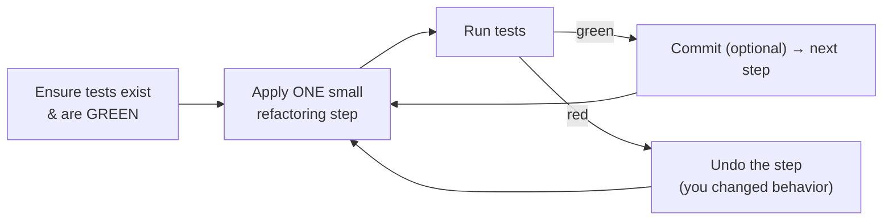
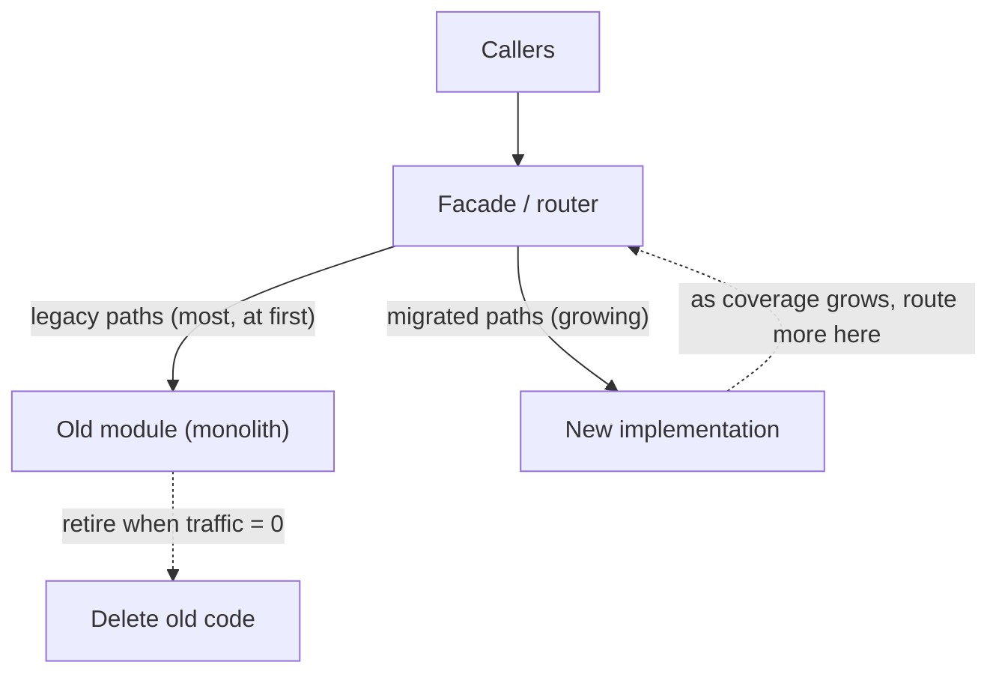

# Engineering Craft 07 — Refactoring

> **Series:** Engineering Craft
> **Goal:** Improve the design of existing code *without changing its behavior* — safely, in small steps, always under green tests — from a single extract to a strangler-fig migration.

---

## Table of Contents

1. [What Refactoring Is (and Isn't)](#1-what-refactoring-is-and-isnt)
2. [The Golden Rule: Only Under Green Tests](#2-the-golden-rule-only-under-green-tests)
3. [Small Safe Steps](#3-small-safe-steps)
4. [The Refactoring Catalog](#4-the-refactoring-catalog)
5. [Worked Refactorings (Before → After)](#5-worked-refactorings-before--after)
6. [When to Refactor (and When Not To)](#6-when-to-refactor-and-when-not-to)
7. [Strangler Fig: Refactoring the Untouchable](#7-strangler-fig-refactoring-the-untouchable)
8. [Practice: Refactor a Smelly Class](#8-practice-refactor-a-smelly-class)
9. [Self-Check](#9-self-check)
10. [Next](#10-next)

---

## 1. What Refactoring Is (and Isn't)

**In plain words:** Refactoring is tidying a room without moving the house — you rearrange the furniture so it's easier to live in, but the room does exactly what it did before. In code: you change the *structure* to make it clearer or easier to extend, while the *behavior* stays byte-for-byte identical. If behavior changed, it wasn't refactoring — it was a feature or a bug.

### Why

Code decays. Every feature added under deadline leaves a little mess; smells accumulate (**Craft 06**) and the cost of change climbs. Refactoring is how you pay that debt down *continuously* so the codebase stays cheap to change. It's also how you make code *testable* and *extendable* before adding a feature — "make the change easy, then make the easy change" (Kent Beck).

### What

A disciplined technique: apply a *named*, *behavior-preserving* transformation (from the catalog, §4) in *small steps*, verifying with tests after each. Not a rewrite, not a redesign-in-flight — a series of provably safe micro-moves.

### When & Where

- **Before a feature:** reshape the code so the new feature slots in cleanly.
- **After green (in TDD):** the "refactor" third of red-green-refactor (**Craft 03**).
- **Opportunistically:** the campsite rule — leave code a little cleaner than you found it.
- **Never** mixed into the same commit as a behavior change (see §3).

> **🤔 Wait — isn't refactoring just "gold-plating" that risks breaking working code for no user-visible benefit? Why would a PM ever approve it?**
> Two corrections. First, *strictly done* refactoring can't break working code — it's behavior-preserving by definition and guarded by tests (§2); the risk you're imagining comes from *un*disciplined "refactoring" (rewriting while adding features). Second, the benefit is very real, just not this sprint: refactoring lowers the *cost of future change*, which is most of a codebase's lifetime cost. You don't ask a PM to approve a "refactoring sprint" (that's usually a smell — see §6); you fold small refactorings into feature work so the code you touch gets better as a side effect. The mistake is treating refactoring as a separate luxury phase rather than an integral part of writing every feature.

**✅ Good scenario (where it saves you):** Before adding a third shipping provider, you spend an hour refactoring the two hard-coded providers behind a `ShippingProvider` interface (**Craft 06** boundaries), tests green throughout. Adding the third is now a 20-line class instead of edits scattered across the codebase. The refactor *paid for itself in the same PR*.

**❌ Bad scenario (the pain without it):** A team never refactors. The `OrderService` grows to 2,000 lines. Each feature takes longer and breaks something. Eventually someone proposes a six-month "big rewrite," which runs a year late, and ships with the *old* bugs plus new ones. Continuous small refactoring would have avoided the cliff entirely.

**When NOT to:** In the same breath as a bug fix or feature (keep commits pure), or on code with no tests and no time to add them (that's gambling — §2), or on stable code nobody touches (a smell that costs nothing isn't worth the risk of changing it).

---

## 2. The Golden Rule: Only Under Green Tests

**In plain words:** Tests are the harness that catches you if a refactor accidentally changes behavior. Refactoring without tests isn't refactoring — it's *editing and hoping*. The rule is absolute: **green tests before you start, green tests after every step.** If the tests go red, your last micro-step changed behavior; undo it and try smaller.


*Green-refactor-green. Red means "you just changed behavior" — revert, don't debug forward.*

### If there are no tests?

You have three options, in order of preference:
1. **Write characterization tests first** — tests that capture what the code *currently* does (bugs and all), so you can refactor safely. You're not asserting correctness, you're *pinning current behavior*.
2. **Use automated, tool-verified refactorings only** — the IDE's "Rename," "Extract Method," "Introduce Parameter" are behavior-preserving *by construction* (the tool guarantees it). Safe even with no tests, for those specific moves.
3. **Add a seam, then a test** — Michael Feathers' *Working Effectively with Legacy Code*: break a dependency to make the code testable, then test, then refactor.

> **🤔 Wait — the whole reason I want to refactor is that the code is a mess with NO tests. Now you're saying I can't refactor without tests. Chicken and egg?**
> Real dilemma, and there's a well-worn escape. Start with the **IDE's automated refactorings** (option 2) — Rename, Extract Method, Extract Variable are mathematically safe even untested, and they're often enough to *break dependencies and create a seam* where you can finally inject a mock (**Craft 03**). Once you have one seam, you write one characterization test, which lets you do a slightly bolder refactor, which creates another seam... you bootstrap your way in. It feels slow at first and accelerates fast. What you must *not* do is hand-refactor untested legacy in big strokes — that's exactly how "cleanup" becomes an outage.

---

## 3. Small Safe Steps

**In plain words:** The secret to safe refactoring is *tiny* steps — so small that if a test breaks, you know precisely which micro-change did it and can undo it in one keystroke. Big-bang refactors fail because when the tests go red, you have no idea which of fifty changes caused it.

- **One transformation at a time.** Rename *or* extract *or* move — not all three in one edit. Run tests between each.
- **Commit often.** Each green step is a safe restore point. A refactoring PR can be a chain of small green commits.
- **Keep refactoring and behavior change in separate commits/PRs.** A reviewer (**Craft 08**) can eyeball a pure-refactor diff ("this only moved code, behavior's unchanged") but must scrutinize a mixed diff line by line — and behavior bugs hide in exactly that mix.
- **Lean on the IDE.** Automated Rename/Extract/Inline/Move are faster *and* safer than hand-editing. Learn the shortcuts (IntelliJ: Ctrl+Alt+M extract method, Shift+F6 rename, F6 move).

```java
// Small-steps example: extracting one concept, verifying, then the next.
// Step 1: Extract Variable (IDE, safe) — name the magic expression. Run tests. Green.
Money tax = subtotal.times(TAX_RATE);     // was: total.multiply(new BigDecimal("0.08"))
// Step 2: Extract Method (IDE, safe) — name the step. Run tests. Green.
Money taxed = applyTax(subtotal);
// Step 3: only NOW, in a SEPARATE commit, change behavior if needed (e.g. regional tax).
```

**When NOT to:** Don't batch "just a few related renames" into one giant untested sweep because it "feels obviously fine." That confidence is exactly when a hidden reference slips through. Small steps cost seconds and save incidents.

---

## 4. The Refactoring Catalog

**In plain words:** Just like smells have names (**Craft 06**), fixes have names — a shared vocabulary (from Martin Fowler's *Refactoring*) so you can say "let's Extract Method here" and everyone knows the exact, safe move. Most are one-click in a modern IDE.

| Refactoring | What it does | Cures which smell |
|---|---|---|
| **Extract Method** | Pull a code block into a named method | Long Method, Duplication |
| **Inline Method** | Replace a needless method with its body | Middle Man, over-extraction |
| **Extract Variable** | Name a sub-expression | Cryptic expressions, magic values |
| **Rename** | Give an accurate name | Poor names (Craft 05) |
| **Extract Class** | Split a class's responsibilities | God Class, Divergent Change (SRP) |
| **Move Method / Field** | Relocate behavior to where its data lives | Feature Envy, Shotgun Surgery |
| **Introduce Parameter Object** | Bundle args into a type | Long Parameter List, Data Clumps |
| **Replace Conditional with Polymorphism** | Turn a type-switch into subclasses | Switch/Type Code (OCP) |
| **Replace Magic Number with Constant** | Name a literal | Magic numbers |
| **Introduce Value Object** | Wrap a primitive in a type | Primitive Obsession |
| **Decompose Conditional** | Extract the condition & branches into named methods | Complex boolean logic |
| **Replace Nested Conditional with Guard Clauses** | Early-return the edge cases | Arrow anti-pattern (Craft 06 §5) |
| **Encapsulate Field / Collection** | Hide direct field access behind methods | Broken encapsulation |
| **Pull Up / Push Down** | Move members up/down a hierarchy | Duplication / misplaced behavior |

You don't memorize the list — you recognize the smell (**Craft 06**), then reach for the named cure. Fluency comes from doing them under tests until they're reflex.

---

## 5. Worked Refactorings (Before → After)

A single method carried through several catalog moves, tests green at every step.

```java
// ❌ BEFORE — Long Method + magic numbers + nested conditionals + data clump + duplication.
public double invoiceTotal(String customerType, double subtotal, double lat, double lon,
                           boolean rush) {
    double t = subtotal;
    if (customerType.equals("GOLD")) {           // switch-on-type smell
        t = t * 0.9;
    } else if (customerType.equals("SILVER")) {
        t = t * 0.95;
    }
    if (t > 100) {                               // magic number
        // free shipping
    } else {
        if (lat > 0 && lon > 0) {                // (lat, lon) data clump, nested
            t = t + 5.0;                         // magic number
        }
    }
    if (rush) t = t + 15.0;                      // magic number, boolean flag
    return t;
}

// ✅ AFTER — a chain of named, behavior-preserving moves.
// Introduce Value Object (Coordinate), Introduce Parameter Object, Extract Method,
// Replace Magic Number with Constant, Replace Conditional with Polymorphism, Guard Clauses.

public Money invoiceTotal(InvoiceRequest request) {         // parameter object (was 5 args)
    Money discounted = request.tier().applyDiscount(request.subtotal());  // polymorphism
    Money withShipping = addShipping(discounted, request.shipTo());       // extracted, one level
    return request.rush() ? withShipping.plus(RUSH_FEE) : withShipping;   // named constant
}

private Money addShipping(Money total, Coordinate shipTo) {  // value object (was lat, lon clump)
    if (total.isGreaterThan(FREE_SHIPPING_THRESHOLD)) return total;  // guard clause
    if (!shipTo.isValid()) return total;                            // guard clause
    return total.plus(STANDARD_SHIPPING);
}

private static final Money RUSH_FEE = Money.of("15.00");
private static final Money STANDARD_SHIPPING = Money.of("5.00");
private static final Money FREE_SHIPPING_THRESHOLD = Money.of("100.00");
// Tier is now a polymorphic type: Gold/Silver/Standard each own applyDiscount() (Craft 06 §3.3).
```

Each move was individually safe and tool-assisted where possible. No step changed behavior — the tests that pinned the original outputs stayed green throughout. The result is the same numbers, radically clearer code, and — crucially — *ready to extend* (a new tier is a class, a new fee is a constant).

---

## 6. When to Refactor (and When Not To)

**In plain words:** Refactoring is a tool with a cost. The art is refactoring *enough* to keep the code healthy without turning every ticket into an open-ended cleanup crusade. The best signal: refactor when the mess is *in your way right now*.

**Refactor when:**
- You're about to add a feature and the current shape fights you ("make the change easy, then make the easy change").
- You just found a bug and the code's confusion contributed to it (clean it *after* the fix, separate commit).
- The campsite rule applies — you're already in this file; leave it a little better.
- A smell (**Craft 06**) is actively raising the cost of a change you're making.

**Don't refactor when:**
- There are no tests and no time/way to add a safety net (§2) — that's gambling.
- The code is stable, works, and nobody touches it — a hidden smell in frozen code costs nothing.
- You're mid-feature and it would balloon the PR — note it, ticket it (**engineering:tech-debt**), do it separately.
- It's a rewrite in disguise — "refactor the whole module" that changes behavior isn't refactoring; it needs a design doc (**Craft 10**) and a plan.

> **🤔 Wait — our team schedules a "refactoring sprint" every quarter. Is that good practice?**
> Usually it's a *symptom*, not a solution. A dedicated refactoring sprint means refactoring *isn't happening continuously* as part of normal work — debt is being allowed to pile up until it's a crisis, then paid down in a risky big batch that competes with features and often gets cancelled when priorities shift. Healthy teams refactor in the small, constantly, folded into feature PRs, so debt never reaches sprint-sized. Occasionally a *targeted* investment (extract a genuinely tangled subsystem before a big initiative) is justified and should be planned like any project — but "we refactor on Fridays" is a process smell. The fix is culture (campsite rule, refactoring in review) plus explicit debt tracking, not a calendar slot.

**❌ Bad scenario:** An engineer, mid-feature, decides to "also clean up" an unrelated module, mixes 40 refactoring changes with the feature in one PR. The reviewer can't tell what's behavior change vs. structure change, approves it tired, and a subtle behavior bug ships hidden in the "cleanup." Pure-refactor-separate-from-behavior would have caught it.

---

## 7. Strangler Fig: Refactoring the Untouchable

**In plain words:** Some code is too big and too risky to refactor in place — a legacy monolith module the whole business runs on. The strangler fig pattern (named for the vine that grows around a tree until it *becomes* the tree, then the original rots away) lets you replace it *incrementally*: build the new version alongside the old, route traffic over piece by piece, and retire the old only when nothing uses it. No big-bang rewrite, no scary cutover. You saw this in **System Design (Microservices / migration strategies)**; here it's the large-scale form of "small safe steps."


*A facade routes each path to old or new; you migrate one path at a time until the old code is dead.*

The mechanics:
1. **Put a seam in front** of the thing you're replacing (a facade/interface — **Craft 06** boundaries). All callers go through it.
2. **Build the new implementation** behind the same interface, one capability at a time.
3. **Route incrementally** — send a small % or one feature to the new code, watch the metrics (**DevOps observability**), roll back instantly if wrong (a feature flag, **Craft 02**).
4. **Compare in production** if needed (dark launch: run both, compare outputs, serve the old one) until confident.
5. **Retire the old path** only when zero traffic flows to it. Delete the dead code (git remembers — **Craft 01**).

**✅ Good scenario:** A 10-year-old billing engine is strangled over two quarters: new invoice types route to the new service behind a flag, old ones stay put, metrics confirm parity, and the team retires the legacy engine path by path with zero downtime and zero big-bang risk.

**❌ Bad scenario:** A team decides to rewrite the same billing engine from scratch in a "big bang." Eighteen months in, the new system still can't match every legacy edge case, the business can't stop shipping features on the old one, and the rewrite is cancelled — classic "second-system" and "never rewrite from scratch" failure. Strangler fig would have delivered value continuously and de-risked every step.

**When NOT to strangler-fig:** For a small, well-tested module, an in-place refactor (§3) is simpler — the facade overhead isn't worth it. Strangler fig is for *large, risky, business-critical* replacements where a big-bang cutover is unacceptable.

---

## 8. Practice: Refactor a Smelly Class

Use the `LegacyOrderService` you diagnosed in **Craft 06 §7** (or any real smelly class). The mission: transform its design while keeping behavior *provably* identical.

1. **Establish the safety net (§2).** If tests exist, run them — green? If not, write **characterization tests** that pin the current outputs (including any quirky behavior). Do not proceed until green.
2. **Refactor in small steps (§3),** running tests after each:
   - Automated **Rename** every unclear identifier (safe, no tests needed but run them anyway).
   - **Extract Method** each altitude so the top method reads as an outline (**Craft 05**).
   - **Introduce Parameter Object** for any data clump; **Introduce Value Object** for primitive obsession.
   - **Replace Conditional with Polymorphism** for the type-switch; **Replace Magic Number with Constant**.
   - **Replace Nested Conditional with Guard Clauses**.
   - **Extract Class** to split responsibilities (SRP); introduce a **boundary/adapter** for any external call (**Craft 06 §6**).
3. **Keep behavior and structure in separate commits (§3).** Your whole refactoring should be a chain of green commits, none of which change behavior.
4. **Verify:** the characterization tests are still green, the diff is *pure structure* (a reviewer can confirm no behavior changed), and adding a hypothetical new feature (a new tier, a new fee) is now trivial.

**Stretch:** if the class is genuinely too large/risky, sketch a **strangler-fig** plan (§7) — where's the seam, what's the first path to migrate, how do you route and roll back?

**Deliverable:** before/after code, the green test suite, and a one-paragraph note on which catalog moves you used and how you proved behavior was preserved.

---

## 9. Self-Check

1. Define refactoring precisely. What one property must every refactoring preserve, and what disqualifies a change from being "refactoring"?
2. State the golden rule. What does a red test *mean* mid-refactor, and what should you do?
3. You want to refactor untested legacy code. Resolve the chicken-and-egg: what's your safe entry point?
4. Why keep refactoring commits separate from behavior-change commits? What does it buy the reviewer (Craft 08)?
5. Name five catalog refactorings and the smell each cures.
6. Walk through the worked example: name three catalog moves applied and confirm none changed behavior.
7. Give two situations to refactor and two situations *not* to. Why is a quarterly "refactoring sprint" often a smell?
8. Explain the strangler-fig pattern in your own words. Why does it beat a big-bang rewrite for a critical system?
9. What are characterization tests, and why don't they assert *correctness*?
10. Which refactorings are safe even without tests, and why? (Hint: tool-guaranteed.)

---

## 10. Next

**Code Review.** You can now read, test, clean, and refactor code — the next skill is doing it *for other people's changes* and getting yours reviewed well. What to look for and in what order (correctness → design → readability → tests → nits), severity vs. nitpick, how to give and receive feedback without ego, small-PR discipline, and the request-changes-vs-approve call.
