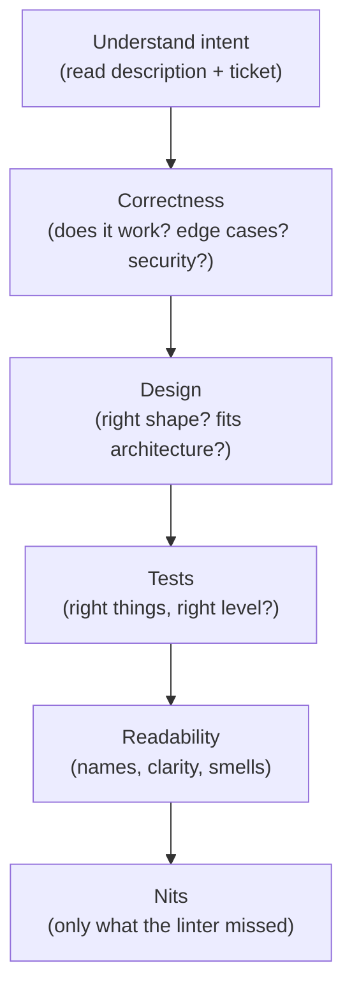

# Engineering Craft 08 — Code Review

> **Series:** Engineering Craft
> **Goal:** Review other people's code well (and in the right order), get your own reviewed fast, and give/receive feedback without ego — because review is where quality and culture are actually set.

---

## Table of Contents

1. [Why Code Review Matters More Than You Think](#1-why-code-review-matters-more-than-you-think)
2. [How to Review: The Right Order](#2-how-to-review-the-right-order)
3. [Severity: Blocker vs Nitpick](#3-severity-blocker-vs-nitpick)
4. [How to Get Reviewed Well](#4-how-to-get-reviewed-well)
5. [Giving Feedback Without Ego](#5-giving-feedback-without-ego)
6. [Receiving Feedback Without Ego](#6-receiving-feedback-without-ego)
7. [Async Etiquette](#7-async-etiquette)
8. [Request Changes vs Approve](#8-request-changes-vs-approve)
9. [Practice: Review a Real Diff](#9-practice-review-a-real-diff)
10. [Self-Check](#10-self-check)
11. [Next](#11-next)

---

## 1. Why Code Review Matters More Than You Think

**In plain words:** Code review is the moment a change stops being one person's opinion and becomes the team's shared code. It's simultaneously a bug filter, a design conversation, a teaching moment, and a culture-setter — the highest-leverage half hour in most engineers' day, and the one they're least trained for.

### Why

Review catches defects *before* they ship (cheaper than any test to add later), spreads knowledge (now two people understand the change, killing bus-factor), enforces shared standards (the clean code and testing norms of **Craft 03–07** live or die in review), and — most underrated — *shapes the team's culture*. How you review teaches juniors what "good" means and whether it's safe to ask questions.

### What

A structured read of a proposed change (a PR/MR) where a peer checks correctness, design, readability, and tests, leaves feedback, and makes an approve/request-changes call. Not a gate to prove you're smart; a collaboration to make the change (and the author) better.

### When & Where

On every non-trivial change, before merge, in your team's PR tool (GitHub/GitLab). Reuse the checklist thinking from **engineering:code-review**; this file is the *craft* of doing it well and humanely.

> **🤔 Wait — with CI, static analysis, and good tests, isn't human review a slow, redundant bottleneck we could automate away?**
> Automation and humans catch *different* things, and confusing them is expensive. Linters and CI catch the mechanical (style, obvious bugs, coverage drops) — and you *should* automate all of that so humans never waste breath on it. But no tool can judge *"is this the right design?", "will the next engineer understand this?", "does this solve the actual problem?", "is there a simpler approach?"* — the judgment calls that dominate real quality. Review is slow only when it's reviewing things a machine should have (fix that with automation) or when PRs are huge (fix that with §4). Done right, review is *faster* overall: catching a design mistake in review costs minutes; catching it after it's shipped and built upon costs weeks.

**✅ Good scenario (where it saves you):** A reviewer notices a PR adds a payment retry with no idempotency key — correct-looking code that would double-charge on retry. Caught in five minutes of review; a production financial incident averted. No linter would have found it; it required understanding the domain.

**❌ Bad scenario (the pain without it):** A team rubber-stamps PRs ("LGTM" in 30 seconds, unread) because review "slows us down." Bugs, inconsistent design, and knowledge silos accumulate. When the one person who understood the payments code leaves, nobody can safely touch it. The review theater gave none of the benefits and all of the false confidence.

**When NOT to over-invest:** A one-line copy fix or a config bump doesn't need a 20-minute deep review — match rigor to risk. And genuine emergencies (a live incident hotfix) may warrant a fast review with a follow-up thorough one. Proportion, always.

---

## 2. How to Review: The Right Order

**In plain words:** Review from the *most important* to the *least* — because if the design is wrong, the variable names don't matter yet. Reviewing in the wrong order (nitpicking commas before checking correctness) wastes everyone's time and buries the important feedback under noise.

The order:

1. **Understand the intent first.** Read the PR description and the linked ticket. What problem is this solving? You can't judge a solution without knowing the problem. If you can't tell, that's your first comment (a description gap — §4).
2. **Correctness.** Does it *do the right thing*? Edge cases, error handling, concurrency, security (injection, authz), data integrity, idempotency. This is where the expensive bugs hide. Use your **Craft 02** debugging instincts: "what input breaks this?"
3. **Design.** Is this the right *shape*? Does it fit the architecture (**System Design**)? Right level of abstraction, sensible boundaries (**Craft 06**), no needless coupling, not over-engineered. Would a simpler approach work? This is the highest-value feedback and the hardest to give after merge.
4. **Tests.** Are the *right things* tested at the *right level* (**Craft 03–04**)? Do tests assert behavior not implementation? Would they catch a regression? Is there a test for the bug this PR fixes?
5. **Readability.** Names, function size, clarity (**Craft 05**). Will the next person understand this? Smells (**Craft 06**)?
6. **Nits.** Style, formatting, typos — *only* things the linter didn't already catch (and if the linter should catch it, fix the linter, not the PR).


*Review top-down by importance. A design flaw makes nit feedback premature.*

> **🤔 Wait — I always start with the small stuff (typos, style) because it's fast and I spot it first. What's wrong with that?**
> It inverts the value and quietly harms the author. If you lead with fifteen style nits and *then* discover the whole approach is wrong, the author has already "fixed" fifteen things that are about to be thrown away — wasted work and a demoralizing signal ("my reviewer cares about commas more than my design"). Worse, a wall of nits *buries* the one comment that matters ("this will double-charge customers") where it's easy to miss. Lead with correctness and design; if those need rework, hold the nits entirely until the shape is settled. Nits are the *last* pass, and often the linter's job, not yours.

---

## 3. Severity: Blocker vs Nitpick

**In plain words:** Not all feedback is equal, and the author can't read your mind about which comments must be addressed before merge and which are take-it-or-leave-it. *Label every comment's severity* — it's the single biggest upgrade to review clarity and keeps a pile of minor suggestions from reading like a rejection.

A simple convention (prefix your comments):

| Tag | Meaning | Blocks merge? |
|---|---|---|
| **`blocker:`** / **`must:`** | Correctness/security/data bug; wrong design | Yes |
| **`should:`** | Real improvement, strong recommendation | Author's call, discuss |
| **`nit:`** | Minor/style/taste; genuinely optional | No |
| **`question:`** | I don't understand — help me | No (until answered) |
| **`praise:`** | This is good, and I'm saying so | No |
| **`fyi:`** / **`suggestion:`** | Non-blocking idea, learning, context | No |

```text
blocker: this retry has no idempotency key — on a retry we'll charge the card twice.
         Suggest passing the order's idempotency key to gateway.charge().

nit: `tmp2` → maybe `discountedTotal`? (non-blocking)

question: why 200ms specifically here — is this the vendor's documented rate limit?

praise: nice use of a guard clause here, the happy path reads really cleanly.
```

Tagging does three things: tells the author what's mandatory vs optional, prevents "death by a thousand nits" from feeling like a wall, and forces *you* to decide whether a comment actually matters (if you can't justify `blocker`, it's probably a `nit`). **Praise is not filler** — calling out good work teaches the team what good looks like and makes critical feedback land better.

**When NOT to:** In a tiny trivial PR, heavy tagging is overkill. And don't inflate severity to get your taste enforced — crying `blocker` on a style preference destroys your credibility for the real blockers.

---

## 4. How to Get Reviewed Well

**In plain words:** A good review starts before anyone reviews — with *you* making your change easy to review. The author owns the reviewer's experience. A small, well-described, self-reviewed PR gets fast, high-quality feedback; a giant unexplained one gets a tired "LGTM" (useless) or sits for days.

- **Small PRs.** The single biggest lever. A 50-line PR gets a real review; a 2,000-line PR gets rubber-stamped because nobody can hold it in their head. Split large work into a *stack* of small, independently-reviewable PRs. Review quality falls off a cliff past a few hundred lines.
- **One concern per PR.** Don't mix a refactor with a feature (**Craft 07** golden rule) — separate PRs so the reviewer can reason about each. A refactor PR says "behavior unchanged, verify structure"; a feature PR says "verify behavior."
- **A description that answers the reviewer's questions before they ask:** *What* does this do, *why* (link the ticket), *how* to test/verify it, *what* you're unsure about, and any screenshots/output. The reviewer should never have to reverse-engineer your intent.
- **Self-review first.** Read your own diff *as a reviewer* before requesting review. You'll catch the debug print you left in, the commented-out code, the confusing name — and every one of those you fix is reviewer goodwill saved for the real issues. This is applying **Craft 01** (reading) and **Craft 06** (smells) to your own diff.
- **Make CI green before requesting review.** Don't make a human find what the machine would have.
- **Call out your own uncertain spots.** "I wasn't sure about the locking here — please check" directs the reviewer's attention to where it's most needed and shows humility, not weakness.

> **🤔 Wait — splitting my work into five small PRs is more overhead than one big one. Isn't that just process for its own sake?**
> The overhead is real and small; the payoff is large and compounding. One big PR *feels* efficient to the author but is brutal for everyone else: it reviews slowly (or not at all — it gets rubber-stamped), it's impossible to revert cleanly if one part is wrong, and it blocks on the *slowest* piece. Five small PRs merge as each is ready, each gets a genuine review, each is a clean revert point, and reviewers stay fresh. The math is well-studied — defect-detection rate collapses past a few hundred changed lines. You're not adding process; you're trading a little authoring effort for much faster, safer delivery. Optimize for the reader (**Craft 01** again).

**✅ Good scenario:** An engineer ships a feature as four stacked PRs (schema, repository, service, endpoint), each 80–150 lines with a crisp description. Each is reviewed in minutes, real bugs are caught in the service PR, and the whole thing lands in a day. Contrast the same feature as one 1,400-line PR that sits for three days and merges half-reviewed.

**❌ Bad scenario:** A dev opens a 3,000-line PR titled "updates" with no description, red CI, a leftover `System.out.println`, and a refactor tangled with the feature. The reviewer can't even find the intent, spends an hour, misses the real bug in the noise, and approves out of fatigue. Everything that went wrong was preventable by the author.

---

## 5. Giving Feedback Without Ego

**In plain words:** Review comments are about the *code*, never the *coder*. The goal is a better change and a colleague who wants to work with you again — not to demonstrate that you're smarter. Tone is not optional politeness; it directly determines whether your feedback gets acted on or resented.

- **Critique the code, not the person.** "This method does two things" — not "you always write god methods." Talk about the diff, not the developer.
- **Ask, don't command, when it's judgment.** "What do you think about extracting this?" invites a conversation; "Extract this." shuts it down (and you might be missing context they have). Reserve directives for genuine `blocker`s.
- **Explain the *why*.** "nit: rename to `discountedTotal` — future readers won't know `t` is post-discount" teaches; a bare "rename this" just asserts authority.
- **Offer a path, not just a problem.** "This could double-charge; passing an idempotency key would fix it" is far more useful than "this is wrong."
- **Praise genuinely (§3).** Especially for juniors — it calibrates their sense of "good" and makes the hard notes land.
- **Assume competence and good intent.** They probably had a reason. Ask before you assume they were careless ("question: was there a reason to skip the null check here?").
- **Prefer suggestions/GitHub suggested-changes for nits** so the author can apply them in one click instead of a back-and-forth.

> **🤔 Wait — all this softening ("what do you think about…", "maybe consider…") feels wishy-washy and slow. If the code is wrong, why not just say so directly?**
> Directness and kindness aren't opposites — the goal is to be *clear* about substance and *considerate* about tone. For a real bug, be unambiguous: "blocker: this double-charges on retry" is direct *and* fine, because it's about the code and states the concrete consequence. The softening ("what do you think about…") is for *judgment* calls where you might be wrong or lack context, not for facts. The failure mode isn't directness; it's *contempt* — sarcasm, "obviously," "why would you…", nitpicking someone into the ground. Those poison the team and, practically, make people defensive so they fix less. Be direct about *what*; be humane about *how*. Clear, kind, and specific — all three, always.

---

## 6. Receiving Feedback Without Ego

**In plain words:** Your code is not you. A comment on your PR is a gift of someone else's attention, even when it stings. The engineers who grow fastest are the ones who treat every review comment as a free lesson rather than an attack to defend against.

- **Separate ego from output.** "This has a bug" is information about the code, not a verdict on your worth. Feel the flinch, then get curious.
- **Assume the reviewer is trying to help.** They spent their time on your change. Even a clumsily-worded comment usually points at something real.
- **Respond to *every* comment** — apply it, or explain why not. Silent dismissal reads as disrespect and stalls the review.
- **Disagree respectfully and with reasons.** "I kept it inline because it's only used here and extracting hurt readability — open to it though" is a fine response. You're allowed to push back; do it with substance, not defensiveness.
- **Don't debate nits — just apply them.** Arguing a `nit:` costs more than the 10-second fix and signals defensiveness. Save your energy for the `blocker`s that matter.
- **Ask when you don't understand.** "Can you say more about the risk you're seeing?" — reviews are a two-way conversation and the best way to learn.
- **Thank reviewers.** It closes the loop and keeps them willing to review well next time.

**✅ Good scenario:** A junior gets ten comments including a real correctness `blocker`. They fix it, ask a clarifying question on one, respectfully explain why they kept one thing, apply the nits without argument, and thank the reviewer. Two reviews later they're making those catches themselves. Review worked as teaching.

**❌ Bad scenario:** An engineer takes every comment as an insult, argues each nit to a standstill, dismisses the correctness concern as "reviewer nitpicking," and merges over objections. The bug ships. Reviewers learn to disengage from their PRs ("not worth the fight"), so quality quietly drops on everything they touch. Ego cost the team its safety net.

---

## 7. Async Etiquette

**In plain words:** Most review happens asynchronously, often across time zones — comments now, reply hours later. Good async etiquette keeps a PR from dragging for days and prevents text-tone misunderstandings (text has no facial expression; assume the worst reading and pre-empt it).

- **Turn reviews around promptly.** A PR blocked on review is a person blocked. Aim to review within a few hours / by next morning; if you can't, say so ("I'll get to this after standup") so the author isn't guessing.
- **Batch your comments; submit as one review.** Don't drip individual comments that fire ten notifications and let the author "fix" things you're about to contradict. Read the whole thing, then submit once.
- **Bias toward unblocking.** "Approve with comments" or "approve, address the nits before merge" keeps things moving when there's no blocker — don't force another full round trip for two style tweaks (§8).
- **Escalate to a call when a thread gets long.** If a comment thread hits 4+ back-and-forths, a 5-minute call resolves it faster than 20 more messages. Then *summarize the decision back in the PR* so it's on the record (and searchable later — **Craft 01** git archaeology, **Craft 10** ADRs).
- **Assume good intent in text.** Written comments read colder than intended. As the author, read charitably; as the reviewer, add a word of warmth or an emoji so "change this" doesn't read as annoyed.
- **Don't let PRs rot.** A stale PR grows merge conflicts and loses context. Nudge, or agree to close it, rather than let it linger for weeks.

**When NOT to be async:** A genuinely contentious design disagreement, an urgent incident fix, or onboarding a brand-new engineer — those are faster and kinder synchronously (a call or pairing). Async is the default, not a dogma.

---

## 8. Request Changes vs Approve

**In plain words:** Every review ends in a verdict, and the verdict carries weight — "Request changes" blocks the merge and (in many tools) demands another round; "Approve" says "ship it." Choosing the right one, and not over- or under-using the block, is a judgment call that shapes how your team moves.

The options and when to use each:

- **Approve** — no blockers; ship it. Use freely when correctness and design are sound, even with open nits you trust the author to handle.
- **Approve with comments / "Approve, address nits before merge"** — the workhorse. No blockers, but a few `nit:`/`should:` items you trust the author to resolve without re-review. Keeps velocity high without abdicating standards.
- **Comment (no verdict)** — you have questions or partial feedback but aren't ready to bless or block; often used mid-conversation or when you're not the deciding reviewer.
- **Request changes** — there's a real `blocker:` (correctness, security, data integrity, fundamentally wrong design). Use it deliberately and *specifically* — say exactly what must change. It's a strong signal; don't spend it on taste.

| Situation | Verdict |
|---|---|
| Bug that corrupts data / security hole | **Request changes** (blocker) |
| Wrong overall design / approach | **Request changes** — discuss early, before more work piles on |
| Solid change, a couple of nits | **Approve** (with comments) |
| Missing a test for the core behavior | **Request changes** if the behavior is risky; else `should:` + approve |
| You don't understand it yet | **Comment** with `question:` — don't block or bless blindly |
| Pure style preferences | **Approve** + `nit:` — never block on taste |

> **🤔 Wait — if I "Approve with nits," what stops the author from just ignoring the nits and merging? Doesn't that make review toothless?**
> It relies on *trust*, and that trust is the point — it's what lets a team move fast without a heavyweight gate on every comma. In a healthy team, "approve with nits" works because authors reliably address them (or explain why not, §6); the social contract holds. If it *doesn't* hold — if people routinely merge over ignored feedback — that's a *culture* problem, not a tooling one, and the fix is a team conversation, not reflexively slapping "Request changes" on everything (which just slows everyone and devalues the block for real emergencies). Reserve the hard block for real blockers; use trust for the rest; fix trust breaches directly. Over-blocking is as corrosive as rubber-stamping — one grinds velocity to zero, the other gives false confidence.

**❌ Bad scenario:** A reviewer "Requests changes" over a variable name, forcing a full re-review cycle for a rename. The author waits a day for the re-approval on a one-word fix. Multiply across a team and review becomes the bottleneck everyone resents and routes around. The block should have been an `Approve` + `nit:`.

---

## 9. Practice: Review a Real Diff

Grab a real PR — one of your own recent ones, an open-source PR, or a teammate's (with permission) — and review it *properly*, producing a written review.

1. **Understand intent (§2):** read the description and ticket. Write one sentence: what problem does this solve? If you *can't*, that's your first comment (`question:` about the missing description).
2. **Work the order (§2):** make one pass each for correctness → design → tests → readability → nits. For correctness, actively ask "what input breaks this?" (**Craft 02**). For tests, ask "would these catch a regression, and do they test behavior?" (**Craft 03–04**).
3. **Tag every comment with severity (§3):** `blocker` / `should` / `nit` / `question` / `praise`. Include *at least one genuine praise* and *at most a handful of nits* (bundle or skip the rest).
4. **Write feedback humanely (§5):** critique code not coder, explain the *why*, offer a path, phrase judgment calls as questions.
5. **Make the verdict call (§8):** Approve / Approve-with-comments / Request-changes — and justify it in one line. If you chose Request-changes, point to the specific blocker.
6. **Self-review drill (§4):** now take one of *your own* recent PRs and review it as a stranger would. List everything you'd have caught before requesting review — that list is your personal pre-flight checklist from now on.

**Deliverable:** a written review (severity-tagged comments + a verdict + justification) and your personal self-review checklist. Success = a peer reading your review would know exactly what's mandatory, what's optional, and would feel *helped*, not judged.

---

## 10. Self-Check

1. Name four distinct things code review provides beyond catching bugs. Why can't CI/linters replace it?
2. List the review order from most to least important. Why is nitpicking style before checking design harmful?
3. What does severity-tagging (`blocker`/`should`/`nit`/`question`/`praise`) accomplish? Why does inflating severity hurt you?
4. Give the single biggest lever for getting reviewed well, and explain why huge PRs get worse reviews.
5. What five things should a good PR description tell the reviewer? Why self-review before requesting review?
6. Contrast a directive vs a question review comment. When is each appropriate?
7. What's the difference between being *direct* and being *contemptuous* in feedback? Which is the real failure mode?
8. As an author, how should you handle a nit you disagree with vs a blocker you disagree with?
9. Give three rules of good async review etiquette. When should you switch to synchronous?
10. When do you "Request changes" vs "Approve with comments"? Why is over-blocking as corrosive as rubber-stamping?

---

## 11. Next

**Documentation.** Review is how a change enters the codebase; documentation is how the *next* person understands it without asking you. A README that gets people running fast, API docs (Javadoc/OpenAPI), inline comments done right (why not what — **Craft 05**), keeping docs near the code so they don't rot, and diagrams-as-docs.
