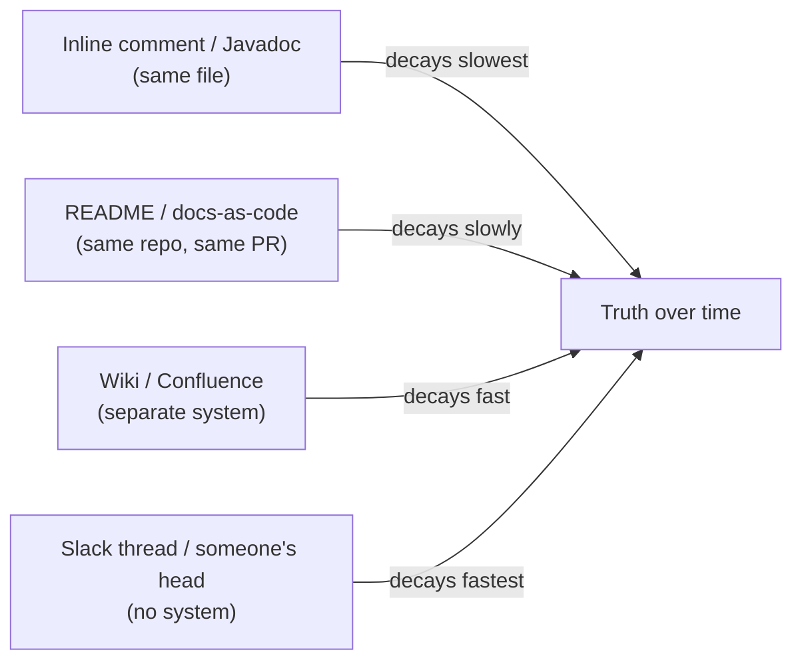
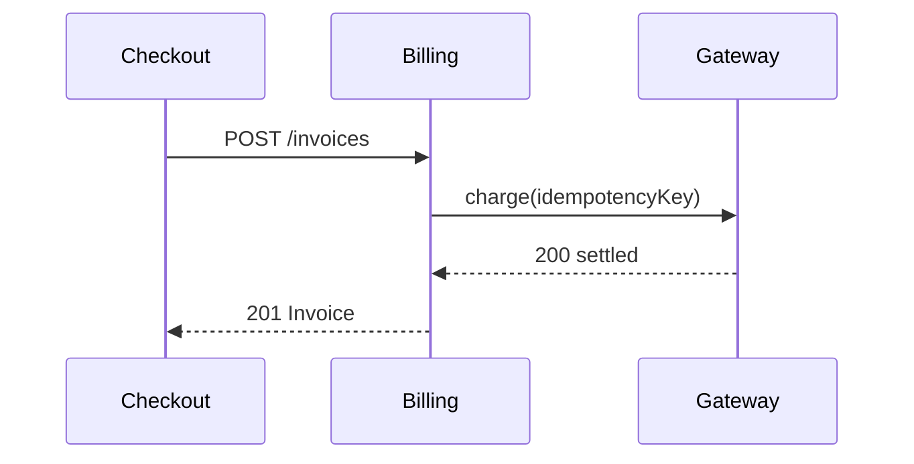
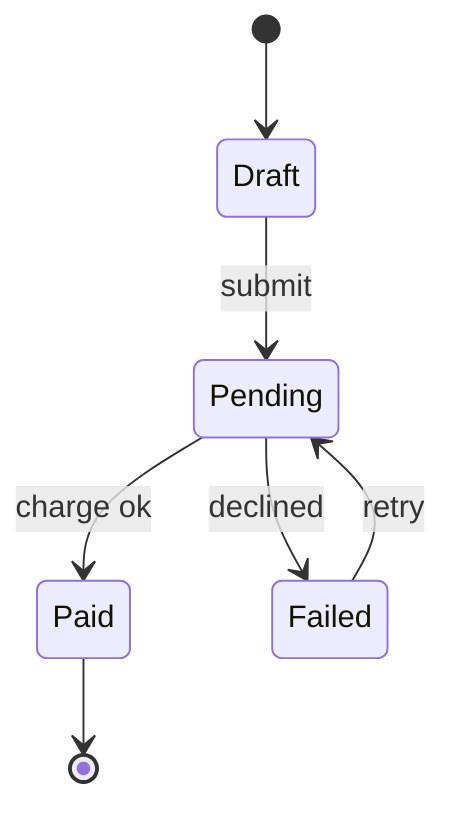

# Engineering Craft 09 — Documentation

> **Series:** Engineering Craft
> **Goal:** Write docs that get people running fast and keep them right — a README that turns a stranger into a running app in minutes, API docs the caller can trust, comments that explain *why*, and diagrams-as-docs — while keeping docs close enough to the code that they don't rot.

---

## Table of Contents

1. [Why Documentation Is a Craft, Not a Chore](#1-why-documentation-is-a-craft-not-a-chore)
2. [The README That Gets People Running Fast](#2-the-readme-that-gets-people-running-fast)
3. [API Docs: Javadoc & OpenAPI/Swagger](#3-api-docs-javadoc--openapiswagger)
4. [Inline Comments Done Right: Why, Not What](#4-inline-comments-done-right-why-not-what)
5. [Docs That Live Near Code vs Docs That Rot](#5-docs-that-live-near-code-vs-docs-that-rot)
6. [Diagrams-as-Docs](#6-diagrams-as-docs)
7. [Changelogs](#7-changelogs)
8. [Practice: Write a README + API Doc](#8-practice-write-a-readme--api-doc)
9. [Self-Check](#9-self-check)
10. [Next](#10-next)

---

## 1. Why Documentation Is a Craft, Not a Chore

**In plain words:** Documentation is the interface between your brain and everyone who comes after you — including future-you at 2 a.m. during an incident. Code tells the machine *what* to do; docs tell humans *why it exists, how to run it, and how to use it safely*. It's the multiplier that turns "only Priya understands the billing service" into "anyone on the team can pick it up."

### Why

Every hour you spend writing a good README saves dozens of hours of other people's time — questions never asked, onboarding never stalled, incidents shortened. Undocumented systems create *bus-factor* risk (knowledge dies when a person leaves), throttle onboarding, and quietly tax every future change. Docs are how a team scales past what any one person can hold in their head.

### What

The full spectrum: **README** (the front door — what/why/quickstart), **API docs** (contracts for callers — Javadoc, OpenAPI/Swagger), **inline comments** (the *why* behind non-obvious code), **architecture docs & diagrams** (the mental model), and **changelogs** (what changed and when). Different audiences, different lifespans, different homes.

### When & Where

Write docs *as you build*, not "later" (later never comes, and by then you've forgotten the why). Keep them in the repo next to the code they describe. This file pairs with the reusable **engineering:documentation** skill — that skill is a workflow; this file is the *craft judgment* of what to write, for whom, and how to keep it alive.

> **🤔 Wait — good code is self-documenting. If I need comments and docs, isn't that a sign my code just isn't clean enough (Craft 05)?**
> Half true, and the half that's false is the expensive half. Clean code (**Craft 05**) *does* eliminate the need for comments that narrate *what* the code does — good names and small functions carry that. But no amount of clean code can express *why* a decision was made ("we retry exactly 3 times because the vendor rate-limits at 4"), *how to run the system* (env vars, dependencies, ports), *what the public contract is* for callers who never read your source, or *the shape of the architecture*. "Self-documenting" covers the *what* inside one file; it says nothing about the *why*, the *how-to-run*, or the *whole system*. Self-documenting code and good docs aren't substitutes — they cover different questions. Skipping docs because your code is clean is like skipping the map because the roads are well-paved.

**✅ Good scenario (where it saves you):** A new hire clones the payments service, follows a 6-line README quickstart, and has it running against a local stack in ten minutes — then ships a fix on day two. The team's onboarding cost dropped from a week of shoulder-tapping to an afternoon.

**❌ Bad scenario (the pain without it):** A revenue-critical service has no README. Every new engineer spends two days reverse-engineering how to run it, DMs three people, and still gets the config wrong. The one author who knows the magic env var goes on holiday, and a deploy stalls for a day. All of it was preventable with fifteen minutes of writing.

**When NOT to:** Don't write a 20-page architecture tome for a throwaway spike or a two-file script — match doc weight to the code's lifespan and audience. A prototype nobody but you will run needs a one-line note, not a manual.

---

## 2. The README That Gets People Running Fast

**In plain words:** The README is the front door. Its single most important job is to take a stranger from "I just cloned this" to "it's running and I understand what it is" as fast as possible. Optimize ruthlessly for *time-to-first-success*.

A README that works, top to bottom:

1. **What it is** (1–3 sentences). What does this project do and who is it for? A reader should know in ten seconds whether they're in the right place.
2. **Why it exists** (1 short paragraph). The problem it solves — context a newcomer lacks.
3. **Quickstart** (the star of the show). The *copy-pasteable* shortest path to a running system: prerequisites, install, run, verify. If someone can't get it running from this section, the README has failed.
4. **Usage** (common tasks). How to actually use it once it runs — key commands, main endpoints, a worked example.
5. **Configuration** (env vars / flags) — a table of what's configurable and defaults.
6. **Contributing** — how to run tests (**Craft 03–04**), the branch/PR flow (**Craft 08**), where to ask questions.
7. **Links** — deeper docs, architecture (§6), changelog (§7), license.

```text
# Billing Service                              <- README.md rendered preview

Charges customers and issues invoices for subscription plans.
Used by: checkout, admin dashboard, dunning jobs.

## Why
Centralizes all payment logic (retries, idempotency, tax) so no
other service touches the payment gateway directly.

## Quickstart                                  (a fenced bash block in the real file)
    git clone https://github.com/acme/billing-service && cd billing-service
    cp .env.example .env          # fill in STRIPE_TEST_KEY
    docker compose up -d          # postgres + the service on :8080
    ./mvnw spring-boot:run        # start the app
    curl localhost:8080/health    # -> {"status":"UP"}   you're running

## Usage
Create an invoice:
    curl -X POST localhost:8080/invoices \
      -H 'Content-Type: application/json' \
      -d '{"customerId":"cus_123","amountCents":4999}'

## Configuration
| Env var           | Default | Purpose                          |
|-------------------|---------|----------------------------------|
| STRIPE_TEST_KEY   | —       | Gateway API key (required)       |
| RETRY_MAX         | 3       | Charge retries before giving up  |
| PORT              | 8080    | HTTP port                        |

## Contributing
`./mvnw test` before every PR. Small PRs, one concern each (see Craft 08).
Full API reference: /swagger-ui.html   Architecture: docs/architecture.md
```

> **🤔 Wait — nobody reads READMEs anyway; they just ask in Slack. Why polish something people skip?**
> They skip *bad* READMEs — walls of prose, out-of-date setup steps, no runnable quickstart — because those have burned them before, so Slack feels faster. A README that reliably gets them running in five minutes *changes the behavior*: people learn to check it first because it pays off. The Slack questions you're drowning in are a *symptom* of a README that doesn't answer them, not proof that READMEs are useless. Every question you answer once in the README is a question you never answer again — the highest-leverage writing you'll do.

**✅ Good scenario:** An open-source library's README quickstart is five copy-paste lines that produce a working "hello world." Adoption climbs because the time-to-first-success is under two minutes; contributors show up because contributing is documented.

**❌ Bad scenario:** A README is 800 words of architecture philosophy and *zero* runnable commands. Every would-be user bounces to a competitor or files "how do I even run this?" issues. Impressive prose, useless front door.

**When NOT to:** A tiny internal script with one obvious command doesn't need seven sections — a two-line README ("what it does, how to run it") is complete. Don't ceremony-pad small things.

---

## 3. API Docs: Javadoc & OpenAPI/Swagger

**In plain words:** API docs are the *contract* for people who call your code without reading its insides — another team, a frontend, a future integrator. Two flavors matter in the Java world: **Javadoc** for library/method-level contracts, and **OpenAPI/Swagger** for HTTP APIs. Both live *in the code* so they can't drift.

### Javadoc — the method contract

Document the *contract*, not the implementation: what it does, params, return, and — critically — what it *throws* and any preconditions. Explain the *why* where it's non-obvious (§4).

```java
/**
 * Charges a customer, retrying transient gateway failures.
 *
 * <p>Idempotent per {@code idempotencyKey}: calling twice with the same key
 * charges once. We retry up to {@code RETRY_MAX} times because the gateway
 * rate-limits bursts — see ADR-0007.  // WHY, not restating the loop
 *
 * @param customerId     gateway customer id, non-null
 * @param amountCents    amount to charge, must be > 0
 * @param idempotencyKey stable key so retries don't double-charge
 * @return the settled charge
 * @throws PaymentDeclinedException if the card is declined (do not retry)
 * @throws GatewayUnavailableException if all retries are exhausted
 */
public Charge charge(String customerId, long amountCents, String idempotencyKey) { ... }
```

Good Javadoc documents the *edges callers can't see*: nullability, ranges, exceptions, idempotency, thread-safety. Bad Javadoc restates the signature (`@param customerId the customer id` adds nothing).

### OpenAPI / Swagger — the HTTP contract

For REST APIs, describe the contract in **OpenAPI 3.1**. The pragmatic path in Spring Boot 3 (2026): add **springdoc-openapi** (2.8.x as of early 2026, Java 21+), annotate, and it generates a live spec + a Swagger UI at `/swagger-ui.html` *from your actual code* — so the docs can't lie about the routes.

```java
@RestController
@RequestMapping("/invoices")
class InvoiceController {

  @Operation(summary = "Create an invoice for a customer")
  @ApiResponse(responseCode = "201", description = "Invoice created")
  @ApiResponse(responseCode = "400", description = "Invalid amount")
  @PostMapping
  ResponseEntity<Invoice> create(@Valid @RequestBody CreateInvoice req) { ... }
}
```

| Aspect | Javadoc | OpenAPI/Swagger |
|---|---|---|
| Audience | Java callers (libraries, internal code) | Any HTTP client (frontends, other services, external) |
| Describes | Classes/methods, params, exceptions | Endpoints, request/response schemas, status codes |
| Output | HTML API reference (`javadoc` tool) | Machine-readable spec + interactive Swagger UI, client codegen |
| Lives in | Source comments | Annotations / spec file, generated from code |
| Best for | SDKs, shared libs, complex method contracts | Microservice REST APIs, public APIs |

> **🤔 Wait — Swagger UI is auto-generated, so isn't API documentation basically a solved, zero-effort problem now?**
> Generation solves *structure* (routes, types, status codes) — it can't solve *meaning*. The tool knows an endpoint takes an `amountCents: integer`; it doesn't know that it must be positive, that a 409 means "duplicate idempotency key," that this endpoint is rate-limited, or *why* you'd use it over a sibling endpoint. Auto-gen gives you an accurate skeleton for free — which is genuinely valuable — but the *useful* docs are the descriptions, examples, and constraints you add on top. Generation kills the drift problem (docs match code); it doesn't kill the writing problem.

**✅ Good scenario:** A frontend team integrates against your Swagger UI, sees the exact request schema, error codes, and an example payload, and ships without a single "what does this endpoint return?" Slack thread. The contract was self-serve.

**❌ Bad scenario:** An API is documented in a hand-maintained wiki page that's six months stale. A caller sends the old field name, gets a 400, and burns an afternoon before someone admits "oh, the wiki's wrong, check the code." Hand-maintained-away-from-code docs *always* rot (§5).

**When NOT to:** A single internal endpoint used only by its own frontend, changed together in one repo, may not need a full OpenAPI spec — a clear controller and a test can be the contract. Reserve heavy API docs for boundaries crossed by *other* teams.

---

## 4. Inline Comments Done Right: Why, Not What

**In plain words:** The golden rule of comments: **explain *why*, never *what*.** The code already says *what* it does. A comment earns its place only when it adds context the code cannot — a reason, a constraint, a warning, a link to the decision. A comment that narrates the code is noise that will rot into a lie.

### The bad comment — narrates the code

```java
// BAD: restates exactly what the code says. Adds zero information,
// and will silently go stale when someone changes the number.
i = i + 1;                       // increment i by 1
int retries = 3;                 // set retries to 3
// loop over the customers
for (Customer c : customers) { ... }
// check if the user is null
if (user == null) { ... }
```

### The good comment — explains why, warns, links

```java
// GOOD: each explains something the code CANNOT say for itself.

// Gateway rate-limits at 4 req/s; 3 retries stays safely under. See ADR-0007.
int retries = 3;

// Sort before the binary search below — the vendor returns unsorted pages.
Collections.sort(pages);

// WARNING: do NOT extract this into a shared helper — the tax service
// depends on this exact rounding (banker's rounding), legal requirement.
BigDecimal tax = amount.setScale(2, RoundingMode.HALF_EVEN);

// TODO(PROJ-482): remove this fallback once all clients send v2 headers.
```

The test for a comment: *does deleting it lose information a competent reader couldn't recover from the code?* If yes, keep it. If the code already says it, delete the comment and let the code speak (**Craft 05** — better names beat comments). If the code is *confusing* and you're tempted to explain it, first ask whether a rename or an extract-method (**Craft 07**) would remove the need for the comment entirely.

> **🤔 Wait — more comments means more documentation, which is more helpful. How can commenting *too much* be bad?**
> Because comments have a maintenance cost and no compiler to keep them honest. Every comment that narrates the code is a second thing to update on every change — and the moment someone changes the code but not the comment (which is *always*, eventually), the comment becomes an active lie that misleads the next reader worse than no comment at all. A codebase littered with `// increment i` also trains readers to *skim past* comments, so they miss the one `// WARNING: legal rounding` that actually matters. Fewer, higher-signal comments (only the *why*) are read and trusted; a flood of *what*-comments is noise that rots into misinformation. Quality over quantity, always.

**✅ Good scenario:** Six months later, an engineer sees `retries = 2` failing intermittently, reads the `// gateway rate-limits at 4/s` comment, understands the constraint instantly, and fixes it correctly. The *why* survived the original author leaving.

**❌ Bad scenario:** A file is 40% `// what`-comments. Someone changes a threshold but not its comment; the next reader trusts the comment, reasons from the stale number, and ships a bug. The comments actively made the code *harder* to reason about than no comments would have.

**When NOT to:** Don't comment to compensate for bad code — fix the code first (**Craft 05/07**). And don't leave commented-out code "just in case"; that's what git is for (**Craft 01** git archaeology). Delete it.

---

## 5. Docs That Live Near Code vs Docs That Rot

**In plain words:** The single biggest predictor of whether docs stay true is *distance from the code*. Docs in the repo, updated in the same PR as the code, stay honest. Docs in a far-off wiki drift into fiction because nothing forces them to change when the code does.

The principle: **the closer a doc lives to the code it describes, the longer it stays true.** Distance is decay.


*The farther a doc lives from the code, the faster it rots into a lie.*

Practices that keep docs alive:
- **Docs-as-code.** Keep prose docs (`docs/*.md`), diagrams (§6), ADRs (**Craft 10**), and the changelog *in the repo*. They get reviewed in the same PR (**Craft 08**) as the code — so a change that breaks a doc gets caught in review.
- **Update docs in the same PR as the code.** "Docs later" is "docs never." If the PR changes behavior, it changes the doc. Make it a review checklist item.
- **Generate what you can.** OpenAPI from annotations (§3), Javadoc from source — generated docs can't drift because they *are* the code.
- **Delete docs that outlived their code.** A wrong doc is worse than no doc. If it's stale and you can't fix it, remove it.
- **Put a "last verified" date on standalone docs.** A reader seeing "verified 2024" on a 2026 read knows to distrust it.

| | Docs near code (in-repo) | Docs far from code (wiki/tribal) |
|---|---|---|
| Reviewed with the change? | Yes (same PR) | No — separate, easily forgotten |
| Rot rate | Slow | Fast |
| Discoverable by devs? | Yes (it's right there) | Only if they know the wiki exists |
| Version-matched to code? | Yes (same git history) | No — one wiki, many versions |
| Best for | Anything tied to the code | Cross-project process, org-wide policy |

> **🤔 Wait — my company standardized on Confluence for all docs. Isn't a wiki the professional, searchable, single-source-of-truth choice over scattered markdown files?**
> A wiki is a fine home for *org-level* docs that aren't tied to one codebase — onboarding, policies, runbooks spanning many services. The failure is putting *code-coupled* docs there: setup steps, API contracts, architecture of one service. Those need to change *with the code*, and a wiki has no mechanism to force that — the code PR merges, the wiki page doesn't, and now it's wrong. "Single source of truth" only holds if the source is kept true, and distance from the code is exactly what breaks that. Use the wiki for what's not code-coupled; keep code-coupled docs in the repo where the same review that gates the code gates the doc.

**✅ Good scenario:** A team keeps `docs/` in-repo. A PR that renames an endpoint fails review until the OpenAPI annotation and the README example are updated in the same PR. Six months on, the docs still match reality because they *had* to.

**❌ Bad scenario:** Setup instructions live in a Confluence page. Twelve code changes later, none of them touched Confluence, and the page describes a system that no longer exists. New hires follow it, fail, and learn to distrust *all* company docs — the rot spreads reputationally.

**When NOT to:** Truly org-wide, code-independent material (HR policy, incident-comms templates, cross-team glossaries) belongs in the shared wiki, not scattered across fifty repos. Match the home to the doc's coupling.

---

## 6. Diagrams-as-Docs

**In plain words:** Some things — request flows, state machines, service topology — are far faster to grasp as a picture than as paragraphs. Keep those pictures as *text* (Mermaid in markdown) so they live in the repo, diff in review, and never become a screenshot nobody can edit.

**Why Mermaid (or similar text-diagram) beats a drawn image:** a `draw.io` PNG or a whiteboard photo can't be diffed, can't be edited by the next person, and rots the instant the system changes because updating it is a chore. A Mermaid block is *text* — it lives beside the code, changes in the same PR, and renders automatically on GitHub/GitLab (Mermaid 11.x, 2026). It applies the §5 principle to pictures.


*A request flow readers grasp in seconds — and that diffs in the next PR.*

What's worth a diagram (and what isn't):
- **Worth it:** system/service topology, a request or data flow across boundaries, a non-trivial state machine, a sequence with several actors. These carry the *architecture* mental model (ties to **System Design**).
- **Not worth it:** anything a short list or the code itself conveys. A diagram of three linear steps is slower to read than three bullet points.


*An invoice lifecycle — a state machine is far clearer as a picture than prose.*

> **🤔 Wait — text-based diagrams look uglier than the polished ones I can make in a dedicated diagramming tool. Why settle for worse-looking?**
> Because the prettiest diagram in the codebase is worthless the moment it's wrong, and drawn images go wrong fastest — nobody re-exports a PNG for a small change, so they don't, so it drifts. A slightly plainer Mermaid diagram that's *correct* because it lives in-repo and updates in the same PR beats a gorgeous PNG that describes last quarter's architecture. Optimize for *true and maintained*, not *pretty and abandoned*. (For a one-off exec slide, sure, use the polished tool — that image isn't meant to live with the code.)

**✅ Good scenario:** A new engineer reads the service's `architecture.md`, sees a Mermaid topology and a sequence diagram, and forms an accurate mental model in five minutes — no need to trace ten files by hand (though **Craft 01** would let them).

**❌ Bad scenario:** The only architecture "doc" is a photo of a two-year-old whiteboard in a Slack pin. It shows services that were deleted and misses three that were added. It actively misleads, and no one can edit it.

**When NOT to:** Don't diagram the trivial or the volatile-and-low-value. A diagram of a linear three-step process wastes the reader's time; a diagram of code that changes weekly will always be behind. Reserve diagrams for structure that's non-obvious *and* stable enough to be worth maintaining.

---

## 7. Changelogs

**In plain words:** A changelog is the human-readable answer to "what changed between the version I had and the version I have now?" It's written for *users of your thing* (an upgrading service, a consumer of your library), not for developers reading git — it curates the *meaningful* changes and, above all, screams about anything that will break them.

A changelog is not `git log`. Git log is every commit ("fix typo," "wip"); a changelog is the *curated, user-facing* subset grouped by impact. The widely-used convention is **Keep a Changelog** with **semantic versioning** (`MAJOR.MINOR.PATCH` — major = breaking).

```markdown
# Changelog

## [2.0.0] - 2026-05-14
### Changed
- **BREAKING:** `POST /invoices` now requires `idempotencyKey`. Callers
  without it get 400. Migration: pass a stable key (see README §Usage).
### Added
- Partial refunds via `POST /invoices/{id}/refund`.
### Fixed
- Retries no longer double-charge on gateway timeout (PROJ-482).
### Deprecated
- `amount` (dollars) — use `amountCents`. Removed in 3.0.

## [1.4.2] - 2026-04-02
### Security
- Patched log4j-style injection in the audit logger.
```

The load-bearing part is **BREAKING changes** — the whole reason a consumer reads a changelog is to know whether upgrading will hurt, and how to migrate. Bury that and the changelog failed. Group by *Added / Changed / Deprecated / Removed / Fixed / Security* so a reader scans to what they care about.

| | `git log` | Changelog |
|---|---|---|
| Audience | Developers of this repo | *Users* of this release (upgraders, integrators) |
| Content | Every commit, verbatim | Curated, meaningful changes only |
| Grouping | Chronological | By impact (breaking / added / fixed) |
| Answers | "Who changed this line and why?" (**Craft 01**) | "Is it safe for me to upgrade?" |

> **🤔 Wait — we use conventional commits and auto-generate release notes from them. Isn't a hand-written changelog redundant now?**
> Auto-generation from good commits gets you 80% there and is worth doing — it's the curated skeleton. But two things still need a human: *emphasis* (a generated list treats "fix typo" and "BREAKING: auth changed" as equal lines; a reader needs the breaking one to *shout*) and *migration guidance* (the generator can say what broke, not how to fix your call site). Auto-gen solves the *collection* problem; a human solves the *what matters and what do I do about it* problem. Generate the draft, then curate the breaking changes and migration notes by hand.

**✅ Good scenario:** A team upgrading your library reads "BREAKING: `idempotencyKey` now required" with a one-line migration, updates their calls in ten minutes, and upgrades cleanly. The changelog did its one job: no surprise breakage.

**❌ Bad scenario:** A library ships a breaking change with only a raw commit dump as "release notes." Consumers upgrade blind, their integration breaks in production, and they spend a day bisecting to find what changed. The information existed; it just wasn't *surfaced* where it mattered.

**When NOT to:** A private app that only you deploy, with no external consumers and continuous deployment, may not need a formal changelog — the deploy history and tickets suffice. Changelogs earn their keep when *someone other than the deployer* depends on knowing what changed.

---

## 8. Practice: Write a README + API Doc

Take a real project — one of yours, a course project, or a small open-source repo — and give it documentation that gets a stranger running fast.

1. **README quickstart (§2):** Write the *what / why / quickstart / usage / configuration / contributing* sections. Then test it for real: on a clean machine (or fresh clone / container), follow *only* your quickstart. Every place you had to guess or reach outside the doc is a bug — fix the README. Success = a copy-paste path from clone to a verified running system.
2. **API docs (§3):** Pick your public surface. If it's a library, write proper **Javadoc** on 3–4 key methods — document params, return, *exceptions*, and the *why* of any non-obvious constraint (§4), not the signature. If it's an HTTP API, add **springdoc-openapi** and annotate 2–3 endpoints so Swagger UI shows schemas, status codes, and an example.
3. **Comments audit (§4):** Open one real source file. Delete every *what*-comment; for each, either the code already says it or improve the name (**Craft 05**). Then add *why*-comments only where a reader genuinely couldn't recover the reason from the code.
4. **One diagram (§6):** Add a single Mermaid diagram (topology, a request flow, or a state machine) to a `docs/architecture.md` — something that gives a newcomer the mental model faster than prose.
5. **Changelog (§7):** Start a `CHANGELOG.md` with your latest release, grouped by impact, with any breaking change called out and a migration note.

**Deliverable:** a README a stranger can run from cold, real API docs (Javadoc or Swagger), a comment-audited file, one diagram, and a changelog entry. Success test = hand it to someone who's never seen the project; if they get it running and understand what it is *without asking you a question*, your docs work.

---

## 9. Self-Check

1. Why doesn't "self-documenting code" remove the need for docs? Name three things clean code *cannot* express.
2. What is the single most important job of a README, and which section serves it? How do you test that section?
3. Contrast Javadoc and OpenAPI/Swagger — audience, what each describes, and when you'd reach for each.
4. State the golden rule of inline comments. Give a bad (what) and a good (why) example, and explain why *too many* comments is actively harmful.
5. Why do docs that live far from the code rot? Name two practices that keep docs true.
6. When *should* you use a wiki/Confluence, and when should docs live in the repo instead?
7. Why is a Mermaid diagram-as-code better than a drawn PNG for architecture that will change? When is a diagram not worth it?
8. How is a changelog different from `git log`? What is the load-bearing part of a changelog and why?
9. "We auto-generate our API docs / release notes, so documentation is solved." What does generation solve, and what still needs a human?
10. Give one case in this file where writing *less* documentation is the right call (a "When NOT to").

---

## 10. Next

**Technical Writing — RFCs & ADRs.** README and API docs describe what *exists*; the next skill is writing to *decide what should exist*. Design docs / RFCs (context → problem → options → trade-offs → decision → risks → rollout), getting buy-in asynchronously, and ADRs — the immutable log of *why* your architecture is the way it is. The `// see ADR-0007` comments you wrote in this file are about to have real documents behind them.
