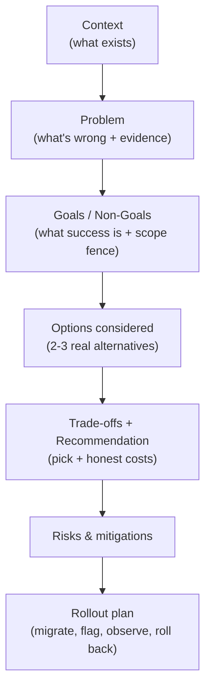
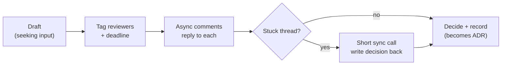
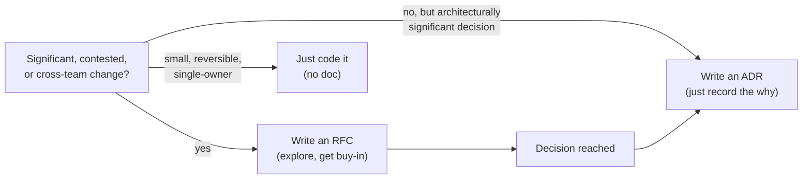

# Engineering Craft 10 — Technical Writing: RFCs & ADRs

> **Series:** Engineering Craft
> **Goal:** Think in writing before you build — a design doc / RFC that earns buy-in *before* the code exists, and an ADR that captures *why* a decision was made so nobody re-litigates it in two years. Writing is thinking made reviewable.

---

## Table of Contents

1. [Why Write a Doc Instead of Just Coding](#1-why-write-a-doc-instead-of-just-coding)
2. [The RFC / Design Doc Structure](#2-the-rfc--design-doc-structure)
3. [Writing for Skimmers](#3-writing-for-skimmers)
4. [Getting Buy-In & Consensus Asynchronously](#4-getting-buy-in--consensus-asynchronously)
5. [ADRs: Capturing the Why](#5-adrs-capturing-the-why)
6. [RFC vs ADR: When to Write Which](#6-rfc-vs-adr-when-to-write-which)
7. [Full Templates](#7-full-templates)
8. [Practice: Write an RFC + an ADR](#8-practice-write-an-rfc--an-adr)
9. [Self-Check](#9-self-check)
10. [Next](#10-next)

---

## 1. Why Write a Doc Instead of Just Coding

**In plain words:** A design doc forces you to think through a change *before* it's expensive to change your mind. Writing exposes the fuzzy thinking that code would let you paper over — you can't write "and then it just handles concurrency" without noticing you don't actually know how. It's the cheapest possible prototype: prose.

### Why

The cost of fixing a design mistake grows brutally the later you catch it — an hour in a doc, a day in review (**Craft 08**), a week after it ships and other things depend on it. A doc surfaces the mistake at the *cheapest* moment, gathers objections from people who know things you don't *before* you've built the wrong thing, and creates a durable record of *why* — so the decision isn't re-argued every six months. Writing is also how you scale a decision beyond a meeting: async, searchable, and inclusive of people in other time zones.

### What

Two related artifacts. An **RFC / design doc** (Request For Comments) proposes a *change* and argues for it: here's the problem, here are the options, here's what I recommend and why, here are the risks. An **ADR** (Architecture Decision Record) is a short, *immutable* record of a single decision and its rationale, written when the decision is made. RFC = "let's decide"; ADR = "here's what we decided and why."

### When & Where

Write an RFC before any change that's *costly to reverse, affects multiple teams, or is genuinely contended* — a new service, a data-model change, a framework choice. Write an ADR whenever a significant architectural decision is *made* (often the outcome of an RFC). These live in the repo (`docs/rfcs/`, `docs/adr/`) as docs-as-code (**Craft 09** §5). Pairs with the **engineering:architecture** skill and echoes **System Design** decision-making.

> **🤔 Wait — writing a doc is slow and I'm a fast coder; I could have a prototype done in the time it takes to write this. Why not just start coding and let the code be the proposal?**
> Because code is the *most expensive* way to explore a design, and a prototype quietly commits you. Once you've built something, sunk cost and momentum push the team to ship *it* rather than the *right* thing — reviewers critique your implementation, not your idea, and "we already built it" wins arguments it shouldn't. A doc is a prototype you can throw away in ten minutes when someone points out the fatal flaw in paragraph two — before you've written a line or anchored anyone's ego. For a small, reversible, single-owner change, yes, just code it (see §6, §When-NOT). But for anything costly-to-reverse or cross-team, the doc is *faster overall*: it front-loads the disagreement to when changing your mind is free. Think of the doc as the compile step for your design.

**✅ Good scenario (where it saves you):** An engineer proposes moving sessions to Redis in a two-page RFC. A reviewer from the platform team comments that Redis eviction would silently log users out under memory pressure — a flaw invisible in code until production. The design changes *before* any code, dodging an incident. The doc paid for itself in one comment.

**❌ Bad scenario (the pain without it):** A team builds a new event pipeline straight into code, no doc. Three weeks in, the data team reveals the schema won't support their reporting — a constraint an RFC would have surfaced on day one. The pipeline is half-rebuilt, deadlines slip, and two teams are annoyed. All the cost of building the wrong thing, none of the cheap early feedback.

**When NOT to:** Reversible, low-blast-radius, single-owner changes don't need an RFC — writing one is bureaucracy that slows delivery and trains people to see docs as ceremony. Match the doc to the *cost of being wrong* (§6).

---

## 2. The RFC / Design Doc Structure

**In plain words:** An RFC is an *argument*, and a good argument has a shape: here's the situation, here's the problem, here's what "good" looks like, here are the options I weighed, here's my pick and honest trade-offs, here's what could go wrong, here's how I'll roll it out. Follow the shape and the reader can *evaluate your reasoning*, not just your conclusion.

The canonical sections, in order:

1. **TL;DR** (2–4 sentences). The whole thing in a nutshell: the problem and your recommendation. Written *last*, read *first* (§3).
2. **Context / Background.** What exists today; what a reader needs to know. Assume a smart colleague who lacks *your* specific context.
3. **Problem.** What's actually wrong, with *evidence* (metrics, incidents, costs). If you can't state the problem crisply, you're not ready to propose a solution.
4. **Goals & Non-Goals.** What success looks like — and, crucially, what's *explicitly out of scope*. Non-goals prevent scope creep and pre-empt "but what about…" derailments.
5. **Options Considered.** *At least two or three* real options (including "do nothing"), each with pros/cons. This is the heart — it proves you explored the space rather than pattern-matching to the first idea.
6. **Trade-offs & Recommendation.** Which option you recommend and *why* — the honest costs, not just the wins. Reason against your own preference.
7. **Risks & Mitigations.** What could go wrong and how you'd handle it. Naming risks *builds* trust, it doesn't undermine you.
8. **Rollout Plan.** How it ships — migration, feature flags, phased rollout, observability (**DevOps**), and rollback. A design that can't be *safely deployed* isn't done.
9. **Open Questions.** Where you want input. Explicit questions get explicit answers.


*An RFC is an argument with a shape — each section lets the reader check your reasoning.*

The load-bearing sections are **Options Considered** and **Trade-offs**. A doc that presents one option as a fait accompli isn't seeking comment — it's seeking rubber-stamps, and reviewers can smell it. Showing the alternatives you rejected, and *why*, is what turns "trust me" into "here's my reasoning, poke holes in it."

> **🤔 Wait — I already know the right answer. Writing out three options I'm going to reject anyway feels like theater to justify a decision I've made. Why bother?**
> Two reasons, both real. First, you're proving your reasoning *to reviewers* — "I picked X" is an assertion; "I picked X over Y and Z because Y can't handle our write volume and Z triples our cloud bill" is an argument someone can *check and improve*. Reviewers who see the alternatives can catch the option you *didn't* consider. Second, you're proving it *to yourself*: the discipline of honestly writing the pros of the options you dislike is exactly when you discover your favorite has a flaw you'd glossed over. If the alternatives genuinely are theater — if the choice is obvious and uncontested — you probably don't need an RFC at all (§6); you need an ADR to *record* the decision. The RFC is for when the answer *isn't* as obvious as it feels at 2 a.m.

**✅ Good scenario:** An RFC's "Options Considered" lists Kafka, SQS, and Postgres-as-a-queue with honest trade-offs. A reviewer spots that SQS's visibility-timeout semantics actually fit the use case better and cost less — the author hadn't weighted operational cost. The doc changed the decision for the better *because* it laid out alternatives.

**❌ Bad scenario:** An RFC presents Kafka as the only option ("here's my Kafka design"). Reviewers can't tell if simpler options were considered, approve it deferentially, and the team runs a Kafka cluster for a workload SQS would have handled at a tenth of the ops burden. The single-option doc hid the better answer.

**When NOT to:** Not every section is mandatory every time — a small RFC can fold risks into the recommendation and skip a formal rollout if it's a code-only change. Use the shape as a checklist of *what to consider*, not a form to pad.

---

## 3. Writing for Skimmers

**In plain words:** Nobody reads your doc the way you wrote it — top to bottom, savoring every word. Busy senior people *skim*: they read the TL;DR, scan the headings, and dive into the one section they care about. Write for that reality or your key point drowns.

Techniques that respect the skimmer:
- **TL;DR at the very top.** The problem and recommendation in 2–4 sentences. A reader who reads *only* this should come away with the gist. Write it last.
- **Descriptive headings.** A reader scanning only your headings should get the skeleton of the argument. "Options Considered," "Rollout Plan" — not "Section 4."
- **Bold the load-bearing sentences.** The recommendation, the key trade-off, the breaking risk — make them survivable at a glance.
- **Short paragraphs, lists, and tables.** A wall of prose repels; a comparison table (§6) invites. Put option trade-offs in a table, not three paragraphs.
- **Put the conclusion first, then support it** (BLUF — bottom line up front). Don't build suspense; this isn't a mystery novel. State the decision, then justify it.
- **Front-load; the deep appendix goes last.** Detailed benchmarks, migration SQL, edge-case matrices — link or appendix them so the main line of argument stays crisp.

```markdown
## TL;DR
Sessions currently live in-process, so we can't scale checkout horizontally
without sticky routing (caused 2 incidents this quarter). **Recommendation:
move sessions to Redis** behind a flag, phased over 2 weeks. Cost ~$40/mo,
main risk is eviction-on-memory-pressure (mitigated by a memory alert).
```

> **🤔 Wait — a good doc should be thorough and complete. Isn't optimizing for skimmers just dumbing it down and rewarding lazy readers?**
> Thoroughness and skimmability aren't in conflict — you keep *all* the depth; you just *structure* it so the reader can navigate to what they need. The senior reviewer skimming your doc isn't lazy; they're triaging fifteen docs this week and their attention is the scarce resource you're competing for. A doc that forces linear reading to extract the point doesn't get read carefully — it gets *skipped*, and then you get no feedback at all. Structuring for skimmers (TL;DR, headings, bold, tables) means the busy expert can grasp the essence in 30 seconds and *then choose* to go deep where it matters. You're not removing depth; you're making depth *reachable*. The appendix still has every benchmark — it's just not blocking the argument.

**✅ Good scenario:** A staff engineer skims an RFC's TL;DR and headings in a minute, jumps straight to "Risks," leaves one sharp comment on the eviction risk, and approves. The doc's structure got expert feedback from someone who'd never have read four dense pages.

**❌ Bad scenario:** An RFC buries its recommendation in paragraph nine of an unbroken wall of text. Reviewers can't find the actual proposal, so they either don't respond (the doc stalls for a week) or skim and miss the breaking risk. The thinking was good; the packaging killed it.

**When NOT to:** A short doc for a small audience doesn't need heavy scaffolding — a TL;DR and two headings suffice. And don't let "skimmable" become "shallow": the depth must still be *there* for the reviewer who does go deep. Structure the depth; don't delete it.

---

## 4. Getting Buy-In & Consensus Asynchronously

**In plain words:** Writing the doc is half the job; the other half is *landing* it — getting the right people to read, object, and agree, mostly asynchronously and across time zones. A brilliant RFC nobody engages with is a diary entry. Buy-in is a process you drive, not a thing that happens to your doc.

How to actually get consensus async:
- **Share early, as a draft.** A doc marked "DRAFT — seeking input" invites shaping; a polished "final" doc invites either rubber-stamps or defensiveness. People engage more when they can still influence the outcome.
- **Tag the right reviewers explicitly, and say what you want from each.** "@platform — does the Redis eviction concern hold?" beats a broadcast "thoughts?" that everyone assumes someone else will answer.
- **Set a decision deadline.** "Comments by Thursday; I'll finalize Friday." Open-ended docs drift forever. A deadline forces the async conversation to converge.
- **Reply to every substantive comment** — resolve it, incorporate it, or explain why not (mirrors **Craft 08** receiving feedback). Silence stalls consensus and reads as dismissal.
- **Distinguish blocking objections from opinions.** Not every comment must change the doc; identify which are *"I'll be blocked / this is unsafe"* vs *"I'd have done it differently."* Address blockers; acknowledge preferences.
- **Escalate a stuck thread to a short synchronous call** — then *write the decision back into the doc*. A 4+ round-trip comment thread is a signal to talk for ten minutes; the *record* still lives in the doc.
- **Drive to a decision and record it.** Consensus is the goal, but unanimous agreement isn't always reachable — someone (an owner or lead) decides, the decision and its rationale go in the doc, and it becomes an ADR (§5). "Disagree and commit" is a valid, healthy outcome.


*Buy-in is a process you drive: draft early, tag, deadline, resolve, decide, record.*

> **🤔 Wait — consensus by committee sounds slow and design-by-committee produces mush. Isn't it faster to just decide and tell people?**
> "Seeking buy-in" is not "seeking unanimous approval," and conflating them is where the fear comes from. The goal is that the people with relevant *context and stake* get a real chance to surface objections you can't see — the platform team's eviction concern, the data team's schema constraint — *before* you build. That's not committee mush; that's cheap error-correction. You still *decide* (or an owner does); you just decide *informed*. The slow, mushy failure mode is different: it's when nobody owns the decision and the doc drifts waiting for everyone to love it. Avoid that with a deadline and a named decider. Fast-but-uninformed ("just decide and tell people") feels efficient and routinely ships the avoidable mistake that a single comment would have caught. Informed-and-owned is the target: gather input, then decide and commit.

**✅ Good scenario:** An RFC shared as a draft with a Thursday deadline and three tagged reviewers gets eight comments, two of which materially improve the design. The author resolves each, holds one 10-minute call on a sticky point, records the decision, and ships with genuine team alignment — no one blindsided later.

**❌ Bad scenario:** An engineer writes a great doc, drops the link in a channel with "thoughts?", and no one responds (diffusion of responsibility, no deadline, no ask). A week later, unshaped and unaligned, they build it anyway — and the objection surfaces in *review* or *production* instead, far more expensively. The doc was fine; the *process* around it was absent.

**When NOT to:** A reversible, low-stakes decision doesn't need a consensus ritual — over-processing trivial choices trains people to ignore your pings for the ones that matter. Reserve the full buy-in drive for decisions that are costly to reverse or cross-team.

---

## 5. ADRs: Capturing the Why

**In plain words:** An ADR (Architecture Decision Record) is a short, dated, *immutable* note that captures a single significant decision: what we decided, the context that forced it, and the consequences we accepted. It answers the question that haunts every codebase — *"why on earth is it done this way?"* — for the person who finds your choice two years later.

**Why ADRs exist:** decisions have *reasons*, and reasons evaporate. Six months on, nobody remembers why you chose Postgres over DynamoDB, and someone "cleans it up" by switching — re-triggering the exact problem the original decision avoided. An ADR freezes the *why* at the moment of maximum context (when you decided), so future engineers can distinguish *"this was a deliberate trade-off"* from *"this was an accident nobody thought about."*

Key properties:
- **Small and single-purpose.** One decision per ADR. A page or less.
- **Immutable.** You don't edit an old ADR to change your mind — you write a *new* ADR that *supersedes* it, and mark the old one "Superseded by ADR-0012." The record is a *log*, so the history of your thinking survives.
- **Numbered and dated.** `docs/adr/0007-use-redis-for-sessions.md`. Sequential, so they read as a decision timeline.
- **Status-tracked.** `Proposed` → `Accepted` → `Superseded` / `Deprecated`.
- **Captures consequences, good *and* bad.** The costs you accepted are the most valuable part — they tell the future reader what pain is *expected* (not a bug to be fixed).

The minimal ADR shape (Michael Nygard's format, still the 2026 default): **Title, Status, Context, Decision, Consequences.** That's it. The power is in the discipline of *always writing one* for significant decisions, not in the template's complexity.

> **🤔 Wait — if the codebase changes, won't old ADRs just become misleading, stale docs? Isn't an immutable record of a decision we've since reversed actively harmful?**
> This is exactly backwards, and it's the key insight about ADRs. An ADR is *not* documentation of the *current* state — it's a record of a *decision made at a point in time*. It's supposed to describe the past; that's its job. When you reverse the decision, you don't delete or edit the old ADR (that would erase *why* you once chose it, and the next person would repeat the mistake) — you write a new ADR that supersedes it, and the old one stays, marked "Superseded by ADR-0012." Now a future reader sees the *whole arc*: we chose Redis (ADR-0007), then moved off it and here's why (ADR-0012). That history is precisely what stops someone from "rediscovering" Redis and re-hitting the eviction problem. A README rots when it lies about the *present*; an ADR can't rot, because it only ever claims to describe a *past decision*. Immutability is the feature.

**✅ Good scenario:** Two years later, an engineer wonders why sessions are in Redis and considers moving them to the database "to simplify." They find ADR-0007, read that sticky-routing incidents drove the decision, realize the DB move would reintroduce the scaling limit, and *don't* make the mistake. The ADR saved a re-learned incident.

**❌ Bad scenario:** A team made a deliberate, hard-won choice to use eventual consistency in the inventory service — but never recorded *why*. A new lead "fixes" it to strong consistency for cleanliness, tanks write throughput, and causes an outage. The reasoning existed once, in someone's head, and left with them. No immutable record, so the lesson had to be relived.

**When NOT to:** Don't ADR trivial or easily-reversible decisions (which linter, a variable name) — that's noise that buries the ADRs that matter. Reserve them for *architecturally significant* choices: ones that are costly to reverse, shape the system, or that a future engineer would reasonably question.

---

## 6. RFC vs ADR: When to Write Which

**In plain words:** They're complementary, not competing. An **RFC decides**; an **ADR records**. You often write an RFC to *reach* a decision, then distill the outcome into an ADR that *preserves* it. Knowing which you need saves you from both over-documenting and under-recording.

| | RFC / Design Doc | ADR |
|---|---|---|
| Purpose | *Propose and decide* a change | *Record* a decision already made |
| Tense | Future ("we should…", "options are…") | Past/present ("we decided…", "because…") |
| Length | As long as the argument needs (1–10+ pages) | Short — a page or less |
| Mutability | Living during review, then frozen | Immutable; superseded, never edited |
| Contains | Options, trade-offs, risks, rollout | Context, decision, consequences |
| Audience | Reviewers whose buy-in you need *now* | Future engineers asking "why?" |
| Written | *Before* building, to get consensus | *When* the decision is made |
| Answers | "What should we do, and is this the right call?" | "Why is it this way?" |

The relationship in practice:


*RFC to decide, ADR to record; small reversible changes need neither.*

Decision rule of thumb:
- **Write an RFC** when the change is *costly to reverse, cross-team, or genuinely contested* — you need to explore options and gather buy-in before building.
- **Write an ADR** when a *significant architectural decision is made* — whether or not there was an RFC. Every accepted RFC should leave an ADR behind; not every ADR needs an RFC (some decisions are clear enough to just record).
- **Write neither** when the change is small, reversible, and single-owner — just build it (§1 When-NOT).

> **🤔 Wait — this is a lot of process. If every accepted RFC becomes an ADR too, am I not writing the same thing twice?**
> They serve different readers at different times, and the "duplication" is tiny because the ADR is a *distillation*, not a copy. The RFC is a 6-page argument aimed at reviewers *this week* — full of options you rejected and trade-offs you weighed, most of which the future reader doesn't need. The ADR is a half-page aimed at an engineer *two years from now* who only needs: what was decided, the context that forced it, and the consequences to expect. Boiling a long RFC down to a one-paragraph ADR takes five minutes and is genuinely different information for a genuinely different audience. Skip it and the RFC gets buried in `docs/rfcs/`, unread, while the code's *why* is lost. The ADR is the durable index into the decision; the RFC is the disposable argument that produced it.

**✅ Good scenario:** A team debates their event-transport choice in a thorough RFC, lands on SQS after weighing three options, and leaves a one-paragraph ADR ("Chose SQS over Kafka; context: our volume is low and we lack Kafka ops expertise; consequence: accept SQS's at-least-once semantics"). A year later a new hire reads the ADR in 60 seconds and understands the whole choice.

**❌ Bad scenario:** A team writes RFCs but never distills ADRs. The decisions are buried in long, forgotten design docs. Newcomers can't find *why* anything is the way it is, so they either ask (bus-factor tax) or "clean up" deliberate choices (incidents). All that RFC effort, and the *why* still didn't survive where people look.

**When NOT to:** Don't force an RFC for a decision that's obvious and uncontested — write the ADR and move on. And don't ADR the trivial (§5). Match the artifact to the *cost of being wrong* and the *need to remember why*.

---

## 7. Full Templates

Copy these into `docs/rfcs/` and `docs/adr/`. Keep them in the repo (docs-as-code, **Craft 09** §5).

### RFC / Design Doc template

```markdown
# RFC-0000: <Short, descriptive title>

- **Author:** <you>   **Reviewers:** @person, @team
- **Status:** Draft | In Review | Accepted | Rejected | Superseded
- **Created:** 2026-07-26   **Decision by:** 2026-08-02

## TL;DR
<2-4 sentences: the problem and your recommendation. Write this LAST.>

## Context / Background
<What exists today. What a smart colleague needs to know to evaluate this.>

## Problem
<What is wrong, with EVIDENCE — metrics, incidents, cost. Be specific.>

## Goals
- <What success looks like — measurable where possible>
## Non-Goals
- <Explicitly out of scope — fences the discussion>

## Options Considered
### Option A — <name>  (RECOMMENDED)
- Pros: ...
- Cons: ...
### Option B — <name>
- Pros: ...
- Cons: ...
### Option C — Do nothing
- Pros: ... / Cons: ...

## Recommendation & Trade-offs
<Which option and WHY. State the honest costs, not just the wins.>

## Risks & Mitigations
| Risk | Likelihood | Impact | Mitigation |
|------|-----------|--------|------------|
| <risk> | Med | High | <how we handle it> |

## Rollout Plan
<Migration, feature flag, phased %, observability (DevOps), rollback.>

## Open Questions
- <Where you want input — tag who should answer>
```

### ADR template (Michael Nygard format)

```markdown
# ADR-0007: Use Redis for session storage

- **Status:** Accepted   <!-- Proposed | Accepted | Superseded by ADR-XXXX | Deprecated -->
- **Date:** 2026-07-26
- **Context RFC:** RFC-0003 (if any)

## Context
<The forces at play. Why a decision is needed NOW. The constraints.
e.g. In-process sessions block horizontal scaling of checkout; caused
2 sticky-routing incidents this quarter.>

## Decision
<The decision, stated plainly and actively.
e.g. We will store sessions in Redis, accessed via a SessionStore interface.>

## Consequences
<What becomes easier AND harder. The costs we accept.
Positive: checkout scales horizontally; sessions survive deploys.
Negative: new Redis dependency to operate; eviction under memory pressure
can drop sessions (mitigated by a memory alert). Extra ~$40/mo.>
```

An ADR should be readable in under a minute. If yours needs more, it's probably an RFC in disguise — split them (§6).

---

## 8. Practice: Write an RFC + an ADR

Pick a *real* change you're facing or would propose — a genuine one, not a toy.

1. **Write the RFC (§2, §7):** Fill the template for real. Force yourself to write **at least three options** including "do nothing," each with honest pros/cons (§2). Put the option trade-offs in a **table**, not prose (§3). Write the **TL;DR last** and make it standalone (§3).
2. **Make it skimmable (§3):** Re-read your draft as a busy reviewer who reads only the TL;DR and headings. Can they get the gist and find the recommendation in 30 seconds? Bold the load-bearing sentences; move deep detail to an appendix.
3. **Run the buy-in process (§4):** Share it as a *draft* with a real deadline and *tag specific people with specific asks* ("@X, does the migration plan hold?"). Reply to every substantive comment. If a thread stalls, take it to a 10-minute call and *write the decision back into the doc.*
4. **Distill the ADR (§5, §7):** Once you (or the group) decide, write the one-page ADR — Context, Decision, Consequences — capturing the *why* and the *costs you accepted*. Number and date it.
5. **Cross-link:** In the code that implements it, add a `// see ADR-0007` comment (**Craft 09** §4) so the decision is discoverable from the code.

**Deliverable:** an RFC that presents a real choice with real alternatives, evidence of the async buy-in process (comments resolved), and a crisp ADR recording the outcome. Success test = a colleague reading only your ADR understands *why* the decision was made and what pain to expect; a reviewer of your RFC could disagree with your *reasoning*, not just your conclusion.

---

## 9. Self-Check

1. Why is writing a design doc *cheaper* than starting with a prototype, given a prototype "works"? What does a doc front-load?
2. List the RFC sections in order. Which two are load-bearing, and why does a single-option RFC fail?
3. What are Non-Goals for, and why do they prevent derailment?
4. Give three techniques for writing for skimmers. Why does optimizing for skimmers *not* mean removing depth?
5. Describe the async buy-in process. Why is "seeking buy-in" different from "seeking unanimous approval"?
6. What is an ADR, and what are its five sections? Why must an ADR be immutable?
7. Explain why an old, "superseded" ADR is *not* a rotted doc — contrast with a rotted README.
8. Fill the table from memory: RFC vs ADR on purpose, tense, mutability, and audience.
9. State the decision rule: when do you write an RFC, when an ADR, and when neither?
10. Give one "When NOT to" from this file — a case where writing a doc is the *wrong* call.

---

## 10. Next

**Estimation & Breaking Down Work.** You've decided *what* to build (RFC) and recorded *why* (ADR). Now: how big is it, and how do you slice a vague ticket into shippable pieces? Turning fuzzy scope into ~1-day *vertical* slices, estimation techniques (t-shirt, story points, three-point/PERT), the cone of uncertainty, spikes for unknowns, and telling non-engineers the truth about "when will it be done?"
