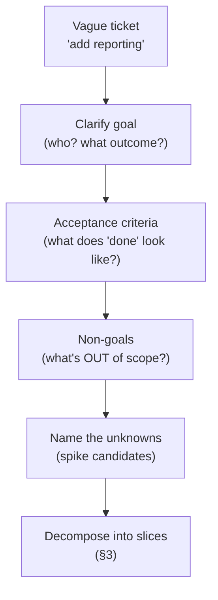
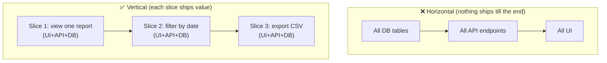
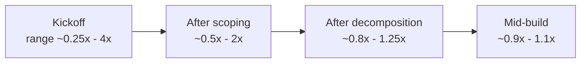

# Engineering Craft 11 — Estimation & Breaking Down Work

> **Series:** Engineering Craft
> **Goal:** Turn a vague ticket into scoped, shippable pieces and give estimates people can actually plan around — decompose into *vertical* slices, pick the right estimation technique, respect the cone of uncertainty, buy down unknowns with spikes, and tell non-engineers the truth without drowning them in caveats.

---

## Table of Contents

1. [Why Estimate at All](#1-why-estimate-at-all)
2. [From Vague Ticket to Scoped Work](#2-from-vague-ticket-to-scoped-work)
3. [Decomposition: Vertical Slices, Not Horizontal Layers](#3-decomposition-vertical-slices-not-horizontal-layers)
4. [Estimation Techniques](#4-estimation-techniques)
5. [The Cone of Uncertainty](#5-the-cone-of-uncertainty)
6. [Padding vs Honesty](#6-padding-vs-honesty)
7. [Spikes: Buying Down Unknowns](#7-spikes-buying-down-unknowns)
8. [Avoiding the Planning Trap](#8-avoiding-the-planning-trap)
9. [Communicating Estimates to Non-Engineers](#9-communicating-estimates-to-non-engineers)
10. [Practice: Decompose a Feature](#10-practice-decompose-a-feature)
11. [Self-Check](#11-self-check)
12. [Next](#12-next)

---

## 1. Why Estimate at All

**In plain words:** An estimate is not a promise — it's a *decision-making input*. The business isn't asking "when exactly?" out of cruelty; they're asking "is this a two-day thing or a two-month thing?" because that answer changes what they prioritize, what they promise customers, and how they staff. Estimation is how engineering participates in those decisions instead of having them imposed.

### Why

Every organization has finite time and infinite ideas. Estimates — even rough ones — are how the org sequences work: build A before B, cut C if it's too expensive, hire if the roadmap doesn't fit. Refusing to estimate doesn't make the need go away; it just means *someone else* (usually someone with less information) guesses for you. Estimation also forces *you* to understand the work before committing — the act of estimating surfaces the unknowns you'd otherwise hit mid-build.

### What

Estimation is producing a *calibrated guess* about the size/effort/duration of work, with an honest sense of the uncertainty attached. Decomposition — breaking a big fuzzy thing into small clear things — is the other half: you can't estimate (or ship) a blob, and small pieces estimate far more accurately than big ones.

### When & Where

At planning: sprint planning, roadmap shaping, "can we hit the launch date?" conversations. You estimate *after* enough understanding to decompose (§2) and *before* committing to a plan. This connects to the **RFC/rollout** thinking of **Craft 10** (a rollout plan implies a rough size) and feeds the delivery cadence your **DevOps** pipeline enables.

> **🤔 Wait — estimates are always wrong, software is notoriously unpredictable, and "no estimates" movements exist. Why estimate at all if I'll just be wrong and then blamed for it?**
> Because the *purpose* of an estimate isn't to be right — it's to inform a decision, and even a wrong-but-honest estimate does that. "This is roughly two weeks, ±a week" tells the business it's not a two-day thing and not a two-quarter thing — and that's often *all they need* to sequence the roadmap correctly. The failure you're afraid of isn't estimating; it's estimating *without communicating uncertainty* and letting a guess get treated as a commitment (§6, §9). The fix for "estimates are wrong" isn't to stop estimating — it's to estimate in *ranges*, re-estimate as you learn (§5), and be honest about confidence. Refusing to estimate doesn't protect you; it just hands the guess to someone with less context and guarantees the plan is built on *their* worse guess. A calibrated range beats both a false precision and a shrug.

**✅ Good scenario (where it saves you):** A PM asks "can we add gift cards before Black Friday?" The team decomposes it, estimates ~3 weeks with real unknowns flagged, and the PM — seeing it won't fit safely — cuts scope to "gift *codes*" (1 week) that ships in time. The estimate enabled a good trade-off *before* the deadline crunch.

**❌ Bad scenario (the pain without it):** A team refuses to estimate ("we'll know when it's done"). Sales promises a customer a feature by month-end based on a hallway guess. It takes ten weeks. The customer churns, and engineering gets blamed for the *sales* guess they never informed. Absent an engineering estimate, the vacuum filled with a worse one.

**When NOT to:** Pure research or a genuinely unknowable task shouldn't get a fake point estimate — time-box a *spike* (§7) instead and estimate *after*. And don't estimate to false precision on trivial work; "small, do it today" is a complete estimate for a one-liner.

---

## 2. From Vague Ticket to Scoped Work

**In plain words:** Most tickets arrive vague — "add reporting," "make search better." You can't estimate or build that; it's a wish, not a task. The first craft move is *interrogating the ticket into clarity*: what exactly, for whom, done when, and what's explicitly *not* included. Scope is something you *create*, not something handed to you.

The moves that turn a wish into scoped work:
- **Clarify the actual goal.** "Add reporting" — for whom, to answer what question? A CSV export and a real-time dashboard are wildly different tickets. Ask until you could explain the *user outcome* in one sentence.
- **Define done (acceptance criteria).** What observable behavior means this is finished? "User can download a CSV of last-30-day orders from the account page." If you can't write acceptance criteria, you don't understand it well enough to estimate.
- **Fence the scope — write non-goals.** "Not this iteration: scheduling, formats other than CSV, more than 30 days." Non-goals (borrowed from **Craft 10** RFCs) are the single best defense against scope creep and runaway estimates.
- **Surface the unknowns.** What don't you know yet? An unfamiliar API, a performance question, an unclear data source. Name them — they're where estimates go wrong (and candidates for a spike, §7).
- **Decompose (§3).** Break the scoped goal into small, independently shippable slices.


*Scope is created: interrogate the wish into a goal, criteria, fences, and known unknowns.*

> **🤔 Wait — asking a pile of clarifying questions makes me look like I don't know what I'm doing, or like I'm stalling. Shouldn't a good engineer just figure it out and build?**
> The opposite is true, and it's one of the clearest junior→senior tells. Juniors take a vague ticket and start coding, then build the *wrong* thing because they guessed at the ambiguity — expensive rework, missed deadline. Seniors ask the sharp questions *first* ("does 'reporting' mean an export or a live dashboard? which matters — I'll build a very different thing") because they know the cost of a wrong assumption dwarfs the cost of a two-minute question. Good clarifying questions signal that you understand the *space* well enough to see the ambiguity others miss. "Just figure it out and build" is fine when the scope is genuinely clear; when it isn't, building on a guess is the *un*professional move. Asking isn't stalling — it's the cheapest possible risk reduction.

**✅ Good scenario:** An engineer takes "make search better," asks two questions, and learns the real problem is that typos return zero results. Scope collapses from a vague rewrite to "add fuzzy matching to the query" — a 2-day slice that solves the actual pain. Clarification shrank a month of guessing into two days of the right work.

**❌ Bad scenario:** A dev grabs "add reporting," assumes it means a full BI dashboard, and builds for three weeks. Turns out the stakeholder wanted a CSV button. Three weeks of the wrong thing, thrown away, because the ambiguity was never interrogated. The ticket was vague; the failure was accepting it as-is.

**When NOT to:** Don't over-interrogate a genuinely clear, small ticket — asking ten questions about "fix the typo on the login button" is its own kind of waste (analysis paralysis, §8). Calibrate clarification to the ticket's ambiguity and size.

---

## 3. Decomposition: Vertical Slices, Not Horizontal Layers

**In plain words:** When you break a feature down, cut it into thin *vertical* slices — each a tiny end-to-end sliver that delivers *working, shippable value* (UI → API → data, all touched) — not *horizontal* layers ("do all the database work," then "all the API," then "all the UI"). Vertical slices ship value early and de-risk continuously; horizontal layers deliver *nothing usable* until the very end.

### Horizontal (the trap) vs Vertical (the craft)

**Horizontal layers** decompose by *technical layer*: build the whole data model, then the whole service layer, then the whole UI. The problem: you have *nothing demonstrable* until all three are done, integration risk is deferred to the end (the scariest time), and if you run out of time you've shipped nothing.

**Vertical slices** decompose by *user-visible capability*: the thinnest possible feature that touches every layer and *works*. Each slice is independently shippable, demoable, and testable (**Craft 03–04**). You get feedback and value from slice one, and integration risk is paid down *continuously*.


*Horizontal layers deliver nothing until the end; vertical slices each ship working value.*

Take "reporting." Decomposed *vertically* into ~1-day slices:
1. **Slice 1:** Show a hard-coded report table on the page (thin UI + one real endpoint + one query). *Shippable, demoable.*
2. **Slice 2:** Make it show real last-30-day data.
3. **Slice 3:** Add a date-range filter.
4. **Slice 4:** Add the CSV export button.

Each slice is a real, mergeable PR (**Craft 08** — small PRs) with its own tests. Ship slice 1, get feedback, and if priorities change after slice 2, you still shipped *something useful*.

| | Horizontal layers | Vertical slices |
|---|---|---|
| First shippable value | Only at the very end | After slice 1 |
| Integration risk | Deferred to the end (worst time) | Paid down continuously |
| Demoable early? | No | Yes, every slice |
| If time runs out | Nothing usable shipped | The slices you finished still work |
| Feedback loop | Late, expensive | Early, cheap |
| PR size (**Craft 08**) | Huge, or blocked on layers | Small, independent |

> **🤔 Wait — it's more efficient to do all the database work at once while I'm 'in the database headspace,' then all the API, then all the UI. Doesn't context-switching per slice waste time?**
> The per-slice context switch is a small, real cost; the horizontal approach's hidden costs are large and often catastrophic. "All the DB first" *feels* efficient, but you're building schema for features you haven't validated — and when the UI slice finally reveals the data model is wrong, you rework the foundation *everything* sits on. You also defer all integration risk to the end, when there's no schedule left to absorb it, and you can demo *nothing* to stakeholders until then (so you get no course-correcting feedback). Vertical slicing trades a little context-switching for early value, continuous de-risking, and the ability to stop at any slice boundary with something that works. In practice, slicing *thin* keeps each vertical small enough that the DB work per slice is tiny anyway. Optimize for shipping value and reducing risk, not for staying in one headspace.

**✅ Good scenario:** A team slices a checkout redesign vertically. Slice 1 (a single working product → cart → pay path) ships in three days and reveals a payments-API assumption was wrong — caught early, cheaply fixed. By launch, integration risk was long gone because every slice had exercised the full stack.

**❌ Bad scenario:** A team builds the same redesign horizontally: two weeks of schema, two weeks of services, then wiring the UI in the final week — where they discover the schema can't support the cart flow. The "efficient" layered plan collapses into a panicked rebuild with no schedule left. Nothing was demoable until it was too late to change course.

**When NOT to:** Some genuinely shared foundation (a schema migration, an auth library) can't be meaningfully slivered and is a legitimate horizontal prerequisite — but keep it *minimal*, do just enough to enable slice 1, and resist "let's build the whole platform first." Thin the horizontal base to the bare minimum; slice everything above it.

---

## 4. Estimation Techniques

**In plain words:** There are a handful of standard ways to size work, and they trade precision for speed and honesty. The key insight behind the popular ones (points, t-shirts) is that humans are *bad* at estimating absolute time but *decent* at estimating *relative* size — "this is bigger than that." Pick the technique that matches your need for precision and your tolerance for the planning overhead.

The main techniques:

| Technique | What it is | Precision | Best for | Watch out |
|---|---|---|---|---|
| **T-shirt sizes** (S/M/L/XL) | Coarse relative buckets | Low | Fast roadmap-level triage, early sizing | Too coarse for sprint planning |
| **Story points** (Fibonacci: 1,2,3,5,8,13) | Relative effort/complexity, not hours | Medium | Team sprint planning, velocity tracking | Meaningless across teams; don't convert to hours |
| **Three-point / PERT** | Optimistic (O), Most-likely (M), Pessimistic (P); estimate ≈ (O + 4M + P) / 6 | Higher | Individual tasks where you want a realistic single number with uncertainty | More overhead; needs decent inputs |
| **Ideal days / hours** | Direct time estimate | Varies | Small, well-understood tasks; individual planning | Confuses "effort" with "elapsed calendar time" |
| **#NoEstimates / count of slices** | Just count small, similarly-sized slices | Low/implicit | Teams with consistent thin slices (§3) | Requires disciplined, uniform slicing |

**Why Fibonacci for points?** The gaps *widen* (5, 8, 13, not 5, 6, 7) because the bigger something is, the *less precisely* you can size it — the scale bakes in the uncertainty. Arguing 8 vs 9 is fake precision; 8 vs 13 is a real "this is meaningfully bigger" signal.

**Three-point (PERT) worked example:**
```text
Task: integrate the new tax API
  Optimistic (everything's smooth):     2 days
  Most likely (normal friction):        4 days
  Pessimistic (their docs are wrong):   9 days
  PERT estimate = (2 + 4*4 + 9) / 6 = 27/6 = 4.5 days
  Spread (P - O) = 7 days  ->  HIGH uncertainty: flag it, maybe spike (§7)
```
The *spread* is as informative as the number — a wide O–P gap screams "unknowns here," which tells you to communicate a range (§9) or buy down the risk with a spike.

**Relative vs absolute — the core comparison:**

| | Story points (relative) | Hours/days (absolute) |
|---|---|---|
| What humans are good at | Comparing sizes ("bigger than X") | Poorly — we're optimistic and forget overhead |
| Affected by who does it? | No (team-relative complexity) | Yes (senior vs junior differ) |
| Good for | Team velocity, planning | Small personal tasks, external commitments |
| Failure mode | Treating points as hours | Ignoring meetings, reviews, testing, unknowns |

> **🤔 Wait — story points are just hours in a costume. Why not skip the abstraction and estimate in hours like a normal person?**
> Because points deliberately break the two things that make hour-estimates lie. First, they separate *size* from *who does it and how fast their week is*: a task is "5 points of complexity" whether a senior or junior takes it, whereas "3 hours" is a different number for each person and useless for team planning. Second, they resist the false precision and pressure that hours invite — "8 hours" gets heard as a promise you'll be done by end of day (ignoring your two meetings, the review round, the flaky test); "5 points" is understood as *relative effort* the team converts to time via its measured *velocity*, which already accounts for real-world overhead. The moment you convert points to hours ("a point is 4 hours"), you've thrown away both benefits and rebuilt the thing points were escaping. Points aren't hours in disguise — they're a deliberate refusal to pretend you can name the hour. For a small personal task, sure, estimate in hours; for team planning under uncertainty, relative sizing plus velocity is the more honest instrument.

**✅ Good scenario:** A team estimates a sprint in points, tracks that they reliably complete ~30 points/sprint (velocity), and forecasts a 90-point epic as ~3 sprints — with the honest caveat that velocity is an average. Planning grounded in *measured* throughput, not wishful hour-math.

**❌ Bad scenario:** A manager decrees "a point = 4 hours" and starts holding devs to points as deadlines. Engineers inflate estimates to protect themselves (§6), the relative signal is destroyed, and points become worse than useless — hour-commitments with extra ceremony. The abstraction was defeated by converting it back to time.

**When NOT to:** Don't run heavy PERT ceremony on trivial tasks, and don't impose story points on a solo project where you just need a personal hour-guess. Match the technique's overhead to the stakes; the goal is a *useful* estimate, not a ritual.

---

## 5. The Cone of Uncertainty

**In plain words:** The earlier you estimate, the less you know, so the wider your estimate's honest range must be. At the very start of a project you might be off by 4x in *either* direction; by the time you're mid-build, the range narrows to ±25%. The "cone" is the shape of that shrinking uncertainty over time — and pretending you're at the narrow end when you're at the wide end is how estimates become lies.


*Uncertainty is widest at kickoff and narrows as you learn; estimate in ranges that reflect where you are.*

What the cone means in practice:
- **Early estimates are ranges, not numbers.** At kickoff, "somewhere between 1 and 4 months" is the *honest* answer. Collapsing that to "2 months" and treating it as firm is the original sin of estimation.
- **Re-estimate as you learn.** An estimate isn't a one-time act; it's refreshed as unknowns resolve. The number you give after decomposition (§3) is far tighter than the one at kickoff — say so and update the plan.
- **Uncertainty shrinks through *work*, not *thinking*.** You narrow the cone by decomposing, spiking (§7), and building — not by staring harder at the ticket. This is why a spike moves you down the cone.
- **Communicate *where on the cone* you are.** "This is an early, wide estimate" vs "we're mid-build, this is tight" is critical context for whoever's planning around you (§9).

> **🤔 Wait — if the range is '1 to 4 months,' that's so wide it's useless. A stakeholder needs a date. Isn't a wide range just a cowardly non-answer?**
> A wide range is *information*, not cowardice — it tells the stakeholder the truth: "we don't yet know enough to commit, and here's how much we don't know." That's genuinely more useful than a confident "2 months" that's really a coin-flip, because a fake-precise number leads to a fake-precise plan that *breaks* — and breaks late, when it's most expensive. If the range is too wide to plan around, that's not a reason to fake a narrow one; it's a signal to *narrow the cone with work* — decompose further, run a spike (§7) — and come back with a tighter honest range. Give the range *plus* a path: "1–4 months now; give me two days to spike the unknown and I'll come back with 1–2 months." The stakeholder gets both honesty and a way forward, instead of a comfortable number that detonates the schedule in month three.

**✅ Good scenario:** A team gives leadership a wide early range for a migration, flags the two big unknowns, spikes them over a week, and returns with a tight ±20% estimate. Leadership plans around the *tight* number and hits the date — because the early honesty bought the room to narrow the cone properly.

**❌ Bad scenario:** Pressured for "a date," an engineer gives a single kickoff number as if it were mid-build-tight. It's off by 3x (well within the early cone's honest range), the launch slips badly, and trust erodes. The estimate wasn't *wrong* — it was *presented as more certain than it was*. The cone was ignored.

**When NOT to:** For a tiny, well-understood task you're already at the narrow end of the cone — don't theater a wide range around "fix the typo." The cone matters most for *large, early, uncertain* work.

---

## 6. Padding vs Honesty

**In plain words:** There's a constant temptation to secretly pad estimates ("say two weeks, it'll really take one, I'll look good / have a buffer"). The craft move is *honesty with explicit buffers* instead of *hidden padding* — because secret padding corrodes trust, hides real risk, and (via Parkinson's law) tends to get consumed anyway.

The distinction:
- **Hidden padding:** silently inflating the number to protect yourself. Feels safe, but: it destroys the *signal* (nobody knows the real size), the padding gets spent anyway (work expands to fill it — Parkinson's law), and when discovered it torches your credibility.
- **Honest estimate + explicit contingency:** "The work is ~1 week; I'm adding buffer for the unfamiliar API, call it 1.5 weeks, and here's why." Now the risk is *visible and negotiable* — the stakeholder can decide whether to accept the buffer, cut scope, or de-risk with a spike.

The honest way to handle uncertainty is to *name it*, not hide it: estimate the work, add contingency *transparently* tied to specific risks, and communicate the range (§5, §9). Buffers aren't dishonest; *hidden* buffers are.

> **🤔 Wait — everyone pads estimates because everyone gets pressured to go faster, then blamed when they're late. Isn't padding just rational self-defense in a system that punishes honesty?**
> The instinct is understandable, but hidden padding *worsens* the exact dynamic you're defending against. When you secretly pad, three things happen: the padding gets consumed anyway (work fills the time), so you're late *even with* the buffer; the real risk stays invisible, so nobody can help you manage it; and the day someone discovers the pad, every future estimate you give is discounted — you've trained them to distrust you, which means *more* pressure, not less. The way out of the "punished for honesty" trap isn't matching dishonesty with dishonesty — it's making uncertainty *explicit and shared*: "1 week of work, plus buffer for this specific unknown, so 1.5 weeks — or give me a day to spike it and I'll tighten that." Now the risk is a *shared* problem, not your secret liability, and you're building the track record that eventually *earns* you the benefit of the doubt. Padding defends the individual estimate at the cost of the trust that makes all future estimates easier.

**✅ Good scenario:** An engineer says "core work is 3 days; the vendor API is a wildcard so I'm adding 2 days of contingency for it — want me to spike it first to shrink that?" The PM opts for the half-day spike, the unknown resolves, and the honest 4-day estimate lands dead-on. Transparency turned a padded guess into a de-risked plan.

**❌ Bad scenario:** A dev quietly doubles every estimate. Work expands to fill it (they're still occasionally late), and when a manager notices tasks "always take exactly the estimate," they start halving all future estimates as "obviously padded" — including the honest ones. The padding poisoned the whole team's estimates and the dev's credibility.

**When NOT to:** Don't over-explain contingency on trivial work — nobody needs a risk breakdown for a one-day task. And "honest" doesn't mean "zero buffer": omitting reasonable contingency and then blowing the estimate is its own dishonesty. Add buffer where risk is real; just make it *visible*.

---

## 7. Spikes: Buying Down Unknowns

**In plain words:** When an estimate is dominated by "I don't know" — an unfamiliar API, an unproven performance assumption, an unclear data source — the answer isn't to guess bigger; it's to *spend a time-boxed chunk learning* until you can estimate for real. That's a **spike**: a short, bounded research task whose *deliverable is knowledge* (and a better estimate), not shippable code.

Key properties of a good spike:
- **Time-boxed.** "Two days, max, to answer: can the tax API handle our batch volume?" The box prevents a spike from becoming an open-ended rabbit hole (§8).
- **Question-driven.** A spike answers a *specific* question. If you can't state the question, you're not spiking, you're wandering.
- **Deliverable is a decision/estimate, not a feature.** The output is "here's what we learned; the real work is now ~X" — often a throwaway prototype, a proof-of-concept, a benchmark. The prototype is *evidence*, not production code (don't ship the spike).
- **Deployed against the *widest* part of your estimate.** Spike the thing with the biggest O–P spread (§4) — the unknown that dominates your uncertainty. Spiking the well-understood part wastes the box.

A spike is how you *move down the cone of uncertainty (§5) with work.* You convert "somewhere between 3 days and 3 weeks" into "4 days, ±1" by spending two days learning. That trade — a small known cost now to eliminate a large unknown risk later — is almost always worth it when the spread is wide.

```text
Before spike:  "Integrate tax API"  -> 3 days to 3 weeks (unknown: does it batch?)
Spike (2 days): prototype a batch call against their sandbox, measure.
After spike:   "It batches fine, but pagination is manual"
               -> real work now ~5 days, ±1.   Cone narrowed.
```

> **🤔 Wait — a spike is time spent *not* building the feature. Isn't that just procrastination dressed up as process — time I could've spent actually making progress?**
> A spike *is* progress — it's progress on the *riskiest* part, which is exactly where progress is most valuable. The alternative isn't "start building sooner and finish sooner"; it's "start building on a guess and discover the fatal unknown three weeks in, after you've built dependent code around a wrong assumption." A time-boxed spike pays a small, *bounded* cost now to avoid a large, *unbounded* cost later — you learn whether the tax API batches *before* you've architected around the assumption that it does. The discipline is in the time-box: a spike that answers its question in two days is high-leverage; one that drifts into an open-ended playground is the procrastination you're worried about (§8). Spike the unknowns that dominate your uncertainty, box it hard, and come back with a real estimate. That's not avoiding the work — it's refusing to build blind.

**✅ Good scenario:** Facing a "3 days to 3 weeks" integration, a team spends a boxed 2-day spike, learns the API rate-limits harder than documented, and re-scopes with a queue. The real work lands on the new estimate. Two days bought certainty that saved a mid-build architectural panic.

**❌ Bad scenario:** A team skips the spike, estimates the integration at "1 week" on a guess, and discovers in week two that the API can't do what they assumed — forcing a redesign of code already built on top of it. The unknown they refused to spend two days resolving cost them two weeks of rework.

**When NOT to:** Don't spike the *known* — if you understand the work, estimate it and build. And don't let a spike become the project: if you're "spiking" for a week with no bounded question, that's analysis paralysis (§8), not a spike. Box it, answer the question, move on.

---

## 8. Avoiding the Planning Trap

**In plain words:** Planning and estimation are tools, not the job. The trap is *over-investing* in them — endless re-estimation, analysis paralysis, gold-plated plans for work that'll change anyway — so that planning becomes a way to *avoid* the discomfort of building under uncertainty. Plan *enough* to make a good decision, then go build and learn.

The failure modes to watch for:
- **Analysis paralysis.** Researching and re-planning forever because committing feels risky. But you learn more from *one built slice* (§3) than from another day of speculation — build to learn.
- **Gold-plated plans.** A 40-hour project plan for a 2-week feature. The plan will be wrong the moment reality hits (the cone, §5); detailed planning of far-future work is largely wasted (it'll be re-planned).
- **Estimating what you should be spiking.** Agonizing over a number for genuinely unknown work instead of time-boxing a spike (§7) to *learn* it.
- **Treating the plan as fixed.** Reality diverges from every plan. The value is in the *planning* (the shared understanding it builds), not the *plan* (the artifact). Adjust as you learn; don't defend a stale plan.
- **Re-estimating too often.** Some re-estimation as you learn is healthy (§5); re-estimating every task daily is overhead that produces no decisions.

The principle: **plan to the horizon you can see, in the detail the decision needs — and no more.** Near work: decompose in detail. Far work: rough size only. Uncertain work: spike, don't estimate.

> **🤔 Wait — you told me to clarify scope (§2), decompose (§3), and estimate carefully (§4). Now you're saying don't over-plan. Where's the line between diligent planning and the planning trap?**
> The line is *decisions*. Planning earns its keep when it produces a decision or reduces a real risk: clarifying scope prevents building the wrong thing; decomposing enables shipping and accurate sizing; a spike resolves a dominant unknown. That's diligence — each step changes what you'll *do*. You've crossed into the trap when more planning stops changing any decision — when you're re-estimating a number that's already good enough to sequence the work, detailing a plan for work three months out that'll be re-planned, or "researching" to postpone the discomfort of committing. Ask: *"will more planning here change a decision, or am I just avoiding the uncertainty of starting?"* If it changes a decision, plan. If it doesn't, that uncertainty gets resolved by *building* (a slice) or *spiking* (a boxed question) — not by more planning. Diligence plans until the next decision is clear, then acts; the trap plans to avoid acting.

**✅ Good scenario:** A team decomposes the next two weeks into detailed slices, sizes the following month roughly, and leaves the quarter as t-shirt guesses. They start building slice 1 on day one, learn fast, and refine the plan with real data. Right-sized planning; momentum from the start.

**❌ Bad scenario:** A team spends three weeks producing a gorgeous 200-line Gantt chart for a six-month project, estimating every task to the hour. Month one blows the whole thing up (the cone, §5), and the meticulous plan is thrown away — three weeks of planning that shipped nothing and predicted nothing. Planning became procrastination with a spreadsheet.

**When NOT to:** This isn't license to *skip* planning — under-planning (diving in with no scope, no decomposition) is the opposite trap and just as costly (§2, §3). The target is *enough* planning for the next decision, refreshed as you learn. Neither paralysis nor recklessness.

---

## 9. Communicating Estimates to Non-Engineers

**In plain words:** An estimate only helps if the *listener* understands it correctly. Non-engineers (PMs, sales, execs) don't speak points or cones — they hear numbers as promises. The craft is translating your honest, uncertain engineering estimate into language a stakeholder can *plan around* without either lying to them or burying them in caveats.

How to communicate estimates well:
- **Give ranges with confidence, not single false-precise numbers.** "Most likely 2 weeks, could be 3 if the vendor API fights us" beats "2 weeks" (heard as a promise) — and beats "1–4 weeks" said with a shrug (heard as "no idea").
- **Translate points/cones into business terms.** Stakeholders don't care about story points; they care about *when* and *how sure*. Say "we're fairly confident this lands before the launch" — not "it's 13 points."
- **Attach estimates to decisions and trade-offs.** "Full version is ~4 weeks; a CSV-only version is 1 week and hits your deadline — which do you want?" Estimation becomes a *scoping conversation*, which is its real value (§1).
- **Name the big risks in plain language.** "The unknown is the tax vendor's API; if it works as documented we're fine, if not add a week. I can spend two days de-risking it." Honest, actionable, no jargon.
- **Update proactively as the cone narrows (§5).** "Two weeks ago I said 2–4 weeks; now that we've built the core, I'm confident it's 2." Stakeholders forgive changing estimates *far* more than surprise slips.
- **Never let a guess get recorded as a commitment.** If pressed for "a date," give a range *and* the confidence, and make sure what gets written down is the honest version, not the optimistic edge (§6).

```text
❌ To a PM:  "It's 8 story points."          (meaningless to them)
❌ To a PM:  "Two weeks."                     (heard as a firm promise)
✅ To a PM:  "Most likely 2 weeks. The risk is the tax API — if it behaves,
             2 weeks; if not, closer to 3. I can spike it in 2 days to be
             sure. Or a CSV-only version is 1 week and hits your date."
```

> **🤔 Wait — stakeholders want a date, full stop. If I answer with ranges and risks and caveats, won't they just hear waffling and push me for 'the real number'?**
> They push for a single number when they don't trust the range — and the fix is to give a range that's *decision-ready*, not to fold and give a fake number. "Most likely 2 weeks, up to 3 if the vendor API fights us" *is* a real answer: it gives them a planning number (2 weeks) *and* the downside to hedge against (3). That's more useful to a good planner than a bare "2 weeks," because now they can decide how much risk to carry. If they still push for a hard commitment, that's the moment to convert uncertainty into a *choice*: "I can commit to 2 weeks if we cut the export to CSV-only, or give me two days to de-risk the vendor API and I'll commit to a firm date." You're not waffling — you're refusing to convert a guess into a promise that will break *their* plan when it slips. The stakeholders who've been burned by confident-then-wrong estimates learn to *prefer* the honest range. Trust is built by the estimate that came true with its caveats, not the confident one that detonated.

**✅ Good scenario:** An engineer tells a launch-focused PM "2 weeks likely, 3 if the vendor fights us — or 1 week for a CSV-only cut that safely hits your date." The PM picks the safe cut, ships on time, and *trusts the next estimate* because this one was framed as an honest trade-off, not a promise. Estimation did its real job: enabling a good decision.

**❌ Bad scenario:** Pressured, an engineer blurts "two weeks," it gets written into a customer contract as a commitment, the vendor API fights them, and it takes four. Sales is blindsided, the customer's angry, and every future estimate from that engineer is now met with "are you sure?" A single unqualified number, treated as a promise, cost the trust that makes estimating bearable.

**When NOT to:** Don't over-hedge trivial, certain work — "it'll be done today" is the right answer for a one-liner, and drowning a simple ask in risk-caveats erodes trust as surely as false precision. Calibrate the caveats to the *actual* uncertainty.

---

## 10. Practice: Decompose a Feature

Take a real feature — a genuine one from your work or a plausible one (e.g. "add CSV export of orders to the account page").

1. **Scope it (§2):** Write the one-sentence user outcome, 3–5 acceptance criteria, and an explicit **non-goals** list. Then list the **unknowns** — anything you'd have to guess at.
2. **Spike the biggest unknown (§7):** For your top unknown, define a *time-boxed, question-driven* spike ("2 days, max, to answer: does X?"). State what the deliverable is (a decision + tighter estimate), not code to ship.
3. **Decompose vertically (§3):** Break the feature into **~1-day vertical slices** — each touching UI→API→data and independently shippable/demoable. Confirm slice 1 alone delivers *some* real value. If any slice is a pure horizontal layer ("all the DB"), re-slice it.
4. **Estimate each slice (§4):** Size each slice — pick a technique (points, t-shirt, or three-point) and *say which and why*. For your most uncertain slice, do a **three-point (PERT)** estimate and note the O–P spread.
5. **Locate yourself on the cone (§5):** State how confident you are and what would narrow the range.
6. **Write the stakeholder message (§9):** Draft the 3–4 sentence version you'd actually send a PM — a range with confidence, the key risk in plain language, and a scope trade-off option. No jargon, no single false-precise number.

**Deliverable:** a scoped feature (outcome + criteria + non-goals + unknowns), a boxed spike for the top unknown, a list of ~1-day vertical slices each estimated, your position on the cone, and a jargon-free stakeholder message offering a trade-off. Success test = a teammate could pick up any single slice and ship it independently, and a PM could plan around your message without hearing a false promise.

---

## 11. Self-Check

1. What is the *purpose* of an estimate if estimates are always somewhat wrong? Why doesn't "refuse to estimate" solve anything?
2. Name three moves that turn a vague ticket into scoped work. Why do good clarifying questions signal seniority, not confusion?
3. Contrast vertical slices and horizontal layers. Why does horizontal decomposition defer risk to the worst possible time?
4. Give an example of a ~1-day vertical slice for a feature of your choice. What makes it a *slice* and not a *layer*?
5. Why does story-point estimation use a Fibonacci scale? Why is converting points to hours self-defeating?
6. Work a three-point (PERT) estimate for O=2, M=5, P=14. What does the O–P spread tell you?
7. What is the cone of uncertainty? Why is a wide *early* range more honest — and more useful — than a confident single number?
8. Distinguish hidden padding from an explicit buffer. Why does hidden padding corrode trust *and* fail on its own terms?
9. What are the properties of a good spike? How does a spike move you down the cone?
10. How should you frame an estimate to a non-engineer? Why does a decision-ready range beat both "8 points" and a bare "2 weeks"?

---

## 12. Next

**Capstone + Interview/Promotion Prep.** You now hold the full craft toolkit — reading, debugging, testing, clean code, refactoring, review, documentation, RFCs/ADRs, and estimation. The finale ties **files 01–11** into one worked loop on a real messy codebase, then arms you with model interview answers, a junior→staff promotion-signal map, and a gap-analysis you'll use to steer the rest of your career.
