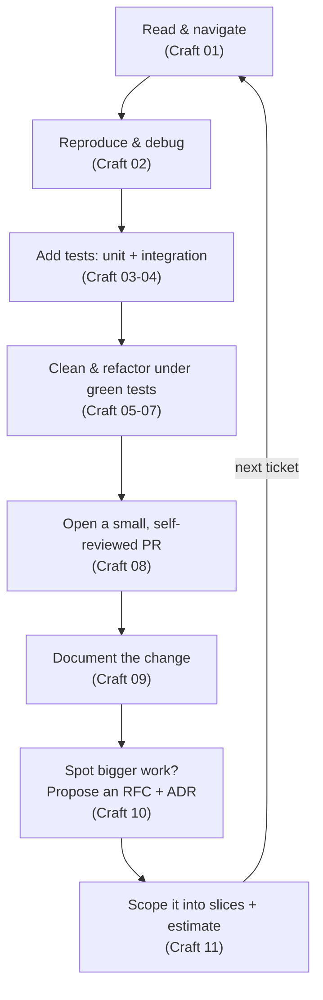
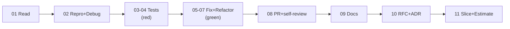
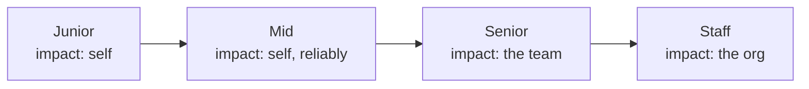

# Engineering Craft 12 — Capstone + Interview/Promotion Prep

> **Series:** Engineering Craft
> **Goal:** Prove the whole craft on one real messy codebase — read it, debug it, test it, refactor it, review it, document it, propose an improvement as an RFC, and scope it with estimates — then translate that craft into interview answers and promotion signals that move you from junior to staff.

---

## Table of Contents

1. [Why a Capstone](#1-why-a-capstone)
2. [The Craft Loop](#2-the-craft-loop)
3. [The Capstone: Step-by-Step](#3-the-capstone-step-by-step)
4. [Interview Craft: Model Answers](#4-interview-craft-model-answers)
5. [Promotion Signals: Junior → Staff](#5-promotion-signals-junior--staff)
6. [Gap-Analysis Template](#6-gap-analysis-template)
7. [Practice: Run Your Own Capstone](#7-practice-run-your-own-capstone)
8. [Self-Check](#8-self-check)
9. [Graduation](#9-graduation)

---

## 1. Why a Capstone

**In plain words:** You've learned eleven skills one at a time. But real engineering never uses them one at a time — a single ticket makes you read, debug, test, refactor, review, document, and estimate *in one continuous flow*. The capstone is where the isolated skills fuse into a *loop*, the way a musician stops practicing scales and plays a piece. It's the difference between *knowing* the craft and *having* it.

### Why

Skills learned separately stay separate until you *integrate* them under real conditions. The capstone forces integration: you'll feel how debugging (**02**) needs reading (**01**), how refactoring (**05–07**) is only safe under tests (**03–04**), how a good PR (**08**) needs docs (**09**), and how proposing bigger work needs an RFC (**10**) scoped with estimates (**11**). That felt sense of *how the skills chain* is what no single-topic file can teach — and it's exactly what separates someone who "took a course" from someone who can walk into a legacy codebase and make it better.

### What

A single worked exercise on a *real, messy* codebase — ideally an unfamiliar open-source repo with open bug issues, or a gnarly corner of your own work. You'll run the full craft loop end to end and produce real artifacts: a debugged fix under new tests, a refactor, a well-scoped PR with a self-review, docs, an RFC, and an estimate.

### When & Where

Do this now, as the capstone of the series — then re-run the *loop* (§2) as your default operating rhythm on every real ticket for the rest of your career. This file also converts that loop into **interview** answers (§4) and **promotion** signals (§5) so the craft pays off in your actual career, not just your codebase.

> **🤔 Wait — I passed the self-checks on all eleven files. Isn't a capstone just busywork repeating what I already proved I know?**
> Passing a self-check proves you understand a skill *in isolation, when you know which skill you're being tested on*. Real work never announces which skill it needs — a ticket just says "checkout is broken sometimes," and *you* have to reach for reading, then debugging, then testing, then refactoring, in the right order, under uncertainty, without a chapter heading telling you which one. That *sequencing and selection under real mess* is a distinct skill the self-checks can't test, and it's the one interviewers and promotion committees actually probe ("walk me through how you'd approach X"). The capstone is where you discover the gaps between *knowing* each skill and *chaining* them — the flaky-test you can't reproduce, the refactor that has no test to protect it, the fix you can't explain in a PR. Those gaps only show up when the skills collide on one real problem. That's not busywork; that's the reps that turn knowledge into craft.

**✅ Good scenario (where it saves you):** An engineer runs the capstone on an unfamiliar open-source repo, ships a tested bug fix as a clean PR, and writes an RFC for a bigger improvement. Weeks later in a job interview, "how do you approach an unfamiliar codebase?" isn't a hypothetical — they narrate exactly what they *did*. The story lands because it's real.

**❌ Bad scenario (the pain without it):** Someone finishes every file, aces every quiz, then freezes on their first real legacy ticket — the skills are all there but *disconnected*, and they don't know which to reach for first or how the fix, tests, and PR fit together. They revert to hacking blindly. Knowledge without integration didn't transfer.

**When NOT to:** If you're already fluently running this loop on real tickets daily, you don't need a contrived capstone — your *job* is the capstone. This is for consolidating the skills before they're second nature.

---

## 2. The Craft Loop

**In plain words:** The eleven skills aren't a checklist you complete once — they're a *loop* you run on every meaningful change. Understand the code, make it fail on demand, protect it with tests, improve it safely, get it reviewed, document it, and — when you spot bigger work — propose and size it. Then repeat. Seeing the loop is seeing the whole craft at once.

*The craft loop: every skill in the series, in the order a real change actually uses them.*

Why *this* order (and why it's a loop, not a line):
- **Reading first (01)** — you can't safely change what you don't understand. Every downstream step depends on an accurate mental model.
- **Debugging needs a repro (02)** — and a repro is often the seed of a *test* (03), so debugging flows straight into testing.
- **Tests before refactoring (03–07)** — refactoring is only "behavior-preserving" if tests *prove* behavior is preserved. Green tests are the safety net that makes cleanup fearless.
- **Review, then docs (08–09)** — the change enters the codebase through review and stays understandable through docs.
- **RFC + estimate close the loop (10–11)** — the *"this whole area needs rework"* insight you gained by living in the code becomes a proposal, sized into slices, feeding the *next* ticket.

The loop connects outward to your other courses too: the *design* you refactor toward is **System Design** (SOLID, boundaries); the *deploy and observe* step your PR triggers is **DevOps**; the *data* your fix touches is **DB Engineering**. Craft is the inner loop inside those larger systems.

> **🤔 Wait — this loop looks heavyweight. For a one-line fix am I really supposed to read, debug, test, refactor, review, document, RFC, and estimate?**
> No — the loop is the *full* toolkit, and craft is knowing *how much of it each change deserves*. A one-line typo fix uses reading (glance at context), maybe a test if the bug was untested, a tiny self-reviewed PR, and a one-line changelog if it's user-facing — and *skips* refactoring, RFC, and estimation entirely, correctly. A gnarly intermittent production bug in a critical service uses *every* step, deeply. The loop isn't a mandatory ceremony you run at full weight every time; it's the menu you *select from* proportionally to risk and size — the exact "match rigor to stakes" judgment every file in this series has drilled (**Craft 08** review depth, **Craft 11** planning weight). The skill isn't running all eight steps; it's *knowing which steps this change needs* and doing those well. Over-applying the loop to a typo is as much a craft failure as skipping tests on a payments change.

**✅ Good scenario:** An engineer hits a production bug, instinctively runs the loop — reads to locate it, writes a failing test that reproduces it, fixes under green, refactors the messy method they were in, ships a small PR with a clear description and an ADR for the design tweak. The fix is done *right* in one smooth pass because the loop is muscle memory.

**❌ Bad scenario:** A dev fixes a bug by hacking until symptoms vanish (no repro, no understanding — skipped 01–02), adds no test (skipped 03), leaves the mess (skipped 05–07), and opens a 900-line unexplained PR (ignored 08–09). The bug recurs, the reviewer can't follow it, and the "fix" seeds two new bugs. Every skipped loop step became a downstream cost.

**When NOT to:** Don't run the loop at full weight on throwaway spikes (**Craft 11** §7) or genuine one-off scripts — right-size it. And in a live incident, a fast hotfix *now* with the full loop as a *follow-up* is correct. Proportion always beats dogma.

---

## 3. The Capstone: Step-by-Step

**In plain words:** Here's the concrete plan. Pick one real messy codebase and take one real issue through the entire loop, producing a real artifact at each step. Don't simulate — *do* it. The artifacts are the proof.

**Setup — pick your codebase and issue.** Best choice: an unfamiliar, active open-source Java repo with open bug issues (real mess, real stakes, and your PR could actually merge). Alternative: a gnarly module in your own work. Pick *one* concrete bug issue — ideally one with a reproduction hint but no fix.

**Step 1 — Read & navigate (Craft 01).** Before touching anything, build a mental model. Find the entry point for the affected feature, trace the call path, use git archaeology (`git log`/`blame`) to learn *why* the suspicious code is the way it is. *Artifact:* a few sentences describing how the feature works and where you think the bug lives.

**Step 2 — Reproduce & debug (Craft 02).** Make the bug happen *on demand* — the single most important debugging move. Form a hypothesis, use the scientific method (change one thing, observe), bisect if needed. Find the *root cause*, not the symptom. *Artifact:* reliable reproduction steps + one-sentence root-cause statement.

**Step 3 — Add tests: unit + integration (Craft 03–04).** Write a **failing test that reproduces the bug** *before* you fix it (your repro from Step 2 becomes the test — TDD's red step). Add a unit test for the specific logic and, if the bug crosses a boundary, an integration test. *Artifact:* a red test that proves the bug.

**Step 4 — Fix under green, then clean & refactor (Craft 05–07).** Make the failing test pass — that's the fix. *Now*, with green tests as your safety net, clean up: rename for clarity (**05**), address the smell that let the bug hide (**06**), refactor the method in small safe steps (**07**), re-running tests constantly. Keep the fix and the refactor as *separate commits* (**Craft 07** golden rule). *Artifact:* green tests + a cleaner method than you found.

**Step 5 — Open a well-scoped PR & self-review (Craft 08).** Split if needed (fix PR vs refactor PR — one concern each). Write a description that answers the reviewer's questions: what, why (link the issue), how to verify, what you're unsure about. Then **self-review your own diff as a stranger** — catch the debug print, the confusing name — *before* requesting review. *Artifact:* a small, self-reviewed PR with a real description.

**Step 6 — Document it (Craft 09).** Add a *why*-comment where the fix is non-obvious (not a *what*-comment). Update the README/changelog if behavior changed. If you touched a public contract, update the Javadoc/OpenAPI. *Artifact:* a doc change that helps the next person.

**Step 7 — Propose a bigger improvement as an RFC + ADR (Craft 10).** Living in the code, you saw a larger problem (this whole area needs rework, this dependency is wrong). Write a short RFC — context, problem with evidence, 2–3 options, recommendation, risks, rollout — and, for any decision you'd lock in, an ADR. *Artifact:* an RFC + ADR for the larger improvement.

**Step 8 — Scope it with estimates (Craft 11).** Decompose the RFC's proposal into **~1-day vertical slices**, size each (pick a technique and say why), locate yourself on the cone of uncertainty, and write the plain-language stakeholder message with a range and a trade-off. *Artifact:* a sliced, estimated plan + a stakeholder-ready message.

*Eight steps, eight real artifacts — the whole series on one real bug.*

> **🤔 Wait — this is a lot of work for one bug fix. In a real job I'd just fix it and move on. Isn't the full eight-step version over-engineering?**
> For the capstone, the *point* is to run all eight so you feel how they chain — that's the training, and you do it deliberately once. In the *job*, you're right that not every bug earns all eight, and §2's "match rigor to stakes" governs which you skip. But notice how many of these steps busy engineers wrongly skip on bugs that *did* deserve them: shipping a fix with no test (Step 3) so it silently regresses; leaving the smell that hid the bug (Step 4) so the next bug hides there too; opening an unreviewed-by-yourself PR (Step 5) that wastes a reviewer's time; never writing the RFC (Step 7) for the rework you *know* is needed, so the debt compounds forever. The capstone's discipline isn't over-engineering — it's building the *instinct* for which steps a change needs, so that when you skip one on the job it's a *choice*, not a blind spot. Do it heavy once here; calibrate for life after.

**✅ Good scenario:** An engineer runs the full capstone on an open-source repo, and their tested, cleanly-refactored, well-documented PR *merges upstream*. The RFC sparks a real maintainer discussion. They now have a public artifact of end-to-end craft — worth more in an interview than any certificate.

**❌ Bad scenario:** Someone shortcuts the capstone — fixes the bug, skips the test and the self-review, opens a messy PR. It gets rejected by maintainers, the bug isn't provably fixed, and there's no artifact to show. The shortcut produced nothing demonstrable and taught none of the integration.

**When NOT to:** Don't stall picking the "perfect" codebase — any real messy repo with an open bug works. Analysis paralysis (**Craft 11** §8) about *which* capstone is itself a failure to just start.

---

## 4. Interview Craft: Model Answers

**In plain words:** Interviews increasingly probe *craft*, not just algorithms — "how do you approach an unfamiliar codebase?", "walk me through debugging a production issue." These reward *process*, not a memorized answer. Below are model answers grounded in this series; adapt them to *your* real capstone stories, because a specific lived example always beats a generic script.

### "How would you approach an unfamiliar codebase?"

> "I resist the urge to start changing things and spend real time *reading* first (**Craft 01**). I find the entry point for the feature I care about and trace one path end to end rather than reading everything — depth over breadth. I lean on the tools: `grep`/IDE search to locate, and *git archaeology* — `git log` and `blame` — to learn *why* code is the way it is, since the history often explains the weirdness. I run the tests to see what the code claims about itself. I build a small mental model or diagram before touching anything. The mistake I avoid is editing before understanding — that's how you break invisible invariants."

Why it lands: shows *reading as a deliberate skill*, names concrete tools, and demonstrates the judgment to *not* dive in blind.

### "Walk me through debugging a production issue."

> "First, I make it *reproducible* (**Craft 02**) — a bug I can trigger on demand is nearly solved; one I can't is guesswork. I check observability first — logs, metrics, traces (**DevOps**) — to localize *where* and *when* it happens. Then I work the scientific method: form a hypothesis, change *one* variable, observe, repeat — bisecting the problem space rather than randomly poking. I chase the *root cause*, not the symptom; making the error message disappear isn't fixing it. Once I've found it, I write a *failing test that reproduces it* (**Craft 03**) *before* I fix, so I've proven the bug and guaranteed it can't silently come back. Then I fix under a green test."

Why it lands: repro-first, observability, one-variable discipline, root cause, and the test-before-fix habit — pure senior signal.

### "Review this code snippet."

> "I review in *order of importance* (**Craft 08**), not top-to-bottom. First, intent — what's this trying to do? Then *correctness*: edge cases, error handling, concurrency, security like injection or a missing idempotency key — the expensive bugs. Then *design*: is this the right shape, does it fit the architecture (**System Design**), is there a simpler approach. Then *tests*: are the right things tested at the right level (**Craft 03–04**). Then readability and *only then* nits — and I'd tag each comment's severity so you know what's a blocker versus a nit. I'd also call out something done well; review is teaching, not gatekeeping."

Why it lands: the correctness-first ordering and severity-tagging show you review like a senior, and the "call out what's good" note shows you understand review as culture.

### "How do you decide what to test?"

> "I think in terms of the test pyramid and *risk* (**Craft 03–04**). Lots of fast unit tests on the logic and edge cases; fewer integration tests at the boundaries that actually break — DB, external APIs; very few end-to-end tests on critical user journeys. I test *behavior, not implementation*, so tests survive refactoring (**Craft 07**). I prioritize by risk and change-frequency: the payments path gets thorough tests; a stable config loader gets less. And every bug I fix gets a regression test first (**Craft 02–03**). I'm not chasing 100% coverage — I'm covering what's *risky* and what *changes*."

Why it lands: pyramid + risk-based prioritization + behavior-not-implementation + regression-test habit — shows testing *strategy*, not dogma.

### "How do you estimate a task?"

> "I decompose before I estimate — you can't size a blob (**Craft 11**). I break the work into thin *vertical* slices, each shippable, and size those. I estimate in *ranges* because of the cone of uncertainty — early estimates are honestly wide, and I narrow them as I learn or by running a time-boxed *spike* on the biggest unknown rather than guessing bigger. I add contingency *transparently*, never hidden padding. And I communicate it in business terms: 'likely two weeks, three if this vendor API fights us, or one week for a reduced scope that hits your date' — so it's a decision, not a false promise."

Why it lands: decompose-first, vertical slices, ranges + cone, spikes, honest buffers, and stakeholder translation — the whole of **Craft 11** in one answer.

> **🤔 Wait — these are polished scripts. If I recite them, won't a sharp interviewer see right through the rehearsed answer?**
> They will — which is why you *don't* recite them. These are the *skeleton of good reasoning*, not lines to memorize. The move is to hang each one on a *real story from your capstone or your work*: not "I make bugs reproducible" (generic) but "on my capstone I had an intermittent test failure; I couldn't fix it until I made it reproduce reliably by pinning the random seed, and *then* it was obvious." Specificity is what separates a candidate who *read about* craft from one who *has* it — interviewers are trained to dig for the concrete detail precisely because you can't fake it. Learn the reasoning shape from these answers; supply the lived detail yourself. The capstone (§3) exists partly so you *have* those stories to tell. A rehearsed script fails; a real story told with a clear reasoning frame is exactly what gets the offer."

**When NOT to:** Don't force all five frames into every answer or name-drop skills robotically — read the interviewer, answer the actual question, and go deep on *one* real example rather than shallow across five. Depth and authenticity over coverage.

---

## 5. Promotion Signals: Junior → Staff

**In plain words:** Craft skills don't just make you better — they're the *observable evidence* promotion committees look for. The same skill looks different at each level: a junior *does* it on their own work; a senior *ensures* the team does it; a staff engineer *builds the systems and culture* that make everyone do it by default. Promotion is about *scope of impact*, and craft is how that impact shows up.

| Craft skill | Junior (does it) | Mid (does it well, consistently) | Senior (raises the team) | Staff (systematizes it org-wide) |
|---|---|---|---|---|
| **Reading (01)** | Navigates with help | Reads unfamiliar code independently | Onboards others; explains subsystems | Shapes codebases/docs so they're *readable by design* |
| **Debugging (02)** | Fixes with guidance | Reproduces & root-causes solo | Leads incident debugging; teaches method | Builds observability/tooling that prevents whole bug classes |
| **Testing (03–04)** | Writes tests when asked | Tests by risk, behavior-not-impl | Sets team test strategy & standards | Drives testability & CI culture across teams |
| **Clean code (05–06)** | Writes readable code | Spots & fixes smells; applies SOLID sensibly | Sets code standards; mentors on design | Defines org-wide code health & architecture norms |
| **Refactoring (07)** | Small safe refactors | Refactors under tests confidently | Leads large safe refactors; manages debt | Creates strategy/space for paying down debt org-wide |
| **Code review (08)** | Reviews small PRs | Gives high-signal, kind reviews | Sets review culture; unblocks fast | Builds review norms & tooling that scale quality |
| **Documentation (09)** | Documents own work | Docs that don't rot, near code | Establishes doc patterns for the team | Makes docs-as-code the org default |
| **RFCs/ADRs (10)** | Writes small design notes | Drives an RFC to consensus | Reviews others' designs; async buy-in | Sets technical direction; decisions cross teams |
| **Estimation (11)** | Estimates own tasks | Decomposes & estimates reliably | Plans team work; honest with stakeholders | Shapes roadmaps; scopes multi-quarter bets |

The through-line: **scope of impact grows from self → team → org.** Junior craft is *"I do good work."* Senior craft is *"the team does good work because of how I show up."* Staff craft is *"the organization does good work by default because of systems I built."* Every skill in this series is a lever you push *outward* as you grow.

*Promotion is scope of impact; craft is the visible evidence of it at every level.*

> **🤔 Wait — this table maps craft to levels, but I've seen people get promoted on shipping big flashy features, not on 'clean refactors' and 'good reviews.' Isn't craft actually secondary to visible output?**
> Flashy output gets you noticed; *craft* is what makes the output *survive and scale you*, and it's what committees actually cite when they justify the level. Here's the trap: you can ship a flashy feature *once* on raw effort, but if it's untested, undocumented, and unreviewable, it becomes *your* maintenance burden forever — you can't move to bigger work because you're babysitting the last thing. The engineers who reach senior and staff are the ones whose work *multiplies* — their tests let others change the code safely, their docs let others onboard, their reviews raise everyone's bar. That multiplication *is* the scope-of-impact the ladder rewards. So it's not craft *versus* output — craft is what turns a one-time output into *leverage*, and leverage is the whole promotion case. The person promoted "for the big feature" almost always shipped it *with* the craft that let the org build on it; the person who shipped flashy-but-fragile plateaus, because their impact doesn't compound past themselves."

**When NOT to:** Don't weaponize this table into box-checking ("I wrote 3 ADRs, promote me") — levels are about *demonstrated impact*, not activity counts. And levels/titles vary by company; use this as a *direction of growth*, not a literal rubric.

---

## 6. Gap-Analysis Template

**In plain words:** You can't improve what you don't honestly assess. This template turns the whole series into a personal development plan: rate your real confidence in each of the twelve skills, then attach *one concrete action* to your weakest. Honesty here is the whole point — inflating your scores just hides the gaps you most need to close.

Fill this in for real (1 = "I need hand-holding," 5 = "I could teach it"):

| # | Craft skill | Confidence (1–5) | Concrete next action |
|---|---|---|---|
| 01 | Reading & navigating code | ___ | e.g. Trace an unfamiliar OSS feature end-to-end this week |
| 02 | Debugging | ___ | e.g. Next bug: make it reproduce *before* touching code |
| 03 | Unit testing & TDD | ___ | e.g. Write the failing test first on my next 3 fixes |
| 04 | Testing strategy | ___ | e.g. Map my service to the test pyramid; find the gaps |
| 05 | Clean code: naming & functions | ___ | e.g. Rename-audit one file I own for intent-revealing names |
| 06 | Code smells & SOLID | ___ | e.g. Name the top 3 smells in my current module |
| 07 | Refactoring | ___ | e.g. Do one boy-scout refactor under green tests this week |
| 08 | Code review | ___ | e.g. Severity-tag every comment on my next review |
| 09 | Documentation | ___ | e.g. Rewrite one README's quickstart; test it cold |
| 10 | Technical writing: RFCs/ADRs | ___ | e.g. Write one ADR for a decision my team already made |
| 11 | Estimation & breaking down work | ___ | e.g. Decompose my next feature into ~1-day vertical slices |
| 12 | Integration (the whole loop) | ___ | e.g. Run the §3 capstone on a real repo |

How to use it well:
- **Rate honestly, not aspirationally.** A truthful 2 you act on beats a flattering 4 you don't. The scores are for *you*, not a performance review.
- **Attack your *lowest* scores first** — that's where the marginal improvement is biggest.
- **One concrete, this-week action per gap.** "Get better at testing" is a wish; "write the failing test first on my next three fixes" is an action (**Craft 11** — vague vs scoped).
- **Re-rate quarterly.** Confidence should climb where you've acted; if it hasn't moved, your action wasn't concrete enough.
- **Map to your ladder (§5).** Cross-reference weak skills against your target level's expectations to prioritize what actually unblocks your growth.

> **🤔 Wait — self-assessment is notoriously unreliable; I'll either be too hard or too easy on myself. What's the point of scores I can't trust?**
> The scores aren't the deliverable — the *actions* are, and the scores exist only to point you at which action to take first. Even a *roughly* wrong self-rating usually gets the *ordering* right: you generally know which skills make you uneasy and which feel automatic, and that relative ranking is all you need to pick where to invest this week. Two things sharpen it: pair your self-rating with *evidence* ("I rate debugging a 3 because I still occasionally fix symptoms not root causes — here's a recent example"), which forces honesty; and cross-check against *feedback* — your last few code reviews and 1:1s are a free external calibration. The failure mode isn't an imperfect score; it's not doing the assessment at all and drifting, or scoring high to feel good and closing no gaps. An imperfect-but-acted-on gap analysis compounds; a perfect one you file away does nothing."

**When NOT to:** Don't turn this into an anxiety spiral or a quarterly performative ritual — it's a lightweight compass, not a report card. If you're already growing deliberately with feedback, a heavy template may just be overhead; keep the *habit* (honest assessment → concrete action), lose the ceremony if it's not serving you.

---

## 7. Practice: Run Your Own Capstone

This *is* the capstone — do it for real, produce the artifacts.

1. **Pick a real messy codebase and one open bug** (§3 setup) — ideally an active open-source Java repo with an issue you could actually fix and PR. Don't overthink the choice; start.
2. **Run all eight steps (§3)**, producing the eight artifacts: mental-model note (01) → repro + root cause (02) → red test (03–04) → green fix + a refactor (05–07) → small self-reviewed PR (08) → a doc change (09) → an RFC + ADR for a bigger improvement (10) → a sliced, estimated plan + stakeholder message (11).
3. **Narrate it into interview answers (§4):** for each of the five interview questions, write your 4–6 sentence answer anchored to what you *actually did* in this capstone. These are now your real stories.
4. **Fill the gap analysis (§6):** rate all twelve skills honestly against how the capstone *felt* — which steps were smooth, which exposed a gap — and write one concrete this-week action for your two lowest scores.
5. **Map to your ladder (§5):** identify your current and target level, and pick the one craft skill whose growth would most move you toward it.

**Deliverable:** the eight capstone artifacts, five interview answers grounded in real work, a completed gap analysis with actions, and one identified growth priority. Success test = you could walk an interviewer through a *specific, real* end-to-end story of making a messy codebase better — and you know exactly what to practice next.

---

## 8. Self-Check

1. Why can't the isolated self-checks from files 01–11 replace a capstone? What specific skill does integration teach?
2. State the craft loop in order (01→11) and explain *why* reading comes first and *why* tests come before refactoring.
3. Why is the loop a *menu you select from* rather than a ceremony you run at full weight every time? Give a case for skipping steps.
4. List the eight capstone steps and the *artifact* each produces.
5. Give the reasoning frame for "how would you approach an unfamiliar codebase?" — and why anchoring it to a real story beats reciting it.
6. In the debugging interview answer, why is "make it reproducible" first, and why write the test *before* the fix?
7. How does the *same* craft skill look different at junior vs senior vs staff? State the through-line in one phrase.
8. Rebut "craft is secondary to shipping flashy features" — what does craft turn a one-time output into?
9. Why are the *actions*, not the *scores*, the real output of the gap analysis? How do you make an imperfect self-rating useful?
10. Pick your own weakest of the twelve skills right now and write one concrete this-week action for it (yes, actually).

---

## 9. Graduation

**In plain words:** You started this series learning to *read* code you didn't write (**Craft 01**) — the humblest, most fundamental skill, and the one juniors most often skip. You're ending it able to walk into an unfamiliar, messy codebase and take a real problem all the way through: understand it, prove the bug, protect it with tests, improve it safely, ship it cleanly, document it, and propose and scope the bigger work. That arc — from *reading* someone else's code to *raising the standard* of a whole codebase — is the arc from junior to senior. It was never about any single skill; it was about the *judgment* to chain them and the *proportion* to right-size them.

Zoom out to your whole journey. Craft doesn't stand alone — it's the inner loop inside every other discipline you've studied:
- **System Design** gave you the *shapes* — SOLID, boundaries, architecture — that your refactoring (**07**) moves code toward and your RFCs (**10**) decide between.
- **AI Engineering** gave you systems whose behavior is probabilistic and whose code *still* has to be read, tested, and reviewed with exactly this craft — arguably more, because the stakes and opacity are higher.
- **DevOps** gave you the pipeline that carries your reviewed PR to production and the observability your debugging (**02**) depends on.
- **DB Engineering** gave you the data layer your integration tests (**04**) exercise and your migrations (a horizontal prerequisite, **Craft 11** §3) respect.
- **Engineering Craft** — this series — is the thread that runs through all of them: the *how* of doing the work well, day after day, that separates someone who *knows* about software from someone the team trusts to *build* it.

**What's beyond graduation.** There's no final level — craft is a practice, not a destination. Keep running the loop (§2) on real work; keep the gap analysis (§6) honest and current; keep pushing your impact *outward* (§5) from your own code to your team to your org. Teach it — the fastest way to deepen a skill is to raise someone else's. Re-read a file in this series when a project stretches you on that skill; craft deepens on the second and third pass because you bring more experience to it. The scales are learned; now you play, for the rest of your career.

You've completed **Engineering Craft**. You've completed the journey — **System Design**, **AI Engineering**, **DevOps**, **DB Engineering**, and **Craft**. Now go build things worth maintaining, and leave every codebase you touch better than you found it.

*Next: there is no file 13. The next codebase is real, and it's waiting. Go run the loop.*
