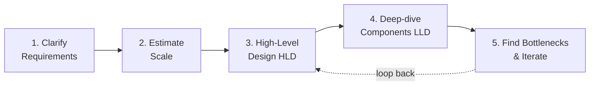
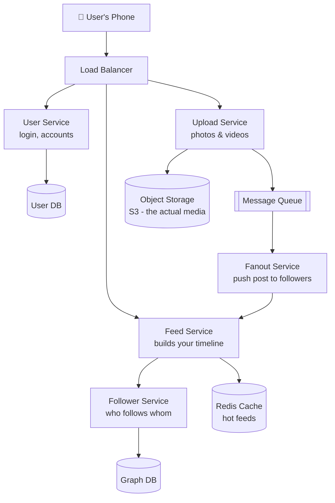
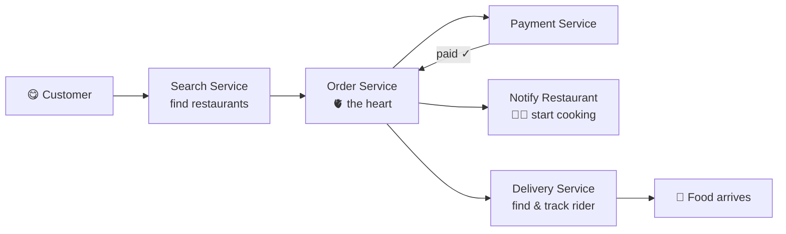
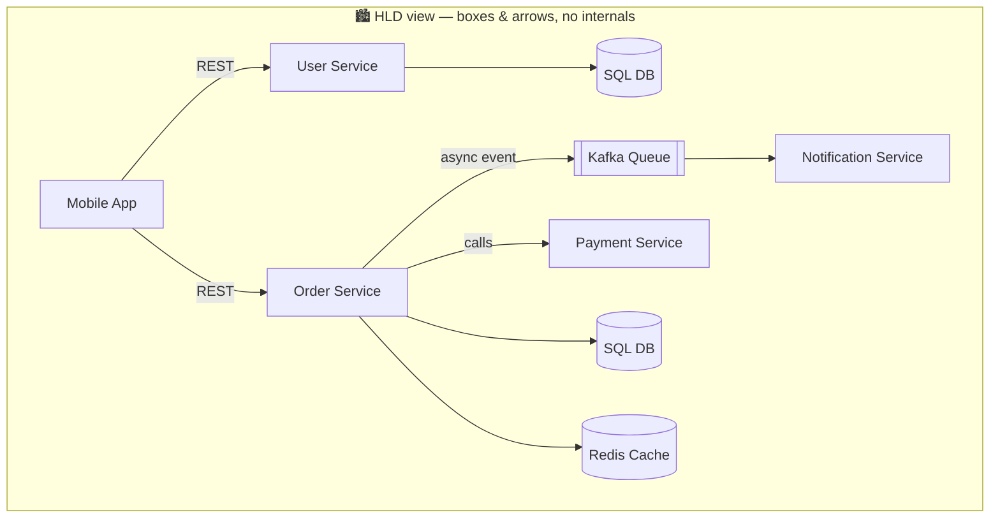
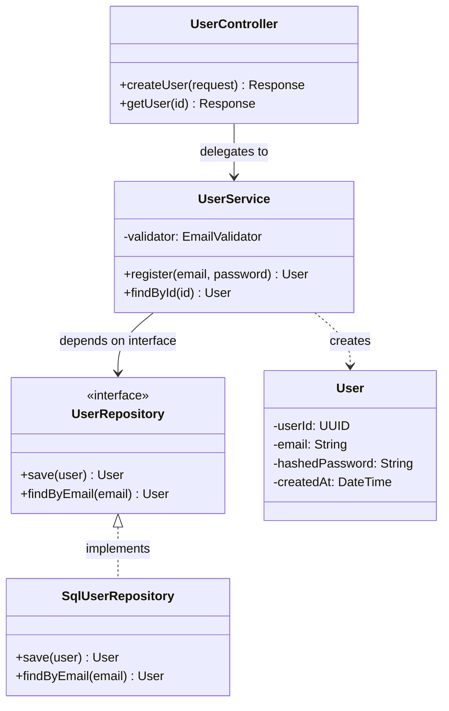
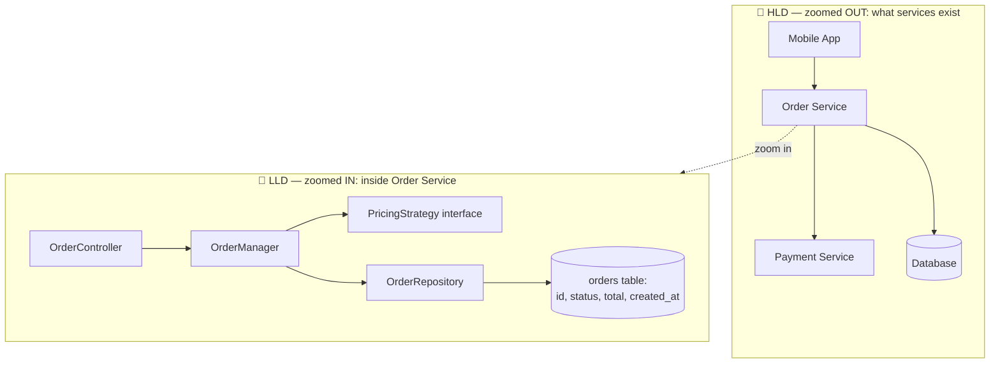
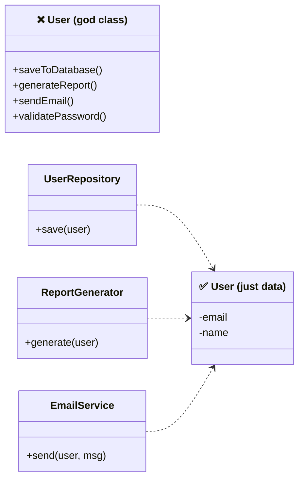
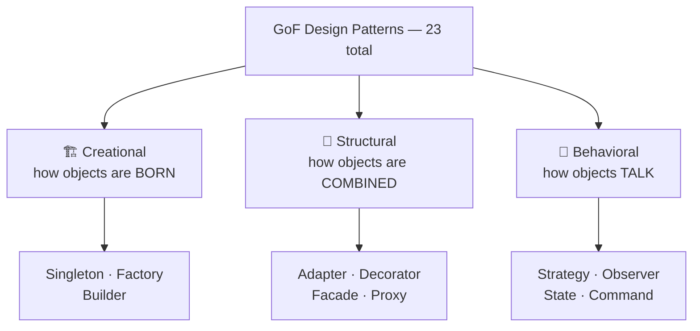
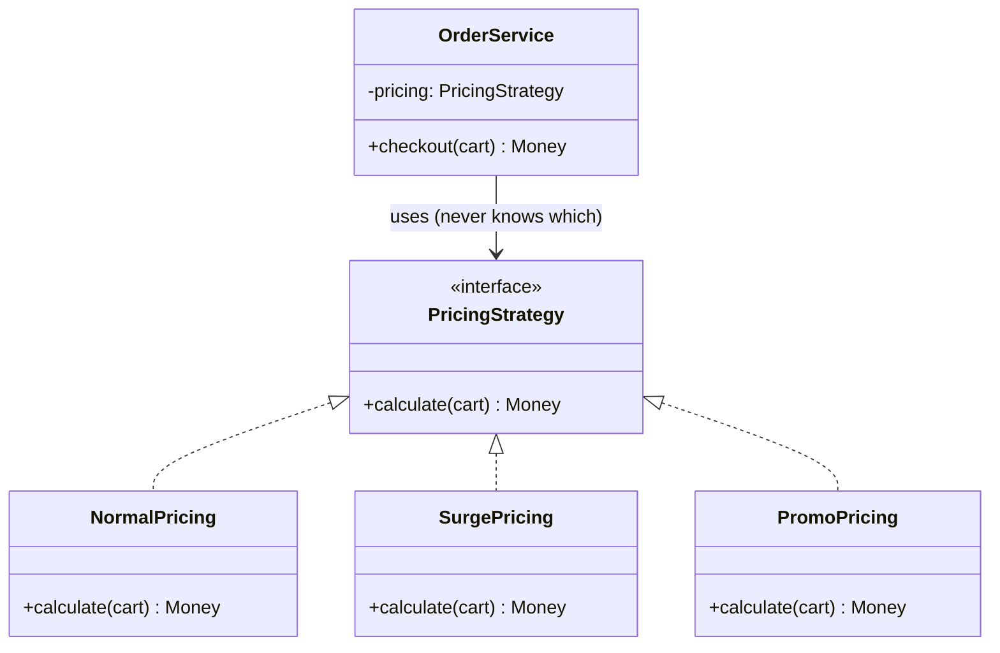
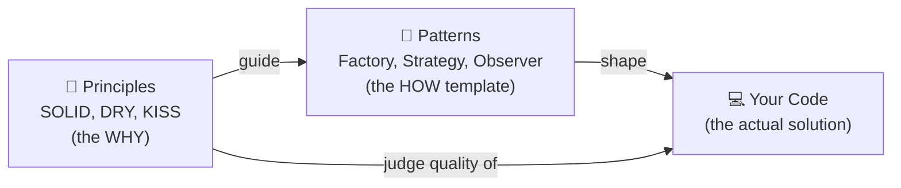

# Day 1 — Introduction: System Design, HLD, LLD, Principles & Patterns

> **Series:** System Design Mastery · **Depth today:** Introduction only (each topic gets its own deep-dive file later)
> **Format:** Every concept follows **Why → What → When → How → Where**, plus **The Dark Side** (when the "bad" practice is actually the right call).

---

## Table of Contents

1. [What is System Design?](#1-what-is-system-design)
2. [Key Attributes of a Good System](#2-key-attributes-of-a-good-system)
3. [High-Level Design (HLD)](#3-high-level-design-hld)
4. [Low-Level Design (LLD)](#4-low-level-design-lld)
5. [HLD vs LLD](#5-hld-vs-lld)
6. [Design Principles (SOLID — intro)](#6-design-principles-solid--intro)
7. [Design Patterns (intro)](#7-design-patterns-intro)
8. [Principles vs Patterns](#8-principles-vs-patterns)
9. [The Dark Side — When "Bad" Practice Wins](#9-the-dark-side--when-bad-practice-wins)
10. [Day 1 Self-Check](#10-day-1-self-check)

---

## 1. What is System Design?

**In plain words:** System design is like being the architect of a house before anyone picks up a hammer. Writing code is like building one room well; system design is deciding how many rooms there are, where the plumbing runs, and whether the house can survive a storm or a growing family. It's about planning the whole structure so the pieces fit together and keep working as things change.

### Why (does this discipline exist?)

Code answers "does it work?" System design answers "does it *keep* working" — when users grow 100×, when a server dies at 3 AM, when a new engineer joins, when the business pivots. Every famous outage or "app is slow" complaint traces back to a design decision, not a syntax error. Companies pay senior salaries for this skill because a wrong design decision costs months of rework; a wrong line of code costs minutes.

### What (is it?)

System design is the process of defining the **architecture** (major parts), **components/modules** (responsibilities), **interfaces** (how parts talk — APIs, events), and **data** (what's stored, where, in what shape) of a system so that it satisfies both:

- **Functional requirements** — what the system does (place order, upload photo)
- **Non-functional requirements (NFRs)** — how well it does it (fast, available, secure, cheap). *NFRs are where system design actually lives; features are easy, qualities are hard.*

It is a series of **trade-off decisions**, not a search for a "correct" answer. Every choice buys a quality by paying with another (consistency vs availability, speed vs cost, simplicity vs flexibility).

> **🤔 Wait — isn't "system design" just coding with a fancier title?**
> No — they answer different questions, and conflating them is why juniors get blindsided in their first design review. Coding answers *"does this function work?"*; system design answers *"will this whole thing survive 100× traffic, a dead server at 3 AM, and three teams editing it for five years?"* You can write flawless code inside a design that collapses on the first big sale — the bug isn't in any line, it's in the shape.

**✅ Good scenario (where it saves you):** A payments team sketches the flow — idempotency keys, a queue between order and ledger, a read replica for statements — *before* writing code. When a festival sale brings 40× load, the queue absorbs the spike and nothing melts; a design decision made in a 1-hour whiteboard session saved a midnight incident.

**❌ Bad scenario (the pain without it):** A team ships a feature that writes directly to one Postgres row per "like." It works perfectly in the demo. Six months later a celebrity post drives 50k likes/sec to that single row, the DB lock-thrashes, and the whole feed service times out — a design flaw no amount of function-level code review would ever catch.

**When NOT to over-do it:** a weekend hackathon demo or a script that runs once doesn't need a design doc — for throwaway code, *just build it*; the design effort only pays off when the thing must live and grow.

### When (do you do it?)

- Before building anything new (greenfield)
- Before scaling something that's hitting limits (rework/migration)
- Before every significant feature that touches architecture
- Continuously — design erodes; systems are re-designed in small steps forever

### How (is it done, at a glance?)

The universal method (also the interview method):

1. Clarify requirements — functional + NFRs; what's explicitly out of scope
2. Estimate scale — users, requests/sec, data size (back-of-envelope math)
3. High-level design — draw the major components and data flow (**HLD**)
4. Deep-dive components — schemas, classes, algorithms (**LLD**)
5. Identify bottlenecks — single points of failure, hot spots — and iterate

### Where (does it show up in real life?)

- Architecture proposals & design docs (RFCs) at any product company
- Interviews — HLD and LLD rounds are standard from mid-level up
- Incident reviews — "why did it break" is almost always a design conversation
- Everyday code review — "should this be one service or two?" is system design

### Anchor examples (we'll reuse these all month)

**Instagram (simplified):** User Service (auth/accounts), Feed Service (assemble timeline), Upload/Storage Service (media → object storage like S3), Fanout/Notification Service (push new post to followers' feeds), Follower Service (the social graph), Access Control (who may see what).

*Follow one photo upload: phone → Upload Service → media lands in S3 → an event goes on the queue → Fanout Service pushes it into followers' feeds → next time they open the app, Feed Service serves it (from cache if hot). Each box = one job. That's the whole trick.*

**Swiggy / food delivery:** User Service, Restaurant Service (menus, availability, location), Search/Filter Service, Order Service (the order lifecycle — the heart), Payment Service, Restaurant Notification, Delivery Service (rider matching + live tracking), Customer Support.

*One order's journey left to right. Notice Order Service in the middle — everything flows through it. Central components like this get designed most carefully.*

Notice the pattern: big systems are **decomposed into services, each owning one responsibility and its own data** — that instinct is 50% of system design.

---

## 2. Key Attributes of a Good System

**In plain words:** Think of judging a car — you don't just ask "does it drive?" You ask: is it fast, safe, reliable, cheap to run, easy to repair? A good software system is judged the same way, across a handful of qualities. And just like a car, you can't max out every quality at once (a race car isn't a family van), so you pick what matters most for your situation.

These five NFRs are the vocabulary of every design discussion. Intro-level today; each gets deep treatment later.

| Attribute | One-line meaning | Real-world stakes | The trade-off it fights with |
|---|---|---|---|
| **Scalability** | Handles growth (users/data/traffic) without collapsing | App fine at 100 users must survive 1M (flash sale, viral moment) | Complexity & cost — scalable designs are harder to build |
| **Reliability / Availability** | Works correctly, stays up even when parts fail | Netflix mid-stream failure = churn; downtime = revenue loss | Cost — redundancy means paying for spare everything |
| **Performance** | Responds fast (latency) and processes a lot (throughput) | Google returns results in ms; slow = users leave | Consistency & cost — caches make you fast but can serve stale data |
| **Maintainability** | Easy to understand, change, debug, extend | Adding "10-min delivery" shouldn't require rewriting Order Service | Short-term speed — clean design is slower to write today |
| **Security** | Protects data from unauthorized access/loss | One password leak = reputational + legal damage | Convenience — every auth layer adds friction and latency |

**Key insight:** you cannot maximize all five. Design = deciding *which ones your business needs most* and consciously under-investing in the rest. A prototype needs maintainability last; a bank needs consistency and security above all; a game leaderboard tolerates stale data happily.

> **🤔 Why can't we just make the system good at everything?**
> Because the qualities actively fight each other — this is the most common naive assumption in the room. Redundancy for availability costs money; caches for speed risk stale data (consistency); security layers add latency. Every "+1" to one attribute is a "−1" somewhere else. Senior engineering *is* choosing which two or three matter for this business and deliberately under-investing in the rest.

**✅ Good scenario (where it saves you):** A gaming leaderboard team consciously picks performance and availability over strict consistency — a rank that's two seconds stale is fine. They cache aggressively and ship a blazing-fast, cheap feature, precisely because they *chose* to sacrifice the one quality that didn't matter here.

**❌ Bad scenario (when misused):** A startup tries to build "bank-grade consistency + Netflix-scale + Google-speed" for a to-do app with 200 users. They burn six months on multi-region replication and consensus protocols, ship late, and the competitor running one boring Postgres wins the market.

**When NOT to obsess:** for an internal tool with ten users, don't agonize over NFR trade-offs — pick the boring, available option and move on; the trade-off math only earns its keep at real scale or real stakes.

---

## 3. High-Level Design (HLD)

**In plain words:** HLD is the bird's-eye map of a city — where the neighborhoods, main roads, and power stations sit — drawn before anyone builds a single house. It shows the big pieces of your system and how they connect, without worrying about the tiny details inside each piece. You do it first so everyone agrees on the overall shape before teams start building.

### Why

Someone must decide the shape of the system *before* teams start coding, or you get ten teams building pieces that don't fit. HLD exists to make the big, expensive, hard-to-reverse decisions first — databases, service boundaries, communication style — and to give every stakeholder (including non-coders) a shared picture.

### What

The **macro-level blueprint**: the major components, their responsibilities, the data flow between them, and the strategic technology choices. It answers **"WHAT needs to be built?"**

City analogy: HLD is the city master plan — where the districts, highways, and power plants go. Not the wiring inside any building.

*This is what a complete HLD looks like: services, arrows labeled with how they talk (REST/async), and tech choices (SQL, Kafka, Redis). Nothing about classes or table columns — that's deliberately absent.*

Key deliverables: system architecture diagrams, component/service interaction diagrams, data-flow diagrams, tech-choice decisions (SQL vs NoSQL, Kafka vs REST, Redis caching, etc.), capacity estimates.

> **🤔 Why bother with HLD if the architecture always changes later anyway?**
> Because the *expensive, hard-to-reverse* decisions — SQL vs NoSQL, one service vs ten, sync vs async — are cheap to change on a whiteboard and brutally expensive to change in running code with live data. HLD isn't a permanent contract; it's the one cheap chance to get the costly bones right and give ten teams a shared picture *before* they build pieces that don't fit.

**✅ Good scenario (where it saves you):** Before building a food-delivery backend, the team draws the order/payment/delivery services with a queue between order and notification. Every team now knows the seams; the payments and delivery teams build in parallel against agreed interfaces and integrate cleanly in week six.

**❌ Bad scenario (the pain without it):** No HLD — each team picks its own datastore and calling style. The order team assumes synchronous REST; the notification team built for async events. Integration week becomes integration month, with adapters bolted on to bridge decisions a single diagram would have settled up front.

**When NOT to:** a solo dev shipping a CRUD side-project doesn't need a formal HLD ceremony — a mental model and one datastore is enough; HLD earns its cost when multiple teams or genuinely hard-to-reverse choices are on the table.

### When

- Start of any new system or major subsystem
- Interviews: the classic 45-min "design Instagram" round is pure HLD
- Whenever architecture changes (adding a queue, splitting a service)

### How

You produce an HLD by: listing functional + non-functional requirements → estimating scale → drawing components as boxes with arrows (your UML component & deployment diagrams live here) → choosing data stores and communication (sync REST vs async queue) → walking through the main user flows across the diagram to verify it works.

**Example:** For Instagram's HLD you'd specify: *a `UserService` exposes `POST /users`, `GET /users/{id}`; uploads go to object storage; feed generation uses a fanout via a message queue; Redis caches hot feeds.* You would **not** specify table columns or class names — that's LLD.

### Where

Design docs/RFCs, architecture review meetings, interview whiteboards, onboarding docs. Audience: architects, senior engineers, stakeholders/product.

### The Dark Side

Over-designing HLD is a real failure mode. Designing for 100M users when you have 0 ("resume-driven architecture") wastes months. A team of 3 with a Kafka cluster, 12 microservices, and a service mesh usually shipped later than the team who deployed one Spring Boot monolith. **Good HLD is as simple as current scale allows, with clear seams to split later.**

---

## 4. Low-Level Design (LLD)

**In plain words:** If HLD is the city map, LLD is the detailed blueprint for one single building — where the wiring goes, how the rooms are laid out, what materials to use. It zooms into one component and spells out the exact classes, methods, and database tables a developer needs to write the code. It answers "how do we actually build this box?"

### Why

An HLD box labeled "Order Service" tells a developer nothing about what classes to write, how to validate input, or what the database table looks like. Without LLD, five developers implement the same component five incompatible ways. LLD exists to turn architecture into an unambiguous implementation plan — and it's where code quality (maintainability) is actually won or lost.

### What

The **micro-level blueprint** of a single component: its classes, interfaces, methods, database schema, data structures, algorithms, validation rules, and error handling. It answers **"HOW will it be built?"**

City analogy: LLD is one building's blueprint — plumbing, wiring, room layout.

Key deliverables: class diagrams & sequence diagrams (your UML!), detailed API specs (request/response payloads, status codes), database schemas, data-structure and algorithm choices, error/edge-case handling.

> **🤔 Why write LLD when the code IS the low-level design?**
> Because "just start coding" means five developers implement the same `OrderService` five incompatible ways, and the schema and API contract get discovered — and argued about — mid-sprint. LLD is cheap agreement *before* the expensive typing: the class seams, the table columns, the error codes. Not a 40-page document (that rots by sprint two) — a schema, an API contract, one class diagram, and the edge-case list.

**✅ Good scenario (where it saves you):** Before coding checkout, the team pins down the `payments` table, the `PaymentGateway` interface, and that a declined card returns `402`. Two engineers split the work, hit their agreed interface, and the PRs merge without a "wait, you returned a boolean and I expected an enum" rewrite.

**❌ Bad scenario (the pain without it):** No LLD — one dev stores money as a `double`, another as cents-in-`int`, a third as a `String`. Reconciliation is off by rounding errors nobody can trace, and the "quick feature" becomes a two-week data-cleanup migration.

**When NOT to:** for a one-line bugfix or a trivial CRUD endpoint, skip formal LLD — the code is the design; reserve LLD effort for non-trivial components where getting the contract wrong is expensive.

### When

- After HLD fixes the component boundaries, before coding starts
- Interviews: the "design a Parking Lot / BookMyShow" machine-coding round is pure LLD
- Every non-trivial feature inside an existing service

### How

For each component from the HLD: define its API contract precisely → design the schema (`users(user_id, email, hashed_password, created_at)`) → design classes/interfaces applying OOP + SOLID + patterns → draw a sequence diagram for the main flow → enumerate edge cases (duplicate email? payment timeout?) → choose data structures for the hot paths (HashMap for O(1) lookup, etc.).

**Example:** For `UserService`, the LLD defines the `users` table columns, a `User` entity class, a `UserRepository` interface, email-uniqueness + format validation, password hashing choice (bcrypt), and what `409 Conflict` is returned when the email exists.

*Same `UserService` that was one box in the HLD — now zoomed in. Controller handles HTTP, Service holds business rules, Repository (interface!) hides the database. This layering will repeat all month.*

### Where

Component design docs, PR descriptions, codebases themselves. Audience: the engineers writing the code.

### The Dark Side

Over-specified LLD rots instantly — a 40-page class-by-class document is outdated by sprint two, and nobody updates it. Modern teams keep LLD lightweight: schema + API contract + one class diagram + edge-case list. The code is the ultimate LLD; documents should capture *decisions*, not restate code.

---

## 5. HLD vs LLD

**In plain words:** HLD and LLD are the same system seen through two different lenses — like zooming a map out to see the whole country, then zooming in to see one street. HLD is the wide shot (what services exist); LLD is the close-up (what's inside one service). You need both: the map to know where you're going, and the street view to actually get there.

One picture — the same system at two zoom levels:

| Feature | HLD | LLD |
|---|---|---|
| Question answered | **What** needs to be built? | **How** will it be built? |
| Scope | Macro — whole system | Micro — one component/module/class |
| Deliverables | Architecture & component diagrams, tech choices, data flow | Class & sequence diagrams, DB schemas, API payloads, validation logic |
| Decisions | Strategic: SQL vs NoSQL, monolith vs microservices, queue vs REST | Tactical: HashMap vs List, bcrypt vs argon2, error codes, method signatures |
| UML used | Component, Deployment, Use Case | Class, Sequence, Activity |
| Audience | Architects, senior engs, stakeholders | Implementing developers |
| Wrong decision costs | Months (migration, rewrite) | Days–weeks (refactor) |
| Interview round | "Design Twitter" (45 min, whiteboard) | "Design a Parking Lot" (machine coding) |

**How they connect:** HLD says *"an Order Service talks to a Payment Service through a queue."* LLD says *"inside Order Service, `OrderManager` uses the Strategy pattern for pricing and returns `402` on declined payment."* One flows into the other; neither replaces the other.

---

## 6. Design Principles (SOLID — intro)

> Intro only today. Each principle gets its own deep-dive (with violations and refactorings) on Day 2.

**In plain words:** Design principles are like the general rules of good cooking — "keep your station clean," "taste as you go." They don't hand you a recipe; they give you good habits that keep any dish from going wrong. SOLID is the famous set of five such habits for writing code that's easy to change later.

### Why

Code is read and changed far more often than it is written. Principles exist because certain code shapes are *provably painful to change* — a class doing five jobs breaks in five ways. Principles are the distilled scar tissue of 50 years of software failures.

### What

**Design principles are abstract guidelines** — a philosophy of good structure. They don't give you code; they give you a lens to judge a design. They are language-agnostic.

The famous five — **SOLID**:

| Letter | Principle | One-liner (intro level) |
|---|---|---|
| **S** | Single Responsibility (SRP) | A class should have exactly one reason to change. A `User` class that saves to DB *and* generates reports has two — split into `UserRepository` + `ReportGenerator`. |
| **O** | Open/Closed (OCP) | Open for extension, closed for modification — add new behavior by adding code (new class), not editing tested code. |
| **L** | Liskov Substitution (LSP) | A subclass must be usable anywhere its parent is, without surprises. If `Square extends Rectangle` breaks `setWidth`, the inheritance is a lie. |
| **I** | Interface Segregation (ISP) | Many small, specific interfaces beat one fat one. Clients shouldn't be forced to depend on methods they never use. |
| **D** | Dependency Inversion (DIP) | Depend on abstractions, not concretions. High-level `OrderService` depends on `PaymentGateway` interface, never directly on `StripeClient`. |

**SRP visualized — the before/after you'll do a hundred times:**

*Left: one class, four reasons to change — DB migration, report format, email provider, security policy all force edits to the same file. Right: each reason to change lives in its own class.*

> **🤔 If principles are so important, why not apply all of SOLID everywhere, always?**
> Because principles are *heuristics with a cost*, not laws. Every abstraction you add to satisfy a principle buys flexibility with indirection — and indirection you never use is pure tax. SOLID pays off where change is actually expected; applied to a 200-line script that runs once a month, it produces 30 pointless classes. The skill is knowing the *price* of each rule and when it's not worth paying.

**✅ Good scenario (where it saves you):** In a payments service edited by four teams for years, SRP and DIP keep the blast radius small — the fraud team swaps its rules engine behind an interface without touching checkout, and a DB migration edits one repository class, not forty call sites.

**❌ Bad scenario (when misused):** A junior "SOLID-ifies" a simple CSV export into `ExporterFactoryProvider`, `AbstractRowMapperStrategy`, and six interfaces with one implementor each. The next person needs 20 minutes and a debugger to find where a comma actually gets written — the principle applied where no change was ever coming.

**When NOT to:** for prototypes, one-off scripts, or code with a lifespan of days, skip the abstractions — a straightforward god-function is the *right* call; principles earn their keep on code that lives and changes.

### When

Whenever you design or review classes/modules — LLD territory. They also echo upward: microservice boundaries follow SRP; pluggable services follow DIP (remember the swappable Stripe Adapter in your UML component diagram — that *is* DIP at architecture scale).

### How

Applied as questions during design/review: "How many reasons does this class have to change?" (SRP), "Can I add the new payment method without editing existing code?" (OCP), "Can I swap the implementation in tests?" (DIP).

### Where

Codebases, code reviews, LLD interviews (interviewers explicitly grade SOLID), framework design.

### The Dark Side

SOLID zealotry produces its own hell: 30 one-method classes, interfaces with a single implementation, `AbstractFactoryProviderManager` indirection nobody can navigate. **Principles are heuristics, not laws.** A 200-line script that runs once a month doesn't need DIP. Abstraction has a cost — pay it only where change is actually expected. The rule of thumb: *duplicate first, abstract on the second or third occurrence* (Rule of Three), because the wrong abstraction is more expensive than duplication.

---

## 7. Design Patterns (intro)

> Intro only today. Patterns get 3 dedicated days (Days 3–5) with code.

**In plain words:** Design patterns are like proven recipes for problems that keep coming up. When a cook faces "how do I thicken a sauce?" they don't invent a method from scratch — they reach for a known technique. Patterns are the software equivalent: named, tried-and-tested templates you adapt to your own code so you don't reinvent (badly) what others already solved.

### Why

The same design problems recur in every codebase: "only one instance should exist", "creation logic is getting messy", "many algorithms for one task", "notify many objects when one changes". Patterns exist so you don't reinvent (badly) what thousands of engineers already solved — and so you can say "use a Strategy here" instead of a 10-minute explanation. **Patterns are a shared vocabulary as much as a solution.**

### What

**Design patterns are named, proven, reusable solution templates** for recurring object-design problems. Not libraries, not copy-paste code — a *shape* of solution you adapt. Catalogued famously by the "Gang of Four" (GoF, 1994): 23 patterns in three families:

| Category | Solves problems about… | Star patterns (learn these first) |
|---|---|---|
| **Creational** | How objects get created | Singleton, Factory Method, Abstract Factory, Builder |
| **Structural** | How classes/objects compose into bigger structures | Adapter, Decorator, Facade, Proxy, Composite |
| **Behavioral** | How objects communicate & divide responsibility | Strategy, Observer, State, Command, Template Method, Iterator |

Intro-level taste of each family:

- **Factory (creational):** you need a `Vehicle` but the concrete type (`Car`/`Truck`/`Bike`) depends on input. Instead of `if/else` chains at every call site, one factory owns creation logic.
- **Decorator (structural):** add features to an object by wrapping it (`Coffee` → `MilkDecorator(Coffee)` → `SugarDecorator(...)`) instead of exploding subclasses (`CoffeeWithMilkAndSugar…`).
- **Strategy (behavioral):** several interchangeable algorithms (pricing: normal / surge / promo) behind one interface, selected at runtime — this is OCP in action.
- **Observer (behavioral):** one object changes (order status), many must react (notify customer, update tracking, alert restaurant) without the subject knowing them — the heart of event-driven systems.

**One pattern visualized — Strategy (swappable pricing):**

*Add "festival pricing" tomorrow? New class, zero edits to `OrderService`. That's OCP delivered by a pattern — principles and patterns working together.*

> **🤔 Aren't design patterns just over-engineering with fancy names?**
> They can be — when applied for their own sake ("patternitis"). But their real job is *shared vocabulary + a proven shape* for a problem that genuinely recurs. Saying "use a Strategy here" replaces a ten-minute explanation, and the pattern encodes a solution thousands of engineers already debugged. The abuse (a Factory for one class, a Singleton for everything) is real — the cure is applying a pattern only when the problem's recurrence justifies the indirection.

**✅ Good scenario (where it saves you):** A pricing team keeps adding promotions — flat, surge, festival, loyalty. Behind a `PricingStrategy` interface each new promo is a new class and zero edits to checkout, which hasn't been reopened in a year. One word — "Strategy" — tells any reviewer exactly what's going on.

**❌ Bad scenario (when misused):** An engineer wraps a single, never-changing config map in a lock-guarded Singleton and fronts one `EmailSender` with an `AbstractFactory`. No behavior varies, nothing is swapped — just indirection that makes every reader chase three files to find one method call.

**When NOT to:** if a plain `if/else` is clear and the code has one caller that never changes, the `if/else` is the better engineering — reach for the pattern only when recurrence and change pressure actually show up (Rule of Three).

### When

When you *recognize the recurring problem* the pattern names — never before. Pattern choice comes *after* you understand the problem, during LLD.

### How

Learning path: understand the problem each pattern solves → see the structure (class diagram — your UML pays off here) → code it once yourself → then spot it in the wild (Java's `InputStream` = Decorator; Spring beans = Singleton + Factory; React's state subscriptions = Observer).

### Where

Everywhere in frameworks and codebases; LLD interviews (parking lot ⇒ Strategy + Factory + Singleton almost always); architecture (pub/sub systems are Observer at planet scale).

### The Dark Side

**Patternitis** — the disease of applying patterns to feel professional. A Singleton for everything becomes global mutable state (testing nightmare — many teams now treat Singleton itself as an anti-pattern and use dependency injection instead). A Factory for a class with one implementation is noise. Patterns add indirection; indirection costs readability. **If a plain `if/else` is clear and the code has one caller, the `if/else` is the better engineering.** Use a pattern when the problem's *recurrence and change pressure* justify the indirection — not because the pattern exists.

---

## 8. Principles vs Patterns

**In plain words:** Principles are like the rules of grammar; patterns are like common, ready-made phrases. Grammar tells you what makes a sentence good; phrases are proven combinations you drop in when they fit. You need both to speak fluently — principles tell you *why* a design is good, patterns give you the *ready-made shape* to solve a specific problem.

| Feature | Design Principles | Design Patterns |
|---|---|---|
| Nature | Abstract philosophy / guidelines | Concrete, named solution templates |
| Answers | "Is this design *good*?" | "How do I solve *this specific* problem?" |
| Scope | Broad — apply everywhere, always | Narrow — each fits particular situations |
| Count you must know | ~5 (SOLID) + DRY, KISS, YAGNI | ~10–12 of the GoF 23 cover real-world needs |
| Example | SRP: "one reason to change" | Factory: "centralize object creation" |
| Relationship | The **why** behind patterns | The **applied form** of principles — Strategy implements OCP, patterns wire dependencies per DIP |

Mental model: **principles are the grammar; patterns are common phrases.** Fluency needs both — grammar without phrases is slow, phrases without grammar produce nonsense.

Three bonus principles you'll hear constantly (know the names today):

- **DRY** — Don't Repeat Yourself: one authoritative place per piece of knowledge.
- **KISS** — Keep It Simple: the simplest design that works wins.
- **YAGNI** — You Aren't Gonna Need It: don't build for imagined future requirements.

Note how YAGNI and KISS *push against* SOLID's abstractions — professional judgment is balancing them. That tension is the next section.

---

## 9. The Dark Side — When "Bad" Practice Wins

Tutorials teach ideals. Production teaches trade-offs. Each of these is "bad practice" by the book — and the *correct* choice in the listed situations:

| "Bad" practice | Why the book hates it | When it's actually right |
|---|---|---|
| **Monolith** (vs microservices) | "Doesn't scale, single point of failure" | Small team, early product, unclear domain boundaries. Splitting too early = distributed monolith, the worst of both. Shopify & Stack Overflow ran huge on monoliths. |
| **Denormalized data / duplication** | Violates DRY/normalization; update anomalies | Read-heavy systems at scale. Instagram *precomputes* your feed (massive duplication) because joining at read time would melt. Caches are institutionalized duplication. |
| **God class / script-style code** | Violates SRP, untestable | Prototypes, one-off migration scripts, hackathons — code whose lifespan is days. Design effort on disposable code is waste. |
| **Hardcoding config/values** | Inflexible, needs redeploy to change | Values that change ~never (π, ISO country codes) or in a 2-hour spike. A config system for 3 constants is overengineering. |
| **`if/else` instead of Strategy pattern** | "Not extensible" | Two branches that haven't changed in a year. Indirection costs more than the flexibility earns. Refactor to Strategy on the *third* branch (Rule of Three). |
| **Skipping abstractions (concrete deps)** | Violates DIP | Only one implementation exists and no test needs a fake. Interfaces with a single implementor are ceremony. |
| **Synchronous calls everywhere** | "Queues decouple, async scales" | Low traffic + a strong need for simplicity and easy debugging. Async introduces ordering, retries, and observability problems you must *earn* the need for. |
| **Eventual consistency ignored / single DB** | "Won't survive scale" | Most businesses never reach the scale where one well-indexed Postgres fails. Premature distribution is the most expensive mistake in modern backend engineering. |

**The meta-rule:** every practice — good or bad — is a trade of *cost now* vs *cost later*, weighted by *probability the future arrives*. Books optimize for "code lives 10 years, team of 50." When your reality is "demo on Friday, team of 2," invert the advice with a clear conscience. What separates a professional from a tutorial-follower is not knowing the rules — it's knowing the **price** of each rule and when it's not worth paying. The unforgivable sin is not breaking the rule; it's breaking it *without knowing you did*.

---

## 10. Day 1 Self-Check

Answer from memory (Feynman test — say it out loud in your own words):

1. Define system design in one sentence, and name the two requirement types it must satisfy.
2. Name the 5 key attributes and one trade-off each attribute fights with.
3. What question does HLD answer vs LLD? Give one deliverable of each.
4. Which UML diagrams belong to HLD, which to LLD?
5. Recite SOLID — letter, name, one-liner.
6. What are the 3 GoF pattern categories? One example pattern each.
7. Principles vs patterns in one sentence.
8. Give two examples where a "bad" practice is the right engineering decision, and why.

**Tomorrow (Day 2):** SOLID in depth — each principle with a violation, a refactoring, code, and its dark side.
