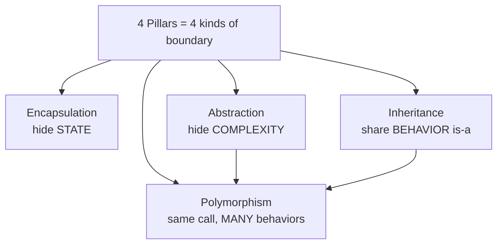
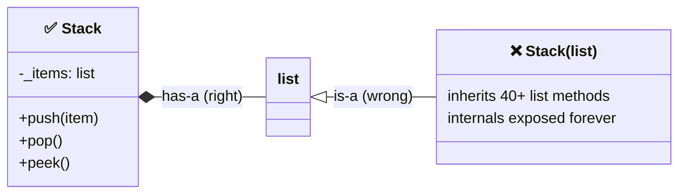
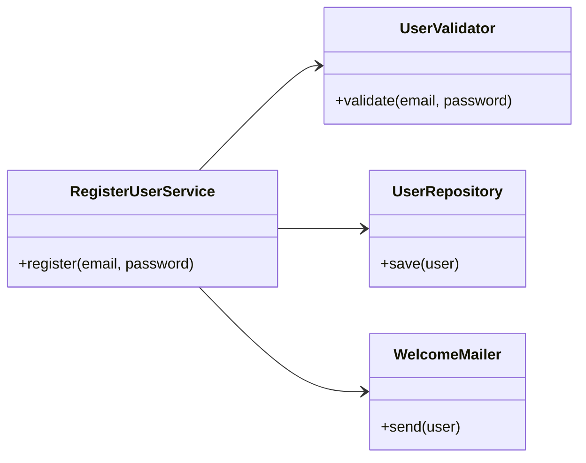
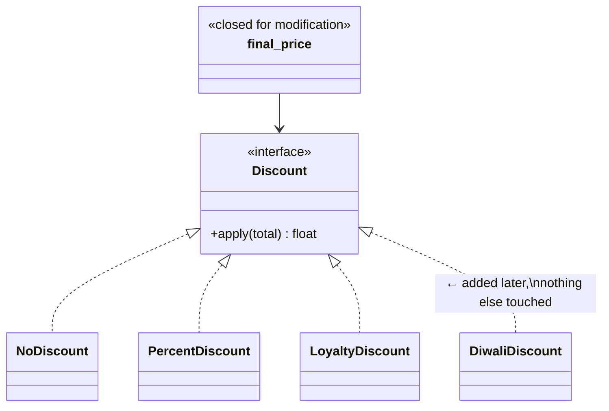
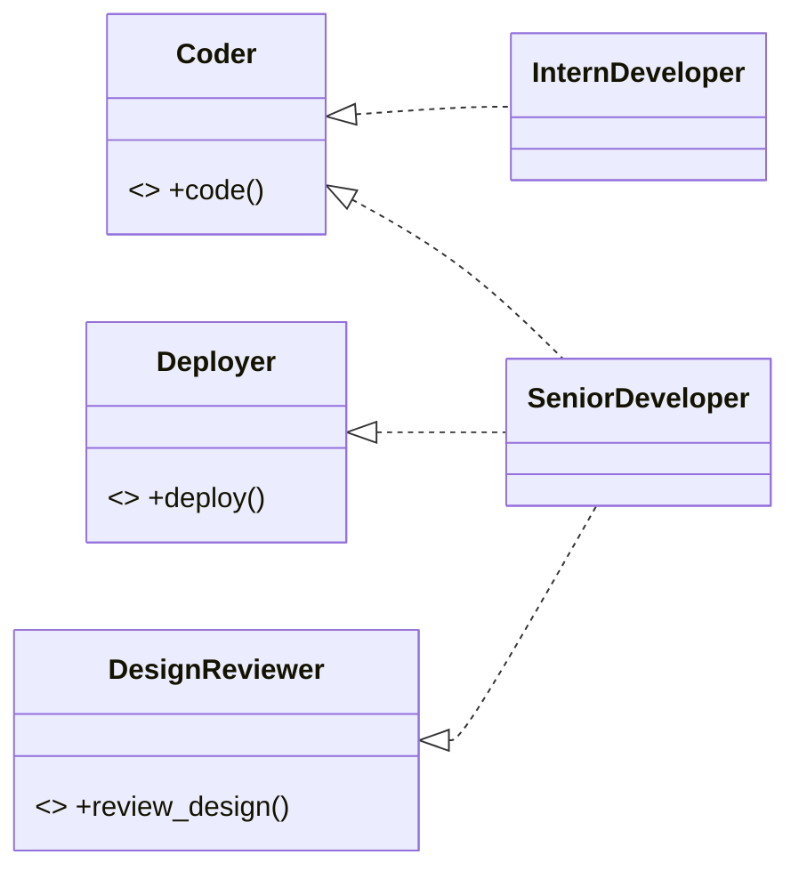
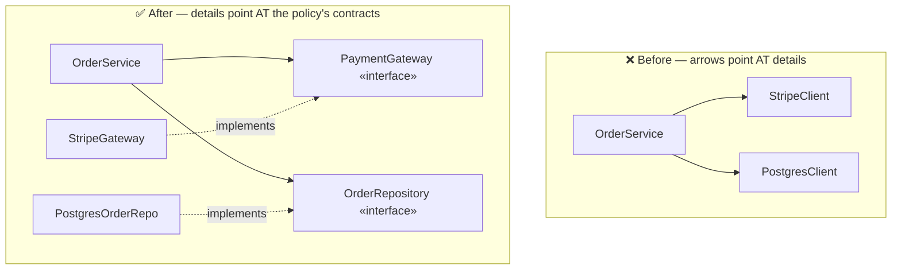
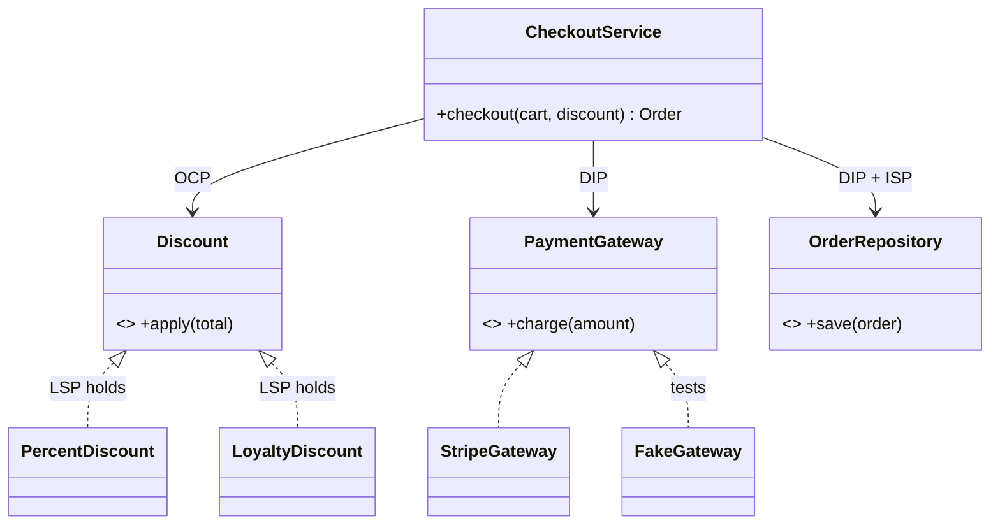

# Day 2 — OOP Deep-Dive + SOLID In Depth (Java)

> **Series:** System Design Mastery · **Depth today:** Full depth — these concepts are used *daily* in real work
> **Format:** Why → What → When → How → Where + **The Dark Side**. Every SOLID principle gets: violation code → refactored code → diagram.

---

## Table of Contents

1. [The Four Pillars of OOP](#1-the-four-pillars-of-oop)
2. [Composition vs Inheritance](#2-composition-vs-inheritance)
3. [S — Single Responsibility Principle](#3-s--single-responsibility-principle)
4. [O — Open/Closed Principle](#4-o--openclosed-principle)
5. [L — Liskov Substitution Principle](#5-l--liskov-substitution-principle)
6. [I — Interface Segregation Principle](#6-i--interface-segregation-principle)
7. [D — Dependency Inversion Principle](#7-d--dependency-inversion-principle)
8. [SOLID Working Together — One Mini Design](#8-solid-working-together--one-mini-design)
9. [The Dark Side — When SOLID Hurts](#9-the-dark-side--when-solid-hurts)
10. [Apply — Library System Exercise](#10-apply--library-system-exercise)
11. [Day 2 Self-Check](#11-day-2-self-check)

---

## 1. The Four Pillars of OOP

**In plain words:** Think of building a house. You put walls around rooms so a mess in the kitchen doesn't spill into the bedroom. OOP does the same for code — it draws walls (boundaries) so a change in one part doesn't leak everywhere. The "four pillars" are just four different kinds of walls you can build.

### Why

Objects exist to manage **complexity through boundaries**. A 100k-line program as free-floating functions and global data is unmaintainable because *anything can touch anything*. OOP's pillars are four different ways of drawing boundaries so change stays local.

### What — pillar by pillar

#### 1.1 Encapsulation — "hide the internals, expose a contract"

**In plain words:** Encapsulation is like an ATM. You can deposit and withdraw, but you can't reach inside and change the cash total directly — the machine enforces the rules. Your class hides its data and only lets the outside world touch it through safe, validated methods.

Bundle data + the methods that operate on it, and **hide the internal state** so it can only change through controlled methods.

```java
public class BankAccount {
    // 'private' = the compiler forbids any code outside this class from touching balance directly
    private int balance = 0;

    // A "getter" gives read-only access to the hidden field
    public int getBalance() {
        return this.balance;       // reading is allowed
    }

    // Deposits must be positive — the rule lives in ONE place
    public void deposit(int amount) {
        if (amount <= 0) {
            // 'throw' aborts the method and signals an error to the caller
            throw new IllegalArgumentException("Deposit must be positive");
        }
        this.balance += amount;    // ALL changes pass through validation
    }

    public void withdraw(int amount) {
        if (amount > this.balance) {
            throw new IllegalArgumentException("Insufficient funds");
        }
        this.balance -= amount;
    }
}
```

The invariant "*balance is never negative*" is enforced in exactly one place. Without encapsulation (`account.balance -= 500` from anywhere), every caller must remember the rule — one forgets, and you have a production incident.

> **🤔 Wait — why do we need this if the database already stores data securely?**
> This is *the* question that separates memorizing from understanding, so pin it down. Database security and encapsulation solve **completely different problems** — they're not alternatives.
>
> - **Database security answers: "who is allowed to touch this data?"** It protects data *at rest* from unauthorized people — encryption, passwords, access rules. A wall around the building.
> - **Encapsulation answers: "how does my code stay correct while it's running?"** The moment your program loads `balance = 5000` out of the DB into an object, the DB's protection is gone — now it's just a number in memory that *any line of your own code* can corrupt: `account.balance -= 5000` before checking funds, a teammate forgetting the "never negative" rule, a refund path subtracting twice. The DB happily stores whatever wrong number you finally hand it.
>
> So the one-liner to remember: **DB security protects data from people; encapsulation protects data from bugs; abstraction protects the programmer from complexity.** Three different jobs. You need all three.

**✅ Good scenario (where it saves you):** At a payments company, five teams touch the `Wallet` object — checkout, refunds, promotions, support tools, a nightly reconciliation job. Because balance changes *must* go through `debit()`/`credit()` with validation, the "balance can't go negative" rule is enforced once and holds for all five teams forever. A new intern on the promotions team literally *cannot* write code that corrupts a wallet — the compiler stops them.

**❌ Bad scenario (the pain without it):** The same `Wallet` exposes a public `balance` field "for convenience." Six months later a race in the refund path does `balance -= amount` without the funds check. Now customers have negative balances, finance can't reconcile, and the bug could be in any of 40 files that touch `.balance` directly. This is a real class of production incident — and it's why product companies grade encapsulation in code review.

**When NOT to over-do it:** a short-lived DTO or a throwaway script that just carries data from A to B doesn't need getters/setters guarding every field — public fields (or a `record`) are fine. Encapsulation earns its cost when there are **invariants to protect** and **many callers**. No invariant, few callers → don't add ceremony (that's covered more in section 9).

> **Java note:** Java **has** real access modifiers — `private`, `protected`, `public` — and the **compiler enforces them**. Marking `balance` as `private` means code outside `BankAccount` literally cannot compile if it tries `account.balance -= 500`. Encapsulation here is guaranteed by the language, not just a naming convention or code-review discipline.

#### 1.2 Abstraction — "expose *what*, hide *how*"

**In plain words:** Driving a car, you use a steering wheel and pedals. You don't need to know how the engine burns fuel or how the brakes grip. Abstraction gives callers a simple set of controls (*what* it does) and hides the complicated machinery (*how* it does it).

Callers see a simple interface; the messy details live behind it.

```java
// An interface is a pure contract: it lists WHAT can be done, never HOW
public interface PaymentGateway {          // pure "what"
    // No method body — just the promise "you can charge and get a transaction id back"
    String charge(int amount, String token);
}

// 'implements' means StripeGateway promises to fulfil the PaymentGateway contract
public class StripeGateway implements PaymentGateway {   // the "how"
    @Override                                            // @Override = "this fills in a contract method"
    public String charge(int amount, String token) {
        // 50 lines of Stripe API calls, retries, error mapping...
        return "txn_123";
    }
}
```

Encapsulation hides *state*; abstraction hides *complexity*. Related but distinct: encapsulation is about access control, abstraction is about simplifying the mental model.

#### 1.3 Inheritance — "is-a: share behavior through a hierarchy"

**In plain words:** A sports car *is a* car — it already has wheels, doors, and an engine, plus a few extras. Inheritance lets a specialized class reuse everything a general class already has, and just add or tweak the differences.

```java
public class User {
    // 'protected' lets subclasses use these fields while still hiding them from outside code
    protected String name;
    protected String email;

    public User(String name, String email) {   // constructor sets the fields
        this.name = name;
        this.email = email;
    }

    public String greet() {
        return "Hi " + this.name;              // Java uses + to join strings
    }
}

// 'extends' means Driver IS-A User and inherits greet(), name, email
public class Driver extends User {
    private String vehicle;

    public Driver(String name, String email, String vehicle) {
        super(name, email);                    // 'super(...)' calls the User constructor first
        this.vehicle = vehicle;
    }
}
```

Use only when the subclass truly **is** a parent in every context (LSP, section 5, is the test). Overused inheritance is the #1 beginner OOP mistake — see section 2.

#### 1.4 Polymorphism — "same call, different behavior"

**In plain words:** Press the "play" button on a TV remote, a car stereo, or a phone — same button, but each device does its own thing. Polymorphism means one line of calling code works with many different objects, and each object responds in its own way.

```java
public class Checkout {
    // The parameter type is the INTERFACE, so any implementer can be passed in
    public void checkout(PaymentGateway gateway, int amount) {
        gateway.charge(amount, "tok_x");      // works for Stripe, PayPal, FakeGateway...
    }

    public void demo() {
        checkout(new StripeGateway(), 500);
        checkout(new PayPalGateway(), 500);   // same calling line, different behavior
    }
}
```

Polymorphism is *why* abstraction pays off: code written against `PaymentGateway` works with implementations that don't exist yet.

> **Java note:** Java uses **nominal typing** for its contracts — an object works with `checkout` only if its class explicitly says `implements PaymentGateway`. Unlike Python's "duck typing" (where merely having a `charge` method is enough), Java requires the class to declare the relationship, and the compiler checks it. The interface *is* the contract, and `implements` is how a class signs it.



### When / Where

Every class you write. Interviews probe pillars indirectly: "why is this field private?", "why an interface here?" Real systems: every Java framework (Spring beans = encapsulation + dependency injection; JPA entities = encapsulation + inheritance; `java.util.List`/`InputStream` = abstraction over many concrete implementations).

### The Dark Side

Getters/setters for every field is *fake* encapsulation — `getX/setX` with no logic is just a public field with ceremony (in Java, expose a getter only when the field is genuinely read externally, and add a setter only when validated mutation is actually needed). Deep inheritance trees (>2-3 levels) are a maintenance trap. Abstraction layers nobody needed ("we might swap the database someday" — you won't) are the most common form of overengineering.

---

## 2. Composition vs Inheritance

**In plain words:** There are two ways to reuse parts. "Inheritance" is like being born into a family — you *are* one of them and inherit their traits permanently. "Composition" is like hiring a specialist — your class *has* a helper and asks it to do the job. Hiring is more flexible than being born, so prefer composition unless the "is-a" is genuinely true.

### Why

Both reuse code. Choosing wrong is expensive: inheritance is the *strongest* coupling in OOP — a subclass depends on its parent's internals, forever, and you can only inherit once meaningfully.

### What

- **Inheritance (is-a):** `Driver` is a `User`. Subclass gets everything, coupled to parent.
- **Composition (has-a):** `Car` has an `Engine`. The container holds a reference and delegates.

```java
import java.util.*;

// ❌ Inheritance abuse — a Stack "is-a" ArrayList? No. It just NEEDS a list inside.
class BadStack<T> extends ArrayList<T> {
    public void push(T item) { this.add(item); }
}
// Problem: badStack.add(0, x), badStack.set(3, y), badStack.remove(2) — the whole
// ArrayList API leaks out, callers WILL use it, and now you can never change the internals.

// ✅ Composition — Stack HAS-A list (holds one privately and delegates to it)
class Stack<T> {
    private final List<T> items = new ArrayList<>();   // hidden internal; only Stack touches it

    public void push(T item) {
        items.add(item);
    }

    public T pop() {
        return items.remove(items.size() - 1);         // remove & return the last element
    }

    public T peek() {
        return items.get(items.size() - 1);            // look at the last element without removing
    }
}
```



> **🤔 Why prefer composition if inheritance reuses code just fine?**
> Both reuse code — but inheritance is the *strongest, most permanent* coupling in OOP: a subclass is welded to its parent's internals forever, and you get exactly one parent. The confusion is thinking "reuse" *means* "inherit." Composition reuses by *holding a helper and delegating*, which you can swap, test, and combine freely. Inherit only for a true, stable is-a; otherwise you've signed a lifetime contract just to reuse ten lines.

**✅ Good scenario (where it saves you):** At a ride-hailing company, `Trip` composes a `PricingStrategy`, a `RouteEngine`, and a `Notifier`. Each is swappable and independently testable; the surge team ships a new pricing rule without recompiling or re-testing `Trip`.

**❌ Bad scenario (the pain without it):** `class Stack extends ArrayList` (above) — the entire list API leaks, callers start doing `stack.add(0, x)`, and now you can never change the internals. Or a `PremiumUser extends User extends Account` chain where one change to `Account` silently breaks three subclasses owned by two different teams.

**When NOT to:** when the is-a is genuinely true and stable and you need shared *behavior* — `PaymentDeclinedException extends PaymentException`, or a framework base class you're required to extend — inheritance is cleaner than a wall of delegation boilerplate. Composition *first*, not composition *only*.

### How — the decision test

1. **The substitution test:** can the child be used *everywhere* the parent is, with zero surprises? No → composition.
2. **The "share behavior or share interface?" test:** need to share *code* → maybe inheritance; need to share a *contract* → Java `interface` + composition.
3. **The change test:** if the parent's internals change, should this class break? No → composition.
4. **Default:** *composition first.* Inherit only for true, stable is-a with shared behavior (and for framework hooks that require it).

### Where

Everywhere in good codebases: Spring services wire collaborators via composition (constructor injection) rather than deep inheritance; game engines abandoned `Player extends Character extends Entity` for component systems (composition) decades ago. **Strategy, Decorator, Adapter — most design patterns are composition doing what inheritance can't.**

### The Dark Side

Composition zealotry produces delegation boilerplate — 10 one-line pass-through methods. If the is-a is real and stable (`Driver`/`User`, exceptions hierarchy), inheritance is cleaner. The rule is composition *first*, not composition *only*.

---

## 3. S — Single Responsibility Principle

> *"A class should have one, and only one, reason to change."* — Robert C. Martin

**In plain words:** A good employee has one job title. If you make one person be the chef, the waiter, and the accountant, then any change from the kitchen, the dining room, or the finance office all land on that one overworked person. Give each class a single job so changes from different departments stay separate.

### Why

Change is the only constant. When one class serves multiple masters (DB team, finance team, notification vendor), every master's change risks breaking the others' features. Blast radius = size of class responsibilities.

### What

"One reason to change" = **one actor/stakeholder whose requirements can force edits**. Not "one method" — a class with 15 methods serving one purpose is fine; a class with 3 methods serving 3 departments is not.

> **🤔 Doesn't SRP just mean "one method per class"?**
> No — that misread is exactly what produces 40 microscopic classes. "One responsibility" means *one actor/stakeholder who can force a change*. A class with 15 methods all serving the checkout flow has one responsibility; a class with 3 methods serving the DB team, the marketing vendor, and the security team has three. Count the *masters*, not the methods.

**✅ Good scenario (where it saves you):** At an e-commerce company, `RegisterUserService` orchestrates while `UserValidator`, `UserRepository`, and `WelcomeMailer` each answer to one team. When marketing switches email vendors, exactly one class changes and the checkout path is never reopened or re-tested.

**❌ Bad scenario (the pain without it):** One `UserManager` validates, hashes, writes SQL, and sends SMTP. A DB migration, a password-policy change, and a new email vendor all land as merge conflicts on the same file — three teams stepping on each other, and every deploy re-tests everything.

**When NOT to:** if two responsibilities *always change together* and are owned by the same team, splitting them is ceremony — `EmailValidator` / `EmailNormalizer` / `EmailTrimmer` for one signup form is SRP mania. Split on *observed* axes of change, not imaginable ones.

### Violation → Refactoring

```java
import java.sql.*;
import javax.mail.*;

// ❌ VIOLATION — three reasons to change in one class
class UserManager {
    public void register(String email, String password) {
        if (!email.contains("@")) {                       // validation rule (product team)
            throw new IllegalArgumentException("bad email");
        }
        String hashed = hash(password);
        Connection conn = DriverManager.getConnection(DSN); // persistence (DB/infra team)
        conn.prepareStatement("INSERT INTO users ...").execute();
        Session smtp = Session.getInstance(mailProps);      // notification (marketing/vendor)
        Transport.send(buildWelcomeEmail(email));           // send "Welcome!" mail
    }
}
```

DB migration to MySQL? Edit this file. New email vendor? Edit this file. Password policy change? Edit this file. Three teams, one file, merge conflicts and regressions forever.

```java
// ✅ REFACTORED — each class answers to ONE master

class UserValidator {
    public void validate(String email, String password) {
        if (!email.contains("@")) {
            throw new IllegalArgumentException("bad email");
        }
    }
}

class UserRepository {
    public void save(User user) { /* ... */ }        // all SQL lives here
}

class WelcomeMailer {
    public void send(User user) { /* ... */ }        // all SMTP lives here
}

class RegisterUserService {                          // orchestrates — its ONE job
    // The three collaborators are handed in (injected), not created here
    private final UserValidator validator;
    private final UserRepository repo;
    private final WelcomeMailer mailer;

    public RegisterUserService(UserValidator validator, UserRepository repo, WelcomeMailer mailer) {
        this.validator = validator;
        this.repo = repo;
        this.mailer = mailer;
    }

    public void register(String email, String password) {
        validator.validate(email, password);          // step 1: validate
        User user = new User(email, hashPassword(password));
        repo.save(user);                              // step 2: persist
        mailer.send(user);                            // step 3: notify
    }
}
```



Bonus: each piece is now unit-testable alone (fake repo, fake mailer) — SRP is why testable code and SOLID code are nearly synonyms.

### When / How to detect

Smells: class name contains *Manager/Util/Helper*; "and" needed to describe it ("validates **and** saves **and** emails"); imports from unrelated worlds (`java.sql` + `javax.mail` + a templating library); different teams keep editing the same file.

### Where

LLD interviews (first thing graders check), microservice boundaries (a service that owns orders *and* notifications is SRP violation at architecture scale), code review.

### The Dark Side

SRP taken to absurdity: `EmailValidator`, `EmailNormalizer`, `EmailTrimmer`… 40 classes for a signup form. If two responsibilities *always change together*, they're one responsibility. Split on *actual* axes of change (observed or confidently expected), not imaginable ones.

---

## 4. O — Open/Closed Principle

> *"Open for extension, closed for modification."*

**In plain words:** Think of a power strip. When you buy a new appliance you just plug it in — you don't rewire the wall. Good code lets you add new behavior by plugging in a new class, without cutting open and re-editing the code that already works.

### Why

Every edit to working, tested code risks breaking it (and re-testing it). If new behavior arrives as *new code* instead of *edits*, existing behavior can't regress. This is the principle behind every plugin system.

### What

Design so new variants plug in via a shared abstraction. "Closed" = the core logic file doesn't change; "open" = behavior grows by adding classes.

> **🤔 Why bother with Strategy/interfaces when an `if/else` is right there and works?**
> Because the `if/else` over a *type* is the exact code you'll re-edit every sprint — and every edit to working, tested code risks regressing it and forces a full re-test. OCP doesn't ban conditionals; it says *the growing dimension* (payment methods, discounts) should arrive as new files, not new branches in an old one. A 2-branch `if` that never changes is fine; a ladder marketing extends monthly is the wound.

**✅ Good scenario (where it saves you):** A payments team adds UPI, then wallet, then BNPL over a year. Behind a `Discount` / `PaymentMethod` interface each is a new class; the pricing engine — tested and PCI-audited — is never reopened, so no audit is invalidated.

**❌ Bad scenario (the pain without it):** `finalPrice()` is a 12-branch `if (discountType.equals(...))` ladder edited by three teams. A festival-sale change to one branch subtly breaks the loyalty branch (they shared a local variable), and the bug ships because "it's just one more else-if."

**When NOT to:** wait for the *pattern of change* (Rule of Three) — a two-branch condition stable for a year doesn't need Strategy; premature OCP bakes in the wrong extension axis and costs more than the flexibility earns.

### Violation → Refactoring

```java
// ❌ VIOLATION — every new discount type = edit this method (again, and again)
public double finalPrice(Order order, String discountType) {
    if (discountType.equals("none")) {                 // use .equals for String comparison in Java
        return order.total;
    } else if (discountType.equals("percent10")) {
        return order.total * 0.9;
    } else if (discountType.equals("festival")) {      // added last month
        return order.total * 0.8;
    } else if (discountType.equals("loyalty")) {       // added yesterday — edited AGAIN
        return order.total - Math.min(200, order.total * 0.15);
    }
    return order.total;
}
```

```java
// ✅ REFACTORED — Strategy pattern (OCP's favorite tool)

// The shared contract every discount must honor
interface Discount {
    double apply(double total);
}

class NoDiscount implements Discount {
    @Override
    public double apply(double total) { return total; }
}

class PercentDiscount implements Discount {
    private final double pct;
    public PercentDiscount(double pct) { this.pct = pct; }
    @Override
    public double apply(double total) { return total * (1 - pct); }
}

class LoyaltyDiscount implements Discount {
    @Override
    public double apply(double total) { return total - Math.min(200, total * 0.15); }
}

// CLOSED — this method never needs editing when a new discount appears
public double finalPrice(Order order, Discount discount) {
    return discount.apply(order.total);                // just delegate to whichever strategy
}

// Next month: class DiwaliDiscount implements Discount — new file, zero edits to finalPrice ✅
```



### When / How to detect

Smell: a growing `if/else if` chain over a *type/kind* string, edited every sprint; `switch` statements on kind that appear in several files at once (each new kind = shotgun surgery across all of them).

### Where

Payment methods, notification channels, pricing rules, file exporters (PDF/CSV/Excel), auth providers — anywhere the business says "we're adding another kind of X" repeatedly. Frameworks: Spring's `HandlerInterceptor` chain, servlet `Filter`s — OCP at scale.

### The Dark Side

You can't be open to *every* change — abstractions bake in assumptions (per-order discounts above can't easily do per-item). **Wait for the pattern of change to reveal itself** (Rule of Three: hardcode → second case if/else → third case abstract). A 2-branch if that has never changed doesn't need Strategy. OCP is for *demonstrated* axes of change.

---

## 5. L — Liskov Substitution Principle

> *"Anywhere the parent works, the child must work — with no surprises."*

**In plain words:** If a recipe calls for "a bird's egg," any real egg — chicken, duck, quail — should work fine. But if you hand it a chocolate "egg," the recipe breaks. A subclass must be a true stand-in for its parent everywhere, or the substitution is a lie that will blow up later.

### Why

Polymorphism is a **promise**: code written against `User` runs against any subclass unseen. LSP violations break that promise, producing the nastiest bug class — code that's correct today, and explodes when someone passes a new subclass in six months.

### What

A subclass must: accept everything the parent accepts (no *stronger* preconditions), deliver everything the parent promises (no *weaker* postconditions), keep invariants, and not throw surprise exceptions from inherited methods.

> **🤔 If a `Square` mathematically IS a `Rectangle`, why is the inheritance wrong?**
> Because LSP is about *behavior*, not real-world taxonomy. Math says a square is a rectangle; code says a `Rectangle` must let you set width and height *independently* — and a `Square` can't without a surprise side effect. The is-a that matters is *"can the child stand in everywhere the parent works, with zero surprises?"* The moment any caller needs an `instanceof` check or hits an unexpected exception, the substitution is a lie.

**✅ Good scenario (where it saves you):** A `PaymentGateway` interface with `Stripe`, `PayPal`, and `FakeGateway` implementations — every one honors the contract, so the checkout loop runs against any of them (including the test fake) with no surprises. That's LSP holding, and it's *why* polymorphism is safe.

**❌ Bad scenario (the pain without it):** `ReadOnlyRepository extends Repository` throwing `UnsupportedOperationException` from `save()`. Code written against `Repository` runs fine for months, then someone passes the read-only subclass into a save path and production crashes — a bug that is correct today and explodes in six months.

**When NOT to:** strict LSP can shatter a hierarchy into many tiny capability interfaces (`Flyer`, `Swimmer`) — overkill for a small program. Violate knowingly only in leaf code you fully control; never in a public contract strangers depend on.

### Violation → Refactoring (the famous one)

```java
// ❌ VIOLATION — mathematically a square IS a rectangle; behaviorally it is NOT
class Rectangle {
    protected int w, h;
    public Rectangle(int w, int h) { this.w = w; this.h = h; }
    public void setWidth(int w)  { this.w = w; }
    public void setHeight(int h) { this.h = h; }
    public int area() { return w * h; }
}

class Square extends Rectangle {
    public Square(int side) { super(side, side); }
    @Override
    public void setWidth(int w)  { this.w = this.h = w; }   // surprise side effect!
    @Override
    public void setHeight(int h) { this.w = this.h = h; }
}

void stretch(Rectangle rect) {
    rect.setWidth(4);
    rect.setHeight(5);
    assert rect.area() == 20;      // passes for Rectangle, FAILS for Square (25)
}
```

`stretch` is correct for the parent's contract and wrong for the child → the *inheritance* is the bug, not the function.

```java
// ✅ REFACTORED — model what's truly common; don't force the is-a
interface Shape {
    double area();                 // the only thing every shape truly shares
}

class Rectangle implements Shape {
    private final int w, h;
    public Rectangle(int w, int h) { this.w = w; this.h = h; }
    @Override
    public double area() { return w * h; }
}

class Square implements Shape {
    private final int side;
    public Square(int side) { this.side = side; }
    @Override
    public double area() { return side * side; }   // side squared
}
```

**The real-world version** you'll actually meet:

```java
class Bird {
    public void fly() { /* ... */ }
}

class Penguin extends Bird {
    @Override
    public void fly() {
        throw new UnsupportedOperationException("penguins can't fly");   // ❌ LSP violation
    }
}
// Any code doing `for (Bird bird : birds) bird.fly();` now crashes on penguins.

// ✅ Fix: split the ability out of the base
class Bird2 { /* base bird stuff, no fly() */ }
class FlyingBird extends Bird2 {
    public void fly() { /* ... */ }
}
class Penguin2 extends Bird2 { /* simply never claims to fly */ }
```

### When / How to detect

Smells: subclass method throws `UnsupportedOperationException`; overrides that do nothing (empty body); `x instanceof SpecialChild` checks sprinkled in caller code (callers *know* substitution is broken); subclass docs full of "except when…".

### Where

Every inheritance decision (LSP *is* the is-a test from section 2). Interviews love Square/Rectangle and Penguin. Real life: a `ReadOnlyRepository` subclassing `Repository` and raising on `save()` — seen in production everywhere, always painful.

### The Dark Side

Strict LSP can force you to fragment hierarchies into many tiny interfaces (`Flyer`, `Swimmer`, `Walker`) — correct but heavy for small programs. In Java, because `implements` makes the contract explicit and the compiler checks method signatures, the practical LSP question is a *behavioral* one the compiler can't see for you: *"can every caller of this contract handle this object without surprises?"* Pragmatism: violate knowingly only in leaf code you fully control, never in a public contract.

---

## 6. I — Interface Segregation Principle

> *"No client should be forced to depend on methods it does not use."*

**In plain words:** A restaurant menu split into "Drinks," "Mains," and "Desserts" is easier than one giant page listing everything. If you only want a coffee, you shouldn't have to wade through 200 dishes. Keep interfaces small and focused so each client only sees the handful of methods it actually needs.

### Why

A fat interface welds its clients together: change one method's signature for client A, and clients B–Z recompile/retest/break. Implementers of fat interfaces must stub methods they can't support — which is an LSP violation factory (all those `NotImplementedError`s).

### What

Split big interfaces into small, client-focused ones. A class can implement several; each *client* sees only what it needs.

> **🤔 What's the harm in one big interface if a class can just leave the methods it doesn't need empty?**
> Those empty / `throw`-ing bodies *are* the harm — each one is an LSP violation waiting to fire, and a fat interface welds all its clients together. Change one method's signature for client A and clients B–Z recompile, re-test, and can break, even though they never call it. ISP says: split by *client need* so each caller sees only the handful of methods it actually uses.

**✅ Good scenario (where it saves you):** Splitting a fat `Repository` into `ReadRepository` and `WriteRepository` means the reporting service depends only on reads — a change to the write API can't touch it, and a read-only replica implementation is honest (it literally can't be asked to save).

**❌ Bad scenario (the pain without it):** One `Worker` interface with `code()`, `deploy()`, `reviewDesign()`. The `InternDeveloper` is forced to `throw new SecurityException()` from `deploy()` — and the day someone loops over workers calling `deploy()`, the intern object bombs. Every implementer stubs methods it can't support.

**When NOT to:** don't shatter into 25 one-method interfaces — if all clients genuinely use all the methods together, the "fat" interface is actually cohesive and correct. Segregate by client need, not by method count.

### Violation → Refactoring

```java
// ❌ VIOLATION — one fat interface for every kind of "worker"
interface Worker {
    void code();
    void attendMeeting();
    void deploy();
    void reviewDesign();
}

class InternDeveloper implements Worker {
    @Override public void code() { /* ... */ }
    @Override public void attendMeeting() { /* ... */ }
    // Forced to implement methods it can't support ❌
    @Override public void deploy() { throw new SecurityException(); }
    @Override public void reviewDesign() { throw new SecurityException(); }
}
```

```java
// ✅ REFACTORED — small role interfaces (one job each)
interface Coder {
    void code();
}

interface Deployer {
    void deploy();
}

interface DesignReviewer {
    void reviewDesign();
}

// Intern implements ONLY the roles it can truly fill
class InternDeveloper implements Coder {
    @Override public void code() { /* ... */ }
    public void attendMeeting() { /* ... */ }
}

// A senior can play several roles, so it implements several small interfaces
class SeniorDeveloper implements Coder, Deployer, DesignReviewer {
    @Override public void code() { /* ... */ }
    @Override public void deploy() { /* ... */ }
    @Override public void reviewDesign() { /* ... */ }
}

// This client depends ONLY on the Deployer role — nothing else
void runDeployment(Deployer worker) {
    worker.deploy();
}
```



> **Java note:** Java interfaces are **nominal** — a class satisfies an interface only if it explicitly says `implements Coder` (not merely by happening to have a `code()` method, which is how Python's structural "duck typing" works). The upside: a single class can list as many small interfaces as it wants (`implements Coder, Deployer, DesignReviewer`), so ISP just means defining several tiny, focused interfaces and letting each class implement the ones it can honor. Prefer several small interfaces over one god interface.

### When / How to detect

Smells: implementations full of empty bodies / `throw new UnsupportedOperationException()`; interface has "groups" of methods used by disjoint callers; changing one method forces edits in classes that never call it.

### Where

Repository interfaces (readers vs writers — `ReadRepo`/`WriteRepo` split is ISP), printer/scanner APIs (the original example), any plugin contract. HLD echo: a microservice exposing one giant API for three different consumer types wants splitting the same way.

### The Dark Side

Interface confetti: 25 one-method interfaces make the codebase a scavenger hunt. Segregate by *client need*, not by method count — if all clients use all methods together, the "fat" interface is actually cohesive and correct.

---

## 7. D — Dependency Inversion Principle

> *"High-level policy should not depend on low-level details. Both should depend on abstractions."*

**In plain words:** A lamp doesn't come with wires soldered straight into the power plant. It has a plug, and the wall socket is a standard shape — either side can be swapped. Your important business logic should plug into a standard "socket" (an interface), so you can swap the database or payment provider behind it without rewiring the logic.

### Why

Business logic (high value, slow-changing) should not be hostage to infrastructure choices (volatile: today Postgres, tomorrow Dynamo; today Stripe, tomorrow Razorpay). And practically: **DIP is what makes code unit-testable** — you can't test logic welded to a real database.

### What

Two moves: (1) high-level code depends on an interface it *owns*, (2) low-level detail implements that interface. The *dependency arrow inverts*: infrastructure points at business logic, not the other way.

Related, not identical: **Dependency Injection** = the mechanical trick of passing dependencies in (constructor args) instead of constructing them inside. DI is how you *implement* DIP.

> **🤔 Isn't adding an interface in front of every class just pointless indirection?**
> In front of *every* class, yes — that's ceremony. DIP's real payoff is at *volatile boundaries*: business logic shouldn't be hostage to infrastructure choices (today Stripe, tomorrow Razorpay; today Postgres, tomorrow Dynamo), and — practically — you cannot unit-test logic welded to a live database. The confusion is applying DIP everywhere; apply it where you'd genuinely want to swap the implementation or fake it in a test.

**✅ Good scenario (where it saves you):** `OrderService` depends on `PaymentGateway` and `OrderRepository` interfaces. Tests run in milliseconds against in-memory fakes (no Docker, no network), and swapping payment providers is a one-line wiring change at the composition root — the business logic never moves.

**❌ Bad scenario (the pain without it):** `OrderService` does `new StripeClient()` and `new PostgresClient()` in its constructor. "Unit" tests now need a real Stripe key and a running database, CI takes 20 minutes and flakes, and the payment-provider migration means editing business logic across forty files.

**When NOT to:** an interface with exactly one implementation forever, that no test ever fakes, is YAGNI — a pure in-memory string helper can be depended on concretely with a clear conscience. Invert at I/O, third parties, and anything you mock.

### Violation → Refactoring

```java
// ❌ VIOLATION — business logic constructs & depends on concrete infrastructure
class OrderService {
    private final PostgresClient db;
    private final StripeClient payments;

    public OrderService() {
        this.db = new PostgresClient(DSN);         // welded to Postgres
        this.payments = new StripeClient(API_KEY); // welded to Stripe
    }

    public void placeOrder(Cart cart) {
        String txn = payments.charge(cart.total);   // can't test without real Stripe!
        db.insert("orders", cart.asRow(), txn);
    }
}
```

```java
// ✅ REFACTORED — OrderService owns the contracts; details plug in

// These interfaces are OWNED by the high-level policy (its "sockets")
interface PaymentGateway {
    String charge(int amount);
}

interface OrderRepository {
    void save(Order order);
}

class OrderService {                                  // high-level: pure policy
    private final PaymentGateway payments;
    private final OrderRepository repo;

    // Dependencies are handed in through the constructor ← dependency injection
    public OrderService(PaymentGateway payments, OrderRepository repo) {
        this.payments = payments;
        this.repo = repo;
    }

    public void placeOrder(Cart cart) {
        String txnId = payments.charge(cart.total);
        repo.save(Order.fromCart(cart, txnId));
    }
}

// Low-level details, in separate files — they depend on the policy's interfaces:
class StripeGateway implements PaymentGateway {
    @Override public String charge(int amount) { /* ... */ return "txn"; }
}
class PostgresOrderRepo implements OrderRepository {
    @Override public void save(Order order) { /* ... */ }
}

// Production wiring:
OrderService service = new OrderService(new StripeGateway(), new PostgresOrderRepo());
// Test wiring — no network, no DB, milliseconds:
OrderService test = new OrderService(new FakeGateway(), new InMemoryRepo());
```



### When / How to detect

Smells: `import com.stripe...` / `import java.sql...` inside business-logic classes; `new SomeClient(...)` constructed inside constructors; tests that need Docker to run "unit" tests; Mockito acrobatics with `mockStatic`/reflection targeting deep internals.

### Where

The backbone of hexagonal/clean architecture; every DI framework (Spring's `@Autowired`/constructor injection, Guice); **your UML component diagram's swappable Stripe Adapter behind `IGateway` — that was DIP at architecture scale.** Interviews: "how would you test this?" is a DIP question in disguise.

### The Dark Side

An interface with exactly one implementation, forever, is ceremony (YAGNI). Even though Java makes it easy to introduce an interface plus a Mockito mock for anything, small programs don't need an interface in front of every class. Apply DIP at *boundaries that matter*: I/O, third parties, anything you fake in tests. Pure in-memory helpers can be depended on concretely with a clear conscience.

---

## 8. SOLID Working Together — One Mini Design

**In plain words:** The five SOLID letters aren't five separate chores — they're five camera angles on one habit: keep the parts that change often behind stable plugs. This checkout example shows all five working at once in a single small class, like a well-organized kitchen where every tool has its place.

Checkout flow with every principle visible:

```java
interface Discount {                           // OCP: new discounts plug in
    double apply(double total);
}

interface PaymentGateway {                     // DIP: policy owns the contract
    String charge(double amount);
}

interface OrderRepository {                    // ISP: writer contract only —
    void save(Order order);                    // reporting reads live elsewhere
}

class CheckoutService {                         // SRP: orchestrates checkout. That's it.
    private final PaymentGateway gateway;
    private final OrderRepository repo;

    // DIP: dependencies injected through the constructor
    public CheckoutService(PaymentGateway gateway, OrderRepository repo) {
        this.gateway = gateway;
        this.repo = repo;
    }

    public Order checkout(Cart cart, Discount discount) {
        double total = discount.apply(cart.total);  // LSP: ANY Discount works, no surprises
        String txn = gateway.charge(total);
        Order order = Order.create(cart, total, txn);
        repo.save(order);
        return order;
    }
}
```



Notice: **five principles, one small class.** SOLID isn't five separate techniques — it's one design instinct (*isolate what changes behind stable contracts*) seen from five angles.

---

## 9. The Dark Side — When SOLID Hurts

| Over-application | What it looks like | The correction |
|---|---|---|
| SRP mania | 40 microscopic classes for a signup form | Split on *actual* axes of change; things that change together stay together |
| OCP prematurely | Strategy pattern for an if/else with 2 stable branches | Rule of Three — abstract on the 3rd variant |
| LSP rigidity | Hierarchy shattered into 12 capability interfaces "just in case" | Model abilities you actually dispatch on |
| ISP confetti | 25 one-method Protocols | Segregate by client need, not method count |
| DIP everywhere | Interface + factory for an in-memory string formatter | Invert at I/O and third-party boundaries only |

**Context ruling:** prototype/script (< a few hundred lines, short life) → pillars yes, SOLID mostly no. Growing product code → SOLID at module boundaries. Library/framework/public API → SOLID strictly; your contracts are promises to strangers.

---

## 10. Apply — Library System Exercise

**Your 1-hour task** (do it before opening the hints): design a **library management system** in Java.

Requirements: members borrow/return books; librarians add/remove books; max 3 books per member; reservations for borrowed books; late fee ₹10/day; notify member when a reserved book becomes available.

Deliverables:

1. Class diagram (Mermaid) — entities + service classes with relationships
2. Java skeletons — classes, method signatures, key logic only
3. Written notes — where you applied each SOLID letter (S: …, O: …, L: …, I: …, D: …)

<details>
<summary>💡 Hints (open only after attempting)</summary>

- Entities: `Book`, `BookCopy` (3 copies of one title!), `Member`, `Loan`, `Reservation`, `Fine`
- SRP: `Catalog` (search/add/remove) vs `LendingService` (borrow/return) vs `FineCalculator` vs `Notifier` — four masters, four classes
- OCP: `FinePolicy` interface — flat daily rate today, grace-period policy tomorrow
- LSP: if you subclass `Member` (e.g., `StudentMember`), borrowing rules must never *surprise* `LendingService`
- ISP: `Notifier` interface with one `notify()` — email/SMS implement it; `LendingService` never sees SMTP
- DIP: `LendingService` takes `BookRepository`, `FinePolicy`, `Notifier` in its constructor; test with in-memory fakes
- State machine (yesterday's diagram!): `BookCopy`: Available → Borrowed → (Reserved) → Available

</details>

---

## 11. Day 2 Self-Check

1. Explain each pillar in one sentence — and which *kind of thing* it hides (state? complexity?).
2. Why composition-first? Give the 3-question decision test.
3. SRP: what exactly counts as a "reason to change"?
4. OCP: which pattern most commonly delivers it, and what's the Rule of Three?
5. LSP: why is Square-extends-Rectangle broken? What's the penguin fix?
6. ISP: what Java mechanism lets one class satisfy several small interfaces at once?
7. DIP vs dependency injection — difference in one sentence?
8. Name the two boundaries where DIP is always worth it, and one place it isn't.
9. From memory: sketch the CheckoutService diagram and label all five letters.

**Tomorrow (Day 3):** Creational patterns — Singleton (and why it's controversial), Factory Method, Abstract Factory, Builder — with Java code.
