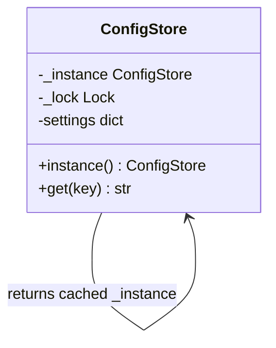
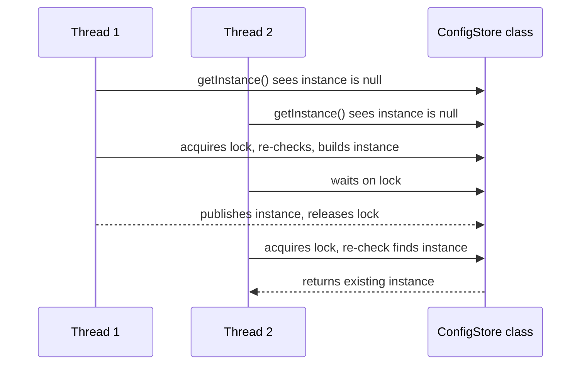
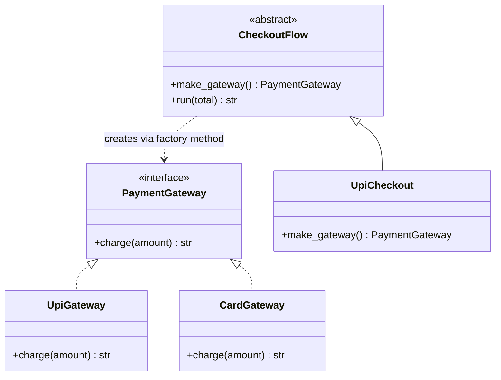
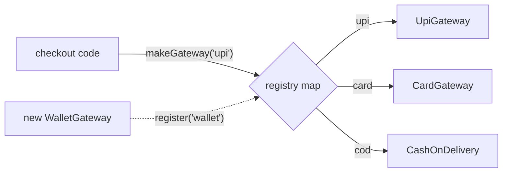
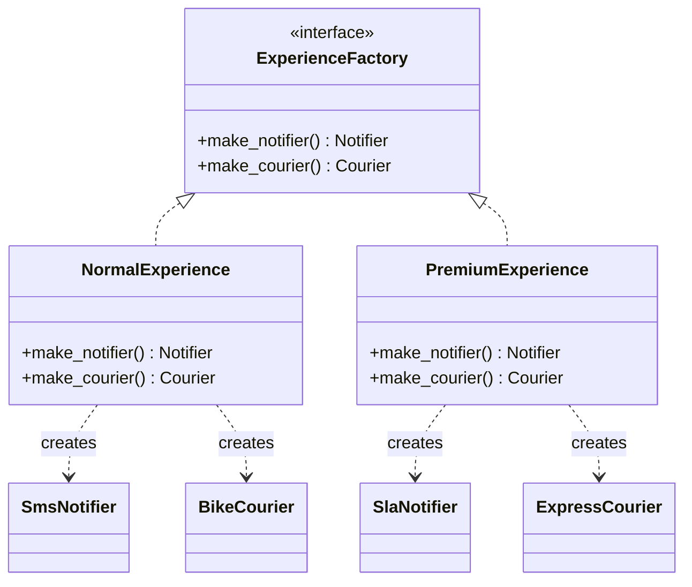
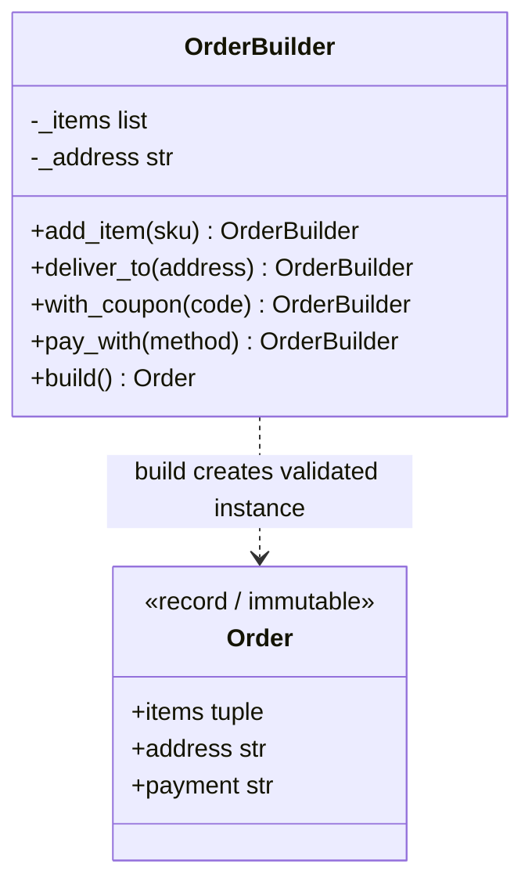
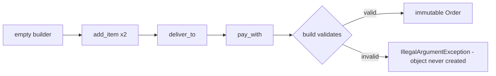
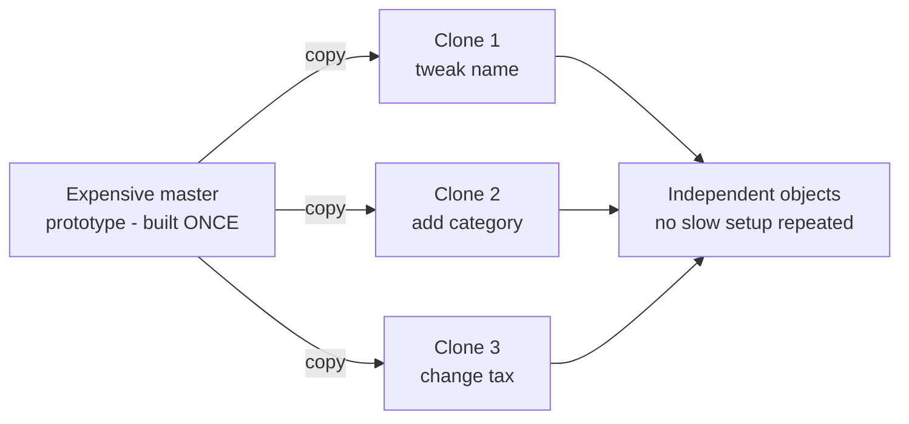
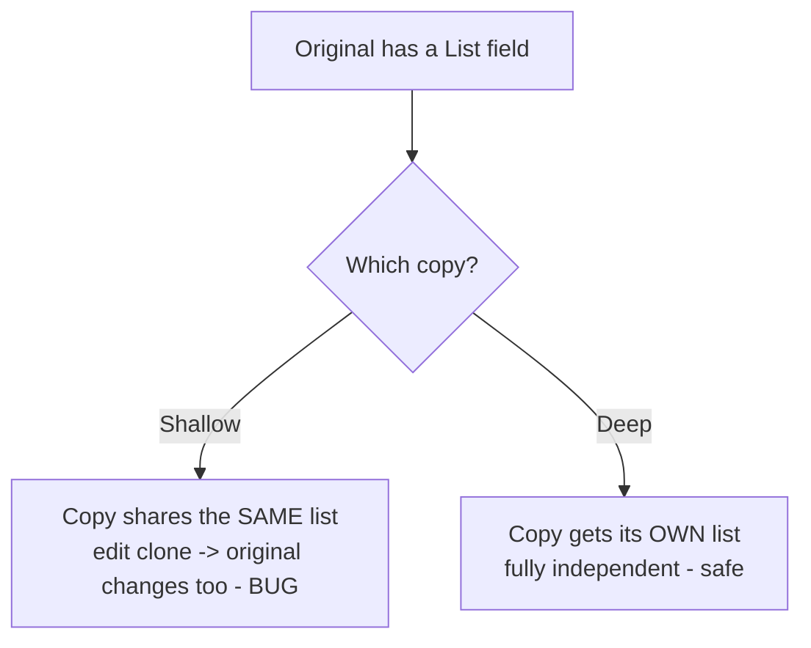

# Day 3 — Creational Patterns

> Series: System Design Mastery
> Domain thread: **QuickBite**, our running food-delivery example — orders, pricing, payments, notifications.

Creational patterns answer one deceptively simple question: **who is allowed to call the constructor (`new`), and when?** Get this wrong and construction logic leaks into every corner of the codebase; change one constructor and forty files break. Get it right and object creation becomes a swappable, testable seam.

---

## Table of Contents

1. [Singleton](#1-singleton)
2. [Factory Method](#2-factory-method)
3. [Abstract Factory](#3-abstract-factory)
4. [Builder](#4-builder)
5. [Prototype](#5-prototype)
6. [Comparison: the five creational patterns](#6-comparison-table)
7. [Real-World Spotting Guide](#7-real-world-spotting-guide)
8. [Day 3 Self-Check](#day-3-self-check)

---

## 1. Singleton

**In plain words:** A Singleton is like the one shared TV remote for the whole house. No matter which room you walk into, you reach for the *same* remote — you never manufacture a brand-new one. The class itself is the person who owns the remote: it hands out the one copy it keeps in a drawer, and refuses to make more.

### Why

QuickBite has one config store, one connection pool, one metrics registry. If every module builds its own `new Config()` you get: duplicated file reads, inconsistent values after a hot-reload, and N connection pools where you budgeted for one. The *need* is real: **one shared instance, globally reachable**.

### What

Singleton guarantees a class has **exactly one instance** and provides a global access point to it. The class itself polices its own construction.


*Read as: the class holds a private reference to its only instance; `instance()` either creates it once or returns the cached one.*

> **🤔 Why not just use a Singleton instead of passing this object around everywhere?**
> That instinct — "it's easier to reach a global than to thread a parameter" — is *exactly* how Singleton gets abused into global mutable state. A Singleton is justified only for a genuinely one-per-process resource (a connection pool, config, the metrics registry) that many callers must *share*. "I'm too lazy to pass it in" is a global variable wearing a suit, and it makes every consumer's real dependencies invisible in its signature.

**✅ Good scenario (where it saves you):** QuickBite's DB connection pool is a single `enum` Singleton — building a second pool would double the connections the database budgeted for. Every service shares the one pool, and because it is created once and never mutated after startup, the sharing is safe.

**❌ Bad scenario (the pain when misused):** A team makes `CurrentUserContext` a Singleton "for convenience." Under a thread-pooled web server, request A's user leaks into request B's response — a security incident — and every unit test now has to reset the static field, so tests know private internals and flake in random order.

**When NOT to:** for immutable config in a small program, a plain `public static final` constant is fine — don't build lock-guarded Singleton ceremony for a map that never changes. And if you find yourself resetting a Singleton between tests, constructor injection was the right answer all along.

### When

- Genuinely one-per-process resources: connection pools, config, logging root, metrics registries.
- Creation is expensive and callers must share state.
- **Not** merely "I'm too lazy to pass this object around" — that is a global variable wearing a suit.

### How

**Problem code first** — the naive version that breaks under threads:

```java
public class ConfigStore {
    // 'static' means this field belongs to the CLASS, not to any one object.
    private static ConfigStore instance = null;
    private Map<String, String> settings;

    // Private constructor: nobody OUTSIDE this class can call 'new ConfigStore()'.
    private ConfigStore() {
        load();
    }

    public static ConfigStore getInstance() {
        if (instance == null) {          // Thread A and B both pass this check...
            instance = new ConfigStore(); // ...and the constructor runs twice. Race!
        }
        return instance;
    }

    private void load() {
        try { Thread.sleep(100); } catch (InterruptedException ignored) {} // simulate slow I/O
        settings = new HashMap<>();
        settings.put("delivery_fee", "2.99");
    }
}
```

Two threads racing through `getInstance()` can both see `instance == null` and both construct. One classic fix is **double-checked locking** (note the `volatile` keyword — it is essential in Java so half-built objects are never seen by another thread):

```java
import java.util.*;

public class ConfigStore {
    // 'volatile' guarantees every thread sees the fully-built object, never a half-written one.
    private static volatile ConfigStore instance = null;
    private Map<String, String> settings;

    private ConfigStore() {             // private: construction is the class's own job
        load();
    }

    public static ConfigStore getInstance() {
        if (instance == null) {                    // fast path, no lock cost
            synchronized (ConfigStore.class) {     // only one thread enters this block at a time
                if (instance == null) {            // re-check inside the lock
                    instance = new ConfigStore();  // publish only when fully ready
                }
            }
        }
        return instance;
    }

    private void load() {
        settings = new HashMap<>();                // list/dict -> Map in Java
        settings.put("delivery_fee", "2.99");
        settings.put("currency", "INR");
    }

    public String get(String key) {
        return settings.get(key);
    }
}

// Usage:
// ConfigStore a = ConfigStore.getInstance();
// ConfigStore b = ConfigStore.getInstance();
// assert a == b;  // one instance, guaranteed (== compares object identity)
```

**The idiomatic Java way — the Bill Pugh "static holder" idiom.** It is lazy (the instance is not built until first use), thread-safe *without* any locking, and far simpler than double-checked locking:

```java
public class ConfigStore {
    private final Map<String, String> settings;

    private ConfigStore() {                         // still private
        settings = new HashMap<>();
        settings.put("delivery_fee", "2.99");
        settings.put("currency", "INR");
    }

    // The nested class is NOT loaded by the JVM until Holder.INSTANCE is first referenced.
    // Class loading is thread-safe by definition, so no locks are needed. This is the trick.
    private static class Holder {
        private static final ConfigStore INSTANCE = new ConfigStore();
    }

    public static ConfigStore getInstance() {
        return Holder.INSTANCE;                      // triggers Holder load exactly once
    }

    public String get(String key) {
        return settings.get(key);
    }
}
```

**The safest Java singleton of all — an `enum`.** Java guarantees an enum constant is created exactly once. It is automatically thread-safe, and — unlike the class-based versions — it is safe against *serialization* and *reflection* attacks (both of which can otherwise sneak a second instance into existence):

```java
public enum ConfigStore {
    INSTANCE;                                        // the one and only instance

    private final Map<String, String> settings = new HashMap<>();

    ConfigStore() {                                  // enum constructor runs once, safely
        settings.put("delivery_fee", "2.99");
        settings.put("currency", "INR");
    }

    public String get(String key) {
        return settings.get(key);
    }
}

// Usage:
// String fee = ConfigStore.INSTANCE.get("delivery_fee");
```


*Read as: the second check inside the lock is what stops Thread 2 from building a duplicate.*

### Where

| Library | Singleton sighting |
|---|---|
| `java.util.logging` / SLF4J | `LoggerFactory.getLogger(...)` returns the **same** logger object per name — a registry of singletons |
| Spring Framework | beans are **singleton-scoped by default** — one instance per application context |
| Runtime | `Runtime.getRuntime()` — one JVM runtime object per process |
| `Boolean.TRUE`, `Collections.emptyList()` | the JDK caches these — effectively singletons in the library itself |

### Java note

Java has no module-level globals the way scripting languages do, so the language leans on the JVM's class-loading guarantees instead. **Prefer the `enum` singleton**: the JVM guarantees a single instance, it is thread-safe with zero locking, and it is the only form that survives serialization and reflection without extra defensive code. Use the Bill Pugh static-holder idiom when you need a plain class (for example, to extend another class, which an enum cannot do).

Even better for testability: **dependency injection**. Build the object once at the composition root (or let a framework like Spring do it) and *pass it in*:

```java
public App createApp(ConfigStore config) {
    PricingService pricing = new PricingService(config); // explicit dependency, trivially mockable
    return new App(pricing);
}
```

### The Dark Side

Singleton is the most-abused pattern in existence, and the criticism is earned:

- **Hidden global state.** `OrderService` silently reaches for `ConfigStore.getInstance()` — its true dependencies are invisible in its signature. That is action at a distance.
- **Testing pain.** State leaks between tests. You end up needing tricks to reset the instance between tests, which means your tests now know private implementation details. With DI, you just pass a fake.
- **Concurrency trap.** The singleton itself may be created safely, but its *mutable state* is now shared by every thread.
- **It lies about cardinality.** "One per process" quietly becomes "one per process × N JVMs" when you scale horizontally across many servers or containers. Your "single" rate-limiter is suddenly eight rate-limiters.

**When the "bad" alternative is right:** a plain `public static final` constant is *fine* for immutable config in a small program. Don't build lock-guarded singleton ceremony for a map that never changes. Conversely, if you find yourself resetting a singleton in tests, the "boring" answer — constructor injection — was right all along.

---

## 2. Factory Method

**In plain words:** A Factory Method is like ordering "a coffee" at the counter. You don't say "go grab beans, grind them, pull an espresso shot, steam milk." You just name what you want, and the barista decides how to make it. Your code names *what* it needs; the factory decides *which concrete class* to build.

### Why

QuickBite accepts payments through UPI, cards, and cash-on-delivery. The naive approach scatters `if (method.equals("upi")) new UpiGateway()` across checkout, refunds, and reconciliation. Adding "wallet" means hunting down every branch — a textbook Open-Closed violation (Day 2 callback).

### What

Factory Method moves the `new SomeClass()` call behind a method that subclasses (or a registry) override, so **the code that uses a product never names its concrete class**.

> **🤔 Why wrap `new` in a factory when I can just call the constructor?**
> Because the problem isn't *one* `new` — it's the same `if (method.equals("upi")) new UpiGateway()` ladder copy-pasted across checkout, refunds, and reconciliation. When "wallet" arrives you must hunt down every branch. A factory puts choose-and-construct in *one* place, so calling code names *what* it wants, not *which* concrete class — and adding a variant touches one file, not forty.

**✅ Good scenario (where it saves you):** QuickBite's `GatewayFactory` registry maps `"upi"/"card"/"cod"` to constructors. A new `WalletGateway` self-registers with one line; checkout, refund, and reconciliation code never change — Open-Closed delivered, and the payments on-call has exactly one place to look when a method misbehaves.

**❌ Bad scenario (the pain without it):** The gateway `if/else` is duplicated in three services. Adding BNPL means three edits; one team forgets the reconciliation branch, and BNPL orders silently fail to reconcile for a week until finance notices the gap.

**When NOT to:** one implementation with no second on the horizon? `new UpiGateway()` called directly is honest code — a factory is indirection tax. A two-branch `if` that changes once a year beats a registry; YAGNI beats OCP when change isn't actually coming.

### When

- The concrete class is chosen at runtime from data (user input, config, DB row).
- You expect the family of implementations to grow.
- You want construction logic (validation, credentials, retries) in exactly one place.

### How

**Problem code** — the if/else spread:

```java
public String checkout(double orderTotal, String method) {
    PaymentGateway gateway;
    if (method.equals("upi")) {
        gateway = new UpiGateway("quickbite@");
    } else if (method.equals("card")) {
        gateway = new CardGateway("QB-441", true);
    } else if (method.equals("cod")) {
        gateway = new CashOnDelivery();
    } else {
        throw new IllegalArgumentException(method); // 'raise' -> 'throw' in Java
    }
    return gateway.charge(orderTotal);
}
// ...and the same ladder again in refund(), and again in reconcile()...
```

**Pattern applied** — start with the interface (the abstract "product"), then the concrete gateways:

```java
// An interface is Java's way of saying "any class implementing this must have a charge() method".
// (In Python this was an ABC with @abstractmethod.)
public interface PaymentGateway {
    String charge(double amount);
}

public class UpiGateway implements PaymentGateway {
    private final String vpaPrefix;              // snake_case vpa_prefix -> camelCase vpaPrefix

    public UpiGateway(String vpaPrefix) {        // constructor replaces Python's __init__
        this.vpaPrefix = vpaPrefix;             // 'this' replaces 'self'
    }

    @Override
    public String charge(double amount) {
        // String.format replaces the Python f-string; %.2f is the ".2f" formatting.
        return String.format("UPI charged %.2f via %s", amount, vpaPrefix);
    }
}

public class CardGateway implements PaymentGateway {
    private final String merchantId;
    private final boolean threeDs;

    public CardGateway(String merchantId, boolean threeDs) {
        this.merchantId = merchantId;
        this.threeDs = threeDs;
    }

    @Override
    public String charge(double amount) {
        return String.format("Card charged %.2f, 3DS=%b", amount, threeDs);
    }
}

public class CashOnDelivery implements PaymentGateway {
    @Override
    public String charge(double amount) {
        return String.format("COD noted for %.2f", amount);
    }
}
```

**Classic GoF form** — an abstract creator whose subclasses decide the concrete product:

```java
// Abstract class: it provides the shared run() logic but leaves makeGateway() for subclasses.
public abstract class CheckoutFlow {
    // THE factory method: subclasses fill in which gateway to build.
    protected abstract PaymentGateway makeGateway();

    public String run(double total) {
        PaymentGateway gateway = makeGateway();  // template method calls the hook
        return gateway.charge(total);
    }
}

public class UpiCheckout extends CheckoutFlow {
    @Override
    protected PaymentGateway makeGateway() {
        return new UpiGateway("quickbite@");
    }
}
```

**The registry variant** — what production Java often looks like (a `Map` from name to a factory function):

```java
import java.util.*;
import java.util.function.Supplier;

public class GatewayFactory {
    // Map<String, Supplier<PaymentGateway>>: a name -> "something that builds a gateway".
    // Supplier<T> is a built-in interface for a no-argument function returning a T.
    private static final Map<String, Supplier<PaymentGateway>> REGISTRY = new HashMap<>();

    // Register each known gateway once (e.g. in a static initializer).
    static {
        REGISTRY.put("upi", () -> new UpiGateway("quickbite@"));   // lambda = the factory
        REGISTRY.put("card", () -> new CardGateway("QB-441", true));
        REGISTRY.put("cod", CashOnDelivery::new);                  // method reference = 'new'
    }

    // Let new code register itself without editing this class.
    public static void register(String name, Supplier<PaymentGateway> factory) {
        REGISTRY.put(name, factory);
    }

    public static PaymentGateway makeGateway(String name) {
        Supplier<PaymentGateway> factory = REGISTRY.get(name);
        if (factory == null) {                                     // KeyError -> null check
            throw new IllegalArgumentException("Unknown payment method: " + name);
        }
        return factory.get();                                      // call the factory -> new object
    }
}
```

New gateway? One new class, plus one `GatewayFactory.register("wallet", WalletGateway::new)` call. Zero edits to checkout. That is Open-Closed, delivered.


*Read as: `CheckoutFlow.run` depends only on the abstract product; subclasses plug in the concrete class.*


*Read as: callers ask the registry by name; new implementations self-register without touching caller code.*

### Where

| Library | Factory Method sighting |
|---|---|
| `LoggerFactory.getLogger(name)` | factory + registry: returns existing or creates |
| JDBC `DriverManager.getConnection("jdbc:postgresql://…")` | URL scheme picks the driver class from a registry |
| `Calendar.getInstance()` | returns a locale-appropriate concrete `Calendar` subclass |
| Spring `BeanFactory.getBean(...)` | resolves a concrete bean behind a factory |

### Java note

In Java, methods are not first-class objects the way they are in scripting languages, so the classic GoF creator-subclass hierarchy is more common here. That said, since Java 8 you *can* pass behavior around using `Supplier<T>`, lambdas, and method references (`UpiGateway::new`) — which is exactly what makes the `Map<String, Supplier<PaymentGateway>>` registry above clean and idiomatic. Reach for the registry when the set of products is open-ended; reach for the creator-subclass form when each variant also carries its own surrounding workflow.

### The Dark Side

- **Premature abstraction.** One implementation, no second on the horizon? A factory is indirection tax. `new UpiGateway()` called directly is honest code.
- **Registry opacity.** Registration hides *where* things come from; a misspelled key fails at runtime, not compile time. Debuggability drops.
- **Factory sprawl.** `FactoryFactoryProvider` jokes exist for a reason. If your factory has one line and one caller, inline it.

**When the "bad" alternative is right:** a two-branch `if` that changes once a year is clearer than a registry. YAGNI beats OCP when change is not actually expected.

---

## 3. Abstract Factory

**In plain words:** An Abstract Factory is like choosing a "meal deal" instead of picking each item separately. Order the "kids' combo" and you get a small burger, small fries, and a toy — all matched to that tier. Order the "premium combo" and every item upgrades together. You pick the *family*, and the factory guarantees the parts always match.

> **Honest depth note:** we cover this lightly. In everyday application code you will *recognize* Abstract Factory far more often than you will *write* one. It matters at the LLD-interview level and in framework internals; day-to-day code rarely needs it.

### Why

Suppose QuickBite ships a **normal** experience and a **premium** experience: premium orders get a priority gateway, an SLA-backed notifier, and express couriers. These objects must be **consistent as a family** — mixing a premium courier with a normal SLA notifier is a bug.

### What

Abstract Factory provides an interface for creating **families of related objects** without naming their concrete classes. Factory Method creates *one* product; Abstract Factory creates a *kit* of them, guaranteed to match.

> **🤔 Why not just build a premium notifier and a premium courier separately, as I need them?**
> Because nothing stops you from accidentally pairing a *premium* courier with a *normal* SLA notifier — and that mismatch is a real bug, not a style nit. Abstract Factory earns its keep only when family *consistency is a correctness requirement*: pick the tier once, and the factory guarantees every part matches. If the parts don't actually need to agree, you don't need this pattern.

**✅ Good scenario (where it saves you):** QuickBite ships "normal" and "premium" experiences; a premium order must get the priority gateway *and* the SLA notifier *and* the express courier, together. `PremiumExperience` hands back the whole matched kit, so no code path can assemble a half-premium order.

**❌ Bad scenario (the pain without it):** Each call site picks parts individually. Someone adds a "priority" order type, wires the express courier but forgets to upgrade the notifier, and premium customers get express delivery with no SLA tracking — a support nightmare spanning two teams.

**When NOT to:** often — if the "family" is really just configuration, a bundle of constructors (or `Supplier`s) per tier is smaller and clearer. Reach for the full Abstract Factory only when a mismatched family is a *correctness* bug, not a cosmetic one.

### How

```java
// Two product interfaces — the members of the family.
public interface Notifier {
    void send(String msg);
}

public interface Courier {
    void dispatch(String orderId);
}

// Concrete products for the NORMAL tier:
public class SmsNotifier implements Notifier {
    @Override
    public void send(String msg) {
        System.out.println("SMS: " + msg);        // print() -> System.out.println()
    }
}

public class BikeCourier implements Courier {
    @Override
    public void dispatch(String orderId) {
        System.out.println("Bike for " + orderId);
    }
}

// Concrete products for the PREMIUM tier:
public class SlaNotifier implements Notifier {
    @Override
    public void send(String msg) {
        System.out.println("SLA-tracked push: " + msg);
    }
}

public class ExpressCourier implements Courier {
    @Override
    public void dispatch(String orderId) {
        System.out.println("Express for " + orderId);
    }
}

// The abstract factory: one method per product in the family.
public interface ExperienceFactory {
    Notifier makeNotifier();
    Courier makeCourier();
}

// Each concrete factory builds ONE matched family.
public class NormalExperience implements ExperienceFactory {
    @Override public Notifier makeNotifier() { return new SmsNotifier(); }
    @Override public Courier makeCourier()  { return new BikeCourier(); }
}

public class PremiumExperience implements ExperienceFactory {
    @Override public Notifier makeNotifier() { return new SlaNotifier(); }
    @Override public Courier makeCourier()  { return new ExpressCourier(); }
}

// Client code depends only on the interface — it can never mix families by accident.
public class Fulfilment {
    public void fulfil(String orderId, ExperienceFactory factory) {
        factory.makeCourier().dispatch(orderId);              // family consistency
        factory.makeNotifier().send(orderId + " on the way"); // is guaranteed
    }
}
```


*Read as: each concrete factory column produces a matched row of products — you can never mix families by accident.*

### Where

JDBC-style driver families (one driver supplies matched connection + statement + result-set classes); GUI toolkits producing matched widget sets per OS (Swing's pluggable look-and-feel); Spring's `BeanFactory` hierarchies — less common in plain application code.

### Java note

When the family is really just configuration, you don't always need the full interface hierarchy. A small class (or a `record`) that bundles a set of factory functions can replace it: `new ExperienceKit(SlaNotifier::new, ExpressCourier::new)`, where each field is a `Supplier<Notifier>` / `Supplier<Courier>`. Reach for the full Abstract Factory when family consistency is a *correctness* requirement, not a styling preference.

### The Dark Side

- Heaviest ceremony-to-payoff ratio of the creational patterns. Adding a *new product type* to the family means editing **every** factory — the pattern is open for new families but closed against new products.
- **When the "bad" alternative is right:** often. If families are just configuration, a bundle of constructors (or `Supplier`s) per tier is smaller and clearer. Reach for Abstract Factory only when family consistency is a *correctness* requirement, not a styling preference.

---

## 4. Builder

**In plain words:** A Builder is like a sandwich order form where you tick the options you want — bread, fillings, sauces, toasted or not — and hand it in only when you're done. You add choices one at a time in any order, skip the ones you don't care about, and the kitchen only makes the sandwich (and checks it's a valid combo) when you press "submit."

### Why

A QuickBite `Order` has: items, address, coupon, tip, scheduled time, utensils flag, allergy notes, payment method… The **telescoping constructor** is the disease: eight positional parameters, half optional, impossible to read at call sites, and every new field breaks the signature.

### What

Builder separates the construction of a complex object from its representation: accumulate parts step by step, then `build()` a validated — often immutable — result.

> **🤔 Why a Builder when Java already has constructors?**
> Because a constructor with eight half-optional parameters — `new Order(items, addr, null, 0.0, null, false, "", "upi")` — is unreadable and unsafe: nobody can tell what `false` or `null` means at the call site, and Java has no named or default arguments to rescue you. Builder gives readable, order-free, optional construction *and* one place to run cross-field validation before the object exists. It carries more weight in Java precisely because Java lacks keyword args.

**✅ Good scenario (where it saves you):** A QuickBite cart *is* an order-builder that lives for minutes — items get added across HTTP requests, then `build()` runs the "COD can't pre-tip" rule and mints an immutable `Order`. No half-built, invalid order ever reaches the payments code.

**❌ Bad scenario (the pain without it):** A telescoping `Order` constructor. A refactor reorders two `String` parameters; every call site still compiles, but addresses and coupon codes silently swap. Orders ship to the wrong place, and the bug is invisible to the compiler — the classic positional-argument disaster.

**When NOT to:** for a 3–4 field object with no cross-field rules, a `record` and a plain `new Order(...)` is the correct, boring choice. Upgrade to Builder only when validation or incremental assembly actually demands it (or let Lombok's `@Builder` generate it).

### How

**Problem code** — telescoping constructor:

```java
public class Order {
    // Eight parameters, half of them optional-in-spirit but mandatory in Java's signature.
    public Order(List<String> items, String address, String coupon, double tip,
                 LocalDateTime scheduled, boolean utensils, String allergyNotes, String payment) {
        // ...
    }
}

// Call site: what does 'false' mean? what is '0.0'? Good luck in review.
Order order = new Order(items, addr, null, 0.0, null, false, "", "upi");
```

**Pattern applied** — a fluent builder producing an immutable order. We use a `record` for the immutable product (Java's concise way to declare an immutable data class with fields, constructor, and getters generated for you):

```java
import java.util.*;
import java.time.LocalDateTime;

// A 'record' is immutable once built — safe to share across threads and handlers.
// It auto-generates a constructor, accessor methods (items(), address(), ...), equals/hashCode.
public record Order(
    List<String> items,
    String address,
    String coupon,           // may be null
    double tip,
    LocalDateTime scheduled, // may be null
    String payment
) {}

public class OrderBuilder {
    // Mutable "scratch" fields the builder fills in step by step.
    private final List<String> items = new ArrayList<>();
    private String address = null;
    private String coupon = null;
    private double tip = 0.0;
    private LocalDateTime scheduled = null;
    private String payment = "card";

    // Each setter returns 'this' so calls can be chained fluently.
    public OrderBuilder addItem(String sku) {
        items.add(sku);
        return this;                                 // fluent chaining
    }

    public OrderBuilder deliverTo(String address) {
        this.address = address;
        return this;
    }

    public OrderBuilder withCoupon(String code) {
        this.coupon = code.toUpperCase();            // code.upper() -> code.toUpperCase()
        return this;
    }

    public OrderBuilder tip(double amount) {
        if (amount < 0) {
            throw new IllegalArgumentException("Tip cannot be negative");
        }
        this.tip = amount;
        return this;
    }

    public OrderBuilder payWith(String method) {
        this.payment = method;
        return this;
    }

    public Order build() {
        // Cross-field validation lives in ONE place, runs BEFORE the object exists.
        if (items.isEmpty()) {
            throw new IllegalArgumentException("Order needs at least one item");
        }
        if (address == null) {
            throw new IllegalArgumentException("Delivery address is required");
        }
        if (payment.equals("cod") && tip > 0) {
            throw new IllegalArgumentException("COD orders cannot pre-tip");
        }
        // List.copyOf makes an unmodifiable snapshot so the built Order stays truly immutable.
        return new Order(List.copyOf(items), address, coupon, tip, scheduled, payment);
    }
}

// Usage — reads like a sentence:
// Order order = new OrderBuilder()
//         .addItem("PIZZA-M")
//         .addItem("COKE-500")
//         .deliverTo("221B Baker Street")
//         .withCoupon("first50")
//         .payWith("upi")
//         .build();
```


*Read as: every mutator returns the builder itself, enabling chains; only `build` can mint an Order, so no invalid Order ever exists.*


*Read as: the half-built state lives only inside the builder; the domain object is born valid or not at all.*

### When Builder still wins in Java

Java lacks named/keyword arguments and default parameter values, so Builder carries *more* weight here than in languages that have those features — a fluent builder is often the cleanest way to get readable, optional, order-free construction. Builder especially earns its place when:

1. **Cross-field validation** must run before the object exists (the `cod` + tip rule above).
2. **Immutability**: you want a frozen `record`, but assembly is inherently step-by-step (items added in a loop, across HTTP requests, in a cart session).
3. **Telescoping is real**: many interacting options (think a query builder, an HTTP client config, or test-data factories).
4. Construction spans time or components — a cart *is* an order builder that lives for minutes.

A common idiom is to nest the builder as a `static` class inside the product and expose it via `Order.builder()`, so the two always travel together.

### Where

| Library | Builder sighting |
|---|---|
| `StringBuilder` | `.append(...).append(...).toString()` — accumulate, then produce |
| `Stream` API | `stream.filter(...).map(...).collect(...)` — chained transformation builders |
| `HttpClient.newBuilder()` (java.net.http) | fluent config, then `.build()` |
| Lombok `@Builder` / Immutables | generate a fluent builder for you |

### Java note

Before hand-writing a Builder, ask: *would a small `record` (or a class with a few constructors) do?* For 3–4 fields, often yes. But because Java has no keyword arguments or defaults, the tipping point toward Builder comes sooner than in scripting languages. Tools like Lombok's `@Builder` or the Immutables library generate the whole builder from a single annotation — reach for those before writing 60 lines of boilerplate by hand.

### The Dark Side

- **Ceremony for nothing.** A builder mirroring a 4-field record one-to-one can be pure boilerplate; sometimes a plain constructor or a generated `@Builder` is enough.
- **Half-built object leaks.** If code passes the *builder* around instead of the built product, you've reinvented mutable shared state.
- **Fluent chains hide errors**: a 9-call chain gives one stack frame of context when step 6 fails.

**When the "bad" alternative is right:** a `record` with a plain constructor, `new Order(...)`, is the correct choice for most small objects. Choose boring first; upgrade to Builder when validation or incremental assembly demands it.

---

## 5. Prototype

**In plain words:** Prototype is like using a photocopier instead of retyping a document. When you already have an object set up just the way you want, you *copy* it and tweak the copy — instead of building a fresh one from scratch. Think "duplicate this and change a couple of things," like copy-pasting a slide and editing it.

### Why

Sometimes creating an object from scratch is **expensive or complicated**: it took a slow database call, a network fetch, or heavy computation to assemble; or it has dozens of fields already configured a specific way. If you need many *near-identical* objects, rebuilding each one from zero is wasteful — and re-running the setup logic every time is error-prone. Prototype says: build one good original, then **clone** it and adjust the differences.

### What

Prototype creates new objects by **copying an existing instance (the "prototype")** rather than calling a constructor. The object knows how to duplicate itself (a `copy()`/`clone()` method), so callers get a ready-made copy without knowing or repeating the construction details.

The critical concept you must understand: **shallow copy vs deep copy.**

- **Shallow copy** — copies the top-level fields. But if a field is a reference to another object (like a `List`), the copy points to the *same* inner object. Change the list in the copy → the original changes too. Usually a bug.
- **Deep copy** — copies the object *and* everything it references, all the way down. The copy is fully independent. Usually what you actually want.

> **🤔 Why clone an object instead of just calling `new` again?**
> Because sometimes building from scratch is the *expensive* part — a slow DB load, a network fetch, heavy computation — and you need many near-identical copies. Re-running that setup for each one is wasteful and error-prone. Prototype says: pay the cost once for a configured "master," then stamp out cheap, independent copies and tweak only the differences. If construction is cheap, this pattern buys you nothing.

**✅ Good scenario (where it saves you):** QuickBite builds one expensive `MenuTemplate` master (default categories + region tax loaded from the DB), then `copy()`s it per new restaurant and edits a few fields. Onboarding 500 restaurants runs the slow DB setup once, not 500 times.

**❌ Bad scenario (the pain when misused):** A team clones templates with a *shallow* copy, so every clone shares one `categories` list. A restaurant adds "Wood-fired" and it silently appears on 40 other menus — the classic "why did editing A change B?" bug that takes a day to trace.

**When NOT to:** if construction is cheap (a plain data object, no expensive setup), just call `new` — a constructor is clearer than a clone method, and you dodge the shallow-vs-deep-copy trap entirely.

### How

**Problem code** — rebuilding a complex object from scratch every time:

```java
import java.util.*;

// Imagine assembling a QuickBite "menu template" for a new restaurant is expensive:
// it loads default categories, tax rules, and standard items from the database.
public class MenuTemplate {
    private String restaurantName;
    private List<String> categories;
    private double taxRate;

    public MenuTemplate(String restaurantName) {
        this.restaurantName = restaurantName;
        // EXPENSIVE: pretend these come from slow DB/network calls every single time.
        this.categories = loadDefaultCategoriesFromDb();   // slow
        this.taxRate = loadRegionTaxRuleFromDb();          // slow
    }
    // ... every new restaurant re-runs the slow setup, even though 95% is identical.
}
```

**Pattern applied** — build one prototype, then clone it (with a proper deep copy):

```java
import java.util.*;

public class MenuTemplate {
    private String restaurantName;
    private List<String> categories;   // a reference type — the deep-copy trap lives here
    private double taxRate;            // a primitive — copied safely by value

    public MenuTemplate(String restaurantName, List<String> categories, double taxRate) {
        this.restaurantName = restaurantName;
        this.categories = categories;
        this.taxRate = taxRate;
    }

    // The prototype knows how to duplicate ITSELF. This is the heart of the pattern.
    public MenuTemplate copy() {
        // DEEP COPY: build a BRAND-NEW list with the same contents, so the clone's list
        // is independent. If we passed 'this.categories' directly, both would share one
        // list (shallow copy) and editing one would silently change the other — a classic bug.
        List<String> categoriesCopy = new ArrayList<>(this.categories);
        return new MenuTemplate(this.restaurantName, categoriesCopy, this.taxRate);
    }

    public void setRestaurantName(String name) { this.restaurantName = name; }
    public void addCategory(String c) { this.categories.add(c); }
}

// Usage: build the expensive "master" ONCE...
// MenuTemplate master = new MenuTemplate("DEFAULT",
//         loadDefaultCategoriesFromDb(), loadRegionTaxRuleFromDb());
//
// ...then cheaply clone it for each new restaurant and tweak the differences:
// MenuTemplate pizzaPlace = master.copy();
// pizzaPlace.setRestaurantName("Mario's Pizza");
// pizzaPlace.addCategory("Wood-fired");   // affects ONLY the copy, thanks to deep copy
```


*Read as: pay the expensive construction cost once for the prototype, then stamp out cheap, independent copies and adjust only what differs.*


*Read as: the whole art of Prototype is getting the deep-vs-shallow decision right for every reference-type field.*

### When

- Creating an object is **expensive** (DB/network/computation) but you need many similar ones.
- You want to snapshot an object's current **configured state** and produce variations (templates, presets, default configs, saved game states, document copies).
- You need copies at runtime without coupling to their concrete classes.

### Where

| Library / place | Prototype sighting |
|---|---|
| `Object.clone()` + `Cloneable` | Java's built-in (but flawed) cloning mechanism |
| `ArrayList`, `HashMap` copy constructors — `new ArrayList<>(other)` | the everyday, idiomatic way to copy |
| Deserialization (JSON/serialize → copy) | a common deep-copy trick |
| Prototype-scoped Spring beans | a fresh copy per request |

### Java note

Java ships a built-in `clone()` method and a `Cloneable` interface — but they're widely considered **broken/awkward** (`clone()` does a shallow copy by default, has confusing rules, and Josh Bloch's *Effective Java* famously advises avoiding them). In modern Java the preferred ways to implement Prototype are: a **copy constructor** (`new ArrayList<>(original)`), a dedicated `copy()` method like above, or copying via serialization for deep copies. Prefer these over `Cloneable`.

### The Dark Side

- **The shallow-copy trap** is the #1 source of Prototype bugs — a clone that secretly shares a list/map with the original leads to spooky "why did editing A change B?" bugs. Deep copy costs more but is usually what you need.
- **Deep-copying a huge object graph** can be as slow as rebuilding it — measure before assuming clone is cheaper.
- **Cyclic references** (A points to B points to A) make naive deep copy infinite-loop.

**When the "bad" alternative is right:** if construction is cheap (a plain data object, no expensive setup), just call `new` — a constructor is clearer than a clone method. Prototype earns its keep specifically when construction is *expensive* or you're stamping out *variations of a configured original*. For most everyday objects, don't reach for it.

---

## 6. Comparison Table

| Aspect | Factory Method | Abstract Factory | Builder | Prototype |
|---|---|---|---|---|
| Creates | **one** product | a **family** of matched products | **one complex** product, step-by-step | a **copy** of an existing object |
| Variation axis | which concrete class | which family/theme | which parts and options | which fields differ from the original |
| Typical trigger | `if (type == …)` ladders | "premium vs normal kit" consistency | telescoping constructors, cross-field validation | expensive construction, "duplicate & tweak" |
| Result known when | immediately | immediately | only at `build()` | immediately (as a clone) |
| Idiomatic Java substitute | `Map<String, Supplier<T>>` registry | record/class bundling `Supplier`s | fluent builder, or Lombok `@Builder` | copy constructor / `copy()` method |
| Frequency in real Java | very common | rare | very common (fluent APIs) | occasional (copies, templates, snapshots) |

Rule of thumb: **Factory Method picks the class, Abstract Factory picks the matching set, Builder assembles the instance, Prototype copies an existing one.**

---

## 7. Real-World Spotting Guide

| You see… | Pattern hiding inside |
|---|---|
| `LoggerFactory.getLogger("quickbite")` returns same object | Singleton-per-name registry |
| `Calendar.getInstance()` returning a locale-specific subclass | Factory Method |
| `DriverManager.getConnection("jdbc:mysql://…")` picking a driver | Factory Method + registry |
| A JDBC driver providing matched connection/statement/result-set classes | Abstract Factory |
| `stream.filter().map().collect()` or `HttpClient.newBuilder()...build()` | Builder as fluent API |
| Spring singleton-scoped beans | Singleton (with all its testing pain) |

---

## Day 3 Self-Check

1. Why does naive lazy Singleton initialization break under threads, and what do *both* checks in double-checked locking accomplish? Why is `volatile` required in Java?
2. Give two reasons Singletons make unit testing painful, and the DI-based cure for each.
3. Why is a Java `enum` the safest Singleton? What two attacks (that break class-based singletons) does it defend against for free?
4. Your teammate wraps a read-only constants map in a lock-guarded Singleton class. What do you tell them?
5. Show (in your head) how a `Map<String, Supplier<PaymentGateway>>` Factory upholds the Open-Closed Principle when a "wallet" payment method arrives.
6. Factory Method vs Abstract Factory: which one creates families, and what edit-cost does Abstract Factory pay when a **new product type** joins the family?
7. Name the situations where Builder still beats a plain constructor or `record` in Java, and why Java's lack of keyword arguments makes Builder more valuable here than in scripting languages.
8. What invariant does "only `build()` can create the Order" protect, and why does immutability (a `record`) pair naturally with it?
9. Where is the Factory Method inside `Calendar.getInstance()`? Inside `DriverManager.getConnection`?
10. When is a plain if/else ladder genuinely *better* than a factory registry?

**Tomorrow:** Day 4 — Behavioral Patterns I: Strategy, Observer, State — QuickBite's pricing engine learns to swap algorithms, its orders start broadcasting events, and the order lifecycle becomes a real state machine.
