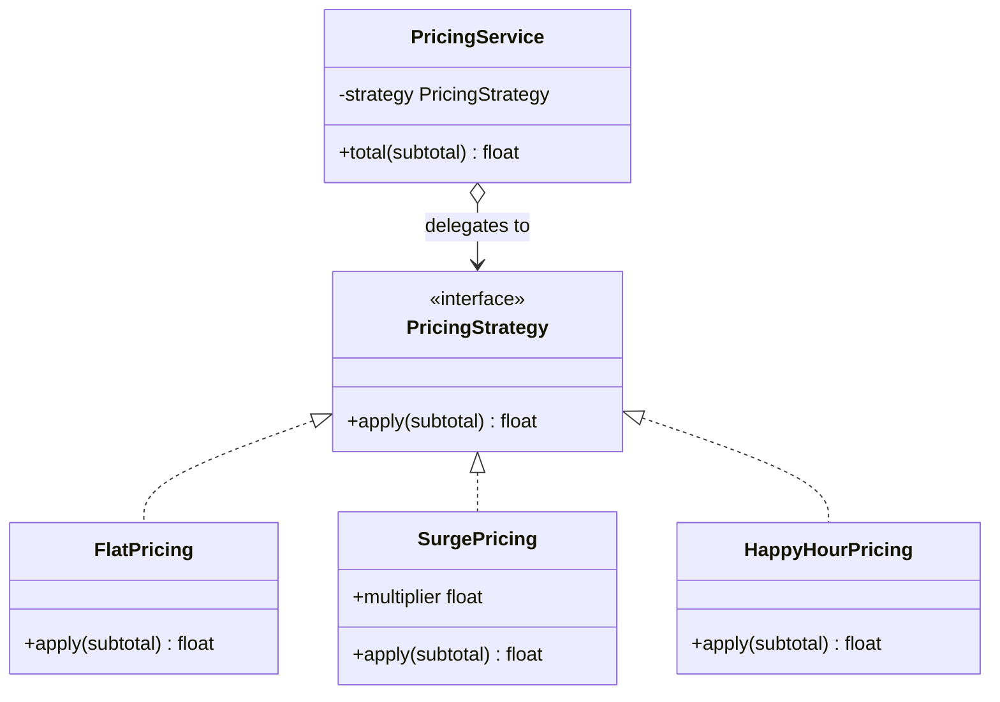
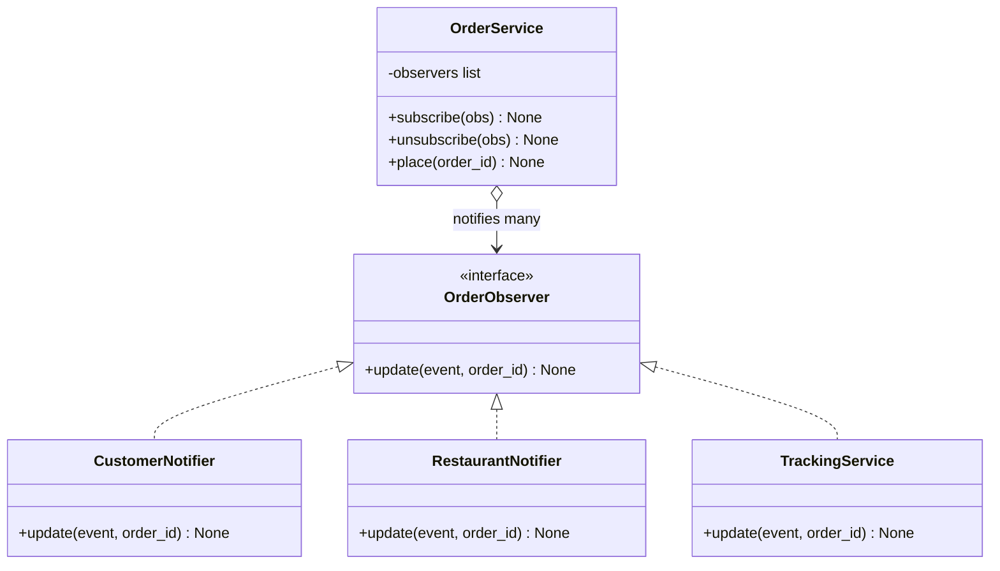
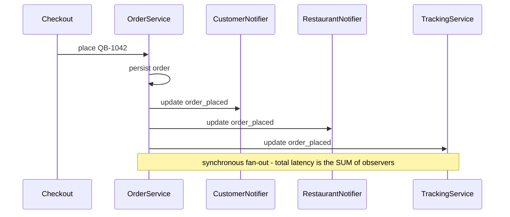
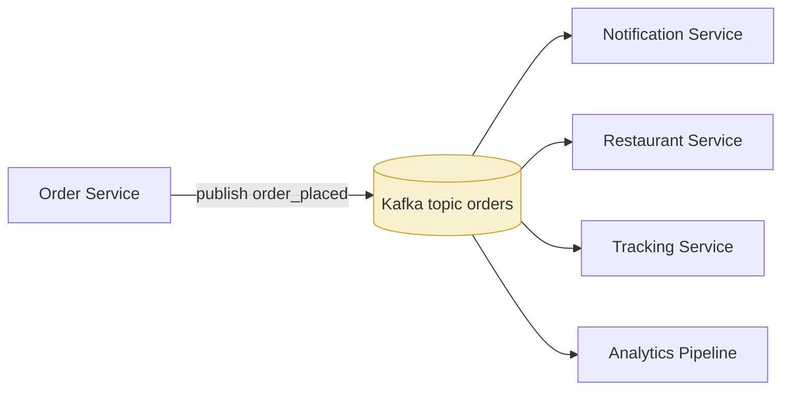
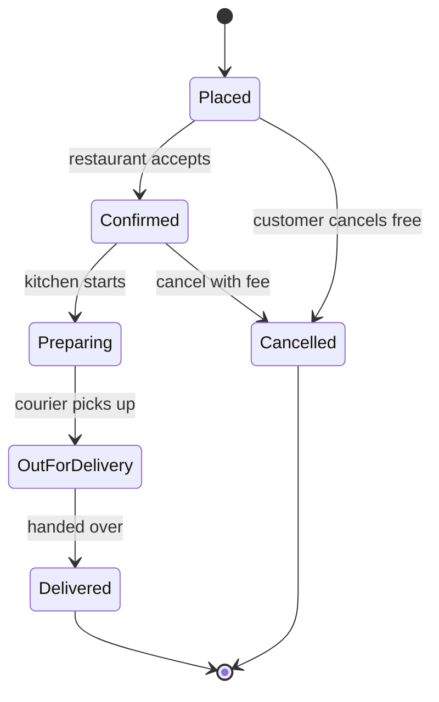
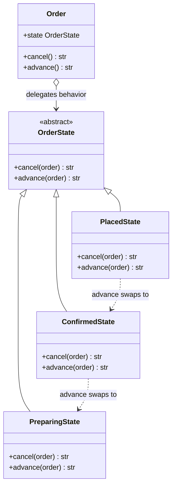

# Day 4 — Behavioral Patterns I: Strategy, Observer, State

> Series: System Design Mastery
> Domain thread: **QuickBite** — today its pricing engine learns to swap algorithms, its orders broadcast events, and its lifecycle becomes a state machine.

Creational patterns (Day 3) decide *who builds objects*. Behavioral patterns decide **how objects talk and how behavior varies at runtime**. The three we cover today are the highest-frequency behavioral patterns you will meet in real code — and in interviews.

---

## Table of Contents

1. [Strategy](#1-strategy)
2. [Observer](#2-observer)
3. [State](#3-state)
4. [Strategy vs State — the twins that aren't](#4-strategy-vs-state-comparison)
5. [Real-World Spotting Guide](#5-real-world-spotting-guide)
6. [Day 4 Self-Check](#day-4-self-check)

---

## 1. Strategy

**In plain words:** Strategy is like a maps app asking "how do you want to get there — car, bike, or walking?" The trip is the same; only the *method* of getting there changes, and you pick it fresh each time. In code, you keep a family of interchangeable algorithms and swap which one runs without touching the code that calls it.

### Why

QuickBite prices orders differently: flat pricing at launch, surge pricing at dinner rush, happy-hour discounts, partner-restaurant deals. Hardcoding these as an if/else-if ladder inside `PricingService` means the service is edited — and re-tested, and re-deployed — every time marketing invents a promotion. That is the exact wound the **Open-Closed Principle** (Day 2) told us to close.

### What

Strategy defines a **family of interchangeable algorithms**, encapsulates each one, and lets the client pick one at runtime. The context code depends on the *interface*, never a concrete algorithm.

> **🤔 Why Strategy if I can just use an `if/else` to pick the pricing?**
> Because that ladder lives *inside* `PricingService`, so every promo marketing invents means editing — and re-testing, and re-deploying — the core pricing code. Strategy doesn't magically delete the choice; it moves each algorithm into its own class so the service depends on an interface and never reopens. The confusion is thinking Strategy "removes conditionals" — it *relocates* the volatility out of the code that must stay stable.

**✅ Good scenario (where it saves you):** QuickBite's marketing ships flat, surge, happy-hour, and festival pricing over a quarter. Each is a small `PricingStrategy` class; `PricingService` is never touched, so the payments-critical `total()` math is never put at risk by a promo experiment.

**❌ Bad scenario (the pain without it):** Pricing is one growing `if (mode.equals(...))` ladder in `PricingService`. A happy-hour tweak shares a rounding variable with surge, breaks surge subtly, and now a pricing bug ships to every dinner-rush order — the exact code you least want to re-touch weekly.

**When NOT to:** two stable, simple branches (`if (peakHours)`) that change never? Keep the `if`. Strategy pays only when the algorithm family genuinely grows or must be swapped per-request/per-config; 14 near-identical classes differing by one constant should have been one parameterized class.

### When

- Multiple ways to do the *same job*: pricing, routing a courier, ranking restaurants, compressing payloads, retry backoff.
- The choice varies by runtime data (time of day, user tier, config, A/B bucket).
- You see an if/else-if ladder where every branch has the same *shape*: take inputs, return the same type.

### How

**Problem code** — the ladder that grows forever:

```java
public double computeTotal(double subtotal, String mode, int hour) {
    if (mode.equals("flat")) {
        return subtotal + 2.99;
    } else if (mode.equals("surge")) {
        // pick a multiplier based on whether it is dinner rush
        double multiplier = (hour >= 18 && hour <= 21) ? 1.5 : 1.2;
        return subtotal * multiplier + 2.99;
    } else if (mode.equals("happy_hour")) {
        return subtotal * 0.8 + 2.99;
    }
    // every promo = another branch = another edit to core pricing = risk
    throw new IllegalArgumentException(mode);
}
```

**Pattern applied** — an `interface` defines the common shape; each algorithm is its own class:

```java
import java.util.*;

// The Strategy contract: anything that can turn a subtotal into a total.
// In Java we make the shared shape explicit with an interface.
interface PricingStrategy {
    double apply(double subtotal);
}

// A Java "record" is an immutable data holder: fields + constructor + getters,
// all generated for you. Perfect for a strategy that only carries config.
record FlatPricing(double deliveryFee) implements PricingStrategy {
    // A no-arg convenience constructor that supplies the default fee (2.99).
    FlatPricing() { this(2.99); }

    @Override
    public double apply(double subtotal) {
        return subtotal + deliveryFee();   // deliveryFee() is the auto-generated getter
    }
}

record SurgePricing(double multiplier, double deliveryFee) implements PricingStrategy {
    // Convenience constructor: caller supplies multiplier, fee defaults to 2.99.
    SurgePricing(double multiplier) { this(multiplier, 2.99); }

    @Override
    public double apply(double subtotal) {
        return subtotal * multiplier() + deliveryFee();
    }
}

record HappyHourPricing(double discount) implements PricingStrategy {
    HappyHourPricing() { this(0.20); }   // default 20 percent off

    @Override
    public double apply(double subtotal) {
        return subtotal * (1 - discount()) + 2.99;
    }
}

// Context: closed for modification, open for new strategies.
class PricingService {
    private final PricingStrategy strategy;   // depends on the interface only

    PricingService(PricingStrategy strategy) {
        this.strategy = strategy;
    }

    double total(double subtotal) {
        // round to 2 decimal places (money) using Math.round on cents
        return Math.round(strategy.apply(subtotal) * 100.0) / 100.0;
    }
}

// --- usage ---
PricingService dinnerRush = new PricingService(new SurgePricing(1.5));
System.out.println(dinnerRush.total(400.0));   // 602.99
```

A new promotion is a new class — `PricingService` is never touched. Selection itself is often a Day-3 Factory: `Map<String, PricingStrategy> strategies`.


*Read as: the service holds any object satisfying the interface and delegates; adding a strategy adds a class on the left, never an edit on the right.*

### Where

| Library | Strategy sighting |
|---|---|
| `Collections.sort(list, comparator)` / `list.sort(Comparator)` | the `Comparator` IS a strategy |
| Apache HttpClient / Resilience4j retry configs | retry/backoff policy objects |
| Spring Security `AuthenticationProvider`s | pluggable auth algorithms |
| Jackson serializers, `TypeAdapter` (Gson) | serialization strategies |
| Weka / Smile / DL4J estimators | swap `LinearRegression` for `RandomForest` behind one `fit/predict` interface |

### Java note

**Functional interfaces and lambdas eat the Strategy pattern.** When a strategy has one method and no config, you do not need a named class at all. Any interface with a single abstract method (a "functional interface") can be satisfied by a lambda or a method reference:

```java
import java.util.function.DoubleUnaryOperator;   // takes a double, returns a double

// A strategy expressed as a plain lambda — no class, no boilerplate.
DoubleUnaryOperator happyHour = subtotal -> subtotal * 0.8 + 2.99;

double serviceTotal = happyHour.applyAsDouble(400.0);   // 322.99
```

Use classes (or records) when strategies carry **configuration** (surge multiplier), **state**, or **multiple methods**. Use lambdas or method references otherwise. GoF's class ceremony exists because early Java (pre-Java 8) could not pass functions around — lambdas arrived in Java 8 and made the lightweight version possible.

### The Dark Side

- **Two-branch ladders don't need it.** An `if (peakHours)` that changes never is clearer than three files of strategy classes.
- **Strategy explosion**: 14 near-identical classes differing by a constant — should have been *one* parameterized class.
- **Choice logic just moves.** The if/else-if often reappears in the factory that picks the strategy. That's still a win (one place, isolated from pricing math) — but don't claim you "eliminated" conditionals.

**When the "bad" alternative is right:** stable, few, simple branches → keep the `if`. The pattern pays only when the algorithm family genuinely grows or must be swapped per-request/per-config.

---

## 2. Observer

**In plain words:** Observer is like subscribing to a YouTube channel. The channel (the subject) does not know or care who you are — it just posts a video, and everyone who hit "subscribe" gets notified automatically. Subscribers can come and go without the channel ever changing how it uploads.

### Why

When a QuickBite order is placed, *many* things must happen: SMS the customer, ping the restaurant tablet, start the tracking page, notify analytics. Naive version: `OrderService.place()` calls all four directly. Now OrderService **knows about** SMS, tablets, tracking, and analytics — four reasons to change, four teams merging into one file, and adding "notify loyalty-points service" means editing core order code. High coupling, low cohesion — Day 1's twin villains.

### What

Observer defines a **one-to-many dependency**: when the subject changes, all registered observers are notified automatically. The subject knows only "a list of things with an `update()` method" — not who they are.

> **🤔 Why Observer when `OrderService.place()` can just call the four things directly?**
> Because those four direct calls mean `OrderService` now *knows about* SMS, tablets, tracking, and analytics — four reasons to change, four teams merging into one file, and "add loyalty points" means editing core order code. Observer flips the dependency: the subject holds a list of `update()`-ers and never learns their names, so new reactions plug in without reopening the publisher. It's the cure for high coupling, not decoration.

**✅ Good scenario (where it saves you):** When an order is placed, the subscriber set churns constantly — loyalty, fraud-scoring, and a new analytics pipeline all want in, owned by different teams. As observers they subscribe independently; the order team never edits `place()` and never merges against those teams.

**❌ Bad scenario (the pain without it):** `place()` hard-codes five notification calls. The SMS provider has a slow night, and because the calls are synchronous and inline, checkout latency spikes for everyone — one observer's outage takes down the whole order path, and nobody can add a reaction without a core-order PR.

**When NOT to:** if the reaction list is short, stable, and all owned by one team, five explicit calls in `place()` are *more* maintainable — you read the whole flow in one place. Decouple only when the subscriber set genuinely churns or crosses team/service boundaries.

### When

- One event, many independent reactions, and the reaction list changes over time.
- The publisher must not depend on subscribers (plugin systems, UI events, domain events).
- You want to add/remove reactions at runtime.

### How

**Problem code** — the coupled version:

```java
class OrderService {
    void place(String orderId) {
        saveToDb(orderId);
        sms.send("Order " + orderId + " placed!");     // knows SMS
        restaurantTablet.ping(orderId);                // knows tablets
        tracking.start(orderId);                        // knows tracking
        analytics.record("order_placed", orderId);      // knows analytics
        // loyalty team: "can you add us too?"  -> yet another edit here
    }
}
```

**Pattern applied**:

```java
import java.util.*;

// The Observer contract: one method the subject will call.
// Java note: java.util.Observer/Observable exist but are DEPRECATED since Java 9,
// so we define our own interface — this is the modern, recommended approach.
interface OrderObserver {
    void update(String event, String orderId);
}

// Subject: manages subscriptions, knows no concrete observer.
class OrderService {
    private final List<OrderObserver> observers = new ArrayList<>();

    void subscribe(OrderObserver obs) {
        observers.add(obs);
    }

    void unsubscribe(OrderObserver obs) {
        observers.remove(obs);
    }

    void place(String orderId) {
        // ... persist order ...
        notifyObservers("order_placed", orderId);
    }

    private void notifyObservers(String event, String orderId) {
        // Iterate over a COPY: an observer may unsubscribe itself mid-loop,
        // which would otherwise corrupt the list we are looping over.
        for (OrderObserver obs : new ArrayList<>(observers)) {
            obs.update(event, orderId);
        }
    }
}

// --- concrete observers: each is one small, focused class ---
class CustomerNotifier implements OrderObserver {
    @Override
    public void update(String event, String orderId) {
        System.out.println("SMS to customer: " + orderId + " -> " + event);
    }
}

class RestaurantNotifier implements OrderObserver {
    @Override
    public void update(String event, String orderId) {
        System.out.println("Tablet ping: prepare " + orderId);
    }
}

class TrackingService implements OrderObserver {
    @Override
    public void update(String event, String orderId) {
        System.out.println("Tracking page live for " + orderId);
    }
}

// --- usage ---
OrderService service = new OrderService();
service.subscribe(new CustomerNotifier());
service.subscribe(new RestaurantNotifier());
service.subscribe(new TrackingService());
service.place("QB-1042");   // all three fire; OrderService names none of them
```


*Read as: the subject points only at the interface; concrete observers plug in below without the subject ever learning their names.*


*Read as: notification is a simple loop; every slow observer adds directly to the caller's latency — the key motivation for going async.*

### Push vs Pull

- **Push** (above): subject sends event data in the call. Simple; risks sending data observers don't need.
- **Pull**: subject sends only "something changed" + a reference to itself; observers query back for what they care about. More flexible, chattier, and re-couples observers to the subject's API.

Most Java systems push a small immutable **event object** (often a `record`) — best of both.

### Sync vs Async observers — and the road to pub-sub

Synchronous fan-out means: one slow SMS provider stalls checkout, and one observer that throws an exception can break the loop for the rest. Fixes, in escalating order:

1. Wrap each `update` in try/catch (isolate failures).
2. Hand events to an `ExecutorService` — one task per observer (isolate latency).
3. **Leave the process entirely**: publish to a broker. This is Observer graduating into **pub-sub / event-driven architecture** at HLD scale — Kafka topics, SNS/SQS, RabbitMQ. Same intent (decouple publisher from N consumers), new properties: durability, replay, backpressure, consumers in other services and languages, and *at-least-once* delivery instead of exactly-once in-process calls.


*Read as: the broker replaces the in-memory observer list — Observer at architecture scale; the publisher survives even if every consumer is down.*

### The unsubscribe / memory-leak pitfall

The subject holds **strong references** to observers. A long-lived `OrderService` that subscribes short-lived objects (a per-request handler, a UI widget) keeps them alive forever: the *lapsed listener* leak — the classic Observer bug in GUIs and daemons. In Java the garbage collector can never reclaim an object the subject's `List` still points at.

Cures: always pair subscribe with unsubscribe (release the observer when done), or hold `WeakReference`s so the GC can still collect a discarded observer:

```java
import java.lang.ref.WeakReference;
import java.util.*;

class WeakSubject {
    // Hold WEAK references: the GC may reclaim an observer nobody else keeps,
    // even though this list still "points" at it.
    private final List<WeakReference<OrderObserver>> refs = new ArrayList<>();

    void subscribe(OrderObserver obs) {
        refs.add(new WeakReference<>(obs));
    }

    void notifyObservers(String event, String orderId) {
        // Prune the dead: a WeakReference returns null once its target is collected.
        refs.removeIf(ref -> ref.get() == null);
        for (WeakReference<OrderObserver> ref : refs) {
            OrderObserver obs = ref.get();
            if (obs != null) {
                obs.update(event, orderId);
            }
        }
    }
}
```

### Where

| Library | Observer sighting |
|---|---|
| Spring `ApplicationEventPublisher` / `@EventListener` | in-process observer bus |
| Kafka / Redis pub-sub / SNS | Observer at distributed scale |
| `CompletableFuture.thenAccept` / callbacks | future completion observers |
| Swing/JavaFX listeners (`addActionListener`) | the original habitat |
| RxJava / Project Reactor | observable streams |

### Java note

A list of plain functional interfaces is a perfectly good subject: `List<Consumer<Event>> handlers`. Frameworks (Spring events, Guava `EventBus`) give you the registry, weak references, and dispatch for free — prefer them to hand-rolling in app code.

### The Dark Side

- **Invisible control flow.** "What happens when an order is placed?" now has no single answer — search for subscribers, pray they're registered. Debugging event soup is genuinely harder than reading five explicit calls.
- **Ordering and cascade hazards**: observers that depend on each other's side effects, or that publish events that trigger more events → infinite loops and heisenbugs.
- **Hidden failure semantics**: did all observers run? Partially? In-process Observer gives you none of the delivery guarantees you'll wish you had.

**When the "bad" alternative is right:** if the reaction list is short, stable, and all owned by one team, five explicit calls in `place()` are *more* maintainable — explicit beats decoupled when nothing actually varies. Decouple when the subscriber set genuinely churns or crosses team/service boundaries.

---

## 3. State

**In plain words:** State is like a traffic light. The same light behaves completely differently depending on its color — green means go, red means stop — and each color knows which color comes next. Instead of one giant "what should I do now?" checklist, each state is its own little object that owns its own rules and hands control to the next state.

### Why

A QuickBite order is a lifecycle: **Placed → Confirmed → Preparing → Out for delivery → Delivered**, with Cancelled reachable early on. Business rules differ *per state*: you can cancel a Placed order free, cancel Confirmed with a fee, and can't cancel Preparing at all. The naive implementation — status strings and if/else-if everywhere — smears each state's rules across every method.

### What

State lets an object **change its behavior when its internal state changes**, by delegating state-dependent behavior to a state object. The object appears to change class. It is the object-oriented encoding of the **UML state machine diagram**: each diagram node becomes a class (or an enum constant), each arrow a transition method.


*Read as: this UML state machine IS the spec; the State pattern turns each node into a class and each arrow into a method that swaps the current state object.*

> **🤔 Why one class per state instead of a `status` string and some `if/else`?**
> Because with status strings, each state's rules get *smeared* across every method — "Confirmed cancels with a fee" lives partly in `cancel()`, partly in `nextStep()`, partly in `refund()`. Add a `RefundRequested` state and you audit every ladder in the class. State gives each lifecycle stage one home: one class owns all of Confirmed's behavior, and illegal transitions become impossible instead of silent fall-through bugs.

**✅ Good scenario (where it saves you):** A QuickBite order's rules differ sharply per stage (free cancel when Placed, fee when Confirmed, forbidden when Preparing) and each stage has real side effects — notifications, refund math, ETA updates. One class per state keeps each stage's logic and transitions in one auditable place.

**❌ Bad scenario (the pain without it):** Status strings and scattered conditionals. A dev adds "out for delivery" handling to `cancel()` but forgets `refund()`, so a cancelled-in-transit order still issues a refund. The bug hides because no single place shows the state machine — you reconstruct it by reading five methods.

**When NOT to:** two or three statuses with one conditional? `if (status.equals("delivered")) throw ...;` is honest and readable. For most CRUD-ish lifecycles a map-based transition table beats a class hierarchy; full State classes earn their keep only when per-state *behavior* is rich.

### How

**Problem code** — status codes and scattered conditionals:

```java
class Order {
    private String status = "placed";

    void cancel() {
        if (status.equals("placed")) {
            status = "cancelled";
        } else if (status.equals("confirmed")) {
            status = "cancelled";                  // forgot the fee — silent bug
        } else if (status.equals("preparing")
                || status.equals("out_for_delivery")
                || status.equals("delivered")) {
            throw new IllegalStateException("Too late to cancel");
        }
        // 'cancelled' falls through silently — another latent bug
    }

    void nextStep() {
        if (status.equals("placed")) { status = "confirmed"; }
        else if (status.equals("confirmed")) { status = "preparing"; }
        else if (status.equals("preparing")) { status = "out_for_delivery"; }
        else if (status.equals("out_for_delivery")) { status = "delivered"; }
        // every new method = another full ladder over every status
    }
}
```

Each *rule about Confirmed* is split across `cancel`, `nextStep`, `refund`, `eta`… Adding a `RefundRequested` state means auditing every ladder in the class.

**Pattern applied** — one class per state, transitions swap the state object. We use an abstract class so shared bits (like `name`) live in one place:

```java
// The state contract. abstract methods have no body — each concrete
// state MUST provide its own version. This is like a Python ABC.
abstract class OrderState {
    // Everything Confirmed-specific lives in ConfirmedState. One state, one home.
    abstract String name();
    abstract String cancel(Order order);
    abstract String advance(Order order);
}

class PlacedState extends OrderState {
    @Override String name() { return "placed"; }

    @Override
    String cancel(Order order) {
        order.setState(new CancelledState());
        return "Cancelled, full refund";
    }

    @Override
    String advance(Order order) {
        order.setState(new ConfirmedState());
        return "Restaurant confirmed";
    }
}

class ConfirmedState extends OrderState {
    @Override String name() { return "confirmed"; }

    @Override
    String cancel(Order order) {
        order.setState(new CancelledState());
        return "Cancelled, 20 percent fee applied";   // the rule lives HERE
    }

    @Override
    String advance(Order order) {
        order.setState(new PreparingState());
        return "Kitchen is preparing";
    }
}

class PreparingState extends OrderState {
    @Override String name() { return "preparing"; }

    @Override
    String cancel(Order order) {
        throw new IllegalStateException("Cannot cancel while preparing");
    }

    @Override
    String advance(Order order) {
        order.setState(new OutForDeliveryState());
        return "Courier picked up";
    }
}

class OutForDeliveryState extends OrderState {
    @Override String name() { return "out_for_delivery"; }

    @Override
    String cancel(Order order) {
        throw new IllegalStateException("Courier already en route");
    }

    @Override
    String advance(Order order) {
        order.setState(new DeliveredState());
        return "Delivered, enjoy your meal";
    }
}

class DeliveredState extends OrderState {
    @Override String name() { return "delivered"; }

    @Override
    String cancel(Order order) {
        throw new IllegalStateException("Already delivered");
    }

    @Override
    String advance(Order order) {
        throw new IllegalStateException("Terminal state");
    }
}

// Cancelled behaves like a terminal state, so it reuses Delivered's rules.
class CancelledState extends DeliveredState {
    @Override String name() { return "cancelled"; }
}

// Context: forwards everything to the current state object.
class Order {
    private OrderState state = new PlacedState();

    void setState(OrderState state) {   // states call this to install their successor
        this.state = state;
    }

    String cancel() {
        return state.cancel(this);
    }

    String advance() {
        return state.advance(this);
    }
}

// --- usage ---
Order o = new Order();
System.out.println(o.advance());   // Restaurant confirmed
System.out.println(o.cancel());    // Cancelled, 20 percent fee applied
```


*Read as: Order never branches on status; it forwards to whichever state object it currently holds, and states install their successors.*

### The enum-based transition table — the middle ground

If states differ only in **which transitions are legal** (not in rich per-state behavior), a table beats a class hierarchy. In Java the idiomatic home for a fixed set of named states is an `enum`, and a `Map` keyed by (state, event) makes a clean, auditable transition table:

```java
import java.util.*;

// A key that pairs the current status with an incoming event.
// A record gives us value-based equals()/hashCode() for free, so it works as a Map key.
record Move(String status, String event) {}

class StateMachine {
    // The whole state machine as data: six entries, fully auditable.
    private static final Map<Move, String> TRANSITIONS = Map.of(
        new Move("placed", "confirm"),       "confirmed",
        new Move("placed", "cancel"),        "cancelled",
        new Move("confirmed", "start_prep"), "preparing",
        new Move("confirmed", "cancel"),     "cancelled",
        new Move("preparing", "pickup"),     "out_for_delivery",
        new Move("out_for_delivery", "deliver"), "delivered"
    );

    static String transition(String status, String event) {
        String next = TRANSITIONS.get(new Move(status, event));
        if (next == null) {
            throw new IllegalArgumentException("Cannot " + event + " from " + status);
        }
        return next;
    }
}
```

A few lines of data, fully auditable, trivially serializable to a DB. **Use the table when behavior per state is thin; use State classes when each state carries real logic** (fees, notifications, side effects, per-state ETA math). Libraries like Spring Statemachine and Squirrel industrialize the table approach with hooks.

### Where

| Library | State sighting |
|---|---|
| TCP sockets | LISTEN/SYN_SENT/ESTABLISHED — the canonical state machine |
| `CompletableFuture` / `Thread.State` | NEW → RUNNABLE → TERMINATED |
| Workflow engines (AWS Step Functions, Camunda) | State at HLD scale |
| Spring Statemachine, Squirrel-foundation | table-driven state machines as a service |
| Game AI, parsers, regex engines | states all the way down |

### Java note

State objects are usually **stateless** (all instance data lives in the context), so you can share a single instance of each state instead of allocating new ones on every transition. A Java `enum` is the natural fit: each constant is a lazily-created singleton, and you can give the enum abstract methods so each constant supplies its own behavior — a state machine and its shared instances in one construct.

### The Dark Side

- **Class explosion**: 8 states × 6 actions = 48 tiny methods, most of them "throw". For thin state machines that's far *more* code than a table.
- **Transition scatter**: with states installing their successors, the overall diagram exists nowhere in code — you reconstruct it by reading every class. (Mitigation: keep a transition map anyway, or generate the Mermaid diagram from it.)
- **Persistence friction**: DB rows store `"confirmed"`, not a `ConfirmedState` instance; you need a name↔class mapping at the boundary.

**When the "bad" alternative is right:** two or three statuses with one conditional? `if (status.equals("delivered")) throw ...;` is honest and everyone can read it. The map-based table is the right call for most CRUD-ish lifecycles; full State classes earn their keep only when per-state *behavior* is rich.

---

## 4. Strategy vs State Comparison

Structurally near-identical — context delegates to a swappable object. The difference is **who swaps, and why**:

| Aspect | Strategy | State |
|---|---|---|
| Intent | choose *how* to do one job | change behavior as lifecycle *progresses* |
| Who selects the object | the **client/config**, from outside | the **states themselves**, from inside |
| Objects aware of each other? | never | yes — states name their successors |
| Change frequency | usually fixed per request/context | changes throughout the object's life |
| Analogy | picking a route algorithm | the order growing up |
| QuickBite example | surge vs flat pricing | Placed → Confirmed → Delivered |

Litmus test: **does the pluggable object ever replace itself with a sibling? That's State. Is it chosen once from outside and never self-swaps? Strategy.**

---

## 5. Real-World Spotting Guide

| You see… | Pattern |
|---|---|
| `list.sort(Comparator.comparing(Record::eta))` | Strategy as a lambda / method reference |
| Spring `@EventListener(OrderPlaced.class)` | Observer (in-process event bus) |
| Kafka consumer group on `orders` topic | Observer scaled into pub-sub |
| `future.thenAccept(callback)` on a CompletableFuture | Observer on completion |
| TCP state diagram in `man 7 tcp` | State |
| `StateMachineBuilder` with states + transitions | State via transition table |
| Passing `retryPolicy = new ExponentialBackoff()` | Strategy carrying config |

---

## Day 4 Self-Check

1. How does Strategy operationalize the Open-Closed Principle in the QuickBite pricing engine? What file changes when a new promo launches?
2. When should a strategy be a class (or record) instead of a plain lambda in Java? Name two triggers.
3. The if/else-if "moves into the factory" after applying Strategy — why is that still a win?
4. In Observer, why must the subject iterate over a *copy* of its observer list during notify?
5. Explain the lapsed-listener memory leak and both cures (explicit unsubscribe, `WeakReference`). Why do event frameworks often keep references weakly by default?
6. Push vs pull observers: trade-offs of each, and what the "small immutable event object" (a `record`) compromise buys you.
7. What new guarantees and new problems appear when in-process Observer becomes Kafka-based pub-sub?
8. In the State pattern, where does the "Confirmed orders cancel with a fee" rule live — and where was it smeared in the naive version?
9. When does a map-based transition table beat full State classes, and what do you lose?
10. Give the one-line litmus test that distinguishes Strategy from State.

**Tomorrow:** Day 5 — Structural Patterns: Decorator, Adapter, Facade, Proxy — we wrap QuickBite's payment gateway in retry armor, adapt a third-party SMS provider, hide checkout chaos behind a facade, and meet the proxy that pretends to be something it isn't.
