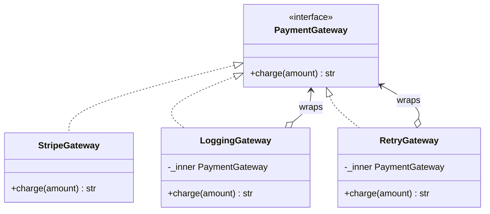
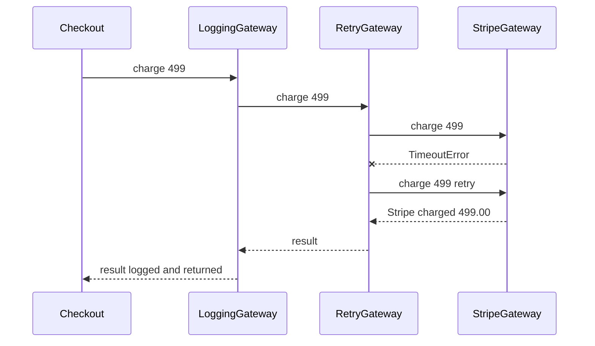
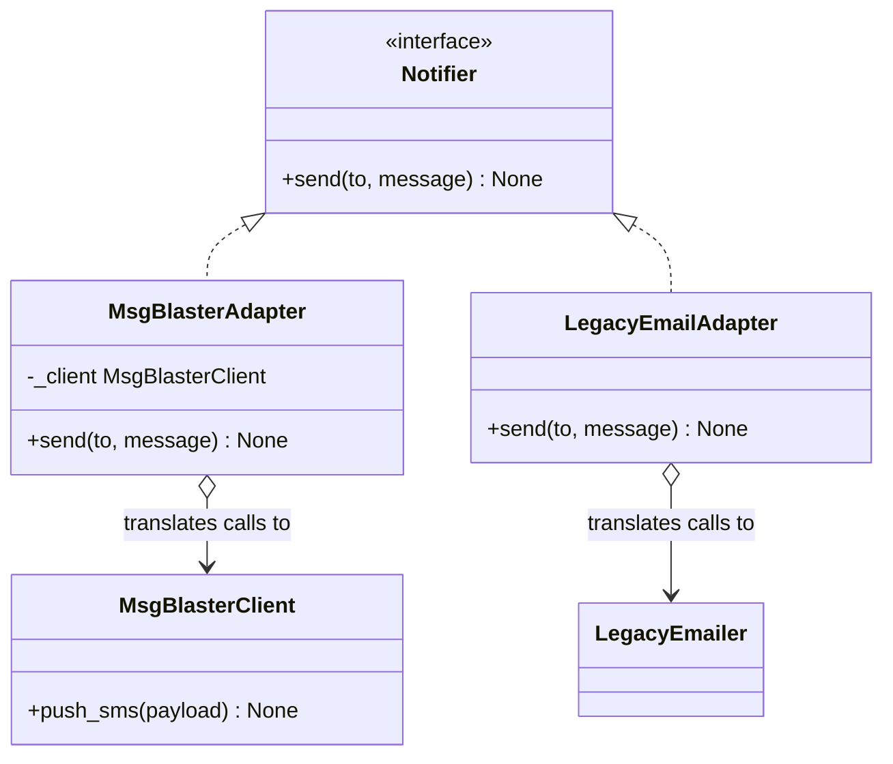
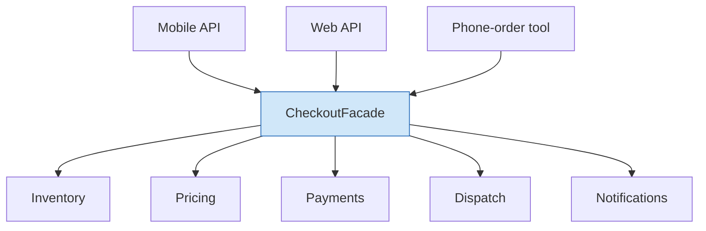
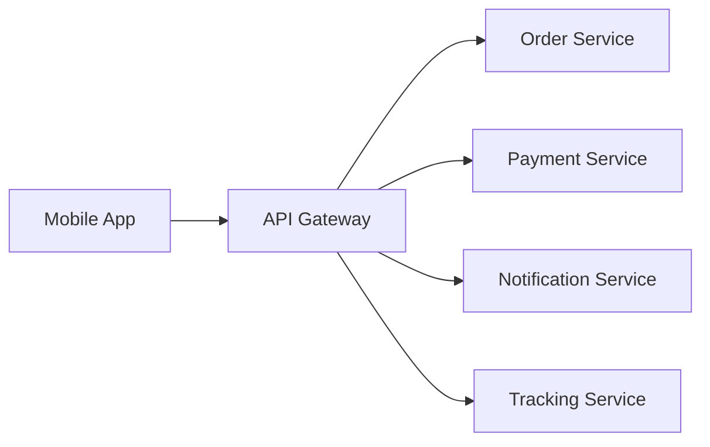
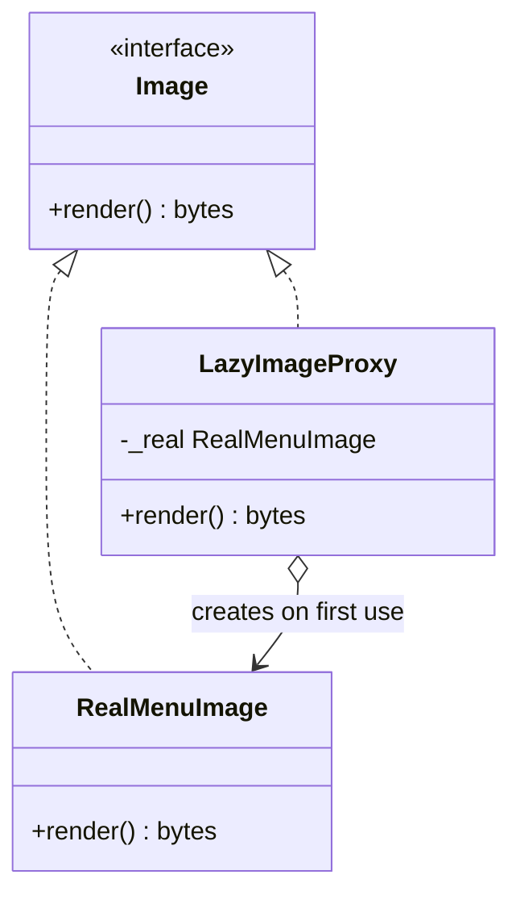
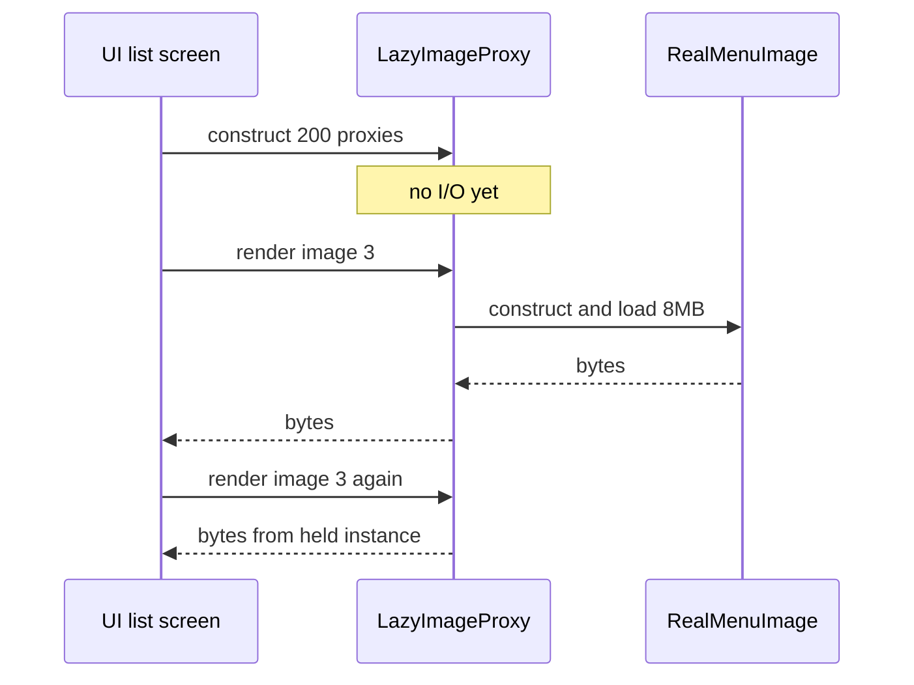

# Day 5 — Structural Patterns: Decorator, Adapter, Facade, Proxy

> Series: System Design Mastery
> Domain thread: **QuickBite** — today we wrap the payment gateway in retry armor, adapt a third-party SMS provider, hide checkout chaos behind one door, and meet the stand-in that controls access.

Behavioral patterns (Day 4) shaped how objects talk. Structural patterns shape **how objects are composed** — how you bolt capabilities together without inheritance explosions. All four of today's patterns are "a thing standing in front of another thing"; the exam-grade skill is knowing *which* thing and *why*.

---

## Table of Contents

1. [Decorator](#1-decorator)
2. [Adapter](#2-adapter)
3. [Facade](#3-facade)
4. [Proxy](#4-proxy)
5. [Decorator vs Proxy vs Adapter — the wrapper showdown](#5-decorator-vs-proxy-vs-adapter)
6. [Real-World Spotting Guide](#6-real-world-spotting-guide)
7. [Day 5 Self-Check](#day-5-self-check)

---

## 1. Decorator

**In plain words:** Decorator is like adding toppings to your coffee by wrapping the cup in another cup. You start with plain espresso, then "wrap" it with milk, then wrap *that* with sugar. Each wrapper still looks and behaves like a coffee cup (same interface), but adds one extra thing before handing off. In Java the textbook real-world example is `java.io`: `new BufferedReader(new InputStreamReader(new FileInputStream(...)))` — each stream wraps another stream, adding behavior, all speaking the same `Reader`/`InputStream` interface.

### Why

QuickBite's `PaymentGateway.charge()` needs logging. And retries. And auth-token refresh. And latency metrics. Inheritance gives you `LoggingRetryingAuthGateway`, `LoggingAuthGateway`, `RetryingGateway`… 4 features → 2⁴ subclasses. The combinatorial explosion is the disease; **stacking wrappers at runtime** is the cure.

### What

Decorator attaches responsibilities to an object dynamically by wrapping it in an object with the **same interface**, which adds behavior before/after delegating. Wrappers stack like nesting dolls, in any order, chosen at runtime.

> **🤔 Why wrap objects when I could just add the feature with a subclass?**
> Because features *combine*: logging + retry + auth + metrics on a gateway is 4 features → 2⁴ = 16 subclasses (`LoggingRetryingAuthGateway`…). Subclassing bakes the combination in at compile time; you get one fixed mix per class. Decorator wraps at *runtime*, so you compose exactly the layers each use-case needs — checkout gets retry, refunds don't — from the same small set of classes.

**✅ Good scenario (where it saves you):** QuickBite's checkout wraps `StripeGateway` in auth + retry + logging; the refund path reuses the same pieces minus retry (you don't want to double-charge a refund on a retry). Adding metrics later is one new wrapper applied everywhere — no subclass explosion, no touching Stripe's code.

**❌ Bad scenario (the pain without it):** Features welded into `StripeGateway.charge()` — logging and retry hard-coded inline. The refund team needs charges *without* retry, so they copy-paste a second gateway class; now a bug fix to the charge logic must be applied in two places, and one gets missed.

**When NOT to:** one feature, needed always? Put it *in* the class. Wrapping ceremony for a single, permanent behavior is indirection without payoff — and a 5-layer stack means 5 frames between you and the real work, plus `instanceof`/`==` checks that break because the object you hold isn't the one doing the work.

### When

- Cross-cutting add-ons: logging, retry, caching, auth, metrics, rate-limiting.
- You need arbitrary *combinations* of features per object, not per class.
- You can't or shouldn't modify the wrapped class (third-party code).

### How

The classic teaching example — coffee — in three lines of intuition: `new Milk(new Sugar(new Espresso()))`, each layer adds cost and description. Fine. Now the **real** one.

**Problem code** — features welded into the class:

```java
class StripeGateway {
    // Every concern is hard-wired into this one method.
    public String charge(double amount) {
        System.out.println("[log] charging " + amount);   // logging welded in
        for (int attempt = 0; attempt < 3; attempt++) {    // retry welded in
            try {
                return doCharge(amount);
            } catch (RuntimeException e) {                  // pretend TimeoutException
                System.out.println("[log] retry " + attempt);
            }
        }
        throw new RuntimeException("timeout");
        // Want charges WITHOUT retry for refunds? Copy-paste a second class...
    }
}
```

**Pattern applied** — same interface, stackable wrappers:

```java
import java.util.*;

// The component contract. Every wrapper AND the real thing implement this.
interface PaymentGateway {
    String charge(double amount);   // one method, same shape everywhere
}

// The naked component: does exactly one thing.
class StripeGateway implements PaymentGateway {
    @Override
    public String charge(double amount) {
        // String.format replaces Python's f-string with :.2f formatting
        return String.format("Stripe charged %.2f", amount);
    }
}

// A base decorator: holds a reference to the wrapped component and
// implements the same interface. Concrete decorators extend this.
abstract class GatewayDecorator implements PaymentGateway {
    protected final PaymentGateway inner;   // the thing we wrap

    protected GatewayDecorator(PaymentGateway inner) {
        this.inner = inner;
    }
}

// Decorator #1: adds logging around the call, then delegates inward.
class LoggingGateway extends GatewayDecorator {
    public LoggingGateway(PaymentGateway inner) {
        super(inner);
    }

    @Override
    public String charge(double amount) {
        System.out.println("[log] charge start amount=" + amount);
        String result = inner.charge(amount);            // delegate to the wrapped object
        System.out.println("[log] charge ok -> " + result);
        return result;
    }
}

// Decorator #2: retries with exponential backoff, then delegates.
class RetryGateway extends GatewayDecorator {
    private final int attempts;

    public RetryGateway(PaymentGateway inner) {
        this(inner, 3);                                  // default of 3 attempts
    }

    public RetryGateway(PaymentGateway inner, int attempts) {
        super(inner);
        this.attempts = attempts;
    }

    @Override
    public String charge(double amount) {
        RuntimeException last = null;                     // remember the last failure
        for (int i = 0; i < attempts; i++) {
            try {
                return inner.charge(amount);
            } catch (RuntimeException exc) {              // pretend this is a TimeoutException
                last = exc;
                try {
                    Thread.sleep((long) (100 * Math.pow(2, i)));   // exponential backoff
                } catch (InterruptedException ignored) {
                    Thread.currentThread().interrupt();
                }
            }
        }
        throw (last != null) ? last : new RuntimeException("timeout");
    }
}

// Decorator #3: enforces a token before allowing the call through.
class AuthGateway extends GatewayDecorator {
    private final String token;

    public AuthGateway(PaymentGateway inner, String token) {
        super(inner);
        this.token = token;
    }

    @Override
    public String charge(double amount) {
        if (token == null || token.isEmpty()) {
            throw new SecurityException("No payment token");   // Java's raise -> throw
        }
        return inner.charge(amount);
    }
}

public class DecoratorDemo {
    public static void main(String[] args) {
        // Compose per use-case, at runtime, in any order:
        PaymentGateway checkoutGw =
            new LoggingGateway(new RetryGateway(new AuthGateway(new StripeGateway(), "tok")));
        PaymentGateway refundGw =
            new LoggingGateway(new AuthGateway(new StripeGateway(), "tok"));   // no retry

        System.out.println(checkoutGw.charge(499.0));
    }
}
```


*Read as: every wrapper both implements AND contains the interface — that closed loop is what makes stacking in any order possible.*


*Read as: the call tunnels inward through each layer; each layer adds its behavior on the way in or out.*

### Java note — `java.io` streams are the canonical Decorator

Java's standard library ships the most famous Decorator in existence: the `java.io` stream classes. You never subclass to combine buffering + decoding + decompression; you **wrap**:

```java
import java.io.*;
import java.util.zip.GZIPInputStream;

// Each constructor takes the stream it decorates and returns the same
// InputStream/Reader interface — identical philosophy to our gateways above.
InputStream file    = new FileInputStream("data.gz");   // raw bytes from disk
InputStream unzip   = new GZIPInputStream(file);        // + decompression
Reader      decode  = new InputStreamReader(unzip);     // bytes -> chars
BufferedReader in   = new BufferedReader(decode);       // + buffering + readLine()

String firstLine = in.readLine();   // the whole stack behaves like one Reader
```

Key point for interviews: the wrappers all share the `InputStream`/`Reader` interface, they stack in any sensible order, and you choose the combination **at runtime, per stream** — exactly the GoF Decorator intent. (This is the counterpart to what Python does with function `@decorators`, which decorate at definition time; Java's version composes objects at runtime.)

### Where

| Library | Decorator sighting |
|---|---|
| `java.io` streams (`BufferedReader`, `GZIPInputStream`, `InputStreamReader`) | stream wrappers stacking over raw files — the canonical Java Decorator |
| Servlet filters / Spring `HandlerInterceptor` chains | each filter wraps the next handler — Decorator (a.k.a. Chain of Responsibility flavored) |
| `Collections.unmodifiableList`, `synchronizedList` | wrap a `List`, add a behavior (read-only, thread-safe), same `List` interface |
| Micrometer / Resilience4j (`Retry.decorateSupplier`, metrics) | wrap a call, add retry/metrics |

### The Dark Side

- **Onion debugging**: a 5-layer stack means 5 frames between you and the real work; identity checks (`instanceof`, `==`) break because the object you hold isn't the object doing the work.
- **Order sensitivity**: `Retry(Auth(gw))` retries auth failures; `Auth(Retry(gw))` doesn't. Invisible in the type system, very visible at 3 a.m.
- **When the "bad" alternative is right:** one feature, needed always? Put it *in* the class. Wrapping ceremony for a permanent, single behavior is indirection without payoff.

---

## 2. Adapter

**In plain words:** Adapter is a travel plug adapter. Your laptop charger has a two-pin plug; the hotel wall socket in another country is a three-pin. You don't rewire the laptop or the wall — you slot in a little adapter that presents the shape each side expects. In code, an Adapter is a class that *implements the interface your code expects* while internally *calling a differently-shaped object* (the adaptee).

### Why

QuickBite's notification system speaks one interface: `Notifier.send(to, message)`. The new SMS vendor "MsgBlaster" ships an SDK that speaks `pushSms(payloadMap)` with its own field names. Rewriting our codebase to MsgBlaster's shape couples us to a vendor; rewriting their SDK isn't possible. We need a **translator**.

### What

Adapter converts the interface of an existing class into the interface clients expect. It changes the **shape** of an API without changing its behavior. (Decorator keeps the shape, changes behavior — opposite trade.)

> **🤔 Isn't an Adapter just a Decorator by another name — they both wrap?**
> They wrap for opposite reasons. Decorator keeps the *same* interface and adds behavior; Adapter *changes the shape* of an API without changing what it does. You reach for Adapter when a third-party SDK speaks `pushSms(payloadMap)` and your code speaks `Notifier.send(to, message)` — you can't edit the vendor, and you don't want their dialect leaking into 40 call sites. The Adapter is the translator that keeps your domain vendor-free.

**✅ Good scenario (where it saves you):** QuickBite wraps the "MsgBlaster" SMS SDK in a `MsgBlasterAdapter implements Notifier`. The whole codebase depends only on `Notifier`; switching to a cheaper SMS vendor next quarter is one new adapter and one wiring line, not 40 edits.

**❌ Bad scenario (the pain without it):** The vendor's `pushSms(Map)` and its field names (`recipient_number`, `body_text`) are called directly at 40 sites. The vendor raises prices, the team wants to switch, and migrating now means touching 40 files across three services — the codebase is married to a vendor.

**When NOT to:** if you own both sides, *change the interface* instead of adapting — an adapter between two internal modules is often just deferred refactoring. And for a single call site, calling the vendor SDK directly is honest.

### When

- Integrating third-party/legacy code whose interface you don't control.
- Insulating your domain from vendor churn (swap SMS providers without touching call sites).
- Migrating incrementally off a legacy API.

### How

**Problem code** — vendor types bleeding everywhere:

```java
import java.util.*;

// The vendor SDK's shape leaks straight into our domain method.
void notifyOrderPlaced(String phone, String orderId) {
    MsgBlasterClient client = new MsgBlasterClient("api-key");
    Map<String, String> payload = new HashMap<>();      // vendor dialect in domain code
    payload.put("recipient_number", phone);
    payload.put("body_text", "Order " + orderId + " placed");
    payload.put("sender_mask", "QUICKBITE");
    client.pushSms(payload);
}
// 40 call sites later, switching vendors = 40 edits.
```

**Pattern applied**:

```java
import java.util.*;

// OUR interface. Domain code knows only this shape.
interface Notifier {
    void send(String to, String message);
}

// Simulated third-party SDK — we cannot modify this class.
class MsgBlasterClient {
    public void pushSms(Map<String, String> payload) {
        System.out.println("MsgBlaster -> " + payload.get("recipient_number")
                           + ": " + payload.get("body_text"));
    }
}

// Adapter: implements OUR Notifier, translates into MsgBlaster's dialect.
class MsgBlasterAdapter implements Notifier {
    private final MsgBlasterClient client;   // the adaptee we wrap
    private final String sender;

    public MsgBlasterAdapter(MsgBlasterClient client) {
        this(client, "QUICKBITE");           // default sender mask
    }

    public MsgBlasterAdapter(MsgBlasterClient client, String sender) {
        this.client = client;
        this.sender = sender;
    }

    @Override
    public void send(String to, String message) {
        Map<String, String> payload = new HashMap<>();
        payload.put("recipient_number", to);
        // adapt constraints too: SMS bodies cap at 160 chars
        payload.put("body_text", message.substring(0, Math.min(160, message.length())));
        payload.put("sender_mask", sender);
        client.pushSms(payload);
    }
}

// A different legacy subsystem with yet another shape.
class LegacyEmailer {
    public void deliver(String address, String subject, String body) {
        System.out.println("Email to " + address + ": " + subject);
    }
}

// Second adapter: same Notifier interface, different adaptee.
class LegacyEmailAdapter implements Notifier {
    private final LegacyEmailer emailer;

    public LegacyEmailAdapter(LegacyEmailer emailer) {
        this.emailer = emailer;
    }

    @Override
    public void send(String to, String message) {
        emailer.deliver(to, "QuickBite update", message);
    }
}

public class AdapterDemo {
    // Domain code depends on Notifier only — completely vendor-free.
    static void notifyOrderPlaced(Notifier notifier, String to, String orderId) {
        notifier.send(to, "Order " + orderId + " placed");
    }

    public static void main(String[] args) {
        notifyOrderPlaced(new MsgBlasterAdapter(new MsgBlasterClient()), "+91-98x", "QB-1042");
        notifyOrderPlaced(new LegacyEmailAdapter(new LegacyEmailer()), "a@b.com", "QB-1042");
    }
}
```

Swapping vendors is now: write one new adapter, change one wiring line.


*Read as: adapters face left with our interface and face right with the adaptee's — the domain never sees the right-hand side.*

### Where

| Library | Adapter sighting |
|---|---|
| `java.util.Arrays.asList(...)` | adapts a raw array to the `List` interface |
| JDBC drivers (Postgres, MySQL, SQLite) | each adapts a wire protocol to one `java.sql` interface |
| `InputStreamReader` | adapts a byte `InputStream` to a character `Reader` |
| SLF4J bindings (`slf4j-log4j`, `slf4j-jdk14`) | adapt a logging backend to one façade interface |

### Java note

Program to interfaces, and many "adapters" become tiny. When the vendor already matches your interface, no adapter is needed. When it doesn't, an adapter can even be a single lambda where a `Notifier` (a functional interface) is expected: `Notifier n = (to, msg) -> client.pushSms(Map.of("recipient_number", to, "body_text", msg, "sender_mask", "QUICKBITE"));`. Declaring `Notifier` as your own interface makes "our interface" a real, checkable contract without vendor classes inheriting anything from you.

### The Dark Side

- **Adapters can hide impedance mismatches** that deserve visibility: silently truncating to 160 chars (above!) may lose refund links. Translation that changes meaning is a bug factory.
- **Adapter chains** (adapter over adapter over legacy adapter) signal that the underlying model disagreement should be fixed, not bridged again.
- **When the "bad" alternative is right:** if you own both sides, *change the interface* instead of adapting — an adapter between two internal modules is often just deferred refactoring. And for one call site, calling the vendor SDK directly is honest.

---

## 3. Facade

**In plain words:** Facade is a hotel concierge who handles everything behind one desk. You want dinner, a taxi, and theatre tickets — you don't call the restaurant, the cab company, and the box office yourself. You say one sentence to the concierge, and they coordinate all the messy subsystems. A Facade is one class exposing one simple method that orchestrates many complicated subsystems behind the scenes.

### Why

Placing a QuickBite order really means: validate cart, reserve stock with the restaurant, compute pricing, authorize payment, schedule a courier, send notifications. Forcing the mobile-API handler to orchestrate six subsystems means every client re-learns the correct order, the error handling, the rollback dance. Complexity leaks upward.

### What

Facade provides a **single, simplified entry point** to a subsystem. It doesn't add behavior (Decorator) or translate shapes (Adapter) — it **reduces the surface area** clients must know. Subsystems remain fully accessible for power users; the facade is a convenience front door, not a wall.

> **🤔 Isn't a Facade just a Decorator or Adapter — more wrapping?**
> No — Decorator adds behavior, Adapter translates one shape; Facade *reduces surface area* by putting one simple door in front of *many* subsystems. Placing an order really means: validate cart, reserve stock, price it, authorize payment, dispatch a courier, notify — in the right order, with the right rollback. Without a facade, every client (mobile, web, phone-order tool) re-learns that choreography and copies it slightly wrong.

**✅ Good scenario (where it saves you):** QuickBite's `CheckoutFacade.checkout(cart)` owns the six-step order dance and its rollback. Mobile, web, and the phone-support tool all call one method; the "release the stock if payment fails" rule lives in exactly one place instead of being re-implemented three times.

**❌ Bad scenario (the pain without it):** Each client orchestrates the six subsystems itself. The phone-order team copies the mobile flow but forgets the stock-release on payment failure — now failed phone orders silently hold inventory hostage, and reserved stock leaks until a nightly job cleans it up.

**When NOT to:** with two subsystems and one client, direct calls are simpler and grep-able. Facades earn their keep at *many clients × many subsystems*; adding one preemptively is speculative generality — and a facade that grows business logic becomes a god object every team edits.

### How

**Problem code** — orchestration in the client:

```java
// The client must know the correct order, the rollback rules, and all six subsystems.
String apiPlaceOrder(Cart cart) {
    if (!inventory.check(cart.items())) throw new OutOfStockException();
    double price = pricing.quote(cart);                    // client must know
    Auth auth = payments.authorize(cart.user(), price);    // the right order,
    if (!auth.ok()) throw new PaymentFailedException();     // the rollback rules,
    Courier courier = dispatch.assign(cart.address());      // all six subsystems...
    notifications.sendAll(cart.user(), courier.eta());
    return "ok";
}
// ...and the phone-order team copies this, slightly wrong, into their handler.
```

**Pattern applied**:

```java
// One door. Clients need one method; subsystems stay independent behind it.
class CheckoutFacade {
    private final Inventory inv;
    private final Pricing pricing;
    private final Payments pay;
    private final Dispatch dispatch;
    private final Notifications notify;

    // The facade holds references to every subsystem it coordinates.
    public CheckoutFacade(Inventory inv, Pricing pricing, Payments pay,
                          Dispatch dispatch, Notifications notify) {
        this.inv = inv;
        this.pricing = pricing;
        this.pay = pay;
        this.dispatch = dispatch;
        this.notify = notify;
    }

    // The single simple method clients call.
    public Receipt checkout(Cart cart) {
        inv.reserve(cart.items());
        double total;
        Courier courier;
        try {
            total = pricing.quote(cart);
            Auth auth = pay.authorize(cart.user(), total);
            courier = dispatch.assign(cart.address());
        } catch (RuntimeException e) {
            inv.release(cart.items());     // rollback lives in ONE place
            throw e;
        }
        notify.orderPlaced(cart.user(), courier.eta());
        return new Receipt(total, courier.eta());
    }
}

// Client code, anywhere:  facade.checkout(cart)  — done.
```


*Read as: many clients, one door; without the facade every client on top would hold five arrows each into the subsystems below.*

### Facade at HLD scale: the API Gateway

Zoom out and the same intent reappears as architecture: an **API Gateway** (Kong, AWS API Gateway, nginx) is a Facade over microservices — one endpoint for clients, hiding service topology, plus gateway-y extras (authn, rate limiting, routing). The Day-1 lesson repeats: LLD patterns and HLD components are the same ideas at different zoom levels.


*Read as: the gateway is Facade drawn on a whiteboard instead of in a class diagram — clients see one host, not four services.*

### Where

`HttpClient.send(request)` (facade over connection pools, redirects, TLS); Spring's `JdbcTemplate` (over raw JDBC connection/statement/result-set juggling); `Files.readAllLines(path)` (over stream + buffer + decode machinery); the SLF4J `Logger` API (over whichever backend is bound).

### Java note

A facade is often just a **service class with public methods**: a `CheckoutService` exposing `placeOrder()` while heavier machinery hides in package-private helpers. Package boundaries and a small public API are themselves a facade: consumers `import com.quickbite.checkout.CheckoutService` without seeing the twelve internal classes it coordinates.

### The Dark Side

- **The God Facade**: a facade that accumulates business logic becomes a god object (Day 1's villain) with 40 methods and every team editing one file.
- **Leaky simplification**: if callers routinely bypass the facade for "one more parameter", the abstraction chose the wrong surface.
- **When the "bad" alternative is right:** with two subsystems and one client, direct calls are simpler and grep-able. Facades earn their keep at *many clients × many subsystems*; adding one preemptively is speculative generality.

---

## 4. Proxy

**In plain words:** Proxy is a security guard at a building entrance who checks you before letting you in. To you it looks like the door (same interface), but it decides *whether*, *when*, and *how* you actually reach what's inside. Some guards check your badge (access control), some fetch the thing only when you actually ask for it (lazy loading), some just hand you a copy they already have (caching), and some phone another building on your behalf (remote calls).

### Why

Three real QuickBite needs: restaurant menu images are heavy — don't load until viewed (**lazy loading**); refunds may only be triggered by support staff (**access control**); the restaurant-list query hammers the DB on every request (**caching**). All three share a shape: a stand-in that controls access to the real object.

### What

Proxy provides a **surrogate with the same interface** as the real subject, controlling access to it. Unlike Decorator (adds features, subject already exists and is handed in), a Proxy typically **manages the subject's lifecycle or reachability** — it may create it lazily, deny access entirely, answer from cache without touching it, or talk to it over a network.

The classic taxonomy:

| Kind | Controls | QuickBite example |
|---|---|---|
| **Virtual proxy** | *when* the expensive object is created | lazy menu images |
| **Protection proxy** | *who* may call | staff-only refunds |
| **Caching proxy** | *whether* the call happens at all | memoized restaurant list |
| **Remote proxy** | *where* the object lives | a gRPC/REST client stub standing in for another service |

> **🤔 A Proxy also wraps and keeps the same interface — how is it not just a Decorator?**
> Decorator *adds behavior* to an object handed to it and always delegates. A Proxy *controls access to or the lifecycle of* the real thing — it may create it lazily, deny the call, answer from cache without touching it, or reach it over a network. The tell: a Decorator always forwards; a Proxy may *refuse to*. Same shape, but the proxy owns *whether, when, and how* you reach what's inside.

**✅ Good scenario (where it saves you):** QuickBite's restaurant-list screen builds 200 `LazyImageProxy` objects instantly with zero I/O; only the images the user scrolls to load their 8MB payload. And `@Cacheable` on the restaurant query is a caching proxy that spares the DB a hammering on every request.

**❌ Bad scenario (when misused):** A caching proxy ships without invalidation, so it serves yesterday's restaurant list forever after a menu change. Or a remote proxy makes a network call look like a local method call — an innocent `for` loop over lazy Hibernate entities becomes an N+1 network storm that melts the DB at peak.

**When NOT to:** if the object is cheap, construct it eagerly — lazy machinery has its own bugs (surprise latency at first touch, exceptions thrown far from construction). An explicit `load()` beats magic laziness when callers *should* think about cost.

### How

**Problem code** — everything eager, everything open:

```java
class MenuImage {
    private final byte[] bytes;

    public MenuImage(String path) {
        System.out.println("Loading 8MB from " + path + "...");   // pays cost at construction
        this.bytes = readAllBytes(path);
    }

    public byte[] render() {
        return bytes;
    }
}
// Building a 200-restaurant list screen loads 200 images the user never scrolls to.
```

**Pattern applied** — virtual + protection proxies:

```java
import java.util.*;

// The shared interface both the real subject and the proxy implement.
interface Image {
    byte[] render();
}

// The real, expensive subject.
class RealMenuImage implements Image {
    private final byte[] bytes;

    public RealMenuImage(String path) {
        System.out.println("Loading 8MB from " + path);
        this.bytes = "...heavy bytes...".getBytes();   // pretend this is 8MB
    }

    @Override
    public byte[] render() {
        return bytes;
    }
}

// Virtual proxy: same interface, defers the expensive load until first use.
class LazyImageProxy implements Image {
    private final String path;
    private RealMenuImage real;    // stays null until first render()

    public LazyImageProxy(String path) {
        this.path = path;
    }

    @Override
    public byte[] render() {
        if (real == null) {                      // created on FIRST use only
            real = new RealMenuImage(path);
        }
        return real.render();
    }
}

// The real refund subject.
class RefundService {
    public String refund(String orderId) {
        return "Refunded " + orderId;
    }
}

// Protection proxy: same shape, gatekeeps the real subject by role.
class RefundServiceProxy {
    private final RefundService real;
    private final String role;

    public RefundServiceProxy(RefundService real, String role) {
        this.real = real;
        this.role = role;
    }

    public String refund(String orderId) {
        if (!"support_staff".equals(role)) {
            throw new SecurityException("Refunds require support role");
        }
        return real.refund(orderId);
    }
}

public class ProxyDemo {
    public static void main(String[] args) {
        // 200 proxies constructed instantly with zero I/O.
        List<Image> thumbs = new ArrayList<>();
        for (int i = 0; i < 200; i++) {
            thumbs.add(new LazyImageProxy("menu_" + i + ".jpg"));
        }
        thumbs.get(3).render();     // only image #3 actually loads
    }
}
```

**Caching proxy — you already use one whenever you memoize:**

```java
import java.util.*;
import java.util.function.Function;

// A caching proxy over an expensive DB lookup: check the map first,
// only run the real query on a miss, then remember the answer.
class RestaurantListCache {
    private final Map<String, List<String>> cache = new HashMap<>();
    private final Function<String, List<String>> realQuery;

    public RestaurantListCache(Function<String, List<String>> realQuery) {
        this.realQuery = realQuery;
    }

    public List<String> get(String city) {
        // computeIfAbsent runs the real query ONLY when the key is missing
        return cache.computeIfAbsent(city, c -> {
            System.out.println("Expensive DB query for " + c);
            return realQuery.apply(c);
        });
    }
}

// Usage:
// RestaurantListCache cache = new RestaurantListCache(
//     city -> List.of("Pizza Palace", "Curry Corner"));
// cache.get("Pune");   // hits DB
// cache.get("Pune");   // served from cache — the real query never runs
```

A memoizing wrapper like this is a caching **Proxy**: same access shape, but it may answer without touching the real subject at all. (Spring's `@Cacheable` does exactly this for you via a generated proxy — patterns and the mechanism that implements them are separate axes.)


*Read as: clients hold the proxy believing it's the image; the dashed lifecycle arrow is what separates Proxy from Decorator — the proxy owns when the real thing exists.*


*Read as: cost is paid at first use, not at construction — and only for images actually viewed.*

### Where

| Library | Proxy sighting |
|---|---|
| Spring `@Cacheable`, Guava/Caffeine `LoadingCache` | caching / virtual proxy |
| Hibernate lazy entities & collections (`@OneToMany(fetch = LAZY)`) | virtual proxy — DB hit deferred until first access |
| Mockito mocks/spies | a proxy that records instead of forwarding |
| gRPC/Thrift client stubs, `java.rmi` stubs | remote proxy |
| `java.lang.reflect.Proxy` / CGLIB (Spring AOP) | literally named — dynamic proxies |
| CDN / reverse proxy / Redis cache-aside | Proxy at HLD scale |

### Java note

Java gives you `java.lang.reflect.Proxy` for a universal delegating proxy — you write one `InvocationHandler` and it intercepts *every* interface method, no per-method boilerplate:

```java
import java.lang.reflect.*;

// One handler logs access to every method of the wrapped object, then forwards.
@SuppressWarnings("unchecked")
static <T> T audited(T real, Class<T> iface) {
    return (T) Proxy.newProxyInstance(
        iface.getClassLoader(),
        new Class<?>[]{ iface },
        (proxy, method, args) -> {              // called on EVERY method invocation
            System.out.println("[audit] accessed " + method.getName());
            return method.invoke(real, args);   // forward to the real object
        });
}
```

This is how Spring AOP, mocking libraries, and lazy entities are built. Cost: dynamic proxies only work through interfaces (or subclassable classes via CGLIB), and stack traces get noisier — a real trade-off in large codebases.

### The Dark Side

- **Lying about cost**: a remote proxy makes a network call look like a method call — the core critique of distributed objects. Innocent loops become N+1 network storms (Hibernate lazy collections iterated in a loop: same disease).
- **Stale caches**: a caching proxy without invalidation serves yesterday's restaurant list forever; cache invalidation is one of the two famously hard problems.
- **When the "bad" alternative is right:** if the object is cheap, construct it eagerly — lazy machinery has its own bugs (surprise latency at first touch, exceptions thrown far from construction). Explicit `load()` methods beat magic laziness when callers *should* think about cost.

---

## 5. Decorator vs Proxy vs Adapter

All three wrap. Interviewers love this because the *structure* is identical — the **intent** differs:

| Aspect | Decorator | Proxy | Adapter |
|---|---|---|---|
| Interface vs wrappee | **same** | **same** | **different** — that's the point |
| Intent | add behavior | control access / lifecycle | translate shape |
| Who creates the real object | caller, hands it in | often the proxy itself (lazy) | caller or adapter |
| Stacking expected? | yes — the design goal | rarely | no |
| May refuse to forward? | no — always delegates | yes — deny, cache-hit, defer | no |
| QuickBite example | retry around gateway | staff-only refund gate | MsgBlaster SMS translator |
| One-liner | same shape, more behavior | same shape, gated access | new shape, same behavior |

And Facade, for completeness: **many objects behind one simpler door** — it changes the interface like Adapter, but to *simplify* many things, not to *match* one thing.

---

## 6. Real-World Spotting Guide

| You see… | Pattern |
|---|---|
| Servlet filter / Spring interceptor chain, each wrapping `get_response` | Decorator stack |
| `new BufferedReader(new InputStreamReader(in))` | Decorator (the canonical Java example) |
| `InputStreamReader` bridging bytes to chars | Adapter |
| JDBC driver behind `java.sql.Connection` | Adapter |
| `HttpClient.send(request)` one-liner | Facade over connection/TLS machinery |
| Spring `@Cacheable` | caching Proxy via a generated proxy |
| Hibernate entity hitting the DB only when a field is touched | virtual Proxy |
| gRPC stub object | remote Proxy |
| API Gateway in an architecture diagram | Facade at HLD scale |
| CDN in front of origin servers | caching Proxy at HLD scale |

---

## Day 5 Self-Check

1. Why does adding features via subclassing explode combinatorially, and how does Decorator's "implements AND contains the interface" loop fix it?
2. `Retry(Auth(gw))` vs `Auth(Retry(gw))` — what behaves differently and why is this dangerous?
3. Why are Java's `java.io` streams (`BufferedReader(new InputStreamReader(...))`) the textbook Decorator? Name the two things each wrapper shares and the thing each adds.
4. Which pattern changes the interface but not the behavior? Which changes behavior but not the interface? Which may refuse to call the real object at all?
5. Your MsgBlaster adapter truncates messages to 160 chars. Why is this "Dark Side" territory, and what should the adapter do instead?
6. Why is an API Gateway "Facade at HLD scale"? Name two things the gateway hides from mobile clients.
7. Name the four proxy kinds and give a QuickBite example of each.
8. Explain why a memoizing wrapper (or Spring `@Cacheable`) is a Proxy even though the *mechanism* that implements it (a generated proxy) is a separate concern.
9. What goes wrong when a remote proxy makes network calls look local? Relate to Hibernate lazy collections iterated in a loop.
10. When is eager construction plus an explicit `load()` better than a virtual proxy?

**Tomorrow:** Day 6 — Behavioral Patterns II: Command, Template Method, Chain of Responsibility — QuickBite gets an undo-able order queue, a fixed checkout skeleton with pluggable steps, and a request pipeline where each handler decides to act or pass.
