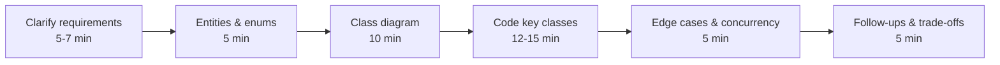
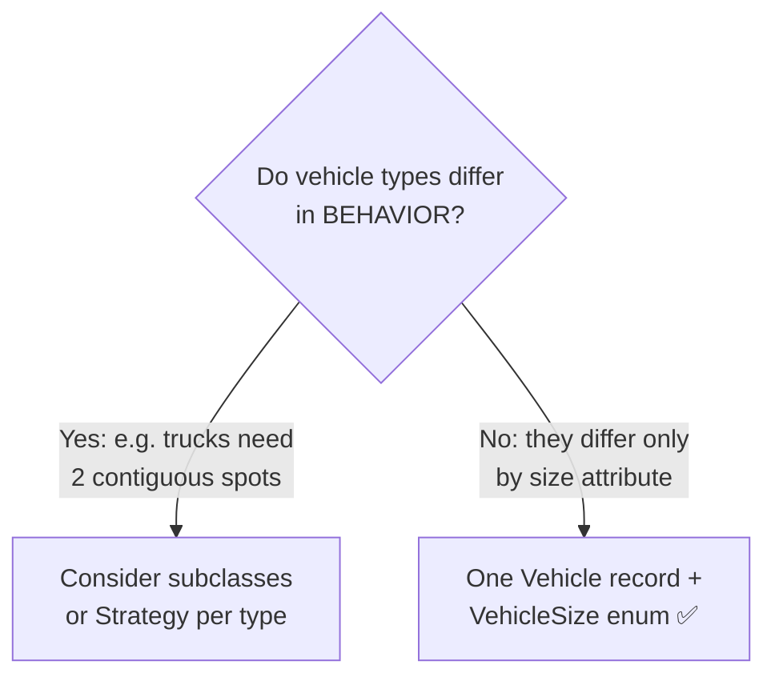
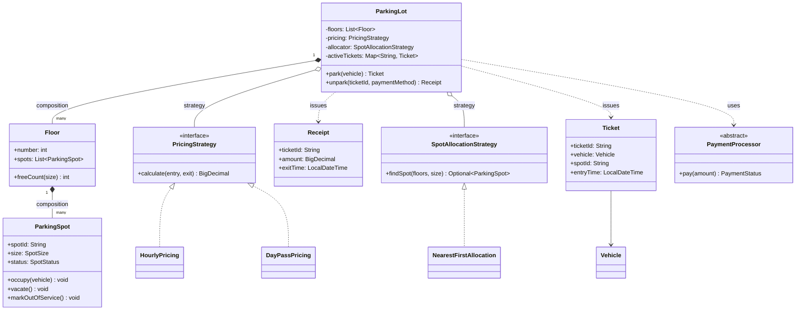
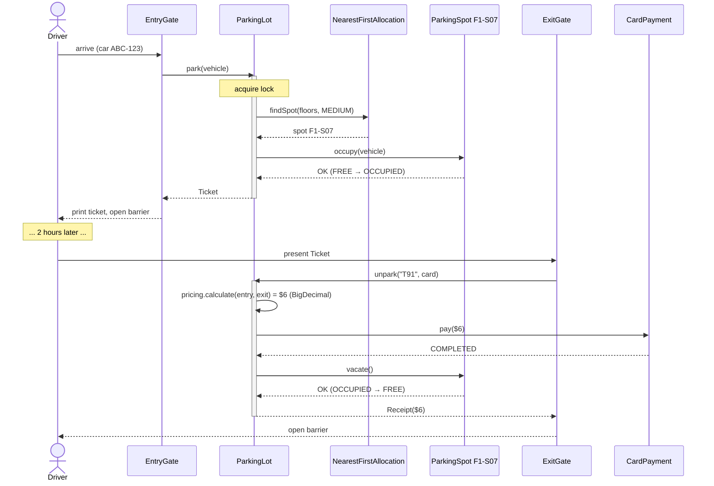
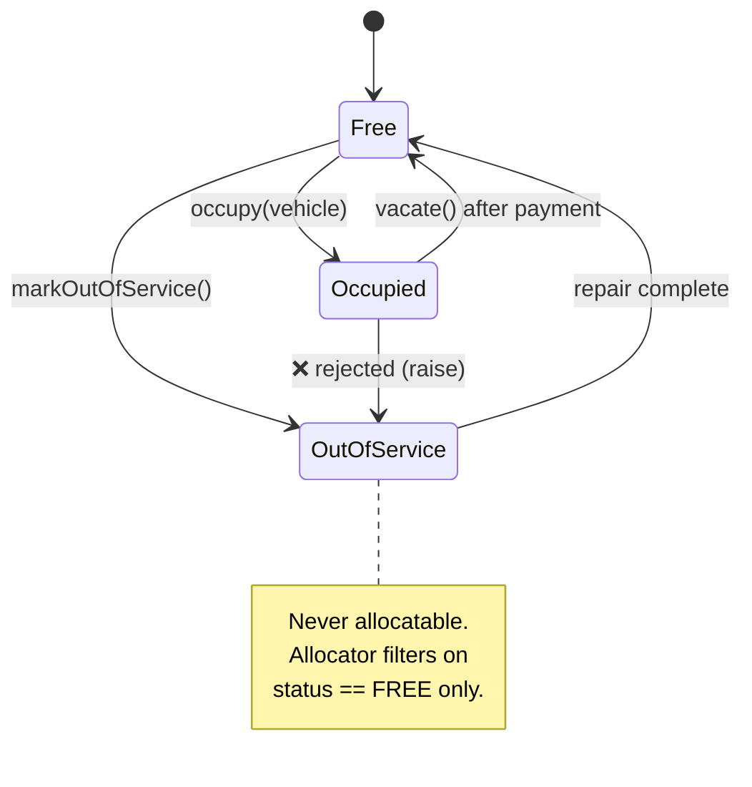

# Day 6 — LLD Problem: Parking Lot (Full Walkthrough)

> Series: System Design Mastery

This is a *worked interview walkthrough* — the single most-asked LLD question in interviews at every level. We will play both roles: the candidate who asks the right questions, and the interviewer who keeps raising the stakes. By the end you will have a design you can whiteboard in 35 minutes and defend for another 20.

---

## Table of Contents

1. [Interview Framing — How to Spend Your 45 Minutes](#1-interview-framing)
2. [Step 1: Requirements Clarification](#2-requirements-clarification)
3. [Step 2: Core Entities & Enums](#3-core-entities--enums)
4. [Step 3: Class Diagram + Design Patterns (Where & Why)](#4-class-diagram--design-patterns)
5. [Step 4: Code Skeletons with Business Logic](#5-code-skeletons)
6. [Step 5: Sequence Diagram — Main Flow](#6-sequence-diagram)
7. [Step 6: The ParkingSpot State Machine](#7-parkingspot-state-machine)
8. [Step 7: Concurrency — Two Gates, One Spot](#8-concurrency)
9. [Step 8: Edge Cases Table](#9-edge-cases-table)
10. [Step 9: Interviewer Follow-ups](#10-interviewer-follow-ups)
11. [SOLID Audit](#11-solid-audit)
12. [Common Candidate Mistakes](#12-common-candidate-mistakes)
13. [The Dark Side — Where This Is Overengineered](#13-the-dark-side)
14. [Self-Check Questions](#14-self-check-questions)

---

## 1. Interview Framing

A 45-minute LLD interview is a *pacing* problem as much as a design problem:


*The interview clock: candidates who jump straight to box D usually fail at box A.*

The most common failure mode is not bad code — it is **solving the wrong problem confidently**. So we start with questions.

---

## 2. Requirements Clarification

**In plain words:** Before you design a garage you ask the owner basic questions — how many floors, what vehicles, one entrance or several? Skipping this is like pouring concrete before you know if trucks need to fit. In an interview, these out-loud questions are worth as much as the code: they prove you scope the real problem instead of guessing.

### Questions a good candidate asks (out loud)

| # | Question | Why it matters |
|---|----------|----------------|
| 1 | "What vehicle types must we support?" | Drives the spot-size model |
| 2 | "Single building or multiple floors?" | Drives Floor as an entity |
| 3 | "Multiple entry/exit gates operating simultaneously?" | Surfaces concurrency early — interviewers love this |
| 4 | "How is pricing computed — flat, hourly, day pass?" | Screams Strategy pattern |
| 5 | "Can a small vehicle take a bigger spot?" | Allocation policy decision |
| 6 | "Do we handle payments here, or integrate an external processor?" | Scope boundary |
| 7 | "Do we need reservations / EV charging / handicapped spots?" | Explicitly de-scope — say it out loud |
| 8 | "Is a display board showing free spots per floor required?" | Optional Observer hook |

### Chosen assumptions (state these, then move on)

- **Vehicles:** bike, car, truck. A vehicle needs a spot of *its size or larger* (bike → any; car → MEDIUM/LARGE; truck → LARGE only).
- **Structure:** one lot, multiple floors, each floor has many spots.
- **Gates:** multiple entry and exit gates, *concurrent* operation.
- **Ticketing:** entry gate issues a ticket; exit gate computes fee and takes payment.
- **Pricing:** hourly by default; day-pass supported; pluggable.
- **Allocation:** nearest-first (lowest floor, lowest spot number); pluggable.
- **Out of scope:** reservations, EV charging, valet, monthly subscriptions.
- **Language chosen: Java.** Java's strong static typing catches whole classes of mistakes at compile time, and its first-class `enum` (which can carry fields and methods) models fixed sets like vehicle/spot sizes and statuses cleanly — both of which make Java a very natural fit for LLD interviews.

> **Interview tip:** writing "OUT OF SCOPE: reservations, EV" on the whiteboard earns points. It shows you control scope instead of scope controlling you.

---

## 3. Core Entities & Enums

**In plain words:** Think of walking into a parking garage. The "things" you can point at — the cars, the numbered spots, the ticket the machine spits out — become your classes. The fixed little labels on those things — "this is a compact spot", "this spot is taken", "this is a motorbike" — become your enums. In Java an `enum` is a tiny, fixed, type-safe list of named values, which is exactly what a garage's signage is: a small closed set of options that can never accidentally be a typo'd string.

Nouns from the requirements become candidate classes; qualities become enums. In Java, enums are real classes, so they can carry helper methods (like asking "does this spot fit that vehicle?") right alongside the values.

```java
import java.util.*;
import java.time.*;

// An enum is a fixed, type-safe set of named constants.
// Giving each size an int rank lets us compare "who is bigger".
enum VehicleSize {
    SMALL(1),    // bike
    MEDIUM(2),   // car
    LARGE(3);    // truck

    private final int rank;                 // numeric weight for comparisons
    VehicleSize(int rank) { this.rank = rank; }
    public int getRank() { return rank; }   // getter — enums expose data via methods
}

// A spot's size. Notice a Java enum can hold behaviour, not just values.
enum SpotSize {
    SMALL(1),
    MEDIUM(2),
    LARGE(3);

    private final int rank;
    SpotSize(int rank) { this.rank = rank; }
    public int getRank() { return rank; }

    // A spot fits any vehicle of equal or smaller size.
    // This method lives on the enum so the rule has ONE home.
    public boolean fits(VehicleSize vehicleSize) {
        return this.rank >= vehicleSize.getRank();
    }
}

// No int ranks needed here — these are plain labels for a spot's lifecycle.
enum SpotStatus {
    FREE,
    OCCUPIED,
    OUT_OF_SERVICE
}

enum PaymentStatus {
    PENDING,
    COMPLETED,
    FAILED
}

// Composition over inheritance: no Bike/Car/Truck subclasses.
// A vehicle's ONLY behaviour relevant to a parking lot is its size,
// so a `record` (an immutable data carrier) with two fields is enough.
// A Java `record` auto-generates the constructor, getters, equals, and hashCode.
record Vehicle(String licensePlate, VehicleSize size) { }
```

Notice the deliberate decision embedded in `Vehicle`: **no inheritance hierarchy**. `class Bike extends Vehicle`, `class Car extends Vehicle`, `class Truck extends Vehicle` subclasses are the classic trap — they differ by exactly one attribute, which an enum captures with zero extra classes. Reach for inheritance only when *behavior* differs. Using a Java `record` here also makes the vehicle immutable for free — you cannot accidentally change a parked car's license plate mid-stay.

> **🤔 Why not model this the "OOP way" with `Bike`, `Car`, `Truck` subclasses?**
> Because those three would differ by *exactly one attribute* — size — and share zero unique behavior. Inheritance is for when subtypes *behave* differently; here a `VehicleSize` enum on one `Vehicle` record carries all the information with zero extra classes. Reaching for subclasses when only an attribute varies is the single most common LLD-interview trap.

**✅ Good scenario (where it pays off):** A truck later needs *two contiguous spots* — genuinely different allocation *behavior*. Now a subtype or a per-type Strategy is justified, and because `Vehicle` stayed a clean record, adding that behavior is additive rather than a rewrite of a shaky hierarchy.

**❌ Bad scenario (the pain when misused):** A candidate builds `Bike`/`Car`/`Truck` subclasses on day one. Every method that switches on type (`instanceof Truck`) now lives in three places; adding "scooter" means a new class *and* touching every switch — ceremony a one-line enum value would have avoided.

**When NOT to (i.e., when to subclass after all):** the moment vehicle types carry *different behavior* — trucks needing two spots, EVs needing a charger — an enum stops being enough and a subtype or Strategy-per-type earns its place.


*The inheritance-vs-composition decision, resolved in one question.*

---

## 4. Class Diagram + Design Patterns

**In plain words:** This is the blueprint of the whole garage before you pour concrete. It shows which pieces own which other pieces (the building owns its floors, a floor owns its spots) and which pieces are swappable modules plugged in from outside (the pricing rulebook, the "where do I put this car" rulebook). In Java, those swappable modules are `interface`s — a promise of what methods exist — while the concrete rulebooks (`HourlyPricing`, `NearestFirstAllocation`) are classes that fulfil the promise.


*Full class diagram: ParkingLot composes floors, and delegates pricing/allocation to injected strategies.*

### Which pattern, where, and why

| Pattern | Where | Why here — not just "because patterns" |
|---------|-------|----------------------------------------|
| **Strategy** | `PricingStrategy`, `SpotAllocationStrategy` | Pricing *will* change (weekend rates, surge). Allocation *will* change (nearest vs. load-balanced across floors). Strategy makes the changing thing a pluggable seam — Open/Closed in action. |
| **Factory** | `SpotFactory.create(size)` / ticket-ID generation | Centralizes construction rules (ID format, defaults). Small win here; grows valuable when spots gain subtypes (EV, handicapped). |
| **Singleton** | `ParkingLot` — *maybe* | There is physically one lot. In Java the cleanest singleton is a single-constant `enum` or a static-holder class, but prefer **one instance created at the composition root and injected** over a `getInstance()` global: same guarantee, testable. Say this trade-off out loud. |
| **State** | `ParkingSpot` status transitions | FREE→OCCUPIED→FREE plus OUT_OF_SERVICE, with *illegal transitions rejected*. A full State-object pattern is optional; enforcing valid transitions is not. |
| **Observer** | `DisplayBoard` subscribes to spot changes | Floor displays update when spots free up, without `ParkingSpot` knowing displays exist. |

---

## 5. Code Skeletons

**In plain words:** Now we actually build the parts. The trick that keeps this from becoming one giant tangled machine is to pull out the two decisions that change most often — "how much do I charge?" and "which spot do I hand out?" — into their own plug-in modules. In Java those plug-in points are `interface`s (the "Strategy pattern"), and you can swap in a weekend price or a load-balancing allocator later without touching the garage itself.

### Strategies (the seams)

**In plain words:** A strategy is a swappable rulebook. The pricing booth follows one rulebook to turn "time parked" into "dollars owed"; the attendant follows another to pick a spot. Because both are hidden behind an `interface`, the `ParkingLot` never knows or cares which concrete rulebook is loaded — it just calls `calculate(...)` or `findSpot(...)`. Note we use `BigDecimal` for money (never `double`, which rounds 0.1 + 0.2 wrong) and `java.time` (`LocalDateTime`, `Duration`) for time math.

> **🤔 Why hide pricing and allocation behind interfaces — there's only one of each today?**
> Because these are the two decisions the business *will* change: weekend rates, surge, day-passes; nearest-first vs load-balanced-across-floors. Putting each behind an interface makes the volatile thing a pluggable seam, so a new pricing scheme is a new class and *zero* edits to `ParkingLot` (Open/Closed). The honest nuance: if v1 truly has one price, keep the math in its own method and defer the interface — but design *where* the seam goes now.

**✅ Good scenario (where it saves you):** Marketing asks for weekend pricing. A new `WeekendPricing implements PricingStrategy` plus one line at the composition root does it; `ParkingLot`, gates, and tickets are untouched and un-retested — the seam paid off exactly as designed.

**❌ Bad scenario (the pain without it):** Pricing math is inlined in `ParkingLot.unpark()`. Weekend rates mean editing the orchestration class — which also holds the concurrency lock and payment ordering — so a pricing tweak now risks a double-booking or pay-before-vacate bug, and every change re-tests the whole lot.

**When NOT to:** for a single-price v1, a plain static pricing method beats a Strategy interface — speculative generality is a cost. Keep the math *isolated in a method* so extracting a Strategy later is a 5-minute refactor: "design the seam's location, defer the seam's machinery."

```java
import java.util.*;
import java.time.*;
import java.math.BigDecimal;

// An interface is a pure promise: "any pricing strategy must be able to
// turn an entry and exit time into an amount owed." No implementation here.
interface PricingStrategy {
    BigDecimal calculate(LocalDateTime entry, LocalDateTime exit);
}

// Ceil to next hour — 61 minutes bills as 2 hours.
class HourlyPricing implements PricingStrategy {
    private final BigDecimal rate;                    // final = set once in constructor

    HourlyPricing(BigDecimal ratePerHour) {
        this.rate = ratePerHour;
    }

    @Override
    public BigDecimal calculate(LocalDateTime entry, LocalDateTime exit) {
        // Duration is java.time's way of measuring elapsed time between two instants.
        long seconds = Duration.between(entry, exit).getSeconds();
        // Round UP to the next whole hour, but never bill fewer than 1 hour.
        long hours = Math.max(1, (long) Math.ceil(seconds / 3600.0));
        return rate.multiply(BigDecimal.valueOf(hours));
    }
}

// Flat fee per calendar day (or part thereof).
class DayPassPricing implements PricingStrategy {
    private final BigDecimal dayRate;

    DayPassPricing(BigDecimal dayRate) {
        this.dayRate = dayRate;
    }

    @Override
    public BigDecimal calculate(LocalDateTime entry, LocalDateTime exit) {
        // Compare calendar DATES (ignore the time of day), then +1 so a stay
        // that starts and ends the same day still counts as one paid day.
        long days = ChronoUnit.DAYS.between(entry.toLocalDate(), exit.toLocalDate()) + 1;
        return dayRate.multiply(BigDecimal.valueOf(days));
    }
}

// The second seam: "given the floors and a vehicle size, find a spot (or none)."
// Optional<ParkingSpot> makes "no spot found" an explicit, un-ignorable result.
interface SpotAllocationStrategy {
    Optional<ParkingSpot> findSpot(List<Floor> floors, VehicleSize size);
}

// Lowest floor first, lowest spot id first, smallest fitting size first.
// Preferring the smallest fitting spot keeps LARGE spots free for trucks —
// say this optimization out loud, interviewers reward it.
class NearestFirstAllocation implements SpotAllocationStrategy {

    @Override
    public Optional<ParkingSpot> findSpot(List<Floor> floors, VehicleSize size) {
        // Walk floors from the ground up (sorted by floor number).
        List<Floor> sorted = new ArrayList<>(floors);
        sorted.sort(Comparator.comparingInt(Floor::getNumber));

        for (Floor floor : sorted) {
            // Keep only FREE spots big enough for this vehicle...
            ParkingSpot best = floor.getSpots().stream()
                .filter(s -> s.getStatus() == SpotStatus.FREE && s.getSize().fits(size))
                // ...then pick the smallest fitting size, tie-broken by spot id.
                .min(Comparator.comparingInt((ParkingSpot s) -> s.getSize().getRank())
                                .thenComparing(ParkingSpot::getSpotId))
                .orElse(null);
            if (best != null) {
                return Optional.of(best);
            }
        }
        // Nothing on any floor fit — hand back an empty Optional, not null.
        return Optional.empty();
    }
}
```

### ParkingSpot — a guarded state machine

**In plain words:** A single parking spot is like a turnstile with rules: it can go FREE → OCCUPIED when a car pulls in, and OCCUPIED → FREE when it leaves, but it must never jump straight from OCCUPIED to "closed for maintenance" while a car is sitting on it. Each method here is a guard that checks the current state first and throws an exception if the move is illegal — turning a silent data-corruption bug into a loud, obvious error.

> **🤔 Why guard every transition — can't the spot just flip its `status` field?**
> Because an unguarded field lets illegal reality slip in silently: a spot marked OUT_OF_SERVICE while a car sits on it, or vacated twice. The guards turn each illegal move into a loud exception at the moment it's attempted, instead of a corrupt row discovered days later by a confused customer. The *rejected* transitions are the whole value — not the happy path.

**✅ Good scenario (where it saves you):** A maintenance tool tries to close an occupied spot; `markOutOfService()` throws immediately, so the bug surfaces in the maintenance flow's own stack trace. The car's owner is never stranded behind a "closed" barrier on a spot the system forgot they were in.

**❌ Bad scenario (the pain without it):** Status is a public `String` flipped directly. A retry in the exit flow calls `vacate()` twice, the second freeing an already-free spot; the allocator hands it to a second car while the first is still parked — a physical double-booking traced back to a missing guard.

**When NOT to:** for a two-status toy (free/taken) with one code path, a plain boolean and an `if` is honest. Full guarded transitions earn their keep once there are three-plus states and multiple methods that could each make an illegal move.

```java
// A custom unchecked exception (extends RuntimeException so callers aren't
// forced to wrap every call in try/catch). Thrown when a state move is illegal.
class IllegalSpotTransition extends RuntimeException {
    IllegalSpotTransition(String message) {
        super(message);
    }
}

class ParkingSpot {
    private final String spotId;         // never changes once built
    private final SpotSize size;         // never changes once built
    private SpotStatus status;           // mutable: this is the "state" in state machine
    private Vehicle vehicle;             // null when the spot is empty

    ParkingSpot(String spotId, SpotSize size) {
        this.spotId = spotId;
        this.size = size;
        this.status = SpotStatus.FREE;   // a fresh spot starts empty
        this.vehicle = null;
    }

    // Getters — Java exposes fields through methods, not public fields.
    public String getSpotId()   { return spotId; }
    public SpotSize getSize()   { return size; }
    public SpotStatus getStatus() { return status; }
    public Optional<Vehicle> getVehicle() { return Optional.ofNullable(vehicle); }

    public void occupy(Vehicle vehicle) {
        // GUARD: you may only occupy a FREE spot.
        if (status != SpotStatus.FREE) {
            throw new IllegalSpotTransition(spotId + ": " + status + " -> OCCUPIED");
        }
        this.status = SpotStatus.OCCUPIED;
        this.vehicle = vehicle;
    }

    public void vacate() {
        // GUARD: you may only vacate a spot that is actually OCCUPIED.
        if (status != SpotStatus.OCCUPIED) {
            throw new IllegalSpotTransition(spotId + ": " + status + " -> FREE");
        }
        this.status = SpotStatus.FREE;
        this.vehicle = null;
    }

    public void markOutOfService() {
        // GUARD: refuse to close a spot that still has a car on it.
        if (status == SpotStatus.OCCUPIED) {
            throw new IllegalSpotTransition("Cannot close an occupied spot");
        }
        this.status = SpotStatus.OUT_OF_SERVICE;
    }
}
```

### Ticket, Receipt, Payment

**In plain words:** The ticket is the little paper stub the machine prints when you enter — it records who you are, where you parked, and when you arrived, and it must never be edited after printing. The receipt is what you get on the way out. Payment is another swappable module: card, cash, or a future mobile-pay all promise the same one thing — "take this amount and tell me if it worked." Because a ticket should be un-editable, we model it as an immutable Java `record`.

```java
import java.util.*;
import java.time.*;
import java.math.BigDecimal;

// An immutable record: once printed, a ticket's fields can never change.
// A static factory method centralises how a ticket (and its ID) is created.
record Ticket(String ticketId, Vehicle vehicle, String spotId, LocalDateTime entryTime) {

    // Factory: generate a short, uppercase 10-char ID and stamp the entry time.
    static Ticket create(Vehicle vehicle, String spotId) {
        String id = UUID.randomUUID().toString()
                        .replace("-", "")
                        .substring(0, 10)
                        .toUpperCase();
        return new Ticket(id, vehicle, spotId, LocalDateTime.now());
    }
}

// Another immutable record — the proof of payment handed back at exit.
record Receipt(String ticketId, BigDecimal amount, LocalDateTime exitTime) { }

// Abstract class instead of interface here because a real processor might share
// setup/logging; either would work. The one abstract method is the contract.
abstract class PaymentProcessor {
    // Subclasses MUST implement how they actually take the money.
    public abstract PaymentStatus pay(BigDecimal amount);
}

class CardPayment extends PaymentProcessor {
    @Override
    public PaymentStatus pay(BigDecimal amount) {
        // Real impl: call payment gateway, handle retries/timeouts.
        return PaymentStatus.COMPLETED;
    }
}

class CashPayment extends PaymentProcessor {
    @Override
    public PaymentStatus pay(BigDecimal amount) {
        return PaymentStatus.COMPLETED;
    }
}
```

### ParkingLot — orchestration only

**In plain words:** The `ParkingLot` is the control room, not a do-everything god. It does not compute prices and it does not scan for spots — it hands those jobs to the injected strategies and simply coordinates the steps in the right order: find a spot, occupy it, print a ticket; later, price it, take payment, THEN free the spot. The `synchronized` block (Java's built-in lock) is what stops two entry gates from grabbing the same last spot at the same instant — the concurrency story in §8.

```java
import java.util.*;
import java.time.*;
import java.math.BigDecimal;
import java.util.stream.Collectors;

class Floor {
    private final int number;
    private final List<ParkingSpot> spots;

    Floor(int number, List<ParkingSpot> spots) {
        this.number = number;
        this.spots = spots;
    }

    public int getNumber() { return number; }
    public List<ParkingSpot> getSpots() { return spots; }

    // How many FREE spots of exactly this size does this floor have?
    public long freeCount(SpotSize size) {
        return spots.stream()
            .filter(s -> s.getStatus() == SpotStatus.FREE && s.getSize() == size)
            .count();
    }
}

// "Lot full for this vehicle" is a real business outcome, so it gets its own type.
class NoSpotAvailable extends RuntimeException {
    NoSpotAvailable(String message) { super(message); }
}

class ParkingLot {
    private final List<Floor> floors;
    private final PricingStrategy pricing;              // injected — Dependency Inversion
    private final SpotAllocationStrategy allocator;     // injected — swappable rulebook
    private final Map<String, Ticket> activeTickets = new HashMap<>();
    private final Map<String, ParkingSpot> spotsById = new HashMap<>();
    private final Object lock = new Object();           // the monitor we synchronize on (see §8)

    ParkingLot(List<Floor> floors, PricingStrategy pricing, SpotAllocationStrategy allocator) {
        this.floors = floors;
        this.pricing = pricing;
        this.allocator = allocator;
        // Flatten every spot on every floor into a fast id -> spot lookup map.
        for (Floor f : floors) {
            for (ParkingSpot s : f.getSpots()) {
                spotsById.put(s.getSpotId(), s);
            }
        }
    }

    public Ticket park(Vehicle vehicle) {
        // synchronized makes the whole find-then-occupy sequence atomic:
        // no other thread can slip between the "check" and the "act".
        synchronized (lock) {
            ParkingSpot spot = allocator.findSpot(floors, vehicle.size())
                // Optional forces us to handle "no spot" — here we turn it into an exception.
                .orElseThrow(() -> new NoSpotAvailable("No spot for " + vehicle.size().name()));
            spot.occupy(vehicle);
            Ticket ticket = Ticket.create(vehicle, spot.getSpotId());
            activeTickets.put(ticket.ticketId(), ticket);
            return ticket;
        }
    }

    public Receipt unpark(String ticketId, PaymentProcessor payment) {
        synchronized (lock) {
            Ticket ticket = activeTickets.get(ticketId);
            if (ticket == null) {
                throw new NoSuchElementException("Unknown or already-used ticket " + ticketId);
            }
            LocalDateTime exitTime = LocalDateTime.now();
            BigDecimal amount = pricing.calculate(ticket.entryTime(), exitTime);
            // ORDER MATTERS: take payment BEFORE freeing the spot. If payment
            // fails we throw and the spot stays OCCUPIED (barrier stays down).
            if (payment.pay(amount) != PaymentStatus.COMPLETED) {
                throw new RuntimeException("Payment failed; barrier stays down");
            }
            spotsById.get(ticket.spotId()).vacate();
            activeTickets.remove(ticketId);   // remove so the same ticket can't be reused
            return new Receipt(ticketId, amount, exitTime);
        }
    }
}
```

`ParkingLot` holds **no pricing math and no allocation math** — it orchestrates. That is the difference between a coordinator and a god class.

> **🤔 Does the order of "take payment" and "free the spot" really matter?**
> It's business logic, not style. If you `vacate()` first and the payment then fails, the barrier has already opened — the car leaves unpaid and the spot state no longer matches reality. Taking payment *before* vacating preserves the invariant "the barrier opens only after money is COMPLETED." Order-of-operations *is* correctness here.

**✅ Good scenario (where it saves you):** A card declines at exit. Because `pay()` runs before `vacate()`, the code throws, the spot stays OCCUPIED, and the barrier stays down — the customer retries with another card and nothing leaks. Finance reconciles cleanly because no free exit ever happened.

**❌ Bad scenario (the pain without it):** `vacate()` runs first "to be responsive," then payment fails. The barrier's already up, the car's gone, the spot shows FREE, and the lot has given away parking for free — a revenue leak that surfaces only as a mysterious gap in the day's takings.

**When NOT to (skip it):** never — this ordering is a correctness invariant, and correctness is never the overengineering you trim. What you *can* defer is wrapping it in a distributed transaction; a single in-process ordered sequence is enough at parking-lot scale.

---

## 6. Sequence Diagram


*End-to-end happy path: park at entry gate, pay and vacate at exit gate.*

---

## 7. ParkingSpot State Machine

**In plain words:** Every parking spot lives one of three lives at a time — empty, taken, or closed for repair — and only certain moves between them make sense. A state machine is just a map of the legal moves plus a bouncer that rejects the illegal ones (you can't close a spot while a car sits on it). Our Java `ParkingSpot` methods each play that bouncer role by checking the current `status` before changing it.


*Spot lifecycle: only FREE spots may be occupied or taken out of service; illegal edges raise.*

The value is not the diagram — it is the **rejected transitions**. Encoding "you cannot close an occupied spot" in `markOutOfService()` turns a silent data-corruption bug into a loud exception.

---

## 8. Concurrency

**In plain words:** Imagine two entrance gates on opposite sides of the garage, and exactly one spot left. If both attendants look at the board at the same moment, both see that spot as free, and both send a car to it — collision. A lock is the walkie-talkie rule: "only one attendant may look-and-claim at a time." In Java that walkie-talkie is the `synchronized` block wrapping the find-then-occupy steps so no one can interrupt mid-decision.

**The interviewer's favorite trap:** *"Two entry gates run `park()` at the same instant. One free spot remains. What happens?"*

Without a lock, both threads run `findSpot` → both see spot `F1-S07` FREE → both call `occupy()`. Classic **check-then-act race**: the check and the act are not atomic.

> **🤔 Two gates, but it's just a quick check-then-set — do I really need a lock?**
> Yes — that "quick" gap between checking a spot is FREE and marking it OCCUPIED is exactly where a second thread slips in. Both gates read the same last spot as free, both occupy it, and you've physically double-booked one spot. This *check-then-act race* is the planted interview question and a real production bug class; the lock makes check-and-act one atomic step.

**✅ Good scenario (where it saves you):** Under `synchronized (lock)`, Gate 2 blocks until Gate 1 finishes; its `findSpot()` then sees the spot already OCCUPIED and returns the next one. Two cars, two different spots, zero collisions — one coarse lock is plenty at a few ops/second.

**❌ Bad scenario (the pain without it):** No lock. On a busy morning two entrance gates assign the same final spot to two cars; both drivers circle to F1-S07 and find each other there. The data says one is parked; physically two are — and support has no clean way to untangle it.

**When NOT to:** a single-gate, single-threaded kiosk needs no lock at all — the race can't happen. And don't shard into per-spot locks prematurely; one coarse lock is right until profiling shows contention (though *saying* "I'd shard per floor if it showed up" is the senior move).

```mermaid
sequenceDiagram
    participant G1 as Gate 1 (thread A)
    participant G2 as Gate 2 (thread B)
    participant PL as ParkingLot

    par Without lock — RACE
        G1->>PL: findSpot() → F1-S07 (FREE)
        G2->>PL: findSpot() → F1-S07 (FREE!)
        G1->>PL: occupy(F1-S07) ✅
        G2->>PL: occupy(F1-S07) 💥 double-booked
    end
    Note over PL: With synchronized(lock): Gate 2 blocks until<br/>Gate 1 finishes; its findSpot() then sees<br/>OCCUPIED and returns the next spot.
```
*The check-then-act race: two gates observe the same FREE spot before either occupies it.*

### In-process fix: `synchronized`

Shown in §5: `park()` and `unpark()` wrap their whole *find → occupy* / *price → pay → vacate* sequence in `synchronized (lock) { ... }`. The critical section makes check-and-act atomic — only one thread holds the monitor at a time. (For finer control you could swap the `synchronized` block for a `java.util.concurrent.locks.ReentrantLock`, which supports `tryLock()` and fairness.) One coarse lock is fine at parking-lot throughput (a few ops/second); a per-floor or per-spot lock is premature here — but *saying* "I'd shard the lock per floor if contention showed up in profiling" is a great line.

### What if there are multiple app servers? (DB-level answer)

A `synchronized` block (or any in-JVM lock) only protects one process. With two gate servers you need the **database** to arbitrate:

```sql
-- Pessimistic: row lock inside a transaction
BEGIN;
SELECT spot_id FROM spots
 WHERE status = 'FREE' AND size >= 2
 ORDER BY floor, spot_id
 LIMIT 1
 FOR UPDATE SKIP LOCKED;   -- second gate skips the locked row entirely
UPDATE spots SET status = 'OCCUPIED', vehicle = 'ABC-123' WHERE spot_id = ...;
COMMIT;
```

Or **optimistic** with a compare-and-set: `UPDATE spots SET status='OCCUPIED' WHERE spot_id=? AND status='FREE'` — if `rows_affected == 0`, someone beat you; retry with the next spot. Mentioning both, plus `SKIP LOCKED` for hot-row avoidance, is a senior-level answer.

---

## 9. Edge Cases Table

| # | Edge case | What breaks naively | Handling |
|---|-----------|--------------------|----------|
| 1 | Lot full for that vehicle size | `findSpot` returns empty `Optional` → `NullPointerException` if unwrapped blindly | `Optional.orElseThrow(...)` raises `NoSpotAvailable`; gate shows "FULL", barrier stays down |
| 2 | Lost ticket | Cannot compute entry time | Policy object: charge max-day rate; verify plate against `activeTickets` by license plate |
| 3 | Same ticket presented at two exit gates | Double refund / double vacate | `unpark` removes the ticket from `activeTickets` inside the lock; second use → `null` → `NoSuchElementException` |
| 4 | Payment fails at exit | Spot freed without payment | Order matters: `pay()` **before** `vacate()`; on failure, throw and keep spot OCCUPIED |
| 5 | Clock skew / exitTime < entryTime | Negative fee | `Math.max(1, Math.ceil(...))` floor in `HourlyPricing`; validate `exit >= entry` |
| 6 | Spot breaks while car parked | OUT_OF_SERVICE on occupied spot | Transition rejected; flag for maintenance-after-vacate queue |
| 7 | Truck arrives, only MEDIUM spots free | Truck squeezed into car spot | `SpotSize.fits()` enforces size ≥ vehicle size |
| 8 | Bike takes the last LARGE spot | Trucks starved | `NearestFirstAllocation` prefers smallest fitting spot first |
| 9 | Overnight stay crossing midnight on day pass | Off-by-one day count | `ChronoUnit.DAYS.between(entry.toLocalDate(), exit.toLocalDate()) + 1` — test this boundary |
| 10 | Duplicate license plate entering twice | Ghost vehicle | Optional invariant: reject entry if plate already in an active ticket |

---

## 10. Interviewer Follow-ups

**"Add a new floor at runtime?"**
`ParkingLot` composes `List<Floor>`; add an `addFloor(floor)` method that also registers spots in `spotsById` under the lock. No other class changes — that is the composition payoff.

**"Add EV charging spots?"**
Two options: new `SpotSize`-orthogonal attribute (`EnumSet<SpotFeature> features`) plus a smarter allocator predicate, or a `ParkingSpot` subtype via `SpotFactory`. Prefer the attribute — features compose (EV + handicapped), subclasses don't. (`EnumSet` is Java's compact, fast set for enum values.)

**"Different pricing on weekends?"**
Either a `CompositePricingStrategy` that delegates by `entryTime.getDayOfWeek()`, or the exit gate picks the strategy. Strategy pattern means zero changes to `ParkingLot`.

**"10,000 spots — is a linear scan OK?"**
No. Keep a **free-list per (floor, size)**: a `PriorityQueue` of free spot ids per bucket gives O(log n) allocation. The `SpotAllocationStrategy` interface doesn't change — only the implementation. That's the whole point of the seam.

**"Two cars, one spot, two gate *servers*?"**
Escalate from an in-JVM `synchronized`/`ReentrantLock` to DB row locking / optimistic CAS as in §8. Bonus: mention idempotency keys on `park()` so a gate-client retry doesn't allocate two spots.

**"How would you test this?"**
Strategies tested in isolation (pure functions of time → money). Spot state machine tested for every illegal edge. Race test: spawn 50 threads calling `park()` against 10 spots, assert exactly 10 tickets and 40 `NoSpotAvailable`.

---

## 11. SOLID Audit

| Letter | Where it shows up in the final design |
|--------|----------------------------------------|
| **S** — Single Responsibility | `ParkingSpot` = state of one spot; `HourlyPricing` = money math; `ParkingLot` = orchestration only; `Ticket` = immutable record. No class has two reasons to change. |
| **O** — Open/Closed | New pricing (`WeekendPricing`) or allocation (`HeapAllocator`) = new class, zero edits to `ParkingLot`. |
| **L** — Liskov Substitution | Every `PricingStrategy` honors the same contract (`LocalDateTime`s in, non-negative `BigDecimal` out). `DayPassPricing` never surprises callers of `HourlyPricing`'s interface. |
| **I** — Interface Segregation | `PricingStrategy` has one method; gates depend on `park`/`unpark`, not on floors or spots. No fat interfaces forcing dummy implementations. |
| **D** — Dependency Inversion | `ParkingLot` depends on the `PricingStrategy`/`SpotAllocationStrategy` *interfaces* and the `PaymentProcessor` abstract class — abstractions injected at construction, never `new HourlyPricing()` hardcoded inside. |

---

## 12. Common Candidate Mistakes

1. **Jumping to code without requirements.** You build reservations that weren't asked for and miss the concurrency question that was.
2. **The god `ParkingLot` class.** Pricing math, spot scanning, payment handling, and display updates all inlined into one 300-line class. Every follow-up becomes surgery.
3. **`Bike`/`Car`/`Truck` inheritance** when a `VehicleSize` enum carries all the information. Inheritance for a single differing *attribute* is ceremony.
4. **Ignoring the "not found" path.** `findSpot` can fail; returning `Optional.empty()` makes "lot full" a first-class outcome, not an afterthought — don't blindly `.get()` an `Optional`.
5. **Vacating before payment** in `unpark` — order of operations is business logic.
6. **`double` for money.** `0.1 + 0.2 != 0.3` — use `BigDecimal`.
7. **Claiming "Singleton" as a feature** without acknowledging its testing cost; injected single instance is the stronger answer.
8. **Never mentioning concurrency** with multiple gates in the requirements. It is the planted question — take the bait.

---

## 13. The Dark Side

Where is this design **overengineered** for a simpler brief?

- **A single-gate, single-floor lot** (a strip-mall lot with 40 spots): `Floor` is pointless, `SpotAllocationStrategy` is a `Stream.min()` over a list, and the lock is unnecessary in a single-threaded kiosk. Pragmatic cut: one `ParkingLot` class with `List<ParkingSpot> spots`, a `park()`/`unpark()` pair, and hourly pricing as a plain static method. ~80 lines total.
- **Strategy for pricing when there is exactly one price** is speculative generality. The honest move: hardcode `HourlyPricing`, but keep the math in its own method so extracting a Strategy later is a 5-minute refactor. *Design the seam's location, defer the seam's machinery.*
- **Factory for spots** with three sizes and no subtypes is a constructor with extra steps.
- The **rule of thumb to say in the interview**: "I'm showing the extensible version because you asked about multiple pricing schemes; for a v1 with one scheme I'd collapse the Strategy and keep a pure function." That sentence demonstrates judgment, which outranks pattern vocabulary.

What survives every cut: the **spot state machine with rejected transitions** and the **pay-before-vacate ordering**. Correctness is never overengineering.

---

## 14. Self-Check Questions

1. Why does `unpark()` call `payment.pay()` *before* `spot.vacate()`, and what invariant breaks if you reverse the order?
2. Explain the check-then-act race at two entry gates without using the word "lock" — then give both the in-process and the DB-level fix.
3. Why is `VehicleSize` an enum instead of a `Vehicle` subclass hierarchy? Name the condition under which you *would* subclass.
4. Which two classes change if the business adds surge pricing on weekends? (Correct answer: one new class, one line at the composition root.)
5. What does `FOR UPDATE SKIP LOCKED` buy you over plain `FOR UPDATE` with many concurrent gates?
6. Point at the D in SOLID in this design — what exactly is inverted, and where is the concrete class named?
7. Which parts of this design would you delete for a 40-spot single-gate lot, and which would you keep no matter what?

**Tomorrow:** Day 7 — the Elevator System, where the interesting logic is not the classes but the *dispatch algorithm* (nearest-car vs SCAN/LOOK, borrowed straight from OS disk scheduling) — plus a full Week 1 review with a pattern revision table and a 10-question quiz.
