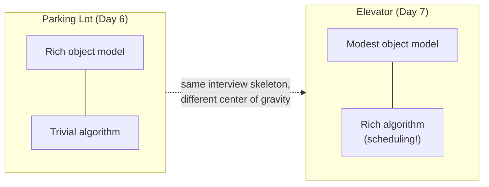
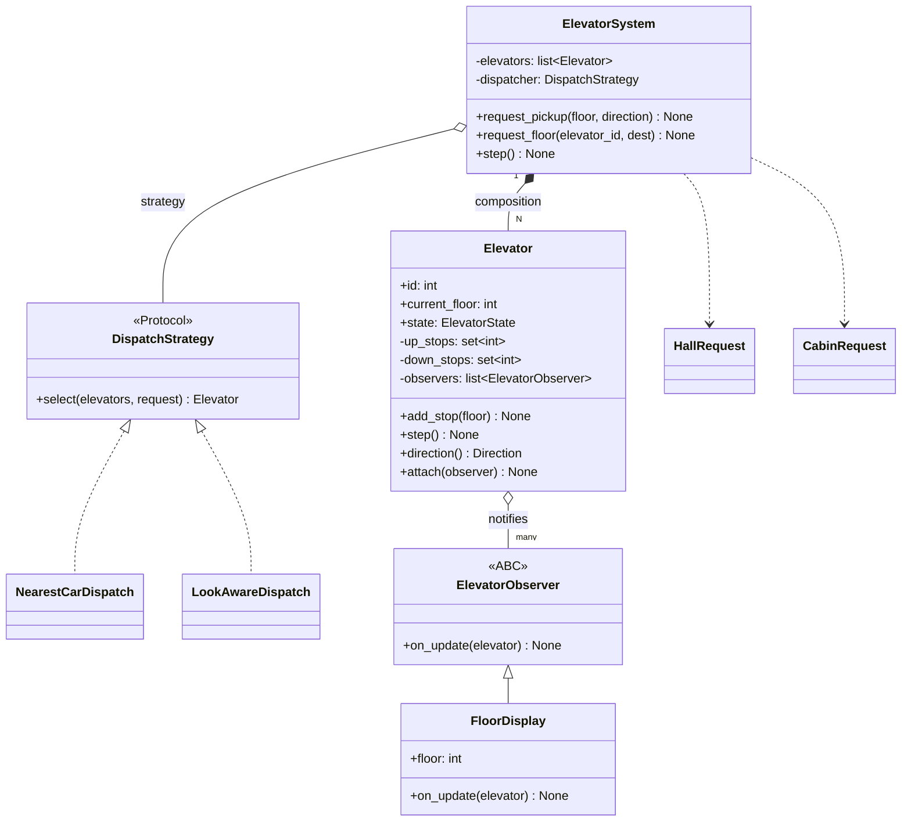
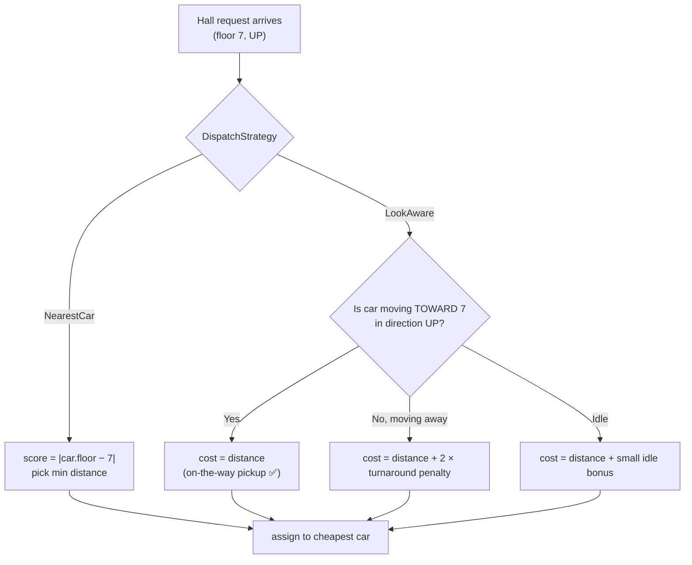
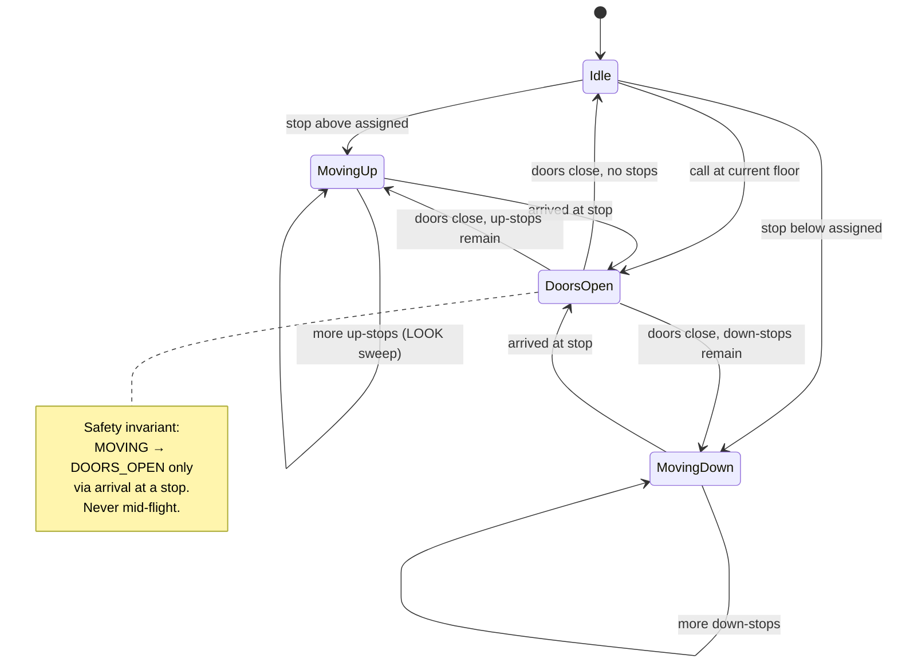
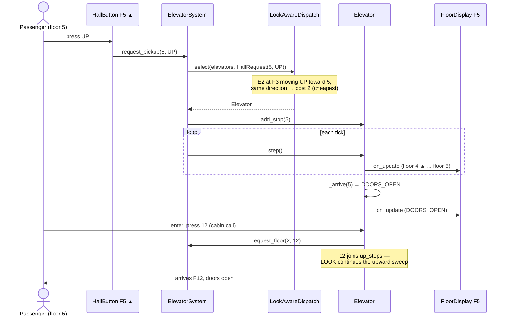
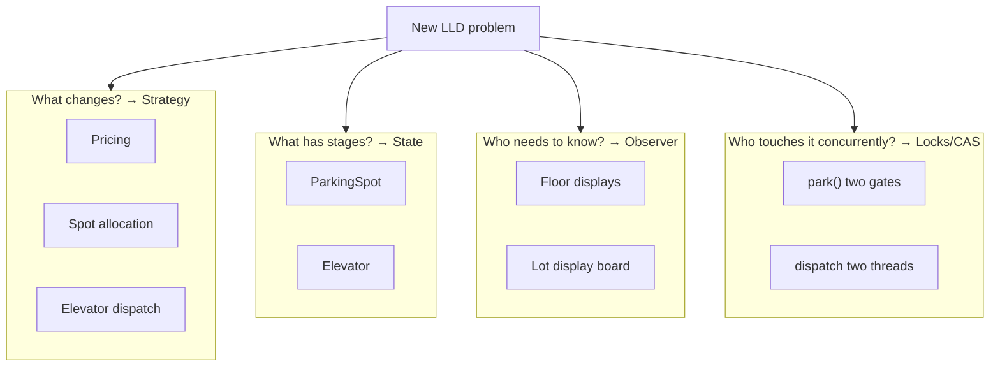

# Day 7 — LLD Problem: Elevator System + Week 1 Review

> Series: System Design Mastery

Two goals today. First, a full worked walkthrough of the **Elevator System** — the LLD problem where the classes are easy but the *algorithm* is the interview. Second, a **Week 1 Review**: every pattern you have met this week, condensed into a revision table, a mixed quiz, and a Feynman checklist.

---

## Table of Contents

1. [Interview Framing](#1-interview-framing)
2. [Step 1: Requirements Clarification](#2-requirements-clarification)
3. [Step 2: Core Entities & Enums](#3-core-entities--enums)
4. [Step 3: Class Diagram + Design Patterns (Where & Why)](#4-class-diagram--design-patterns)
5. [Step 4: The Dispatch Algorithm — Nearest-Car vs SCAN/LOOK](#5-the-dispatch-algorithm)
6. [Step 5: Code Skeletons with Business Logic](#6-code-skeletons)
7. [Step 6: Elevator State Machine](#7-elevator-state-machine)
8. [Step 7: Sequence Diagram — Main Flow](#8-sequence-diagram)
9. [Step 8: Edge Cases Table](#9-edge-cases-table)
10. [Step 9: Interviewer Follow-ups](#10-interviewer-follow-ups)
11. [SOLID Audit](#11-solid-audit)
12. [Common Candidate Mistakes](#12-common-candidate-mistakes)
13. [The Dark Side — Where This Is Overengineered](#13-the-dark-side)
14. [WEEK 1 REVIEW](#14-week-1-review)
15. [Self-Check Questions](#15-self-check-questions)

---

## 1. Interview Framing

The elevator problem inverts the parking lot: yesterday the classes were the substance and the algorithm was trivial (scan for a free spot); today the classes are almost boilerplate and the substance is **which elevator answers which call, and in what order it visits floors**.


*Know where the problem's center of gravity is — and spend your minutes there.*

---

## 2. Requirements Clarification

**In plain words:** Before wiring up a lift, you'd ask the building manager the obvious things: how many lifts and floors, what counts as "good service" (short waits? saving power?), and what happens in a fire. Nailing these questions down first stops you from designing the wrong machine. Skipping this step is like installing an elevator before knowing how tall the building is.

### Questions a good candidate asks

| # | Question | Why it matters |
|---|----------|----------------|
| 1 | "How many elevators (N) and floors (M)? Is N > 1?" | N > 1 forces a *dispatcher* — the heart of the problem |
| 2 | "Two request types, right? Hall call (floor + direction) vs cabin call (destination)?" | Internal vs external requests have different information content |
| 3 | "Optimize for what — average wait time, fairness, energy?" | The metric picks the algorithm |
| 4 | "Capacity/weight limits? Overload sensor?" | Adds a guard state |
| 5 | "Express elevators, restricted floors, freight elevator?" | De-scope explicitly |
| 6 | "Do floor displays need to show elevator position/direction?" | Observer hook |
| 7 | "Emergency states — fire mode, door obstruction?" | Safety transitions in the state machine |
| 8 | "Real-time simulation loop or event-driven API design?" | Determines whether you write a `step()` tick or callbacks |

### Chosen assumptions

- **N elevators, M floors** (say N=4, M=20 for concreteness).
- **External (hall) request** = `(floor, direction)`; **internal (cabin) request** = `(destination_floor)`.
- **Optimize** average wait time while avoiding starvation.
- **Dispatching** is pluggable (Strategy): nearest-car baseline, LOOK-aware upgrade.
- **Displays** on every floor observe elevator state (Observer).
- **Out of scope:** weight sensors, express banks, fire service mode (mention, then park them).

---

## 3. Core Entities & Enums

**In plain words:** Think of the vocabulary a lift needs to describe itself: is it going up, down, or resting (Direction)? Are its doors open or shut (state)? There are also two kinds of button-press: the one you make *outside* on the landing ("I'm on floor 5 and want to go up") and the one you make *inside* the car ("take me to floor 12"). Those are two different messages carrying different information, and we model them as two small, unchangeable data objects.

```java
import java.util.*;

// An enum is a fixed set of named constants. Java enums are full classes,
// so each constant can carry a value — here the +1 / -1 / 0 "step" per tick.
enum Direction {
    UP(1),
    DOWN(-1),
    IDLE(0);

    private final int step;                 // how the floor number changes per move

    Direction(int step) {                   // enum constructor runs once per constant
        this.step = step;
    }

    public int getStep() {                  // getter — Java's version of Python @property
        return step;
    }
}

// The four states a car can be in. Behaviour of step() depends on which one is active.
enum ElevatorState {
    IDLE,
    MOVING_UP,
    MOVING_DOWN,
    DOORS_OPEN
}

// Doors are their own concept so "open vs closed" is never just a boolean.
enum DoorState {
    OPEN,
    CLOSED
}

// External request: pressed on a floor. We know WHERE and WHICH WAY, not destination.
// A Java 'record' is the idiomatic way to model immutable data (frozen dataclass):
// it auto-generates the constructor, getters, equals(), and hashCode() for us.
record HallRequest(int floor, Direction direction) { }

// Internal request: pressed inside a car. We know the DESTINATION.
record CabinRequest(int destination) { }
```

The **information asymmetry** between the two request types is the key modeling insight: a hall request cannot be assigned a destination-optimal car because the destination is unknown — only the direction is. Saying this sentence in an interview immediately separates you from candidates who model one generic `Request`.

> **🤔 Why two request types — isn't a request just "someone wants floor X"?**
> No, and collapsing them into one generic `Request` throws away the information the whole algorithm runs on. A *hall* call knows only `(floor, direction)` — the passenger hasn't chosen a car and hasn't said where they're going. A *cabin* call knows the destination but already knows its car (the passenger is standing in it). That asymmetry is exactly why hall calls need a dispatcher and cabin calls don't.

**✅ Good scenario (where it saves you):** Modeling them separately lets the dispatcher assign a hall call to a car already sweeping that way, while a cabin call goes straight into its own car's stop set. Later, "destination dispatch" (passengers type the floor at a lobby kiosk) becomes a clean new request type — the design bends instead of breaking.

**❌ Bad scenario (the pain without it):** A candidate uses one `Request(floor)`. Now the dispatcher can't tell "pick me up going up" from "take me to 12," direction-aware LOOK costing is impossible, and the design silently degrades to dumb nearest-car ping-ponging — the exact failure interviewers are probing for.

**When NOT to:** for a single-car lift where every press just means "come here / go here," the distinction adds nothing — one request type is honest. The asymmetry only earns its keep once a *dispatcher* has to choose among multiple cars.

---

## 4. Class Diagram + Design Patterns

**In plain words:** This is the blueprint of who-owns-what. One control panel (`ElevatorSystem`) runs the whole bank of lifts, but it hands off the tricky "which lift should answer this call?" decision to a swappable brain (`DispatchStrategy`), and each lift shouts its position to the little arrow displays on every floor (`Observer`). Splitting the work this way means you can upgrade the "brain" without touching the lifts, and add new displays without touching either.


*ElevatorSystem composes N cars, delegates assignment to a DispatchStrategy, and cars push updates to Observer displays.*

### Which pattern, where, and why

| Pattern | Where | Why |
|---------|-------|-----|
| **Strategy** | `DispatchStrategy` | Assignment policy is the most-likely-to-change logic (nearest-car → LOOK-aware → ML-based destination dispatch). Isolate the volatility. |
| **State** | `Elevator` transitions (IDLE / MOVING_UP / MOVING_DOWN / DOORS_OPEN) | Behavior of `step()` depends entirely on current state; illegal jumps (MOVING_UP → DOORS_OPEN without arriving) must be impossible. |
| **Observer** | `FloorDisplay` (and hall lanterns) subscribe to `Elevator` | Displays update on every state change without `Elevator` importing display code. Decouples hardware UI from control logic. |
| **Singleton** | `ElevatorSystem` — one controller per bank | Same verdict as Day 6: one instance at the composition root, injected; avoid the global `getInstance()`. |
| **Command** *(mention)* | `HallRequest` / `CabinRequest` as immutable objects | Requests-as-objects can be queued, logged, replayed, cancelled — say it, don't build it. |

---

## 5. The Dispatch Algorithm

**In plain words:** Imagine four lifts and a fresh call on floor 7 going up. Which one should go? The naive answer is "the closest one," but the closest lift might be zooming *away* from you toward the penthouse. The smart answer — the one real elevators use — is to prefer a lift already heading your way, and to keep sweeping in one direction picking up everyone en route (like a bus that finishes its uptown run before turning around) rather than darting back and forth. This "sweep till you run out, then reverse" rule is called LOOK.

This is the section that wins the interview. Frame it via **OS disk scheduling** — an elevator is a disk head, floors are cylinders, requests are I/O:

| OS algorithm | Elevator translation | Property |
|--------------|----------------------|----------|
| FCFS | Serve requests in arrival order | Terrible: elevator ping-pongs across the building |
| SSTF (shortest seek) | Always go to the nearest requested floor | Good latency, but **starves** far floors under load |
| **SCAN** ("the elevator algorithm" — literally named after this machine) | Sweep to the top, then sweep to the bottom, serving stops on the way | Fair, predictable; wastes travel to the very top even with no requests there |
| **LOOK** | SCAN, but reverse as soon as no stops remain in the current direction | What real elevators run — SCAN without the empty overshoot |


*Nearest-car looks only at distance; LOOK-aware costing also asks "is the car already sweeping my way?"*

**Nearest-car** is the honest baseline: pick `min(|car.floor - request.floor|)`. Its flaw — it may assign a car moving *away* (car at floor 8 heading up to 20 gets a floor-7 DOWN call because it's "1 away").

**LOOK-aware dispatch** fixes it: a car heading toward you in your direction is cheap; a car that must finish its sweep and turn around is expensive. Each car then serves its own stops in LOOK order via two sorted stop sets (`up_stops`, `down_stops`).

> **🤔 Why not just send the nearest elevator — isn't closest always fastest?**
> No — the closest car might be zooming *away* from you toward the penthouse, so "1 floor away, wrong direction" is slower than "3 floors away, heading toward you." Naive nearest-car (SSTF) also *starves* far floors under load. LOOK — sweep in one direction picking up everyone en route, reverse only when no stops remain that way — is what real elevators run, and putting dispatch behind a Strategy lets you upgrade nearest-car → LOOK → ML dispatch without touching the cars.

**✅ Good scenario (where it saves you):** A hall call at floor 7 UP is assigned to the car already moving up through floor 3 (cost = distance), not the idle car at floor 6 that would have to reverse. Under heavy lobby traffic, LOOK guarantees every sweep reaches the top requested floor, so floor 19 is never starved — a bounded wait of ≤ 2M ticks.

**❌ Bad scenario (the pain without it):** FCFS ("queues are simple") or pure nearest-car. The bank ping-pongs across the building, average wait balloons, and during morning rush the penthouse callers wait forever while the lobby churns — the classic disk-scheduling starvation, now stuck between floors.

**When NOT to:** a single-car, low-rise building needs no dispatcher, and LOOK degenerates to "go where pressed" — don't build the Strategy machinery for one elevator. The dispatch seam earns its keep only when N > 1 cars compete for calls.

---

## 6. Code Skeletons

**In plain words:** Now we translate the blueprint into working Java. Each piece stays in its own lane: the dispatch strategies decide *which* lift answers, the `Elevator` class handles one car's movement and doors, the floor displays just show status, and the `ElevatorSystem` is a thin receptionist that routes button-presses to the right place. Read the comments — they explain why each Java construct (interface, enum, record, TreeSet) was chosen.

### Dispatch strategies

```java
import java.util.*;

// Strategy pattern: an INTERFACE is the "seam" where the algorithm can be swapped.
// Any class that implements this promises a select(...) method — that's the contract.
interface DispatchStrategy {
    Elevator select(List<Elevator> elevators, HallRequest request);
}

// Baseline: pure distance. Simple, explainable, starves nobody badly at low load.
class NearestCarDispatch implements DispatchStrategy {

    @Override
    public Elevator select(List<Elevator> elevators, HallRequest request) {
        // Comparator.comparingInt(...) is the idiomatic Java way to pick a minimum.
        // Math.abs(...) gives the floor distance; the car with the smallest wins.
        return elevators.stream()
                .min(Comparator.comparingInt(
                        e -> Math.abs(e.getCurrentFloor() - request.floor())))
                .orElseThrow();   // there is always at least one elevator
    }
}

// Cost = distance, penalized if the car must reverse to serve the request.
class LookAwareDispatch implements DispatchStrategy {

    // A named constant instead of a "magic number" (~ floors of extra effort to turn around).
    private static final int TURNAROUND_PENALTY = 20;

    // Private helper — the equivalent of Python's _cost(): the scoring rule for one car.
    private int cost(Elevator e, HallRequest req) {
        int distance = Math.abs(e.getCurrentFloor() - req.floor());
        Direction d = e.direction();
        if (d == Direction.IDLE) {
            return distance;                       // a resting car pays only the distance
        }
        // Is the car already travelling toward this floor?
        boolean movingToward =
                (d == Direction.UP   && req.floor() >= e.getCurrentFloor()) ||
                (d == Direction.DOWN && req.floor() <= e.getCurrentFloor());
        boolean sameDirection = d == req.direction();
        if (movingToward && sameDirection) {
            return distance;                       // on-the-way pickup — cheap
        }
        return distance + TURNAROUND_PENALTY;      // must finish sweep first — expensive
    }

    @Override
    public Elevator select(List<Elevator> elevators, HallRequest request) {
        // Pick the car with the lowest cost, not just the nearest.
        return elevators.stream()
                .min(Comparator.comparingInt(e -> cost(e, request)))
                .orElseThrow();
    }
}
```

### Elevator — LOOK movement + guarded state machine

```java
import java.util.*;

// A custom unchecked exception — thrown when code attempts an illegal state jump.
// Extending RuntimeException means callers aren't forced to wrap every call in try/catch.
class IllegalElevatorTransition extends RuntimeException {
    public IllegalElevatorTransition(String message) {
        super(message);
    }
}

class Elevator {
    private final int id;
    private int currentFloor;
    private ElevatorState state = ElevatorState.IDLE;   // every car starts at rest

    // TreeSet keeps floor numbers sorted automatically, so "nearest above/below"
    // is just first()/last() — no manual sorting, the LOOK algorithm stays clean.
    private final TreeSet<Integer> upStops = new TreeSet<>();
    private final TreeSet<Integer> downStops = new TreeSet<>();
    private final List<ElevatorObserver> observers = new ArrayList<>();

    // Constructor. Java has no default-argument syntax, so we overload:
    Elevator(int elevatorId, int floor) {
        this.id = elevatorId;
        this.currentFloor = floor;
    }

    Elevator(int elevatorId) {              // second constructor = the "floor = 0" default
        this(elevatorId, 0);                // delegate to the main constructor
    }

    // ---- Getters (Java's version of Python @property) ----------------
    public int getId() { return id; }

    public int getCurrentFloor() { return currentFloor; }

    public ElevatorState getState() { return state; }

    // ---- Observer plumbing -------------------------------------------
    public void attach(ElevatorObserver observer) {
        observers.add(observer);
    }

    private void notifyObservers() {
        // Push the new state to every subscribed display. The car never imports
        // display code — it only knows the ElevatorObserver interface.
        for (ElevatorObserver obs : observers) {
            obs.onUpdate(this);
        }
    }

    // ---- Request intake ----------------------------------------------
    public void addStop(int floor) {
        if (floor > currentFloor) {
            upStops.add(floor);            // a stop above us joins the up-sweep
        } else if (floor < currentFloor) {
            downStops.add(floor);          // a stop below us joins the down-sweep
        } else {
            openDoors();                   // already here — just open up
        }
    }

    public Direction direction() {
        if (state == ElevatorState.MOVING_UP)   return Direction.UP;
        if (state == ElevatorState.MOVING_DOWN) return Direction.DOWN;
        return Direction.IDLE;
    }

    // ---- LOOK sweep: one simulation tick -----------------------------
    public void step() {
        if (state == ElevatorState.DOORS_OPEN) {
            closeDoors();                  // spent last tick loading; now close and move on
            return;
        }
        Integer target = nextTarget();     // Integer (not int) so it can be null = "no stops"
        if (target == null) {
            setState(ElevatorState.IDLE);  // nothing to do — rest
            return;
        }
        if (target > currentFloor) {
            setState(ElevatorState.MOVING_UP);
            currentFloor += 1;             // move exactly one floor per tick
        } else if (target < currentFloor) {
            setState(ElevatorState.MOVING_DOWN);
            currentFloor -= 1;
        }
        if (currentFloor == target) {
            arrive(target);                // reached a stop this tick
        }
    }

    // LOOK: keep sweeping in the current direction while stops remain,
    // else reverse; if empty both ways, return null (go idle).
    private Integer nextTarget() {
        if (direction() == Direction.UP && !upStops.isEmpty()) {
            return upStops.first();        // nearest stop above (TreeSet is sorted)
        }
        if (direction() == Direction.DOWN && !downStops.isEmpty()) {
            return downStops.last();       // nearest stop below
        }
        if (!upStops.isEmpty())   return upStops.first();   // reversed / was idle
        if (!downStops.isEmpty()) return downStops.last();
        return null;                       // no stops anywhere
    }

    private void arrive(int floor) {
        upStops.remove(floor);             // clear the served stop from both sets
        downStops.remove(floor);
        openDoors();
    }

    // ---- Guarded transitions -----------------------------------------
    private void openDoors() {
        // Reaching here mid-flight is only legal at the instant of arrival —
        // the caller (arrive/addStop) guarantees the car has actually stopped.
        setState(ElevatorState.DOORS_OPEN);
    }

    private void closeDoors() {
        // Guard clause: you may only close doors that are open. Anything else is a bug,
        // so we fail loudly instead of silently corrupting the state machine.
        if (state != ElevatorState.DOORS_OPEN) {
            throw new IllegalElevatorTransition("closeDoors from " + state);
        }
        setState(ElevatorState.IDLE);
    }

    private void setState(ElevatorState newState) {
        if (state != newState) {           // only notify on an actual change
            state = newState;
            notifyObservers();
        }
    }
}
```

### Observer — floor displays

> **🤔 Why Observer for the floor displays — can't the elevator just call `display.render()` when it moves?**
> It could, but then `Elevator` would `import` and *know about* every display type — hall lanterns, lobby dashboards, a mobile app — and adding one means editing the control logic. Observer flips it: the car pushes state to a list of `ElevatorObserver`s it never names, so display hardware and control logic evolve independently. The car's job is moving; rendering is somebody else's.

**✅ Good scenario (where it saves you):** The building adds a lobby dashboard and a passenger app showing live car positions. Both just `attach()` as observers; `Elevator` and its state machine are never touched — new display *types* multiply without a single edit to control logic.

**❌ Bad scenario (the pain without it):** `Elevator.setState()` directly calls three concrete display classes. A new display type means editing the safety-critical movement code, and a slow or throwing display in that inline call can stall or crash the car's tick loop — UI coupling reaching into control logic.

**When NOT to:** for two fixed displays that will never multiply, a direct `render(elevator)` call from `setState` is honest and simpler — introduce Observer when display *types* actually grow (lanterns, dashboards, apps).

```java
// The Observer contract: one method, so displays aren't forced to know anything else.
interface ElevatorObserver {
    void onUpdate(Elevator elevator);
}

// A concrete observer: the little arrow panel on one floor.
class FloorDisplay implements ElevatorObserver {
    private final int floor;

    FloorDisplay(int floor) {
        this.floor = floor;
    }

    @Override
    public void onUpdate(Elevator elevator) {
        // Pick an arrow glyph based on the car's state (switch expression, Java 14+).
        String arrow = switch (elevator.getState()) {
            case MOVING_UP   -> "▲";   // ▲
            case MOVING_DOWN -> "▼";   // ▼
            default          -> "•";   // •
        };
        // String.format is Java's f-string equivalent: %d = int, %s = string.
        System.out.println(String.format(
                "[Floor %d] Car %d: floor %d %s %s",
                floor, elevator.getId(), elevator.getCurrentFloor(),
                arrow, elevator.getState().name()));
    }
}
```

### ElevatorSystem — thin controller

```java
import java.util.*;

class ElevatorSystem {
    // 'final' fields set once in the constructor — both dependencies are INJECTED,
    // so we can pass in any DispatchStrategy without editing this class (Open/Closed).
    private final List<Elevator> elevators;
    private final DispatchStrategy dispatcher;

    ElevatorSystem(List<Elevator> elevators, DispatchStrategy dispatcher) {
        this.elevators = elevators;
        this.dispatcher = dispatcher;
    }

    // External hall call: the car is NOT yet chosen, so we ask the dispatcher.
    public void requestPickup(int floor, Direction direction) {
        HallRequest req = new HallRequest(floor, direction);
        Elevator car = dispatcher.select(elevators, req);   // strategy picks the best car
        car.addStop(floor);
    }

    // Internal cabin call: the car is already known, no dispatch needed.
    public void requestFloor(int elevatorId, int destination) {
        elevators.get(elevatorId).addStop(destination);     // straight to that car's stops
    }

    // Advance every car by one simulation tick.
    public void step() {
        for (Elevator car : elevators) {
            car.step();
        }
    }
}
```

Note the asymmetry made explicit in code: **hall calls go through the dispatcher; cabin calls do not** — the passenger already chose the car by standing in it.

---

## 7. Elevator State Machine

**In plain words:** A real lift can only ever be in one of a few situations — resting, going up, going down, or sitting with its doors open — and it can only move between them in sensible ways. The unbreakable safety rule is that the doors may only open *after* the car has actually stopped at a floor, never mid-flight between floors. Modelling these situations as an `enum` and rejecting any illegal jump (like "open doors while moving") is what keeps the design safe rather than hoping the code never asks for it.

> **🤔 Why model doors and movement as a strict state machine — isn't a couple of booleans simpler?**
> Booleans let illegal combinations exist — `moving == true` *and* `doorsOpen == true` is a person falling down a shaft. The state machine makes that combination *unrepresentable*: every path into DOORS_OPEN must pass through an arrival at a stop, and any attempt to open mid-flight throws. The rejected transitions encode the one safety invariant the whole design exists to protect.

**✅ Good scenario (where it saves you):** A buggy caller tries to open the doors while the car is between floors; the guarded transition throws `IllegalElevatorTransition` at once, in that caller's stack trace, long before it could reach real hardware. "Doors open only after arrival" is enforced in code, not in a reviewer's memory.

**❌ Bad scenario (the pain without it):** Doors are a `boolean` flipped anywhere. A refactor sets `doorsOpen = true` in a path that runs while `MOVING_UP`; nothing rejects it, tests pass, and in a physical system that's a safety incident — the exact class of bug a first-class DOORS_OPEN state makes impossible.

**When NOT to:** a toy simulation with no doors and no safety stakes doesn't need the ceremony — but the moment "never move with doors open" is a real requirement, the state machine is correctness, not overengineering, and (per the Dark Side) it survives every cut.


*Elevator lifecycle: every path into DoorsOpen passes through an arrival — the safety invariant of the whole design.*

---

## 8. Sequence Diagram


*Main flow: hall call dispatched by strategy, on-the-way pickup, cabin call merged into the same upward sweep.*

---

## 9. Edge Cases Table

| # | Edge case | What breaks naively | Handling |
|---|-----------|--------------------|----------|
| 1 | Call at the car's current floor | Car "moves" 0 floors, stops never cleared | `addStop` short-circuits to `openDoors()` |
| 2 | Same hall button pressed 5 times | Five dispatches, five cars converge | Stops are a `Set` (TreeSet); dedupe hall requests per (floor, direction) until served |
| 3 | Passenger presses opposite-direction destination (in UP car, presses 2) | Sweep order violated | Goes into `downStops`; served after the up-sweep completes (LOOK) |
| 4 | All cars idle, simultaneous calls at F1 and F20 | Both assigned to same nearest car | Dispatcher should assign per-request sequentially, seeing updated stop sets |
| 5 | Starvation: heavy lobby traffic, F19 waits forever | Pure SSTF/nearest never reaches F19 | LOOK guarantees each sweep reaches the extreme requested floor |
| 6 | Door obstruction while closing | State corrupts to MOVING with doors open | Reopen: DOORS_OPEN → DOORS_OPEN with reset timer; never transition to MOVING until closed |
| 7 | Invalid floor (0 in a 1-based building, or > M) | Ghost stop, car sweeps to nowhere | Validate at the `request*` boundary; throw `IllegalArgumentException` |
| 8 | Car taken out of service mid-sweep | Its stops silently vanish | Drain: reassign remaining stops through the dispatcher |
| 9 | Two threads call `requestPickup` concurrently | Dispatcher reads stale stop sets | Lock (synchronized) around select+addStop (same check-then-act lesson as Day 6) |
| 10 | Overload sensor trips | Car departs overweight | Guard in DOORS_OPEN: refuse to close doors; not modeled here — say it's a scoped-out guard state |

---

## 10. Interviewer Follow-ups

**"How would you scale from 4 to 32 elevators across banks?"**
Group cars into `ElevatorBank`s (low-rise/high-rise); a top-level router picks the bank by requested floor range, then the bank's own `DispatchStrategy` picks the car. The Strategy seam composes hierarchically.

**"Destination dispatch — passengers type the floor at the kiosk?"**
Then hall requests carry destinations, the information asymmetry disappears, and the dispatcher can *batch passengers by destination* (how modern towers cut wait times ~30%). Model it as a new `DispatchStrategy` consuming `DestinationRequest` — the class diagram barely changes; the algorithm changes completely.

**"Prove starvation-freedom of LOOK."**
Each sweep serves all stops in the current direction and only reverses when none remain; any pending stop is at worst one full sweep away, so wait time is bounded by 2M ticks. Pure nearest-first has no such bound.

**"Where's the concurrency risk?"**
`select()` then `addStop()` is check-then-act across cars — same race class as Day 6's two-gates-one-spot. In-process: one `synchronized` block (or a `ReentrantLock`) around dispatch. Distributed (controller per bank, shared state): route all mutations through a single-writer event queue per bank, or CAS on a car's stop-version.

**"How do you test the dispatcher?"**
Table-driven: given car positions/directions and a request, assert the chosen car. Then property-based simulation: random request streams, assert (a) every request eventually served, (b) max wait ≤ 2M ticks under LOOK.

---

## 11. SOLID Audit

| Letter | Where it shows up |
|--------|--------------------|
| **S** | `Elevator` = one car's motion; `DispatchStrategy` = assignment policy; `FloorDisplay` = rendering; `ElevatorSystem` = routing only. |
| **O** | Swap `NearestCarDispatch` for `LookAwareDispatch` (or destination dispatch) with zero edits to `ElevatorSystem` or `Elevator`. |
| **L** | Any `DispatchStrategy` returns a valid `Elevator` for any legal request — `LookAwareDispatch` never narrows the contract (e.g., never returns `null` where the interface promises an Elevator). |
| **I** | `ElevatorObserver` exposes exactly one method; displays are not forced to implement stop management. Buttons depend on `requestPickup`, not on car internals. |
| **D** | `ElevatorSystem` depends on the `DispatchStrategy` interface and `Elevator` depends on the `ElevatorObserver` interface — both injected/attached, neither hard-imports a concrete display or policy. |

---

## 12. Common Candidate Mistakes

1. **Skipping the internal/external request distinction.** One generic `Request(floor)` class throws away the direction information the whole algorithm runs on.
2. **A god `ElevatorController`** that owns car positions, stop queues, door timers, and display strings. The dispatcher must be a seam, not a paragraph inside a method.
3. **FCFS queue per building** because "queues are simple" — leads to the ping-pong elevator; interviewers are waiting for SCAN/LOOK vocabulary.
4. **A single sorted list of stops** instead of `upStops`/`downStops` — makes LOOK's "nearest in current direction" a fragile index dance instead of `TreeSet.first()`/`last()`.
5. **Doors as a boolean** instead of a state — door obstruction, reopen timers, and the "never move with doors open" invariant all need DOORS_OPEN to be a first-class state.
6. **No tick/step model.** Without `step()`, you cannot demonstrate the algorithm at all; the design stays hypothetical.
7. **Forgetting the concurrency callback** — the dispatch race is Day 6's parking race wearing a different hat; reuse the answer.

---

## 13. The Dark Side

Where is this overengineered?

- **A 4-floor building with 1 elevator** needs no `DispatchStrategy` (there is one car), no Observer (one display can poll), and LOOK degenerates to "go where pressed." Pragmatic cut: `Elevator` with a stop set and `step()` — 40 lines.
- **Observer for two displays** is machinery; a direct method call from `setState` to a `render(elevator)` method is honest at that scale. Introduce Observer when display *types* multiply (hall lanterns, lobby dashboard, mobile app).
- **The turnaround-penalty constant (20)** is a magic number pretending to be a policy. In a real system it's calibrated from telemetry; in an interview, *say* "this is a tunable, and tuning it is an ops problem, not a design problem."
- What survives every cut: the **state machine with the doors-safety invariant** and the **up/down stop-set structure**. As with Day 6 — correctness invariants are never the fat to trim; speculative seams are.

---

## 14. WEEK 1 REVIEW

**In plain words:** A week's worth of lessons boils down to four questions you can ask of any new design, like a building inspector's checklist. What varies? (Strategy.) What has stages? (State.) Who needs to be told? (Observer.) Who touches it at the same time? (Locks.) Once you've internalised these four, most low-level design problems start solving themselves — you already know which tool each part of the problem is asking for.

### Pattern revision table

| Pattern | Problem it solves | One-line Java trick | Where it appeared this week |
|---------|-------------------|------------------------|------------------------------|
| **Strategy** | Algorithm varies independently of its host | `interface Pricing { BigDecimal calculate(...); }` — inject, don't inherit | Parking: pricing + spot allocation. Elevator: dispatch (nearest vs LOOK-aware) |
| **State** | Behavior depends on lifecycle stage; illegal jumps must fail loudly | `enum` status + guard clauses that `throw` on bad transitions | Parking: Spot FREE→OCCUPIED→OUT_OF_SERVICE. Elevator: IDLE/MOVING/DOORS_OPEN |
| **Observer** | Publisher must notify subscribers it cannot know about | `for (var obs : observers) obs.onUpdate(this);` behind an interface | Elevator: floor displays; Parking (optional): free-count display board |
| **Factory** | Centralize construction rules / hide concrete classes | `static Ticket create(...)` | Parking: Ticket/Spot creation |
| **Singleton** | Exactly-one instance of a coordinator | Prefer *one instance at composition root, injected* over `getInstance()` | Parking: the lot. Elevator: the system/bank controller |
| **Composition > Inheritance** | Types differ by data, not behavior | A `record` + an `enum` field beats a subclass tree | Parking: Vehicle + VehicleSize instead of Bike/Car/Truck |
| **Interface vs Abstract class** | Pure seam vs enforced base + shared code | `interface` for pure contracts; `abstract class` when you also ship default behavior | Strategies = interface; Observers/Payment = abstract class (or interface + default methods) |
| **Locking (check-then-act)** | Read-then-write races under concurrency | `synchronized` (or `ReentrantLock`) around find→occupy; DB: `FOR UPDATE SKIP LOCKED` or CAS | Parking: two gates, one spot. Elevator: two threads, one dispatch |

### Week 1 pattern map


*One diagnostic question per pattern: ask all four of a new problem and the design writes itself.*

### 10-Question Mixed Quiz

1. In the parking lot, why must `pay()` precede `vacate()` in `unpark()`?
2. Give the one-sentence rule for choosing an `Enum` field over a subclass hierarchy.
3. Name the race condition shared by "two entry gates" and "two dispatch threads," and its generic name.
4. What does LOOK do differently from SCAN, and why do real elevators use LOOK?
5. Which SOLID letter is violated by a `ParkingLot` that computes hourly fees inline? Name a second letter it also strains.
6. Hall request vs cabin request: which one needs the dispatcher, and why doesn't the other?
7. What guarantee does `FOR UPDATE SKIP LOCKED` add over `FOR UPDATE` for concurrent spot allocation?
8. Why are `upStops`/`downStops` two sets instead of one sorted list?
9. When is Observer overkill? Give the pragmatic alternative.
10. State the starvation bound LOOK gives a pending request in an M-floor building.

<details>
<summary><strong>Answers</strong></summary>

1. If the spot is vacated first and payment fails, the car leaves unpaid and the spot state no longer matches reality; keeping the spot OCCUPIED until payment completes preserves the invariant "barrier opens only after COMPLETED."
2. Subclass only when *behavior* differs; if types differ only by an attribute's value, an Enum field on one class carries all the information.
3. Check-then-act: both threads pass the check (spot FREE / car cheapest) before either acts; fixed by making check+act atomic (lock, row lock, or CAS).
4. SCAN sweeps to the physical end of the shaft; LOOK reverses as soon as no stops remain in the current direction — same fairness, less wasted travel.
5. S (Single Responsibility — orchestration and money math are two reasons to change); it also strains O, since a new pricing scheme forces edits inside `ParkingLot`.
6. The hall request needs the dispatcher — the car is not yet chosen. A cabin request already identifies its car (the passenger is inside it), so it goes straight to that car's stop set.
7. A second transaction skips rows already locked instead of blocking on them, so concurrent gates immediately grab *different* free spots rather than queueing on the same hot row.
8. LOOK needs "nearest stop in my current direction": `upStops.first()` above, `downStops.last()` below (a `TreeSet` keeps them sorted) — O(1) conceptual reads, no index arithmetic, and direction reversal is just switching sets.
9. When there is one subscriber and it won't multiply — a direct call to a render function is simpler; introduce Observer when subscriber types grow (lanterns, dashboards, apps).
10. Any pending stop is served within at most one full sweep each way: ≤ 2M floor-moves (ticks), because each sweep visits every requested extreme before reversing.

</details>

### Feynman checklist

Explain each of these *out loud, no notes*, to an imaginary junior. If you stumble, that's tomorrow's first 20 minutes.

- [ ] Why Strategy is "Open/Closed with a syringe" — and where dependency injection enters the picture.
- [ ] The spot/elevator state machines, including which transitions are *rejected* and why rejection is the point.
- [ ] Check-then-act, in both threading terms and SQL terms, with the fix for each.
- [ ] Composition vs inheritance using the Vehicle example, ending with the one-question decision rule.
- [ ] SCAN/LOOK's origin in OS disk scheduling and the starvation argument against nearest-first.
- [ ] The information asymmetry between hall and cabin requests — and what destination dispatch changes.
- [ ] For each SOLID letter: point at one concrete line of this week's code, not a definition.
- [ ] The Dark Side discipline: name one thing you would cut from each design for a v1, and one thing you never would.

---

## 15. Self-Check Questions

1. Sketch (from memory) the elevator state diagram, then list every transition your sketch *forbids* and the guard that enforces each.
2. A car at floor 10 moving UP with stops {12, 15}; hall calls arrive: (8, DOWN) and (11, UP). Trace LookAwareDispatch's cost for each and the resulting stop sets.
3. Rewrite `NearestCarDispatch.select` to break ties by "fewest pending stops" — which SOLID letter lets you do this without touching `ElevatorSystem`?
4. Your interviewer says "make floor 13 restricted to keycard holders." Which classes change? (Aim: request validation at the boundary + one allocator/stop-intake guard — not a rewrite.)
5. Explain why `requestFloor` bypasses the dispatcher, in one sentence a product manager would understand.
6. From the Week 1 table: which pattern would you reach for if the parking lot must email the owner when the lot hits 90% capacity, and why?
7. What is the single most transferable idea between the parking lot and the elevator? (Hint: it isn't a pattern — it's *where you put the lock*.)

**Tomorrow:** Week 2 begins — we leave single-machine LLD and enter HLD: scaling reads with caching and replication, and designing our first distributed system, a URL shortener, where "which row is free" becomes "which ID is unique across ten servers."
