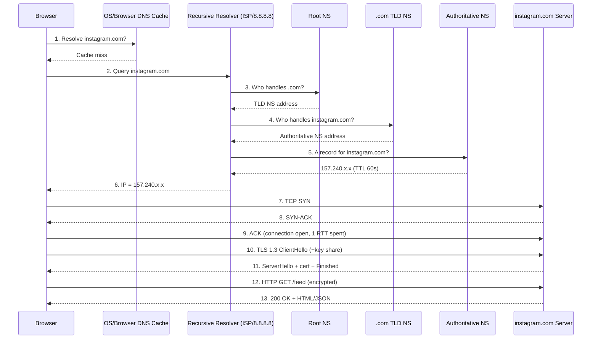
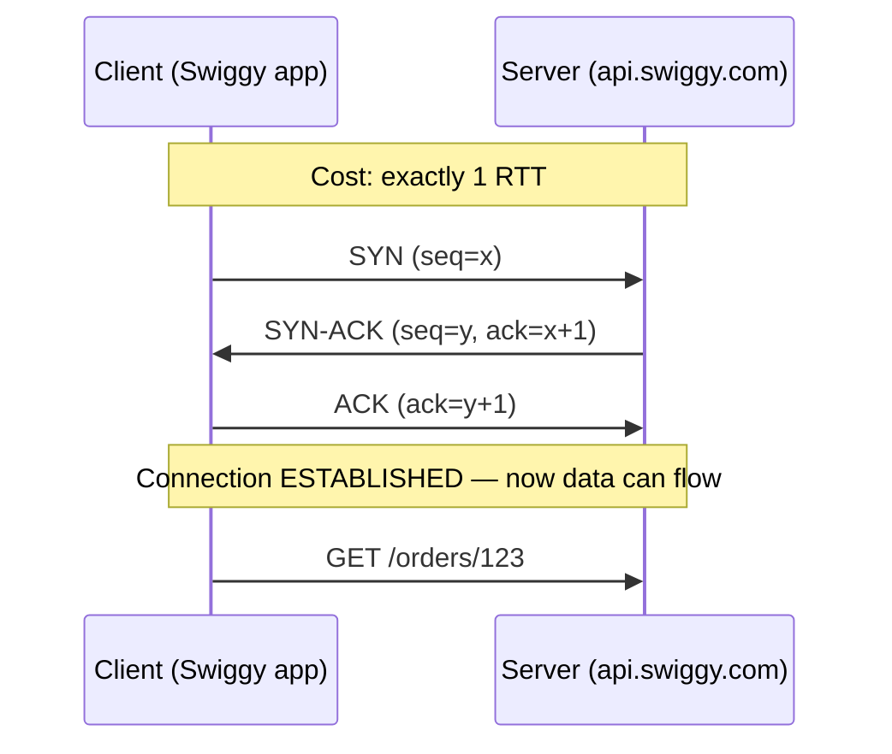
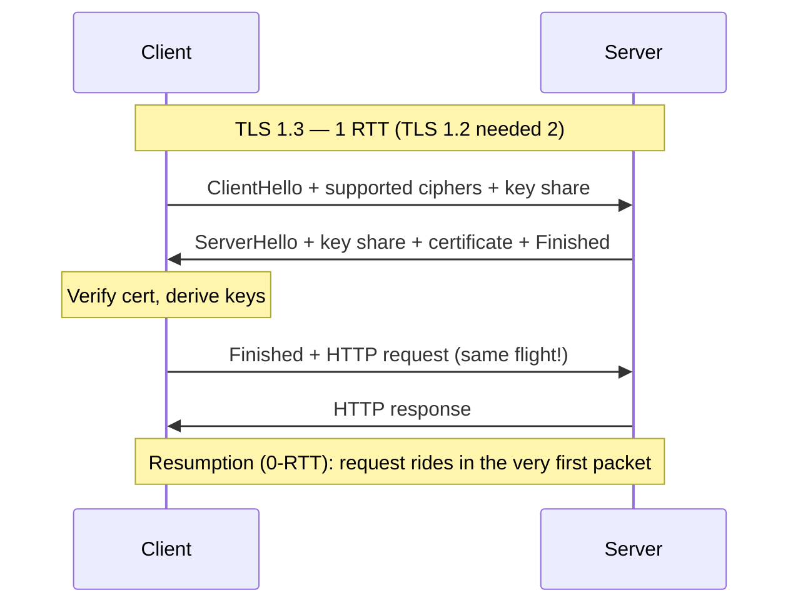
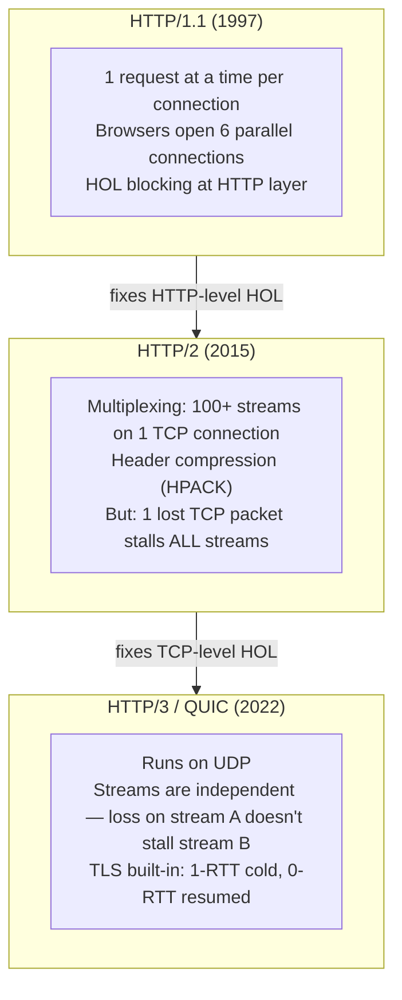
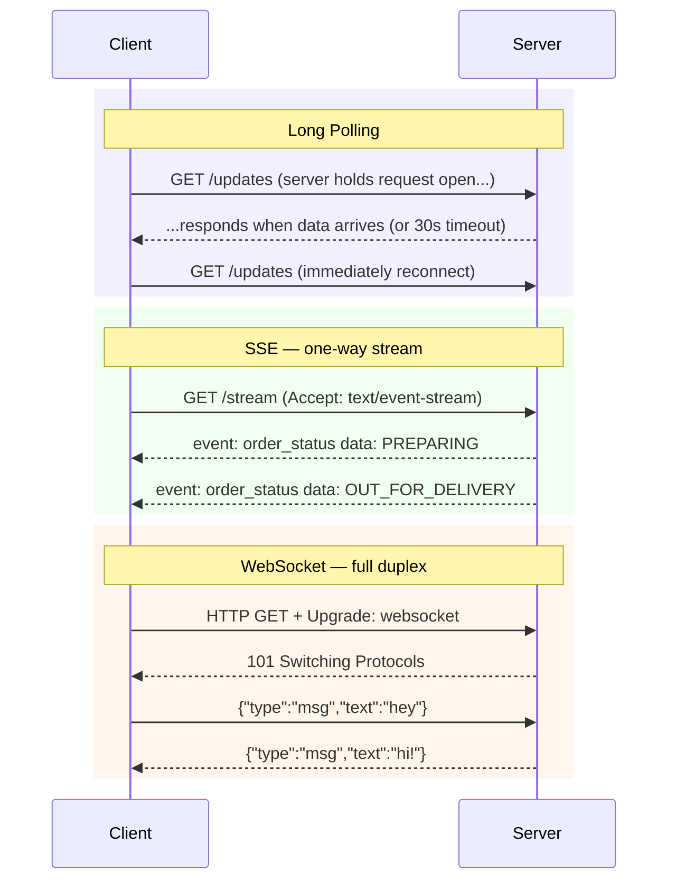
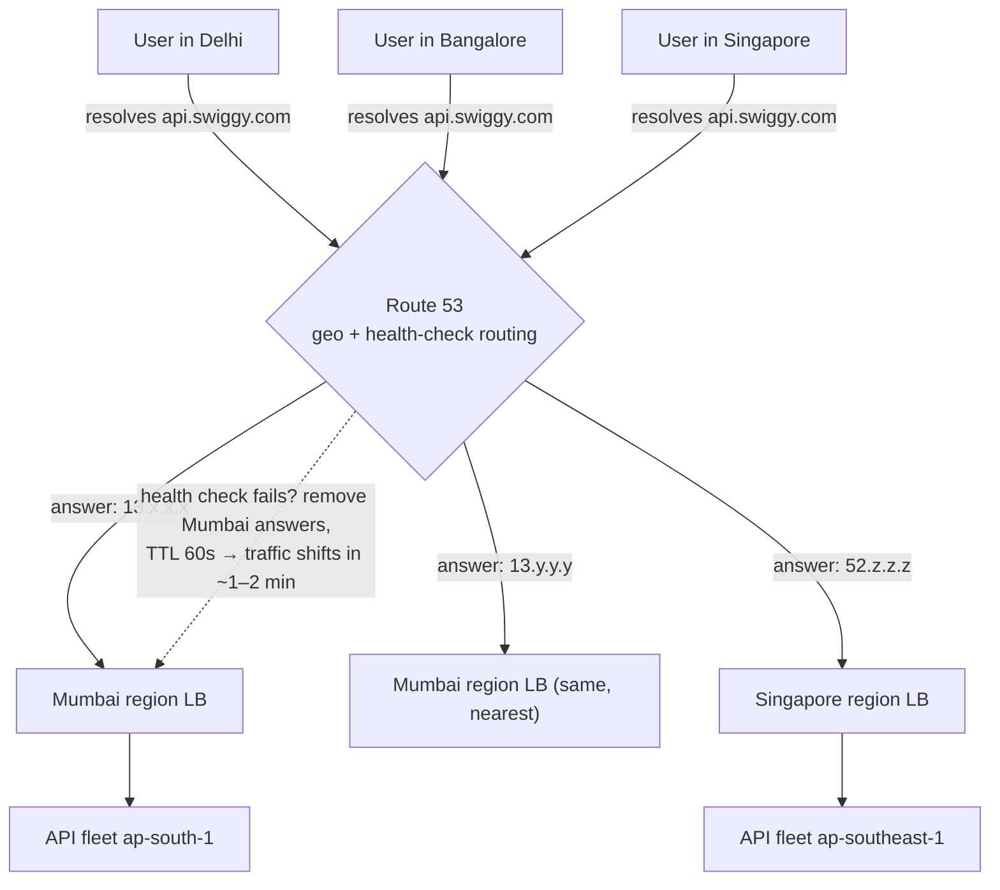

# Day 8 — Networking Essentials for Backend Engineers

> Series: System Design Mastery
> Week 2: The bridge from Low-Level Design to High-Level Design. Before you can draw boxes and arrows, you must know what actually travels down the arrow.

---

## Table of Contents

1. [Why Networking Is Day 1 of HLD](#1-why-networking-is-day-1-of-hld)
2. [The Full Journey of a Request](#2-the-full-journey-of-a-request)
3. [DNS Deep Dive](#3-dns-deep-dive)
4. [TCP: The 3-Way Handshake](#4-tcp-the-3-way-handshake)
5. [TLS 1.3: Encryption Without the Tax](#5-tls-13-encryption-without-the-tax)
6. [HTTP: The Language of the Web](#6-http-the-language-of-the-web)
7. [HTTP/1.1 vs HTTP/2 vs HTTP/3](#7-http11-vs-http2-vs-http3)
8. [TCP vs UDP: The Decision Table](#8-tcp-vs-udp-the-decision-table)
9. [Real-Time: WebSockets vs Long Polling vs SSE](#9-real-time-websockets-vs-long-polling-vs-sse)
10. [DNS-Based Load Balancing & Geo-Routing](#10-dns-based-load-balancing--geo-routing)
11. [Self-Check](#self-check)
12. [Apply (1 hour)](#apply-1-hour)

---

## 1. Why Networking Is Day 1 of HLD

**In plain words:** Imagine ordering food from a restaurant across town. Before the food (your data) arrives, a delivery rider has to find the address, drive there, get let in the gate, and show ID. Networking is all the "getting there and getting let in" work that happens before your actual data moves — and just like traffic and gate checks, it takes time you must budget for.

**Why.** Every system design interview question — "Design Instagram", "Design Swiggy" — is secretly a question about moving bytes between machines with acceptable latency. If you don't know that a TLS handshake costs a round trip, you can't explain why a CDN edge in Mumbai makes Swiggy feel fast in Pune.

**What.** Networking for backend engineers = DNS + TCP/UDP + TLS + HTTP + real-time protocols. Not the OSI model recited from memory — the 6 things that show up in production incidents.

**When.** You reach for this knowledge when: latency budgets are tight (p99 < 200 ms), you're choosing between REST/WebSocket/gRPC, or you're debugging "it's slow only for users in Europe."

**How.** We'll trace one request end-to-end, then zoom into each layer.

**Where.** Every request Instagram serves (~100k+ requests/sec at peak) and every order Swiggy places walks this exact path.

**The Dark Side.** Engineers over-index on protocol trivia and under-index on measurement. Knowing QUIC's handshake diagram is worthless if you never opened your own app's waterfall in Chrome DevTools. Measure first, memorize second.

### The numbers you must carry in your head

| Operation | Typical latency |
|---|---|
| Same-datacenter round trip | 0.5 ms |
| Cross-region round trip (Mumbai → Singapore) | ~55 ms |
| Cross-continent round trip (India → US East) | ~200 ms |
| DNS lookup (cold, full recursion) | 20–120 ms |
| DNS lookup (cached at OS/browser) | ~0–1 ms |
| TCP 3-way handshake | 1 RTT (~1–200 ms depending on distance) |
| TLS 1.3 handshake | +1 RTT (TLS 1.2 was +2 RTT) |
| TLS 1.3 with 0-RTT resumption | +0 RTT |
| First byte of HTTP response over cold connection | DNS + TCP + TLS + server time ≈ 3–4 RTTs |

Rule of thumb: **a cold HTTPS connection to a server 100 ms away costs ~300–400 ms before your application code even runs.** This single number justifies CDNs, connection pooling, and keep-alive.

---

## 2. The Full Journey of a Request

**In plain words:** Typing a web address and hitting Enter is like mailing a letter. First you look up the address in a phone book (DNS), then you establish a phone line to the house (TCP), you agree on a secret code so nobody eavesdrops (TLS), and only then do you actually say what you want (HTTP). Each of those steps is a separate back-and-forth trip that adds to the total wait.

**Why.** "What happens when you type instagram.com and press Enter?" is the most-asked interview question in history because it tests whether your knowledge is connected or fragmented.

**What.** Seven stages: URL parse → DNS → TCP → TLS → HTTP request → server processing → HTTP response (+ rendering, which we skip as backend engineers).

**When.** Use this mental model to budget latency: if the product manager wants "page loads in 1 second globally," you now know ~400 ms may be gone before your code runs.

**How.** Follow the sequence diagram below — this is the canonical picture to draw in interviews.


*The complete cold-start journey: DNS recursion (steps 1–6), TCP handshake (7–9), TLS 1.3 (10–11), then finally HTTP (12–13).*

**Where.** Swiggy example: you open the app, it resolves `api.swiggy.com`, opens a pooled TLS connection, and fires `GET /restaurants?lat=..&lng=..`. The app keeps that connection alive so the next tap costs 1 RTT, not 4.

**The Dark Side.** The textbook diagram shows full DNS recursion, but in production it almost never happens — 85–95% of DNS queries hit a cache. Optimizing DNS before checking cache hit rates is a classic waste of a sprint. Conversely, a too-clever 5-second TTL "for fast failover" can multiply your resolver load 60x versus a 300s TTL.

---

## 3. DNS Deep Dive

**In plain words:** DNS is the internet's phone book. You know a name ("instagram.com") but computers need a number (an IP address like 157.240.1.1) to actually connect. DNS translates the friendly name into the number, and — because looking it up every time would be slow — that answer gets memorized (cached) at many levels, from your browser all the way up to your internet provider.

**Why.** DNS is the first hop of every request and the cheapest global load balancer you will ever get. It's also the layer people forget until it takes down half the internet (Dyn 2016, Facebook BGP/DNS 2021 — 6 hours of global outage).

**What.** A distributed, hierarchical, eventually-consistent key-value store mapping names → records, with aggressive caching at every layer.

### Caching layers (in lookup order)

| Layer | Typical TTL honored | Latency if hit |
|---|---|---|
| Browser cache | seconds–minutes | ~0 ms |
| OS resolver cache | record TTL | <1 ms |
| Router / local network | record TTL | ~1 ms |
| ISP recursive resolver | record TTL | 5–30 ms |
| Full recursion (root → TLD → auth) | — | 50–120 ms |

### Record types engineers actually use

| Record | Maps | Example use |
|---|---|---|
| **A** | name → IPv4 | `api.swiggy.com → 3.7.21.5` |
| **AAAA** | name → IPv6 | Dual-stack support |
| **CNAME** | name → another name | `www.swiggy.com → swiggy.com`, pointing to a CDN (`cdn.swiggy.com → d1234.cloudfront.net`) |
| **MX** | domain → mail server | Receiving email at `@swiggy.com` |
| **TXT** | domain → arbitrary text | SPF/DKIM email auth, domain ownership verification |
| **NS** | domain → nameservers | Delegation |

**When.** Care about DNS when: doing blue-green deploys via DNS swap, adding a CDN (CNAME to edge), or setting up multi-region failover.

**How.** Try it yourself:

```java
import java.net.InetAddress;

public class DnsTiming {
    public static void main(String[] args) throws Exception {
        long start = System.nanoTime();
        // getByName uses the JVM/OS resolver plus its cache
        InetAddress addr = InetAddress.getByName("instagram.com");
        double elapsedMs = (System.nanoTime() - start) / 1_000_000.0;
        System.out.printf("instagram.com -> %s in %.1f ms%n",
                          addr.getHostAddress(), elapsedMs);
        // Run twice: first run ~30-80 ms, second run <1 ms (cached)
    }
}
```
> Note: the JVM caches DNS results too. It is controlled by the
> `networkaddress.cache.ttl` security property (historically the default
> cached successful lookups **forever** — see the Dark Side note below).

**Where.** Instagram uses low TTLs (60s) on API endpoints so traffic can shift between regions within a minute during incidents.

> **🤔 Wait — DNS is just a name lookup, why does it deserve a whole section?**
> Because DNS is the one dial you can turn to move *all* your traffic without touching a single server — and the one layer whose failure takes down everything at once. It isn't "just a lookup"; it's your outermost, cheapest, global load balancer *and* your single largest blast radius.

**✅ Good scenario (where it saves you):** During a regional incident in `ap-south-1`, Swiggy flips the A record and 60s-TTL clients drain off the dead region within ~2 minutes — no redeploy, no code change, one config edit moves 100% of traffic.

**❌ Bad scenario (the pain without it / when misused):** A team sets a 5s TTL "for fast failover"; authoritative-NS query load jumps ~60x versus a 300s TTL, the resolver bill and p99 spike — and failover *still* strands broken-middlebox clients for 20 minutes. Or someone fat-fingers the record (Facebook, Oct 2021) and the whole company goes dark for 6 hours.

**When NOT to:** For a single-region internal service reached via service discovery or a fixed load-balancer VIP, hand-tuning DNS TTLs and geo-policies is overkill — a static CNAME is fine.

**The Dark Side.** DNS failover is *not* instant failover. Clients, resolvers, and some broken middleboxes ignore TTLs; Java's old default cached DNS *forever* until JVM restart. If you need sub-second failover, you need an anycast IP or a load balancer — DNS alone will strand 1–5% of traffic on the dead IP for minutes to hours.

---

## 4. TCP: The 3-Way Handshake

**In plain words:** TCP is like starting a phone call politely before you talk. You say "Can you hear me?" (SYN), they say "Yes, can you hear me?" (SYN-ACK), and you say "Yes!" (ACK) — only then do you start the actual conversation. This little greeting guarantees both sides are ready and that no words get lost or scrambled, but it costs one full round trip before any real information flows.

**Why.** TCP gives you ordered, reliable, congestion-controlled byte streams — the foundation under HTTP/1.1 and HTTP/2. Its cost: 1 full round trip before a single byte of your data moves.

**What.** SYN → SYN-ACK → ACK. Both sides agree on starting sequence numbers so lost/reordered packets can be detected.


*One round trip of pure ceremony before any application data — this is why connection reuse matters.*

**When.** You feel TCP's cost whenever connections are short-lived: serverless functions dialing a DB per invocation, or HTTP clients without keep-alive.

**How.** Amortize the handshake:

```java
import java.net.URI;
import java.net.http.*;

// BAD: creating a fresh client per call throws away the pooled connection,
// paying a new TCP+TLS handshake each time (~300 ms overhead each at 100ms RTT)
for (int i = 0; i < 10; i++) {
    HttpClient throwaway = HttpClient.newHttpClient();
    throwaway.send(HttpRequest.newBuilder(
            URI.create("https://api.swiggy.com/health")).build(),
            HttpResponse.BodyHandlers.discarding());
}

// GOOD: reuse ONE HttpClient — it keeps a keep-alive connection pool,
// so the TCP+TLS handshake is paid once and amortized across all calls
HttpClient client = HttpClient.newHttpClient();   // create once, reuse everywhere
HttpRequest req = HttpRequest.newBuilder(
        URI.create("https://api.swiggy.com/health")).build();
for (int i = 0; i < 10; i++) {
    client.send(req, HttpResponse.BodyHandlers.discarding());
}
```

With 100 ms RTT, the bad version spends ~3 s in handshakes; the good version ~0.3 s.

**Where.** Every load balancer → backend connection at Instagram is long-lived and pooled precisely to avoid handshake storms.

> **🤔 Wait — I never write TCP code, my framework handles it. Why learn the handshake?**
> Because the handshake is a latency line item you either pay or amortize, and connection reuse is the single biggest backend perf lever you actually control. You don't write the SYN/ACK, but you decide whether your code pays it once or ten thousand times.

**✅ Good scenario (where it saves you):** Instagram's load-balancer→backend links are long-lived pooled connections, so at 100k+ req/s the 1-RTT handshake is paid once per connection instead of per request — saving millions of RTTs per second and keeping p99 flat under load.

**❌ Bad scenario (the pain without it / when misused):** A serverless function opens a fresh DB connection per invocation; during a traffic spike every cold call pays TCP+TLS (~300 ms at 100 ms RTT) and the DB drowns in handshake churn and connection-limit exhaustion — a latency cliff and cascading 500s.

**When NOT to:** For a one-shot CLI tool or a cron job that makes a single call and exits, pooling and keep-alive buy nothing — just open, call, close.

**The Dark Side.** TCP's reliability becomes a liability for real-time media. If packet #100 is lost, packets #101–150 sit in the kernel buffer waiting for the retransmit — this is **head-of-line blocking**. For a video call, showing a slightly-glitched *current* frame beats showing a perfect frame from 800 ms ago. That's why WebRTC and live gaming choose UDP, deliberately embracing loss.

---

## 5. TLS 1.3: Encryption Without the Tax

**In plain words:** TLS is how two strangers agree on a secret language so nobody listening in the middle can understand them — and it also proves the server really is who it claims to be (like checking a passport). Older versions needed two rounds of back-and-forth to set this up; TLS 1.3 cleverly does it in one, and for repeat visitors, sometimes zero. Less waiting, same secrecy.

**Why.** Everything is HTTPS now (browsers mark HTTP as insecure; app stores require TLS). The question isn't *whether* to encrypt, it's *how much latency* encryption costs.

**What.** TLS 1.3 (2018) cut the handshake from 2 round trips (TLS 1.2) to **1 round trip**, and to **0 round trips** for resumed sessions (0-RTT).


*TLS 1.3 sends the key share optimistically in the first message, collapsing negotiation into one round trip.*

| Handshake | Round trips | At 100 ms RTT |
|---|---|---|
| TLS 1.2 (cold) | 2 | 200 ms |
| TLS 1.3 (cold) | 1 | 100 ms |
| TLS 1.3 (0-RTT resumption) | 0 | 0 ms |

**When.** This matters most on mobile networks (RTT 80–300 ms) — exactly Swiggy's and Instagram's audience.

**How.** You mostly get TLS 1.3 for free by keeping your load balancer / nginx / CDN current. Verify with: `openssl s_client -connect api.swiggy.com:443 -tls1_3`.

**Where.** CDNs terminate TLS at the edge (~10–30 ms from the user) and reuse warm connections to origin, so users never pay the full India→US handshake.

> **🤔 Wait — isn't TLS just flip-it-on-and-forget? Why does latency care about it?**
> Because on mobile RTTs of 80–300 ms, a cold handshake is a visible chunk of your page-load budget. TLS version and session resumption are real latency levers, not just a security checkbox you tick once.

**✅ Good scenario (where it saves you):** A CDN terminates TLS 1.3 at a Mumbai edge ~15 ms from the user and resumes warm connections to origin — the user never pays the full India→US handshake, and repeat requests ride 0-RTT.

**❌ Bad scenario (the pain without it / when misused):** An origin stuck on TLS 1.2 with no session resumption forces every cold mobile connection through 2 RTTs (~400 ms at 200 ms RTT) before the first byte — Swiggy's cart feels sluggish on 4G and nobody can pinpoint why.

**When NOT to:** Enabling 0-RTT everywhere to shave that last round trip is *wrong* for non-idempotent endpoints — a `POST` in 0-RTT is a replayable double-order; keep 0-RTT to idempotent GETs.

**The Dark Side.** 0-RTT data is replayable — an attacker can capture and re-send the encrypted first flight. If your `POST /orders` rides in 0-RTT, a replay could double-order biryani. Rule: only idempotent GETs in 0-RTT; servers must reject non-idempotent early data. Perfect performance advice ("enable 0-RTT everywhere!") is a security bug in disguise.

---

## 6. HTTP: The Language of the Web

**In plain words:** If TCP is the phone line and TLS is the secret code, HTTP is the actual conversation — the words and grammar both sides agreed to speak. You ask for something ("GET me this page") using a standard verb, and the server answers with a standard status number (200 = "here you go", 404 = "never heard of it"). Following this shared grammar is what lets browsers, caches, and monitoring tools all understand your app for free.

**Why.** HTTP is the contract between every client and server you'll design. Sloppy HTTP usage (wrong methods, wrong codes) breaks caching, retries, and monitoring — three things you get *for free* if you follow the spec.

**What.** A request = method + path + headers + optional body. A response = status code + headers + optional body.

### Methods

| Method | Semantics | Idempotent? | Body? |
|---|---|---|---|
| GET | Read | Yes | No |
| POST | Create / do something | **No** | Yes |
| PUT | Replace entirely | Yes | Yes |
| PATCH | Partial update | Not guaranteed | Yes |
| DELETE | Remove | Yes | Rarely |

### The 10 status codes you'll actually use daily

| Code | Meaning | Real usage |
|---|---|---|
| 200 | OK | GET success |
| 201 | Created | POST that made a resource |
| 204 | No Content | DELETE success |
| 301 | Moved Permanently | http→https, old URLs (cached by browsers!) |
| 304 | Not Modified | ETag/conditional GET hit — empty body, huge bandwidth saver |
| 400 | Bad Request | Malformed JSON, missing field |
| 401 | Unauthorized | No/invalid credentials ("who are you?") |
| 403 | Forbidden | Valid credentials, no permission ("I know you, and no") |
| 404 | Not Found | Missing resource (also used to *hide* resources from 403 probes) |
| 429 | Too Many Requests | Rate limited — return `Retry-After` |
| 500 | Internal Server Error | Your bug |
| 503 | Service Unavailable | Overload/maintenance — safe to retry |

(Yes, that's 12 — engineers can't count when it comes to status codes. Learn all of them.)

### Headers that matter

| Header | Purpose | Example |
|---|---|---|
| `Content-Type` | Body format | `application/json` |
| `Authorization` | Credentials | `Bearer eyJhbGci...` |
| `Cache-Control` | Caching policy | `max-age=300, public` or `no-store` |
| `ETag` / `If-None-Match` | Cheap revalidation | Server: `ETag: "v42"` → next request: `If-None-Match: "v42"` → `304` |

```java
import java.net.URI;
import java.net.http.*;

HttpClient client = HttpClient.newHttpClient();

// First request: server returns 200 plus an ETag identifying this version
HttpResponse<String> r = client.send(
        HttpRequest.newBuilder(URI.create("https://api.github.com/users/torvalds")).build(),
        HttpResponse.BodyHandlers.ofString());
String etag = r.headers().firstValue("ETag").orElseThrow();

// Second request: send the ETag back via If-None-Match to ask
// "only give me the body if it changed"
HttpResponse<String> r2 = client.send(
        HttpRequest.newBuilder(URI.create("https://api.github.com/users/torvalds"))
                   .header("If-None-Match", etag)
                   .build(),
        HttpResponse.BodyHandlers.ofString());
System.out.println(r2.statusCode());  // 304 — no body transferred, bandwidth ~0
```

**When/Where.** Instagram serves profile pictures with `Cache-Control: max-age=31536000, immutable` plus a content-hashed URL — the image is *never* re-fetched. Swiggy's restaurant menu API might use `max-age=60` since menus change rarely but not never.

> **🤔 Wait — HTTP is just GET/POST, why be so pedantic about status codes and methods?**
> Because caches, retries, and monitoring are all built to *trust* HTTP semantics. The moment you lie — a `200` with an error body, a `POST` for a read — you silently break three infrastructure layers you were getting for free.

**✅ Good scenario (where it saves you):** A team returns a proper `429` + `Retry-After` under load; every well-behaved client backs off automatically and the fleet rides out the spike without a human touching anything.

**❌ Bad scenario (the pain without it / when misused):** A junior returns `200 OK` with `{"error":"not found"}`; the CDN caches the "success," dashboards show 100% healthy during an outage, and client retry logic never fires — a silent, invisible incident that pages nobody.

**When NOT to:** For a purely internal RPC between two of your own services sharing a generated client stub, obsessing over REST status-code purity matters less — the contract is the stub, not HTTP semantics.

**The Dark Side.** `Cache-Control` on private data is a career-limiting mistake: a shared proxy caching `GET /me/orders` with `public` serves *your* order history to *someone else*. Real incidents (e.g., the 2018 Steam caching bug) came from exactly this. Default to `no-store` for anything user-specific; opt into caching deliberately.

---

## 7. HTTP/1.1 vs HTTP/2 vs HTTP/3

**In plain words:** Think of a single-lane road (HTTP/1.1) where cars line up one at a time — if the front car stalls, everyone waits. HTTP/2 turns it into a multi-lane highway on one road, so many requests travel at once. HTTP/3 goes further: it builds separate independent lanes so that one crashed car (a lost packet) doesn't freeze all the others. Each generation removes a different kind of traffic jam.

**Why.** A modern page/app screen fires 50–100 requests. How those requests share connections determines perceived speed.

**What.**


*Each generation removes one layer of head-of-line blocking: HTTP/2 at the HTTP layer, HTTP/3 at the transport layer.*

| Dimension | HTTP/1.1 | HTTP/2 | HTTP/3 (QUIC) |
|---|---|---|---|
| Transport | TCP | TCP | UDP |
| Requests per connection | 1 in flight (pipelining is dead) | many (multiplexed) | many (independent streams) |
| Head-of-line blocking | at HTTP layer | at TCP layer | none between streams |
| Handshake (cold, with TLS 1.3) | 2 RTT | 2 RTT | 1 RTT |
| Header compression | none | HPACK | QPACK |
| Adoption (2025) | universal fallback | ~65% of sites | ~30%+ and growing (Google, Meta, Cloudflare) |

**When.** HTTP/2 is the default sane choice for APIs (and gRPC requires it). HTTP/3 shines on lossy mobile networks — exactly where a Swiggy delivery partner's app lives; Meta reported meaningful tail-latency wins moving Instagram traffic to QUIC.

**How.** Enable at the edge (nginx `listen 443 quic;`, or flip a switch in Cloudflare/CloudFront). Your backend code doesn't change.

**Where.** Instagram: feed request + 20 image requests multiplexed over one HTTP/3 connection instead of 6 TCP connections racing each other.

> **🤔 Wait — HTTP/3 is the newest, so I should use it everywhere, right?**
> No. Newer fixes one *specific* problem — transport-level head-of-line blocking on lossy networks. Inside a 0.5 ms datacenter it buys nothing, and HTTP/2's single-connection model can actually *hurt* load balancing.

**✅ Good scenario (where it saves you):** Instagram moves lossy mobile-network traffic to HTTP/3/QUIC and wins tail latency — one crashed packet no longer stalls the other 20 image streams on a flaky 4G connection.

**❌ Bad scenario (the pain without it / when misused):** A team forces HTTP/2 on backend LB→service links; 100 multiplexed streams ride one TCP connection, so the load balancer can't spread load evenly and a single connection reset kills 100 in-flight requests at once.

**When NOT to:** Inside the datacenter, where RTT is 0.5 ms and loss is near zero, plain HTTP/1.1 with big connection pools is often better than HTTP/2 — the multiplexing win vanishes and the load-balancing granularity loss is real.

**The Dark Side.** HTTP/2 to *backends* can hurt: one TCP connection carrying 100 multiplexed streams gives the load balancer less granularity to spread load, and a single connection reset kills 100 in-flight requests. Many teams deliberately run HTTP/1.1 with big connection pools *inside* the datacenter, where RTT is 0.5 ms and handshakes are basically free. New ≠ better everywhere.

---

## 8. TCP vs UDP: The Decision Table

**In plain words:** TCP is like registered mail — every letter is guaranteed to arrive, in order, and you get a receipt, but it's slower. UDP is like shouting across a room — some words might get lost and you won't know, but it's instant. For a bank transfer you want registered mail; for a live video call you'd rather shout the current word than perfectly deliver a word from three seconds ago.

**Why.** This is a genuine either/or with real product consequences — it decides whether your video call glitches or freezes.

| Dimension | TCP | UDP |
|---|---|---|
| Delivery | Guaranteed, ordered | Best-effort, unordered |
| Setup | 1 RTT handshake | None |
| Overhead per packet | 20+ bytes header, ACKs | 8 bytes header |
| Congestion control | Built in | You implement (or don't) |
| Head-of-line blocking | Yes | No |
| Use when | Correctness > latency | Freshness > completeness |

| Real application | Choice | Why |
|---|---|---|
| Instagram API, image upload | TCP (HTTP) | Every byte of a JPEG matters |
| Swiggy order placement | TCP | A lost "place order" is a lost customer |
| Swiggy rider live location (every 3–5 s) | UDP-style semantics | A 3-second-old position is garbage; only latest matters |
| WhatsApp/Instagram video call | UDP (WebRTC/SRTP) | Glitch beats freeze |
| Online gaming (Valorant, PUBG) | UDP | 20 ms matters; old state is useless |
| DNS queries | UDP (TCP fallback) | Tiny payload, retry is cheap |
| HTTP/3 | UDP (QUIC adds reliability per-stream) | Best of both |

> **🤔 Wait — isn't HTTPS enough? Why would I ever touch raw UDP?**
> HTTPS (over TCP) is right for almost everything. But TCP's guarantee — *every byte, in order* — becomes a liability for live media, where retransmitting an old frame is worse than dropping it. You pick UDP for its *semantics* (freshness over completeness), never for a speed brag.

**✅ Good scenario (where it saves you):** A WhatsApp video call rides UDP/WebRTC — a lost packet shows one glitched frame and moves on, instead of freezing the whole call for 800 ms waiting on a retransmit.

**❌ Bad scenario (the pain without it / when misused):** Someone builds live-game netcode on TCP; under 2% packet loss the entire player-state stream head-of-line-blocks and every player rubber-bands — unplayable, and no amount of server scaling fixes it.

**When NOT to:** For anything where correctness beats freshness — order placement, payments, file upload — do NOT reach for UDP; TCP/HTTPS is correct, and rebuilding reliability on top of UDP is wasted, bug-prone effort.

**The Dark Side.** "UDP is faster" is a half-truth. UDP without congestion control can collapse a network (and gets throttled/blocked by ~3–5% of corporate firewalls — which is why QUIC always keeps a TCP fallback). And most "real-time" business apps (rider location on the *customer's* screen) are perfectly fine polling over TCP every 5 seconds. Choose UDP for its semantics, not for speed bragging rights.

---

## 9. Real-Time: WebSockets vs Long Polling vs SSE

**In plain words:** Normal web requests are like you calling a shop to ask "Is my order ready?" — the shop can never call you first. But sometimes the server has news for you. Long polling is you staying on the line until they have an answer; SSE is the shop putting you on a one-way loudspeaker to announce updates; WebSockets is opening a two-way walkie-talkie so both of you can talk anytime. Heavier tools cost more to run, so pick the lightest one that fits.

**Why.** Chat, live order tracking, notification badges — HTTP's request/response shape doesn't fit "server has news for you." Three workarounds exist, and picking the heavyweight one by default is a classic over-engineering trap.

**What.**


*Three escalating commitments: long polling reuses plain HTTP, SSE opens a one-way pipe, WebSocket opens a two-way pipe.*

| Dimension | Short polling | Long polling | SSE | WebSocket |
|---|---|---|---|---|
| Direction | client pull | client pull (held) | server → client | both |
| Latency of update | poll interval (e.g., 5 s) | ~instant | ~instant | ~instant |
| Server cost | 1 req per interval per client | 1 held request per client | 1 held connection | 1 held connection |
| Auto-reconnect | trivial | manual | **built into browser** | manual (write it yourself) |
| Proxy/firewall friendliness | perfect | perfect | very good (plain HTTP) | occasionally blocked |
| Infra complexity | none | low | low | high (sticky/stateful, LB config, scaling fan-out) |

**When — the honest rules:**
- Chat app (Instagram DMs): **WebSocket** — genuinely bidirectional, high message rate.
- Swiggy live order status: **SSE or long polling** — server→client only; SSE's free auto-reconnect is lovely.
- Notification badge count: **short polling every 30–60 s is fine.** Nobody dies if the badge is 40 s stale.

**How.** SSE in Spring Boot is just a few lines (Spring returns an `SseEmitter`):

```java
// Spring Boot / Spring MVC controller
@RestController
public class OrderStreamController {

    // produces = text/event-stream tells the browser this is an SSE stream
    @GetMapping(value = "/orders/{orderId}/stream",
                produces = MediaType.TEXT_EVENT_STREAM_VALUE)
    public SseEmitter stream(@PathVariable String orderId) {
        SseEmitter emitter = new SseEmitter(0L);   // 0L = no timeout

        // Push updates from a background thread so we don't block the request thread
        Executors.newSingleThreadExecutor().execute(() -> {
            String[] statuses = {"CONFIRMED", "PREPARING", "OUT_FOR_DELIVERY", "DELIVERED"};
            try {
                for (String s : statuses) {
                    // Each send() writes one "data: {...}\n\n" SSE event to the client
                    emitter.send(Map.of("order", orderId, "status", s));
                    Thread.sleep(30_000);           // wait 30s between updates
                }
                emitter.complete();                 // close the stream cleanly
            } catch (Exception e) {
                emitter.completeWithError(e);
            }
        });
        return emitter;
    }
}
```

**Where.** Swiggy's order-tracking screen is the textbook SSE/polling case; the driver-dispatch system (bidirectional: offers down, accept/reject up) is the WebSocket case.

> **🤔 Wait — WebSockets do everything, why not just use them for all real-time?**
> Because "real-time" is a spectrum of commitments. A WebSocket is a stateful, sticky, always-open connection *per client*; for a notification badge that can be 40s stale, that's a massive infra tax for zero product benefit.

**✅ Good scenario (where it saves you):** Instagram DMs use WebSockets — genuinely bidirectional, high message rate — exactly where a two-way always-open pipe is the right tool.

**❌ Bad scenario (the pain without it / when misused):** A team puts 1M notification-badge users on WebSockets: 1M stateful connections, sticky routing, heartbeats, and a reconnect thundering herd after every deploy — versus ~33k req/s of cheap stateless polling that any fleet shrugs off.

**When NOT to:** For low-frequency, staleness-tolerant updates (badge counts, "is my report ready?"), don't open a WebSocket — short polling every 30–60s is simpler, cacheable, and load-balancer-friendly.

**The Dark Side.** Polling is deeply unfashionable and frequently *correct*. 1M users polling every 30 s = ~33k req/s of cheap, stateless, cacheable, load-balancer-friendly traffic that any horizontal fleet handles. 1M WebSockets = 1M open TCP connections of server state, sticky routing, heartbeats, a reconnect thundering herd after every deploy, and a much harder capacity story. Start with polling; upgrade only when the poll interval itself becomes the product problem.

---

## 10. DNS-Based Load Balancing & Geo-Routing

**In plain words:** Remember DNS is the phone book that turns a name into an address. A clever phone book can hand different people different addresses — sending someone in Delhi to the nearby Mumbai branch and someone in Singapore to the Singapore branch. That's geo-routing: steering each user to the closest, healthiest server before they even knock on the door. It's the cheapest, outermost way to spread traffic across the globe.

**Why.** Before a user ever reaches your load balancer, DNS has already made a routing decision. It's the outermost — and cheapest — traffic-steering layer you own.

**What.** The authoritative nameserver returns *different answers* to different resolvers: round-robin across IPs, weighted splits, health-checked failover, or geo/latency-based answers (AWS Route 53, Cloudflare).


*Geo-DNS answers each user with the nearest healthy region; failover speed is bounded by TTL honesty.*

**When.** Multi-region deployments, disaster recovery, gradual region migration (weighted 95/5 → 50/50 → 0/100).

**How.** Route 53 policies: *simple*, *weighted*, *latency-based*, *geolocation*, *failover*. Combine with health checks. Keep TTL 60–300 s.

**Where.** Instagram serves users from the nearest of Meta's dozens of PoPs via DNS + anycast; Swiggy (India-centric) mainly uses DNS failover across zones/regions in ap-south.

> **🤔 Wait — if I already have real load balancers, why bother with DNS-based routing too?**
> Because DNS routes users *before* they reach any load balancer — it's the only layer that can steer a Delhi user to Mumbai and a Singapore user to Singapore across regions. Your LB balances *within* a region; DNS balances *between* them.

**✅ Good scenario (where it saves you):** Swiggy runs geo + health-checked DNS so each user resolves to their nearest healthy region, and a failed Mumbai health check drains that region in ~1–2 min — global steering at zero per-request cost.

**❌ Bad scenario (the pain without it / when misused):** A team leans on DNS to balance *load*; DNS can't see server CPU, so it happily sends 50% of traffic to a region that's melting until a coarse health check finally flips — a slow, blunt outage.

**When NOT to:** For a single-region app, geo-DNS and latency-routing policies are pure overhead — one A record (or a single anycast VIP) is all you need; add geo-routing only when you actually run multiple regions.

**The Dark Side.** Geo-DNS locates the *resolver*, not the user. A user in Pune using Google's 8.8.8.8 might appear to be wherever Google's nearest resolver PoP sits — EDNS Client Subnet mitigates this but isn't universal. And DNS load balancing cannot see server load: it happily sends 50% of traffic to a region that's on fire until a health check flips. It's a steering wheel, not a suspension — you still need real load balancers (Day 12) behind it.

---

## Self-Check

1. Walk through every network round trip between typing `swiggy.com` (cold cache) and receiving the first byte of HTML. How many RTTs total, and at 100 ms RTT, how many milliseconds before your backend code runs?
2. Your DNS record has TTL 30 s "for fast failover." What two costs does this impose, and why might failover *still* take 10 minutes for some users?
3. TLS 1.3 saved exactly one round trip vs TLS 1.2. How? And why is 0-RTT dangerous for `POST /orders`?
4. A junior returns `200 OK` with body `{"error": "not found"}`. List three concrete systems (caching, monitoring, retries) this breaks and how.
5. Explain head-of-line blocking twice: once at the HTTP layer (why HTTP/2 fixes it) and once at the TCP layer (why only HTTP/3 fixes it).
6. Swiggy rider location updates every 3 s: argue for UDP, then argue why HTTPS polling might win anyway in the real world (think firewalls, battery, infra reuse).
7. When would you pick SSE over WebSockets for live order tracking? Name the SSE feature that browsers give you for free.
8. Why is a `304 Not Modified` response often a bigger bandwidth win than gzip? What two headers make it work?
9. Your notification badge uses WebSockets and a deploy just disconnected 500k clients. Describe the thundering-herd problem that follows and two mitigations.
10. Geo-DNS routed a Mumbai user to your Singapore region. Give two plausible causes.

---

## Apply (1 hour)

**Build a latency waterfall by hand (no frameworks).**

1. *(15 min)* Write a Java program using `java.net.Socket` + `javax.net.ssl.SSLSocket` that separately times: DNS resolution (`InetAddress.getByName`), TCP connect (`socket.connect(...)`), TLS handshake (`sslSocket.startHandshake()`), and first HTTP byte for `www.instagram.com`. Print a 4-row waterfall table in ms.
2. *(10 min)* Run it 5 times. Explain why run 1's DNS differs from runs 2–5.
3. *(15 min)* Hit the same HTTPS endpoint 20 times with a fresh `HttpClient` per call vs a single reused `HttpClient` (connection pool). Measure total time for each. Compute handshake overhead per request.
4. *(15 min)* Open Chrome DevTools → Network on swiggy.com. Identify: the protocol column (h2? h3?), one request served `304`, one `Cache-Control: immutable` asset, and the DNS+connect+TLS timing breakdown of the first request. Write 5 bullet observations.
5. *(5 min)* Decide and justify in 3 sentences: for a Swiggy-style "delivery partner is 2 stops away" screen — polling, SSE, or WebSocket?

---

**Tomorrow:** Day 9 — API Design. Now that you know how bytes travel, we design the contract that rides on them: REST resource modeling, status-code discipline, idempotency keys that prevent double-charging, pagination that survives scale, and the REST vs gRPC vs GraphQL decision.
