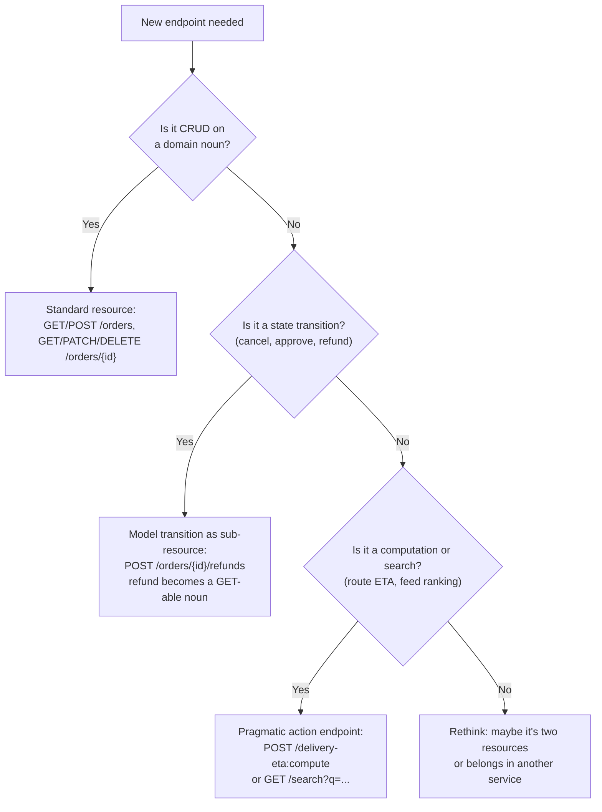
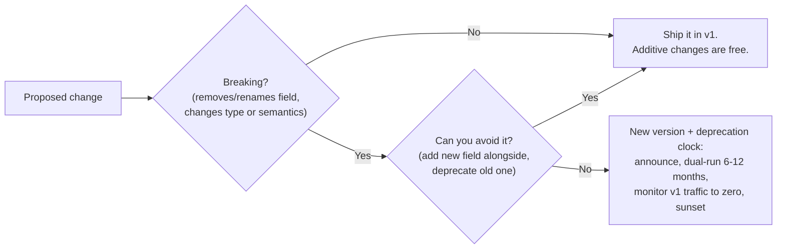
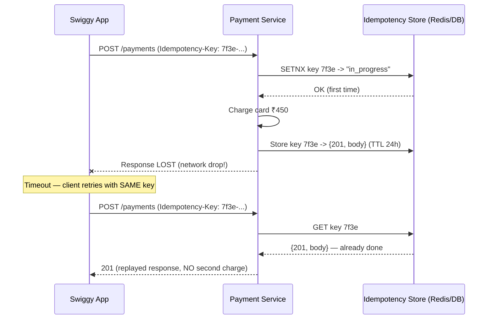
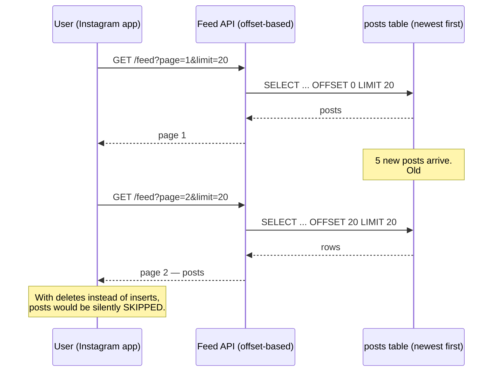
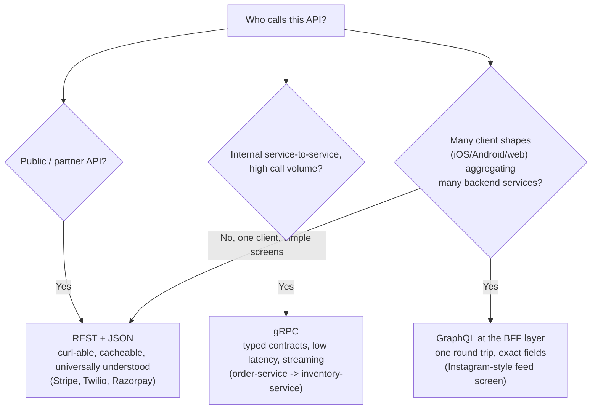
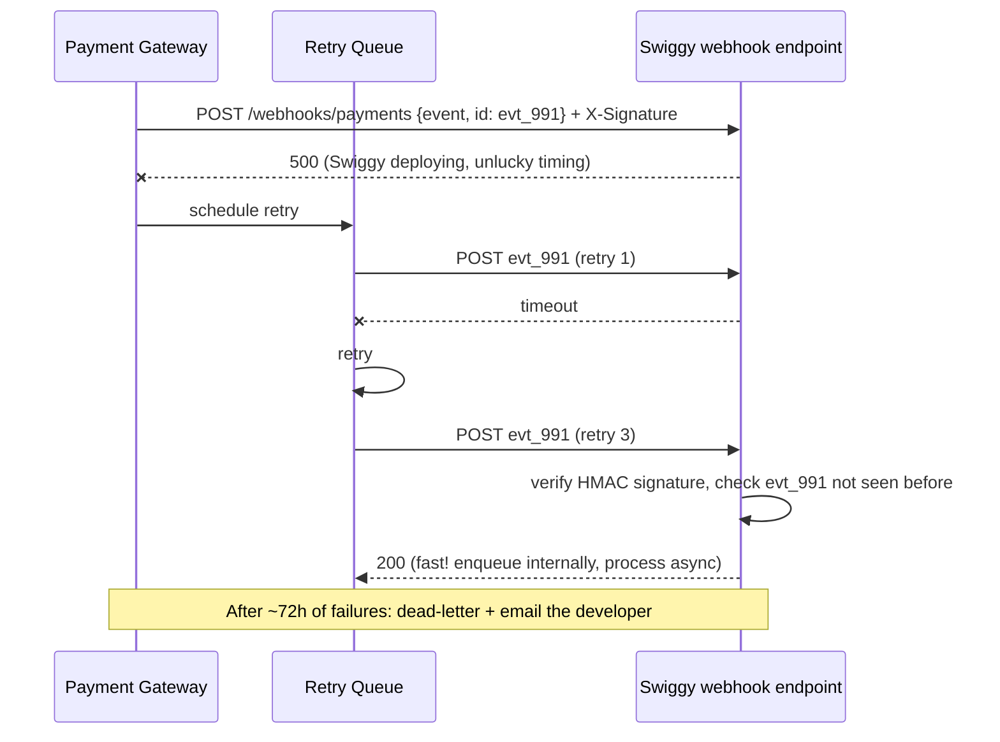

# Day 9 — API Design

> Series: System Design Mastery
> Week 2: An API is a promise you make to strangers. Break it and they page you; design it well and nobody notices — which is the highest compliment infrastructure ever gets.

---

## Table of Contents

1. [Why API Design Deserves a Full Day](#1-why-api-design-deserves-a-full-day)
2. [REST Resource Modeling](#2-rest-resource-modeling)
3. [Status Code Discipline](#3-status-code-discipline)
4. [Versioning Strategies](#4-versioning-strategies)
5. [Idempotency In Depth](#5-idempotency-in-depth)
6. [Pagination: Offset vs Cursor](#6-pagination-offset-vs-cursor)
7. [Rate Limiting & Its Headers](#7-rate-limiting--its-headers)
8. [Error Response Body Design](#8-error-response-body-design)
9. [REST vs gRPC vs GraphQL](#9-rest-vs-grpc-vs-graphql)
10. [Webhook Design Basics](#10-webhook-design-basics)
11. [Self-Check](#self-check)
12. [Apply (1 hour)](#apply-1-hour)

---

## 1. Why API Design Deserves a Full Day

**In plain words:** An API is the menu at a restaurant — it lists exactly what you can order and how. Once customers memorize your menu and build habits around it, changing it angers everyone. So unlike the kitchen (which you can remodel freely), the menu is a promise that's very hard to take back — which is why it's worth getting right up front.

**Why.** Databases can be migrated, services rewritten, caches flushed — but a public API contract, once shipped, is nearly immortal. Stripe still supports API versions from 2011. The cost of a bad API compounds: every client hardcodes your mistakes.

**What.** API design = resource modeling + method/status semantics + evolution strategy (versioning) + safety under retries (idempotency) + scale mechanics (pagination, rate limits) + failure communication (errors) + push channel (webhooks).

**When.** Before writing the first route handler. An hour of contract review saves a quarter of migration work.

**How.** We use two running products: **Instagram** (posts, comments, likes, follows) and **Swiggy** (restaurants, menus, carts, orders, payments).

**Where.** Everywhere two teams meet. Inside a company, the API *is* the org chart's handshake.

**The Dark Side.** API-design perfectionism is real. Internal APIs between two services owned by the same team can and should be scrappier — you can change both sides in one PR. Reserve the full ceremony (versioning policy, problem+json, deprecation windows) for APIs with clients you don't control.

---

## 2. REST Resource Modeling

**In plain words:** REST is like organizing a library by things (books, authors, shelves) rather than by actions (getBook, fetchAuthor, grabShelf). You name the things — the nouns — and use a small fixed set of verbs (GET to read, POST to add, DELETE to remove) on them. Because the verbs are always the same, anyone can guess how to work with a new noun without a manual.

**Why.** URLs shaped as nouns give you predictability: any engineer can *guess* your API. Verbs in URLs (`/getUserOrders`, `/doPayment`) create a flat namespace of 500 special snowflake endpoints nobody can guess.

**What.** Model your domain as **resources (nouns)**, manipulate them with **HTTP methods (verbs)**.

| Intent | Wrong (RPC-ish) | Right (REST) |
|---|---|---|
| List restaurants | `GET /getRestaurants` | `GET /restaurants` |
| One restaurant | `GET /getRestaurantById?id=42` | `GET /restaurants/42` |
| Restaurant's menu | `GET /fetchMenu?rid=42` | `GET /restaurants/42/menu-items` |
| Place order | `POST /createNewOrder` | `POST /orders` |
| Cancel order | `POST /cancelOrder?id=9` | `POST /orders/9/cancellation` *(or `DELETE /orders/9`)* |
| Like a post (Instagram) | `POST /likePost` | `PUT /posts/123/likes/me` *(idempotent!)* |

### Nesting rules

- Nest **one level max**: `/restaurants/42/menu-items` ✅, `/cities/7/zones/3/restaurants/42/menu-items/9/variants` ❌.
- If a child has its own identity, promote it to top level: comments live at `/comments/{id}` for direct access, even if created via `/posts/{id}/comments`.
- Collections are plural. Always. Pick a casing (`kebab-case` paths, `snake_case` JSON) and never look back — consistency beats any particular convention.


*A decision tree that keeps 90% of endpoints boring and gives the weird 10% a designated escape hatch.*

**When.** Apply strictly for public/partner APIs; apply loosely for internal BFFs.

**How (Spring Boot sketch).**

```java
// Spring Boot / Spring MVC controller
@RestController
public class RestaurantController {

    // GET /restaurants/{id}/menu-items?availableOnly=true
    // @PathVariable pulls values out of the URL; @RequestParam reads query params
    @GetMapping("/restaurants/{restaurantId}/menu-items")
    public List<MenuItem> listMenuItems(
            @PathVariable long restaurantId,
            @RequestParam(defaultValue = "true") boolean availableOnly) {
        // ...
        return List.of();
    }

    // POST that creates a resource returns 201 Created
    @PostMapping("/orders")
    @ResponseStatus(HttpStatus.CREATED)
    public Order placeOrder(@RequestBody OrderCreate order) {
        // ...
        return new Order();
    }

    // State transition modeled as a sub-resource, NOT a verb-URL like /cancelOrder
    @PostMapping("/orders/{orderId}/cancellation")
    @ResponseStatus(HttpStatus.CREATED)
    public Cancellation cancelOrder(
            @PathVariable String orderId,
            @RequestBody CancellationRequest reason) {
        // ...
        return new Cancellation();
    }
}
```

**Where.** Stripe (`/v1/charges`, `/v1/refunds`) and GitHub (`/repos/{owner}/{repo}/issues`) are the reference implementations worth imitating.

> **🤔 Wait — why not just name endpoints after what they do, like `/getUserOrders`? It's clearer!**
> Because verb-URLs create a flat namespace of 500 special-snowflake endpoints nobody can guess or cache. Nouns + a fixed set of verbs mean any engineer *predicts* your API, and HTTP caching, tooling, and monitoring work for free.

**✅ Good scenario (where it saves you):** GitHub's `/repos/{owner}/{repo}/issues` — a new engineer guesses the URL for comments, labels, and assignees without opening docs, and CDNs cache GETs by URL automatically.

**❌ Bad scenario (the pain without it / when misused):** An RPC-style API grows to `/getUserOrders`, `/fetchOrderById`, `/doPayment`, `/cancelOrderNow` — 500 endpoints, no cache keys, every client hardcoding a different guess; onboarding a new integrator takes weeks.

**When NOT to:** For a genuine computation or search that maps to no noun (feed ranking, ETA), don't torture it into a fake resource — a pragmatic `POST /delivery-eta:compute` is honest and fine.

**The Dark Side.** REST purity loses to reality in three recurring places: (1) **Search** — `GET /restaurants?lat=..&lng=..&cuisine=..&sort=..` with 15 params eventually becomes `POST /restaurants/search` because URLs hit length/encoding limits and GETs with bodies are undefined. (2) **Batch operations** — "like 50 posts" as 50 HTTP calls is mobile-battery arson; a `POST /posts/likes:batch` verb endpoint wins. (3) **Workflows** — "reassign this delivery to another rider with a reason" maps to no clean noun; Google's own API guidelines bless `POST /resource:customVerb`. Purity is a default, not a religion.

---

## 3. Status Code Discipline

**In plain words:** Status codes are the standardized "reply stamps" on every response — like a package tracking status that says DELIVERED, RETURNED, or ADDRESS UNKNOWN. Machines everywhere (browsers, monitoring alarms, retry logic) are built to react to these exact numbers automatically. If you stamp "DELIVERED" on a failed package (return 200 with an error inside), all that automatic machinery quietly does the wrong thing.

**Why.** Status codes are machine-readable contract bits. Monitoring dashboards alert on 5xx, retry libraries retry on 503, browsers cache 301s. Return `200 {"success": false}` and every one of those free behaviors breaks.

**What — the discipline table:**

| Situation | Code | Not | Why it matters |
|---|---|---|---|
| GET success, PATCH success | **200** | — | Body included |
| POST created a resource | **201** + `Location` header | 200 | Client learns the new URL |
| DELETE success, or update with nothing to say | **204** | 200 with `{}` | No body; saves bytes, states intent |
| Request syntactically broken (bad JSON, wrong type) | **400** | 500 | Client's bug — don't page yourself |
| Request well-formed but semantically invalid (qty = -3, address outside delivery zone) | **422** | 400 | Distinguishes "can't parse" from "won't accept"; the code Spring's `@Valid` bean-validation failures map to |
| No / expired / invalid token | **401** + `WWW-Authenticate` | 403 | "Who are you?" — client should re-authenticate |
| Valid token, insufficient rights (user A reads user B's orders) | **403** | 401 | "I know exactly who you are. No." — re-auth won't help |
| Resource doesn't exist (or you're hiding it) | **404** | 403 | Also the privacy-preserving answer for private Instagram profiles |
| Version conflict / duplicate state (order already cancelled, username taken) | **409** | 400 | Signals "re-read current state, then retry" |
| Rate limit exceeded | **429** + `Retry-After` | 403/503 | Client backoff logic keys on this |
| Your code threw | **500** | — | Page yourself |
| Overloaded / deploying / dependency down | **503** + `Retry-After` | 500 | Explicitly retryable |

**When.** Enforce in code review and in a shared API guideline doc. One team returning 400 for auth failures poisons org-wide client libraries.

> **🤔 Wait — why not just always return `200` and put `success:false` in the body? The app reads the body anyway.**
> Because monitoring, retries, browsers, and CDNs react to the *number*, not your body. Return `200` for a failure and every one of those free behaviors silently does the wrong thing — dashboards stay green through an outage.

**✅ Good scenario (where it saves you):** A service returns a proper `503` + `Retry-After` during a deploy — retry libraries back off automatically, the 5xx dashboard shows the blip, and the incident self-heals without paging anyone.

**❌ Bad scenario (the pain without it / when misused):** A service returns `200 {"success":false}` on every error; the 5xx graph stays flat through a full outage, alerts never fire, clients retry nothing — and you find out from angry tweets.

**When NOT to:** A GraphQL endpoint returning `200` with errors in the body is a legitimate deliberate exception — the transport isn't the semantic layer there; don't force REST codes onto it.

**The Dark Side.** Some giants deliberately sin: many GraphQL deployments return `200` for *everything* (errors ride in the body) because the transport isn't the semantic layer anymore — and it genuinely simplifies some client stacks. Also, `401 vs 403 vs 404` leaks information: GitHub returns **404** for private repos you can't access, deliberately "wrong" to prevent repo-name enumeration. Security sometimes beats semantics.

---

## 4. Versioning Strategies

**In plain words:** Versioning is like printing a new edition of a board game's rulebook. Existing players keep using the old rules they learned; only new players get the new edition. This lets you fix or change the rules without invalidating every game already in progress — the old and new editions run side by side until everyone has moved on.

**Why.** You *will* need a breaking change: renaming `mobile` to `phone_number`, splitting `address` into structured fields. Versioning is how you break the contract for new clients without breaking old ones.

**What — the two mainstream options:**

| Dimension | URL versioning `/v1/orders` | Header versioning `Accept: application/vnd.swiggy.v2+json` or `X-API-Version: 2024-06-01` |
|---|---|---|
| Visibility | Obvious in logs, curl, browser | Hidden; needs tooling |
| Caching | Trivial (different URLs = different cache keys) | Must add `Vary` header, easy to get wrong |
| Purity | "The resource didn't change, why did its URI?" | Cleaner: same resource, different representation |
| Client ergonomics | Copy-paste friendly | Easy to forget the header (then what's the default?) |
| Real users | Twitter/X, Google, most of the industry | Stripe (date-based), GitHub (media types) |

**When.** Version **only on breaking changes**. Additive changes (new optional field, new endpoint) need no version bump — which is why well-run APIs sit on v1 for years.

**How.** Practical playbook: URL major version (`/v1/`) for the rare big break + additive evolution within it. Stripe's refinement — date-pinned versions per API key (`2024-06-20`) with server-side transforms between versions — is the gold standard but costs real engineering.


*The most successful versioning strategy is the one you almost never use.*

**Where.** Swiggy's app-to-BFF API can rev fast (they ship the app), but their partner-restaurant API needs formal versioning — restaurants' POS integrations update on a yearly cadence at best.

> **🤔 Wait — shouldn't I bump v1 → v2 → v3 as my API evolves, like software releases?**
> No. Additive changes need no version bump; you version *only* on breaking changes. Well-run APIs sit on v1 for years precisely because they never break — they only add.

**✅ Good scenario (where it saves you):** Stripe still serves 2011-era API versions via date-pinned keys + server-side transforms — a customer's decade-old integration keeps working untouched while new clients get the modern shape.

**❌ Bad scenario (the pain without it / when misused):** A team ships v2, v3, v4 eagerly; clients never migrate voluntarily, so they now maintain 4 live versions forever — 4x the test matrix, docs, and on-call surface, and they end up writing the migration for their biggest customer.

**When NOT to:** For an app-to-BFF API where you ship both client and server together, skip formal versioning entirely — change both sides in one PR.

**The Dark Side.** Versions are a tax, not a feature: every live version multiplies test matrix, docs, and on-call surface. Teams that version eagerly ("v3 this quarter!") end up maintaining 4 versions forever because clients *never* migrate voluntarily — you'll be writing the migration for your biggest customer. The alternative discipline — never break, only add, tolerate ugly field names like `phone_number_v2` — is unfashionable and often cheaper.

---

## 5. Idempotency In Depth

**In plain words:** Idempotency means "doing it again changes nothing." A light switch set to ON stays ON no matter how many times you flip it up — that's idempotent. Ordering food is not: press "place order" twice and you get two dinners. Idempotency keys are like a receipt number that lets the kitchen say "we already made this exact order, here's the same confirmation" instead of cooking it twice when your phone retries.

**Why.** Networks fail *after* the server processed the request but *before* the client saw the response. The client retries. Without idempotency, Swiggy charges you twice for one biryani. Payment double-charging is the single most common real-world API bug with legal consequences.

**What.** An operation is idempotent if doing it N times has the same effect as doing it once.

| Method | Naturally idempotent? | Why |
|---|---|---|
| GET | Yes | Reads don't mutate |
| PUT | Yes | "Set state to X" twice = state is X |
| DELETE | Yes | Deleting the deleted is a no-op (may return 404) |
| PATCH | **Not guaranteed** | `{"set": {"qty": 3}}` yes; `{"increment": 1}` no |
| POST | **No** | "Create one order" twice = two orders |


*The retry that would have double-charged instead replays the saved response — the whole trick is one unique key.*

**How (Spring Boot sketch).**

```java
// Spring Boot / Spring MVC controller
@RestController
public class PaymentController {

    // A tiny in-memory record of what we've already processed.
    // In production use Redis with a 24h TTL instead of this Map.
    private final Map<String, StoredResult> store = new ConcurrentHashMap<>();

    // Small holder for the saved state + saved response
    record StoredResult(String state, int status, Object response, String bodyHash) {}

    @PostMapping("/payments")
    public ResponseEntity<Object> createPayment(
            @RequestBody Map<String, Object> payment,
            // The client sends the SAME key on every retry of one logical attempt
            @RequestHeader("Idempotency-Key") String idempotencyKey) {

        // Hash the body so we can detect a key being reused with a different payload
        String bodyHash = sha256(canonicalJson(payment));

        StoredResult prev = store.get(idempotencyKey);
        if (prev != null) {
            if (!prev.bodyHash().equals(bodyHash)) {
                // Same key, different payload = client bug. Refuse loudly.
                throw new ResponseStatusException(
                        HttpStatus.UNPROCESSABLE_ENTITY,
                        "Idempotency key reused with different body");
            }
            if (prev.state().equals("in_progress")) {
                throw new ResponseStatusException(
                        HttpStatus.CONFLICT, "Original request still processing");
            }
            // Replay the saved response — do NOT charge the card again
            return ResponseEntity.status(prev.status()).body(prev.response());
        }

        // Mark in-progress BEFORE the side effect (atomic in Redis via SETNX)
        store.put(idempotencyKey, new StoredResult("in_progress", 0, null, bodyHash));
        Object result = chargeCard(payment);   // the dangerous side effect
        store.put(idempotencyKey, new StoredResult("done", 201, result, bodyHash));
        return ResponseEntity.status(201).body(result);
    }
}
```

Design details that separate toys from production: (1) key is **client-generated** (UUID v4 per logical attempt, reused across retries); (2) store the *response*, not just a flag; (3) hash the body to catch key reuse; (4) handle the concurrent-retry race with an atomic `SETNX`/unique constraint; (5) TTL ~24 h — Stripe's exact behavior.

**Where.** Stripe, Razorpay, PayPal all require `Idempotency-Key` on POSTs. Swiggy order placement and Instagram "post upload" both need it (retried upload ≠ duplicate post).

> **🤔 Wait — TCP already guarantees delivery, so how would a request ever run twice?**
> Because the failure happens *after* the server processed the request but *before* the client saw the response. The client can't tell "lost on the way out" from "lost on the way back," so it retries — and without idempotency you charge the card twice.

**✅ Good scenario (where it saves you):** Stripe requires an `Idempotency-Key` on payment POSTs; a phone that retries a timed-out charge replays the saved `201` instead of charging again — zero double-charges across billions of requests.

**❌ Bad scenario (the pain without it / when misused):** A payments endpoint has no key; a flaky network retries `POST /payments` and the customer is charged twice for one biryani — now it's a refund, a support ticket, and a chargeback with legal weight.

**When NOT to:** For `POST /analytics/events` where a double-recorded screen view is statistical noise, skip the machinery — dedup downstream in the pipeline instead.

**The Dark Side.** Idempotency keys everywhere is over-engineering. `POST /analytics/events` double-recording a screen view costs nothing; dedup can happen downstream in the pipeline. Apply the machinery where duplicates are *expensive* (money, inventory, notifications) and skip it where they're statistical noise. Also note the quiet alternative: make the operation *naturally* idempotent — `PUT /posts/123/likes/me` needs no key at all. Redesign beats machinery.

---

## 6. Pagination: Offset vs Cursor

**In plain words:** Pagination is handing out a long list a page at a time instead of dumping all million rows at once. Offset pagination says "skip the first 40, give me the next 20" — but if items get added or removed while you read, the counting slips and you see duplicates or gaps. Cursor pagination instead says "give me the 20 after *this specific item*" — like a bookmark that stays put even when pages are inserted before it.

**Why.** `GET /orders` returning 10 million rows kills your DB, your bandwidth, and the mobile client. Everything lists; everything paginates.

**What — the two schools:**

| Dimension | Offset (`?page=3&limit=20` → SQL `OFFSET 40`) | Cursor (`?after=eyJpZCI6OTg3fQ&limit=20`) |
|---|---|---|
| Implementation | Trivial | Moderate |
| Jump to page 50 | Yes | No (only next/prev) |
| Stability under inserts | **Broken** — items shift, users see dupes/gaps | Stable |
| DB cost at depth | `OFFSET 100000` scans & discards 100k rows (~500 ms+) | `WHERE id < cursor` seeks the index (~2 ms) at any depth |
| Best for | Admin dashboards, small static lists | Feeds, timelines, infinite scroll, anything big |

**Why offset breaks — the concrete example.** You're on page 1 of the Instagram feed (posts 1–20, newest first). While you read, 5 new posts arrive. You request page 2 (`OFFSET 20`): rows 21–40 of the *new* ordering are old rows 16–35 — you see posts 16–20 **again**. Under deletes, you'd silently *skip* posts. Every high-write list breaks this way; and separately, page 5000 of anything does a 100k-row scan-and-discard. Two independent failure modes, one fix.

**How — cursor implementation sketch.**

The underlying query is **keyset pagination** — the tuple comparison handles `created_at` ties, and we fetch `limit + 1` rows so the existence of the extra row tells us whether there's a next page:

```sql
-- Keyset pagination. Tuple comparison handles created_at ties.
SELECT * FROM posts
WHERE (created_at, id) < (:cursorT, :cursorId)
ORDER BY created_at DESC, id DESC
LIMIT 21;   -- fetch limit+1: extra row's existence = hasNextPage
```

And the Java side that encodes the opaque cursor and shapes the response:

```java
// Spring Boot / Spring MVC controller
import java.util.Base64;

@RestController
public class FeedController {

    // Encode the cursor as opaque base64 so clients can't parse or forge it
    private String encodeCursor(String createdAt, long postId) {
        String json = String.format("{\"t\":\"%s\",\"id\":%d}", createdAt, postId);
        return Base64.getUrlEncoder().withoutPadding()
                     .encodeToString(json.getBytes());
    }

    // GET /feed?after=<cursor>&limit=20  (after is optional -> may be null)
    @GetMapping("/feed")
    public Map<String, Object> feed(
            @RequestParam(required = false) String after,
            @RequestParam(defaultValue = "20") int limit) {

        // Fetch limit+1 rows: if we got an extra one, there IS a next page
        List<Post> rows = fetchPage(after, limit + 1);
        boolean hasNext = rows.size() > limit;
        if (hasNext) {
            rows = rows.subList(0, limit);   // trim the peeked extra row
        }

        Post last = rows.get(rows.size() - 1);
        String nextCursor = hasNext ? encodeCursor(last.createdAt(), last.id()) : null;

        return Map.of(
            "data", rows,
            "paging", Map.of("nextCursor", nextCursor)   // null when no more pages
        );
    }
}
```

Rules: cursor is **opaque** (base64 so clients don't parse/forge it), sort key must be **unique** (append `id` as tiebreaker), always fetch `limit+1` to compute `has_next` without a COUNT.

The failure mode, drawn out:


*Offset counts rows, not identity — any insert or delete above your position shifts the window under your feet.*

**Where.** Instagram feed, Swiggy order history, Slack messages — all cursor-based. GitHub's REST API: offset-style `page=` for most lists (pragmatism!) but cursors in GraphQL.

> **🤔 Wait — offset pagination (`page=3&limit=20`) is dead simple. Why complicate it with cursors?**
> Because offset counts *rows*, not identity: any insert or delete above your position shifts the window, so users see duplicates or skips — and page 5000 scans and throws away 100k rows. Cursors fix both problems at once.

**✅ Good scenario (where it saves you):** Instagram's feed uses keyset cursors, so new posts arriving mid-scroll never cause dupes, and page 900 seeks the index in ~2 ms just like page 1.

**❌ Bad scenario (the pain without it / when misused):** A high-write feed on `OFFSET` shows users the same 5 posts twice on page 2 (or silently skips them under deletes), and deep pages take 500 ms+ scanning discarded rows — a slow, buggy scroll.

**When NOT to:** For a 500-row admin table where support genuinely needs "jump to page 47" and "sort by any column," offset is correct — don't cargo-cult cursors onto a small static list.

**The Dark Side.** Cursor pagination is strictly worse for the admin panel: support staff genuinely need "jump to page 47" and "sort by any column," which cursors can't do. Offset + `LIMIT 20` on a 10k-row filtered table is *fine* — the breakage stories all involve millions of rows or high write rates. Don't cargo-cult cursors onto a 500-row internal tool.

---

## 7. Rate Limiting & Its Headers

**In plain words:** Rate limiting is the "one free sample per customer" sign at a store — it stops any single person from grabbing everything and ruining it for others. The response headers are the store politely telling each customer "you have 3 samples left, resets in 30 seconds," so well-behaved shoppers can pace themselves instead of getting turned away at the counter.

**Why.** One buggy client in a retry loop can be 90% of your traffic. Rate limits protect you; rate-limit *headers* let well-behaved clients protect themselves.

**What.** The de-facto standard trio plus the retry signal:

```
HTTP/1.1 429 Too Many Requests
RateLimit-Limit: 100          # requests allowed per window
RateLimit-Remaining: 0        # left in this window
RateLimit-Reset: 27           # seconds until window resets
Retry-After: 27               # standard header; clients & proxies understand it
```

**How.** Send `RateLimit-*` on **every** response (not just 429s) so clients can self-throttle before hitting the wall. Client side: exponential backoff **with jitter** (`sleep(min(cap, base * 2**attempt) * random())`) — without jitter, a thousand throttled clients retry in synchronized waves.

**When/Where.** Per-user limits for fairness (Instagram: unauthenticated ~more strict, authenticated per-token), per-IP for abuse, global for self-protection. Swiggy: strict limits on `POST /orders` (fraud), generous on `GET /restaurants` (browsing).

> **🤔 Wait — if I trust my own clients, why rate-limit at all?**
> Because one *buggy* client in a retry loop can become 90% of your traffic without any malice. Limits protect you from your friends' bugs; the `RateLimit-*` headers let well-behaved clients pace themselves before hitting the wall.

**✅ Good scenario (where it saves you):** Swiggy sends `RateLimit-Remaining` on every response, so a partner's nightly batch job self-throttles and never trips the 429 — smooth for them, protected for you.

**❌ Bad scenario (the pain without it / when misused):** No limits, and a single mobile client stuck in a tight retry loop after a bad deploy sends 40k req/s at `POST /orders` — the fraud checks and DB buckle, and it looks like a DDoS from your own app.

**When NOT to:** For cheap cacheable reads (`GET /restaurants`), a CDN in front is usually the better answer than a hard rate limit that just annoys legitimate integrators.

**The Dark Side.** Rate limiting *reads* that are cheap and cacheable mostly annoys integrators — a CDN in front is often the better answer. And a 429 storm during a legitimate traffic spike (IPL final night on Swiggy) is self-inflicted downtime: limits need headroom above organic peaks, and load-shedding by endpoint priority beats blanket throttling.

---

## 8. Error Response Body Design

**In plain words:** When something fails, the status code is the red light and the error body is the note explaining why. A good note says what went wrong, in machine-readable terms the app can act on, plus a reference number support can look up — like a doctor's note with a diagnosis code, not just "you're sick." A bad note (`{"error": "error"}`) leaves the developer guessing and generates support tickets.

**Why.** A status code says *that* it failed; the body must say *why* and *what to do*. `{"error": "error"}` (real APIs ship this) generates support tickets; a good error body generates self-service fixes.

**What.** RFC 9457 (`application/problem+json`) — the standard shape:

```json
{
  "type": "https://api.swiggy.com/errors/out-of-delivery-zone",
  "title": "Address outside delivery zone",
  "status": 422,
  "detail": "Restaurant 42 delivers within 6 km; this address is 9.2 km away.",
  "instance": "/orders",
  "trace_id": "a1b2c3d4",
  "errors": [
    {"field": "delivery_address.pincode", "code": "OUT_OF_ZONE", "max_km": 6}
  ]
}
```

Rules: (1) machine-readable stable `code`s clients can switch on — never make them parse English; (2) human-readable `detail` for developers, *not* for end users (the app translates codes to UI copy); (3) always include a `trace_id` so support can find the exact request in logs; (4) field-level errors for validation failures; (5) **never leak internals** — no stack traces, no SQL, no `NullPointerException at OrderService.java:214` in production bodies.

> **🤔 Wait — the status code already says it failed, why does the body matter?**
> Because the code says *that* it failed; the body must say *why* and *what to do*. `{"error":"error"}` generates a support ticket; a machine-readable `code` + `trace_id` generates a self-service fix.

**✅ Good scenario (where it saves you):** A `422` with `code: OUT_OF_ZONE` + a `trace_id` lets the app show the right UI copy instantly and support find the exact request in logs in seconds.

**❌ Bad scenario (the pain without it / when misused):** An endpoint returns `{"error":"error"}`; the client can't branch on it, developers guess, every failure becomes a human ticket — and a leaked `"duplicate key ... users_email_key"` hands attackers your schema.

**When NOT to:** For end users, don't surface the developer-oriented `detail` string — the app translates the machine code to friendly copy; verbose internals belong only in logs keyed by `trace_id`.

**The Dark Side.** Over-detailed errors are an attacker's map: "password incorrect for this email" confirms the email exists (enumeration); "card declined: insufficient funds" is data a fraudster wants. Auth and payment errors should be deliberately vague externally ("invalid credentials", "payment failed — code P402") with the specifics only in your internal logs, keyed by trace_id.

---

## 9. REST vs gRPC vs GraphQL

**In plain words:** These are three styles of ordering food. REST is a printed menu anyone can read and point at — universal and simple. gRPC is a private shorthand between the waiter and kitchen that's blazing fast but useless to outsiders — great between your own services. GraphQL is telling the chef exactly which ingredients you want on one custom plate so you don't get five separate dishes — powerful for complex screens, but you must guard against someone ordering the entire pantry in one request.

**Why.** This is the most common "either/or" architecture question of the decade, and the answer is a routing table, not a winner.

**What.**

| Dimension | REST/JSON | gRPC | GraphQL |
|---|---|---|---|
| Contract | OpenAPI (optional, often stale) | Protobuf (**enforced**, codegen) | Schema (enforced, introspectable) |
| Transport | HTTP/1.1 or 2 | HTTP/2 only | HTTP POST (usually) |
| Payload | JSON text (~2-10x larger) | Binary protobuf | JSON |
| Latency (typical service-to-service) | baseline | ~2–10x faster serialization, multiplexed | ~REST + resolver overhead |
| Streaming | no (SSE bolt-on) | client/server/bidi built-in | subscriptions (bolt-on complexity) |
| Browser-native | yes | no (needs grpc-web proxy) | yes |
| Caching | HTTP caching free (GET, ETag, CDN) | roll your own | hard (everything is POST) |
| Over/under-fetching | endpoints return fixed shapes | fixed shapes | client picks exact fields |
| Ops maturity needed | low | medium | high (query cost limits, N+1 resolvers, persisted queries) |


*Route by caller: strangers get REST, your own services get gRPC, your own polyglot frontends may earn GraphQL.*

**Where — the running examples.**
- **Swiggy internal:** `order-service → rider-dispatch → payments` = gRPC (typed, fast, streaming rider locations).
- **Swiggy partner API** (restaurants' POS systems): REST — partners have interns with curl, not protobuf toolchains.
- **Instagram mobile BFF:** the feed screen needs user + posts + like counts + comment previews + story tray. REST = 5 round trips or a bespoke mega-endpoint; GraphQL = one query with exactly the fields each app version needs (Meta literally invented GraphQL for this in 2012).

> **🤔 Wait — GraphQL lets clients fetch exactly what they want, isn't it strictly better than REST?**
> No — it's a routing decision, not a winner. GraphQL hands strangers an unbounded-cost query engine; that flexibility is a liability for a public API and overkill for simple screens. REST is the default; the others must earn their place.

**✅ Good scenario (where it saves you):** Instagram's mobile feed screen — user + posts + like counts + comment previews in one GraphQL query instead of 5 REST round trips; Meta invented GraphQL for exactly this aggregation problem.

**❌ Bad scenario (the pain without it / when misused):** A 5-person startup puts GraphQL on its public API; one nested query (`users→followers→posts→comments`) becomes a 10M-row join, and now they need depth limits, cost analysis, and DataLoader — infra a few REST endpoints never would have.

**When NOT to:** For a public/partner API whose integrators have interns with curl (not protobuf toolchains or query-cost budgets), stick to REST — gRPC and GraphQL earn their place only with a measured problem.

**The Dark Side.** GraphQL's flexibility is an unbounded-cost query engine handed to strangers: one nested query (`users → followers → posts → comments → authors`) can be a 10M-row join — so production GraphQL needs depth limits, cost analysis, persisted queries, and DataLoader batching... at which point a simple team should ask if 3 REST endpoints were cheaper. gRPC inside a 5-person startup adds a protobuf build pipeline for services that could've shared a JSON schema. **REST is the default; the others must earn their place with a measured problem.**

---

## 10. Webhook Design Basics

**In plain words:** Normally your app has to keep asking the server "done yet? done yet?" (polling). A webhook flips it around: you leave your phone number, and the server calls *you* the moment something happens. The catch is that phone calls get dropped — so the caller retries, which means the same news can arrive twice or out of order, and your side must be ready to handle that gracefully.

**Why.** Payments confirm asynchronously; delivery statuses change server-side. Polling "is it done yet?" wastes 99% of calls. Webhooks invert the arrow: *the server calls the client*.

**What.** You POST an event to a URL your consumer registered. You are now an unreliable client calling an unreliable server — design accordingly.


*Webhook delivery is at-least-once by design — which makes consumer-side idempotency mandatory.*

**How — the producer checklist (you send webhooks):**
1. **Retries:** exponential backoff (1m, 5m, 30m, 2h, ...) for up to ~72 h; then dead-letter and alert the consumer. (Stripe's model.)
2. **Signatures:** `X-Signature: t=1721111111,v1=HMAC-SHA256(secret, timestamp + "." + body)` — consumer verifies; timestamp bounds replay to ±5 min.
3. **Event IDs:** every event gets a stable `id`; retries reuse it so consumers can dedupe.
4. Include an event `type` + minimal payload; let consumers fetch full state via API ("thin events") so a delayed webhook never carries stale data as truth.

**Consumer checklist:** return `200` in <5 s (enqueue, process later); dedupe on event id; verify signature; **never trust event ordering** (retry #3 of `payment.succeeded` can arrive after `order.delivered`).

**Where.** Razorpay → Swiggy: `payment.captured`. Swiggy → restaurant POS: `order.placed`. Instagram → creator tools: `comment.created`.

> **🤔 Wait — a webhook is just a POST to a URL, what's hard about that?**
> You've become an unreliable client calling an unreliable server. Deliveries drop, so you retry — which makes the same event arrive twice or out of order, and the consumer must be built for that.

**✅ Good scenario (where it saves you):** Stripe-style webhooks with event IDs + HMAC signatures + exponential retries let a restaurant POS dedupe on event id and safely process `order.placed` even when it arrives twice after a deploy blip.

**❌ Bad scenario (the pain without it / when misused):** A consumer trusts event ordering and processes each POST inline; retry #3 of `payment.succeeded` lands after `order.delivered`, the endpoint times out under load, and events are silently lost — "we never got it" tickets pile up.

**When NOT to:** For a consumer that can't host a reliable public endpoint, don't force webhooks — a humble `GET /events?after=cursor` polling API is more reliable; Stripe offers both for this reason.

**The Dark Side.** Webhooks silently fail in the real world: consumer endpoints rot, certs expire, firewalls change — and *you* get the support ticket ("we never got the event!"). Mature platforms ship a webhook *dashboard* (delivery logs, manual replay button) because debugging invisible cross-company HTTP is misery. And for consumers who can't host a public endpoint, plain old polling a `GET /events?after=cursor` list API is the humble, reliable fallback — Stripe offers both for exactly this reason.

---

## Bonus: The 10-Point API Review Checklist

Pin this next to your PR template. Every new endpoint answers all ten before merge:

1. **Noun or justified verb?** Resource-shaped URL, plural collection, ≤1 level of nesting — or an annotated escape hatch.
2. **Right method, right code?** POST→201+`Location`, DELETE→204, validation→422, conflicts→409.
3. **Idempotent under retry?** Naturally (GET/PUT/DELETE) or via `Idempotency-Key` (money/inventory POSTs) or explicitly "duplicates are harmless."
4. **Paginated?** Every collection endpoint, from day one — retrofitting pagination onto clients that expect full lists is a breaking change.
5. **Rate-limit story?** Which bucket, what limit, headers on every response.
6. **Error body?** problem+json shape, machine-readable code, trace_id, no internals leaked.
7. **Breaking or additive?** If breaking: why can't it be additive?
8. **Auth boundary clear?** Who may call it; 401 vs 403 vs 404 behavior decided (including the enumeration question).
9. **Timeout & payload budget?** Max response size, expected p99; anything unbounded gets a limit parameter today.
10. **Documented example?** One curl request + one full response committed alongside the code. Undocumented APIs get invented by their clients.

**The Dark Side of checklists.** Checklists calcify into cargo cult: an internal admin endpoint used by one dashboard doesn't need items 3, 5, and 10 at full ceremony. The checklist is a conversation-forcer, not a gate — the reviewer's job is knowing which "N/A" answers are honest.

---

## Self-Check

1. Design the URL + method for: "restaurant marks item out of stock", "user unlikes a post", "admin refunds order 99". Which one tempted you toward a verb URL, and what's the noun escape hatch?
2. 400 vs 422, 401 vs 403, 409 vs 429 — give a one-line Swiggy example for each of the six codes.
3. Why does GitHub return 404 for a private repo you lack access to, and what attack does that block?
4. A payment POST times out client-side. Walk through exactly what your idempotency layer does on the retry — including the case where the first attempt is *still running*.
5. Which HTTP methods are naturally idempotent? Why is PATCH "it depends," with an example of each kind?
6. Instagram feed on offset pagination: 5 new posts arrive between page 1 and page 2. What does the user see and why? What SQL makes cursor pagination immune, and why does the sort key need `id` as a tiebreaker?
7. Your public API needs a breaking rename of `mobile` → `phone`. Give two ways to avoid a version bump entirely, and the deprecation timeline if you must bump.
8. What three things must a webhook *consumer* do before processing an event, and why must processing happen after returning 200?
9. For each, pick REST/gRPC/GraphQL and defend in one sentence: (a) Swiggy rider-dispatch ↔ order-service, (b) Razorpay's public API, (c) Instagram's home feed BFF.
10. Your error body includes `"detail": "duplicate key value violates unique constraint users_email_key"`. Name two problems.

---

## Apply (1 hour)

**Design and stub the Swiggy Order API.**

1. *(20 min)* On paper: full resource model for cart → order → payment → tracking. Every endpoint: method, path, success code, top 2 error codes. At least one deliberate REST-purity break, annotated with why.
2. *(25 min)* Implement in Spring Boot: `POST /orders` with a working in-memory `Idempotency-Key` layer (replay + body-hash mismatch → 422 + in-progress → 409). Test with 3 curl calls: same key twice, same key different body.
3. *(10 min)* Add `GET /orders` with cursor pagination over 50 fake orders (limit+1 trick, opaque base64 cursor). Verify page 2 stays correct after inserting a new order between calls.
4. *(5 min)* Write the problem+json error body your `POST /orders` returns for an out-of-zone address. Include trace_id and a machine-readable code.

---

**Tomorrow:** Day 10 — Databases: SQL, NoSQL & Choosing Right. The API is the promise; the database is where promises go to be kept or broken. B-trees, ACID, isolation levels, the four NoSQL families, and picking a database for every Instagram service.
