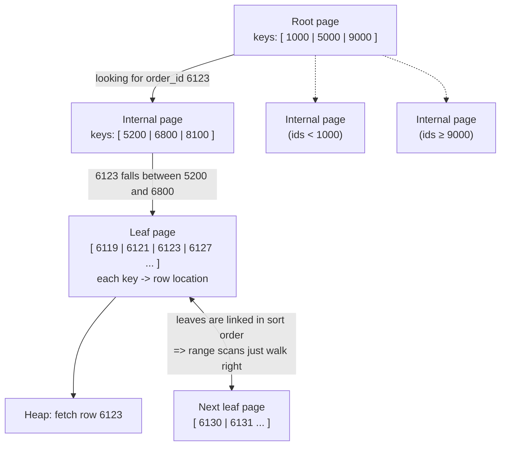
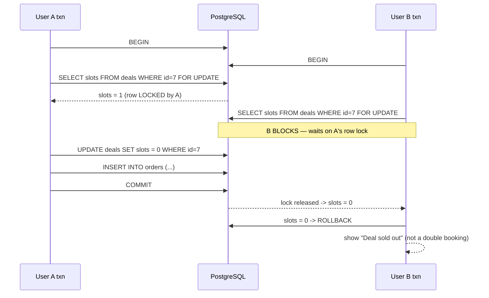
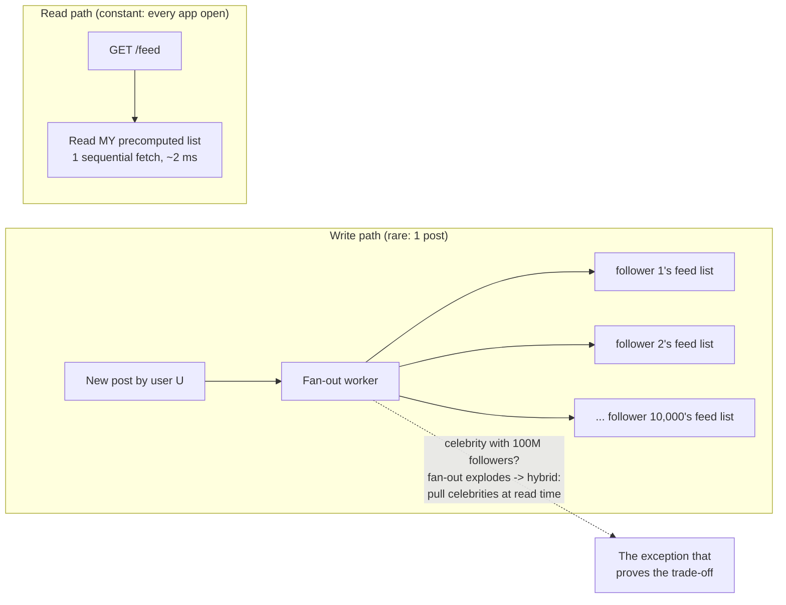
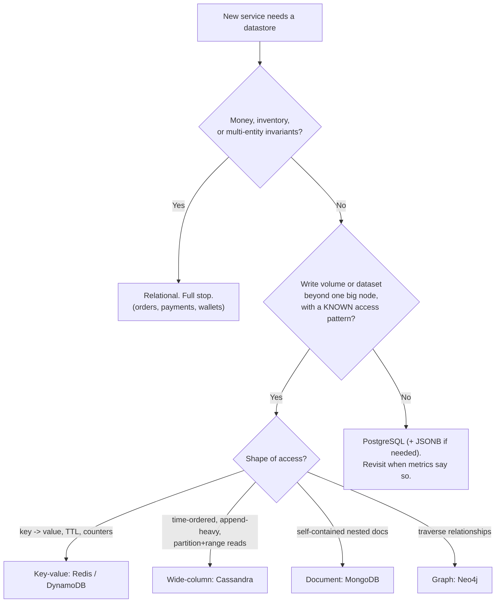
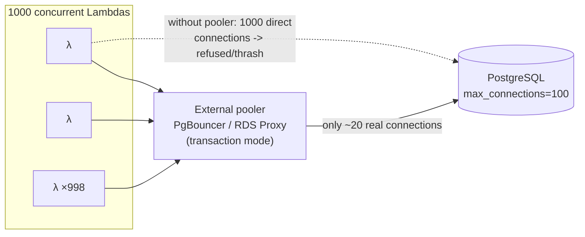

# Day 10 — Databases: SQL, NoSQL & Choosing Right

> Series: System Design Mastery
> Week 2: Stateless services are cattle; the database is the crown jewels. Every hard problem in system design — consistency, latency, scale — eventually becomes a database problem.

---

## Table of Contents

1. [Why Databases Decide Your Architecture](#1-why-databases-decide-your-architecture)
2. [How a B-tree Index Actually Works](#2-how-a-b-tree-index-actually-works)
3. [ACID with a Double-Booking Example](#3-acid-with-a-double-booking-example)
4. [Transaction Isolation Levels](#4-transaction-isolation-levels)
5. [Normalization — and Deliberate Denormalization](#5-normalization--and-deliberate-denormalization)
6. [SQL vs NoSQL: Honest Decision Criteria](#6-sql-vs-nosql-honest-decision-criteria)
7. [The Four NoSQL Families](#7-the-four-nosql-families)
8. [Connection Pooling](#8-connection-pooling)
9. [ORMs and the N+1 Problem](#9-orms-and-the-n1-problem)
10. [Worked Example: Pick a DB for Every Instagram Service](#10-worked-example-pick-a-db-for-every-instagram-service)
11. [Self-Check](#self-check)
12. [Apply (1 hour)](#apply-1-hour)

---

## 1. Why Databases Decide Your Architecture

**In plain words:** Think of your app's code like furniture you can rearrange any weekend, but the database is the foundation the house sits on — moving it means jacking up the whole building. Because it is so hard to change later, picking the right database is one of the most important early decisions you make. Get it wrong and you pay for it for years; get it right and everything else gets easier.

**Why.** You can redeploy a service in 30 seconds; migrating a 2 TB database takes a quarter and a war room. Database choices are the least reversible decisions in system design — which is why interviewers always probe them.

**What.** Today: how storage engines find rows (B-trees), how they keep promises (ACID, isolation), how to shape data (normalization), and when to leave the relational world (NoSQL's four families).

**When.** At service design time, per service. "One Postgres for everything" is a great start and a terrible ending; "a different database per microservice fashion trend" is a terrible start.

**How.** Numbers first:

| Operation | Typical cost |
|---|---|
| Read one row via B-tree index (cached) | 0.1–1 ms |
| Read one row via B-tree (disk seeks, SSD) | 1–5 ms |
| Full table scan, 10M rows | 5–60 s |
| Simple indexed Postgres query throughput | 5k–50k qps per node |
| Redis GET | ~0.1 ms, 100k+ ops/s per node |
| Cassandra write | ~1 ms, near-linear scale-out |
| Postgres max useful connections | ~few hundred (each ~5–10 MB + contention) |

**Where.** Instagram famously ran (and grew) on **sharded PostgreSQL** for its core graph and media metadata, plus Cassandra and Memcache around it. Swiggy runs a polyglot mix: relational for orders/payments, Redis for carts/sessions, document stores for catalogs.

**The Dark Side.** Database-driven résumé engineering is endemic: teams adopt Cassandra at 50 GB of data because "scale," inheriting eventual consistency, no joins, and 3 a.m. compaction mysteries — for a dataset that fits in Postgres's RAM. **A single Postgres instance comfortably handles hundreds of GB and tens of thousands of QPS.** Most companies never outgrow it. Boring first; exotic when measured.

---

## 2. How a B-tree Index Actually Works

**In plain words:** An index is like the index at the back of a textbook: instead of reading every page to find a topic, you jump straight to the right page. A B-tree is the clever sorted structure databases use so that even in a table of a billion rows, finding one is only a handful of hops instead of a full scan.

**Why.** The difference between 2 ms and 30 s on the same query is one `CREATE INDEX`. Understanding *why* lets you predict which queries an index helps — and which it can't.

**What.** A B-tree is a wide, shallow, sorted tree. Each node is one disk page (~8 KB in Postgres) holding hundreds of sorted keys. With fanout ~500: 3 levels reach ~125M rows, 4 levels reach ~60B. **Any row in a billion-row table is ≤4 page reads away.**


*Three or four page hops from root to row — and the sorted, linked leaves are why `BETWEEN` and `ORDER BY` ride the index for free.*

**When.** Index columns that appear in `WHERE`, `JOIN ... ON`, and `ORDER BY` of frequent queries. Composite index `(user_id, created_at)` serves `WHERE user_id = ? ORDER BY created_at DESC` in one descent — the classic "user's recent orders" pattern.

**How.**

```sql
-- Swiggy: order history lookups going slow?
EXPLAIN ANALYZE
SELECT * FROM orders WHERE customer_id = 88421 ORDER BY created_at DESC LIMIT 20;
-- Seq Scan on orders ... actual time=4187.220  (4.2 s, scans 12M rows)

CREATE INDEX idx_orders_customer_time ON orders (customer_id, created_at DESC);

-- Index Scan using idx_orders_customer_time ... actual time=0.94  (0.9 ms)
-- 4,500x speedup from one line.
```

Why range queries work: leaves are sorted and sibling-linked, so `created_at BETWEEN '2026-07-01' AND '2026-07-15'` finds the start leaf (3–4 hops) then streams rightward sequentially. That's also why an index on `status` alone can't help `ORDER BY created_at` — sort order lives in the tree structure.

**Where.** Every relational DB (Postgres, MySQL/InnoDB, SQL Server) and most NoSQL stores use B-trees or the write-optimized cousin, LSM-trees (Cassandra, RocksDB).

### Aside: B-tree vs LSM-tree in one minute

**In plain words:** Both are ways of organizing data on disk. A B-tree is like keeping a bookshelf perfectly alphabetized as you go — wonderful for finding things quickly. An LSM-tree is like tossing new books into a pile and sorting them in big batches later — wonderful for adding things fast. Different jobs favor different trade-offs.

| Dimension | B-tree (Postgres, InnoDB) | LSM-tree (Cassandra, RocksDB, LevelDB) |
|---|---|---|
| Write path | Update page in place (random I/O) | Append to memtable, flush sorted runs (sequential I/O) |
| Write throughput | Good | Excellent — why write-heavy stores choose it |
| Read path | One tree descent | May check memtable + several on-disk levels (bloom filters help) |
| Read latency | Very predictable | Good, but with tail spikes |
| Background cost | Vacuum/page splits | Compaction — the 3 a.m. CPU mystery in Cassandra clusters |

Rule of thumb: read-heavy + predictable latency → B-tree; sustained write firehose → LSM. This single distinction explains half of the SQL-vs-Cassandra performance folklore.

> **🤔 Wait — if indexes make queries faster, why not just index every column?**
> Because every index is a second copy of the data that the DB must update on *every write*. Index the queries you actually run, not the ones you fear — over-indexing quietly makes your writes crawl.

**✅ Good scenario (where it saves you):** One composite index on `(customer_id, created_at)` turns Swiggy's 4.2 s order-history scan into a 0.9 ms seek — a 4,500x win from a single line.

**❌ Bad scenario (the pain without it / when misused):** A hot `orders` table carries 8 indexes "just in case"; each INSERT does ~9 B-tree writes, the nightly bulk import slows 4x, and the indexes outweigh the table on disk — fast reads, mysteriously slow writes.

**When NOT to:** On a 200-row lookup table, skip the index entirely — a full scan of one page beats a tree walk, and the index is pure write tax.

**The Dark Side.** Every index is a second copy of data that must be updated **on every write**: a table with 8 indexes does ~9 B-tree insertions per INSERT — write throughput can drop 3–5x, and the indexes may outweigh the table on disk. Symptoms: fast reads, mysteriously slow bulk loads, bloated storage. Also, on a 200-row lookup table, an index is pure overhead — a full scan of one page beats a tree walk. Audit with `pg_stat_user_indexes`; unused indexes are pure tax. Index the queries you have, not the queries you fear.

---

## 3. ACID with a Double-Booking Example

**In plain words:** ACID is a set of four promises a database makes so that important operations never end up half-done. Picture an ATM that must either give you cash AND deduct your balance, or do neither — never one without the other. That all-or-nothing guarantee, plus a few related safeguards, is what ACID buys you.

**Why.** "We charged the customer but never created the order" is the incident that gets executives on the call. ACID is the machinery that makes multi-step money operations all-or-nothing.

**What — via one concrete scenario.** Swiggy flash sale: the last "₹99 thali" slot, two users tap Buy simultaneously.

- **Atomicity** — reserve inventory + create order + record payment intent is ONE unit. Crash between steps ⇒ all roll back. No orphan charge.
- **Consistency** — constraints hold: `available_slots >= 0` (CHECK), order rows reference real users (FK). A transaction that would violate them fails entirely.
- **Isolation** — concurrent transactions can't read each other's half-done state. This is the one that prevents double-booking (details below).
- **Durability** — once `COMMIT` returns, the order survives a power cut (write-ahead log, fsync).


*`SELECT ... FOR UPDATE` serializes the two buyers on the row lock; without it, both read slots=1 and both "win."*

The buggy version — `SELECT slots` (no lock), check `> 0` in application code, then `UPDATE` — is the **check-then-act race**: both read 1, both decrement, slots hits −1 or two orders exist for one thali. Fixes, in order of preference: an atomic conditional update (`UPDATE deals SET slots = slots - 1 WHERE id = 7 AND slots > 0` — then check rows-affected), `FOR UPDATE`, or serializable isolation.

**When/Where.** Anything involving money, inventory, or seats: payments, wallet balances, coupon redemption (one-per-user!), rider assignment (one rider, one active order).

> **🤔 Wait — my app code checks `slots > 0` before inserting, isn't that enough?**
> No — between your check and your write, another request can slip in and both "win." That's the check-then-act race; only the database's isolation/locks (or an atomic conditional UPDATE) can serialize the two.

**✅ Good scenario (where it saves you):** `SELECT ... FOR UPDATE` (or `UPDATE ... WHERE slots > 0`) on a flash-sale row makes the last-thali race impossible — the second buyer cleanly sees "sold out" instead of a double-booking.

**❌ Bad scenario (the pain without it / when misused):** A coupon endpoint checks-then-inserts in app code; under load two requests both read "0 redemptions" and both insert — the user redeems a one-per-customer coupon twice, and finance eats the loss.

**When NOT to:** For an Instagram like-count that can be off by 3 for a minute, don't pay ACID's row-lock cost — eventual consistency buys enormous throughput and nobody is harmed.

**The Dark Side.** ACID's costs are real: row locks serialize hot rows (a "global counter" row caps you at ~few-hundred TPS on that row), and cross-service operations can't share one transaction at all — Swiggy's order + payment + inventory spanning three services requires sagas/outbox patterns (Day 15), not `BEGIN...COMMIT`. And plenty of writes don't need ACID: an Instagram like-count being off by 3 for a minute harms nobody; the eventual-consistency trade there buys enormous throughput. Pay for ACID where wrongness is expensive.

---

## 4. Transaction Isolation Levels

**In plain words:** When many people use the database at once, isolation levels decide how much each one can see of the others' unfinished work. It is like dressing-room rules in a shop: stricter rules mean fewer awkward surprises but longer waits. Databases let you dial the strictness up or down per situation.

**Why.** Full isolation (serializable) is expensive, so databases sell four grades of it. Most engineers run at the default without knowing what anomalies it permits — until a coupon gets redeemed twice.

**What — the practical table:**

| Level | Dirty read (see uncommitted data) | Non-repeatable read (row changes mid-txn) | Phantom read (new rows appear mid-txn) | Notes |
|---|---|---|---|---|
| Read Uncommitted | Possible | Possible | Possible | Nobody uses this (Postgres doesn't even really offer it) |
| **Read Committed** | No | Possible | Possible | **Postgres default.** Each statement sees latest committed data |
| Repeatable Read | No | No | Possible* | **MySQL/InnoDB default.** Snapshot per transaction (*Postgres's version also blocks phantoms) |
| Serializable | No | No | No | As if transactions ran one-by-one; ~10–30% overhead + you **must retry** serialization failures |

Concrete anomaly, Swiggy wallet: txn reads balance ₹500 (statement 1), later re-reads and sees ₹200 because a concurrent spend committed in between — a **non-repeatable read**, legal under Read Committed. If your invariant spans two reads, Read Committed will eventually betray you.

```mermaid
sequenceDiagram
    participant R as Refund-check txn (Read Committed)
    participant DB as PostgreSQL
    participant S as Concurrent spend txn

    R->>DB: BEGIN (Read Committed)
    R->>DB: SELECT balance -> ₹500  ✅ eligible for ₹300 refund
    S->>DB: BEGIN; UPDATE balance = 200; COMMIT
    Note over DB: commit lands between R's two statements
    R->>DB: SELECT balance -> ₹200  (same txn, different answer!)
    R->>DB: business logic already decided using ₹500...
    Note over R,DB: Non-repeatable read. Fix: Repeatable Read snapshot,<br/>FOR UPDATE on the first read, or a single atomic statement.
```
*Under Read Committed each statement sees the newest committed data — a two-read invariant is a race waiting for traffic.*

**How.**

```sql
BEGIN ISOLATION LEVEL SERIALIZABLE;
-- one coupon per user, race-proof:
SELECT count(*) FROM redemptions WHERE user_id = 42 AND coupon = 'FIRST50';
INSERT INTO redemptions (user_id, coupon) VALUES (42, 'FIRST50');
COMMIT;  -- concurrent duplicate attempt fails with SQLSTATE 40001 -> retry loop in app code
```

**When.** Default (Read Committed) + explicit locks/atomic updates for hot spots covers ~95% of services. Serializable for correctness-critical, low-QPS flows (coupon redemption, ledger closing). 

> **🤔 Wait — if Serializable is the safest, why not run everything at Serializable?**
> Because full isolation costs 10–30% overhead and forces retry loops on serialization failures; under load those retries look like an outage. Reach for a unique constraint first — it's cheaper and never retries.

**✅ Good scenario (where it saves you):** `BEGIN ISOLATION LEVEL SERIALIZABLE` around a low-QPS ledger close makes concurrent double-postings structurally impossible, exactly where correctness is worth the overhead.

**❌ Bad scenario (the pain without it / when misused):** A team cranks the whole app to Serializable "to be safe"; a traffic spike triggers storms of `SQLSTATE 40001` retries, throughput collapses, and on-call debugs a self-inflicted outage.

**When NOT to:** When a simple `UNIQUE (user_id, coupon)` makes the anomaly impossible at *any* isolation level, don't reach for Serializable — constraints beat isolation levels.

**The Dark Side.** Cranking everything to Serializable is a classic footgun: throughput drops, and under load you get storms of serialization-failure retries that look like an outage. Meanwhile the *actual* fix for most races is smaller — a unique constraint. `UNIQUE (user_id, coupon)` makes the double-redemption structurally impossible at *any* isolation level, costs nearly nothing, and never needs a retry loop. **Constraints beat isolation levels; isolation levels beat application-side checks.**

---

## 5. Normalization — and Deliberate Denormalization

**In plain words:** Normalization means storing each fact in exactly one place so it can never contradict itself — like keeping one master phone-number list instead of scribbling it on five sticky notes. Denormalization is the deliberate opposite: keeping extra copies so reads are fast, while accepting the chore of keeping those copies in sync.

**Why.** Normalization is how you make wrong data unrepresentable. Denormalization is how you make reads fast. Mature systems do both — on purpose, in different places.

**What — the three forms that matter:**

| Form | Rule | Swiggy violation example | Fix |
|---|---|---|---|
| 1NF | Atomic values, no repeating groups | `phone_numbers = "981...,974..."` in one column | Child table / one row per value |
| 2NF | No partial dependency on a composite key | In `order_items(order_id, item_id, restaurant_name)` — restaurant depends only on order | Move `restaurant_name` to `orders` |
| 3NF | No transitive dependencies | `orders` stores `restaurant_id` AND `restaurant_city` (city depends on restaurant, not order) | Keep only the FK; join for city |

The payoff: one fact lives in one place, so an update can't create contradictions ("restaurant renamed in 3 tables, missed the 4th").

**When to denormalize deliberately — the Instagram feed example (Dark Side, front and center).** The normalized way to build a home feed: `SELECT posts JOIN follows JOIN users JOIN like_counts WHERE follower = me ORDER BY created_at LIMIT 20`. For a user following 1,000 accounts on a billion-row posts table, that's a scatter-gather across shards on **every feed open** — hundreds of ms at best, meltdown at Instagram scale. So Instagram *precomputes*: when you post, a fan-out job **copies your post ID into each follower's feed list** (Redis/Cassandra). Reading a feed = one sequential fetch of a precomputed list, ~1–5 ms. That is denormalization: the same post ID stored 10,000 times, deliberately.


*Instagram trades one expensive write-time fan-out for millions of cheap reads — denormalization as a business decision.*

Other everyday denormalizations: caching `like_count` on the post row (instead of `COUNT(*)` over a billion-row likes table), storing `restaurant_name` inside the order snapshot (you *want* the name as-it-was-at-order-time — here denormalization is actually more correct!).

**How.** Rules of thumb: normalize the **system of record**; denormalize in **derived, rebuildable copies** (caches, feed lists, search indexes, materialized views) with a defined refresh/repair path. Denormalized data that *can't* be rebuilt from a normalized source is a future data-corruption incident.

> **🤔 Wait — copying the same post ID into 10,000 feed lists sounds insane — isn't duplication a bug?**
> Not when it's deliberate and rebuildable. Instagram trades one expensive write-time fan-out for millions of ~2 ms reads; those copies are a derived cache, not a second source of truth.

**✅ Good scenario (where it saves you):** Instagram's precomputed feed lists turn a scatter-gather JOIN across shards into one sequential ~2 ms read per app-open — denormalization as a business decision that makes the feed feel instant.

**❌ Bad scenario (the pain without it / when misused):** A team denormalizes `restaurant_name` into the normalized system-of-record with no refresh path; a rename updates 3 tables and misses the 4th, and now the same restaurant shows two names with no way to tell which is right.

**When NOT to:** At 1M rows, don't pre-denormalize — a JOIN over indexed tables costs single-digit milliseconds; normalize until a profiler actually complains.

**The Dark Side (inverted).** Denormalization's bill: every copy is a consistency liability you now reconcile in application code — Instagram's fan-out means a deleted post must be *removed* from 10,000 lists (they tombstone/filter at read time instead). And premature denormalization at small scale buys nothing: a JOIN over indexed tables with 1M rows costs single-digit milliseconds. Normalize until a profiler complains.

---

## 6. SQL vs NoSQL: Honest Decision Criteria

**In plain words:** SQL databases are like a well-organized filing cabinet with strict rules and powerful search; NoSQL databases trade some of those rules for raw speed or huge scale in specific shapes. The skill is choosing based on real needs — like write volume or access pattern — rather than on hype.

**Why.** This decision is made badly more often than any other in system design, usually for the wrong reason ("schema flexibility").

**What — first, the overrated reason.** "NoSQL because our schema changes fast" is mostly a myth: your *application* still assumes fields exist; schema-on-read just moves migrations from one `ALTER TABLE` into forever-code (`doc.containsKey("phone") ? doc.get("phone") : doc.get("mobile")...`). Modern Postgres does `ALTER TABLE ... ADD COLUMN` instantly and has `JSONB` with indexes for the genuinely dynamic 10% of your data.

**The real reasons to leave relational:**

| Real criterion | Meaning | Example |
|---|---|---|
| **Scale-out writes** | Sustained write volume beyond one primary (~tens of thousands of writes/s) needs transparent horizontal sharding | Rider GPS pings: 300k riders × 1 ping/4s ≈ 75k writes/s → Cassandra |
| **Flexible aggregates** | Data naturally lives/dies as one nested blob, no cross-entity queries | Product/menu catalog: item + variants + addons fetched together |
| **Specific access patterns** | You need one operation to be O(1) at any scale, and you know it upfront | Session lookup by token, cart by user_id → Redis/Dynamo |
| **Data-model mismatch** | Relationships ARE the query (variable-depth traversals) | "Friends-of-friends who ordered here" → graph DB |
| **Latency floor** | Sub-millisecond reads at high concurrency | Feed lists, counters → in-memory KV |

And the honest costs going in: you give up ad-hoc joins, multi-row ACID (mostly), mature constraint enforcement, and 40 years of tooling.


*The honest decision tree: invariants pull you to SQL; only measured scale plus a known access pattern justifies leaving.*

> **🤔 Wait — everyone says "NoSQL because our schema changes fast" — isn't that the reason to switch?**
> Mostly a myth. Your app still assumes fields exist; schema-on-read just moves the migration into forever-code. Modern Postgres adds columns instantly and has indexed JSONB for the genuinely dynamic 10%. The *real* reasons are scale-out writes and specific access patterns.

**✅ Good scenario (where it saves you):** Rider GPS at ~75k writes/s outgrows one Postgres primary, so Cassandra's transparent horizontal sharding is the right, *measured* move.

**❌ Bad scenario (the pain without it / when misused):** A team adopts Cassandra at 50 GB "for scale," inheriting eventual consistency, no joins, and 3 a.m. compaction mysteries — for a dataset that fit in Postgres's RAM with room to spare.

**When NOT to:** If your data has money/inventory/multi-entity invariants, don't leave relational for "flexibility" — losing joins and multi-row ACID costs far more than a schema migration ever would.

**The Dark Side.** The dirty secret of "SQL doesn't scale": Instagram scaled sharded Postgres to hundreds of millions of users; so did Facebook (MySQL), Shopify (MySQL/Vitess), Stripe-scale ledgers run relational. SQL scales *reads* trivially (replicas) and scales writes with sharding effort. NoSQL's pitch is that it does the sharding *for* you — that's an ops trade, not a physics upgrade. Conversely, SQL zealotry has its own dark side: forcing a 75k-writes/s time-series firehose into un-sharded Postgres because "we know Postgres" is the same mistake mirrored.

---

## 7. The Four NoSQL Families

**In plain words:** "NoSQL" is not one thing — it is four different tools sharing the same label, each good at one job. Think of a toolbox: a document store, a key-value store, a wide-column store, and a graph store are like a screwdriver, a hammer, a drill, and a wrench. You reach for the one that matches the task in front of you.

**Why.** "NoSQL" is four different tools sharing a marketing label. Each is a different answer to "what do we give up for scale?"

| Family | Exemplars | Data model | ONE ideal use case | Why it fits |
|---|---|---|---|---|
| **Document** | MongoDB | Nested JSON docs, secondary indexes | **Swiggy product/menu catalog** | A menu item + variants + addons + images is one aggregate, read together, structure varies per restaurant; no cross-item joins needed |
| **Key-value** | Redis, DynamoDB | key → opaque value, O(1) | **Sessions & carts** | `GET cart:{user_id}` in 0.1 ms; TTL auto-expires abandoned carts; value shape irrelevant to store |
| **Wide-column** | Cassandra | partition key → ordered rows | **Time-series & feeds** (rider GPS trails, activity feeds) | Writes scale linearly across nodes; `WHERE rider_id=? AND ts>?` reads one partition in time order — the layout *is* the query |
| **Graph** | Neo4j | nodes + typed edges | **Social graph & fraud detection** | "Accounts sharing a device with refund-abusers, 3 hops out" is milliseconds of edge-walking vs a 5-way self-JOIN that dies |

```java
// The same "user's cart" in two worlds:

// Relational: 3 tables, 2 joins, ~2-5 ms
// SELECT ci.*, m.name, m.price FROM carts c
//   JOIN cart_items ci ON ci.cart_id = c.id
//   JOIN menu_items m ON m.id = ci.item_id
// WHERE c.user_id = 42;

// Key-value with the Jedis client: one aggregate, ~0.1 ms, TTL for free
import redis.clients.jedis.Jedis;
import com.fasterxml.jackson.databind.ObjectMapper; // Jackson turns objects <-> JSON

Jedis jedis = new Jedis("localhost", 6379);   // connect to Redis
ObjectMapper mapper = new ObjectMapper();

// Build the cart as a plain Java object graph (Map/List), then serialize to JSON.
Map<String, Object> cart = Map.of(
    "restaurantId", 7,
    "items", List.of(Map.of(
        "itemId", 901, "name", "Paneer Thali", "qty", 2, "price", 249))
);

// SETEX key seconds value -> store the JSON with a 1-hour (3600s) time-to-live.
jedis.setex("cart:42", 3600, mapper.writeValueAsString(cart));

// Read it back and parse the JSON string into a Map again.
Map<String, Object> loaded = mapper.readValue(jedis.get("cart:42"), Map.class);
```

**When/How.** Cassandra design rule that surprises SQL people: you model **tables per query**, not per entity — data is duplicated across tables because storage is cheap and cross-partition queries are not. Choosing the partition key IS the design.

> **🤔 Wait — isn't "NoSQL" just one alternative to SQL I can pick?**
> No — it's four different tools sharing a marketing label (document, key-value, wide-column, graph), each a different answer to "what do we give up for scale?" Picking "NoSQL" without picking the *family* is picking a toolbox blindfolded.

**✅ Good scenario (where it saves you):** Redis key-value for carts — `GET cart:{user_id}` in 0.1 ms with TTL auto-expiring abandoned carts; the value shape is irrelevant to the store, which is exactly its superpower.

**❌ Bad scenario (the pain without it / when misused):** A team stores the menu catalog in Cassandra, then gets asked "total orders per city last month?" — a query that isn't a pre-designed partition read, so it means a painful export to an analytics store.

**When NOT to:** Don't buy a NoSQL family for a query it refuses to answer — if you need cross-document transactions or ad-hoc aggregates, that's a relational job, not a MongoDB/Cassandra one.

**The Dark Side.** Each family's ideal case has a cliff right next to it. MongoDB is lovely until you need a transaction across two documents or an aggregate report joining collections. Redis is lovely until the dataset exceeds RAM or you treat cache as system-of-record and a restart eats the carts (persistence exists, but that's not why you bought Redis). Cassandra is lovely until someone asks a question that isn't a pre-designed partition read ("total orders per city last month?" → export to an analytics store). Neo4j is lovely until you're doing bulk scans/aggregations, where columnar stores crush it. Buy the family for its one superpower and plan explicitly for the queries it refuses to answer.

---

## 8. Connection Pooling

**In plain words:** Opening a fresh database connection for every request is like hiring and firing a cashier for each customer — slow and wasteful. A connection pool keeps a small team of cashiers standing ready, handing each request a free one and taking it back when done. Surprisingly, a small team serves a huge crowd best.

**Why.** A Postgres connection is expensive: TCP + TLS + auth handshake (~5–50 ms) and a dedicated backend process (~5–10 MB RAM). Open one per request and you melt the DB at a few hundred RPS — not from queries, from *connections*.

**What.** A pool holds N warm connections; requests borrow (~microseconds) and return them. Counterintuitive sizing truth: pools should be **small**. A DB does useful work ≈ parallel to its cores/IO; a common rule (HikariCP's): `pool ≈ 2 × cores + spindles` — often **10–30 connections serve thousands of RPS**. 500 connections don't make the DB faster; they make it a context-switching thrash pit.

```java
// HikariCP: a right-sized connection pool for a Spring Boot service.
import com.zaxxer.hikari.HikariConfig;
import com.zaxxer.hikari.HikariDataSource;

HikariConfig config = new HikariConfig();
config.setJdbcUrl("jdbc:postgresql://db:5432/swiggy");
config.setUsername("app");
config.setPassword("***");

config.setMaximumPoolSize(20);        // steady-state + burst connections (15 + 5)
config.setMinimumIdle(15);            // keep this many warm at all times
config.setConnectionTimeout(3000);    // 3s: fail fast -> a quick 503 beats a pileup
config.setKeepaliveTime(30000);       // ping idle connections to detect dead ones
config.setMaxLifetime(1800000);       // recycle a connection after 30 min (1800s)

HikariDataSource dataSource = new HikariDataSource(config);
```

**When — and why serverless breaks it.** A pool lives inside a long-running process. Serverless (AWS Lambda, Cloud Run scale-to-zero) has no long-running process: 1,000 concurrent Lambda instances each hold "a pool of 1" → 1,000 DB connections → Postgres (default `max_connections=100`) starts refusing; a traffic spike becomes a database outage *caused by your scaling working*. 


*The fix is moving the pool out of the dying processes into a proxy that multiplexes thousands of clients onto ~20 real connections.*

**Worked sizing example.** Swiggy order-service: 2,000 RPS, each request holds a connection for ~5 ms of DB time. Connections needed = 2,000 × 0.005 = **10 concurrent connections** (Little's Law). A pool of 15 with overflow 5 has 50% headroom. The intuition-driven "set it to 200 to be safe" would allocate ~1–2 GB of Postgres backend memory to do the work of 10 — and slow it down with lock and scheduler contention. Small pools, fast queries, fail-fast timeouts.

**Where.** Every service at Swiggy/Instagram scale runs poolers; Instagram used PgBouncer in front of sharded Postgres. Serverless-native DBs (DynamoDB, Aurora Serverless via HTTP/Data API, Neon) dodge the problem by not speaking the connection-oriented protocol at all.

> **🤔 Wait — more connections means more throughput, so shouldn't I set the pool to 500?**
> No — a DB does useful work roughly parallel to its cores; 500 connections don't make it faster, they make it a context-switching thrash pit. 10–30 connections often serve thousands of RPS.

**✅ Good scenario (where it saves you):** A HikariCP pool of 15 serves Swiggy's 2,000-RPS order-service comfortably (Little's Law: 2000 × 5 ms = 10 concurrent) with fail-fast timeouts — small pool, fast queries, happy DB.

**❌ Bad scenario (the pain without it / when misused):** 1,000 concurrent Lambdas each hold "a pool of 1" — that's 1,000 connections against Postgres's default `max_connections=100`, so a traffic spike becomes a database outage caused by your scaling *working*.

**When NOT to:** In transaction-mode PgBouncer, don't assume session state survives — prepared statements, `SET` vars, and advisory locks break because your next query may land on a different backend; check the compatibility list first.

**The Dark Side.** Poolers in *transaction mode* silently break session state: prepared statements, `SET` variables, advisory locks, and long transactions all assume "my connection" — under PgBouncer, your next query may run on a different backend. Teams migrate to PgBouncer for the connection math and spend a week debugging "prepared statement does not exist." Read the compatibility list before, not after.

---

## 9. ORMs and the N+1 Problem

**In plain words:** An ORM (Object-Relational Mapper) lets you work with database rows as ordinary Java objects, hiding the SQL behind the scenes. The catch: a simple loop over those objects can secretly fire one database query per item — the "N+1" problem — turning one trip to the kitchen into a hundred. The fix is telling the ORM to grab everything in one trip.

**Why.** ORMs (Hibernate/JPA, Spring Data JPA) map rows to objects and eliminate boilerplate — and quietly generate the single most common performance bug in web apps.

**What — pros/cons honestly:**

| ORMs give you | ORMs cost you |
|---|---|
| 70% less CRUD boilerplate, parameterization by default (SQL-injection resistant) | Hidden query generation — innocent attribute access = a query |
| Migrations tooling (Flyway/Liquibase), model-as-documentation | The N+1 trap (below) |
| Portability across DBs (mostly theoretical) | Awkward for window functions, CTEs, bulk ops — you'll write SQL anyway |
| Unit-of-work / identity map | A learning curve as deep as SQL itself |

**The N+1 problem, concretely:**

```java
// Swiggy admin page: 20 recent orders + restaurant names (JPA / Hibernate).
List<Order> orders = entityManager
    .createQuery("SELECT o FROM Order o", Order.class)
    .setMaxResults(20)
    .getResultList();                              // query 1

for (Order o : orders) {
    System.out.println(o.getRestaurant().getName()); // lazy-load: 1 query PER order
}
// Total: 1 + 20 = 21 queries. At 2 ms each ~ 42 ms.
// On the feed page with 100 posts x (author + like_count + top comment)
// this becomes 301 queries and a 600 ms page. It scales with data, so
// it's invisible in dev (5 rows) and a fire in prod (10k rows).
```

```java
// Fix: tell the ORM to fetch the relationship upfront with a JOIN FETCH.
// Many-to-one (order -> restaurant): a single JOIN pulls everything in one query.
List<Order> orders = entityManager
    .createQuery("SELECT o FROM Order o JOIN FETCH o.restaurant", Order.class)
    .setMaxResults(20)
    .getResultList();                              // 21 -> 1 query, 42 -> 3 ms

// For one-to-many (order -> items), a batched/entity-graph fetch avoids a row
// explosion: Hibernate issues 1 query for the orders, then 1 for the items
// (WHERE order_id IN (...)) -> 2 queries total instead of N+1.
List<Order> ordersWithItems = entityManager
    .createQuery("SELECT o FROM Order o", Order.class)
    .setHint("jakarta.persistence.fetchgraph",
             entityManager.getEntityGraph("Order.items"))
    .setMaxResults(20)
    .getResultList();
```

**How to catch it.** Log queries per request in dev (`hibernate.show_sql=true`, a datasource-proxy that logs, or a Hibernate `Statistics` counter); alert when a request exceeds ~10 queries. N+1 is a *testable* defect, not a code-review vibe:

```java
// Regression test: fail the build if the endpoint's query count creeps up.
// Hibernate exposes a Statistics object that counts every SQL statement it runs.
import org.hibernate.stat.Statistics;
import org.hibernate.SessionFactory;
import org.junit.jupiter.api.Test;
import static org.junit.jupiter.api.Assertions.assertTrue;

// Counts the SQL statements fired while the given block of code runs.
long countQueries(SessionFactory sessionFactory, Runnable work) {
    Statistics stats = sessionFactory.getStatistics();
    stats.setStatisticsEnabled(true);
    stats.clear();                                 // reset the counter to zero
    work.run();                                    // run the code under test
    return stats.getPrepareStatementCount();       // total SQL statements executed
}

@Test
void orderListStaysWithinQueryBudget() {
    long n = countQueries(sessionFactory, () -> renderOrderList(20));
    // Fail the build if a lazy-load N+1 sneaks back in.
    assertTrue(n <= 3, "query budget exceeded: " + n + " queries (N+1 regression?)");
}
```

**When/Where.** ORM for the 80% CRUD; hand-written SQL for reports, bulk writes, and anything with `EXPLAIN` output you care about. Every mature codebase is this hybrid.

> **🤔 Wait — the ORM makes one clean loop over orders, how could that be 21 queries?**
> Because each `o.getRestaurant().getName()` lazily fires its own query behind the scenes — that's N+1. It's invisible in dev with 5 rows and a fire in prod with 10k; the fix is `JOIN FETCH` to grab everything in one trip.

**✅ Good scenario (where it saves you):** A `JOIN FETCH o.restaurant` collapses 21 queries into 1 (42 ms → 3 ms), and a Hibernate `Statistics` query-count test fails the build if the N+1 ever sneaks back.

**❌ Bad scenario (the pain without it / when misused):** A feed endpoint lazy-loads author + like_count + top comment per post; 100 posts becomes 301 queries and a 600 ms page — a latency bug that scales with data and passes every dev test.

**When NOT to:** Don't swing to "never use an ORM" — hand-rolled SQL codebases still write N+1 loops and forget parameterization; the fix is looking at the generated queries, not banning the tool.

**The Dark Side.** "ORMs are slow, real engineers write SQL" is its own trap: hand-rolled SQL codebases reinvent identity maps, forget parameterization (hello injection), and still write N+1 loops — just explicitly. The ORM isn't the problem; not looking at the generated queries is. Meanwhile the reverse purism ("never raw SQL") leaves 10x wins on the table when one CTE could replace 40 lines of ORM gymnastics. Own the SQL either way.

---

## 10. Worked Example: Pick a DB for Every Instagram Service

**In plain words:** Big systems rarely use just one database. Instead they use the right tool for each job — an approach called polyglot persistence. This section walks service by service through Instagram, showing which database fits each need and, just as important, the reason why.

**Why.** The final exam of this day: polyglot persistence with *reasons*, service by service.

| Service | Access pattern | Choice | Why (and the number that decides it) |
|---|---|---|---|
| Users, follows, auth | Point reads/writes, uniqueness constraints, relations | **PostgreSQL (sharded by user_id)** | Invariants (unique username, FK integrity); Instagram's real historical choice |
| Posts metadata (caption, author, ts) | Point read by id, write once | **Sharded Postgres / MySQL** | System of record; joins for admin/trust tooling; media itself is NOT here |
| Photos/videos (blobs) | Write once, read a billion times | **Object storage (S3) + CDN** | Databases store pointers, never 4 MB JPEGs; CDN serves from ~20 ms edge |
| Home feed lists | Read 20 ids per app-open, fan-out writes | **Redis / Cassandra (precomputed lists)** | The denormalization from §5; read path must be ~1–5 ms |
| Like/view counters | Insane write rate, tolerant of slight staleness | **Redis counters → periodic flush to SQL** | 100k+ INCR/s per node; exact-eventually beats exact-now |
| Sessions & tokens | O(1) by token, TTL | **Redis / DynamoDB** | 0.1 ms lookups on every single request; TTL for free |
| DMs (chat) | Append-heavy, read recent by conversation, time-ordered | **Cassandra (partition: conversation_id, cluster: ts)** | Linear write scale-out; partition+range read = the exact query shape |
| Search (users, hashtags) | Full-text, typo-tolerant, ranked | **Elasticsearch/OpenSearch** | Inverted index ≠ B-tree; fed asynchronously from Postgres via CDC |
| Social graph analytics / fraud | Multi-hop traversals | **Graph DB (or offline graph engine)** | "3 hops from known-bad accounts" is milliseconds vs self-JOIN death |
| Payments (badges, boosts) | Multi-row invariants, ledgers | **PostgreSQL, SERIALIZABLE where needed** | §3–§4: money = ACID = relational. Non-negotiable |

Pattern worth memorizing: **relational system-of-record at the center; specialized, rebuildable derived stores (cache, feed, search, analytics) at the edges, fed asynchronously.** Almost every large system converges here.

The same drill for Swiggy, compressed:

| Swiggy service | Choice | One-line reason |
|---|---|---|
| Orders & payments | PostgreSQL | Money + multi-row invariants |
| Cart & sessions | Redis (TTL) | O(1) by user, abandonment expiry for free |
| Menu catalog | MongoDB / Postgres JSONB | Per-restaurant nested aggregates, read-together |
| Rider GPS trail | Cassandra | 75k writes/s firehose, partition+time-range reads |
| Restaurant search ("biryani near me") | Elasticsearch + geo index | Full-text + geo ranking, fed via CDC |
| Live rider position (latest only) | Redis geo/key-value | Only the newest ping matters — overwrite, don't append |

> **🤔 Wait — Instagram uses ten databases, shouldn't a serious system be polyglot from day one?**
> No — ten databases means ten backup stories, ten failure modes, ten on-call runbooks. Polyglot persistence at a 6-person startup is self-harm; each store must be earned by a metric.

**✅ Good scenario (where it saves you):** The mature convergence — relational system-of-record at the center, rebuildable derived stores (cache, feed, search) at the edges fed asynchronously — lets Instagram serve feeds in ~2 ms while payments stay ACID.

**❌ Bad scenario (the pain without it / when misused):** A small team spins up Postgres + Mongo + Cassandra + Elasticsearch + Neo4j on day one; now it's five backup/restore drills, five failure modes, and five 3 a.m. runbooks for a product with 10k users.

**When NOT to:** Day 1 doesn't need the ten-box table — Postgres + Redis + S3 covers rows, speed, and blobs; add Elasticsearch only when `LIKE '%q%'` measurably hurts, Cassandra only when a table outgrows a shard.

**The Dark Side.** Ten databases means ten backup stories, ten failure modes, ten on-call runbooks — polyglot persistence at a 6-person startup is self-harm. The staged path: Day 1 = Postgres + Redis + S3 (covers rows, speed, blobs). Add Elasticsearch when `LIKE '%q%'` measurably hurts. Add Cassandra when a table's write rate outgrows a shard. Every box in the table above must be *earned by a metric*, not by this table's existence.

---

## Self-Check

1. A B-tree with fanout 500 — how many page reads to find one row among 100M? Why does `WHERE created_at BETWEEN x AND y` stay cheap but `WHERE status='FAILED'` on an unindexed column not?
2. Your bulk order-import slowed 4x after last quarter. The table gained 6 new indexes since. Explain the mechanism and your audit query.
3. Write the check-then-act double-booking bug in pseudocode, then give three distinct fixes ranked by preference.
4. Read Committed vs Repeatable Read: construct a Swiggy wallet scenario where they give different answers. Which is your DB's default?
5. Why is `UNIQUE (user_id, coupon_code)` better than SERIALIZABLE for preventing double-redemption? What does SERIALIZABLE require of your application code that constraints don't?
6. `orders` stores `restaurant_name` copied at order time. Is this a normalization violation, a bug, or correct design? Defend your answer.
7. Explain Instagram's feed fan-out as a denormalization trade: what exactly is duplicated, what write cost is paid, what read cost is saved, and why do celebrities break it?
8. Give the two *real* reasons (not "schema flexibility") you'd move rider GPS pings out of Postgres, with the approximate write-rate math.
9. 1,000 concurrent Lambdas, Postgres `max_connections=100`. What happens, why, and what are two architecturally different fixes?
10. Spot the N+1: a feed endpoint renders 50 posts with author names. How many queries with lazy loading, what's the fix, and how would a test catch the regression?

---

## Apply (1 hour)

**Feel the numbers on your own machine (SQLite or Postgres, your pick).**

1. *(15 min)* Create `orders(id, customer_id, restaurant_id, amount, created_at)` and insert 1M random rows (Java + JDBC `addBatch()` / `executeBatch()`, batches of 10k). Time: `SELECT * WHERE customer_id = 4242 ORDER BY created_at DESC LIMIT 20` — no index. Record ms.
2. *(10 min)* `CREATE INDEX ON orders(customer_id, created_at)`. Re-run. Record the speedup ratio and the index's size on disk. Now time 100k fresh INSERTs with the index present vs a fresh unindexed copy — record the write penalty.
3. *(15 min)* Reproduce the double-booking race: a `deals(id, slots)` row with slots=1, two Java threads doing check-then-act. Show slots going to −1 (or 2 orders). Fix with the atomic conditional UPDATE and prove one thread loses gracefully.
4. *(15 min)* JPA/Hibernate entities `Order`/`Restaurant`: build the N+1 (enable SQL logging, count the queries for 20 orders), then fix with `JOIN FETCH` and count again.
5. *(5 min)* In 5 bullet points: pick databases for Swiggy's order service, cart, rider-location tracking, menu catalog, and restaurant search — one sentence of justification each.

---

**Tomorrow:** Day 11 — Scaling Databases: replication (leader/follower, replication lag and the read-your-own-writes problem), sharding strategies (range vs hash vs geo), and consistent hashing — how one Postgres becomes Instagram's fleet.
