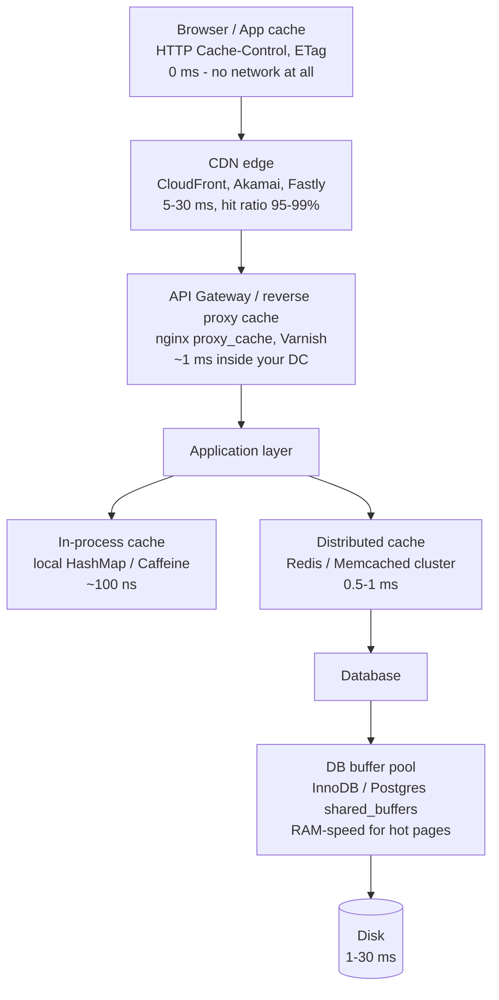
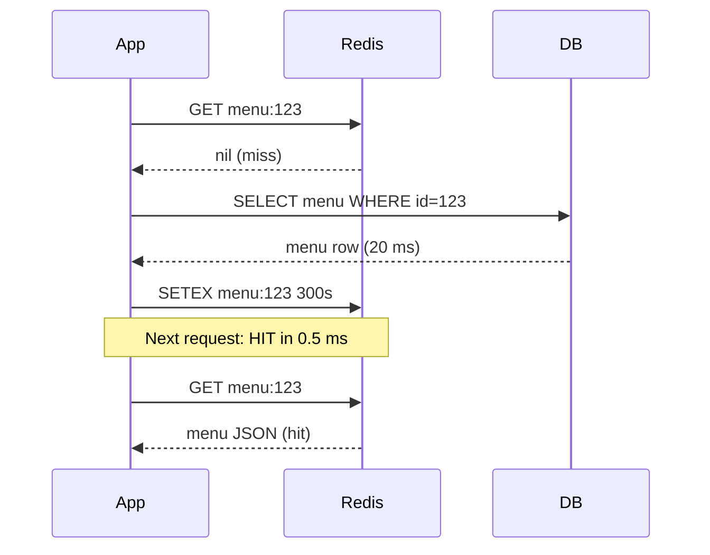
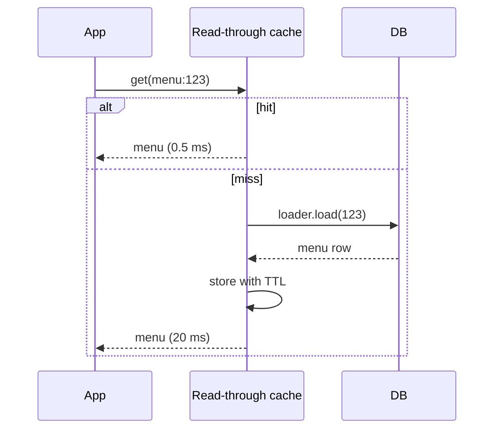
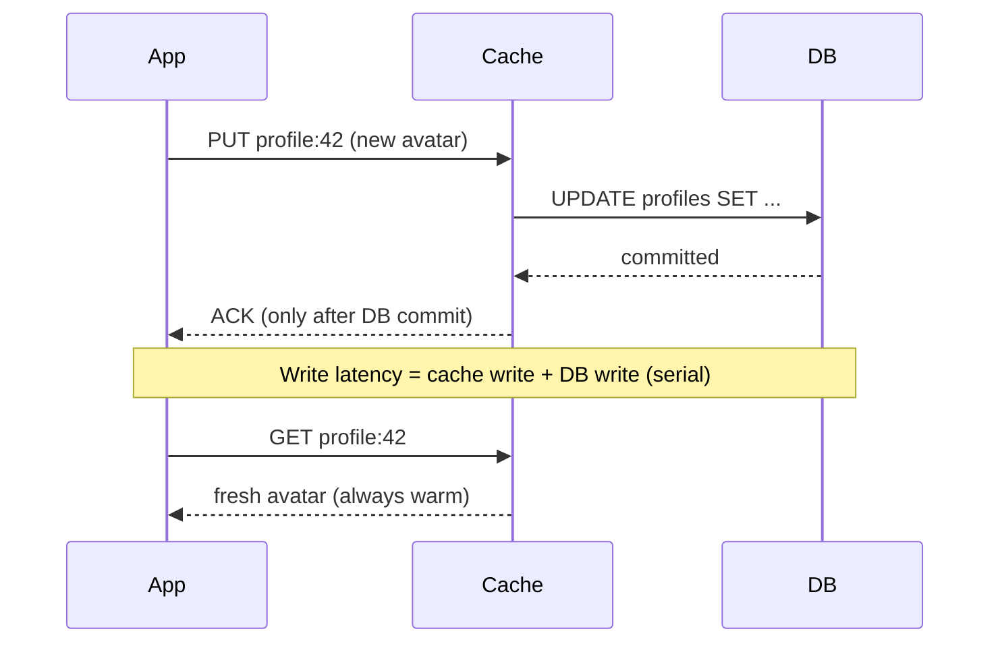
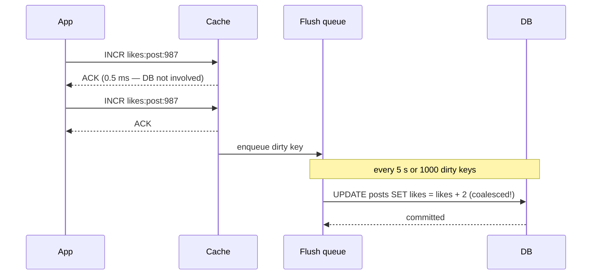
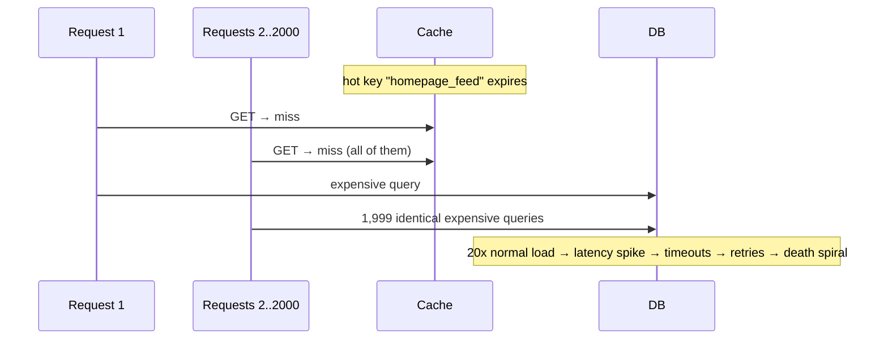
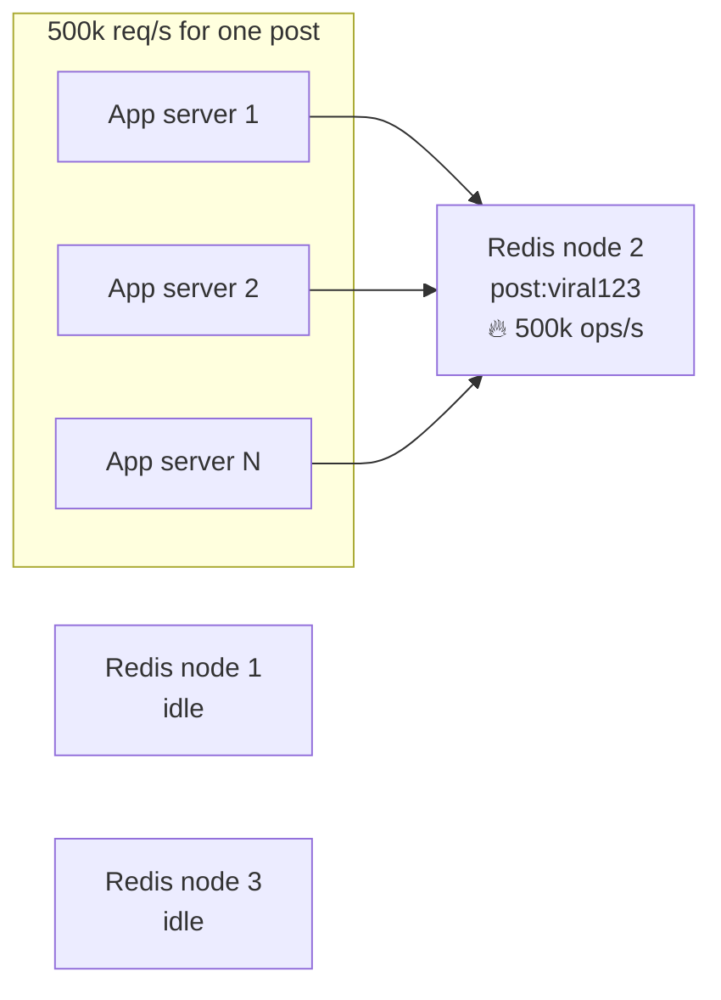

# Day 11 — Caching: The Most Profitable Millisecond

> Series: System Design Mastery

---

## Table of Contents

1. [Why Caching Is Physics, Not Preference](#1-why-caching-is-physics-not-preference)
2. [The Latency Ladder — Numbers Every Engineer Must Know](#2-the-latency-ladder--numbers-every-engineer-must-know)
3. [Where Caches Live: The Full Stack of Caching Layers](#3-where-caches-live-the-full-stack-of-caching-layers)
4. [The Four Caching Patterns](#4-the-four-caching-patterns)
   - [Cache-Aside (Lazy Loading)](#41-cache-aside-lazy-loading)
   - [Read-Through](#42-read-through)
   - [Write-Through](#43-write-through)
   - [Write-Behind (Write-Back)](#44-write-behind-write-back)
5. [Eviction Policies: LRU vs LFU vs TTL](#5-eviction-policies-lru-vs-lfu-vs-ttl)
6. [Hard Problem #1: Cache Invalidation](#6-hard-problem-1-cache-invalidation)
7. [Hard Problem #2: Stampede / Thundering Herd](#7-hard-problem-2-stampede--thundering-herd)
8. [Cache Penetration & the Hot-Key Problem](#8-cache-penetration--the-hot-key-problem)
9. [Redis vs Memcached](#9-redis-vs-memcached)
10. [The Dark Side: What NOT to Cache](#10-the-dark-side-what-not-to-cache)
11. [Self-Check](#11-self-check)
12. [Apply (1 hour)](#12-apply-1-hour)

---

## 1. Why Caching Is Physics, Not Preference

**In plain words:** A cache is like keeping the snacks you eat most often on your desk instead of walking to the kitchen every time. The kitchen (the database) still has everything, but the trip is slow. Keeping a copy of the popular stuff within arm's reach saves you the walk — that is all caching really is, and every headache it causes comes from now having two bowls of snacks that can disagree.

**Why.** A database query that touches disk costs milliseconds. A read from RAM costs nanoseconds. That is a gap of roughly **100,000x** — the same ratio as a 1-second task vs a task that takes more than a day. No amount of clever SQL closes a gap dictated by the speed of electrons through silicon vs a network round trip to a disk platter or SSD controller. Caching is how we exploit that physics.

**What.** A cache is a smaller, faster storage layer that keeps a *copy* of data whose authoritative version lives somewhere slower. The word "copy" is the whole game — every caching problem (staleness, invalidation, inconsistency) comes from having two versions of the truth.

**When.** Cache when reads vastly outnumber writes (10:1 or higher), when data tolerates some staleness, and when the same items are requested repeatedly (a skewed access distribution — which is almost every real workload; Instagram's feed reads follow a power law where ~1% of posts get ~90% of views).

**How.** Choose a pattern (Section 4), an eviction policy (Section 5), an invalidation strategy (Section 6), and defenses against stampedes and penetration (Sections 7–8).

**Where.** Everywhere — browser, CDN, gateway, application, database. Section 3 maps the layers.

> **🤔 Wait — why do I need a cache if my database is already fast and indexed?**
> Because "fast" is relative. An indexed DB read is 5–30 ms and caps at tens of thousands of QPS per node; a RAM read is ~100 ns. Caching isn't about fixing a *slow* DB — it's about exploiting a 100,000x physics gap and shedding read load off your one primary so writes aren't starved.

**✅ Good scenario (where it saves you):** Instagram's feed reads follow a power law — ~1% of posts get ~90% of views; caching those hot posts serves the vast majority of traffic from RAM and keeps Postgres from ever seeing it.

**❌ Bad scenario (the pain without it / when misused):** A team points 50k QPS of repeated profile reads straight at the primary; the DB saturates at a few thousand QPS, p99 climbs, and every read competes with writes — a self-inflicted capacity wall.

**When NOT to:** If a query is 3 ms behind an index and runs 50 times a second, don't cache it — Redis adds a network hop, a failure mode, and confusing bimodal p99s for zero benefit.

**The Dark Side.** Caching is the most abused tool in system design. Every cache you add creates a second source of truth, a new failure mode, and a new class of bug ("why is the user seeing yesterday's price?"). A cache is a *bet* that staleness is cheaper than latency. Sometimes that bet is wrong — see Section 10.

### Running examples for today

- **Instagram**: a profile page (username, avatar, follower count, recent posts). Read-heavy, tolerates seconds of staleness.
- **Swiggy**: a restaurant menu page (dishes, prices, availability) and live order status. Menus tolerate staleness; order status and payment state mostly do not.

---

## 2. The Latency Ladder — Numbers Every Engineer Must Know

**In plain words:** Different kinds of storage are fast or slow the way different ways of getting information are fast or slow for you: remembering something instantly (RAM) vs. checking your phone (SSD) vs. mailing a letter overseas and waiting for the reply (a cross-continent network hop). The table below blows up nanoseconds into human seconds so the gaps feel real — a memory lookup is a blink, a trip across the planet is years.

The classic table (Jeff Dean / Peter Norvig, updated for modern hardware):

| Operation | Latency | Humanized (1 ns = 1 s) |
|---|---:|---|
| L1 cache reference | 0.5 ns | 0.5 s |
| Branch mispredict | 5 ns | 5 s |
| L2 cache reference | 7 ns | 7 s |
| Mutex lock/unlock | 25 ns | 25 s |
| Main memory (RAM) reference | 100 ns | 1.5 min |
| Compress 1 KB with Zippy/Snappy | 3,000 ns (3 µs) | 50 min |
| Send 1 KB over 1 Gbps network | 10,000 ns (10 µs) | 2.8 hr |
| Read 4 KB randomly from NVMe SSD | 16,000 ns (16 µs) | 4.4 hr |
| Read 1 MB sequentially from RAM | 250,000 ns (250 µs) | 2.9 days |
| Round trip within same datacenter | 500,000 ns (0.5 ms) | 5.8 days |
| Read 1 MB sequentially from SSD | 1,000,000 ns (1 ms) | 11.6 days |
| HDD disk seek | 10,000,000 ns (10 ms) | 3.8 months |
| Read 1 MB sequentially from HDD | 20,000,000 ns (20 ms) | 7.6 months |
| Send packet CA → Netherlands → CA | 150,000,000 ns (150 ms) | 4.8 years |

**The takeaways engineers should tattoo somewhere:**

- **RAM is ~160x faster than NVMe SSD** for random reads, and ~100,000x faster than a cross-continent round trip.
- **A same-DC network hop (~0.5 ms) is not free.** A Redis hit is ~0.5–1 ms end to end; an in-process dict lookup is ~100 ns. Redis is 5,000x slower than local memory — but 10–50x faster than a typical indexed DB query (5–30 ms) and 100x+ faster than an unindexed one.
- **Cross-region is death.** Mumbai → Virginia is ~180–200 ms. This is why CDNs and regional caches exist: you cannot engineer around the speed of light (~1 ms per 100 km in fiber, round trip).

Typical production cache hit ratios to calibrate against: CDN static assets **95–99%**, application object caches **80–95%**, DB buffer pool on a well-sized box **99%+**. If your app cache hit ratio is below 80%, either your TTLs are too short, your key cardinality is too high, or the workload genuinely isn't cacheable.

---

## 3. Where Caches Live: The Full Stack of Caching Layers

**In plain words:** Think of ordering water at a restaurant. If there is already a glass on your table you drink it (browser cache); if not, the waiter checks the pitcher on the station nearby (CDN), then the fridge in the dining room (gateway/app cache), and only as a last resort walks to the well out back (the database). Caching stacks these layers so most requests get answered close to the surface and rarely reach the slow bottom.

A single Instagram profile request may be served from any of six layers before it ever touches Postgres:



*Every layer is a chance to answer without asking the slower layer below — a request that dies at the CDN never costs you a server cycle.*

| Layer | What it caches | Staleness control | Who invalidates |
|---|---|---|---|
| Browser | Static assets, API responses | `Cache-Control: max-age`, `ETag` | The user (hard refresh) or expiry |
| CDN | Images, video, JS/CSS, sometimes API GETs | TTL headers, purge API | You (purge) or TTL |
| Gateway/proxy | Full HTTP responses | TTL, cache keys on URL+headers | Config + purge |
| In-process | Deserialized objects, config, feature flags | Short TTL, pub/sub bust | Each process independently (danger!) |
| Distributed (Redis) | Objects, sessions, computed results | TTL + explicit delete | Application code |
| DB buffer pool | Raw pages/rows | Automatic, always coherent | The database itself |

**Where Swiggy uses which:** restaurant photos → CDN; the menu JSON → Redis with 5-min TTL + purge on merchant edit; delivery-fee config → in-process cache refreshed every 30 s; live rider location → *not cached* (changes every 2 s, staleness is the product breaking).

> **🤔 Wait — if I have Redis, why bother with all these other cache layers?**
> Because each layer answers requests the one below never sees. A request that dies at the CDN never costs a server cycle; one that hits in-process memory never pays Redis's 0.5 ms network hop. Layers compound — you want the request answered as close to the user as possible.

**✅ Good scenario (where it saves you):** An Instagram profile request served from the CDN edge (~15 ms, 95–99% hit) never reaches your datacenter at all — six layers of defense mean Postgres sees a tiny fraction of global traffic.

**❌ Bad scenario (the pain without it / when misused):** A team caches everything only in Redis; a viral spike sends every one of 500k req/s across the network to Redis, and the same-DC hop plus serialization become the bottleneck a local in-process cache would have absorbed.

**When NOT to:** For per-user or fast-changing data, don't push it into in-process caches on 50 servers — you get 50 copies going stale at 50 different times; keep in-process caching for globally-identical, rarely-changing data (config, flags).

**The Dark Side.** In-process caches are the fastest and the most dangerous: with 50 app servers you have 50 independent caches that go stale at 50 different times. A user who hits server A sees the new menu; the retry that lands on server B shows the old one. Rule of thumb: in-process caching is for data that is *globally identical and rarely changing* (config, feature flags), not per-user data.

---

## 4. The Four Caching Patterns

**In plain words:** These four patterns are just different answers to one question: who fetches from the slow database and when? Do you grab from the database yourself only when the snack bowl is empty (cache-aside), let the bowl refill itself (read-through), refill the bowl every time you buy groceries (write-through), or scribble changes on the bowl and sync to the pantry later (write-behind)? Each choice trades speed for freshness or safety in a different way.

The four patterns differ on one axis: **who talks to the database, and when.**

| Pattern | Who loads on miss | Who writes DB | Read latency | Write latency | Staleness risk | Data-loss risk |
|---|---|---|---|---|---|---|
| Cache-aside | Application | Application | Miss = slow | Normal | Medium (until TTL/invalidation) | None |
| Read-through | Cache itself | Application | Miss = slow | Normal | Medium | None |
| Write-through | Cache/app | Cache writes DB synchronously | Fast (always warm) | Slow (two writes) | Low | None |
| Write-behind | Cache | Cache writes DB *later* | Fast | Very fast | Low (cache is truth) | **High — cache crash loses writes** |

> **🤔 Wait — four patterns? Why not just always pick the fastest one?**
> Because they differ on *who talks to the DB and when*, which trades read speed against write latency, freshness, and data-loss risk. "Fastest write" (write-behind) can silently lose committed data; "always fresh" (write-through) wastes cache on data nobody reads. The pattern is a risk choice, not a speed ranking.

**✅ Good scenario (where it saves you):** Cache-aside as the default for Swiggy menus — simple, and if Redis dies the app degrades to "slow" (falls through to the DB) instead of "broken."

**❌ Bad scenario (the pain without it / when misused):** A team uses write-behind for wallet updates because it's fastest; a cache node dies before the async flush and those balance changes are gone forever — a reconciliation incident with real money missing.

**When NOT to:** Don't reach for write-through or write-behind on read-mostly entities where cache-aside suffices — the extra write latency (write-through) or data-loss risk (write-behind) buys nothing.

### 4.1 Cache-Aside (Lazy Loading)

**In plain words:** You check the snack bowl first; if it is empty you walk to the pantry, grab the snack, and refill the bowl yourself. The app is fully in charge of both noticing the empty bowl and refilling it. If the bowl (cache) disappears entirely, you just walk to the pantry every time — slower, but nothing breaks.

**Why.** It is the simplest pattern with the fewest moving parts, and the cache being down degrades to "slow" rather than "broken."
**What.** The application checks the cache first; on a miss it reads the DB, then populates the cache itself.
**When.** Default choice for 90% of use cases. Read-heavy, tolerant of first-request slowness.
**How:**

```java
import redis.clients.jedis.Jedis;
import com.fasterxml.jackson.databind.ObjectMapper;
import java.util.Map;

// Jedis is a widely used Java client for Redis.
// ObjectMapper (Jackson) converts Java objects <-> JSON strings.
Jedis jedis = new Jedis("cache.internal", 6379);
ObjectMapper mapper = new ObjectMapper();
static final int TTL_SECONDS = 300;

public Map<String, Object> getRestaurantMenu(String restaurantId) throws Exception {
    String key = "menu:v2:" + restaurantId;          // versioned key, see Section 6
    String cached = jedis.get(key);
    if (cached != null) {
        // HIT: ~0.5 ms — turn the stored JSON string back into a Map
        return mapper.readValue(cached, Map.class);
    }

    Map<String, Object> menu = db.queryMenu(restaurantId);   // MISS: ~20 ms
    // setex = SET + expiry in one atomic step; the TTL bounds how stale we can get
    jedis.setex(key, TTL_SECONDS, mapper.writeValueAsString(menu));
    return menu;
}

public void updateMenu(String restaurantId, Map<String, Object> newMenu) {
    db.saveMenu(restaurantId, newMenu);          // 1. write the DB first
    jedis.del("menu:v2:" + restaurantId);        // 2. THEN invalidate (delete, don't set!)
}
```

**Where.** Instagram profile objects, Swiggy menus, any read-mostly entity.



*Cache-aside: the app owns both the miss path and the fill — the cache is a dumb key-value bystander.*

**Failure modes / Dark Side.**
- **Delete-then-write race:** if you `SET` the new value on update instead of `DELETE`, two concurrent updates can leave the cache holding the loser's value forever. Deleting is safer — the next read repopulates from the DB, the single source of truth.
- **The subtle race even with delete:** reader misses → reads old DB value → writer updates DB → writer deletes cache → reader (slow) sets the *old* value with a fresh TTL. Rare (requires a read to be slower than a full write cycle) but real; mitigations are short TTLs or CAS-style versioned sets.
- Cold cache after deploy/restart = miss storm (see Section 7).

### 4.2 Read-Through

**In plain words:** Same idea as cache-aside, but now the snack bowl magically refills itself from the pantry whenever it runs empty — you only ever talk to the bowl. The refill logic lives in one place (the cache) instead of being copy-pasted at every spot you reach for a snack.

**Why.** Removes cache-population boilerplate from every call site; the cache library/proxy does it.
**What.** The application only ever talks to the cache. On a miss, *the cache itself* fetches from the DB via a configured loader.
**When.** When you have infrastructure that supports it (DAX for DynamoDB, a caching library like Caffeine `LoadingCache`, or a data-access layer that wraps this). Semantically identical to cache-aside; the difference is who owns the code.



*Read-through: same traffic shape as cache-aside, but the loader lives inside the cache — one implementation instead of fifty call sites.*

**Failure modes / Dark Side.** The cache is now on the critical path for *every* read — if it's down, everything is down (cache-aside can fall through to the DB). The loader also becomes a single choke point: a bad loader config poisons every consumer at once.

### 4.3 Write-Through

**In plain words:** Every time you buy a snack you put it in the bowl AND in the pantry at the same moment, and you do not consider the shopping done until both are stocked. The bowl is always up to date, so reads are instantly fresh — but shopping takes longer because you are doing two things at once.

**Why.** Guarantees the cache is never stale relative to committed data, and reads are always warm.
**What.** Every write goes to the cache, which synchronously writes to the DB before acknowledging. Cache and DB commit together.
**When.** Read-after-write consistency matters and you can afford slower writes: user profile edits ("I changed my avatar, show me my avatar"), Swiggy restaurant toggling itself online/offline.



*Write-through: the ACK waits for the database — you pay write latency to buy read consistency.*

**Failure modes / Dark Side.** Doubles write latency. Worse, it caches *everything you write*, including data nobody will ever read (99% of Instagram posts get most of their reads in the first 48 hours; write-through keeps filling the cache with week-old long-tail writes, evicting genuinely hot data). Usually paired with cache-aside for reads and used only for specific hot entities.

### 4.4 Write-Behind (Write-Back)

**In plain words:** You toss snacks into the bowl and call it done immediately, then someone restocks the pantry from the bowl a little later, in batches. Super fast because you never wait on the pantry — but if the bowl gets knocked over before the restock happens, those changes are gone forever. Great for like-counts, terrible for money.

**Why.** Absorbs write bursts the DB could never handle; write latency becomes cache latency.
**What.** Writes go to the cache and are ACKed immediately; the cache flushes to the DB asynchronously (batched, coalesced).
**When.** High-volume writes where losing a few seconds of data is survivable: view counters, like counts, Swiggy rider GPS pings (thousands/sec, only the latest matters), metrics.



*Write-behind: 2 increments became 1 DB write — coalescing is the superpower, the async gap is the danger.*

**Failure modes / Dark Side.** **If the cache node dies before flushing, those writes are gone.** Never use write-behind for money, orders, or anything with the word "ledger" near it. Mitigations: replicated cache (Redis with AOF + replica), short flush intervals, or accept the loss (a like counter off by 3 is fine; a wallet balance off by ₹3 is a incident report).

---

## 5. Eviction Policies: LRU vs LFU vs TTL

**In plain words:** Your snack bowl only holds so much, so when it is full and you want to add something new, you have to throw one out. LRU throws out whatever you have not touched in the longest time; LFU throws out whatever you reach for least often; TTL throws out anything past its expiry date. Each rule is smart in some situations and dumb in others.

**Why.** Caches are small on purpose (RAM costs ~$2–4/GB/month in the cloud vs ~$0.02–0.10/GB for disk-backed storage — a 20–100x premium). Something must be thrown out.

| Policy | Evicts | Great for | Fails when |
|---|---|---|---|
| **LRU** (least recently used) | The key untouched longest | Temporal locality (recent = hot) — most workloads | A large scan (analytics job reads everything once) flushes your real working set |
| **LFU** (least frequently used) | The key with fewest accesses | Stable popularity (top-100 restaurants) | Yesterday's celebrity stays cached forever without decay; new hot keys can't get in |
| **TTL** (time-based) | Anything older than N seconds | Bounding staleness, not memory | Says nothing about *which* keys are worth keeping; hot keys expire mid-storm |
| **Random** | A random key | Surprisingly OK, O(1), no metadata | You feel bad about it |

In practice you combine them: **TTL bounds staleness, LRU/LFU manages memory.** Redis's `allkeys-lru` is approximate (samples 5 keys, evicts the LRU among them) — 95% as good as true LRU at a fraction of the bookkeeping. Redis 4.0+ also offers `allkeys-lfu` with a decay factor that fixes classic LFU's "stale celebrity" problem.

### Java: the free LRU (Caffeine)

**In plain words:** Instead of writing eviction logic yourself, you hand a library a size limit and a "how to compute a missing value" function, and it manages the throwing-out for you. Caffeine is the go-to in-process cache in the Java world.

```java
import com.github.benmanes.caffeine.cache.Caffeine;
import com.github.benmanes.caffeine.cache.LoadingCache;

// A small key object for the two inputs (Java 16+ record = compact immutable class)
record SurgeKey(int zoneId, int hour) {}

// Caffeine is Java's de-facto in-process cache: a modern, high-hit-ratio LRU/LFU hybrid.
LoadingCache<SurgeKey, Double> surgeFee = Caffeine.newBuilder()
        .maximumSize(1024)                  // like maxsize: bounds how much we keep
        .recordStats()                      // track hits/misses so we can inspect them
        // the loader runs ONLY on a miss: expensive — runs the pricing model
        .build(key -> pricingModel.compute(key.zoneId(), key.hour()));

// double fee = surgeFee.get(new SurgeKey(zoneId, hour));  // hit = instant, miss = compute
// surgeFee.stats() -> CacheStats{hitCount=98231, missCount=412, ...}
// hit ratio here: 98231 / (98231 + 412) = 99.6%
```

### Hand-rolled LRU with LinkedHashMap (know this for interviews)

**In plain words:** If you had to build the throw-out-the-oldest logic by hand, Java hands you most of it: `LinkedHashMap` can remember the order you touched keys, and it lets you say "auto-remove the stalest entry when we get too big."

```java
import java.util.LinkedHashMap;
import java.util.Map;

// O(1) get and put. LinkedHashMap in "access order" mode reorders on every get,
// so the least-recently used entry naturally sits at the front.
public class LRUCache<K, V> extends LinkedHashMap<K, V> {
    private final int capacity;

    public LRUCache(int capacity) {
        // 3rd arg accessOrder=true => get() bumps a key to most-recently used
        super(capacity, 0.75f, true);
        this.capacity = capacity;
    }

    // LinkedHashMap calls this after each put; return true to evict the eldest entry
    @Override
    protected boolean removeEldestEntry(Map.Entry<K, V> eldest) {
        return size() > capacity;           // over capacity? drop least-recently used
    }
}
```

> **🤔 Wait — memory is cheap, why evict at all? Just make the cache bigger.**
> Because cache RAM is a 20–100x premium over disk, and past a point a bigger cache just holds cold long-tail data that's never read again — while still evicting genuinely hot keys. Eviction policy keeps the *right* small set hot; it's not a limitation to engineer around.

**✅ Good scenario (where it saves you):** Redis `allkeys-lru` (approximate, samples 5 keys) keeps Swiggy's hot restaurants resident at ~95% of true-LRU quality for a fraction of the bookkeeping — the working set stays warm automatically.

**❌ Bad scenario (the pain without it / when misused):** A cache uses plain LRU and a nightly "export all restaurants" scan touches every key once, flushing the entire hot working set; the 6 a.m. breakfast rush then hits a cold cache and hammers the DB.

**When NOT to:** For data where you only care about bounding staleness (not memory), don't over-think LRU vs LFU — a plain TTL is the honest tool; reach for LFU only when a scan is evicting your working set.

**The Dark Side.** A cache keyed on an object that holds a reference back to a big parent object keeps that parent alive forever — a classic memory leak (in Java, watch out for capturing `this` or large graphs in cache values or loader lambdas). And LRU's scan vulnerability is real: one nightly "export all restaurants" job can evict Swiggy's entire hot working set at 2 a.m., and the 6 a.m. breakfast rush hits a cold cache. Fixes: a separate cache pool for batch jobs, or LFU/segmented-LRU which resist scans.

---

## 6. Hard Problem #1: Cache Invalidation

> "There are only two hard things in Computer Science: cache invalidation and naming things." — Phil Karlton

**In plain words:** Invalidation is the problem of throwing away the snack in your bowl the moment the "real" recipe in the pantry changes — otherwise you keep happily eating the old, wrong snack. The hard part is knowing exactly when the pantry changed and making sure your bowl hears about it, without accidentally throwing away perfectly good snacks or keeping stale ones forever.

**Why.** The moment the DB changes, every cached copy is a lie. The question is how long you tolerate the lie and who ends it.

| Strategy | Staleness window | Complexity | Failure mode |
|---|---|---|---|
| **TTL only** | Up to full TTL | Trivial | Users see stale data for the whole TTL; short TTLs kill hit ratio |
| **Event-driven purge** | ~ms (event propagation) | Medium–high | Missed event = stale *forever* (until a backstop TTL saves you) |
| **Versioned keys** | Zero for new readers | Medium | Old versions rot in cache until evicted; needs where-to-find-current-version logic |

**TTL** is the honest workhorse: `menu tolerates 5 min of staleness → TTL 300`. Cheap, self-healing, and the staleness bound is a *product decision* written as a number.

**Event-driven purge**: the write path (or a CDC pipeline like Debezium reading the DB binlog) publishes "menu 123 changed" and consumers delete the key. Precise, but now correctness depends on a message pipeline never dropping anything. **Always keep a backstop TTL** (e.g., purge on event + 1-hour TTL) so a missed event heals in an hour instead of never.

**Versioned keys**: never mutate, write a new key.

```java
public String menuKey(String restaurantId) {
    // the version pointer itself is a tiny, cheap cache entry
    String version = jedis.get("menu_ver:" + restaurantId);
    if (version == null) version = "0";
    return "menu:" + restaurantId + ":v" + version;
}

public void onMenuUpdate(String restaurantId, Map<String, Object> newMenu) {
    db.saveMenu(restaurantId, newMenu);
    jedis.incr("menu_ver:" + restaurantId);   // atomically point everyone at a NEW key
    // the old key is never wrong for its version; LRU quietly evicts it later
}
```

This sidesteps the delete race in Section 4.1 entirely — you never overwrite, you redirect. It's also how CDNs are handled in practice: `app.js?v=8f3ab2` (cache-busting hashes) instead of purging.

> **🤔 Wait — invalidation is famously hard, shouldn't I build a precise event-driven purge system?**
> Usually not first. The hard question isn't "how do I eliminate staleness?" but "what does staleness *cost*?" For a follower count the answer is nothing — a 60s TTL is the whole solution. Precise purge earns its complexity only where stale data has a real price.

**✅ Good scenario (where it saves you):** A 300s TTL on Swiggy menus is cheap, self-healing, and encodes the staleness bound as a product decision — no message pipeline, no missed-event bugs.

**❌ Bad scenario (the pain without it / when misused):** A team builds elaborate CDC-driven purge with no backstop TTL; one dropped event leaves a menu stale *forever*, and the bug is invisible until a customer complains about a price that changed weeks ago.

**When NOT to:** Don't build event-driven invalidation for data where nobody can tell it's stale (like counts, follower counts) — TTL-only is correct and an order of magnitude simpler.

**The Dark Side.** Teams routinely build elaborate event-driven invalidation when a 60-second TTL would have satisfied the product requirement. Ask "what does staleness *cost*?" before asking "how do I eliminate it?" — for an Instagram follower count, the answer is "nothing, nobody can tell 10,432 from 10,437." Conversely, TTL-only invalidation on a price during a Swiggy flash sale means selling at yesterday's price for up to a full TTL — there, event purge earns its complexity.

---

## 7. Hard Problem #2: Stampede / Thundering Herd

**In plain words:** Imagine one popular snack bowl empties, and at that exact instant a thousand hungry people all rush the pantry at once to refill it — each doing the slow walk independently. The pantry (database) was never built for a thousand simultaneous visitors and collapses. The fixes all boil down to: let only one person go refill while everyone else waits, refill a bit early before it fully empties, or stagger the expiry dates so bowls do not all empty at the same second.

**Why.** A hot key expires. In the next 50 ms, 2,000 requests all miss, and all 2,000 independently run the 200 ms DB query. The DB — sized for a 95% hit ratio, i.e., 5% of peak traffic — receives 20x its expected load and falls over. The outage *caused by the cache* is worse than having no cache.



*The stampede: one expiry, thousands of identical queries — the cache's absence is amplified, not neutral.*

**Three defenses (use all three for genuinely hot keys):**

**1. Mutex / single-flight.** Only one request recomputes; the rest wait or serve stale.

```java
import redis.clients.jedis.params.SetParams;
import java.util.function.Supplier;

// compute is a lambda that does the expensive work (e.g., the slow DB query).
// It returns the value already serialized to a String ready to cache.
public String getWithLock(String key, Supplier<String> compute, int ttl) throws InterruptedException {
    String val = jedis.get(key);
    if (val != null) {
        return val;                                 // HIT
    }

    String lockKey = "lock:" + key;
    // NX = only set if the key does not already exist; EX=10 so a crashed
    // lock holder can't deadlock everyone forever (the lock auto-expires).
    String gotLock = jedis.set(lockKey, "1", SetParams.setParams().nx().ex(10));
    if ("OK".equals(gotLock)) {                     // we won the lock
        try {
            String fresh = compute.get();           // exactly ONE thread does this
            jedis.setex(key, ttl, fresh);
            return fresh;
        } finally {
            jedis.del(lockKey);                     // always release the lock
        }
    } else {
        // Losers: brief backoff, then re-read (the winner has likely filled it)
        for (int i = 0; i < 50; i++) {
            Thread.sleep(50);                       // 50 ms
            val = jedis.get(key);
            if (val != null) {
                return val;
            }
        }
        return compute.get();   // last resort: give up waiting, hit the DB
    }
}
```

**2. Early recompute (probabilistic early expiration).** Don't wait for expiry; a request arriving *near* expiry volunteers to refresh in the background while everyone else keeps serving the still-valid value. The XFetch algorithm formalizes this: recompute when `now - delta * beta * ln(rand())` exceeds expiry (delta = recompute cost). The key never actually goes cold.

**3. TTL jitter.** If you cache 10,000 menus at deploy time with TTL=300, they all expire together 300 s later — a synchronized stampede you scheduled yourself.

```java
import java.util.concurrent.ThreadLocalRandom;

public int jitteredTtl(int base, double jitterPct) {
    // nudge each TTL up or down by a random % so keys don't all expire together
    double factor = 1 + ThreadLocalRandom.current().nextDouble(-jitterPct, jitterPct);
    return (int) (base * factor);
}
// jitteredTtl(300, 0.15) -> some value in the 255–345 s range
```

**Where.** Instagram's home feed key, Swiggy's "restaurants near you" for a dense zone at 8 p.m. — anything where one key serves thousands of QPS.

> **🤔 Wait — the cache absorbs load, so how can a cache *cause* an outage?**
> When one hot key expires, thousands of requests miss simultaneously and all independently run the same expensive query. A DB sized for a 95% hit ratio suddenly gets 20x its expected load — the cache's momentary absence is amplified, not neutral.

**✅ Good scenario (where it saves you):** A single-flight mutex on Instagram's home-feed key means exactly one request recomputes on expiry while thousands serve the still-valid value — the DB sees 1 query, not 2,000.

**❌ Bad scenario (the pain without it / when misused):** A hot "restaurants near you" key for a dense zone expires at 8 p.m. peak; 2,000 requests stampede the DB, latency spikes, timeouts trigger client retries, and the retry storm death-spirals the whole service.

**When NOT to:** For the long-tail key read 3x a minute, skip stampede protection — the mutex and jitter are pure overhead; protect the head of the distribution, not the tail.

**The Dark Side.** Locks add tail latency (the 1,999 waiters see p99 spike during recompute) and a buggy lock (no expiry) can freeze a key forever. For most keys — the long tail read 3x a minute — stampede protection is pure overhead. Protect the head of the distribution, not the tail.

---

## 8. Cache Penetration & the Hot-Key Problem

**In plain words:** Two different ways a cache stops helping. *Penetration* is people constantly asking for a snack that does not exist anywhere — the empty bowl sends them to the pantry, the pantry has nothing either, and nothing ever gets cached, so the slow trip happens every single time. A *hot key* is the opposite: one snack is SO popular that the single shelf holding it gets mobbed while every other shelf sits idle.

### Penetration: misses that can never become hits

**In plain words:** The trick is to remember "we already checked, this does not exist" (cache the absence) or to keep a quick checklist of what could possibly exist and reject impossible requests before they ever reach the pantry (a bloom filter).

**Why/What.** Requests for keys that don't exist *anywhere* — `GET /restaurant/999999999` from a scraper or attacker — miss the cache, hit the DB, find nothing, cache nothing, and repeat. The cache is bypassed entirely; the DB eats 100% of this traffic.

**How to fix:**
- **Negative caching:** cache the *absence*. `jedis.setex("menu:999999999", 60, "NULL_SENTINEL")` — short TTL so a restaurant created a minute later appears. Cheap, effective, do this by default.
- **Bloom filter:** a bit array + k hash functions answering "definitely not present" or "probably present." Load all valid restaurant IDs into a bloom filter (10M IDs at 1% false-positive rate ≈ 12 MB of RAM); reject impossible IDs before touching cache *or* DB. Redis has this built in (`BF.ADD` / `BF.EXISTS`). The cost: you can't delete from a classic bloom filter, so rebuild periodically or use a counting variant.

### Hot keys: when one key melts one shard

**In plain words:** Spreading keys across many cache servers balances the *number* of keys, but not their *popularity*. If the whole world wants one celebrity's post, that one key lives on one server, and that server melts while the others nap. Fixes: keep a tiny copy on each app server so they barely bother Redis, or store the value under several key names that land on different servers.

**Why/What.** Redis Cluster shards keys across nodes — but a single key lives on exactly one node. When Virat Kohli posts, `post:viral123` might draw 500k reads/sec at *one* Redis node whose ceiling is ~100k ops/sec. The cluster is fine; that node is on fire.



*Sharding distributes keys, not popularity — one celebrity post concentrates the world onto one node.*

**How to fix:**
- **Local cache in front:** each app server caches the hot value in-process for 1–2 s. 50 servers × 1 refresh/sec = 50 Redis reads/sec instead of 500k. Staleness of 2 s on a like count is invisible.
- **Key replication:** write the value under N suffixed keys (`post:viral123:#0` … `:#9`) that hash to different nodes; readers pick a random suffix. 10x fan-out of load, 10x invalidation work.
- **Detect first:** you can't fix hot keys you can't see — `redis-cli --hotkeys`, or client-side sampling of key access counts.

> **🤔 Wait — the cache protects the DB, so why is the DB still getting hammered?**
> Two blind spots. *Penetration*: requests for keys that exist nowhere miss the cache, hit the DB, cache nothing, and repeat — the cache is bypassed entirely. *Hot key*: sharding balances the *number* of keys, not their popularity, so one viral key melts one node while the rest nap.

**✅ Good scenario (where it saves you):** Negative-caching a non-existent ID (`setex ... "NULL_SENTINEL"` with a short TTL) turns a scraper's 5k QPS of misses into cache hits, and a local in-process cache in front of a celebrity post drops 500k Redis reads/s to ~50.

**❌ Bad scenario (the pain without it / when misused):** No negative caching, and an attacker requests random non-existent user IDs at 5k QPS; every request sails through the cache into the DB, which eats 100% of the abusive traffic — a trivial DoS.

**When NOT to:** Don't apply hot-key replication (10 copies across nodes) to an account balance — ten copies means ten chances for a stale straggler; that trade is right for a viral like count, wrong for money.

**The Dark Side.** Both fixes trade consistency for survival — ten replicas of a key means ten chances for one stale straggler. That's the correct trade during a viral spike and the wrong one for an account balance. (Notice the pattern: every fix in caching is a staleness trade.)

---

## 9. Redis vs Memcached

**In plain words:** Both are fast in-memory caches, but Redis is a Swiss Army knife (lists, sets, counters, can save to disk, can replicate itself, can send messages) while Memcached is a single very sharp blade (just plain string storage, but blazing fast across many CPU cores). Reach for Redis unless you specifically need nothing but a huge, dumb, ultra-fast string cache.

| Dimension | Redis | Memcached |
|---|---|---|
| Data structures | Strings, hashes, lists, sets, sorted sets, streams, HyperLogLog, bitmaps, geo | Strings/blobs only |
| Threading | Single-threaded core (I/O threads since 6.0) | Fully multithreaded |
| Throughput per node | ~100–200k ops/s | ~1M ops/s (scales with cores) |
| Persistence | RDB snapshots + AOF log | None — restart = empty |
| Replication / HA | Built-in (replicas, Sentinel, Cluster) | None built-in (client-side sharding) |
| Eviction | 8 policies (LRU, LFU, TTL-aware...) | Slab-based LRU |
| Atomic ops / Lua | Yes (INCR, scripts, transactions) | INCR only |
| Pub/Sub, streams | Yes | No |
| Memory efficiency for flat strings | Good | Slightly better (lower per-key overhead) |
| Use when | You need *any* structure, persistence, HA, or pub/sub — i.e., usually | Pure ephemeral string cache at extreme throughput per node, simplest possible ops |

> **🤔 Wait — Memcached is multithreaded and does ~1M ops/s vs Redis's ~200k, so isn't Memcached just faster?**
> Per-node raw string throughput, yes — but that's rarely your bottleneck. Redis's data structures, persistence, replication, and pub/sub eliminate entire classes of application code; you're choosing capability, not winning a drag race.

**✅ Good scenario (where it saves you):** Using Redis for Swiggy carts gets you atomic `INCR`, TTL expiry, sorted sets, and built-in replication in one box — features you'd otherwise hand-build around Memcached.

**❌ Bad scenario (the pain without it / when misused):** A team picks Memcached for its throughput, then needs counters, HA, and persistence; they bolt client-side sharding and home-grown failover onto it and reinvent half of Redis, badly.

**When NOT to:** Don't reach for Redis's machinery when you genuinely need only a huge, dumb, ephemeral string cache at extreme per-node throughput — that narrow niche is exactly where Memcached still wins.

**Rule of thumb:** Redis is the default in 2026; Memcached wins only the narrow "dumb, huge, multithreaded string cache" niche (it's still what Facebook's legendary cache tier grew from). If your design doc says Memcached, be ready to defend why you don't need persistence, replication, or data structures.

---

## 10. The Dark Side: What NOT to Cache

**In plain words:** A cache is a copy, and some things are too important, too personal, or too fast-changing to trust a copy of. You would never keep a sticky note of your bank balance and spend against the note — you check the real account. This section is the list of snacks you should leave in the pantry and always fetch fresh: money, decisions, one-off data, and anything that changes faster than you can read it.

This is where caching interviews are actually won. Anyone can add Redis; senior engineers know when not to.

**1. Don't cache money.** Caching a Swiggy wallet balance or a payment state means a user can spend the same ₹500 twice on two app servers reading two copies. Balances, inventory counts near zero ("last 2 items"), idempotency keys, auth-revocation state — these need the single source of truth, every read. If the DB can't handle balance reads, the fix is read replicas with careful consistency (Day 13), not a cache. *When does the "bad" practice win?* Displaying a balance on a dashboard where it's decorative — caching the display copy for 30 s while the transaction path reads the DB is fine. Cache the *view*, never the *decision input*.

**2. Don't cache before measuring.** Caching adds: a network hop on every read, serialization cost, invalidation code, a new infra dependency, and a bimodal latency distribution (0.5 ms hits, 25 ms misses) that makes p99s confusing forever. If the DB query is 3 ms behind an index and runs 50 times a second, Redis buys you nothing and costs you an on-call page the first time it fails. Measure first: what's the query latency, its QPS, its hit-ratio potential (repeated identical reads?), and the DB's actual headroom.

**3. Cache-as-crutch: the most expensive habit.** The team's `restaurants near location` query takes 900 ms because it's missing a geo index. Someone caches it. The symptom disappears; the disease stays. Six months later the cache is load-bearing: a cold restart takes the site down, every new query pattern needs its own cache entry, and nobody remembers the query is fixable with one `CREATE INDEX` (making it 5 ms — *possibly faster than managing the cache*). **A cache in front of a bad query is technical debt with a great first month.** Fix the query, add the index, denormalize the table — *then* cache what's still slow.

**4. Don't cache the highly unique or the highly volatile.** A key read once per TTL has a ~0% hit ratio (per-user search results with long tails); a value that changes every second (rider GPS) is stale before its first hit. Both cases: all cost, no benefit.

**5. Personalized ≠ uncacheable, but almost.** Instagram's *feed* is per-user (hard to cache whole), but built from *posts* (cacheable), *profiles* (cacheable), and a per-user *ranking* (not cacheable). The senior move is decomposing responses into cacheable and uncacheable parts, not a boolean.

**And the reverse Dark Side — when "never cache X" advice is wrong:** stale-if-error is a legitimate pattern. If the DB is *down*, serving a 10-minute-old menu beats serving a 500 page. Many teams configure caches to serve expired entries during backend outages (`stale-while-revalidate`, `stale-if-error` in HTTP; keep-expired-on-error in app caches). Staleness as a *fallback* is graceful degradation; staleness as the *default* for critical data is a bug.

---

## 11. Self-Check

1. RAM reference vs same-datacenter round trip vs cross-continent round trip — give the three numbers, and explain why they dictate the existence of in-process caches, Redis, and CDNs respectively.
2. Your cache-aside `updateMenu` sets the new value into the cache instead of deleting the key. Describe the concurrency bug this introduces, and why delete-on-write is safer.
3. Write-through vs write-behind: which one can lose committed-to-the-user data, under exactly what failure, and name two datasets where that's acceptable and one where it's fireable.
4. A nightly batch job scans every restaurant row. What does it do to an LRU cache, why doesn't LFU suffer the same way, and what's the operational fix that requires changing neither policy?
5. Your hit ratio is 92% and the DB is sized for the resulting 8% of traffic. A hot key with 30k QPS expires. Walk through the death spiral, then apply all three stampede defenses and state what each one specifically prevents.
6. An attacker requests random non-existent user IDs at 5k QPS. Why doesn't your cache help at all, and how do negative caching and a bloom filter each stop it — including each fix's own staleness/false-positive cost?
7. Redis Cluster has 10 nodes and a celebrity post is melting one of them. Explain why adding 10 more nodes does nothing, then fix it two ways.
8. TTL vs event-driven purge vs versioned keys: which would you pick for (a) Instagram follower counts, (b) Swiggy item prices during a flash sale, (c) a JS bundle on a CDN — and why in each case?
9. A teammate proposes caching Swiggy wallet balances with a 10-second TTL "since balance reads are hammering the primary." Give the double-spend scenario, then propose two alternatives that actually solve the read load.
10. Defend this statement with an example: "Adding a cache can make a system *less* reliable than it was without one."

---

## Tomorrow

**Day 12 — Load Balancing, Proxies & API Gateways.** You now have fast reads; tomorrow is about spreading requests across machines without anyone noticing a machine die — L4 vs L7, consistent hashing (which you'll recognize from today's hot-key problem), rate limiting, and why the load balancer itself must not become the single point of failure.

---

## 12. Apply (1 hour)

Build a miniature Swiggy menu service and hurt it, then heal it:

1. **(15 min)** Run Redis locally (`docker run -p 6379:6379 redis`). Write a Spring Boot controller with a `@GetMapping("/menu/{id}")` endpoint backed by SQLite/H2 with a deliberate `Thread.sleep(200)` in the DB method (simulating a slow query). Implement cache-aside with a 30 s TTL using Jedis or Lettuce.
2. **(10 min)** Load test with `hey`, `wrk`, or a 50-thread Java client (e.g., an `ExecutorService` with a fixed thread pool). Record p50/p99 and requests/sec for cold vs warm cache. Compute your hit ratio from counters you add (an `AtomicLong` for hits and misses).
3. **(15 min)** Create a stampede: set TTL to 5 s, point 100 concurrent threads at one key, and watch the miss storm hit SQLite (log every DB call). Then add the mutex-based `getWithLock` from Section 7 and TTL jitter, and show DB calls per expiry drop from ~100 to 1.
4. **(10 min)** Simulate penetration: request 1,000 random non-existent IDs. Add negative caching with a 10 s TTL and measure DB calls before/after.
5. **(10 min)** Write five sentences: for each of (menu, item price, wallet balance, rider GPS, restaurant photo), state cache/don't-cache, the pattern, the TTL, and the invalidation strategy — with the *product* reason, not the technical one.
